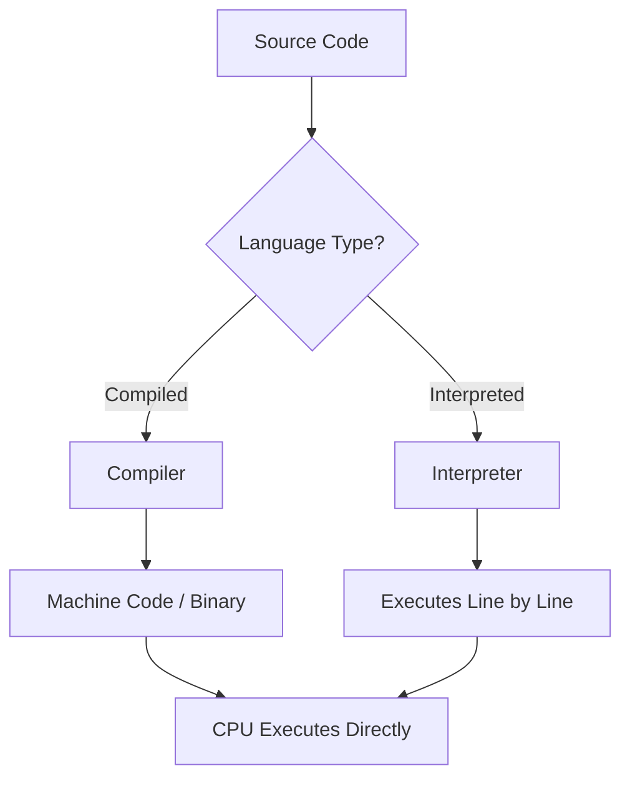
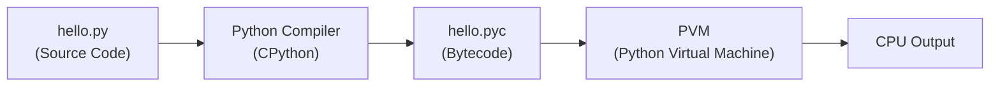
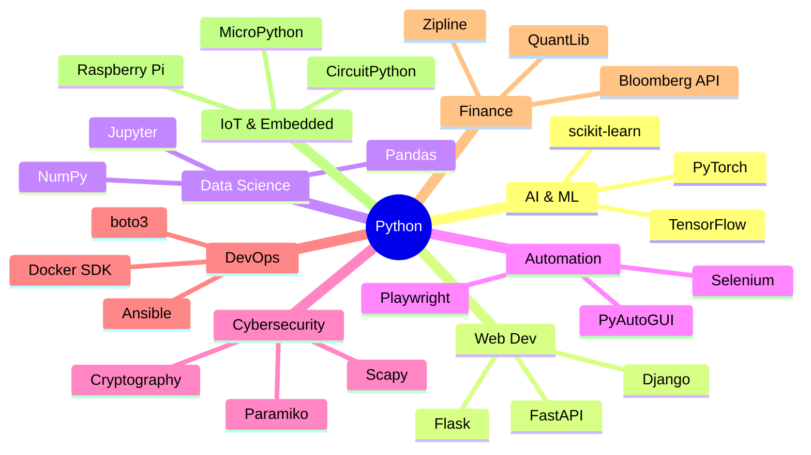

# 🐍 Python Notes — Part 1
### A Premium, Beginner-to-Advanced Python Documentation & Course

> **Author:** Senior Python Engineer & Technical Mentor (15+ Years Experience)
> **Level:** Absolute Beginner → Advanced
> **Style:** Premium Course + Official Documentation Combined
> **Version:** Python 3.12+

---

## 📚 Table of Contents

1. [Introduction to Python](#1-introduction-to-python)
   - [What is Python?](#11-what-is-python)
   - [History of Python](#12-history-of-python)
   - [Why Python is Popular](#13-why-python-is-popular)
   - [Features of Python](#14-features-of-python)
   - [Advantages & Disadvantages](#15-advantages--disadvantages)
   - [Compiled vs Interpreted Languages](#16-compiled-vs-interpreted-languages)
   - [Python Execution Flow](#17-python-execution-flow)
   - [How Python Works Internally](#18-how-python-works-internally)
   - [Python Virtual Machine (PVM)](#19-python-virtual-machine-pvm)
   - [Bytecode Explanation](#110-bytecode-explanation)
   - [Real-World Use Cases](#111-real-world-use-cases-of-python)

2. [Installing Python](#2-installing-python)
   - [Windows Installation](#21-installing-python-on-windows)
   - [Linux Installation](#22-installing-python-on-linux)
   - [macOS Installation](#23-installing-python-on-macos)
   - [Environment Variables](#24-environment-variables-setup)
   - [Verifying Installation](#25-verifying-installation)
   - [Python REPL](#26-python-repl)
   - [Running Python Scripts](#27-running-python-scripts)
   - [Python IDEs](#28-python-ides)
   - [VS Code Setup](#29-vs-code-setup)
   - [PyCharm Setup](#210-pycharm-setup)

3. [Python Basics](#3-python-basics)
   - [First Python Program](#31-first-python-program)
   - [print() Function](#32-print-function-deep-dive)
   - [Comments](#33-comments)
   - [Variables](#34-variables)
   - [Naming Conventions](#35-naming-conventions)
   - [Keywords](#36-keywords)
   - [Data Types Overview](#37-data-types-overview)
   - [Dynamic Typing](#38-dynamic-typing)
   - [Input from User](#39-input-from-user)
   - [Type Casting](#310-type-casting)
   - [Operators](#311-operators)
   - [Operator Precedence](#312-operator-precedence)

4. [Strings in Python](#4-strings-in-python)
   - [String Basics](#41-string-basics)
   - [Indexing & Negative Indexing](#42-string-indexing--negative-indexing)
   - [Slicing](#43-string-slicing)
   - [String Immutability](#44-string-immutability)
   - [String Methods](#45-string-methods)
   - [Escape Characters](#46-escape-characters)
   - [String Formatting](#47-string-formatting)
   - [Multiline Strings](#48-multiline-strings)
   - [Unicode & Encoding](#49-unicode-handling--encodingdecoding)
   - [String Performance Tips](#410-string-performance-tips)

5. [Numbers & Type Conversion](#5-numbers--type-conversion)
   - [int](#51-integers-int)
   - [float](#52-floating-point-float)
   - [complex](#53-complex-numbers)
   - [bool](#54-boolean-bool)
   - [Decimal & Fractions](#55-decimal--fractions)
   - [Type Conversion](#56-type-conversion)
   - [Precision Issues](#57-precision-issues-in-float)
   - [Math Module](#58-math-module)

---

---

# 1. Introduction to Python

---

## 1.1 What is Python?

### 🧠 Simple Explanation

Think of Python as a **translator between your human thoughts and a computer's actions**. You write instructions in a way that feels close to English, and Python converts those instructions into something the computer can execute.

### 🔬 Technical Explanation

Python is a **high-level, general-purpose, interpreted, dynamically-typed, garbage-collected programming language** with a design philosophy that emphasizes code readability and simplicity.

Let's break each term down:

| Term | What It Means |
|------|--------------|
| **High-level** | Abstracts away hardware details; you don't manage memory manually |
| **General-purpose** | Can be used to build almost anything — websites, AI, automation, games |
| **Interpreted** | Code is executed line by line (no separate compilation step needed) |
| **Dynamically-typed** | Variable types are determined at runtime, not compile time |
| **Garbage-collected** | Python automatically manages and frees unused memory |

### 🌍 Real-World Analogy

> Imagine a **universal remote control**. Instead of learning separate remotes for your TV, AC, and DVD player — you use one device that talks to all of them. Python is your universal remote for computers.

---

## 1.2 History of Python

### 📜 The Timeline

```
1989  →  Guido van Rossum begins work on Python during Christmas holidays
1991  →  Python 0.9.0 released (first public version)
1994  →  Python 1.0 released (lambda, map, filter, reduce added)
2000  →  Python 2.0 released (list comprehensions, garbage collection)
2008  →  Python 3.0 released (major redesign, broke backward compatibility)
2010  →  Python 2.7 released (last 2.x version)
2020  →  Python 2 officially retired (EOL - End of Life)
2023  →  Python 3.12 released (performance improvements, better error messages)
2024  →  Python 3.13 released (free-threaded mode, JIT compiler preview)
```

### 👨‍💻 The Creator: Guido van Rossum

Guido van Rossum, a Dutch programmer, created Python. He was affectionately called the **"Benevolent Dictator For Life" (BDFL)** of the Python community, meaning he had final say on all major language decisions (he stepped down from this role in 2018).

**Why the name "Python"?**
Named after the British comedy group **"Monty Python's Flying Circus"** — not the snake! Guido wanted the name to be short, unique, and slightly mysterious.

### 💡 Key Milestone: Python 3 vs Python 2

> ⚠️ **Interview Tip:** Know that Python 2 and Python 3 are NOT backward compatible. `print "hello"` works in Python 2 but fails in Python 3. **Always use Python 3.**

---

## 1.3 Why Python is Popular

Python is consistently ranked **#1 or #2** in the TIOBE Index and Stack Overflow Developer Surveys. Here's why:

### Top 10 Reasons Python Dominates

1. **Readable Syntax** — Code reads almost like English
2. **Huge Community** — Millions of developers, countless tutorials
3. **Vast Ecosystem** — 450,000+ packages on PyPI (Python Package Index)
4. **Versatility** — AI, web, automation, data science, scripting
5. **Rapid Development** — Write less code to do more
6. **Cross-Platform** — Same code runs on Windows, Mac, Linux
7. **Strong in AI/ML** — TensorFlow, PyTorch, scikit-learn all use Python
8. **Corporate Adoption** — Google, Netflix, Instagram, Spotify use Python
9. **Beginner Friendly** — Lowest learning curve among powerful languages
10. **Open Source & Free** — No licensing costs

### 📊 Python vs Other Languages (Popularity Context)

| Language | Primary Use | Difficulty | Speed |
|----------|------------|------------|-------|
| Python | General, AI, Data | ⭐ (Easy) | 🐢 Slow (interpreted) |
| Java | Enterprise, Android | ⭐⭐⭐ (Medium) | 🐇 Fast (JVM compiled) |
| C++ | Systems, Games | ⭐⭐⭐⭐⭐ (Hard) | 🚀 Very Fast |
| JavaScript | Web Frontend | ⭐⭐ (Medium) | 🐇 Fast (V8 engine) |
| Go | Systems, Cloud | ⭐⭐⭐ (Medium) | 🚀 Very Fast |
| Rust | Systems, Safety | ⭐⭐⭐⭐⭐ (Hard) | 🚀 Very Fast |

---

## 1.4 Features of Python

### Core Features Explained

#### ✅ 1. Simple & Readable Syntax

```python
# Python — reads like English
if age >= 18:
    print("You can vote")

# Compare to C++ — same logic
# if (age >= 18) {
#     printf("You can vote\n");
# }
```

#### ✅ 2. Interpreted Language
Python doesn't require a separate compilation step. You write code → run it immediately.

#### ✅ 3. Dynamically Typed
```python
x = 10        # x is int
x = "hello"   # x is now str — perfectly valid in Python
x = [1, 2, 3] # x is now list
```

#### ✅ 4. Object-Oriented + Functional + Procedural
Python is a **multi-paradigm** language:
```python
# Procedural
def greet(name):
    print(f"Hello, {name}")

# Object-Oriented
class Person:
    def __init__(self, name):
        self.name = name

# Functional
names = ["Alice", "Bob"]
upper_names = list(map(str.upper, names))
```

#### ✅ 5. Extensive Standard Library
Python comes with **"batteries included"** — a rich standard library:
```python
import os       # Operating system interaction
import json     # JSON parsing
import re       # Regular expressions
import datetime # Date/time handling
import math     # Mathematical functions
import random   # Random number generation
import urllib   # URL handling
```

#### ✅ 6. Platform Independent (Cross-Platform)
Write code on Windows → runs on Mac/Linux without changes.

#### ✅ 7. Open Source & Free
Python is maintained by the **Python Software Foundation (PSF)** — completely free.

#### ✅ 8. Large Ecosystem (PyPI)
```bash
pip install numpy      # Scientific computing
pip install pandas     # Data analysis
pip install flask      # Web framework
pip install tensorflow # Deep learning
```

#### ✅ 9. Automatic Memory Management
Python uses **reference counting** + **garbage collection** — you never manually allocate/free memory.

#### ✅ 10. Embeddable & Extensible
- Embed Python in C/C++ applications
- Extend Python with C/C++ code (e.g., NumPy uses C for performance)

---

## 1.5 Advantages & Disadvantages

### ✅ Advantages

| Advantage | Explanation |
|-----------|-------------|
| Easy to learn | Beginner-friendly, minimal boilerplate |
| Rapid prototyping | Build an MVP (Minimum Viable Product) quickly |
| Great for AI/ML | Dominant language in data science & ML |
| Strong community | Vast resources, libraries, and forums |
| Readable code | Easy to maintain and review |
| Versatile | Used in almost every domain |
| Glue language | Connects different systems and languages |

### ❌ Disadvantages

| Disadvantage | Explanation | Workaround |
|-------------|-------------|------------|
| Slow execution speed | Interpreted, ~10–100x slower than C | Use NumPy, Cython, or offload to C extensions |
| High memory usage | Objects have overhead | Profile and optimize; use generators |
| Not ideal for mobile | No major mobile framework | Use Kivy or BeeWare (limited) |
| GIL (Global Interpreter Lock) | Prevents true multi-threading | Use multiprocessing or asyncio |
| Runtime errors | Errors caught only at runtime | Use type hints + mypy for static checking |
| Weak in embedded systems | Too heavy for microcontrollers | Use MicroPython |

> 💡 **Real-World Note:** The "slowness" of Python rarely matters in practice because:
> - Most bottlenecks are I/O-bound (waiting for network/disk), not CPU-bound
> - Critical sections can be written in C (like NumPy does)
> - Modern hardware is fast enough for most use cases

---

## 1.6 Compiled vs Interpreted Languages

### 🧠 Understanding the Difference

This is a **classic interview topic**. Let's break it down clearly.



### Compiled Languages (e.g., C, C++, Go)

```
Step 1: Write source code (hello.c)
Step 2: Compiler translates ENTIRE program → machine code (hello.exe)
Step 3: Run the machine code directly on the CPU
```

**Advantages:** Very fast execution, optimized ahead of time
**Disadvantages:** Compile step takes time; not cross-platform (must recompile for each OS)

### Interpreted Languages (Traditional — e.g., old Bash, BASIC)

```
Step 1: Write source code
Step 2: Interpreter reads source code line by line
Step 3: Translates each line to machine code on the fly
Step 4: Executes it immediately
```

**Advantages:** No compile step, portable
**Disadvantages:** Slow (translation happens every time you run)

### Python: A Hybrid Approach 🐍

Python is **NOT purely interpreted** — it's a **compiled + interpreted** hybrid:

```
Step 1: You write Python source code (hello.py)
Step 2: Python compiles it to BYTECODE (.pyc) — done automatically
Step 3: Python Virtual Machine (PVM) interprets the bytecode
Step 4: CPU executes the result
```



### Comparison Table

| Feature | Compiled (C) | Interpreted (Bash) | Python (Hybrid) |
|---------|-------------|-------------------|-----------------|
| Compile step | Yes (explicit) | No | Yes (automatic/hidden) |
| Execution speed | 🚀 Fastest | 🐢 Slowest | 🐇 Medium |
| Portability | Low | High | High (bytecode) |
| Development speed | Slow | Fast | Very Fast |
| Error detection | Compile time | Runtime | Runtime (mostly) |

---

## 1.7 Python Execution Flow

### Step-by-Step What Happens When You Run `python hello.py`

```mermaid
sequenceDiagram
    participant Dev as Developer
    participant Src as hello.py (Source)
    participant Lex as Lexer/Tokenizer
    participant Par as Parser
    participant AST as AST (Abstract Syntax Tree)
    participant Comp as Bytecode Compiler
    participant PYC as .pyc Bytecode File
    participant PVM as Python Virtual Machine
    participant CPU as CPU/OS

    Dev->>Src: python hello.py
    Src->>Lex: Read source code
    Lex->>Par: Stream of tokens
    Par->>AST: Parse tokens into tree
    AST->>Comp: Compile to bytecode
    Comp->>PYC: Save to __pycache__/
    PYC->>PVM: Load bytecode
    PVM->>CPU: Execute instructions
    CPU-->>Dev: Output/Result
```

### Detailed Breakdown

#### Stage 1: Tokenization (Lexical Analysis)
```python
# Source code
x = 10 + 5

# Becomes tokens:
# NAME 'x'
# OP '='
# NUMBER '10'
# OP '+'
# NUMBER '5'
# NEWLINE
```

#### Stage 2: Parsing (Syntax Analysis)
Tokens are organized into an **Abstract Syntax Tree (AST)**:
```
Module
  └── Assign
        ├── Name('x')
        └── BinOp
              ├── Num(10)
              ├── Add
              └── Num(5)
```

#### Stage 3: Bytecode Compilation
The AST is compiled to bytecode — a lower-level, platform-independent instruction set.

#### Stage 4: Python Virtual Machine (PVM)
The PVM reads and executes bytecode instructions one at a time.

---

## 1.8 How Python Works Internally

### CPython: The Default Python

When people say "Python," they almost always mean **CPython** — the reference implementation written in C.

There are other implementations:
| Implementation | Written In | Special Feature |
|---------------|-----------|-----------------|
| **CPython** | C | Default, most compatible |
| **PyPy** | Python + RPython | JIT compiled, 5–10x faster |
| **Jython** | Java | Runs on JVM |
| **IronPython** | C# | Runs on .NET CLR |
| **MicroPython** | C | For microcontrollers |

### The Global Interpreter Lock (GIL)

> 🔥 **Advanced Concept — Interview Favourite**

The GIL is a **mutex (lock)** inside CPython that allows only **one thread to execute Python bytecode at a time**, even on multi-core processors.

```python
import threading

counter = 0

def increment():
    global counter
    for _ in range(1_000_000):
        counter += 1  # Not thread-safe in some languages, but GIL protects this

t1 = threading.Thread(target=increment)
t2 = threading.Thread(target=increment)
t1.start(); t2.start()
t1.join(); t2.join()

# Due to GIL, only one thread runs Python code at a time
# Result may still be < 2,000,000 due to GIL release timing
print(counter)
```

**Why does the GIL exist?**
- Simplifies CPython's memory management (reference counting)
- Makes single-threaded programs faster (no lock overhead)
- Makes C extension integration easier

**When is the GIL released?**
- During I/O operations (file read, network request)
- When calling certain C extensions (NumPy releases GIL during computation)

**Workarounds:**
```python
# For CPU-bound tasks — use multiprocessing (separate processes, no GIL)
from multiprocessing import Pool

# For I/O-bound tasks — use asyncio or threading (GIL released during I/O)
import asyncio
```

> 🆕 **Python 3.13+ Note:** Python 3.13 introduced experimental "free-threaded" mode that can disable the GIL! This is a major change coming to production in future versions.

---

## 1.9 Python Virtual Machine (PVM)

### What is the PVM?

The Python Virtual Machine is the **engine that executes bytecode**. It's a stack-based virtual machine — meaning it uses a stack data structure to hold intermediate computation results.

### How the Stack Works

```python
# Python expression:
result = 2 + 3

# Bytecode instructions (simplified):
# LOAD_CONST 2    → Push 2 onto stack: [2]
# LOAD_CONST 3    → Push 3 onto stack: [2, 3]
# BINARY_ADD      → Pop two values, add, push result: [5]
# STORE_NAME result → Pop 5, store in variable 'result': []
```

### Viewing Bytecode Yourself

```python
import dis

def add(a, b):
    return a + b

dis.dis(add)
```

**Output:**
```
  2           0 RESUME                   0

  3           2 LOAD_FAST                0 (a)
              4 LOAD_FAST                1 (b)
              6 BINARY_OP               0 (+)
             10 RETURN_VALUE
```

---

## 1.10 Bytecode Explanation

### What is Bytecode?

Bytecode is an **intermediate representation** of your code — lower-level than Python source but higher-level than machine code. It's platform-independent.

```python
# Source code
def greet(name):
    return f"Hello, {name}!"

# Python compiles this to bytecode stored in:
# __pycache__/yourfile.cpython-312.pyc
```

### Inspecting .pyc Files

```python
import py_compile
import marshal
import dis

# Compile a file to bytecode
py_compile.compile("hello.py", "hello.pyc")

# Read and disassemble bytecode
with open("hello.pyc", "rb") as f:
    f.read(16)  # Skip header (magic number + metadata)
    code = marshal.loads(f.read())
    dis.dis(code)
```

### Why Bytecode Matters

1. **Speed:** On subsequent runs, Python loads `.pyc` directly (skips compilation)
2. **Portability:** Same `.pyc` works on any OS with same Python version
3. **Caching:** Stored in `__pycache__/` directory automatically

```
my_project/
├── main.py
├── utils.py
└── __pycache__/
    ├── main.cpython-312.pyc
    └── utils.cpython-312.pyc
```

---

## 1.11 Real-World Use Cases of Python

### 🤖 Python in Artificial Intelligence & Machine Learning

```python
# Training a simple ML model (scikit-learn)
from sklearn.linear_model import LinearRegression
import numpy as np

# House prices based on size
X = np.array([[500], [750], [1000], [1500], [2000]])
y = np.array([150000, 200000, 250000, 350000, 450000])

model = LinearRegression()
model.fit(X, y)

# Predict price of a 1200 sqft house
print(model.predict([[1200]]))  # ~290,000
```

**Libraries:** TensorFlow, PyTorch, scikit-learn, Keras, Hugging Face

**Real companies using Python for AI:**
- Google (TensorFlow, search algorithms)
- OpenAI (ChatGPT, DALL-E)
- Tesla (Autopilot training)
- Netflix (recommendation engine)

### 🌐 Python in Web Development

```python
# Flask — minimal web framework
from flask import Flask, jsonify

app = Flask(__name__)

@app.route('/api/users', methods=['GET'])
def get_users():
    users = [{"id": 1, "name": "Alice"}, {"id": 2, "name": "Bob"}]
    return jsonify(users)

if __name__ == '__main__':
    app.run(debug=True)
```

**Frameworks:** Django, Flask, FastAPI, Tornado
**Real companies:** Instagram (Django), Pinterest (Django), Spotify (Flask)

### ⚙️ Python in Automation & Scripting

```python
# Automate renaming 1000 files
import os
import re

folder = "/downloads/reports"
for filename in os.listdir(folder):
    # Rename "report_2024_01.pdf" → "2024-01-report.pdf"
    match = re.match(r"report_(\d{4})_(\d{2})\.pdf", filename)
    if match:
        year, month = match.groups()
        new_name = f"{year}-{month}-report.pdf"
        os.rename(
            os.path.join(folder, filename),
            os.path.join(folder, new_name)
        )
        print(f"Renamed: {filename} → {new_name}")
```

**Libraries:** Selenium, PyAutoGUI, Playwright, subprocess, os, shutil

### 📊 Python in Data Science

```python
import pandas as pd
import matplotlib.pyplot as plt

# Analyze sales data
df = pd.read_csv("sales_2024.csv")

# Find top 5 products by revenue
top_products = (
    df.groupby("product")["revenue"]
    .sum()
    .sort_values(ascending=False)
    .head(5)
)

top_products.plot(kind="bar", title="Top 5 Products by Revenue")
plt.tight_layout()
plt.savefig("top_products.png")
```

**Libraries:** Pandas, NumPy, Matplotlib, Seaborn, Plotly, Jupyter

### 🔐 Python in Cybersecurity

```python
# Port scanner (educational)
import socket
import concurrent.futures

def scan_port(host, port):
    try:
        with socket.socket(socket.AF_INET, socket.SOCK_STREAM) as s:
            s.settimeout(0.5)
            result = s.connect_ex((host, port))
            if result == 0:
                return port, "OPEN"
    except:
        pass
    return port, "CLOSED"

host = "127.0.0.1"
ports = range(1, 1025)

with concurrent.futures.ThreadPoolExecutor(max_workers=100) as executor:
    results = executor.map(lambda p: scan_port(host, p), ports)

for port, status in results:
    if status == "OPEN":
        print(f"Port {port}: {status}")
```

**Libraries:** Scapy, Paramiko, Cryptography, Nmap, Requests
**Tools built in Python:** Metasploit modules, Aircrack-ng scripts, sqlmap

### 🚀 Python in DevOps

```python
# Deploy and monitor services using Python + boto3 (AWS)
import boto3

ec2 = boto3.client('ec2', region_name='us-east-1')

# List all running instances
response = ec2.describe_instances(
    Filters=[{'Name': 'instance-state-name', 'Values': ['running']}]
)

for reservation in response['Reservations']:
    for instance in reservation['Instances']:
        print(f"Instance ID: {instance['InstanceId']}")
        print(f"Type: {instance['InstanceType']}")
        print(f"IP: {instance.get('PublicIpAddress', 'N/A')}")
```

**Libraries/Tools:** boto3, Ansible (written in Python), Fabric, Docker SDK, Kubernetes client

### 🌐 Python Use Cases Summary



---

### 🎯 Section 1 Interview Questions

> **Q1: What is Python and what are its key features?**
> **A:** Python is a high-level, interpreted, dynamically-typed, general-purpose programming language. Key features include readable syntax, large standard library, multi-paradigm (OOP + functional + procedural), automatic memory management, and cross-platform support.

> **Q2: What is the difference between compiled and interpreted languages? Where does Python fit?**
> **A:** Compiled languages (like C) translate entire source code to machine code before execution. Interpreted languages translate line by line at runtime. Python is a hybrid — it compiles source to bytecode automatically, then the PVM interprets that bytecode.

> **Q3: What is the GIL and how does it affect Python?**
> **A:** The Global Interpreter Lock (GIL) is a mutex in CPython that allows only one thread to execute Python bytecode at a time, even on multi-core CPUs. It affects CPU-bound multithreaded programs (no parallelism) but not I/O-bound ones (GIL released during I/O). Workaround: use `multiprocessing` for CPU-bound tasks.

> **Q4: What is CPython, and what are alternatives?**
> **A:** CPython is the default Python implementation written in C. Alternatives include PyPy (JIT compiled, faster), Jython (runs on JVM), IronPython (.NET), and MicroPython (for microcontrollers).

> **Q5: What is bytecode in Python?**
> **A:** Bytecode is the intermediate, platform-independent representation of Python code after compilation. It's stored in `.pyc` files inside `__pycache__/`. The PVM executes this bytecode. It speeds up subsequent runs since the compilation step is skipped.

---

### 📝 Section 1 Practice Exercises

1. Research and list 3 companies using Python in production and describe how they use it.
2. Install Python and run `import dis; dis.dis(lambda x: x * 2)` — describe what you see.
3. Create a simple script and check the `__pycache__` directory — what files are created?
4. Write a paragraph explaining to a non-technical friend what Python is (use an analogy).

---

---

# 2. Installing Python

---

## 2.1 Installing Python on Windows

### Method 1: Official Installer (Recommended)

**Step 1:** Download from [python.org/downloads](https://python.org/downloads)
- Always download the **latest stable version** (3.12.x or 3.13.x)
- Choose "Windows installer (64-bit)"

**Step 2:** Run the installer

> ⚠️ **CRITICAL:** Check "Add Python to PATH" before clicking Install!

```
[✅] Add python.exe to PATH   ← THIS IS CRUCIAL
[ ] Install launcher for all users
```

**Step 3:** Click "Install Now" or "Customize Installation"

For customization (recommended for developers):
```
Optional Features:
[✅] pip                    ← Package manager
[✅] tcl/tk and IDLE        ← GUI toolkit + IDE
[✅] Python test suite
[✅] py launcher

Advanced Options:
[✅] Install for all users
[✅] Add Python to environment variables
[✅] Create shortcuts for installed applications
[✅] Precompile standard library
```

### Method 2: Windows Store
Open Microsoft Store → Search "Python 3.12" → Install

> ⚠️ **Warning:** Windows Store Python may have limitations with some packages.

### Method 3: winget (Windows Package Manager)
```powershell
# In PowerShell or Command Prompt
winget install Python.Python.3.12
```

### Method 4: Chocolatey
```powershell
# Install Chocolatey first, then:
choco install python --version=3.12.0
```

### Method 5: pyenv-win (Manage Multiple Versions)
```powershell
# Install pyenv-win
Invoke-WebRequest -UseBasicParsing -Uri "https://raw.githubusercontent.com/pyenv-win/pyenv-win/master/pyenv-win/install-pyenv-win.ps1" -OutFile "./install-pyenv-win.ps1"; &"./install-pyenv-win.ps1"

# Install Python versions
pyenv install 3.12.0
pyenv install 3.11.0

# Set global default
pyenv global 3.12.0

# Set local version per project
pyenv local 3.11.0  # Creates .python-version file
```

---

## 2.2 Installing Python on Linux

### Ubuntu / Debian

```bash
# Check if Python is already installed
python3 --version

# Update package list
sudo apt update

# Install Python 3
sudo apt install python3

# Install pip (package manager)
sudo apt install python3-pip

# Install development tools (needed for some packages)
sudo apt install python3-dev build-essential

# Install venv (virtual environment tool)
sudo apt install python3-venv

# Verify
python3 --version  # Python 3.x.x
pip3 --version     # pip x.x.x
```

### Install Specific Version (Ubuntu)

```bash
# Add deadsnakes PPA (Python versions repository)
sudo add-apt-repository ppa:deadsnakes/ppa
sudo apt update

# Install specific version
sudo apt install python3.12
sudo apt install python3.12-dev
sudo apt install python3.12-venv

# Set as default (optional — be careful!)
sudo update-alternatives --install /usr/bin/python3 python3 /usr/bin/python3.12 1
```

### CentOS / RHEL / Fedora

```bash
# Fedora
sudo dnf install python3
sudo dnf install python3-pip

# CentOS/RHEL
sudo yum install python3
sudo yum install python3-pip

# Or from source (any distro):
sudo dnf install gcc openssl-devel bzip2-devel libffi-devel zlib-devel
wget https://www.python.org/ftp/python/3.12.0/Python-3.12.0.tgz
tar -xzf Python-3.12.0.tgz
cd Python-3.12.0
./configure --enable-optimizations
make -j$(nproc)
sudo make altinstall  # 'altinstall' avoids overwriting system Python
```

### Using pyenv on Linux (Best Practice for Developers)

```bash
# Install dependencies
sudo apt install curl git build-essential libssl-dev libffi-dev

# Install pyenv
curl https://pyenv.run | bash

# Add to ~/.bashrc or ~/.zshrc
echo 'export PYENV_ROOT="$HOME/.pyenv"' >> ~/.bashrc
echo 'command -v pyenv >/dev/null || export PATH="$PYENV_ROOT/bin:$PATH"' >> ~/.bashrc
echo 'eval "$(pyenv init -)"' >> ~/.bashrc

# Reload shell
source ~/.bashrc

# Install Python
pyenv install 3.12.0
pyenv global 3.12.0
```

---

## 2.3 Installing Python on macOS

### Method 1: Official Installer
Download from [python.org/downloads](https://python.org/downloads) → macOS package → Install

### Method 2: Homebrew (Recommended)

```bash
# Install Homebrew first (if not installed)
/bin/bash -c "$(curl -fsSL https://raw.githubusercontent.com/Homebrew/install/HEAD/install.sh)"

# Install Python
brew install python@3.12

# Verify
python3 --version
pip3 --version

# Add to PATH (if needed, add to ~/.zshrc)
echo 'export PATH="/opt/homebrew/opt/python@3.12/bin:$PATH"' >> ~/.zshrc
source ~/.zshrc
```

### Method 3: pyenv on macOS

```bash
# Install pyenv via Homebrew
brew install pyenv

# Add to ~/.zshrc
echo 'export PYENV_ROOT="$HOME/.pyenv"' >> ~/.zshrc
echo 'export PATH="$PYENV_ROOT/bin:$PATH"' >> ~/.zshrc
echo 'eval "$(pyenv init --path)"' >> ~/.zshrc

source ~/.zshrc

# Install Python
pyenv install 3.12.0
pyenv global 3.12.0
```

> 💡 **Pro Tip:** Always use pyenv or conda when managing multiple Python projects professionally. Never modify the system Python on macOS — it's used by the OS.

---

## 2.4 Environment Variables Setup

### What Are Environment Variables?

Environment variables are **key-value pairs** that tell the OS and programs where to find things. For Python, the most important are:

### PATH Variable

The `PATH` tells your shell where to look for executables when you type a command.

**On Windows:**
```powershell
# View current PATH
echo $env:PATH

# Add Python to PATH manually (if not done during install)
# System Properties → Advanced → Environment Variables
# Find PATH in "System variables" → Edit → Add:
# C:\Users\YourName\AppData\Local\Programs\Python\Python312\
# C:\Users\YourName\AppData\Local\Programs\Python\Python312\Scripts\
```

**On Linux/macOS:**
```bash
# View current PATH
echo $PATH

# Add Python to PATH (in ~/.bashrc or ~/.zshrc)
export PATH="/usr/local/bin/python3.12:$PATH"

# Reload
source ~/.bashrc
```

### PYTHONPATH Variable

`PYTHONPATH` tells Python where to look for modules beyond the standard library:

```bash
# Linux/macOS
export PYTHONPATH="/home/user/my_project/lib:$PYTHONPATH"

# Windows (PowerShell)
$env:PYTHONPATH = "C:\my_project\lib;" + $env:PYTHONPATH
```

### VIRTUAL_ENV & CONDA_DEFAULT_ENV

These are set automatically when you activate a virtual environment.

### Important Environment Variables Reference

| Variable | Purpose | Example |
|----------|---------|---------|
| `PATH` | Find Python executable | `/usr/bin/python3` |
| `PYTHONPATH` | Extra module search paths | `/projects/mylib` |
| `PYTHONDONTWRITEBYTECODE` | Disable `.pyc` generation | Set to `1` |
| `PYTHONUNBUFFERED` | Disable output buffering | Set to `1` (for Docker) |
| `VIRTUAL_ENV` | Active virtual environment path | Auto-set by venv |
| `PIP_INDEX_URL` | Custom PyPI mirror | Company internal PyPI |

---

## 2.5 Verifying Installation

```bash
# Check Python version
python --version         # Windows (if set up correctly)
python3 --version        # Linux/macOS

# Check pip (package installer)
pip --version
pip3 --version

# Check Python executable location
where python             # Windows
which python3            # Linux/macOS

# Check all installed packages
pip list

# Run a quick test
python -c "import sys; print(sys.version)"
python -c "print('Hello, Python is working!')"

# Check Python path (where Python looks for modules)
python -c "import sys; print('\n'.join(sys.path))"
```

**Expected output:**
```
Python 3.12.0 (main, Oct  2 2023, 00:00:00) [GCC 13.2.1]
pip 23.3.1 from /usr/lib/python3/dist-packages/pip (python 3.12)
Hello, Python is working!
```

---

## 2.6 Python REPL

### What is REPL?

**REPL = Read → Evaluate → Print → Loop**

It's an **interactive shell** where you type Python code and immediately see results — perfect for:
- Experimenting with code
- Testing small snippets
- Learning new concepts
- Debugging

### Starting the REPL

```bash
# Start Python REPL
python           # Windows
python3          # Linux/macOS

# You'll see:
# Python 3.12.0 (main, ...)
# Type "help", "copyright", "credits" or "license" for more information.
# >>>
```

### REPL Examples

```python
>>> 2 + 3
5
>>> name = "Alice"
>>> f"Hello, {name}!"
'Hello, Alice!'
>>> [x**2 for x in range(5)]
[0, 1, 4, 9, 16]
>>> import math
>>> math.pi
3.141592653589793
```

### REPL Special Commands

```python
>>> help(str)           # Get help for str class
>>> dir(str)            # List all methods of str
>>> type(42)            # Check type
<class 'int'>
>>> _                   # Last result
>>> quit() or exit()    # Exit REPL
>>> Ctrl+D              # Exit on Linux/macOS
>>> Ctrl+Z + Enter      # Exit on Windows
```

### IPython: Enhanced REPL

```bash
pip install ipython
ipython
```

IPython features:
- Tab completion
- Syntax highlighting
- Magic commands (`%timeit`, `%run`, `%debug`)
- Better error messages
- History search

```python
In [1]: %timeit [x**2 for x in range(1000)]
# 78.8 µs ± 1.42 µs per loop

In [2]: %run my_script.py

In [3]: x = [1, 2, 3]
In [4]: x.<TAB>  # Shows all methods!
```

---

## 2.7 Running Python Scripts

### Method 1: Direct Execution

```bash
# Create a file
echo "print('Hello, World!')" > hello.py

# Run it
python hello.py        # Windows
python3 hello.py       # Linux/macOS
```

### Method 2: Make Script Executable (Linux/macOS)

```python
#!/usr/bin/env python3
# ^ This is called a "shebang line"
print("Hello, World!")
```

```bash
chmod +x hello.py    # Make executable
./hello.py           # Run directly
```

### Method 3: Module Execution

```bash
# Run a module
python -m module_name

# Examples:
python -m http.server 8000   # Start HTTP server
python -m json.tool data.json  # Format JSON
python -m pip install requests  # Install package
python -m venv myenv          # Create virtual env
```

### Method 4: One-liner

```bash
python -c "print('Hello'); x = 5; print(x * 2)"
```

### Method 5: Reading from stdin

```bash
echo "print('Hello')" | python
```

### Running with Arguments

```python
# script.py
import sys

print(f"Script name: {sys.argv[0]}")
print(f"Arguments: {sys.argv[1:]}")
print(f"Number of args: {len(sys.argv) - 1}")
```

```bash
python script.py Alice 25 Developer
# Script name: script.py
# Arguments: ['Alice', '25', 'Developer']
# Number of args: 3
```

---

## 2.8 Python IDEs

### Overview of Popular IDEs

| IDE | Best For | Cost | Features |
|-----|---------|------|---------|
| **VS Code** | General, lightweight | Free | Extensions, Git, terminal |
| **PyCharm** | Professional Python | Free/Paid | Intelligent refactoring, debugger |
| **Jupyter Notebook** | Data Science, ML | Free | Interactive cells, inline plots |
| **Spyder** | Scientific computing | Free | Variable explorer, MATLAB-like |
| **Thonny** | Absolute beginners | Free | Simple, step-by-step debugger |
| **Sublime Text** | Fast editing | Free/Paid | Lightweight, fast |
| **Vim/Neovim** | Terminal lovers | Free | Highly configurable |

---

## 2.9 VS Code Setup

### Installation

1. Download from [code.visualstudio.com](https://code.visualstudio.com)
2. Install for your OS

### Essential Extensions

```
Extensions to install (Ctrl+Shift+X):

1. Python (by Microsoft)          ← REQUIRED
   - IntelliSense, linting, debugging

2. Pylance                        ← RECOMMENDED
   - Fast, feature-rich language support

3. Python Indent                  ← HELPFUL
   - Correct auto-indentation

4. autoDocstring                  ← PROFESSIONAL
   - Auto-generate docstrings

5. GitLens                        ← PROFESSIONAL
   - Powerful Git integration

6. Prettier - Code formatter      ← NICE TO HAVE
   - Format non-Python files

7. Error Lens                     ← PRODUCTIVITY
   - Inline error messages

8. Jupyter                        ← IF NEEDED
   - Jupyter notebook support

9. Python Test Explorer           ← PROFESSIONAL
   - GUI test runner

10. indent-rainbow                ← VISUAL AID
    - Colorizes indentation
```

### VS Code settings.json for Python

Press `Ctrl+Shift+P` → "Open User Settings (JSON)":

```json
{
    "python.defaultInterpreterPath": "${workspaceFolder}/.venv/bin/python",
    "editor.formatOnSave": true,
    "[python]": {
        "editor.defaultFormatter": "ms-python.black-formatter",
        "editor.formatOnSave": true,
        "editor.codeActionsOnSave": {
            "source.organizeImports": "explicit"
        }
    },
    "python.linting.enabled": true,
    "python.linting.pylintEnabled": true,
    "editor.rulers": [79, 120],
    "python.terminal.activateEnvironment": true,
    "editor.tabSize": 4,
    "editor.insertSpaces": true,
    "files.trimTrailingWhitespace": true,
    "terminal.integrated.defaultProfile.linux": "bash"
}
```

### Create Python Project in VS Code

```bash
# 1. Create project folder
mkdir my_project && cd my_project

# 2. Create virtual environment
python3 -m venv .venv

# 3. Activate virtual environment
source .venv/bin/activate     # Linux/macOS
.venv\Scripts\activate        # Windows

# 4. Open in VS Code
code .

# 5. Select Python interpreter:
# Ctrl+Shift+P → "Python: Select Interpreter" → Choose .venv
```

---

## 2.10 PyCharm Setup

### Installation

1. Download from [jetbrains.com/pycharm](https://www.jetbrains.com/pycharm/)
2. **Community Edition** — Free (perfect for Python development)
3. **Professional Edition** — Paid (adds Django, databases, remote dev)

### Initial Configuration

```
1. Open PyCharm → New Project
2. Location: /path/to/your/project
3. Interpreter type: "New environment using Virtualenv"
   - Location: project_dir/.venv
   - Base interpreter: Python 3.12
4. Click "Create"
```

### Essential PyCharm Plugins

```
File → Settings → Plugins → Marketplace:

1. .env files support      ← Read .env files
2. Rainbow Brackets        ← Color-matched brackets
3. IdeaVim                 ← Vim keybindings (optional)
4. GitHub Copilot          ← AI code completion
5. String Manipulation     ← Powerful string tools
6. Batch Scripts Support   ← For Windows scripts
```

### Useful PyCharm Shortcuts

| Action | Windows/Linux | macOS |
|--------|-------------|-------|
| Run current file | Shift+F10 | ⌃R |
| Debug | Shift+F9 | ⌃D |
| Find in file | Ctrl+F | ⌘F |
| Find in project | Ctrl+Shift+F | ⌘⇧F |
| Rename refactor | Shift+F6 | ⇧F6 |
| Format code | Ctrl+Alt+L | ⌘⌥L |
| Show documentation | Ctrl+Q | F1 |
| Go to definition | Ctrl+B | ⌘B |
| Open terminal | Alt+F12 | ⌥F12 |
| VCS commit | Ctrl+K | ⌘K |

---

### 🎯 Section 2 Interview Questions

> **Q1: What is the difference between `python` and `python3` commands?**
> **A:** On Linux/macOS, `python` may still point to Python 2.x (legacy), while `python3` explicitly calls Python 3.x. On Windows with recent installs, `python` typically refers to Python 3. Always use `python3` on Unix systems to be explicit.

> **Q2: What is a virtual environment and why should you use it?**
> **A:** A virtual environment is an isolated Python environment with its own packages and interpreter, separate from the global installation. Use it to avoid dependency conflicts between projects. Create with `python -m venv .venv`, activate, then `pip install` packages without affecting other projects.

> **Q3: What is `pip` and `PyPI`?**
> **A:** `pip` is Python's package installer. `PyPI` (Python Package Index) is the official repository hosting 400,000+ Python packages. `pip install package_name` downloads from PyPI.

> **Q4: What is the shebang line and when do you need it?**
> **A:** `#!/usr/bin/env python3` at the top of a script tells the OS which interpreter to use when running the file directly (`./script.py`). Required on Unix systems for direct execution without typing `python3`.

---

### 📝 Section 2 Practice Exercises

1. Install Python and verify using the REPL — calculate the area of a circle with radius 7.
2. Create a virtual environment, activate it, install the `requests` library, and verify with `pip list`.
3. Configure VS Code with the Python extension and set up auto-formatting with Black.
4. Write a script that accepts your name as a command-line argument and prints a personalized greeting.

---

---

# 3. Python Basics

---

## 3.1 First Python Program

### The Tradition: Hello, World!

```python
# File: hello.py
print("Hello, World!")
```

**Output:**
```
Hello, World!
```

### Why "Hello, World!"?
This tradition started with Brian Kernighan's 1978 book "The C Programming Language." It's the universal way to verify that your environment works and introduces the most basic output operation.

### A More Meaningful First Program

```python
# A real first program that introduces core concepts
name = input("What's your name? ")
age = int(input("How old are you? "))
birth_year = 2024 - age

print(f"\nHello, {name}!")
print(f"You were born around {birth_year}.")
print(f"In 10 years, you'll be {age + 10} years old.")
```

**Output:**
```
What's your name? Alice
How old are you? 25

Hello, Alice!
You were born around 1999.
In 10 years, you'll be 35 years old.
```

---

## 3.2 print() Function Deep Dive

### Basic Syntax

```python
print(*objects, sep=' ', end='\n', file=sys.stdout, flush=False)
```

### Parameters Explained

```python
# Basic usage
print("Hello")                    # Hello
print("Hello", "World")           # Hello World (default sep=' ')

# sep — separator between values
print("a", "b", "c", sep="-")    # a-b-c
print("a", "b", "c", sep="")     # abc
print(1, 2, 3, sep=", ")         # 1, 2, 3

# end — what to print at the end (default '\n' = newline)
print("Hello", end="")            # Helloworld (no newline)
print("world")
print("Loading", end="...")       # Loading...
print("Done!")                    # Loading...Done!

# Multiple values of different types
name = "Alice"
age = 30
score = 98.5
print("Name:", name, "| Age:", age, "| Score:", score)
# Name: Alice | Age: 30 | Score: 98.5

# Print to file
with open("output.txt", "w") as f:
    print("This goes to file", file=f)

# flush — force immediate output (useful in progress displays)
import time
for i in range(5):
    print(f"\rProgress: {i+1}/5", end="", flush=True)
    time.sleep(0.5)
print()  # newline at end
```

### Print Formatting Summary

```python
# Method 1: Comma-separated (old way)
name, age = "Alice", 30
print("Name:", name, "Age:", age)

# Method 2: String concatenation (avoid for non-strings)
print("Name: " + name)  # Only works with strings

# Method 3: % formatting (old, avoid)
print("Name: %s, Age: %d" % (name, age))

# Method 4: .format() (Python 3.0+)
print("Name: {}, Age: {}".format(name, age))
print("Name: {0}, Age: {1}".format(name, age))
print("Name: {n}, Age: {a}".format(n=name, a=age))

# Method 5: f-strings (Python 3.6+ — PREFERRED)
print(f"Name: {name}, Age: {age}")
print(f"Name: {name.upper()}, Age in 10 years: {age + 10}")
print(f"Pi = {3.14159:.2f}")  # Pi = 3.14
```

---

## 3.3 Comments

### Why Comments Matter

Comments are **notes in your code** that Python ignores. They're for humans — your future self, your teammates, code reviewers.

> 💡 **Industry wisdom:** "Code tells you HOW. Comments tell you WHY."

### Single-Line Comments

```python
# This is a single-line comment
x = 5  # This is an inline comment

# Bad comment (explains what, not why):
x = x + 1  # increment x by 1

# Good comment (explains why):
x = x + 1  # Compensate for zero-based indexing
```

### Multi-Line Comments

Python doesn't have a true block comment syntax. Use `#` on each line:

```python
# This is a
# multi-line
# comment block
```

### Docstrings (String Literals as Comments)

Triple-quoted strings that appear as the first statement in a module, function, class, or method are **docstrings**:

```python
def calculate_tax(income, rate=0.2):
    """
    Calculate income tax for a given income.

    Args:
        income (float): Gross income in USD.
        rate (float): Tax rate as a decimal. Default is 0.2 (20%).

    Returns:
        float: Calculated tax amount.

    Raises:
        ValueError: If income is negative.

    Examples:
        >>> calculate_tax(50000)
        10000.0
        >>> calculate_tax(80000, 0.3)
        24000.0
    """
    if income < 0:
        raise ValueError("Income cannot be negative")
    return income * rate

# Access the docstring:
help(calculate_tax)
print(calculate_tax.__doc__)
```

### Comment Best Practices

```python
# ❌ BAD COMMENTS:
# Set x to 5
x = 5

# Multiply y by 2
y = y * 2

# ✅ GOOD COMMENTS:
# Start with page 1 (API is 1-indexed)
page = 1

# Double the buffer size to handle peak load
buffer_size = buffer_size * 2

# ✅ TODO COMMENTS (tracked by IDEs):
# TODO: Handle edge case when user list is empty
# FIXME: This breaks when timezone is UTC+14
# NOTE: This algorithm is O(n²) — optimize if n > 1000
# HACK: Temporary workaround for API rate limiting
# OPTIMIZE: Consider caching this calculation
```

---

## 3.4 Variables

### What is a Variable?

A variable is a **named reference to a value stored in memory**. Unlike in C/Java, Python variables are **not containers** — they're **labels/pointers** attached to objects.

```
Memory Diagram:

x = 42

┌─────────────────┐         ┌──────────────────────┐
│   Variable      │         │   Memory Object      │
│   Name: x       │────────►│   Type: int          │
│   (a label)     │         │   Value: 42          │
└─────────────────┘         │   id: 140234521234   │
                            └──────────────────────┘
```

### Variable Assignment

```python
# Simple assignment
x = 10
name = "Alice"
pi = 3.14159
is_active = True

# Multiple assignment
a = b = c = 0          # All point to same object 0
print(a, b, c)         # 0 0 0

# Tuple unpacking (Pythonic!)
x, y = 10, 20
print(x, y)            # 10 20

# Swap variables (Python makes this elegant)
x, y = y, x            # Swap!
print(x, y)            # 20 10

# Unpack from list/tuple
first, second, third = [1, 2, 3]
print(first, second, third)   # 1 2 3

# Extended unpacking (Python 3)
first, *rest = [1, 2, 3, 4, 5]
print(first)   # 1
print(rest)    # [2, 3, 4, 5]

*start, last = [1, 2, 3, 4, 5]
print(start)   # [1, 2, 3, 4]
print(last)    # 5
```

### Understanding Python's Reference Model

```python
# Variables are references (labels), not boxes!
a = [1, 2, 3]
b = a           # b and a point to SAME list

b.append(4)
print(a)        # [1, 2, 3, 4] ← a also changed!
print(b)        # [1, 2, 3, 4]

# Why? Because a and b are just labels for the same object
print(id(a) == id(b))   # True — same memory address!

# To create a copy:
a = [1, 2, 3]
b = a.copy()   # or b = a[:]  or b = list(a)
b.append(4)
print(a)        # [1, 2, 3] ← a unchanged
print(b)        # [1, 2, 3, 4]
```

### Variable Deletion

```python
x = 100
print(x)    # 100

del x       # Remove the label 'x'
print(x)    # NameError: name 'x' is not defined
```

---

## 3.5 Naming Conventions

### Python Naming Rules (ENFORCED BY LANGUAGE)

| Rule | Valid | Invalid |
|------|-------|---------|
| Must start with letter or underscore | `name`, `_name` | `1name`, `@name` |
| Can contain letters, digits, underscores | `user_id`, `name1` | `user-id`, `user id` |
| Case-sensitive | `Name` ≠ `name` | — |
| Cannot be a keyword | `if_count` (ok) | `if`, `for`, `class` |

```python
# Valid variable names
name = "Alice"
_private = "hidden"
__very_private = "very hidden"
userName = "Bob"          # valid but not Pythonic
user_name = "Charlie"    # Pythonic
MAX_SIZE = 100            # constant (convention)
CamelCase = True          # valid but use for classes

# Invalid variable names:
# 1name = "error"       # SyntaxError: starts with digit
# my-name = "error"     # SyntaxError: hyphen not allowed
# for = "error"         # SyntaxError: reserved keyword
```

### PEP 8 Naming Conventions (Python Style Guide)

> PEP 8 is the **official Python style guide**. Following it makes your code readable by any Python developer.

| Type | Convention | Example |
|------|-----------|---------|
| Variables | `snake_case` | `user_name`, `total_price` |
| Functions | `snake_case` | `calculate_tax()`, `get_user()` |
| Constants | `UPPER_SNAKE_CASE` | `MAX_SIZE`, `PI`, `API_KEY` |
| Classes | `PascalCase` (CamelCase) | `UserAccount`, `DatabaseManager` |
| Modules/files | `snake_case` | `user_model.py`, `db_utils.py` |
| Packages | `lowercase` | `django`, `numpy`, `mypackage` |
| Private variables | `_single_leading_underscore` | `_internal`, `_cache` |
| Name mangling | `__double_leading` | `__private_attr` |
| Magic methods | `__dunder__` | `__init__`, `__str__` |

```python
# Good naming examples
class UserAccount:          # PascalCase class
    MAX_LOGIN_ATTEMPTS = 5  # UPPER_SNAKE for constant

    def __init__(self, email):    # dunder method
        self.email = email        # snake_case attribute
        self._session_token = None  # "private" convention

    def verify_email(self):       # snake_case method
        pass

    def _generate_token(self):    # "private" method
        pass


# Good variable names
total_price = 0.0
user_age = 25
is_logged_in = False
api_response_data = {}

# Bad variable names (but technically valid):
tp = 0.0           # What is tp?
ua = 25            # What is ua?
x = False          # x doesn't describe anything
data = {}          # data is too vague
```

---

## 3.6 Keywords

### What Are Keywords?

Keywords are **reserved words** that have special meaning in Python. You cannot use them as variable names.

### All Python Keywords (Python 3.12)

```python
import keyword
print(keyword.kwlist)
```

```python
# Python 3.12 has 35 keywords:
['False', 'None', 'True', 'and', 'as', 'assert', 'async', 'await',
 'break', 'class', 'continue', 'def', 'del', 'elif', 'else', 'except',
 'finally', 'for', 'from', 'global', 'if', 'import', 'in', 'is',
 'lambda', 'nonlocal', 'not', 'or', 'pass', 'raise', 'return', 'try',
 'while', 'with', 'yield']
```

### Keywords by Category

| Category | Keywords |
|---------|---------|
| **Boolean/None values** | `True`, `False`, `None` |
| **Control flow** | `if`, `elif`, `else`, `for`, `while`, `break`, `continue`, `pass` |
| **Exception handling** | `try`, `except`, `finally`, `raise` |
| **Function/class** | `def`, `class`, `return`, `lambda`, `yield` |
| **Import** | `import`, `from`, `as` |
| **Logical operators** | `and`, `or`, `not` |
| **Scope** | `global`, `nonlocal`, `del` |
| **Object/identity** | `is`, `in` |
| **Context manager** | `with`, `as` |
| **Async** | `async`, `await` |
| **Assertion** | `assert` |

---

## 3.7 Data Types Overview

### Python's Built-in Data Types

```mermaid
graph TD
    A[Python Data Types] --> B[Numeric]
    A --> C[Sequence]
    A --> D[Mapping]
    A --> E[Set]
    A --> F[Boolean]
    A --> G[None]
    A --> H[Binary]

    B --> B1[int: 42]
    B --> B2[float: 3.14]
    B --> B3[complex: 2+3j]

    C --> C1[str: 'hello']
    C --> C2["list: [1,2,3]"]
    C --> C3["tuple: (1,2,3)"]
    C --> C4[range: range(5)]

    D --> D1["{key: val}"]

    E --> E1["{1,2,3}"]
    E --> E2["frozenset({1,2})"]

    F --> F1["True / False"]

    G --> G1["None"]

    H --> H1["bytes, bytearray, memoryview"]
```

### Quick Reference

```python
# Numeric types
x = 42           # int
y = 3.14         # float
z = 2 + 3j       # complex

# Sequence types
s = "hello"      # str (immutable)
lst = [1, 2, 3]  # list (mutable)
t = (1, 2, 3)    # tuple (immutable)
r = range(5)     # range

# Mapping type
d = {"key": "value"}  # dict

# Set types
st = {1, 2, 3}        # set (mutable, unordered, unique)
fs = frozenset({1, 2}) # frozenset (immutable)

# Boolean
flag = True      # bool (subclass of int!)

# None type
nothing = None   # NoneType (only one None exists in Python)

# Check type
print(type(x))   # <class 'int'>
print(type(s))   # <class 'str'>
print(type(lst)) # <class 'list'>
```

### Type Checking Methods

```python
x = 42

# Method 1: type() — exact type check
print(type(x))           # <class 'int'>
print(type(x) == int)    # True
print(type(x) == float)  # False

# Method 2: isinstance() — includes inheritance (PREFERRED)
print(isinstance(x, int))          # True
print(isinstance(x, (int, float))) # True — checks multiple types
print(isinstance(True, int))       # True! bool is subclass of int

# Method 3: __class__ attribute
print(x.__class__)       # <class 'int'>
print(x.__class__.__name__)  # 'int'

# Why isinstance() is preferred:
class Animal: pass
class Dog(Animal): pass

d = Dog()
print(type(d) == Animal)       # False — exact type check
print(isinstance(d, Animal))   # True — includes parent class!
```

---

## 3.8 Dynamic Typing

### What is Dynamic Typing?

In Python, **variables don't have types — values do**. A variable can point to any type of object, and you can change it at any time.

```python
# Static typing (Java-like — Python does NOT work this way):
# int x = 5;       ← x is ALWAYS an int
# x = "hello";     ← ERROR in Java

# Dynamic typing (Python):
x = 5            # x points to int object 5
print(type(x))   # <class 'int'>

x = "hello"      # x now points to str object "hello"
print(type(x))   # <class 'str'>

x = [1, 2, 3]   # x now points to list object
print(type(x))   # <class 'list'>

x = None         # x now points to None
print(type(x))   # <class 'NoneType'>
```

### Pros and Cons of Dynamic Typing

| Pros | Cons |
|------|------|
| Faster to write | Runtime errors (type errors found late) |
| More flexible | Harder to read large codebases |
| Less boilerplate | IDEs have difficulty with type inference |
| Easy prototyping | Performance overhead |

### Type Hints (Python 3.5+ — Best of Both Worlds)

```python
# Type hints don't enforce types — they're documentation + IDE support
def greet(name: str, age: int) -> str:
    return f"Hello {name}, you are {age} years old"

# Still works (hints are not enforced at runtime):
greet(123, "thirty")  # No error at runtime!

# Use mypy for static type checking:
# pip install mypy
# mypy your_file.py
```

---

## 3.9 Input from User

### Basic input()

```python
# input() always returns a STRING
name = input("Enter your name: ")
print(type(name))    # <class 'str'>
print(f"Hello, {name}!")
```

### Input with Type Conversion

```python
# Get integer input
age = int(input("Enter your age: "))
print(f"In 5 years, you'll be {age + 5}")

# Get float input
price = float(input("Enter price: $"))
tax = price * 0.18
print(f"Price with tax: ${price + tax:.2f}")

# Get multiple values on one line
x, y = map(int, input("Enter two numbers separated by space: ").split())
print(f"Sum: {x + y}")

# Example: "10 20" → x=10, y=20
```

### Handling Invalid Input

```python
# Always validate user input!
while True:
    try:
        age = int(input("Enter your age: "))
        if age < 0 or age > 150:
            print("Please enter a realistic age.")
            continue
        break
    except ValueError:
        print("Invalid input! Please enter a number.")

print(f"Your age is: {age}")
```

### Input in Production Code

```python
# In real applications, you rarely use input() directly
# Instead, you use:
# - Command-line arguments (argparse, sys.argv)
# - Environment variables (os.environ)
# - Configuration files (.env, .yaml, .json)
# - Web forms / API requests
# - Database values

import argparse

parser = argparse.ArgumentParser(description='Process user data')
parser.add_argument('--name', type=str, required=True, help='User name')
parser.add_argument('--age', type=int, required=True, help='User age')
args = parser.parse_args()

print(f"Hello {args.name}, age {args.age}")
# Run: python script.py --name Alice --age 30
```

---

## 3.10 Type Casting

### Implicit vs Explicit Type Conversion

#### Implicit (Automatic) Conversion

Python automatically converts types when it makes sense:

```python
x = 5        # int
y = 2.0      # float
result = x + y  # Python converts x to float automatically
print(result)    # 7.0 (float)
print(type(result))  # <class 'float'>

# bool + int
print(True + 5)   # 6 (True is treated as 1)
print(False + 5)  # 5 (False is treated as 0)
```

#### Explicit Type Casting

```python
# int() — convert to integer
int("42")         # 42
int(3.9)          # 3 (truncates, doesn't round)
int(3.1)          # 3
int(True)         # 1
int(False)        # 0
int("0b1010", 2)  # 10 (binary to int)
int("0xFF", 16)   # 255 (hex to int)

# float() — convert to float
float("3.14")     # 3.14
float(42)         # 42.0
float("inf")      # inf
float("-inf")     # -inf
float("nan")      # nan

# str() — convert to string
str(42)           # '42'
str(3.14)         # '3.14'
str(True)         # 'True'
str([1,2,3])      # '[1, 2, 3]'
str(None)         # 'None'

# bool() — convert to boolean
bool(0)           # False
bool(1)           # True (any non-zero int)
bool(-1)          # True!
bool(0.0)         # False
bool(0.001)       # True
bool("")          # False (empty string)
bool("hello")     # True
bool([])          # False (empty list)
bool([1])         # True
bool(None)        # False

# list() — convert to list
list("hello")     # ['h', 'e', 'l', 'l', 'o']
list((1,2,3))     # [1, 2, 3]
list({1,2,3})     # [1, 2, 3] (order not guaranteed)
list(range(5))    # [0, 1, 2, 3, 4]

# tuple() — convert to tuple
tuple([1,2,3])    # (1, 2, 3)
tuple("hello")    # ('h', 'e', 'l', 'l', 'o')

# set() — convert to set (removes duplicates)
set([1,1,2,3,3])  # {1, 2, 3}
set("hello")      # {'h', 'e', 'l', 'o'} (unique chars)

# dict() — create dictionary
dict(a=1, b=2)    # {'a': 1, 'b': 2}
dict([('a',1), ('b',2)])  # {'a': 1, 'b': 2}
```

### Common Type Casting Errors

```python
# These will raise ValueError:
int("hello")     # ValueError: invalid literal
int("3.14")      # ValueError: can't convert float string directly
float("abc")     # ValueError

# Fix:
int(float("3.14"))  # First convert to float, then int → 3

# Watch out for:
int(True)   # 1 — may be unexpected
int(False)  # 0

# None cannot be cast to numeric:
int(None)   # TypeError: int() argument must be a string, a bytes-like object or a real number
```

---

## 3.11 Operators

### 3.11.1 Arithmetic Operators

```python
a, b = 17, 5

print(a + b)   # 22  — Addition
print(a - b)   # 12  — Subtraction
print(a * b)   # 85  — Multiplication
print(a / b)   # 3.4 — True Division (always float)
print(a // b)  # 3   — Floor Division (integer quotient)
print(a % b)   # 2   — Modulus (remainder)
print(a ** b)  # 1419857 — Exponentiation (17^5)

# Special cases:
print(7 / 2)   # 3.5 — true division
print(7 // 2)  # 3   — floor division
print(-7 // 2) # -4  — floor division (rounds towards -infinity!)
print(7 % 3)   # 1   — 7 = 2*3 + 1
print(-7 % 3)  # 2   — Python modulo is always non-negative if divisor is positive

# Power operator
print(2 ** 10)  # 1024
print(4 ** 0.5) # 2.0 — square root!
print(8 ** (1/3)) # 2.0 — cube root!
```

### 3.11.2 Assignment Operators

```python
x = 10         # Simple assignment

x += 5         # x = x + 5  → 15
x -= 3         # x = x - 3  → 12
x *= 2         # x = x * 2  → 24
x /= 4         # x = x / 4  → 6.0  (becomes float!)
x //= 2        # x = x // 2 → 3.0  (floor division)
x **= 3        # x = x ** 3 → 27.0
x %= 5         # x = x % 5  → 2.0

# Bitwise assignment
x = 12
x &= 10        # x = x & 10  (bitwise AND)
x |= 5         # x = x | 5   (bitwise OR)
x ^= 3         # x = x ^ 3   (bitwise XOR)
x <<= 1        # x = x << 1  (left shift)
x >>= 1        # x = x >> 1  (right shift)

# Walrus operator := (Python 3.8+) — assign and use in same expression
data = [1, 2, 3, 4, 5]
if (n := len(data)) > 3:
    print(f"List has {n} elements, more than 3")
# n is now available outside the if!

# Useful in while loops:
while chunk := file.read(1024):
    process(chunk)
```

### 3.11.3 Comparison Operators

```python
a, b = 10, 20

print(a == b)   # False — Equal to
print(a != b)   # True  — Not equal to
print(a > b)    # False — Greater than
print(a < b)    # True  — Less than
print(a >= b)   # False — Greater than or equal
print(a <= b)   # True  — Less than or equal

# Important: Python allows chaining comparisons!
x = 15
print(10 < x < 20)      # True  — Pythonic range check!
print(10 < x < 20 < 30) # True  — chain further

# Equivalent (but less Pythonic):
print(10 < x and x < 20)

# String comparison (lexicographic)
print("apple" < "banana")    # True
print("apple" == "apple")    # True
print("Apple" < "apple")     # True (uppercase 'A' < lowercase 'a')

# Comparing different types (Python 3 raises TypeError):
# print(1 < "a")  # TypeError in Python 3
```

### 3.11.4 Logical Operators

```python
# and — True only if BOTH are true
print(True and True)   # True
print(True and False)  # False
print(False and True)  # False
print(False and False) # False

# or — True if AT LEAST ONE is true
print(True or True)    # True
print(True or False)   # True
print(False or True)   # True
print(False or False)  # False

# not — reverses the truth value
print(not True)        # False
print(not False)       # True
print(not 0)           # True
print(not "")          # True
print(not "hello")     # False

# Short-circuit evaluation (very important!)
# 'and' stops at first False:
print(False and expensive_function())  # False — function never called!

# 'or' stops at first True:
print(True or expensive_function())    # True — function never called!

# Practical use: Default values
name = ""
display_name = name or "Anonymous"  # "Anonymous" because name is falsy
print(display_name)   # Anonymous

name = "Alice"
display_name = name or "Anonymous"  # "Alice" because name is truthy
print(display_name)   # Alice

# The 'and' shortcut for conditional access:
user = {"name": "Alice"}
city = user.get("address") and user["address"].get("city")
# If address is None, stops early — no KeyError!
```

### 3.11.5 Identity Operators

```python
# 'is' checks if two variables point to the SAME OBJECT in memory
# '==' checks if two objects have the SAME VALUE

a = [1, 2, 3]
b = [1, 2, 3]
c = a

print(a == b)    # True — same value
print(a is b)    # False — different objects in memory!
print(a is c)    # True — c is just another label for same list

print(id(a))     # Memory address of a
print(id(b))     # Different memory address
print(id(c))     # Same as id(a)!

# Small integer caching (CPython implementation detail):
x = 256
y = 256
print(x is y)   # True! CPython caches integers -5 to 256

x = 257
y = 257
print(x is y)   # False! Beyond cache range

# None, True, False — always use 'is' for these:
x = None
print(x is None)   # True — CORRECT way to check for None
print(x == None)   # True but PEP 8 says use 'is' for None!

# is not
print(x is not None)   # False
print(a is not b)      # True
```

> ⚠️ **Common Mistake:** Never use `is` to compare strings or numbers in general. Use `is` only for `None`, `True`, `False`, or when you specifically need to check object identity.

### 3.11.6 Membership Operators

```python
# 'in' — checks if value exists in a sequence
# 'not in' — checks if value does NOT exist in a sequence

# With lists
fruits = ["apple", "banana", "cherry"]
print("banana" in fruits)     # True
print("mango" in fruits)      # False
print("mango" not in fruits)  # True

# With strings (substring check)
sentence = "The quick brown fox"
print("quick" in sentence)    # True
print("slow" in sentence)     # False

# With tuples
colors = ("red", "green", "blue")
print("red" in colors)        # True

# With dictionaries (checks KEYS by default)
person = {"name": "Alice", "age": 30}
print("name" in person)       # True
print("Alice" in person)      # False! (checks keys, not values)
print("Alice" in person.values())  # True

# With sets (most efficient — O(1) lookup)
valid_codes = {"ABC", "DEF", "GHI"}
print("ABC" in valid_codes)   # True — hash-based, very fast!

# Performance difference:
# list lookup: O(n) — checks each element
# set/dict lookup: O(1) — hash-based
```

### 3.11.7 Bitwise Operators

> 💡 **When to use:** Low-level programming, network protocols, permissions (Linux file permissions), flags, bit masking, embedded systems, cryptography.

```python
a = 0b1010  # 10 in decimal
b = 0b1100  # 12 in decimal

# Bitwise AND (&) — 1 only if BOTH bits are 1
print(a & b)         # 8 → 0b1000
print(bin(a & b))    # 0b1000

# Bitwise OR (|) — 1 if EITHER bit is 1
print(a | b)         # 14 → 0b1110
print(bin(a | b))    # 0b1110

# Bitwise XOR (^) — 1 if bits are DIFFERENT
print(a ^ b)         # 6 → 0b0110
print(bin(a ^ b))    # 0b0110

# Bitwise NOT (~) — flips all bits
print(~a)            # -11 (two's complement: -(a+1))

# Left Shift (<<) — shift bits left (multiply by 2^n)
print(a << 1)        # 20 (10 * 2)
print(a << 2)        # 40 (10 * 4)

# Right Shift (>>) — shift bits right (divide by 2^n)
print(a >> 1)        # 5  (10 / 2)
print(a >> 2)        # 2  (10 / 4, truncated)

# Real-world use: Unix file permissions
READ    = 0b100  # 4
WRITE   = 0b010  # 2
EXECUTE = 0b001  # 1

user_perm = READ | WRITE  # 6 → rw-
print(bin(user_perm))     # 0b110

# Check if user has read permission:
print(bool(user_perm & READ))     # True
print(bool(user_perm & EXECUTE))  # False

# Real-world use: Feature flags
FEATURE_A = 1 << 0  # 0b0001 = 1
FEATURE_B = 1 << 1  # 0b0010 = 2
FEATURE_C = 1 << 2  # 0b0100 = 4

user_features = FEATURE_A | FEATURE_C  # Has features A and C

# Check if user has FEATURE_B:
print(bool(user_features & FEATURE_B))  # False
```

---

## 3.12 Operator Precedence

### The PEMDAS of Python

Python evaluates operators in a specific order. Higher in the table = evaluated first.

| Priority | Operator | Description | Example |
|----------|---------|-------------|---------|
| 1 (Highest) | `()` | Parentheses | `(2+3)*4` |
| 2 | `**` | Exponentiation | `2**3` |
| 3 | `+x`, `-x`, `~x` | Unary operators | `-5`, `~a` |
| 4 | `*`, `/`, `//`, `%` | Multiplication, Division | `10 * 2` |
| 5 | `+`, `-` | Addition, Subtraction | `5 + 3` |
| 6 | `<<`, `>>` | Bitwise shifts | `a << 2` |
| 7 | `&` | Bitwise AND | `a & b` |
| 8 | `^` | Bitwise XOR | `a ^ b` |
| 9 | `\|` | Bitwise OR | `a \| b` |
| 10 | Comparisons | `==`, `!=`, `<`, `>`, `<=`, `>=`, `is`, `in` | `a > b` |
| 11 | `not` | Logical NOT | `not x` |
| 12 | `and` | Logical AND | `a and b` |
| 13 (Lowest) | `or` | Logical OR | `a or b` |

### Precedence Examples

```python
# 1. Arithmetic precedence
print(2 + 3 * 4)        # 14 (not 20) — * before +
print((2 + 3) * 4)      # 20 — parentheses override

# 2. Exponentiation is right-associative
print(2 ** 3 ** 2)      # 512 — evaluated as 2 ** (3**2) = 2**9 = 512
print((2 ** 3) ** 2)    # 64  — forced left-to-right

# 3. Unary minus vs exponent
print(-2 ** 2)          # -4  — evaluated as -(2**2), NOT (-2)**2!
print((-2) ** 2)        # 4   — now (-2) squared

# 4. Mixed example
result = 2 + 3 * 4 - 1 ** 2 + 6 / 2
# = 2 + 12   - 1        + 3.0
# = 16.0
print(result)  # 16.0

# 5. Comparison and logical
x = 5
print(x > 3 and x < 10)   # True — comparisons before 'and'
print(not x > 3 or x < 1) # False — 'not' first, then 'or'
# = (not True) or False
# = False or False
# = False

# 6. Always use parentheses when in doubt!
# Readable:
is_adult = (age >= 18) and (country == "US")
can_vote = is_adult or (special_permission and is_registered)
```

---

### 🎯 Section 3 Interview Questions

> **Q1: What is the difference between `is` and `==` in Python?**
> **A:** `==` compares values (are the contents equal?), while `is` compares object identity (are they the exact same object in memory?). Use `==` for value comparison. Use `is` only for `None`, `True`, `False`, or explicit object identity checks.

> **Q2: Why is `type()` less preferred than `isinstance()` for type checking?**
> **A:** `isinstance()` respects inheritance — `isinstance(True, int)` returns `True` because `bool` is a subclass of `int`, which is often the desired behavior. `type(True) == int` returns `False`. `isinstance()` also allows checking multiple types at once.

> **Q3: What is dynamic typing and what are its trade-offs?**
> **A:** Dynamic typing means variable types are determined at runtime, not compile time. A variable can reference any type of object. Trade-offs: faster to write and more flexible (pro), but runtime type errors and harder to maintain at scale (con). Type hints + mypy help mitigate the cons.

> **Q4: Explain short-circuit evaluation in Python.**
> **A:** Python's `and`/`or` operators don't evaluate the second operand if the result is already determined from the first. `False and x` → x is never evaluated. `True or x` → x is never evaluated. This is used for efficiency and as idiom: `value = x or default_value`.

> **Q5: What is the walrus operator (`:=`)?**
> **A:** Introduced in Python 3.8, `:=` allows assignment inside expressions. Example: `while chunk := file.read(1024): process(chunk)`. It assigns and returns the value simultaneously.

---

### 📝 Section 3 Practice Exercises

1. Write a program that checks if a number entered by the user is divisible by both 3 and 7.
2. Create a temperature converter that converts Celsius to Fahrenheit using: `F = (C * 9/5) + 32`.
3. Using only bitwise operators, check if a number is even (even numbers have LSB = 0).
4. Write a program that calculates the total bill: `total = price * quantity - discount + (price * tax_rate)`.
5. Swap two variables without using a third variable (Python way AND the old way using arithmetic).

---

### 🔍 Common Errors & Debugging Tips

```python
# Error 1: Using = instead of == in comparison
x = 5
if x = 5:       # SyntaxError! Use ==
    print("equal")

if x == 5:      # Correct
    print("equal")

# Error 2: Integer division when float expected
result = 7 / 2   # 3.5 in Python 3 ✓
result = 7 // 2  # 3 (floor division — may surprise beginners)

# Error 3: Modifying a string (immutable!)
s = "hello"
s[0] = "H"       # TypeError: 'str' object does not support item assignment
s = "H" + s[1:]  # Correct: create new string

# Error 4: Forgetting that input() returns str
age = input("Age: ")
if age > 18:     # TypeError: '>' not supported between 'str' and 'int'
    pass
age = int(input("Age: "))  # Correct

# Error 5: Mutable default argument (common gotcha!)
def add_item(item, lst=[]):    # BAD! Default list is shared!
    lst.append(item)
    return lst

print(add_item(1))  # [1]
print(add_item(2))  # [1, 2] ← not [2]! The list persists!

def add_item(item, lst=None):  # CORRECT
    if lst is None:
        lst = []
    lst.append(item)
    return lst
```

---

---

# 4. Strings in Python

---

## 4.1 String Basics

### What is a String?

A string is an **immutable sequence of Unicode characters**. In Python 3, all strings are Unicode by default — you can store any character from any language.

```python
# Creating strings
s1 = 'Hello'           # Single quotes
s2 = "World"           # Double quotes
s3 = '''Triple single''' # Triple quotes (multi-line)
s4 = """Triple double""" # Triple quotes (multi-line)

# All equivalent — Python doesn't distinguish
print(s1)              # Hello
print(type(s1))        # <class 'str'>

# Containing quotes within strings
s5 = "It's a beautiful day"    # Single quote inside double
s6 = 'He said "Hello"'         # Double quote inside single
s7 = "She said \"Hello\""      # Escaped double quote

# String repetition
print("Ha" * 3)   # HaHaHa
print("-" * 40)   # ----------------------------------------

# String length
print(len("Hello"))   # 5
print(len(""))        # 0
print(len("  "))      # 2 (spaces count!)
```

### Internal Memory Representation

```
String "Hello" in memory:

Index:   0    1    2    3    4
         ↓    ↓    ↓    ↓    ↓
        [H]  [e]  [l]  [l]  [o]

Each character is stored as a Unicode code point.
Python strings are stored as arrays of code points.

Depending on characters used, Python internally uses:
- Latin-1 (1 byte/char) for ASCII-only strings
- UCS-2  (2 bytes/char) for BMP characters
- UCS-4  (4 bytes/char) for full Unicode range
```

---

## 4.2 String Indexing & Negative Indexing

### Positive Indexing

```python
s = "Python"

# Positive indexing: starts from 0
print(s[0])   # P
print(s[1])   # y
print(s[2])   # t
print(s[5])   # n (last character)

# Index out of range:
# print(s[6])  # IndexError: string index out of range
```

### Negative Indexing

```python
s = "Python"

# Negative indexing: starts from -1 (right end)
print(s[-1])   # n (last character)
print(s[-2])   # o
print(s[-6])   # P (same as s[0])

# Diagram:
#  P   y   t   h   o   n
#  0   1   2   3   4   5   (positive indices)
# -6  -5  -4  -3  -2  -1   (negative indices)
```

---

## 4.3 String Slicing

### Slice Syntax: `string[start:stop:step]`

```python
s = "Hello, World!"

# Basic slicing [start:stop] — stop is EXCLUSIVE
print(s[0:5])    # Hello
print(s[7:12])   # World
print(s[0:5])    # Hello

# Omitting start/stop
print(s[:5])     # Hello (start defaults to 0)
print(s[7:])     # World! (stop defaults to end)
print(s[:])      # Hello, World! (entire string — copy)

# Negative indices in slices
print(s[-6:-1])  # World
print(s[-6:])    # World!

# Step
print(s[::2])    # Hlo ol! (every 2nd character)
print(s[::3])    # Hl r (every 3rd character)

# Reverse a string (step = -1) — VERY COMMON INTERVIEW QUESTION!
print(s[::-1])   # !dlroW ,olleH

# Reverse with range:
print(s[12::-1]) # !dlroW ,olleH
```

### Slicing Examples — Real World

```python
# Extract parts of a date string "2024-01-15"
date = "2024-01-15"
year  = date[:4]    # "2024"
month = date[5:7]   # "01"
day   = date[8:]    # "15"
print(f"{day}/{month}/{year}")  # 15/01/2024

# Extract file extension
filename = "document.pdf"
extension = filename[filename.rfind("."):]  # ".pdf"
name_only = filename[:filename.rfind(".")]  # "document"

# Palindrome check
word = "racecar"
print(word == word[::-1])  # True — it's a palindrome!
```

---

## 4.4 String Immutability

### Why are Strings Immutable?

Strings in Python **cannot be modified after creation**. Any operation that appears to "change" a string actually creates a **new string object**.

```python
s = "Hello"

# This FAILS:
# s[0] = "J"  # TypeError: 'str' object does not support item assignment

# This WORKS but creates a NEW string:
s = "J" + s[1:]   # "Jello"
print(s)           # Jello

# Verify with id():
s = "Hello"
id_before = id(s)

s = s + " World"   # Creates new string object
id_after = id(s)

print(id_before == id_after)  # False — different object!
```

### Why Immutability is Good

1. **Hashable** → can be used as dictionary keys or set elements
2. **Thread-safe** → multiple threads can read without locking
3. **Memory efficient** → Python can intern (reuse) strings
4. **Predictable** → no unexpected changes from aliasing

```python
# Strings as dict keys (works because strings are hashable):
word_count = {"hello": 5, "world": 3}

# Lists are NOT hashable (mutable):
# bad = {[1,2]: "value"}  # TypeError: unhashable type: 'list'

# String interning:
a = "hello"
b = "hello"
print(a is b)  # True! Python reuses the same string object (interning)

a = "hello world"  # Spaces may or may not be interned
b = "hello world"
print(a is b)  # May be True or False (implementation-dependent)
```

---

## 4.5 String Methods

### Essential Methods Reference

```python
s = "  Hello, World!  "

# Case methods
print(s.upper())          # "  HELLO, WORLD!  "
print(s.lower())          # "  hello, world!  "
print(s.title())          # "  Hello, World!  " (each word capitalized)
print(s.capitalize())     # "  hello, world!  " (only first char)
print(s.swapcase())       # "  hELLO, wORLD!  "

# Stripping whitespace
print(s.strip())          # "Hello, World!" (both sides)
print(s.lstrip())         # "Hello, World!  " (left only)
print(s.rstrip())         # "  Hello, World!" (right only)
print(s.strip("!"))       # "  Hello, World  " (strip specific char)

# Finding/searching
t = "Hello, World!"
print(t.find("World"))    # 7 (index of first occurrence)
print(t.find("xyz"))      # -1 (not found, returns -1)
print(t.index("World"))   # 7 (like find but raises ValueError if not found)
print(t.rfind("l"))       # 10 (last occurrence)
print(t.count("l"))       # 3 (count occurrences)
print(t.startswith("Hello"))  # True
print(t.endswith("!"))        # True

# Replacing
print(t.replace("World", "Python"))  # "Hello, Python!"
print(t.replace("l", "L", 2))       # "HeLLo, World!" (max 2 replacements)

# Splitting and joining
s2 = "apple,banana,cherry"
parts = s2.split(",")           # ['apple', 'banana', 'cherry']
print(parts)

s3 = "one two three four"
words = s3.split()              # ['one', 'two', 'three', 'four'] (split on whitespace)
print(words)

s4 = s3.split(" ", maxsplit=2)  # ['one', 'two', 'three four'] (limit splits)
print(s4)

# Join — EFFICIENT string concatenation
words = ["Hello", "World", "Python"]
print(" ".join(words))      # "Hello World Python"
print(", ".join(words))     # "Hello, World, Python"
print("".join(words))       # "HelloWorldPython"

# Check content
print("hello123".isalnum())    # True (all alphanumeric)
print("hello".isalpha())       # True (all letters)
print("123".isdigit())         # True (all digits)
print("   ".isspace())         # True (all whitespace)
print("Hello World".istitle()) # True (title case)

# Alignment / padding
print("hello".center(11))         # "   hello   "
print("hello".center(11, "*"))    # "***hello***"
print("hello".ljust(10))          # "hello     "
print("hello".rjust(10))          # "     hello"
print("42".zfill(5))              # "00042"

# Encoding
print("hello".encode("utf-8"))    # b'hello'
print(b"hello".decode("utf-8"))   # 'hello'
```

### Method Chaining

```python
# Chain methods for clean transformations
raw_input = "   HELLO, world!   \n"
cleaned = raw_input.strip().lower().replace(",", "").replace("!", "")
print(cleaned)  # "hello world"

# Parse CSV-like input
data = "Alice , 30 , Engineer "
name, age, role = [x.strip() for x in data.split(",")]
print(f"Name: {name}, Age: {age}, Role: {role}")
# Name: Alice, Age: 30, Role: Engineer
```

---

## 4.6 Escape Characters

```python
# Escape sequences — special character representations
print("Hello\nWorld")      # Newline
print("Hello\tWorld")      # Tab
print("Back\\slash")       # Literal backslash
print("Say \"Hi\"")        # Escaped double quote
print('It\'s ok')          # Escaped single quote
print("\a")                # Bell (audible alert)
print("col1\rcol2")        # Carriage return
print("\x41")              # 'A' — hex ASCII code
print("\u0041")            # 'A' — Unicode code point
print("\U0001F600")        # 😀 — Unicode emoji
print("\N{SNOWFLAKE}")     # ❄  — Named Unicode character

# Raw strings — backslash treated literally
path = r"C:\Users\Alice\Documents"
print(path)   # C:\Users\Alice\Documents (no escape!)

regex = r"\d+\.\d+"  # Regular expression pattern
# Without r"": "\\d+\\.\\d+" — much harder to read

# Escape character reference table:
escape_chars = {
    r"\n": "Newline",
    r"\t": "Tab",
    r"\r": "Carriage Return",
    r"\\": "Backslash",
    r"\'": "Single Quote",
    r"\"": "Double Quote",
    r"\b": "Backspace",
    r"\f": "Form Feed",
    r"\v": "Vertical Tab",
    r"\0": "Null Character",
    r"\a": "Bell/Alert",
    r"\xhh": "Hex char (e.g., \\x41 = 'A')",
    r"\uhhhh": "Unicode 16-bit (e.g., \\u0041 = 'A')",
    r"\Uhhhhhhhh": "Unicode 32-bit (e.g., \\U0001F600 = 😀)",
}
```

---

## 4.7 String Formatting

### The Three Ways to Format Strings

#### Method 1: `%` Formatting (Old Style — Python 2 era)

```python
name = "Alice"
age = 30
score = 98.765

print("Name: %s" % name)
print("Age: %d" % age)
print("Score: %.2f" % score)
print("Name: %s, Age: %d, Score: %.2f" % (name, age, score))

# Format specifiers:
# %s — string
# %d — integer (decimal)
# %f — float (default 6 decimal places)
# %.2f — float with 2 decimal places
# %e — scientific notation
# %x — hex integer
# %o — octal integer
# %10s — right-align in 10-char field
# %-10s — left-align in 10-char field
```

#### Method 2: `.format()` (Python 3.0+)

```python
name = "Alice"
age = 30
score = 98.765

# Positional
print("Name: {}, Age: {}".format(name, age))

# Indexed
print("{0} is {1} years old. {0} scored {2:.1f}".format(name, age, score))

# Named
print("{name} is {age} years old".format(name="Bob", age=25))

# Format spec
print("{:.2f}".format(score))      # 98.77
print("{:10}".format(name))        # "Alice     " (10-char wide)
print("{:>10}".format(name))       # "     Alice" (right-align)
print("{:^10}".format(name))       # "  Alice   " (center)
print("{:0>5}".format(42))         # "00042" (zero-fill)
print("{:,}".format(1000000))      # "1,000,000" (thousands separator)
print("{:e}".format(0.0001234))    # "1.234000e-04" (scientific)
print("{:b}".format(255))          # "11111111" (binary)
print("{:x}".format(255))          # "ff" (hex lowercase)
print("{:X}".format(255))          # "FF" (hex uppercase)
print("{:o}".format(8))            # "10" (octal)
```

#### Method 3: f-strings (Python 3.6+ — PREFERRED ✅)

```python
name = "Alice"
age = 30
score = 98.765

# Basic
print(f"Name: {name}, Age: {age}")

# Expressions inside {}
print(f"In 10 years: {age + 10}")
print(f"Upper: {name.upper()}")
print(f"Length: {len(name)}")

# Format specs (same as .format())
print(f"Score: {score:.2f}")
print(f"Score: {score:10.2f}")    # right-align in 10-char field
print(f"Millions: {1_000_000:,}")  # 1,000,000

# Debugging (Python 3.8+): name=value format
x = 42
print(f"{x=}")     # x=42 — great for debugging!
print(f"{name=}")  # name='Alice'

# Multiline f-strings
message = (
    f"Hello, {name}!\n"
    f"You are {age} years old.\n"
    f"Your score: {score:.1f}"
)

# Nested quotes in f-strings (Python 3.12 makes this easier)
data = {"key": "value"}
print(f"Dict value: {data['key']}")  # Dict value: value

# Conditional expression in f-string
grade = "A" if score >= 90 else "B"
print(f"Grade: {grade}")  # Grade: A

# Real-world formatting example
price = 49.99
discount = 0.2
final = price * (1 - discount)

print(f"""
Order Summary:
  Original price:  ${price:>10.2f}
  Discount (20%):  ${price * discount:>10.2f}
  Final price:     ${final:>10.2f}
""")
```

### f-string Format Specification Mini-Language

```python
# [[fill]align][sign][z][#][0][width][grouping_option][.precision][type]

# align: < left, > right, ^ center
f"{'hi':<10}"    # 'hi        '
f"{'hi':>10}"    # '        hi'
f"{'hi':^10}"    # '    hi    '
f"{'hi':*^10}"   # '****hi****'  (* is fill character)

# sign
f"{42:+}"        # '+42' — always show sign
f"{-42:+}"       # '-42'
f"{42: }"        # ' 42' — space for positive

# width and precision
f"{3.14159:.3f}" # '3.142'
f"{3.14159:10.3f}" # '     3.142' (width 10, 3 decimal places)

# type
f"{255:b}"       # '11111111' — binary
f"{255:o}"       # '377' — octal
f"{255:x}"       # 'ff' — hex lower
f"{255:X}"       # 'FF' — hex upper
f"{255:e}"       # '2.550000e+02' — scientific
f"{0.001234:e}"  # '1.234000e-03'
f"{1000000:,}"   # '1,000,000' — thousands separator
f"{1000000:_}"   # '1_000_000' — underscore separator (Python 3.6+)
```

---

## 4.8 Multiline Strings

```python
# Method 1: Triple quotes
poem = """
Roses are red,
Violets are blue,
Python is awesome,
And so are you!
"""
print(poem)

# Method 2: Implicit concatenation (no backslash needed)
sql_query = (
    "SELECT name, age, email "
    "FROM users "
    "WHERE active = 1 "
    "ORDER BY name ASC"
)
print(sql_query)
# SELECT name, age, email FROM users WHERE active = 1 ORDER BY name ASC

# Method 3: Explicit line continuation (less Pythonic)
long_string = "This is a very " \
              "long string that " \
              "spans multiple lines"

# Method 4: textwrap.dedent (for indented multiline strings in code)
import textwrap

def get_message():
    msg = """
        Dear User,
        
        Welcome to our platform!
        Please verify your email.
        
        Thanks,
        The Team
    """
    return textwrap.dedent(msg).strip()

print(get_message())
```

---

## 4.9 Unicode Handling & Encoding/Decoding

### What is Unicode?

Unicode is a **universal character encoding standard** that assigns a unique number (code point) to every character in every language.

```python
# Every character has a Unicode code point
print(ord('A'))        # 65
print(ord('à'))        # 224
print(ord('中'))       # 20013
print(ord('😀'))       # 128512

# Get character from code point
print(chr(65))         # 'A'
print(chr(128512))     # '😀'

# Python 3 strings ARE Unicode
s = "Hello 世界 🌍"
print(len(s))          # 10 (counts characters, not bytes!)
print(s[6])            # 世
print(s[8])            # 🌍
```

### Encoding: String → Bytes

```python
text = "Hello, 世界!"

# UTF-8 encoding (most common — variable width, 1-4 bytes per char)
utf8_bytes = text.encode("utf-8")
print(utf8_bytes)         # b'Hello, \xe4\xb8\x96\xe7\x95\x8c!'
print(type(utf8_bytes))   # <class 'bytes'>
print(len(utf8_bytes))    # 14 (ASCII chars = 1 byte, Chinese chars = 3 bytes each)

# UTF-16 encoding
utf16_bytes = text.encode("utf-16")
print(len(utf16_bytes))   # 24 (2 bytes per char + BOM)

# ASCII encoding (fails for non-ASCII chars)
try:
    ascii_bytes = text.encode("ascii")
except UnicodeEncodeError as e:
    print(f"Error: {e}")
# Error: 'ascii' codec can't encode character '\u4e16' in position 7

# Handle encoding errors:
safe_bytes = text.encode("ascii", errors="ignore")    # Skip non-ASCII
print(safe_bytes)  # b'Hello, !'

safe_bytes = text.encode("ascii", errors="replace")   # Replace with ?
print(safe_bytes)  # b'Hello, ??!'

safe_bytes = text.encode("ascii", errors="xmlcharrefreplace")  # XML entities
print(safe_bytes)  # b'Hello, &#19990;&#30028;!'
```

### Decoding: Bytes → String

```python
# Decoding (converting bytes back to string)
data = b"Hello, World!"
text = data.decode("utf-8")
print(text)   # Hello, World!

# Decoding network data
import socket
# In real networking:
# raw_data = socket.recv(1024)
# message = raw_data.decode("utf-8")

# Handle decoding errors
bad_data = b"\xff\xfe"  # Not valid UTF-8
try:
    text = bad_data.decode("utf-8")
except UnicodeDecodeError as e:
    print(f"Error: {e}")
    
# With error handling:
text = bad_data.decode("utf-8", errors="replace")  # Replace with replacement char
print(text)  # ÿþ or replacement characters

# Auto-detect encoding (real-world utility)
import chardet  # pip install chardet
with open("unknown_encoding.txt", "rb") as f:
    raw = f.read()
    detected = chardet.detect(raw)
    encoding = detected["encoding"]
    text = raw.decode(encoding)
```

---

## 4.10 String Performance Tips

### ⚡ String Concatenation — The Common Mistake

```python
import timeit

# ❌ BAD: String concatenation in a loop (creates new string each time)
def bad_concat(n):
    result = ""
    for i in range(n):
        result += str(i) + ", "
    return result

# ✅ GOOD: Using join() (builds list then joins once)
def good_concat(n):
    parts = []
    for i in range(n):
        parts.append(str(i))
    return ", ".join(parts)

# ✅ EVEN BETTER: List comprehension + join
def best_concat(n):
    return ", ".join(str(i) for i in range(n))

# Timing comparison:
n = 10000
bad_time = timeit.timeit(lambda: bad_concat(n), number=10)
good_time = timeit.timeit(lambda: good_concat(n), number=10)
best_time = timeit.timeit(lambda: best_concat(n), number=10)

print(f"Bad:  {bad_time:.3f}s")   # ~0.5s
print(f"Good: {good_time:.3f}s")  # ~0.05s
print(f"Best: {best_time:.3f}s")  # ~0.03s
# join() is ~10-16x faster for large string building!
```

### String Interning

```python
import sys

# Python interns (reuses) short strings and identifiers
a = "hello"
b = "hello"
print(a is b)   # True — Python reuses the same object

# Force interning
x = sys.intern("a long string that would normally not be interned")
y = sys.intern("a long string that would normally not be interned")
print(x is y)   # True — now they're the same object

# Use case: comparing many repeated strings (e.g., dictionary keys)
# Interning speeds up equality checks to O(1) identity comparison
```

### Memory Efficiency with Slots

```python
# For large numbers of simple string objects, consider using __slots__
class Name:
    __slots__ = ['first', 'last']  # Saves ~40-60% memory vs regular class

    def __init__(self, first, last):
        self.first = first
        self.last = last
```

---

### 🎯 Section 4 Interview Questions

> **Q1: What is string immutability in Python and why does it matter?**
> **A:** Python strings cannot be modified after creation. Operations like `s[0] = 'X'` raise `TypeError`. Any "modification" creates a new string. Immutability makes strings hashable (usable as dict keys/set elements), thread-safe, and allows Python to intern strings for memory efficiency.

> **Q2: What is the difference between `str.find()` and `str.index()`?**
> **A:** Both find the index of a substring. `find()` returns -1 if not found. `index()` raises `ValueError` if not found. Use `find()` when you're not sure if the substring exists; use `index()` when you expect it to be there (and want an error if it isn't).

> **Q3: Why is `"".join(list)` more efficient than concatenation in a loop?**
> **A:** String concatenation (`s += x`) creates a new string object each iteration since strings are immutable, leading to O(n²) memory operations for n concatenations. `"".join()` pre-calculates total length, allocates memory once, and copies all parts — O(n) overall.

> **Q4: What's the difference between encoding and decoding?**
> **A:** Encoding converts a string (Unicode) to bytes using a specified format (UTF-8, ASCII, etc.). Decoding converts bytes back to a string. In Python 3: `str.encode()` → `bytes`; `bytes.decode()` → `str`. This matters when reading/writing files, network communication, and API responses.

> **Q5: What is string interning?**
> **A:** Python automatically reuses (interns) certain string objects — particularly short strings and identifiers — to save memory. Two variables containing the same interned string point to the same object (`is` returns True). You can force interning with `sys.intern()`. It speeds up string equality checks to O(1) identity comparison.

---

### 📝 Section 4 Mini Exercises

1. Reverse a string without using `[::-1]` (use a loop).
2. Check if a string is a pangram (contains every letter of the alphabet).
3. Count the frequency of each character in a string.
4. Write a function that converts "camelCase" to "snake_case".
5. Encode a string in UTF-8, print the byte length, then decode it back.

```python
# Exercise solutions:

# 1. Reverse without slicing
def reverse_string(s):
    result = ""
    for char in s:
        result = char + result
    return result
print(reverse_string("hello"))  # olleh

# 2. Pangram check
def is_pangram(s):
    return set('abcdefghijklmnopqrstuvwxyz').issubset(set(s.lower()))
print(is_pangram("The quick brown fox jumps over the lazy dog"))  # True

# 3. Character frequency
def char_frequency(s):
    freq = {}
    for char in s:
        freq[char] = freq.get(char, 0) + 1
    return freq
print(char_frequency("hello"))  # {'h':1, 'e':1, 'l':2, 'o':1}

# 4. camelCase to snake_case
import re
def camel_to_snake(s):
    return re.sub(r'([A-Z])', r'_\1', s).lower().lstrip('_')
print(camel_to_snake("camelCaseString"))  # camel_case_string

# 5. Encoding
text = "Hello, 世界!"
encoded = text.encode("utf-8")
print(f"Byte length: {len(encoded)}")  # 14
decoded = encoded.decode("utf-8")
print(decoded)  # Hello, 世界!
```

---

---

# 5. Numbers & Type Conversion

---

## 5.1 Integers (int)

### What is an Integer?

An integer is a **whole number** — no decimal point. In Python 3, integers have **unlimited precision** — they can be arbitrarily large (limited only by available memory).

```python
# Integer creation
x = 42
y = -100
z = 0

# Python 3 has arbitrary precision integers!
big = 2 ** 1000
print(big)   # A 302-digit number — no overflow!

# Different bases
binary  = 0b1010      # Binary (base 2) → 10
octal   = 0o17        # Octal (base 8) → 15
hex_num = 0xFF        # Hexadecimal (base 16) → 255

print(binary)   # 10
print(octal)    # 15
print(hex_num)  # 255

# Readable large numbers (Python 3.6+ — underscores as separators)
million  = 1_000_000
billion  = 1_000_000_000
pi_approx = 3_141_592_653_589_793

print(million)    # 1000000 (underscores ignored)
print(billion)    # 1000000000

# Integer operations
print(10 // 3)    # 3 — floor division
print(10 % 3)     # 1 — modulo
print(2 ** 10)    # 1024 — power

# Integer methods and functions
print(abs(-42))      # 42 — absolute value
print(pow(2, 10))    # 1024 — same as 2**10 but can do modular pow
print(pow(2, 10, 1000))  # 24 — (2^10) mod 1000

# bit operations
n = 42
print(n.bit_length())    # 6 — minimum bits to represent 42
print(bin(42))           # '0b101010'
print(hex(255))          # '0xff'
print(oct(8))            # '0o10'
```

### Integer in Memory

```python
import sys

# Small integers (-5 to 256) are cached by CPython
a = 100
b = 100
print(a is b)   # True — cached

# Large integers are not cached
a = 1000
b = 1000
print(a is b)   # False — separate objects

# Memory size of integers
print(sys.getsizeof(0))      # 24 bytes (base)
print(sys.getsizeof(1))      # 28 bytes
print(sys.getsizeof(2**30))  # 32 bytes
print(sys.getsizeof(2**60))  # 36 bytes
# Python integers grow to accommodate larger values!
```

---

## 5.2 Floating Point (float)

### What is a Float?

A float represents **real numbers with decimal points**, stored as **IEEE 754 double-precision** (64-bit) floating point numbers.

```python
# Float creation
pi = 3.14159
negative = -2.718
small = 0.001
large = 1.5e10      # Scientific notation: 1.5 × 10^10
tiny = 2.5e-4       # 0.00025

print(pi, negative, small, large, tiny)

# Float special values
import math
print(float('inf'))    # inf (positive infinity)
print(float('-inf'))   # -inf (negative infinity)
print(float('nan'))    # nan (Not a Number)
print(math.inf)        # inf
print(math.nan)        # nan

# Checking special values
print(math.isinf(float('inf')))  # True
print(math.isnan(float('nan')))  # True
print(math.isfinite(3.14))       # True

# Float precision (64-bit = about 15-17 significant decimal digits)
print(3.141592653589793238)     # 3.141592653589793 (limited precision)
print(sys.float_info.dig)       # 15 — digits of precision
print(sys.float_info.max)       # 1.7976931348623157e+308 — max float
print(sys.float_info.min)       # 2.2250738585072014e-308 — min positive float
```

---

## 5.3 Complex Numbers

### What are Complex Numbers?

Complex numbers have a **real** and **imaginary** part: `a + bj` where `j = √(-1)`.

```python
# Complex number creation
c1 = 2 + 3j
c2 = complex(2, 3)   # Same as 2 + 3j
c3 = 1j              # Pure imaginary

print(c1)            # (2+3j)
print(c1.real)       # 2.0
print(c1.imag)       # 3.0
print(c1.conjugate()) # (2-3j)

# Operations
print(c1 + c2)       # (4+6j)
print(c1 * c2)       # (-5+12j)
print(abs(c1))       # 3.605... (magnitude: √(2²+3²))

# Use case: Signal processing, electrical engineering, physics
import cmath
print(cmath.phase(c1))   # 0.982... (angle in radians)
print(cmath.polar(c1))   # (3.605..., 0.982...) (magnitude, angle)
```

---

## 5.4 Boolean (bool)

### What is a Boolean?

Booleans are a **subclass of int** in Python. `True == 1` and `False == 0`.

```python
# Boolean values
print(True)     # True
print(False)    # False
print(type(True))  # <class 'bool'>

# bool IS a subclass of int
print(isinstance(True, int))   # True!
print(True + True)             # 2
print(True * 5)                # 5
print(False * 100)             # 0

# Truthy and Falsy values
# FALSY values (evaluate to False in boolean context):
falsy_values = [
    False, None, 0, 0.0, 0j,    # False/None/zero
    "", b"", [],  (), {},  set()  # Empty containers
]

for val in falsy_values:
    print(f"{repr(val):15} → {bool(val)}")

# TRUTHY: everything else!
truthy_examples = [True, 1, -1, 0.001, "a", [0], (None,), {0: 0}]
for val in truthy_examples:
    print(f"{repr(val):20} → {bool(val)}")

# Practical use:
data = []
if not data:     # Pythonic check for empty list
    print("List is empty")

user = None
if user is None:  # Check for None explicitly
    print("No user")

# Count trues in a list
flags = [True, False, True, True, False]
print(sum(flags))   # 3 — neat trick! (True=1, False=0)
```

---

## 5.5 Decimal & Fractions

### The Problem with Float

```python
# Famous floating-point precision issue
print(0.1 + 0.2)          # 0.30000000000000004 — NOT 0.3!
print(0.1 + 0.2 == 0.3)   # False — danger!

# Why? Binary can't represent 0.1 exactly:
# 0.1 in binary = 0.000110011001100... (repeating!)
```

### Decimal — Exact Decimal Arithmetic

```python
from decimal import Decimal, getcontext

# Exact representation
a = Decimal("0.1")
b = Decimal("0.2")
print(a + b)            # 0.3 — exact!
print(a + b == Decimal("0.3"))  # True

# Set global precision
getcontext().prec = 50  # 50 significant digits

result = Decimal("1") / Decimal("3")
print(result)  # 0.33333333333333333333333333333333333333333333333333

# Financial calculation example
price = Decimal("49.99")
tax_rate = Decimal("0.08")
tax = price * tax_rate
total = price + tax
print(f"Price: ${price}")
print(f"Tax:   ${tax}")
print(f"Total: ${total.quantize(Decimal('0.01'))}")  # Round to 2 decimal places
# Price: $49.99
# Tax:   $3.9992
# Total: $53.99

# Rounding modes
from decimal import ROUND_HALF_UP, ROUND_HALF_EVEN, ROUND_DOWN

amount = Decimal("2.345")
print(amount.quantize(Decimal("0.01"), rounding=ROUND_HALF_UP))   # 2.35
print(amount.quantize(Decimal("0.01"), rounding=ROUND_HALF_EVEN)) # 2.34 (banker's rounding)
print(amount.quantize(Decimal("0.01"), rounding=ROUND_DOWN))      # 2.34
```

### Fractions — Exact Rational Arithmetic

```python
from fractions import Fraction

# Create fractions
a = Fraction(1, 3)     # 1/3
b = Fraction(1, 6)     # 1/6
c = Fraction("0.1")    # 1/10

print(a)               # 1/3
print(b)               # 1/6
print(a + b)           # 1/2 (exact!)
print(a * b)           # 1/18
print(a.numerator)     # 1
print(a.denominator)   # 3

# Convert float to fraction
print(Fraction(0.1))   # 3602879701896397/36028797018963968 (exact binary representation!)
print(Fraction(0.1).limit_denominator(10))  # 1/10 (best approximation)

# Use case: Music timing, probability calculations, recipe scaling
recipe_flour = Fraction(3, 4)  # 3/4 cup
scaled = recipe_flour * 3      # For 3x recipe
print(scaled)                  # 9/4 = 2.25 cups
```

### When to Use Which Type?

| Use Case | Recommended Type | Why |
|---------|-----------------|-----|
| Counting, indexing | `int` | Exact, arbitrary precision |
| Scientific computing | `float` | Fast, sufficient precision |
| Financial calculations | `Decimal` | Exact decimal arithmetic |
| Fractions, ratios | `Fraction` | Exact rational arithmetic |
| Yes/No flags | `bool` | Semantic clarity |
| Signal processing | `complex` | Native complex math support |

---

## 5.6 Type Conversion

### Implicit (Automatic) Conversion Table

| Operation | Types Involved | Result Type |
|-----------|--------------|-------------|
| `int + float` | int, float | float |
| `float + complex` | float, complex | complex |
| `int + complex` | int, complex | complex |
| `bool + int` | bool, int | int |
| `True + 1.0` | bool, float | float |

```python
# Python promotes to the "more general" type
print(type(1 + 1.0))     # <class 'float'>
print(type(1.0 + 1j))    # <class 'complex'>
print(type(True + 1))    # <class 'int'>
print(type(True + 1.0))  # <class 'float'>
```

### Explicit Conversion (Type Casting)

```python
# To int
print(int(3.9))          # 3 — truncates (not rounds!)
print(int(-3.9))         # -3 — truncates towards zero
print(int("42"))         # 42
print(int("0b1010", 2))  # 10 — binary string
print(int("FF", 16))     # 255 — hex string

# To float
print(float("3.14"))     # 3.14
print(float("1e10"))     # 10000000000.0
print(float(True))       # 1.0

# To str
print(str(42))           # "42"
print(str(3.14))         # "3.14"
print(str(True))         # "True"
print(str(None))         # "None"
print(str([1,2,3]))      # "[1, 2, 3]"

# To bool
# Remember: 0, 0.0, "", [], {}, (), None → False. Everything else → True.
```

---

## 5.7 Precision Issues in Float

### Why Floats Are Imprecise

Computers use **binary (base 2)** to represent numbers. Just as `1/3` can't be exactly represented in decimal (0.333...), numbers like `0.1` can't be exactly represented in binary.

```python
# The famous 0.1 + 0.2 problem:
print(0.1 + 0.2)          # 0.30000000000000004
print(0.1 + 0.2 == 0.3)   # False!

# Better: check with tolerance
import math
print(math.isclose(0.1 + 0.2, 0.3))          # True
print(math.isclose(0.1 + 0.2, 0.3, rel_tol=1e-9))  # True

# Or use round() for display:
print(round(0.1 + 0.2, 10))  # 0.3

# Accumulation error in loops
total = 0.0
for _ in range(1000000):
    total += 0.000001
print(total)           # 0.9999999999177334 — not exactly 1.0!

# Using Decimal for accurate accumulation:
from decimal import Decimal
total = Decimal("0")
for _ in range(1000000):
    total += Decimal("0.000001")
print(total)           # 1.000000 — exact!

# When precision matters: always use Decimal or integer arithmetic
# Store money in cents (integer) not dollars (float):
price_cents = 499      # $4.99 stored as 499 cents
tax_rate = Decimal("0.08")
tax_cents = int(Decimal(price_cents) * tax_rate)  # 39 cents
total_cents = price_cents + tax_cents             # 538 cents
print(f"Total: ${total_cents / 100:.2f}")         # Total: $5.38
```

---

## 5.8 Math Module

```python
import math

# Constants
print(math.pi)        # 3.141592653589793
print(math.e)         # 2.718281828459045
print(math.tau)       # 6.283185307179586 (= 2π)
print(math.inf)       # inf
print(math.nan)       # nan

# Basic functions
print(math.sqrt(16))   # 4.0
print(math.pow(2, 8))  # 256.0 (returns float, unlike **)
print(math.abs(-5))    # Not in math! Use abs() built-in
print(abs(-5))         # 5

# Ceiling and floor
print(math.ceil(3.2))   # 4 (smallest integer >= x)
print(math.floor(3.9))  # 3 (largest integer <= x)
print(math.trunc(3.9))  # 3 (truncate decimal, same as int())
print(math.trunc(-3.9)) # -3 (trunc towards zero)

# Rounding
print(round(3.5))       # 4 (banker's rounding — rounds to even!)
print(round(2.5))       # 2 (rounds to even 2, not 3!)
print(round(3.14159, 2)) # 3.14

# Logarithms
print(math.log(100))       # 4.605... (natural log, ln(100))
print(math.log10(100))     # 2.0 (log base 10)
print(math.log2(1024))     # 10.0 (log base 2)
print(math.log(8, 2))      # 3.0 (log of 8 in base 2)

# Trigonometry (all work in radians!)
print(math.sin(math.pi / 2))   # 1.0
print(math.cos(0))             # 1.0
print(math.tan(math.pi / 4))   # 1.0000...

# Convert between degrees and radians
print(math.degrees(math.pi))   # 180.0
print(math.radians(180))       # 3.14159...

# Other useful functions
print(math.factorial(5))       # 120
print(math.gcd(12, 8))         # 4 (greatest common divisor)
print(math.lcm(4, 6))         # 12 (least common multiple, Python 3.9+)
print(math.isfinite(1.0))      # True
print(math.isinf(math.inf))    # True
print(math.isnan(math.nan))    # True
print(math.hypot(3, 4))        # 5.0 (√(3²+4²) — Pythagorean theorem)
print(math.comb(10, 3))        # 120 (10 choose 3 — combinations)
print(math.perm(10, 3))        # 720 (10 permute 3 — permutations)

# Real-world example: Compound interest
def compound_interest(principal, rate, years, n=12):
    """Calculate compound interest using A = P(1 + r/n)^(nt)"""
    return principal * math.pow(1 + rate/n, n*years)

investment = 10_000    # $10,000
annual_rate = 0.07     # 7% annual interest
years = 30

final = compound_interest(investment, annual_rate, years)
print(f"${investment:,} invested at {annual_rate*100:.0f}% for {years} years")
print(f"Final value: ${final:,.2f}")   # Final value: $81,136.52
```

---

### 🎯 Section 5 Interview Questions

> **Q1: Why is `0.1 + 0.2 != 0.3` in Python (and most languages)?**
> **A:** Floating-point numbers use binary (IEEE 754) representation. Numbers like 0.1 cannot be exactly represented in binary — they become repeating fractions. The stored values are slightly off, so arithmetic accumulates tiny errors. Use `math.isclose()` for comparison, `Decimal` for exact arithmetic.

> **Q2: What is the difference between `//` (floor division) and `int()` conversion?**
> **A:** Both truncate floats, but differently for negatives. `int(-3.9)` = -3 (truncates towards zero). `-7 // 2` = -4 (floor — rounds towards negative infinity). For positives, they give the same result.

> **Q3: Why is `bool` a subclass of `int` in Python?**
> **A:** Python's design allows `True` and `False` to be used wherever integers are expected. `True == 1` and `False == 0`. This enables idioms like `sum([True, False, True])` = 2. It's a design decision for backward compatibility and practical convenience.

> **Q4: When should you use `Decimal` instead of `float`?**
> **A:** Use `Decimal` for financial calculations, tax computations, currency conversions — any situation where exact decimal precision matters and floating-point errors are unacceptable. Float is fine for scientific computing where small precision errors are tolerable.

> **Q5: What is the difference between `round()` and `math.floor()`?**
> **A:** `round()` rounds to nearest (with "banker's rounding" for .5 — rounds to even). `math.floor()` always rounds down (towards negative infinity). `math.ceil()` always rounds up. Example: `round(2.5)` = 2 (even), `round(3.5)` = 4 (even), but `math.floor(2.5)` = 2 always.

---

### 📝 Section 5 Practice Exercises

1. Write a function that calculates the area of a circle and returns the result rounded to 4 decimal places.
2. Using the `Decimal` module, implement a simple VAT (tax) calculator for a shopping cart.
3. Write a program that converts temperature between Celsius, Fahrenheit, and Kelvin.
4. Create a function that checks if a number is a perfect square using `math.isqrt()`.
5. Simulate compound interest growth over 20 years and print a yearly table.

```python
# Exercise solutions:

# 1. Circle area
import math
def circle_area(radius):
    return round(math.pi * radius ** 2, 4)
print(circle_area(5))  # 78.5398

# 2. VAT calculator
from decimal import Decimal
def calculate_vat(items, vat_rate="0.20"):
    rate = Decimal(vat_rate)
    subtotal = sum(Decimal(str(price)) * qty for price, qty in items)
    vat = subtotal * rate
    total = subtotal + vat
    return {
        "subtotal": subtotal,
        "vat": vat.quantize(Decimal("0.01")),
        "total": total.quantize(Decimal("0.01"))
    }

cart = [(10.99, 2), (5.49, 3)]  # (price, quantity)
bill = calculate_vat(cart)
print(f"Subtotal: £{bill['subtotal']}")
print(f"VAT(20%): £{bill['vat']}")
print(f"Total:    £{bill['total']}")

# 3. Temperature converter
def convert_temp(value, from_unit, to_unit):
    # Convert to Celsius first
    if from_unit == "F":
        celsius = (value - 32) * 5/9
    elif from_unit == "K":
        celsius = value - 273.15
    else:
        celsius = value
    
    # Convert from Celsius to target
    if to_unit == "F":
        return celsius * 9/5 + 32
    elif to_unit == "K":
        return celsius + 273.15
    return celsius

print(f"100°C = {convert_temp(100, 'C', 'F'):.1f}°F")  # 212.0°F
print(f"32°F = {convert_temp(32, 'F', 'C'):.1f}°C")    # 0.0°C

# 4. Perfect square check
def is_perfect_square(n):
    if n < 0:
        return False
    root = math.isqrt(n)
    return root * root == n

print(is_perfect_square(25))  # True
print(is_perfect_square(26))  # False

# 5. Compound interest table
def compound_table(principal, rate, years):
    print(f"{'Year':>6} {'Balance':>15} {'Interest Earned':>18}")
    print("-" * 42)
    for year in range(1, years + 1):
        balance = principal * (1 + rate) ** year
        earned = balance - principal
        print(f"{year:>6} ${balance:>14,.2f} ${earned:>17,.2f}")

compound_table(10_000, 0.07, 20)
```

---

---

## 📋 Document Summary

### ✅ Completed Sections

| Section | Topics Covered | Status |
|---------|---------------|--------|
| 1. Introduction to Python | History, features, GIL, PVM, bytecode, use cases | ✅ Complete |
| 2. Installing Python | Windows/Linux/macOS, pyenv, REPL, IDEs, VS Code, PyCharm | ✅ Complete |
| 3. Python Basics | Variables, operators, types, input, keywords | ✅ Complete |
| 4. Strings in Python | Indexing, slicing, methods, formatting, Unicode | ✅ Complete |
| 5. Numbers & Type Conversion | int, float, complex, bool, Decimal, math module | ✅ Complete |

---

### 📌 Current Completed Section
**Section 5: Numbers & Type Conversion** — Fully covered including int, float, complex, bool, Decimal, Fractions, type conversion, precision issues, and math module.

---

### ⏭️ Suggested Next File: `python-notes-part-2.md`

Continue from the following topics:

1. **Lists in Python** — creation, indexing, slicing, methods, list comprehensions, nested lists
2. **Tuples** — creation, unpacking, named tuples, performance vs lists
3. **Dictionaries** — CRUD operations, methods, dict comprehensions, defaultdict, OrderedDict, Counter
4. **Sets** — set operations (union, intersection, difference), frozenset
5. **Control Flow** — if/elif/else, match-case (Python 3.10+), ternary expressions
6. **Loops** — for, while, break, continue, pass, else clause on loops, enumerate, zip
7. **Functions** — def, return, args/kwargs, default params, lambda, closures, decorators
8. **File I/O** — reading/writing files, context managers, pathlib
9. **Exception Handling** — try/except/finally, custom exceptions, exception chaining
10. **Modules & Packages** — import, __name__, creating packages, virtual environments

---

> 💡 **Note to Learner:** This document contains 5 complete major sections with deep explanations, code examples, interview questions, practice exercises, and real-world examples. Each section builds on the previous one. Practice all exercises before moving to Part 2.

---

*Generated with ❤️ by a Senior Python Engineer & Technical Mentor*
*Python Version: 3.12+ | Last Updated: 2025*
