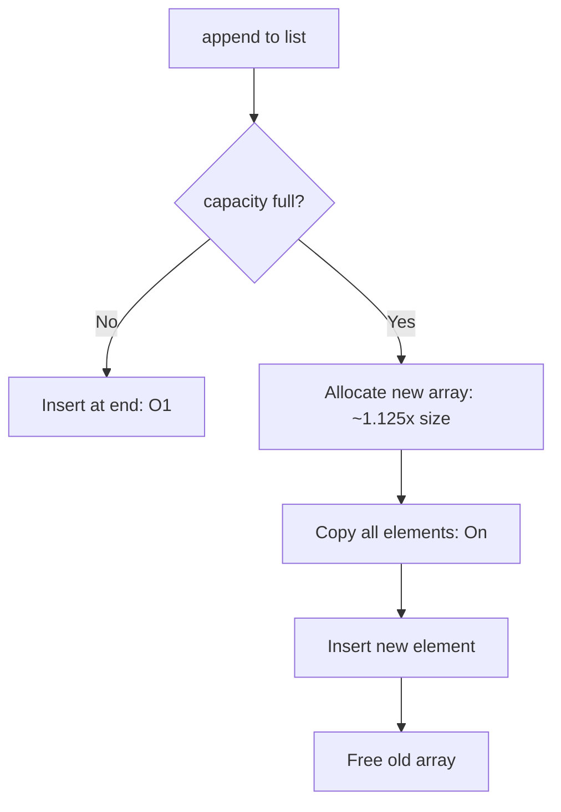
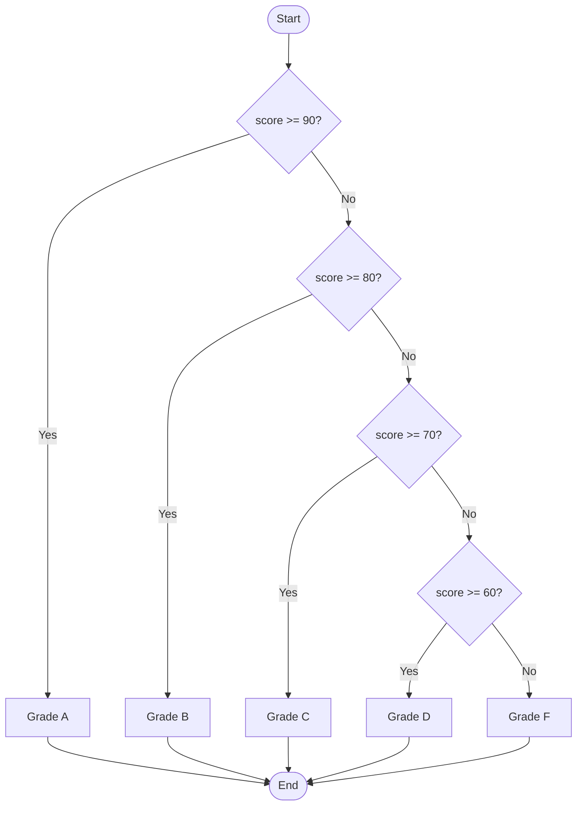
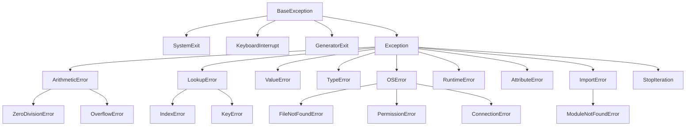

# 🐍 Python Notes — Part 2
### Collections · Conditionals · Loops · Functions · Exception Handling

> **Author:** Senior Python Engineer & Technical Mentor (15+ Years Experience)
> **Level:** Beginner → Advanced
> **Style:** Premium Course + Official Documentation Combined
> **Continues from:** `python-notes-part-1.md`
> **Version:** Python 3.12+

---

## 📚 Table of Contents

6. [Collections in Python](#6-collections-in-python)
   - [Lists](#61-lists)
   - [Tuples](#62-tuples)
   - [Sets](#63-sets)
   - [Dictionaries](#64-dictionaries)

7. [Conditional Statements](#7-conditional-statements)
   - [if / elif / else](#71-if--elif--else)
   - [Ternary Operators](#72-ternary-operators)
   - [Match-Case (Python 3.10+)](#73-match-case-python-310)
   - [Best Practices for Conditions](#74-best-practices-for-conditions)

8. [Loops in Python](#8-loops-in-python)
   - [for Loop](#81-for-loop)
   - [while Loop](#82-while-loop)
   - [Loop Control Statements](#83-loop-control-statements)
   - [Advanced Loop Concepts](#84-advanced-loop-concepts)

9. [Functions in Python](#9-functions-in-python)
   - [Function Basics](#91-function-basics)
   - [Advanced Parameters](#92-advanced-parameters-args-kwargs)
   - [Lambda Functions](#93-lambda-functions)
   - [Recursion](#94-recursion)
   - [Scope & LEGB Rule](#95-scope--legb-rule)
   - [Closures](#96-closures)
   - [Higher-Order & First-Class Functions](#97-higher-order--first-class-functions)
   - [Docstrings & Type Hints](#98-docstrings--type-hints)

10. [Exception Handling](#10-exception-handling)
    - [Types of Errors](#101-types-of-errors)
    - [try / except / else / finally](#102-try--except--else--finally)
    - [Advanced Exception Handling](#103-advanced-exception-handling)
    - [Production-Grade Error Handling](#104-production-grade-error-handling)

---

---

# 6. Collections in Python

> 🧠 **Concept:** Collections are Python's built-in data structures for **storing and organizing multiple values**. Choosing the right collection for your use case is one of the most impactful performance decisions you can make.

---

## 6.1 Lists

### What is a List?

A list is a **mutable, ordered sequence** that can hold elements of **any type** — including other lists. Think of it as a **dynamic array** that grows and shrinks as needed.

> 🌍 **Real-World Analogy:** A shopping cart — you can add items, remove items, reorder them, and put anything inside it (fruits, electronics, groceries together).

---

### 6.1.1 Creating Lists

```python
# Empty list
empty = []
empty2 = list()

# List with elements
numbers = [1, 2, 3, 4, 5]
names   = ["Alice", "Bob", "Charlie"]
mixed   = [1, "hello", 3.14, True, None]  # Any type!

# From other iterables
from_string = list("hello")     # ['h', 'e', 'l', 'l', 'o']
from_range  = list(range(5))    # [0, 1, 2, 3, 4]
from_tuple  = list((1, 2, 3))   # [1, 2, 3]

# Repeated elements
zeros    = [0] * 5              # [0, 0, 0, 0, 0]
repeated = ["x"] * 3           # ['x', 'x', 'x']

# ⚠️ GOTCHA: Nested list repetition
matrix_bad = [[0] * 3] * 3     # [[0,0,0],[0,0,0],[0,0,0]] — WRONG!
matrix_bad[0][0] = 1
print(matrix_bad)               # [[1,0,0],[1,0,0],[1,0,0]] — ALL rows changed!
# All rows point to the SAME inner list!

# CORRECT way:
matrix_good = [[0] * 3 for _ in range(3)]  # Creates independent rows
matrix_good[0][0] = 1
print(matrix_good)              # [[1,0,0],[0,0,0],[0,0,0]] ✓

print(len(numbers))   # 5
print(type(numbers))  # <class 'list'>
```

---

### 6.1.2 Indexing & Negative Indexing

```python
fruits = ["apple", "banana", "cherry", "date", "elderberry"]

# Positive indexing (0-based)
print(fruits[0])    # apple
print(fruits[2])    # cherry
print(fruits[4])    # elderberry

# Negative indexing (from the right)
print(fruits[-1])   # elderberry (last)
print(fruits[-2])   # date
print(fruits[-5])   # apple (same as fruits[0])

# Index memory diagram:
#  apple   banana  cherry  date  elderberry
#    0       1       2      3        4       (positive)
#   -5      -4      -3     -2       -1       (negative)

# Out of range error:
# print(fruits[10])   # IndexError: list index out of range
```

---

### 6.1.3 Slicing

```python
data = [10, 20, 30, 40, 50, 60, 70, 80, 90, 100]

# Syntax: list[start:stop:step]  — stop is EXCLUSIVE
print(data[2:5])      # [30, 40, 50]
print(data[:4])       # [10, 20, 30, 40]  (from beginning)
print(data[6:])       # [70, 80, 90, 100] (to end)
print(data[:])        # Full copy (shallow)

# Step
print(data[::2])      # [10, 30, 50, 70, 90]  (every 2nd)
print(data[1::2])     # [20, 40, 60, 80, 100] (odd indices)
print(data[::-1])     # [100,90,80,...,10]     (reversed)

# Negative slicing
print(data[-3:])      # [80, 90, 100] (last 3)
print(data[:-3])      # [10,...,70]   (all except last 3)

# Real-world: paginating results
results = list(range(1, 101))  # 100 items
page, per_page = 2, 10
start = (page - 1) * per_page
page_data = results[start : start + per_page]
print(page_data)  # [11, 12, 13, 14, 15, 16, 17, 18, 19, 20]

# Slice assignment (modifying in place!)
nums = [1, 2, 3, 4, 5]
nums[1:4] = [20, 30, 40]
print(nums)   # [1, 20, 30, 40, 5]

nums[1:4] = []        # Delete a section
print(nums)   # [1, 5]
```

---

### 6.1.4 List Methods

```python
lst = [3, 1, 4, 1, 5, 9, 2, 6, 5]

# --- ADDING ELEMENTS ---
lst.append(7)          # Add to END — O(1) amortized
print(lst)             # [3, 1, 4, 1, 5, 9, 2, 6, 5, 7]

lst.insert(0, 99)      # Insert at index — O(n)
print(lst)             # [99, 3, 1, 4, 1, 5, 9, 2, 6, 5, 7]

lst.extend([10, 11])   # Add multiple — O(k) where k = added length
print(lst)             # [99, 3, 1, 4, 1, 5, 9, 2, 6, 5, 7, 10, 11]

# --- REMOVING ELEMENTS ---
lst.remove(99)         # Remove first occurrence by VALUE — O(n)
print(lst)             # [3, 1, 4, 1, 5, 9, 2, 6, 5, 7, 10, 11]

popped = lst.pop()     # Remove & return LAST — O(1)
print(popped)          # 11
popped = lst.pop(0)    # Remove & return at INDEX — O(n)
print(popped)          # 3

lst.clear()            # Remove all elements
print(lst)             # []

# --- SEARCHING ---
lst = [3, 1, 4, 1, 5, 9, 2, 6, 5]
print(lst.index(5))    # 4 (first occurrence) — raises ValueError if not found
print(lst.count(1))    # 2 (occurrences of 1)
print(5 in lst)        # True

# --- ORDERING ---
lst.sort()             # Sort IN PLACE — O(n log n) — modifies original!
print(lst)             # [1, 1, 2, 3, 4, 5, 5, 6, 9]

lst.sort(reverse=True) # Descending
print(lst)             # [9, 6, 5, 5, 4, 3, 2, 1, 1]

lst.sort(key=abs)      # Custom key function

# sorted() — returns a NEW list, original unchanged
original = [3, 1, 4]
new_sorted = sorted(original)
print(original)        # [3, 1, 4] — unchanged!
print(new_sorted)      # [1, 3, 4]

lst.reverse()          # Reverse IN PLACE
print(sorted([3,1,4], key=lambda x: -x))   # [4, 3, 1]

# Sort by multiple criteria
students = [("Alice", 85), ("Bob", 92), ("Charlie", 85)]
students.sort(key=lambda s: (-s[1], s[0]))  # Sort by grade desc, name asc
print(students)  # [('Bob', 92), ('Alice', 85), ('Charlie', 85)]

# --- OTHER ---
lst = [1, 2, 3]
copy = lst.copy()      # Shallow copy
lst2 = lst + [4, 5]   # Concatenation (returns new list)
print(lst * 3)         # [1,2,3,1,2,3,1,2,3]
```

---

### 6.1.5 Nested Lists (Multi-dimensional)

```python
# 2D list (matrix)
matrix = [
    [1, 2, 3],
    [4, 5, 6],
    [7, 8, 9]
]

# Access: matrix[row][col]
print(matrix[0][0])    # 1 (top-left)
print(matrix[1][2])    # 6
print(matrix[2][1])    # 8

# Iterate over 2D list
for row in matrix:
    for val in row:
        print(val, end=" ")
    print()
# 1 2 3
# 4 5 6
# 7 8 9

# Transpose a matrix (rows become columns)
transposed = [[matrix[j][i] for j in range(len(matrix))]
              for i in range(len(matrix[0]))]
print(transposed)
# [[1, 4, 7], [2, 5, 8], [3, 6, 9]]

# Real-world: Seating chart for cinema
cinema = [["E"] * 10 for _ in range(8)]  # 8 rows, 10 seats, all Empty
cinema[3][4] = "B"   # Book seat row 3, seat 4
cinema[3][5] = "B"

# Display cinema
for i, row in enumerate(cinema):
    print(f"Row {i+1}: {''.join(row)}")
```

---

### 6.1.6 List Copying — Shallow vs Deep Copy

```python
import copy

original = [[1, 2, 3], [4, 5, 6], [7, 8, 9]]

# --- SHALLOW COPY (3 ways) ---
# Copies the outer list but SHARES inner objects
shallow1 = original.copy()
shallow2 = original[:]
shallow3 = list(original)

shallow1[0][0] = 999
print(original[0][0])   # 999 — original IS affected! (shared inner list)

# Memory diagram:
#
# original: [ref1, ref2, ref3]
# shallow:  [ref1, ref2, ref3]  ← same inner objects!
#
# ref1 → [1, 2, 3]  ← SHARED

# --- DEEP COPY ---
# Recursively copies EVERYTHING — fully independent
deep = copy.deepcopy(original)

deep[0][0] = 888
print(original[0][0])   # 999 — original NOT affected!

# Memory diagram:
#
# original: [ref1, ref2, ref3]
# deep:     [ref4, ref5, ref6]  ← new inner objects!
#
# ref4 → [999, 2, 3]  ← INDEPENDENT COPY

# Performance note:
# deepcopy is slower and uses more memory
# Use shallow copy unless you have mutable nested structures

# When to use which:
# Shallow: flat lists or when inner objects are immutable (ints, strings)
# Deep: nested mutable structures (lists of lists, lists of dicts)
```

---

### 6.1.7 List Comprehension

> 💡 **List comprehensions are Python's most loved feature** — concise, readable, and often faster than explicit loops.

```python
# Syntax: [expression for item in iterable if condition]

# Basic
squares = [x**2 for x in range(10)]
print(squares)   # [0, 1, 4, 9, 16, 25, 36, 49, 64, 81]

# With condition
evens = [x for x in range(20) if x % 2 == 0]
print(evens)     # [0, 2, 4, 6, 8, 10, 12, 14, 16, 18]

# With transformation
words = ["  hello  ", "  world  ", "  python  "]
cleaned = [w.strip().title() for w in words]
print(cleaned)   # ['Hello', 'World', 'Python']

# Multiple for clauses (Cartesian product)
pairs = [(x, y) for x in [1, 2, 3] for y in ['a', 'b']]
print(pairs)
# [(1,'a'),(1,'b'),(2,'a'),(2,'b'),(3,'a'),(3,'b')]

# Nested comprehension (flatten matrix)
matrix = [[1,2,3],[4,5,6],[7,8,9]]
flat = [val for row in matrix for val in row]
print(flat)   # [1, 2, 3, 4, 5, 6, 7, 8, 9]

# Real-world: Filter and transform API data
users = [
    {"name": "Alice", "age": 30, "active": True},
    {"name": "Bob",   "age": 17, "active": True},
    {"name": "Carol", "age": 25, "active": False},
    {"name": "Dave",  "age": 22, "active": True},
]

# Get names of active adults
eligible = [u["name"] for u in users if u["active"] and u["age"] >= 18]
print(eligible)   # ['Alice', 'Dave']

# Performance: list comp vs loop
import timeit

# Loop version
def with_loop(n):
    result = []
    for x in range(n):
        if x % 2 == 0:
            result.append(x**2)
    return result

# Comprehension version
def with_comp(n):
    return [x**2 for x in range(n) if x % 2 == 0]

t1 = timeit.timeit(lambda: with_loop(10000), number=1000)
t2 = timeit.timeit(lambda: with_comp(10000), number=1000)
print(f"Loop: {t1:.3f}s, Comprehension: {t2:.3f}s")
# Comprehension is typically 20-35% faster
```

---

### 6.1.8 Internal Working of Lists — Dynamic Resizing

> 🔬 **Advanced:** Understanding how Python lists work internally helps you write faster code.

```python
import sys

# Python lists are DYNAMIC ARRAYS (over-allocated)
lst = []
prev_size = sys.getsizeof(lst)
print(f"Empty list: {prev_size} bytes")

for i in range(20):
    lst.append(i)
    current_size = sys.getsizeof(lst)
    if current_size != prev_size:
        print(f"Length: {len(lst):3d} | Size: {current_size} bytes ← RESIZE!")
        prev_size = current_size
    else:
        print(f"Length: {len(lst):3d} | Size: {current_size} bytes")
```

**Output shows growth pattern:**
```
Empty list: 56 bytes
Length:   1 | Size:  88 bytes ← RESIZE! (allocated for 4)
Length:   5 | Size: 120 bytes ← RESIZE! (allocated for 8)
Length:   9 | Size: 184 bytes ← RESIZE! (allocated for 16)
Length:  17 | Size: 248 bytes ← RESIZE! (allocated for ~25)
```

**How Dynamic Resizing Works:**

```
Initial: capacity = 0

Append → capacity full → allocate new array with ~1.125× more capacity
Copy all elements → add new element

Growth formula (CPython):
new_capacity = old_capacity + (old_capacity >> 3) + (3 if old_capacity < 9 else 6)

This is roughly O(1) amortized per append operation.
```



---

### 6.1.9 Time Complexity Reference

| Operation | Time Complexity | Notes |
|-----------|----------------|-------|
| `append(x)` | O(1) amortized | Occasional O(n) resize |
| `pop()` | O(1) | Remove last |
| `pop(i)` | O(n) | Remove at index — shifts elements |
| `insert(i, x)` | O(n) | Must shift elements |
| `remove(x)` | O(n) | Must search then shift |
| `x in list` | O(n) | Linear search |
| `lst[i]` | O(1) | Direct index access |
| `lst[i:j]` | O(j-i) | Slicing copies elements |
| `len(lst)` | O(1) | Stored as attribute |
| `sort()` | O(n log n) | Timsort algorithm |
| `reverse()` | O(n) | |
| `extend(iterable)` | O(k) | k = len of iterable |
| `clear()` | O(n) | Must dereference items |

> ⚠️ **Interview Tip:** Use `append()` + `pop()` for stack (LIFO). Use `collections.deque` for queue (FIFO) — `deque.appendleft()` and `popleft()` are O(1) vs list's O(n).

---

### 🎯 List Interview Questions

> **Q1: What is the difference between `append()` and `extend()`?**
> **A:** `append()` adds a single item to the end (even a list becomes one element). `extend()` unpacks an iterable and adds each item individually. `lst.append([1,2])` → `[..., [1,2]]`; `lst.extend([1,2])` → `[..., 1, 2]`.

> **Q2: Why is `list.pop()` O(1) but `list.pop(0)` O(n)?**
> **A:** Python lists are backed by contiguous arrays. Removing the last element needs no shifting. Removing the first element requires shifting all remaining n-1 elements left — O(n).

> **Q3: What is the difference between shallow and deep copy?**
> **A:** Shallow copy creates a new list but shares references to the same inner objects. Deep copy recursively copies all nested objects. For flat lists with immutable items (int, str), both are equivalent. For nested mutable structures, deep copy is needed for full independence.

> **Q4: Why does `[[0]*3]*3` create linked rows?**
> **A:** `*3` repeats the reference, not the object. All three rows point to the same list. Modifying one modifies all. Use `[[0]*3 for _ in range(3)]` to create independent rows.

---

### 📝 List Practice Exercises

```python
# 1. Flatten a nested list of arbitrary depth
def flatten(lst):
    result = []
    for item in lst:
        if isinstance(item, list):
            result.extend(flatten(item))
        else:
            result.append(item)
    return result

print(flatten([1, [2, [3, [4]], 5], 6]))  # [1,2,3,4,5,6]

# 2. Remove duplicates while preserving order
def unique_preserve_order(lst):
    seen = set()
    return [x for x in lst if not (x in seen or seen.add(x))]

print(unique_preserve_order([3,1,4,1,5,9,2,6,5,3]))  # [3,1,4,5,9,2,6]

# 3. Rotate a list by k positions
def rotate(lst, k):
    k = k % len(lst)
    return lst[-k:] + lst[:-k]

print(rotate([1,2,3,4,5], 2))  # [4, 5, 1, 2, 3]

# 4. Find two numbers that sum to a target
def two_sum(nums, target):
    seen = {}
    for i, num in enumerate(nums):
        complement = target - num
        if complement in seen:
            return [seen[complement], i]
        seen[num] = i
    return []

print(two_sum([2, 7, 11, 15], 9))  # [0, 1]
```

---

## 6.2 Tuples

### What is a Tuple?

A tuple is an **immutable, ordered sequence** — like a list that can never be changed after creation. This immutability makes tuples:
- **Faster** than lists
- **Hashable** (usable as dict keys, set elements)
- **Semantically meaningful** (signals "this shouldn't change")

> 🌍 **Real-World Analogy:** GPS coordinates `(latitude, longitude)` — these describe a fixed point. You'd never accidentally change them. A tuple enforces this contract.

---

### 6.2.1 Creating Tuples

```python
# Empty tuple
empty = ()
empty2 = tuple()

# Tuple with elements
point    = (3, 4)
rgb      = (255, 128, 0)
person   = ("Alice", 30, "Engineer")
mixed    = (1, "hello", 3.14, True)

# Parentheses are OPTIONAL (but recommended for clarity)
coords = 10, 20       # Also a tuple!
print(type(coords))   # <class 'tuple'>

# ⚠️ CRITICAL: Single-element tuple NEEDS a trailing comma
single  = (42,)       # ← Tuple with one element
not_tuple = (42)      # ← Just the integer 42 in parentheses!

print(type(single))    # <class 'tuple'>
print(type(not_tuple)) # <class 'int'>

# From iterable
from_list  = tuple([1, 2, 3])
from_str   = tuple("hello")    # ('h','e','l','l','o')
from_range = tuple(range(5))   # (0, 1, 2, 3, 4)
```

---

### 6.2.2 Packing & Unpacking

```python
# Packing — creating a tuple from multiple values
point = 3, 4      # Tuple packing
print(point)      # (3, 4)

# Unpacking — extracting values from a tuple
x, y = point
print(x, y)       # 3 4

# Extended unpacking (Python 3)
first, *rest = (1, 2, 3, 4, 5)
print(first)  # 1
print(rest)   # [2, 3, 4, 5]  (rest is a LIST!)

*start, last = (1, 2, 3, 4, 5)
print(start)  # [1, 2, 3, 4]
print(last)   # 5

a, *middle, b = (1, 2, 3, 4, 5)
print(a, middle, b)  # 1 [2, 3, 4] 5

# Swapping variables (Python magic!)
a, b = 10, 20
a, b = b, a         # Swap using tuple packing/unpacking
print(a, b)         # 20 10

# Unpacking in for loops
employees = [("Alice", 30, 75000), ("Bob", 25, 60000), ("Carol", 35, 90000)]
for name, age, salary in employees:
    print(f"{name} (age {age}): ${salary:,}")

# Function returning multiple values (actually returns a tuple)
def min_max(lst):
    return min(lst), max(lst)   # Returns (min, max) tuple

lo, hi = min_max([3, 1, 4, 1, 5, 9])
print(lo, hi)  # 1 9
```

---

### 6.2.3 Tuple Methods & Operations

```python
t = (3, 1, 4, 1, 5, 9, 2, 6, 5)

# Only 2 methods (because immutable!)
print(t.count(1))     # 2 — count occurrences
print(t.index(5))     # 4 — first occurrence index

# Supported operations (same as lists)
print(t[0])           # 3
print(t[-1])          # 5
print(t[2:5])         # (4, 1, 5)
print(len(t))         # 9
print(5 in t)         # True
print(t + (7, 8))     # (3,1,4,1,5,9,2,6,5,7,8) — NEW tuple
print(t * 2)          # Creates new repeated tuple

# Tuples are hashable!
point = (3, 4)
d = {point: "origin area"}    # Dict key!
s = {(1,2), (3,4)}            # Set element!
```

---

### 6.2.4 Named Tuples

```python
from collections import namedtuple

# Traditional tuple — hard to remember what index means what
point = (3, 4)
print(point[0])   # x? y? Hard to know!

# Named tuple — self-documenting
Point = namedtuple("Point", ["x", "y"])
p = Point(3, 4)
print(p.x)         # 3 — clear!
print(p.y)         # 4
print(p[0])        # 3 — still works with index
print(p)           # Point(x=3, y=4)

# Real-world use
Employee = namedtuple("Employee", ["name", "age", "department", "salary"])
emp = Employee("Alice", 30, "Engineering", 95000)
print(emp.name)       # Alice
print(emp.salary)     # 95000

# _replace() — create new tuple with some values changed
emp2 = emp._replace(salary=100000)
print(emp2.salary)    # 100000
print(emp.salary)     # 95000 — original unchanged

# Python 3.6+ — typing.NamedTuple (cleaner syntax)
from typing import NamedTuple

class Point3D(NamedTuple):
    x: float
    y: float
    z: float = 0.0   # Default value!

p3 = Point3D(1.0, 2.0)
print(p3)  # Point3D(x=1.0, y=2.0, z=0.0)
```

---

### 6.2.5 Tuple vs List — When to Use Which?

| Feature | Tuple | List |
|---------|-------|------|
| Mutability | Immutable ❌ | Mutable ✅ |
| Syntax | `(1, 2, 3)` | `[1, 2, 3]` |
| Memory | Less (~12% smaller) | More |
| Speed | Faster to create/iterate | Slower |
| Hashable | ✅ (can be dict key) | ❌ |
| Methods | 2 (count, index) | 11+ |
| Use case | Fixed data, records | Dynamic collections |

```python
import sys
import timeit

# Memory comparison
lst = [1, 2, 3, 4, 5]
tup = (1, 2, 3, 4, 5)
print(sys.getsizeof(lst))  # 120 bytes
print(sys.getsizeof(tup))  # 80 bytes (~33% smaller!)

# Speed comparison
t_list = timeit.timeit("x = [1, 2, 3, 4, 5]", number=10_000_000)
t_tuple = timeit.timeit("x = (1, 2, 3, 4, 5)", number=10_000_000)
print(f"List:  {t_list:.3f}s")
print(f"Tuple: {t_tuple:.3f}s")  # ~5x faster to create!
```

### When to Use Tuples

```python
# ✅ Use tuples for:

# 1. Coordinates, geographic data
location = (40.7128, -74.0060)   # NYC lat/lon

# 2. RGB colors
RED = (255, 0, 0)
GREEN = (0, 255, 0)

# 3. Database records (each row)
db_row = (1, "Alice", "alice@example.com", "2024-01-15")

# 4. Function returning multiple values
def get_bounds(data):
    return min(data), max(data)

# 5. Dictionary keys (requires hashable)
grid = {(0,0): "start", (5,5): "end"}

# 6. Constants that should NEVER change
HTTP_STATUS = (200, 201, 204, 400, 401, 403, 404, 500)
```

---

### 🎯 Tuple Interview Questions

> **Q1: Why are tuples faster than lists?**
> **A:** Tuples are stored more compactly (no over-allocation for future elements). Python can also optimize tuple literals — constant tuples are stored as single objects and reused. Iteration is faster because CPython has optimized tuple iteration code.

> **Q2: Can a tuple contain mutable elements?**
> **A:** Yes! A tuple's immutability means you can't reassign its elements, but if an element is itself mutable (like a list), that mutable object can be changed. `t = ([1,2], 3); t[0].append(4)` — this works! The tuple still "contains" the same list object; the list just changed.

> **Q3: What is the difference between `namedtuple` and a regular class?**
> **A:** `namedtuple` creates an immutable, memory-efficient, tuple-based class. It's faster and uses less memory than a regular class, supports tuple operations (indexing, iteration), and is hashable. Use it for simple data containers where mutation is unnecessary.

---

## 6.3 Sets

### What is a Set?

A set is an **unordered collection of unique, hashable elements**. It's backed by a **hash table** — making membership testing O(1).

> 🌍 **Real-World Analogy:** A guest list at an event — each person appears only once, and you can quickly check if someone is invited (O(1) lookup). Sets also let you combine two guest lists (union), find guests invited to both parties (intersection), etc.

---

### 6.3.1 Creating Sets

```python
# Empty set — MUST use set(), not {}!
empty_set = set()      # ✅ Empty set
empty_dict = {}        # ❌ This is an empty dict, NOT a set!

# Set with elements
fruits = {"apple", "banana", "cherry"}
numbers = {1, 2, 3, 4, 5}
mixed   = {1, "hello", 3.14, (1, 2)}  # Tuples OK (hashable), lists NOT!

# From iterable (auto-removes duplicates!)
from_list = set([1, 2, 2, 3, 3, 3])
print(from_list)   # {1, 2, 3}

from_str = set("hello")
print(from_str)    # {'h', 'e', 'l', 'o'}  — only 4 (duplicate 'l' removed)

# Duplicates are automatically removed
data = [1, 2, 3, 2, 1, 4, 3, 5]
unique = set(data)
print(unique)   # {1, 2, 3, 4, 5}

# Note: Sets are UNORDERED — order not guaranteed!
print(type(fruits))   # <class 'set'>
```

---

### 6.3.2 Set Methods

```python
s = {1, 2, 3, 4, 5}

# --- ADDING / REMOVING ---
s.add(6)          # Add single element — O(1) avg
print(s)          # {1, 2, 3, 4, 5, 6}

s.add(3)          # Adding duplicate — no effect, no error
print(s)          # {1, 2, 3, 4, 5, 6}

s.remove(6)       # Remove element — raises KeyError if not found
s.discard(99)     # Remove element — NO error if not found ✅
print(s)          # {1, 2, 3, 4, 5}

popped = s.pop()  # Remove & return ARBITRARY element — O(1)
print(popped)     # Some element (order not guaranteed)

s.clear()         # Remove all elements
print(s)          # set()

# --- CHECKING ---
s = {1, 2, 3, 4, 5}
print(3 in s)     # True — O(1) ← KEY ADVANTAGE over lists!
print(6 in s)     # False
print(len(s))     # 5
```

---

### 6.3.3 Set Operations

```python
A = {1, 2, 3, 4, 5}
B = {4, 5, 6, 7, 8}

# UNION — all elements from both sets
print(A | B)          # {1, 2, 3, 4, 5, 6, 7, 8}
print(A.union(B))     # Same

# INTERSECTION — only elements in BOTH sets
print(A & B)                  # {4, 5}
print(A.intersection(B))      # Same

# DIFFERENCE — in A but NOT in B
print(A - B)                  # {1, 2, 3}
print(A.difference(B))        # Same
print(B - A)                  # {6, 7, 8}

# SYMMETRIC DIFFERENCE — in A or B, but NOT both
print(A ^ B)                          # {1, 2, 3, 6, 7, 8}
print(A.symmetric_difference(B))      # Same

# SUBSET / SUPERSET
C = {1, 2, 3}
print(C.issubset(A))      # True — C ⊆ A
print(A.issuperset(C))    # True — A ⊇ C
print(C <= A)             # True (subset operator)
print(A >= C)             # True (superset operator)
print(C < A)              # True (proper subset — C ⊂ A, C ≠ A)

# DISJOINT — no common elements
D = {10, 11, 12}
print(A.isdisjoint(D))    # True — no common elements

# Real-world examples:
# 1. Find common friends between two users
alice_friends = {"Bob", "Carol", "Dave", "Eve"}
bob_friends   = {"Alice", "Carol", "Frank", "Dave"}
common = alice_friends & bob_friends
print(f"Common friends: {common}")   # {'Carol', 'Dave'}

# 2. Find users who visited page A but not page B
page_a_visitors = {"user1", "user2", "user3", "user4"}
page_b_visitors = {"user2", "user4", "user5"}
only_a = page_a_visitors - page_b_visitors
print(f"Visited A only: {only_a}")  # {'user1', 'user3'}

# 3. Remove duplicates from a list FAST
large_list = list(range(1000)) + list(range(500))  # 1500 items with 500 dups
unique_list = list(set(large_list))  # O(n) — very fast!
print(len(unique_list))  # 1000
```

---

### 6.3.4 Frozen Sets

```python
# frozenset — IMMUTABLE set (hashable, can be dict key/set element)
fs = frozenset({1, 2, 3, 4, 5})
print(fs)             # frozenset({1, 2, 3, 4, 5})

# All set OPERATIONS work (returning new frozensets)
other = frozenset({4, 5, 6})
print(fs | other)     # frozenset({1, 2, 3, 4, 5, 6})
print(fs & other)     # frozenset({4, 5})

# MODIFICATION methods do NOT work:
# fs.add(6)   # AttributeError: 'frozenset' object has no attribute 'add'

# Use as dictionary key (regular set can't be a key!)
graph = {
    frozenset({0, 1}): "edge",
    frozenset({1, 2}): "edge",
    frozenset({0, 2}): "edge",
}

# Use in a set of sets
unique_connections = {frozenset({a, b}) for a, b in [(1,2),(2,1),(1,3)]}
print(unique_connections)  # {frozenset({1, 2}), frozenset({1, 3})}  — deduped!
```

---

### 6.3.5 Set Comprehension

```python
# Syntax: {expression for item in iterable if condition}

squares = {x**2 for x in range(10)}
print(squares)   # {0, 1, 4, 9, 16, 25, 36, 49, 64, 81}

# Filter unique characters that are vowels
text = "hello world python"
vowels = {c for c in text if c in "aeiou"}
print(vowels)    # {'e', 'o'}

# Get unique lengths of words
words = ["hi", "hello", "hey", "howdy", "hi"]
unique_lengths = {len(w) for w in words}
print(unique_lengths)   # {2, 5}
```

---

### 6.3.6 Internal Hashing — How Sets Work

```python
# Sets use HASH TABLES internally
# hash(element) → bucket index → O(1) average lookup

print(hash(42))          # 42
print(hash("hello"))     # Some large integer
print(hash((1, 2, 3)))   # Works — tuples are hashable
# print(hash([1, 2, 3])) # TypeError — lists are NOT hashable

# Why lists can't be in sets:
# Mutable objects can change after insertion
# If a list's contents change, its hash changes
# This breaks the hash table lookup → so Python forbids it

# Custom objects in sets:
class Point:
    def __init__(self, x, y):
        self.x = x
        self.y = y

    def __hash__(self):
        return hash((self.x, self.y))    # Must implement __hash__

    def __eq__(self, other):
        return self.x == other.x and self.y == other.y  # Must implement __eq__

p1 = Point(1, 2)
p2 = Point(1, 2)
p3 = Point(3, 4)

pts = {p1, p2, p3}
print(len(pts))  # 2 — p1 and p2 are "equal" so only one stored!
```

### Time Complexity for Sets

| Operation | Average | Worst Case |
|-----------|---------|------------|
| `x in set` | O(1) | O(n) — hash collision |
| `set.add(x)` | O(1) | O(n) |
| `set.remove(x)` | O(1) | O(n) |
| `len(set)` | O(1) | O(1) |
| `A \| B` (union) | O(len(A)+len(B)) | — |
| `A & B` (intersection) | O(min(len(A),len(B))) | — |
| `A - B` (difference) | O(len(A)) | — |

---

### 🎯 Set Interview Questions

> **Q1: Why is `x in set` O(1) while `x in list` is O(n)?**
> **A:** Sets use hash tables. `hash(x)` computes the bucket directly in O(1). Lists require checking each element sequentially. For large collections, this difference is massive — e.g., `x in million_set` takes same time as `x in ten_set`.

> **Q2: What types can be stored in a set? Why?**
> **A:** Only hashable types: `int`, `float`, `str`, `tuple` (containing hashable elements), `frozenset`, and custom objects implementing `__hash__` and `__eq__`. Lists, dicts, and regular sets are NOT hashable because they're mutable — changing them would invalidate their position in the hash table.

> **Q3: What's the practical use of `frozenset`?**
> **A:** When you need an immutable set that can be used as a dictionary key or placed inside another set. Example: storing unique undirected graph edges as `frozenset({node1, node2})` — order doesn't matter and it's hashable.

---

## 6.4 Dictionaries

### What is a Dictionary?

A dictionary is a **mutable, ordered (Python 3.7+) mapping of key-value pairs**, backed by a **hash table**. It provides O(1) average lookup by key.

> 🌍 **Real-World Analogy:** A phone book. You look up a person's name (key) to get their phone number (value). You don't scan every entry — you jump directly to the right section (hash-based lookup).

---

### 6.4.1 Creating Dictionaries

```python
# Empty dict
empty1 = {}
empty2 = dict()

# Dict literal
person = {
    "name": "Alice",
    "age": 30,
    "email": "alice@example.com",
    "active": True
}

# From keyword arguments
config = dict(host="localhost", port=5432, database="mydb")

# From list of key-value pairs
pairs = [("a", 1), ("b", 2), ("c", 3)]
d = dict(pairs)

# Dict comprehension
squares = {x: x**2 for x in range(1, 6)}
print(squares)   # {1:1, 2:4, 3:9, 4:16, 5:25}

# fromkeys — create dict with same value for all keys
keys = ["host", "port", "db"]
defaults = dict.fromkeys(keys, None)
print(defaults)  # {'host': None, 'port': None, 'db': None}

# ⚠️ Keys must be hashable
# {[1,2]: "value"}  # TypeError — list as key!
# Valid keys: str, int, float, tuple, frozenset, bool, None

print(type(person))   # <class 'dict'>
print(len(person))    # 4
```

---

### 6.4.2 Accessing Values

```python
person = {"name": "Alice", "age": 30, "city": "NYC"}

# Direct access
print(person["name"])    # Alice
# person["phone"]        # KeyError! — key doesn't exist

# Safe access with get()
print(person.get("name"))         # Alice
print(person.get("phone"))        # None (no error!)
print(person.get("phone", "N/A")) # N/A (default value)

# Checking existence
print("name" in person)       # True
print("phone" in person)      # False
print("Alice" in person)      # False — checks KEYS, not values!
print("Alice" in person.values())  # True — check values

# All keys, values, items
print(person.keys())     # dict_keys(['name', 'age', 'city'])
print(person.values())   # dict_values(['Alice', 30, 'NYC'])
print(person.items())    # dict_items([('name','Alice'),('age',30),('city','NYC')])

# These are VIEWS — they reflect changes to the dict dynamically!
keys_view = person.keys()
person["country"] = "USA"
print(keys_view)  # dict_keys(['name', 'age', 'city', 'country']) — updated!
```

---

### 6.4.3 Dictionary Methods

```python
d = {"a": 1, "b": 2, "c": 3}

# --- ADDING / UPDATING ---
d["d"] = 4              # Add new key
d["a"] = 99             # Update existing key
print(d)                # {'a':99, 'b':2, 'c':3, 'd':4}

d.update({"b": 20, "e": 5})    # Update multiple
print(d)                # {'a':99, 'b':20, 'c':3, 'd':4, 'e':5}

d.setdefault("f", 100)  # Add ONLY if key doesn't exist
d.setdefault("a", 999)  # "a" already exists — NOT updated
print(d["a"])           # 99 — unchanged

# --- REMOVING ---
removed = d.pop("a")         # Remove & return value — KeyError if missing
print(removed)               # 99

removed = d.pop("z", None)   # Safe remove with default
print(removed)               # None

key, val = d.popitem()       # Remove & return LAST inserted (Python 3.7+)
print(key, val)

d.clear()               # Remove all items

# --- COPYING ---
original = {"x": 1, "y": 2}
shallow = original.copy()
import copy
deep = copy.deepcopy(original)

# --- MERGING (Python 3.9+) ---
d1 = {"a": 1, "b": 2}
d2 = {"b": 20, "c": 3}

merged = d1 | d2        # Merge operator — d2 values win on conflict
print(merged)           # {'a':1, 'b':20, 'c':3}

d1 |= d2               # In-place merge (Python 3.9+)
print(d1)               # {'a':1, 'b':20, 'c':3}

# Pre-3.9 methods:
merged_old = {**d1, **d2}     # Unpack and merge
print(merged_old)
```

---

### 6.4.4 Iterating Dictionaries

```python
inventory = {"apple": 50, "banana": 30, "cherry": 100}

# Iterate keys (default)
for item in inventory:
    print(item)                    # apple, banana, cherry

# Iterate values
for qty in inventory.values():
    print(qty)                     # 50, 30, 100

# Iterate key-value pairs (MOST COMMON)
for item, qty in inventory.items():
    print(f"{item}: {qty} units")

# Sorted iteration
for item in sorted(inventory):
    print(item, inventory[item])

# Sorted by value
for item, qty in sorted(inventory.items(), key=lambda x: x[1], reverse=True):
    print(f"{item}: {qty}")   # cherry:100, apple:50, banana:30

# Dictionary comprehension
# Double all quantities
doubled = {item: qty * 2 for item, qty in inventory.items()}

# Filter low stock
low_stock = {item: qty for item, qty in inventory.items() if qty < 50}
print(low_stock)  # {'banana': 30}
```

---

### 6.4.5 Nested Dictionaries

```python
# Common structure for JSON API responses
users = {
    "user_1": {
        "name": "Alice",
        "age": 30,
        "address": {
            "street": "123 Main St",
            "city": "New York",
            "country": "USA"
        },
        "skills": ["Python", "SQL", "Docker"]
    },
    "user_2": {
        "name": "Bob",
        "age": 25,
        "address": {
            "street": "456 Oak Ave",
            "city": "San Francisco",
            "country": "USA"
        },
        "skills": ["JavaScript", "React", "Node.js"]
    }
}

# Accessing nested values
print(users["user_1"]["address"]["city"])  # New York
print(users["user_2"]["skills"][0])        # JavaScript

# Safe nested access
city = users.get("user_1", {}).get("address", {}).get("city", "Unknown")
print(city)   # New York

# Or using Python 3.8+ walrus operator pattern:
# For very deep nesting, consider using a utility function:
def safe_get(d, *keys, default=None):
    """Safely get a deeply nested value."""
    for key in keys:
        if isinstance(d, dict):
            d = d.get(key)
        else:
            return default
        if d is None:
            return default
    return d

print(safe_get(users, "user_1", "address", "city"))   # New York
print(safe_get(users, "user_3", "address", "city"))   # None
```

---

### 6.4.6 Specialized Dictionaries

```python
from collections import defaultdict, OrderedDict, Counter

# --- defaultdict — never raises KeyError ---
# Regular dict:
d = {}
# d["key"] += 1  # KeyError! Key doesn't exist yet

# defaultdict:
word_count = defaultdict(int)    # Default value: int() = 0
text = "the cat sat on the mat the cat"
for word in text.split():
    word_count[word] += 1   # No KeyError!

print(dict(word_count))
# {'the': 3, 'cat': 2, 'sat': 1, 'on': 1, 'mat': 1}

# Grouping items:
from_cities = defaultdict(list)
employees = [
    ("Alice", "NYC"), ("Bob", "LA"), ("Carol", "NYC"),
    ("Dave", "Chicago"), ("Eve", "LA")
]
for name, city in employees:
    from_cities[city].append(name)

print(dict(from_cities))
# {'NYC': ['Alice', 'Carol'], 'LA': ['Bob', 'Eve'], 'Chicago': ['Dave']}

# --- Counter — count occurrences ---
from collections import Counter

words = ["apple", "banana", "apple", "cherry", "banana", "apple"]
counts = Counter(words)
print(counts)              # Counter({'apple': 3, 'banana': 2, 'cherry': 1})
print(counts["apple"])     # 3
print(counts["mango"])     # 0 — no KeyError!
print(counts.most_common(2))  # [('apple', 3), ('banana', 2)]

# Counter operations
c1 = Counter("aabbcc")
c2 = Counter("abcdd")
print(c1 + c2)   # Combined counts
print(c1 - c2)   # Subtract (removes zero/negative counts)
print(c1 & c2)   # Minimum of each
print(c1 | c2)   # Maximum of each

# --- OrderedDict — order guaranteed (now built-in in 3.7+) ---
# Main advantage: equality check considers ORDER
od1 = OrderedDict([("a", 1), ("b", 2)])
od2 = OrderedDict([("b", 2), ("a", 1)])
print(od1 == od2)   # False — order matters!

d1 = {"a": 1, "b": 2}
d2 = {"b": 2, "a": 1}
print(d1 == d2)     # True — regular dict ignores order
```

---

### 6.4.7 Internal Hashing — How Dicts Work

```python
# Python dicts use OPEN ADDRESSING hash tables (compact since Python 3.6)
#
# Insertion: hash(key) → index → store (key, value)
# Lookup:    hash(key) → index → compare key → return value
#
# Hash collision: when two keys hash to same index
# Resolution: linear probing (Python) — check next slot

# Visualize:
# key "name" → hash("name") = 2718284... → index 3
# key "age"  → hash("age")  = 1048...    → index 7
#
# Internal table:
# [  slot0  | slot1 | slot2 | "name":"Alice" | ... | "age":30 | ... ]

# Since Python 3.6, dicts maintain insertion order
# Since Python 3.7, insertion order is GUARANTEED

# Memory: compact hash table (not sparse like before 3.6)
# ~60% more memory efficient than Python 3.5 dicts

import sys
d = {str(i): i for i in range(100)}
print(sys.getsizeof(d))   # ~4952 bytes for 100-item dict

# Key requirement: must be hashable
# d[(1,2)] = "point"   # OK — tuple is hashable
# d[[1,2]] = "point"   # TypeError — list is not hashable
```

---

### 🎯 Dictionary Interview Questions

> **Q1: How does Python dict lookup work internally?**
> **A:** Python computes `hash(key)` to find the bucket index. If the key matches (using `==`), it returns the value. If there's a collision (another key at same index), Python probes nearby slots. Average O(1), worst case O(n) (rare with good hash distribution).

> **Q2: How do you merge two dictionaries in Python?**
> **A:** Multiple ways: `{**d1, **d2}` (Python 3.5+), `d1.update(d2)` (modifies d1 in place), `d1 | d2` (Python 3.9+, returns new dict). For all methods, if the same key exists in both, the second dict's value wins.

> **Q3: What is `setdefault()` and when would you use it?**
> **A:** `d.setdefault(key, default)` returns the value if key exists, otherwise inserts key with default value and returns it. Useful for building dicts of lists: `d.setdefault("key", []).append(item)` — this is what `defaultdict(list)` does automatically.

> **Q4: Why are dict keys required to be hashable?**
> **A:** Dict lookup uses `hash(key)` to find the bucket. If keys were mutable (like lists), changing the key after insertion would change its hash, making it impossible to find the stored value. Python enforces hashability to guarantee correctness.

---

### 📝 Collections Practice Exercises

```python
# 1. Word frequency counter (using dict and Counter)
from collections import Counter

def word_freq(text):
    words = text.lower().split()
    return Counter(words).most_common(5)

print(word_freq("the quick brown fox jumps over the lazy dog the fox"))

# 2. Group anagrams together
def group_anagrams(words):
    groups = defaultdict(list)
    for word in words:
        key = tuple(sorted(word))
        groups[key].append(word)
    return list(groups.values())

words = ["eat","tea","tan","ate","nat","bat"]
print(group_anagrams(words))
# [['eat','tea','ate'], ['tan','nat'], ['bat']]

# 3. Invert a dictionary (value → key)
original = {"a": 1, "b": 2, "c": 3}
inverted = {v: k for k, v in original.items()}
print(inverted)  # {1:'a', 2:'b', 3:'c'}

# 4. Deep merge two dictionaries
def deep_merge(d1, d2):
    result = d1.copy()
    for key, val in d2.items():
        if key in result and isinstance(result[key], dict) and isinstance(val, dict):
            result[key] = deep_merge(result[key], val)
        else:
            result[key] = val
    return result

cfg1 = {"db": {"host": "localhost", "port": 5432}, "debug": False}
cfg2 = {"db": {"port": 5433, "name": "prod"}, "debug": True}
print(deep_merge(cfg1, cfg2))
# {'db': {'host': 'localhost', 'port': 5433, 'name': 'prod'}, 'debug': True}
```

---

---

# 7. Conditional Statements

---

## 7.1 if / elif / else

### Why Conditions Exist

Programs need to **make decisions** based on data. Conditions are the foundation of logic in any program.

> 🌍 **Real-World Analogy:** A traffic light — if red, stop; elif yellow, prepare; else go.

### Basic if Statement

```python
# Syntax
if condition:
    # code block (must be indented)
    pass

# Example
temperature = 35

if temperature > 30:
    print("It's hot outside!")
    print("Stay hydrated!")
```

### if-else

```python
age = 17

if age >= 18:
    print("You can vote")
    print("You can drive")
else:
    print("You're a minor")
    print("Come back in", 18 - age, "years")
```

### if-elif-else Chain

```python
score = 78

if score >= 90:
    grade = "A"
    message = "Excellent!"
elif score >= 80:
    grade = "B"
    message = "Good job!"
elif score >= 70:
    grade = "C"
    message = "Satisfactory"
elif score >= 60:
    grade = "D"
    message = "Needs improvement"
else:
    grade = "F"
    message = "Failed"

print(f"Grade: {grade} — {message}")   # Grade: C — Satisfactory
```



### Nested Conditions

```python
# Real-world: Login authentication system
username = "alice"
password = "secure123"
is_verified = True
failed_attempts = 2

if username in database:  # Assume database exists
    if failed_attempts >= 5:
        print("Account locked. Contact support.")
    elif not is_verified:
        print("Please verify your email first.")
    elif password_matches(username, password):  # Assume function exists
        print("Login successful!")
        log_access(username)
    else:
        failed_attempts += 1
        print(f"Invalid password. {5 - failed_attempts} attempts remaining.")
else:
    print("Username not found.")
```

### Multiple Conditions

```python
# Combining with and / or / not
age = 25
has_license = True
has_insurance = True
blood_alcohol = 0.0

# All conditions must be true
can_drive = (
    age >= 16
    and has_license
    and has_insurance
    and blood_alcohol < 0.08
)
print(can_drive)   # True

# Real-world: E-commerce shipping eligibility
order_value = 85
is_member = True
in_delivery_zone = True

if order_value >= 100 or (order_value >= 50 and is_member):
    if in_delivery_zone:
        print("Free shipping applied!")
    else:
        print("Not in delivery zone")
else:
    shipping_cost = 5.99
    print(f"Shipping: ${shipping_cost}")
```

---

## 7.2 Ternary Operators

### One-Line Conditional (Ternary Expression)

```python
# Syntax: value_if_true if condition else value_if_false

# Basic
age = 20
status = "adult" if age >= 18 else "minor"
print(status)   # adult

# In function return
def max_two(a, b):
    return a if a > b else b

print(max_two(5, 3))   # 5

# In list
numbers = [-3, -1, 0, 2, 5]
labels = ["negative" if n < 0 else "zero" if n == 0 else "positive" for n in numbers]
print(labels)  # ['negative', 'negative', 'zero', 'positive', 'positive']

# Real-world: API response formatting
def format_price(price, currency="USD"):
    symbol = "$" if currency == "USD" else "€" if currency == "EUR" else "£"
    return f"{symbol}{price:.2f}"

print(format_price(99.99))          # $99.99
print(format_price(99.99, "EUR"))   # €99.99

# ⚠️ Don't over-nest ternary — becomes unreadable:
# BAD:
# x = a if cond1 else b if cond2 else c if cond3 else d
# GOOD: Use if-elif-else for complex logic
```

---

## 7.3 Match-Case (Python 3.10+)

### What is Pattern Matching?

Python 3.10 introduced **structural pattern matching** — more powerful than simple switch-case (like in Java/C). It can match values, types, structures, and patterns simultaneously.

```python
# Basic value matching
def http_status(status_code):
    match status_code:
        case 200:
            return "OK"
        case 201:
            return "Created"
        case 404:
            return "Not Found"
        case 500:
            return "Internal Server Error"
        case _:          # Default (wildcard)
            return "Unknown Status"

print(http_status(404))   # Not Found
print(http_status(999))   # Unknown Status

# Matching multiple values (OR pattern)
def classify_day(day):
    match day.lower():
        case "saturday" | "sunday":
            return "Weekend"
        case "monday" | "tuesday" | "wednesday" | "thursday" | "friday":
            return "Weekday"
        case _:
            return "Invalid day"

# Matching with guards (if condition)
def classify_age(age):
    match age:
        case n if n < 0:
            return "Invalid"
        case n if n < 13:
            return "Child"
        case n if n < 18:
            return "Teenager"
        case n if n < 65:
            return "Adult"
        case _:
            return "Senior"

# Structural matching — match data structures!
def process_command(command):
    match command:
        case {"action": "create", "name": name}:
            return f"Creating user: {name}"
        case {"action": "delete", "id": user_id}:
            return f"Deleting user #{user_id}"
        case {"action": "update", "id": user_id, "data": data}:
            return f"Updating user #{user_id} with {data}"
        case _:
            return "Unknown command"

print(process_command({"action": "create", "name": "Alice"}))
# Creating user: Alice

# Matching sequences
def describe_point(point):
    match point:
        case (0, 0):
            return "Origin"
        case (x, 0):
            return f"On X-axis at {x}"
        case (0, y):
            return f"On Y-axis at {y}"
        case (x, y):
            return f"Point at ({x}, {y})"

print(describe_point((0, 0)))     # Origin
print(describe_point((3, 0)))     # On X-axis at 3
print(describe_point((2, 5)))     # Point at (2, 5)

# Matching class instances
class Circle:
    def __init__(self, radius):
        self.radius = radius

class Rectangle:
    def __init__(self, width, height):
        self.width = width
        self.height = height

def area(shape):
    match shape:
        case Circle(radius=r):
            return 3.14159 * r ** 2
        case Rectangle(width=w, height=h):
            return w * h
        case _:
            raise ValueError("Unknown shape")

print(area(Circle(5)))              # 78.53975
print(area(Rectangle(4, 6)))       # 24
```

---

## 7.4 Best Practices for Conditions

```python
# ✅ BEST PRACTICES:

# 1. Use 'is' for None, True, False
if value is None:        # ✓ Correct
    pass
if value == None:        # ✗ Works but PEP8 says use 'is'
    pass

# 2. Use implicit truthiness for empty checks
data = []
if not data:             # ✓ Pythonic
    pass
if len(data) == 0:       # ✗ Verbose

# 3. Early returns to reduce nesting (Guard clauses)
# BAD (deeply nested):
def process_order(order):
    if order is not None:
        if order["status"] == "pending":
            if order["items"]:
                # actual logic here
                pass

# GOOD (guard clauses — early exit):
def process_order(order):
    if order is None:
        return None
    if order["status"] != "pending":
        return None
    if not order["items"]:
        return None
    # actual logic here — clean!

# 4. Don't compare booleans to True/False
is_active = True
if is_active:            # ✓ Pythonic
    pass
if is_active == True:    # ✗ Redundant

# 5. Use 'in' for multiple value checks
status = "pending"
if status in ("pending", "processing", "review"):  # ✓
    pass
if status == "pending" or status == "processing" or status == "review":  # ✗ verbose

# 6. Use all() / any() for multiple conditions
requirements = [
    age >= 18,
    has_id,
    not is_banned,
    has_verified_email
]
if all(requirements):
    print("Can proceed")

permissions = [is_admin, is_moderator, is_owner]
if any(permissions):
    print("Has elevated access")
```

---

### 🎯 Conditional Interview Questions

> **Q1: What is the difference between `if x:` and `if x is not None:`?**
> **A:** `if x:` tests truthiness — it's False for `None`, `0`, `""`, `[]`, `{}`, etc. `if x is not None:` specifically checks only for `None`. If `x = 0` or `x = []`, `if x:` is False but `if x is not None:` is True. Use the right one based on intent.

> **Q2: What is pattern matching in Python 3.10+ and how does it differ from switch-case?**
> **A:** Python's `match-case` is structural pattern matching — far more powerful than traditional switch-case. It can match values, types, data structures (lists, dicts), class attributes, and use guard conditions (`if`). C's switch-case only matches values.

> **Q3: What are guard clauses and why are they preferred?**
> **A:** Guard clauses are early-return `if` statements that handle edge cases first, allowing the main logic to run without deep nesting. They improve readability (less indentation), make the happy path clear, and are easier to test and maintain.

---

---

# 8. Loops in Python

---

## 8.1 for Loop

### What is a for Loop?

The `for` loop iterates over any **iterable** — lists, strings, tuples, dicts, sets, generators, files, etc.

> 🌍 **Real-World Analogy:** A mail carrier visiting each house on a street — they work through each item in sequence.

```python
# Basic syntax
for variable in iterable:
    # code block

# Iterating a list
fruits = ["apple", "banana", "cherry"]
for fruit in fruits:
    print(fruit)
# apple
# banana
# cherry

# Iterating a string
for char in "Python":
    print(char, end=" ")   # P y t h o n

# Iterating a range
for i in range(5):         # 0 to 4
    print(i, end=" ")      # 0 1 2 3 4

for i in range(1, 11):     # 1 to 10
    print(i, end=" ")

for i in range(0, 20, 3):  # 0, 3, 6, 9, 12, 15, 18
    print(i, end=" ")

# Iterating a dictionary
person = {"name": "Alice", "age": 30, "city": "NYC"}
for key in person:
    print(key, ":", person[key])

for key, value in person.items():  # PREFERRED
    print(f"{key}: {value}")

# Iterating a set (unordered!)
colors = {"red", "green", "blue"}
for color in colors:
    print(color)   # Order not guaranteed!
```

---

### 8.1.1 enumerate() — Loop with Index

```python
# Problem: You need both index and value
fruits = ["apple", "banana", "cherry"]

# BAD (manual index):
for i in range(len(fruits)):
    print(i, fruits[i])

# GOOD (enumerate):
for i, fruit in enumerate(fruits):
    print(i, fruit)
# 0 apple
# 1 banana
# 2 cherry

# Custom start index:
for i, fruit in enumerate(fruits, start=1):
    print(f"{i}. {fruit}")
# 1. apple
# 2. banana
# 3. cherry

# Real-world: Number menu items, display tables
def display_menu(items):
    print("\n=== MENU ===")
    for num, item in enumerate(items, 1):
        print(f"{num:2}. {item['name']:20} ${item['price']:.2f}")

menu = [
    {"name": "Burger", "price": 8.99},
    {"name": "Pizza", "price": 12.99},
    {"name": "Salad", "price": 6.99},
]
display_menu(menu)
```

---

### 8.1.2 zip() — Loop Over Multiple Iterables

```python
names   = ["Alice", "Bob", "Carol"]
scores  = [92, 88, 95]
grades  = ["A", "B+", "A"]

# zip() combines multiple iterables
for name, score, grade in zip(names, scores, grades):
    print(f"{name}: {score} ({grade})")
# Alice: 92 (A)
# Bob: 88 (B+)
# Carol: 95 (A)

# zip stops at the SHORTEST iterable
a = [1, 2, 3, 4, 5]
b = ["a", "b", "c"]
print(list(zip(a, b)))  # [(1,'a'),(2,'b'),(3,'c')] — stops at 3

# Use zip_longest for full iteration
from itertools import zip_longest
print(list(zip_longest(a, b, fillvalue="-")))
# [(1,'a'),(2,'b'),(3,'c'),(4,'-'),(5,'-')]

# Create dict from two lists
keys   = ["host", "port", "db"]
values = ["localhost", 5432, "mydb"]
config = dict(zip(keys, values))
print(config)  # {'host':'localhost', 'port':5432, 'db':'mydb'}

# Unzip — transpose a list of tuples
coords = [(1, 4), (2, 5), (3, 6)]
xs, ys = zip(*coords)   # Unpack and zip
print(xs)  # (1, 2, 3)
print(ys)  # (4, 5, 6)
```

---

## 8.2 while Loop

### What is a while Loop?

`while` runs a block of code **as long as a condition is True**. Use it when you don't know in advance how many iterations you need.

```python
# Basic syntax
while condition:
    # code block

# Countdown
count = 5
while count > 0:
    print(count, end=" ")   # 5 4 3 2 1
    count -= 1
print("Blast off!")

# Input validation loop (very common pattern!)
while True:
    user_input = input("Enter a positive number: ")
    try:
        number = float(user_input)
        if number > 0:
            break   # Valid input — exit loop
        else:
            print("Must be positive. Try again.")
    except ValueError:
        print("Invalid number. Try again.")

print(f"You entered: {number}")

# Real-world: Retry mechanism for API calls
import time

def fetch_data(url):
    """Simulated API fetch with retry logic."""
    max_retries = 3
    retry_delay = 1   # seconds

    attempt = 0
    while attempt < max_retries:
        try:
            # Simulated API call
            response = api_call(url)   # Assume this exists
            if response.status_code == 200:
                return response.json()
            else:
                print(f"Attempt {attempt+1}: HTTP {response.status_code}")
        except ConnectionError:
            print(f"Attempt {attempt+1}: Connection failed")

        attempt += 1
        if attempt < max_retries:
            print(f"Retrying in {retry_delay}s...")
            time.sleep(retry_delay)
            retry_delay *= 2   # Exponential backoff!

    raise Exception(f"Failed after {max_retries} attempts")
```

---

## 8.3 Loop Control Statements

### break — Exit Loop Immediately

```python
# Find first item matching criteria — stop when found
numbers = [1, 5, 3, 8, 2, 9, 4]
target = 8

for num in numbers:
    if num == target:
        print(f"Found {target}!")
        break   # Don't search further
else:
    print(f"{target} not found")
# Found 8!

# Real-world: Search through records
def find_user(users, email):
    for user in users:
        if user["email"] == email:
            return user    # return acts as break + return value
    return None
```

### continue — Skip Current Iteration

```python
# Skip invalid items
data = [1, None, 3, None, 5, 6]
total = 0

for item in data:
    if item is None:
        continue    # Skip None values
    total += item

print(total)   # 15

# Skip even numbers
for n in range(10):
    if n % 2 == 0:
        continue
    print(n, end=" ")   # 1 3 5 7 9

# Real-world: Processing logs, skip malformed entries
def process_log_entries(log_lines):
    results = []
    for line in log_lines:
        line = line.strip()
        if not line or line.startswith("#"):
            continue   # Skip empty lines and comments
        try:
            entry = parse_log_line(line)   # Assume exists
            results.append(entry)
        except ParseError:
            print(f"Warning: Skipping malformed line: {line[:50]}...")
            continue
    return results
```

### pass — Do Nothing (Placeholder)

```python
# pass is a no-op — syntactically required where a block is needed
# Use when you plan to implement something later

class UserService:
    def get_user(self, user_id):
        pass     # TODO: implement

    def create_user(self, data):
        pass     # TODO: implement

# Also use in empty exception handlers (with caution!)
try:
    risky_operation()
except SpecificError:
    pass   # Intentionally ignored — add a comment explaining why!
```

---

## 8.4 Advanced Loop Concepts

### Loop else Clause

> 💡 **Python-Unique Feature:** The `else` block of a loop runs if the loop completes WITHOUT hitting `break`.

```python
# for-else: Search pattern
def search(lst, target):
    for item in lst:
        if item == target:
            print(f"Found: {target}")
            break
    else:
        # This runs only if loop finished WITHOUT break
        print(f"{target} not found in list")

search([1, 2, 3, 4], 3)    # Found: 3
search([1, 2, 3, 4], 9)    # 9 not found in list

# while-else: Auth attempts
max_attempts = 3
attempts = 0

while attempts < max_attempts:
    password = input("Enter password: ")
    if password == "secret":
        print("Access granted!")
        break
    attempts += 1
else:
    # Runs only if while condition became False (without break)
    print("Too many attempts. Account locked.")
```

---

### 8.4.1 Iterators & Iterables

> 🔬 **Understanding this makes you a better Python developer.**

```python
# ITERABLE: any object with __iter__() method
# Returns an ITERATOR when iter() is called on it
# Examples: list, str, tuple, dict, set, range, file

# ITERATOR: object with __iter__() AND __next__() methods
# Maintains state (remembers current position)
# next() returns next value, raises StopIteration when done

# How a for loop actually works:
my_list = [1, 2, 3]

# Behind the scenes:
iterator = iter(my_list)      # Calls my_list.__iter__()
print(next(iterator))         # 1 — calls iterator.__next__()
print(next(iterator))         # 2
print(next(iterator))         # 3
# next(iterator)              # StopIteration!

# For loop equivalent:
# for x in my_list:
#     process(x)
#
# is exactly:
# iterator = iter(my_list)
# while True:
#     try:
#         x = next(iterator)
#         process(x)
#     except StopIteration:
#         break

# Creating a custom iterator:
class Countdown:
    def __init__(self, start):
        self.current = start

    def __iter__(self):
        return self   # Returns itself as iterator

    def __next__(self):
        if self.current <= 0:
            raise StopIteration
        val = self.current
        self.current -= 1
        return val

for n in Countdown(5):
    print(n, end=" ")   # 5 4 3 2 1
```

---

### 8.4.2 Generators — Memory-Efficient Iteration

```python
# Generator: a function that YIELDS values one at a time
# Perfect for large datasets — doesn't load everything into memory

# Regular function — creates entire list in memory
def make_squares_list(n):
    result = []
    for i in range(n):
        result.append(i ** 2)
    return result

# Generator function — yields one value at a time
def make_squares_gen(n):
    for i in range(n):
        yield i ** 2    # ← yield pauses, saves state, returns value

# Using generators
squares = make_squares_gen(1_000_000)  # Almost no memory!
print(next(squares))    # 0
print(next(squares))    # 1
print(next(squares))    # 4

# Memory comparison
import sys
lst = make_squares_list(1_000_000)
gen = make_squares_gen(1_000_000)
print(sys.getsizeof(lst))   # ~8.5 MB
print(sys.getsizeof(gen))   # 112 bytes!

# Generator expressions (like list comprehensions but lazy)
gen_expr = (x**2 for x in range(1_000_000))   # () not []
print(sys.getsizeof(gen_expr))   # 112 bytes

# Real-world: Reading large CSV files
def read_large_file(filename):
    with open(filename, "r") as f:
        for line in f:    # File objects are generators!
            yield line.strip()

# Process without loading entire file into memory:
for line in read_large_file("huge_log.txt"):
    if "ERROR" in line:
        print(line)

# Infinite generator (impossible with list!)
def infinite_counter(start=0):
    n = start
    while True:
        yield n
        n += 1

counter = infinite_counter()
for _ in range(5):
    print(next(counter), end=" ")   # 0 1 2 3 4
```

---

### 8.4.3 range() Internals

```python
# range() is NOT a list — it's a lazy sequence object
r = range(1_000_000)
import sys
print(sys.getsizeof(r))            # 48 bytes — always constant!
print(sys.getsizeof(list(r)))      # ~8 MB

# range supports indexing and slicing efficiently
r = range(0, 100, 2)
print(r[5])         # 10 — O(1) calculated!
print(r[25:30])     # range(50, 60, 2) — returns new range!
print(50 in r)      # True — O(1) check!
print(len(r))       # 50

# range() parameters:
# range(stop)           → 0 to stop-1
# range(start, stop)    → start to stop-1
# range(start, stop, step) → start, start+step, ...

# Common patterns:
list(range(5))           # [0, 1, 2, 3, 4]
list(range(1, 6))        # [1, 2, 3, 4, 5]
list(range(0, 10, 2))    # [0, 2, 4, 6, 8]
list(range(10, 0, -1))   # [10, 9, 8, 7, 6, 5, 4, 3, 2, 1]
list(range(5, -1, -1))   # [5, 4, 3, 2, 1, 0]
```

---

### 🎯 Loop Interview Questions

> **Q1: What is the difference between an iterable and an iterator?**
> **A:** An **iterable** is any object that implements `__iter__()` — lists, strings, dicts, etc. Calling `iter()` on it returns an **iterator**. An **iterator** implements both `__iter__()` and `__next__()`, maintains state, and can only go forward. Iterators ARE iterables (they return `self` from `__iter__`).

> **Q2: What does the `else` clause on a loop do?**
> **A:** The `else` block runs only if the loop completed normally — without hitting a `break` statement. Useful for search patterns: if the loop finishes without finding the item (no break), the else handles the "not found" case.

> **Q3: What is a generator and when should you use one?**
> **A:** A generator is a function using `yield` that produces values lazily — one at a time. Use generators when: data is too large to fit in memory, values are expensive to compute and may not all be needed, processing infinite sequences, or building data pipelines. They use O(1) memory vs O(n) for equivalent lists.

> **Q4: Why is `range()` memory-efficient?**
> **A:** `range()` is a lazy sequence — it doesn't generate all values upfront. It calculates each value on demand using `start + (index * step)`. This makes `range(0, 1_000_000)` use only 48 bytes regardless of size.

---

---

# 9. Functions in Python

---

## 9.1 Function Basics

### Why Functions Exist

Functions let you:
1. **Reuse code** — write once, call many times
2. **Organize logic** — break complex problems into small pieces
3. **Test independently** — test each piece separately
4. **Name concepts** — `calculate_tax()` is more readable than its implementation

> 🌍 **Real-World Analogy:** A function is like a recipe. You define it once. Each time you need to cook it, you "call" the recipe. You can cook it with different ingredients (arguments) each time.

```python
# Defining a function
def function_name(parameters):
    """Docstring: explain what the function does."""
    # body
    return result   # Optional

# Calling a function
result = function_name(arguments)
```

### Basic Functions

```python
def greet():
    """Print a greeting."""
    print("Hello, World!")

greet()   # Hello, World!

# With parameters
def greet_user(name):
    """Greet a specific user."""
    print(f"Hello, {name}!")

greet_user("Alice")   # Hello, Alice!
greet_user("Bob")     # Hello, Bob!

# With return value
def add(a, b):
    """Return the sum of a and b."""
    return a + b

result = add(3, 4)
print(result)         # 7

# Multiple return values (actually returns a tuple)
def stats(numbers):
    """Return min, max, and average."""
    return min(numbers), max(numbers), sum(numbers) / len(numbers)

lo, hi, avg = stats([4, 2, 9, 1, 7])
print(f"Min: {lo}, Max: {hi}, Avg: {avg:.1f}")  # Min: 1, Max: 9, Avg: 4.6

# Functions are objects! (First-class citizens)
print(type(greet))          # <class 'function'>
print(greet.__name__)       # greet
print(greet.__doc__)        # Print a greeting.
```

---

### Call Stack Visualization

```
When you call: result = add(3, 4)

Call Stack (grows downward):
┌─────────────────────────────┐
│  main frame                 │
│  result = ?                 │
│  calls add(3, 4)  ────────────┐
└─────────────────────────────┘ │
                                 ▼
                    ┌─────────────────────────────┐
                    │  add frame                   │
                    │  a = 3, b = 4                │
                    │  return 7  ──────────────────┐
                    └─────────────────────────────┘│
                                                    │
Back to main frame:                                 │
┌─────────────────────────────┐                     │
│  main frame                 │ ◄──────────────────┘
│  result = 7                 │
└─────────────────────────────┘
```

---

## 9.2 Advanced Parameters: *args & **kwargs

### Default Arguments

```python
def connect(host, port=5432, timeout=30, ssl=True):
    """Connect to database with optional defaults."""
    print(f"Connecting to {host}:{port} (timeout={timeout}s, ssl={ssl})")

connect("localhost")                       # Uses all defaults
connect("db.prod.com", 3306)              # Override port
connect("db.prod.com", 3306, 60, False)   # Override all
```

### Keyword Arguments

```python
def create_user(name, email, age, role="user", active=True):
    return {"name": name, "email": email, "age": age, "role": role, "active": active}

# Positional
u1 = create_user("Alice", "alice@example.com", 30)

# Keyword (order doesn't matter!)
u2 = create_user(email="bob@example.com", name="Bob", age=25)

# Mixed — positional MUST come before keyword
u3 = create_user("Carol", "carol@example.com", 22, role="admin")
```

### Positional-Only and Keyword-Only Parameters (Python 3.8+)

```python
# / separates positional-only from rest
# * separates rest from keyword-only

def advanced(pos1, pos2, /, normal, *, kw1, kw2):
    print(pos1, pos2, normal, kw1, kw2)

# pos1, pos2: MUST be positional
# normal: can be either
# kw1, kw2: MUST be keyword

advanced(1, 2, 3, kw1="a", kw2="b")  # ✓
advanced(1, 2, normal=3, kw1="a", kw2="b")  # ✓
# advanced(pos1=1, pos2=2, normal=3, kw1="a", kw2="b")  # ✗ pos1 can't be keyword

# Real-world use: functions where argument name might conflict:
def dict_get(d, key, /, default=None):
    return d.get(key, default)
# Now users can't pass d=something accidentally
```

### *args — Variable Positional Arguments

```python
# *args collects extra positional arguments into a TUPLE
def sum_all(*args):
    print(type(args))   # <class 'tuple'>
    return sum(args)

print(sum_all(1, 2, 3))          # 6
print(sum_all(1, 2, 3, 4, 5))   # 15
print(sum_all())                  # 0

# Mix with regular params
def log(level, *messages):
    for msg in messages:
        print(f"[{level}] {msg}")

log("INFO", "Server started")
log("ERROR", "Connection failed", "Retry in 5s", "Check your credentials")

# Unpacking into *args
numbers = [1, 2, 3, 4, 5]
print(sum_all(*numbers))   # Unpack list into args
```

### **kwargs — Variable Keyword Arguments

```python
# **kwargs collects extra keyword arguments into a DICT
def create_config(**kwargs):
    print(type(kwargs))   # <class 'dict'>
    for key, value in kwargs.items():
        print(f"  {key} = {value}")

create_config(host="localhost", port=5432, debug=True, timeout=30)
# host = localhost
# port = 5432
# debug = True
# timeout = 30

# Real-world: Flexible function signatures
def make_request(url, method="GET", **options):
    headers = options.get("headers", {})
    timeout = options.get("timeout", 30)
    auth = options.get("auth", None)
    print(f"{method} {url} | timeout={timeout} | auth={auth}")

make_request("https://api.example.com/users",
             method="POST",
             headers={"Content-Type": "application/json"},
             timeout=60,
             auth=("user", "pass"))

# Combined: most flexible function signature
def ultra_flexible(*args, **kwargs):
    print(f"Args: {args}")
    print(f"Kwargs: {kwargs}")

ultra_flexible(1, 2, "hello", name="Alice", age=30)
# Args: (1, 2, 'hello')
# Kwargs: {'name': 'Alice', 'age': 30}

# Correct parameter ORDER:
# def func(positional, *args, keyword=default, **kwargs):
```

---

## 9.3 Lambda Functions

### What is a Lambda?

A lambda is an **anonymous, single-expression function**. Best used for short, throwaway functions.

```python
# Syntax: lambda parameters: expression
# (no return keyword — expression is automatically returned)

# Regular function
def square(x):
    return x ** 2

# Lambda equivalent
square_lambda = lambda x: x ** 2

print(square(5))         # 25
print(square_lambda(5))  # 25

# Lambdas shine as arguments to higher-order functions:

# sort by custom key
students = [("Alice", 85), ("Bob", 92), ("Carol", 78)]
students.sort(key=lambda s: s[1])       # Sort by score
print(students)  # [('Carol',78), ('Alice',85), ('Bob',92)]

# filter() — keep elements where lambda returns True
numbers = [1, -2, 3, -4, 5, -6]
positives = list(filter(lambda x: x > 0, numbers))
print(positives)   # [1, 3, 5]

# map() — transform each element
doubled = list(map(lambda x: x * 2, [1, 2, 3, 4]))
print(doubled)     # [2, 4, 6, 8]

# sorted() with complex key
data = [{"name": "Charlie", "age": 25}, {"name": "Alice", "age": 30}, {"name": "Bob", "age": 20}]
by_name = sorted(data, key=lambda d: d["name"])
by_age  = sorted(data, key=lambda d: d["age"])

# ⚠️ When NOT to use lambda:
# BAD — hard to debug, no docstring, can't test easily:
process = lambda x: (x * 2 + 10) / (x - 5) if x != 5 else 0

# GOOD — use a named function for anything non-trivial:
def process_value(x):
    """Process value with safety check for division by zero."""
    if x == 5:
        return 0
    return (x * 2 + 10) / (x - 5)
```

---

## 9.4 Recursion

### What is Recursion?

A function that **calls itself** to solve a problem by breaking it into smaller subproblems.

> 🌍 **Real-World Analogy:** Russian nesting dolls (Matryoshka). To open the biggest doll, you open each inner doll — same action, smaller size each time — until you reach the tiniest doll (base case).

```python
# Every recursive function needs:
# 1. BASE CASE — stops the recursion
# 2. RECURSIVE CASE — calls itself with a smaller problem

# Factorial: n! = n × (n-1) × (n-2) × ... × 1
def factorial(n):
    # Base case
    if n == 0 or n == 1:
        return 1
    # Recursive case
    return n * factorial(n - 1)

print(factorial(5))   # 120
# factorial(5) = 5 × factorial(4)
#              = 5 × 4 × factorial(3)
#              = 5 × 4 × 3 × factorial(2)
#              = 5 × 4 × 3 × 2 × factorial(1)
#              = 5 × 4 × 3 × 2 × 1 = 120

# Fibonacci
def fib(n):
    if n <= 1:
        return n
    return fib(n-1) + fib(n-2)

print([fib(i) for i in range(10)])  # [0, 1, 1, 2, 3, 5, 8, 13, 21, 34]

# ⚠️ PROBLEM: This fib is O(2^n) — exponential!
# With memoization:
from functools import lru_cache

@lru_cache(maxsize=None)
def fib_fast(n):
    if n <= 1:
        return n
    return fib_fast(n-1) + fib_fast(n-2)

print(fib_fast(100))   # 354224848179261915075 — instant!

# Binary search (recursive)
def binary_search(arr, target, low, high):
    if low > high:
        return -1   # Base case: not found

    mid = (low + high) // 2
    if arr[mid] == target:
        return mid                          # Base case: found!
    elif arr[mid] < target:
        return binary_search(arr, target, mid + 1, high)  # Search right
    else:
        return binary_search(arr, target, low, mid - 1)   # Search left

sorted_arr = [1, 3, 5, 7, 9, 11, 13, 15]
print(binary_search(sorted_arr, 7, 0, len(sorted_arr)-1))  # 3

# Recursion limit (Python default: 1000)
import sys
print(sys.getrecursionlimit())   # 1000

# For deep recursion, increase limit or use iteration instead:
sys.setrecursionlimit(5000)

# Recursive directory traversal (real-world!)
import os
def list_files(directory, indent=0):
    for item in os.listdir(directory):
        path = os.path.join(directory, item)
        print(" " * indent + item)
        if os.path.isdir(path):
            list_files(path, indent + 4)   # Recurse into subdir
```

---

## 9.5 Scope & LEGB Rule

### Variable Scope

Scope determines **where a variable is accessible** in your code.

```
LEGB Rule — Python looks for names in this order:
┌─────────────────────────────────────────────────┐
│  L - Local     (inside current function)        │
│  E - Enclosing (outer function in nested funcs) │
│  G - Global    (module level)                   │
│  B - Built-in  (Python built-ins: len, print…)  │
└─────────────────────────────────────────────────┘
```

```python
# Built-in scope: names like print, len, range, etc.

# Global scope
global_var = "I'm global"

def outer():
    enclosing_var = "I'm enclosing"   # Enclosing scope (for inner)

    def inner():
        local_var = "I'm local"       # Local scope

        # LEGB lookup order:
        print(local_var)              # L: found locally
        print(enclosing_var)          # E: found in enclosing
        print(global_var)             # G: found globally
        print(len)                    # B: found in built-ins

    inner()

outer()

# Modifying outer scopes:
counter = 0

def increment():
    global counter       # Declare we want to modify global
    counter += 1

increment()
increment()
print(counter)   # 2

# Modifying enclosing scope:
def make_counter():
    count = 0

    def increment():
        nonlocal count    # Modify enclosing variable
        count += 1
        return count

    return increment

counter = make_counter()
print(counter())   # 1
print(counter())   # 2
print(counter())   # 3
```

---

## 9.6 Closures

### What is a Closure?

A closure is a **function that remembers its enclosing scope's variables** even after the outer function has returned.

> 🌍 **Real-World Analogy:** A briefcase that "closes" with documents inside. You can carry the briefcase (the inner function) anywhere, and it still contains the documents (the enclosed variables) from when it was packed.

```python
def make_multiplier(factor):
    """Returns a function that multiplies by factor."""
    def multiplier(x):
        return x * factor    # 'factor' is enclosed from outer scope
    return multiplier

double = make_multiplier(2)
triple = make_multiplier(3)

print(double(5))    # 10
print(triple(5))    # 15
print(double(10))   # 20

# Even after make_multiplier() returned, 'factor' is preserved!
print(double.__closure__[0].cell_contents)   # 2

# Real-world: Configurable logger
def make_logger(prefix, level="INFO"):
    def log(message):
        print(f"[{level}] {prefix}: {message}")
    return log

app_log = make_logger("App")
db_log  = make_logger("Database", "DEBUG")
err_log = make_logger("Error", "ERROR")

app_log("Server started")         # [INFO] App: Server started
db_log("Query executed")          # [DEBUG] Database: Query executed
err_log("Connection timeout")     # [ERROR] Error: Connection timeout

# Real-world: Memoization with closure
def make_memoized(func):
    cache = {}
    def memoized(*args):
        if args not in cache:
            cache[args] = func(*args)
        return cache[args]
    return memoized

@make_memoized
def expensive_calculation(n):
    print(f"  Computing for {n}...")
    return n ** 3

print(expensive_calculation(5))   # Computing for 5... → 125
print(expensive_calculation(5))   # 125 (from cache, no computation!)
print(expensive_calculation(3))   # Computing for 3... → 27
```

---

## 9.7 Higher-Order & First-Class Functions

### First-Class Functions

In Python, functions are **first-class objects** — they can be:
- Assigned to variables
- Passed as arguments
- Returned from functions
- Stored in data structures

```python
# Functions as variables
def say_hello():
    print("Hello!")

greet = say_hello   # Not calling! Just assigning
greet()             # Hello!

# Functions as arguments
def apply(func, value):
    return func(value)

def square(x): return x ** 2
def cube(x): return x ** 3

print(apply(square, 4))   # 16
print(apply(cube, 4))     # 64

# Functions in data structures
operations = {
    "add": lambda a, b: a + b,
    "sub": lambda a, b: a - b,
    "mul": lambda a, b: a * b,
    "div": lambda a, b: a / b if b != 0 else None
}

def calculate(op, a, b):
    return operations.get(op, lambda a, b: None)(a, b)

print(calculate("add", 10, 3))   # 13
print(calculate("div", 10, 3))   # 3.333...
```

### Higher-Order Functions

```python
# map() — apply function to each element
nums = [1, 2, 3, 4, 5]
squared = list(map(lambda x: x**2, nums))
print(squared)   # [1, 4, 9, 16, 25]

# Equivalent list comprehension (usually preferred):
squared = [x**2 for x in nums]

# filter() — keep elements where function returns True
evens = list(filter(lambda x: x % 2 == 0, nums))
print(evens)   # [2, 4]

# Equivalent:
evens = [x for x in nums if x % 2 == 0]

# reduce() — fold list to single value
from functools import reduce
product = reduce(lambda acc, x: acc * x, nums)  # 1×2×3×4×5
print(product)   # 120

# sorted() with key function
words = ["banana", "apple", "Cherry", "date"]
print(sorted(words))                          # ['Cherry', 'apple', 'banana', 'date']  ← capital first!
print(sorted(words, key=str.lower))           # ['apple', 'banana', 'Cherry', 'date']  ← case-insensitive
print(sorted(words, key=len))                 # ['date', 'apple', 'banana', 'Cherry']  ← by length

# Real-world: Decorator pattern (HOF)
def timing_decorator(func):
    """Decorator that times function execution."""
    import time
    def wrapper(*args, **kwargs):
        start = time.perf_counter()
        result = func(*args, **kwargs)
        elapsed = time.perf_counter() - start
        print(f"{func.__name__} took {elapsed:.4f}s")
        return result
    return wrapper

@timing_decorator
def slow_function(n):
    return sum(range(n))

slow_function(1_000_000)   # slow_function took 0.0284s
```

---

## 9.8 Docstrings & Type Hints

### Docstrings

```python
def calculate_compound_interest(
    principal: float,
    rate: float,
    years: int,
    n: int = 12
) -> float:
    """
    Calculate compound interest.

    The formula A = P(1 + r/n)^(nt) calculates the final amount
    after applying compound interest.

    Args:
        principal (float): Initial investment amount in USD.
        rate (float): Annual interest rate as a decimal (e.g., 0.07 for 7%).
        years (int): Number of years for the investment.
        n (int): Compounding frequency per year. Default is 12 (monthly).

    Returns:
        float: Total amount after compound interest.

    Raises:
        ValueError: If principal, rate, or years is negative.
        ValueError: If n is not a positive integer.

    Examples:
        >>> calculate_compound_interest(10000, 0.07, 10)
        20096.613...
        >>> calculate_compound_interest(5000, 0.05, 5, n=4)  # Quarterly
        6407.99...
    """
    if principal < 0 or rate < 0 or years < 0:
        raise ValueError("Principal, rate, and years must be non-negative")
    if n <= 0:
        raise ValueError("Compounding frequency must be positive")

    return principal * (1 + rate / n) ** (n * years)
```

### Type Hints

```python
# Python 3.5+ type hints (not enforced at runtime — for tooling and docs)
from typing import List, Dict, Optional, Tuple, Union, Any, Callable

# Basic types
def greet(name: str) -> str:
    return f"Hello, {name}!"

# Collection types (Python 3.9+ can use list, dict directly)
def process_names(names: list[str]) -> list[str]:
    return [n.upper() for n in names]

# Optional (can be None)
def find_user(user_id: int) -> Optional[dict]:
    # Returns dict or None
    pass

# Union (one of several types)
def format_value(val: Union[int, float, str]) -> str:
    return str(val)

# Python 3.10+ union syntax:
def format_value_new(val: int | float | str) -> str:
    return str(val)

# Callable
def apply(func: Callable[[int], int], value: int) -> int:
    return func(value)

# TypedDict for dictionary type hints
from typing import TypedDict

class UserDict(TypedDict):
    name: str
    age: int
    email: str
    active: bool

def process_user(user: UserDict) -> str:
    return f"{user['name']} ({user['age']})"

# dataclasses — even better for structured data (Python 3.7+)
from dataclasses import dataclass, field

@dataclass
class Product:
    name: str
    price: float
    category: str
    tags: list[str] = field(default_factory=list)
    in_stock: bool = True

    def discounted_price(self, discount: float) -> float:
        return self.price * (1 - discount)

p = Product("Widget", 29.99, "hardware", ["gadget", "tool"])
print(p)  # Product(name='Widget', price=29.99, category='hardware', ...)
print(p.discounted_price(0.2))  # 23.992
```

---

### 🎯 Function Interview Questions

> **Q1: What is the difference between `*args` and `**kwargs`?**
> **A:** `*args` collects extra positional arguments into a `tuple`. `**kwargs` collects extra keyword arguments into a `dict`. They allow functions to accept variable numbers of arguments. Convention is `*args` and `**kwargs` but any name works (the `*` and `**` are what matter).

> **Q2: What is a closure in Python?**
> **A:** A closure is an inner function that "closes over" variables from its enclosing scope, retaining access to them even after the outer function returns. It requires: a nested function, referencing enclosing variables, and the outer function returning the inner one. Use cases: memoization, factory functions, decorators.

> **Q3: What is the LEGB rule?**
> **A:** Python resolves names in order: Local → Enclosing → Global → Built-in. It stops at the first match. Use `global` to write to a global variable from a function; use `nonlocal` to write to an enclosing variable from a nested function.

> **Q4: What makes Python functions "first-class"?**
> **A:** Functions are objects that can be assigned to variables, passed as arguments, returned from functions, and stored in data structures (lists, dicts). This enables higher-order functions, decorators, callbacks, and functional programming patterns.

> **Q5: What is the difference between `map()` and a list comprehension?**
> **A:** Both transform iterables. List comprehensions are generally more readable and Pythonic. `map()` returns a lazy iterator (memory-efficient for large data). `map()` with a simple function can be slightly faster; with a lambda, list comprehensions are usually faster. Prefer comprehensions unless you have a pre-existing function to pass.

---

### 📝 Function Practice Exercises

```python
# 1. Decorator that retries on exception
from functools import wraps
import time

def retry(max_attempts=3, delay=1, exceptions=(Exception,)):
    def decorator(func):
        @wraps(func)
        def wrapper(*args, **kwargs):
            for attempt in range(max_attempts):
                try:
                    return func(*args, **kwargs)
                except exceptions as e:
                    if attempt == max_attempts - 1:
                        raise
                    print(f"Attempt {attempt+1} failed: {e}. Retrying...")
                    time.sleep(delay)
        return wrapper
    return decorator

@retry(max_attempts=3, delay=0.1)
def unstable_function():
    import random
    if random.random() < 0.7:
        raise ConnectionError("Simulated failure")
    return "Success!"

# 2. Memoization decorator
def memoize(func):
    cache = {}
    @wraps(func)
    def wrapper(*args):
        if args not in cache:
            cache[args] = func(*args)
        return cache[args]
    return wrapper

@memoize
def fib(n):
    if n <= 1: return n
    return fib(n-1) + fib(n-2)

print(fib(50))   # Fast!

# 3. Function that accepts any signature
def log_call(func):
    @wraps(func)
    def wrapper(*args, **kwargs):
        print(f"Calling {func.__name__}({args}, {kwargs})")
        result = func(*args, **kwargs)
        print(f"{func.__name__} returned {result}")
        return result
    return wrapper
```

---

---

# 10. Exception Handling

---

## 10.1 Types of Errors

### Three Categories of Errors

```python
# 1. SYNTAX ERRORS — caught before code runs
# The interpreter can't parse the code

# x = 5 +   # SyntaxError: invalid syntax
# if True    # SyntaxError: expected ':'
# def func:  # SyntaxError: expected '('

# 2. RUNTIME ERRORS (Exceptions) — occur during execution
# Code is syntactically correct but fails to run

x = int("abc")       # ValueError
lst = [1, 2, 3]
lst[10]              # IndexError
d = {"a": 1}
d["b"]               # KeyError
1 / 0                # ZeroDivisionError
int + "hello"        # TypeError
open("nonexistent")  # FileNotFoundError

# 3. LOGICAL ERRORS — code runs but gives wrong answer
# No error raised — hardest to find!

def average(nums):
    return sum(nums) / len(nums) + 1   # Off-by-one logic bug!

print(average([1, 2, 3]))   # 3.0 instead of 2.0 — no error raised!
```

---

### Exception Hierarchy



---

## 10.2 try / except / else / finally

### Basic try-except

```python
# Syntax
try:
    # Code that might raise an exception
    risky_code()
except SomeException:
    # Handle the exception
    handle_error()
```

```python
# Basic usage
try:
    number = int(input("Enter a number: "))
    result = 100 / number
    print(f"100 / {number} = {result}")
except ValueError:
    print("That's not a valid integer!")
except ZeroDivisionError:
    print("Can't divide by zero!")
```

### Multiple Exceptions

```python
def read_config(filepath):
    try:
        with open(filepath, "r") as f:
            import json
            return json.load(f)
    except FileNotFoundError:
        print(f"Config file not found: {filepath}")
        return {}
    except json.JSONDecodeError as e:
        print(f"Invalid JSON in config: {e}")
        return {}
    except PermissionError:
        print(f"Permission denied reading: {filepath}")
        raise   # Re-raise — this is a system issue, not recoverable here

# Catching multiple in one line:
try:
    result = process_data()
except (ValueError, TypeError, KeyError) as e:
    print(f"Data error: {e}")

# Catching any exception (use sparingly!)
try:
    risky_operation()
except Exception as e:
    print(f"Unexpected error: {type(e).__name__}: {e}")
    # At minimum, log it! Don't silently swallow errors.
```

### else Clause — Runs When No Exception

```python
def divide(a, b):
    try:
        result = a / b
    except ZeroDivisionError:
        print("Error: Division by zero")
        return None
    else:
        # Runs ONLY if try block succeeded (no exception)
        print(f"Success: {a} / {b} = {result}")
        return result
    finally:
        # ALWAYS runs — exception or not
        print("Division attempted.")

divide(10, 2)
# Success: 10 / 2 = 5.0
# Division attempted.

divide(10, 0)
# Error: Division by zero
# Division attempted.
```

### finally — Always Runs

```python
# CRITICAL for cleanup: releasing resources, closing connections

def process_file(filename):
    f = None
    try:
        f = open(filename, "r")
        data = f.read()
        return process(data)
    except FileNotFoundError:
        print(f"File not found: {filename}")
        return None
    finally:
        if f:
            f.close()   # ALWAYS close the file!
            print("File closed.")

# Better: use 'with' statement (handles finally automatically)
def process_file_v2(filename):
    try:
        with open(filename, "r") as f:
            data = f.read()
            return process(data)
    except FileNotFoundError:
        print(f"File not found: {filename}")
        return None
# File is automatically closed even if exception occurs!

# Database connection example:
import sqlite3

def get_user(user_id):
    conn = None
    try:
        conn = sqlite3.connect("users.db")
        cursor = conn.cursor()
        cursor.execute("SELECT * FROM users WHERE id = ?", (user_id,))
        return cursor.fetchone()
    except sqlite3.Error as e:
        print(f"Database error: {e}")
        return None
    finally:
        if conn:
            conn.close()   # Always close connection
```

---

## 10.3 Advanced Exception Handling

### raise — Throw an Exception

```python
def set_age(age):
    if not isinstance(age, int):
        raise TypeError(f"Age must be an integer, got {type(age).__name__}")
    if age < 0:
        raise ValueError(f"Age cannot be negative: {age}")
    if age > 150:
        raise ValueError(f"Age {age} is unrealistically high")
    return age

# Re-raising exceptions:
def process_payment(amount):
    try:
        result = payment_gateway.charge(amount)
    except ConnectionError as e:
        # Log it, then re-raise
        logger.error(f"Payment gateway unreachable: {e}")
        raise   # Re-raises the SAME exception with full traceback

# Raising with context (exception chaining):
def load_user_data(user_id):
    try:
        raw = database.query(f"SELECT * FROM users WHERE id={user_id}")
    except DatabaseError as e:
        raise ValueError(f"Invalid user_id: {user_id}") from e
        # Python preserves the original cause (from e)
```

### assert — Debugging Assertions

```python
# assert condition, "error message if condition is False"

def calculate_average(numbers):
    assert len(numbers) > 0, "Cannot average empty list"
    assert all(isinstance(n, (int, float)) for n in numbers), \
           "All elements must be numeric"
    return sum(numbers) / len(numbers)

# ⚠️ Assertions can be DISABLED with -O flag:
# python -O script.py  → assert statements are ignored!
# Use for development/debugging, NOT for production input validation
# For production: use proper if/raise

# Good use: invariant checking in development
def binary_search(arr, target):
    assert arr == sorted(arr), "Input must be sorted!"  # Development check
    # ... rest of search
```

### Custom Exceptions

```python
# Custom exceptions make code self-documenting and allow precise catching

# Base custom exception
class AppError(Exception):
    """Base exception for all application errors."""
    pass

# Domain-specific exceptions
class ValidationError(AppError):
    """Raised when input data fails validation."""
    def __init__(self, field, message):
        self.field = field
        self.message = message
        super().__init__(f"Validation error on '{field}': {message}")

class NotFoundError(AppError):
    """Raised when a requested resource doesn't exist."""
    def __init__(self, resource, identifier):
        self.resource = resource
        self.identifier = identifier
        super().__init__(f"{resource} with id={identifier} not found")

class AuthenticationError(AppError):
    """Raised when authentication fails."""
    pass

class RateLimitError(AppError):
    """Raised when API rate limit is exceeded."""
    def __init__(self, limit, reset_time):
        self.limit = limit
        self.reset_time = reset_time
        super().__init__(f"Rate limit {limit} exceeded. Resets at {reset_time}")

# Using custom exceptions:
class UserService:
    def get_user(self, user_id: int):
        if not isinstance(user_id, int):
            raise ValidationError("user_id", "Must be an integer")
        if user_id <= 0:
            raise ValidationError("user_id", "Must be positive")

        user = self.db.find(user_id)
        if user is None:
            raise NotFoundError("User", user_id)
        return user

    def login(self, email, password):
        user = self.db.find_by_email(email)
        if not user or not user.check_password(password):
            raise AuthenticationError("Invalid credentials")
        return user.generate_token()

# Catching specific exceptions:
service = UserService()
try:
    user = service.get_user(42)
except ValidationError as e:
    print(f"Bad input: {e.field} — {e.message}")
except NotFoundError as e:
    print(f"Not found: {e}")
except AppError as e:
    print(f"Application error: {e}")   # Catch any app error
```

---

## 10.4 Production-Grade Error Handling

### Logging Exceptions

```python
import logging
import traceback

# Configure logging
logging.basicConfig(
    level=logging.INFO,
    format="%(asctime)s %(levelname)s %(name)s: %(message)s",
    handlers=[
        logging.FileHandler("app.log"),
        logging.StreamHandler()   # Also print to console
    ]
)

logger = logging.getLogger(__name__)

def process_payment(order_id: int, amount: float) -> dict:
    """Process payment for an order."""
    logger.info(f"Processing payment: order={order_id}, amount=${amount:.2f}")

    try:
        # Validate
        if amount <= 0:
            raise ValueError(f"Invalid amount: {amount}")

        # Process
        result = payment_gateway.charge(order_id, amount)
        logger.info(f"Payment successful: order={order_id}, txn={result['transaction_id']}")
        return result

    except ValueError as e:
        logger.warning(f"Validation failed for order {order_id}: {e}")
        raise

    except ConnectionError as e:
        logger.error(f"Payment gateway unreachable for order {order_id}: {e}")
        raise

    except Exception as e:
        # Catch-all: log full traceback for unexpected errors
        logger.critical(
            f"Unexpected error processing order {order_id}",
            exc_info=True   # Includes full traceback in log
        )
        raise   # Always re-raise — don't silently swallow!
```

### Real-World API Error Handling Pattern

```python
from dataclasses import dataclass
from typing import Optional, Any
import requests

@dataclass
class APIResponse:
    success: bool
    data: Optional[Any] = None
    error: Optional[str] = None
    status_code: Optional[int] = None

class APIClient:
    def __init__(self, base_url: str, api_key: str):
        self.base_url = base_url
        self.session = requests.Session()
        self.session.headers.update({
            "Authorization": f"Bearer {api_key}",
            "Content-Type": "application/json"
        })

    def get(self, endpoint: str, **params) -> APIResponse:
        url = f"{self.base_url}/{endpoint}"

        try:
            response = self.session.get(url, params=params, timeout=10)

            # Handle HTTP errors
            if response.status_code == 200:
                return APIResponse(success=True, data=response.json(),
                                   status_code=200)
            elif response.status_code == 401:
                return APIResponse(success=False, error="Unauthorized. Check API key.",
                                   status_code=401)
            elif response.status_code == 404:
                return APIResponse(success=False, error=f"Resource not found: {endpoint}",
                                   status_code=404)
            elif response.status_code == 429:
                retry_after = response.headers.get("Retry-After", "60")
                return APIResponse(success=False,
                                   error=f"Rate limited. Retry after {retry_after}s",
                                   status_code=429)
            elif response.status_code >= 500:
                return APIResponse(success=False,
                                   error=f"Server error: {response.status_code}",
                                   status_code=response.status_code)
            else:
                response.raise_for_status()

        except requests.Timeout:
            logger.error(f"Timeout reaching {url}")
            return APIResponse(success=False, error="Request timed out")

        except requests.ConnectionError:
            logger.error(f"Connection error reaching {url}")
            return APIResponse(success=False, error="Connection failed")

        except requests.RequestException as e:
            logger.error(f"Request failed: {e}")
            return APIResponse(success=False, error=str(e))

# Usage:
client = APIClient("https://api.example.com", "my-key")
result = client.get("users/42")

if result.success:
    user = result.data
    print(f"Found user: {user['name']}")
else:
    print(f"Error ({result.status_code}): {result.error}")
```

### Context Managers for Resource Cleanup

```python
# Writing your own context manager with __enter__ and __exit__
class DatabaseConnection:
    def __init__(self, connection_string):
        self.connection_string = connection_string
        self.conn = None

    def __enter__(self):
        print("Opening connection...")
        self.conn = connect(self.connection_string)
        return self.conn

    def __exit__(self, exc_type, exc_val, exc_tb):
        print("Closing connection...")
        if self.conn:
            if exc_type is not None:
                self.conn.rollback()   # Rollback on error
                print(f"Rolled back due to: {exc_val}")
            else:
                self.conn.commit()     # Commit on success
            self.conn.close()
        # Return False → exceptions propagate; True → suppress them

# Usage:
with DatabaseConnection("postgresql://localhost/mydb") as conn:
    conn.execute("INSERT INTO users VALUES (?)", ("Alice",))
# Connection auto-closed, transaction committed (or rolled back on error)

# Simpler context manager with @contextmanager
from contextlib import contextmanager

@contextmanager
def timer(label=""):
    import time
    start = time.perf_counter()
    try:
        yield
    finally:
        elapsed = time.perf_counter() - start
        print(f"{label} took {elapsed:.4f}s")

with timer("Data processing"):
    result = process_large_dataset()
```

---

### Best Practices Summary

```python
# ✅ DO:
# 1. Catch specific exceptions, not bare `except:`
try:
    process()
except ValueError as e:
    handle_value_error(e)
except IOError as e:
    handle_io_error(e)

# 2. Always log exceptions with context
except Exception as e:
    logger.error("Failed to process", exc_info=True)
    raise

# 3. Use custom exceptions for domain errors
raise UserNotFoundError(user_id=42)

# 4. Use 'finally' or context managers for cleanup
with open("file.txt") as f:
    process(f)

# 5. Re-raise when you can't fully handle an exception
except ConnectionError:
    logger.error("DB down")
    raise   # Let the caller decide what to do

# ❌ DON'T:
# 1. Bare except (catches EVERYTHING including SystemExit!)
try:
    process()
except:   # ← NEVER do this
    pass

# 2. Silently swallow exceptions
except Exception:
    pass   # ← What happened? No one knows.

# 3. Catching too broadly
except Exception:
    print("Something went wrong")   # ← Too vague for debugging

# 4. Using exceptions for flow control
try:
    return items[index]
except IndexError:
    return None
# Better: check first
if 0 <= index < len(items):
    return items[index]
return None
```

---

### 🎯 Exception Handling Interview Questions

> **Q1: What is the difference between `except Exception` and bare `except:`?**
> **A:** Bare `except:` catches EVERYTHING — including `SystemExit`, `KeyboardInterrupt`, and `GeneratorExit` (subclasses of `BaseException`, not `Exception`). This can prevent programs from being terminated. Always use `except Exception` at minimum, or catch specific exception types.

> **Q2: When does the `else` clause in try-except run?**
> **A:** The `else` block runs only when the `try` block completed without raising any exception. It's useful for code that should only run on success, separate from the error handling code. Clearer than putting success code at the end of the `try` block.

> **Q3: What is exception chaining and when would you use it?**
> **A:** `raise NewError("message") from original_error` preserves the original exception as the cause. The traceback shows both. Use it when converting a low-level exception to a higher-level one: `raise ApplicationError("Failed to load config") from json.JSONDecodeError`. The caller sees the application error but the full cause chain is preserved for debugging.

> **Q4: Why should you avoid `except: pass`?**
> **A:** It silently swallows all errors — you'll never know something went wrong. Bugs become invisible. At minimum, log the exception. In production, silent failures lead to data corruption, security issues, and impossible debugging.

> **Q5: What's the difference between `raise` and `raise e`?**
> **A:** Bare `raise` re-raises the current exception preserving the full original traceback. `raise e` raises it as if from the current line — you lose the original traceback location. Always use bare `raise` when re-raising inside an `except` block.

---

### 📝 Exception Handling Practice Exercises

```python
# 1. Write a safe division function with complete error handling
def safe_divide(a, b, *, default=None):
    """
    Safely divide a by b.

    Returns default if division is not possible,
    raises TypeError for non-numeric inputs.
    """
    if not all(isinstance(x, (int, float)) for x in (a, b)):
        raise TypeError(f"Expected numbers, got {type(a).__name__} and {type(b).__name__}")
    if b == 0:
        if default is not None:
            return default
        raise ZeroDivisionError("Cannot divide by zero")
    return a / b

# 2. Build a retry decorator with exponential backoff
from functools import wraps
import time
import logging

def retry(max_attempts=3, backoff_factor=2, exceptions=(Exception,)):
    def decorator(func):
        @wraps(func)
        def wrapper(*args, **kwargs):
            delay = 1
            for attempt in range(1, max_attempts + 1):
                try:
                    return func(*args, **kwargs)
                except exceptions as e:
                    if attempt == max_attempts:
                        logging.error(f"All {max_attempts} attempts failed for {func.__name__}")
                        raise
                    logging.warning(f"Attempt {attempt}/{max_attempts} failed: {e}. Retrying in {delay}s...")
                    time.sleep(delay)
                    delay *= backoff_factor
        return wrapper
    return decorator

@retry(max_attempts=3, exceptions=(ConnectionError, TimeoutError))
def fetch_data(url):
    # Simulated network request
    pass

# 3. Custom exception hierarchy for a banking system
class BankError(Exception):
    """Base banking exception."""
    pass

class InsufficientFundsError(BankError):
    def __init__(self, balance, amount):
        self.balance = balance
        self.amount = amount
        super().__init__(
            f"Insufficient funds: balance ${balance:.2f}, attempted ${amount:.2f}"
        )

class AccountFrozenError(BankError):
    pass

class DailyLimitError(BankError):
    def __init__(self, daily_limit, attempted):
        super().__init__(f"Daily limit ${daily_limit:.2f} exceeded (attempted ${attempted:.2f})")

class BankAccount:
    def __init__(self, balance=0, daily_limit=1000):
        self.balance = balance
        self.daily_limit = daily_limit
        self._frozen = False
        self._daily_withdrawn = 0

    def withdraw(self, amount):
        if self._frozen:
            raise AccountFrozenError("Account is frozen")
        if amount > self.balance:
            raise InsufficientFundsError(self.balance, amount)
        if self._daily_withdrawn + amount > self.daily_limit:
            raise DailyLimitError(self.daily_limit, amount)
        self.balance -= amount
        self._daily_withdrawn += amount
        return self.balance

# Test
account = BankAccount(balance=500, daily_limit=1000)
try:
    account.withdraw(600)
except InsufficientFundsError as e:
    print(f"Transaction failed: {e}")
# Transaction failed: Insufficient funds: balance $500.00, attempted $600.00
```

---

---

## 📋 Document Summary

### ✅ Completed Sections — Part 2

| Section | Topics Covered | Status |
|---------|---------------|--------|
| 6. Collections | Lists (dynamic resizing, time complexity), Tuples (named tuples, memory), Sets (hashing, operations), Dicts (internal hashing, Counter, defaultdict) | ✅ Complete |
| 7. Conditional Statements | if/elif/else, ternary, match-case (3.10+), best practices, Mermaid flowcharts | ✅ Complete |
| 8. Loops | for, while, break/continue/pass, loop-else, iterators, generators, range() internals | ✅ Complete |
| 9. Functions | basics, *args/**kwargs, lambda, recursion, LEGB scope, closures, HOF, type hints | ✅ Complete |
| 10. Exception Handling | error types, try/except/else/finally, custom exceptions, logging, production patterns | ✅ Complete |

---

### 📌 Current Completed Section
**Section 10: Exception Handling** — Fully covered including error types, exception hierarchy, try/except/else/finally, raise/assert, custom exceptions, exception chaining, production patterns, API error handling, and context managers.

---

### ⏭️ Suggested Next File: `python-notes-part-3.md`

Continue from the following topics:

| # | Topic | Key Subtopics |
|---|-------|--------------|
| 11 | **File I/O** | open(), read/write/append, `with` statement, pathlib, csv, json, binary files |
| 12 | **Modules & Packages** | import, `__name__`, creating packages, `__init__.py`, relative imports, virtual environments |
| 13 | **Object-Oriented Programming** | classes, `__init__`, self, inheritance, polymorphism, encapsulation, dunder methods, dataclasses, ABC |
| 14 | **Decorators** | function decorators, class decorators, `functools.wraps`, `@property`, `@staticmethod`, `@classmethod`, decorator factories |
| 15 | **Itertools & Functional Tools** | `itertools` module (chain, product, groupby, combinations), `functools` (reduce, partial, cached_property) |
| 16 | **Context Managers** | `with` statement, `__enter__`/`__exit__`, `@contextmanager`, real-world usage |
| 17 | **Comprehensions Deep Dive** | List, dict, set, generator comprehensions, walrus operator inside comprehensions |
| 18 | **Regular Expressions** | `re` module, patterns, groups, lookahead/lookbehind, real-world parsing |
| 19 | **Date & Time** | `datetime`, `timedelta`, `timezone`, `pytz`, formatting, parsing |
| 20 | **Threading & Asyncio** | GIL, threading, multiprocessing, asyncio basics, async/await |

---

> 💡 **Note to Learner:** Part 2 covers the essential building blocks of Python programs — data structures, control flow, functions, and error handling. Master these thoroughly before moving to Part 3's advanced topics (OOP, async, decorators).

---

*Generated with ❤️ by a Senior Python Engineer & Technical Mentor*
*Python Version: 3.12+ | Continuation of python-notes-part-1.md*
