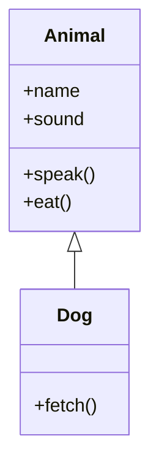
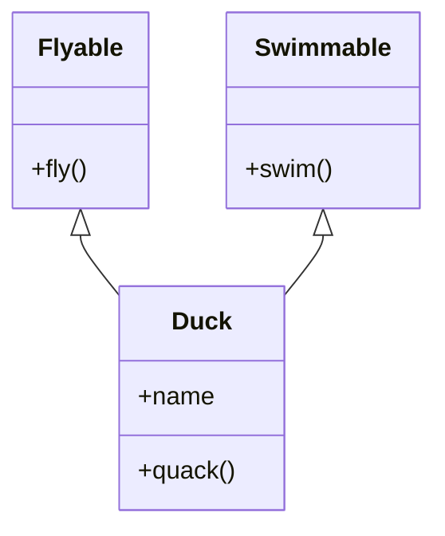
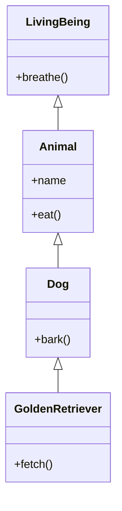
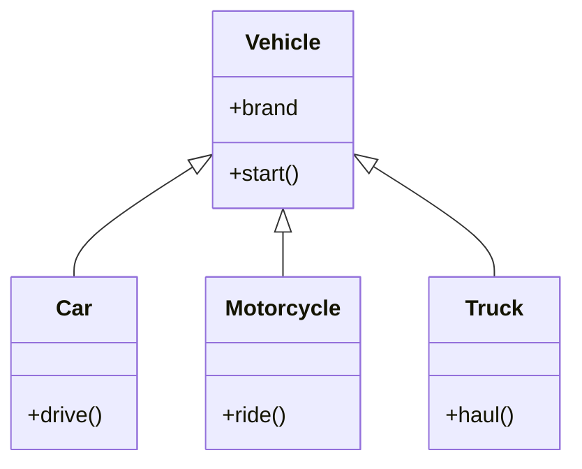
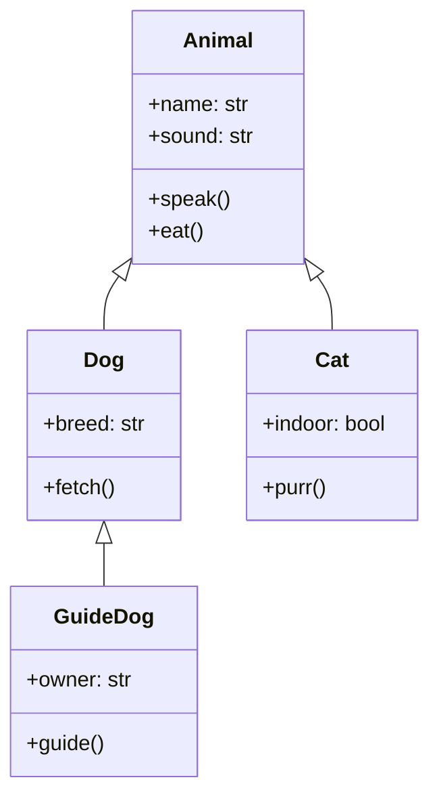

# 🐍 Python Mastery Notes — Part 3
### Advanced Python: OOP, Modules, File Handling, Regex & More

> **Author:** Senior Python Engineer & Mentor | **Level:** Beginner → Advanced  
> **Part:** 3 of N | **Topics:** OOP, Advanced OOP, Modules, File Handling, Regex

---

## 📚 Table of Contents

- [11. Object-Oriented Programming (OOP)](#11-object-oriented-programming-oop-in-python)
  - [OOP Fundamentals](#oop-fundamentals)
  - [Classes and Objects](#classes-and-objects)
  - [Four Pillars of OOP](#four-pillars-of-oop)
    - [Encapsulation](#encapsulation)
    - [Abstraction](#abstraction)
    - [Inheritance](#inheritance)
    - [Polymorphism](#polymorphism)
- [12. Advanced OOP Concepts](#12-advanced-oop-concepts)
- [13. Modules and Packages](#13-modules-and-packages)
- [14. File Handling](#14-file-handling)
- [15. Regular Expressions (Regex)](#15-regular-expressions-regex)

---

# 11. Object-Oriented Programming (OOP) in Python

---

## OOP Fundamentals

### 🤔 What is OOP?

**Simple Explanation:**  
OOP (Object-Oriented Programming) is a way of writing code where you organize everything around **objects** — things that have both **data** (what they are) and **behavior** (what they do).

Think of it like this: a **Car** has data (color, brand, speed) and behavior (start, accelerate, brake). In OOP, you model real-world entities just like that.

**Advanced Explanation:**  
OOP is a programming paradigm based on the concept of "objects" which are instances of "classes". It provides a way to structure programs so that properties and behaviors are bundled into individual objects, making large codebases manageable, maintainable, and scalable.

---

### 🌍 Why OOP Exists

Before OOP, programs were written **procedurally** — a long sequence of instructions. This worked for small programs but became unmanageable as software grew:

- Code was scattered and hard to track
- Changing one part often broke others
- No natural way to model real-world entities
- Reuse was difficult — copy-pasting everywhere

**OOP was invented to solve these problems** by packaging data and the functions that operate on it together, and by allowing modular, reusable design.

---

### ⚔️ Procedural vs Object-Oriented Programming

| Feature | Procedural | Object-Oriented |
|---|---|---|
| Core unit | Functions | Objects / Classes |
| Data | Separate from functions | Bundled with methods |
| Code reuse | Function calls | Inheritance, Composition |
| Scalability | Hard at large scale | Designed for large scale |
| Real-world modeling | Unnatural | Natural |
| Example languages | C, Pascal | Python, Java, C++ |

**Procedural Example:**
```python
# Procedural approach
name = "Alice"
balance = 1000

def deposit(balance, amount):
    return balance + amount

def withdraw(balance, amount):
    if amount > balance:
        return "Insufficient funds"
    return balance - amount

balance = deposit(balance, 500)
print(balance)  # 1500
```

**OOP Example:**
```python
# OOP approach
class BankAccount:
    def __init__(self, name, balance=0):
        self.name = name
        self.balance = balance

    def deposit(self, amount):
        self.balance += amount

    def withdraw(self, amount):
        if amount > self.balance:
            return "Insufficient funds"
        self.balance -= amount

account = BankAccount("Alice", 1000)
account.deposit(500)
print(account.balance)  # 1500
```

---

### ✅ Benefits of OOP

1. **Modularity** — Code is broken into self-contained objects
2. **Reusability** — Classes can be reused across projects
3. **Scalability** — Large systems are easier to manage
4. **Maintainability** — Bugs are localized to specific classes
5. **Abstraction** — Complex internals are hidden from users
6. **Real-world modeling** — Code maps naturally to domain concepts

---

### 🌐 Real-World Examples

| Real World | OOP Class | Attributes | Methods |
|---|---|---|---|
| Bank Account | `BankAccount` | name, balance | deposit(), withdraw() |
| Car | `Car` | brand, speed, color | start(), accelerate() |
| Employee | `Employee` | name, salary, dept | work(), get_paid() |
| Email | `Email` | sender, subject, body | send(), reply() |

---

## Classes and Objects

### 🏗️ Creating Classes

A **class** is a blueprint. An **object** is an instance created from that blueprint.

```python
class Dog:
    # Class variable (shared by all instances)
    species = "Canis familiaris"

    # Constructor — called when an object is created
    def __init__(self, name, age):
        # Instance variables (unique to each object)
        self.name = name
        self.age = age

    # Instance method
    def bark(self):
        return f"{self.name} says: Woof!"

    def describe(self):
        return f"{self.name} is {self.age} years old."
```

---

### 🔨 Creating Objects

```python
# Creating objects (instances)
dog1 = Dog("Buddy", 3)
dog2 = Dog("Max", 5)

print(dog1.bark())       # Buddy says: Woof!
print(dog2.describe())   # Max is 5 years old.

# Accessing class variable
print(dog1.species)      # Canis familiaris
print(Dog.species)       # Canis familiaris (via class)
```

---

### 🏗️ Constructors (`__init__`)

`__init__` is Python's **constructor** — a special method called automatically when an object is created.

```python
class Person:
    def __init__(self, name, age, city="Unknown"):
        self.name = name     # Required parameter
        self.age = age       # Required parameter
        self.city = city     # Optional with default

p1 = Person("Alice", 30, "Mumbai")
p2 = Person("Bob", 25)      # city defaults to "Unknown"

print(p1.name, p1.city)     # Alice Mumbai
print(p2.name, p2.city)     # Bob Unknown
```

**Why `__init__` exists:**  
Without it, you'd have to manually set every attribute after creating an object, and there's no guarantee required data is provided.

---

### 🎯 The `self` Keyword

`self` is a reference to the **current instance** of the class. It's how methods access the object's own data.

```python
class Counter:
    def __init__(self):
        self.count = 0      # self refers to this specific object

    def increment(self):
        self.count += 1     # Modifying this object's count

    def get_count(self):
        return self.count

c1 = Counter()
c2 = Counter()

c1.increment()
c1.increment()
c2.increment()

print(c1.get_count())  # 2
print(c2.get_count())  # 1  — independent from c1
```

> 💡 `self` is just a convention. You could name it anything, but **never do** — it's universally expected to be `self`.

---

### 📊 Instance Variables vs Class Variables

```python
class Employee:
    # Class variable — shared across ALL instances
    company = "TechCorp"
    employee_count = 0

    def __init__(self, name, salary):
        # Instance variables — unique to each object
        self.name = name
        self.salary = salary
        Employee.employee_count += 1  # Modify class variable

emp1 = Employee("Alice", 80000)
emp2 = Employee("Bob", 90000)

print(emp1.company)           # TechCorp
print(emp2.company)           # TechCorp  (same)
print(Employee.employee_count) # 2

# Modifying class variable via instance (creates instance copy!)
emp1.company = "StartupXYZ"
print(emp1.company)           # StartupXYZ  (instance copy)
print(emp2.company)           # TechCorp    (class variable unchanged)
```

| Feature | Instance Variable | Class Variable |
|---|---|---|
| Defined in | `__init__` via `self` | Class body directly |
| Scope | Per object | Shared across all |
| Access | `self.var` or `obj.var` | `ClassName.var` |
| Use case | Unique data per object | Shared config, counters |

---

### 🔄 Object Lifecycle

```
1. Class defined   → Python creates a class object in memory
2. obj = Class()   → __init__ called, memory allocated for instance
3. obj.method()    → Method executes with self = obj
4. del obj         → Reference removed, __del__ called if defined
5. Garbage Collect → Memory freed when no references remain
```

```python
class LifecycleDemo:
    def __init__(self, name):
        self.name = name
        print(f"[CREATED] {self.name}")

    def __del__(self):
        print(f"[DESTROYED] {self.name}")

obj = LifecycleDemo("Alpha")  # [CREATED] Alpha
del obj                        # [DESTROYED] Alpha
```

---

### 🧠 Memory Visualization

```
Stack                    Heap
------                   ----
dog1 ──────────────────► Dog object
                          ├── name = "Buddy"
                          └── age = 3

dog2 ──────────────────► Dog object
                          ├── name = "Max"
                          └── age = 5

Dog class ─────────────► Class object
                          └── species = "Canis familiaris"
```

Both `dog1` and `dog2` are separate objects in heap memory. They both reference the same `Dog` **class** object for class variables and methods.

---

## Four Pillars of OOP

---

## Encapsulation

### 📦 Definition

**Encapsulation** = Bundling data (attributes) and methods that operate on the data together in a class, AND restricting direct access to some of the object's components.

**Real-world analogy:** A capsule pill — you don't see or directly touch the medicine inside; you just take the capsule. Similarly, encapsulation hides internal details.

---

### 🔐 Access Modifiers in Python

Python uses **naming conventions** (not true access control like Java):

| Convention | Type | Example | Accessible From |
|---|---|---|---|
| `name` | Public | `self.salary` | Anywhere |
| `_name` | Protected | `self._salary` | Class + subclasses (convention) |
| `__name` | Private | `self.__salary` | Class only (name mangling) |

---

### 🌐 Public Members

```python
class Car:
    def __init__(self, brand, speed):
        self.brand = brand    # public
        self.speed = speed    # public

    def display(self):        # public method
        print(f"{self.brand} — {self.speed} km/h")

car = Car("Toyota", 180)
print(car.brand)    # Toyota  — directly accessible
car.display()       # Toyota — 180 km/h
```

---

### 🛡️ Protected Members

```python
class BankAccount:
    def __init__(self, owner, balance):
        self.owner = owner
        self._balance = balance   # protected — convention only

    def _validate_amount(self, amount):   # protected method
        return amount > 0

    def deposit(self, amount):
        if self._validate_amount(amount):
            self._balance += amount

account = BankAccount("Alice", 1000)
account.deposit(500)
print(account._balance)   # 1500 — works but violates convention
```

> ⚠️ A single underscore `_` is a **convention only**. Python does NOT enforce protection — it's a signal to other developers: "don't touch this directly."

---

### 🔒 Private Members (Name Mangling)

```python
class SecureVault:
    def __init__(self, owner, pin):
        self.owner = owner
        self.__pin = pin        # Private — name mangling applied
        self.__balance = 0

    def deposit(self, pin, amount):
        if self.__authenticate(pin):
            self.__balance += amount
            return True
        return False

    def __authenticate(self, pin):  # Private method
        return pin == self.__pin

    def get_balance(self, pin):
        if self.__authenticate(pin):
            return self.__balance
        return "Access denied"

vault = SecureVault("Alice", 1234)
vault.deposit(1234, 5000)
print(vault.get_balance(1234))    # 5000
print(vault.get_balance(9999))    # Access denied

# Direct access fails:
# print(vault.__pin)              # AttributeError!

# But name mangling allows (don't do this!):
print(vault._SecureVault__pin)    # 1234 — name mangling
```

---

### 🔧 Getter and Setter Methods

The Pythonic way to control attribute access:

```python
class Temperature:
    def __init__(self, celsius):
        self.__celsius = celsius  # private

    # Getter
    def get_celsius(self):
        return self.__celsius

    # Setter with validation
    def set_celsius(self, value):
        if value < -273.15:
            raise ValueError("Temperature below absolute zero!")
        self.__celsius = value

    # Derived property
    def get_fahrenheit(self):
        return (self.__celsius * 9/5) + 32

temp = Temperature(25)
print(temp.get_celsius())     # 25
print(temp.get_fahrenheit())  # 77.0

temp.set_celsius(100)
print(temp.get_celsius())     # 100

temp.set_celsius(-300)        # ValueError: Temperature below absolute zero!
```

---

### 🏆 Pythonic Way: `@property`

Python's `@property` decorator makes getters/setters elegant:

```python
class Temperature:
    def __init__(self, celsius):
        self.__celsius = celsius

    @property
    def celsius(self):
        return self.__celsius

    @celsius.setter
    def celsius(self, value):
        if value < -273.15:
            raise ValueError("Temperature below absolute zero!")
        self.__celsius = value

    @property
    def fahrenheit(self):
        return (self.__celsius * 9/5) + 32

temp = Temperature(25)
print(temp.celsius)      # 25       — looks like attribute access
print(temp.fahrenheit)   # 77.0

temp.celsius = 100       # Uses setter transparently
print(temp.celsius)      # 100
```

> 💡 This is preferred because it looks like regular attribute access while still validating/computing values.

---

## Abstraction

### 🎭 Definition

**Abstraction** = Hiding complex implementation details and showing only the **essential features** of an object.

**Real-world analogy:** When you drive a car, you use the steering wheel, gas pedal, and brakes. You don't need to know how the fuel injection system works or how ABS is computed. That complexity is abstracted away.

---

### 🏛️ Abstract Classes and Methods

Python provides abstraction via the `abc` (Abstract Base Classes) module:

```python
from abc import ABC, abstractmethod

class Shape(ABC):
    """Abstract base class — cannot be instantiated directly"""

    @abstractmethod
    def area(self):
        """Must be implemented by all subclasses"""
        pass

    @abstractmethod
    def perimeter(self):
        pass

    def describe(self):   # Concrete method — shared behavior
        return f"I am a {self.__class__.__name__}"

class Circle(Shape):
    def __init__(self, radius):
        self.radius = radius

    def area(self):
        return 3.14159 * self.radius ** 2

    def perimeter(self):
        return 2 * 3.14159 * self.radius

class Rectangle(Shape):
    def __init__(self, width, height):
        self.width = width
        self.height = height

    def area(self):
        return self.width * self.height

    def perimeter(self):
        return 2 * (self.width + self.height)

# shape = Shape()        # TypeError: Can't instantiate abstract class
circle = Circle(5)
rect = Rectangle(4, 6)

print(circle.area())      # 78.53975
print(rect.area())        # 24
print(circle.describe())  # I am a Circle
```

---

### ❓ Why Abstraction Matters

1. **Enforces contracts** — Subclasses MUST implement required methods
2. **Hides complexity** — Users interact with a simple interface
3. **Enables polymorphism** — Any `Shape` object has `area()` and `perimeter()`
4. **Real-world modeling** — "All vehicles must have `start()` and `stop()`"

```python
# Practical: Payment processing system
from abc import ABC, abstractmethod

class PaymentGateway(ABC):
    @abstractmethod
    def connect(self): pass

    @abstractmethod
    def charge(self, amount): pass

    @abstractmethod
    def refund(self, transaction_id): pass

class StripeGateway(PaymentGateway):
    def connect(self):
        return "Connected to Stripe API"

    def charge(self, amount):
        return f"Charged ₹{amount} via Stripe"

    def refund(self, transaction_id):
        return f"Refunded transaction {transaction_id}"

class PayPalGateway(PaymentGateway):
    def connect(self):
        return "Connected to PayPal API"

    def charge(self, amount):
        return f"Charged ₹{amount} via PayPal"

    def refund(self, transaction_id):
        return f"PayPal refund: {transaction_id}"

def process_payment(gateway: PaymentGateway, amount):
    gateway.connect()
    return gateway.charge(amount)

stripe = StripeGateway()
paypal = PayPalGateway()

print(process_payment(stripe, 500))   # Charged ₹500 via Stripe
print(process_payment(paypal, 300))   # Charged ₹300 via PayPal
```

---

## Inheritance

### 🧬 Definition

**Inheritance** = A class (child/subclass) can inherit attributes and methods from another class (parent/superclass), enabling **code reuse** and **hierarchical relationships**.

**Real-world analogy:** A child inherits traits from parents. An `ElectricCar` inherits everything from `Car` and adds battery-specific features.

---

### 1️⃣ Single Inheritance

```python
class Animal:
    def __init__(self, name, sound):
        self.name = name
        self.sound = sound

    def speak(self):
        return f"{self.name} says {self.sound}"

    def eat(self):
        return f"{self.name} is eating"

class Dog(Animal):
    def __init__(self, name):
        super().__init__(name, "Woof")  # Call parent constructor

    def fetch(self):
        return f"{self.name} fetches the ball!"

dog = Dog("Buddy")
print(dog.speak())   # Buddy says Woof  — inherited
print(dog.eat())     # Buddy is eating  — inherited
print(dog.fetch())   # Buddy fetches the ball! — own method
```

**Mermaid Diagram:**


---

### 2️⃣ Multiple Inheritance

```python
class Flyable:
    def fly(self):
        return f"{self.name} is flying"

class Swimmable:
    def swim(self):
        return f"{self.name} is swimming"

class Duck(Flyable, Swimmable):
    def __init__(self, name):
        self.name = name

    def quack(self):
        return f"{self.name} says Quack!"

duck = Duck("Donald")
print(duck.fly())    # Donald is flying
print(duck.swim())   # Donald is swimming
print(duck.quack())  # Donald says Quack!
```

**Mermaid Diagram:**


---

### 3️⃣ Multilevel Inheritance

```python
class LivingBeing:
    def breathe(self):
        return "Breathing..."

class Animal(LivingBeing):
    def __init__(self, name):
        self.name = name

    def eat(self):
        return f"{self.name} is eating"

class Dog(Animal):
    def bark(self):
        return f"{self.name} is barking"

class GoldenRetriever(Dog):
    def fetch(self):
        return f"{self.name} is fetching!"

gr = GoldenRetriever("Buddy")
print(gr.breathe())  # Breathing...   — from LivingBeing
print(gr.eat())      # Buddy is eating — from Animal
print(gr.bark())     # Buddy is barking — from Dog
print(gr.fetch())    # Buddy is fetching! — own
```

**Mermaid Diagram:**


---

### 4️⃣ Hierarchical Inheritance

```python
class Vehicle:
    def __init__(self, brand):
        self.brand = brand

    def start(self):
        return f"{self.brand} starting..."

class Car(Vehicle):
    def drive(self):
        return f"{self.brand} driving on road"

class Motorcycle(Vehicle):
    def ride(self):
        return f"{self.brand} riding fast"

class Truck(Vehicle):
    def haul(self):
        return f"{self.brand} hauling cargo"

car = Car("Toyota")
moto = Motorcycle("Yamaha")
truck = Truck("Tata")

print(car.start())    # Toyota starting...
print(moto.start())   # Yamaha starting...
print(truck.haul())   # Tata hauling cargo
```

**Mermaid Diagram:**


---

### 5️⃣ Hybrid Inheritance

A combination of two or more types of inheritance:

```python
class A:
    def method_a(self):
        return "Method A"

class B(A):
    def method_b(self):
        return "Method B"

class C(A):
    def method_c(self):
        return "Method C"

class D(B, C):   # Multiple + Multilevel = Hybrid
    def method_d(self):
        return "Method D"

d = D()
print(d.method_a())  # Method A
print(d.method_b())  # Method B
print(d.method_c())  # Method C
print(d.method_d())  # Method D
print(D.__mro__)     # Method Resolution Order
```

---

### 🔗 `super()` — Calling Parent Methods

```python
class Animal:
    def __init__(self, name):
        self.name = name
        print(f"Animal.__init__: {name}")

    def describe(self):
        return f"I am {self.name}"

class Dog(Animal):
    def __init__(self, name, breed):
        super().__init__(name)   # Call parent's __init__
        self.breed = breed
        print(f"Dog.__init__: breed={breed}")

    def describe(self):
        base = super().describe()   # Call parent's describe
        return f"{base}, breed: {self.breed}"

dog = Dog("Buddy", "Labrador")
# Animal.__init__: Buddy
# Dog.__init__: breed=Labrador

print(dog.describe())
# I am Buddy, breed: Labrador
```

---

## Polymorphism

### 🎭 Definition

**Polymorphism** = Many forms. The same method name behaves differently depending on the object calling it.

**Real-world analogy:** A person can be an employee at work, a parent at home, and a customer at a store — same person, different "methods" activated by context.

---

### 🔁 Method Overriding

```python
class Shape:
    def area(self):
        return 0

    def describe(self):
        return f"Area = {self.area()}"

class Circle(Shape):
    def __init__(self, r):
        self.r = r

    def area(self):                    # Overrides Shape.area()
        return 3.14159 * self.r ** 2

class Rectangle(Shape):
    def __init__(self, w, h):
        self.w = w
        self.h = h

    def area(self):                    # Overrides Shape.area()
        return self.w * self.h

shapes = [Circle(5), Rectangle(4, 6), Shape()]

for shape in shapes:
    print(shape.describe())
# Area = 78.53975
# Area = 24
# Area = 0
```

---

### 🦆 Duck Typing

> "If it walks like a duck and quacks like a duck, then it's a duck."

Python doesn't care about the TYPE of an object — only whether it has the method you call.

```python
class Dog:
    def speak(self):
        return "Woof!"

class Cat:
    def speak(self):
        return "Meow!"

class Robot:
    def speak(self):
        return "Beep boop!"

def make_speak(entity):
    # No type checking — just needs speak()
    print(entity.speak())

make_speak(Dog())    # Woof!
make_speak(Cat())    # Meow!
make_speak(Robot())  # Beep boop!
```

---

### ➕ Operator Overloading

```python
class Vector:
    def __init__(self, x, y):
        self.x = x
        self.y = y

    def __add__(self, other):         # Overloads +
        return Vector(self.x + other.x, self.y + other.y)

    def __sub__(self, other):         # Overloads -
        return Vector(self.x - other.x, self.y - other.y)

    def __mul__(self, scalar):        # Overloads *
        return Vector(self.x * scalar, self.y * scalar)

    def __eq__(self, other):          # Overloads ==
        return self.x == other.x and self.y == other.y

    def __repr__(self):
        return f"Vector({self.x}, {self.y})"

v1 = Vector(2, 3)
v2 = Vector(4, 1)

print(v1 + v2)     # Vector(6, 4)
print(v1 - v2)     # Vector(-2, 2)
print(v1 * 3)      # Vector(6, 9)
print(v1 == v2)    # False
```

---

### 🏋️ Method Overloading Concepts

Python doesn't support true method overloading (same name, different parameters), but you can simulate it:

```python
class Calculator:
    def add(self, *args):
        return sum(args)

calc = Calculator()
print(calc.add(1, 2))         # 3
print(calc.add(1, 2, 3))      # 6
print(calc.add(10, 20, 30))   # 60
```

---

## 🏆 OOP Summary

| Pillar | Purpose | Key Feature |
|---|---|---|
| Encapsulation | Bundle data + methods, restrict access | Private/protected members |
| Abstraction | Hide complexity, show essentials | Abstract classes, ABC |
| Inheritance | Code reuse, hierarchical relationships | `class Child(Parent)` |
| Polymorphism | Same interface, different behavior | Method overriding, duck typing |

---

## 📝 Interview Questions: OOP Basics

**Q1: What is the difference between a class and an object?**
> A class is a blueprint/template. An object is a specific instance created from that blueprint. The class `Dog` defines structure; `my_dog = Dog("Buddy")` creates a concrete object.

**Q2: What is `self` in Python?**
> `self` is a reference to the current instance of the class. It's the first parameter of instance methods and lets the method access instance variables and other methods.

**Q3: What's the difference between instance and class variables?**
> Instance variables are unique to each object (defined via `self`). Class variables are shared across all instances (defined in the class body). Modifying via an instance creates an instance-level copy.

**Q4: Can you instantiate an abstract class?**
> No. Attempting to instantiate an abstract class raises `TypeError`. Abstract classes exist as templates only — they must be subclassed and all abstract methods must be implemented.

**Q5: What is name mangling?**
> When a variable starts with `__` (double underscore), Python renames it to `_ClassName__variable` internally. This prevents accidental overriding in subclasses but does NOT make it truly private.

---

# 12. Advanced OOP Concepts

---

## Class Methods

A **class method** is bound to the class, not instances. It receives `cls` (the class itself) as the first argument.

```python
class Employee:
    company = "TechCorp"
    _count = 0

    def __init__(self, name, salary):
        self.name = name
        self.salary = salary
        Employee._count += 1

    @classmethod
    def get_count(cls):
        return f"{cls.company} has {cls._count} employees"

    @classmethod
    def from_string(cls, emp_string):
        """Alternative constructor — factory method pattern"""
        name, salary = emp_string.split(",")
        return cls(name, int(salary))

emp1 = Employee("Alice", 80000)
emp2 = Employee.from_string("Bob,90000")   # Alternative constructor

print(Employee.get_count())  # TechCorp has 2 employees
print(emp2.name)             # Bob
print(emp2.salary)           # 90000
```

**When to use:** Factory methods, alternative constructors, shared state operations.

---

## Static Methods

A **static method** doesn't receive `self` or `cls`. It's just a regular function that lives in the class namespace.

```python
class MathUtils:
    @staticmethod
    def add(a, b):
        return a + b

    @staticmethod
    def is_prime(n):
        if n < 2:
            return False
        for i in range(2, int(n**0.5) + 1):
            if n % i == 0:
                return False
        return True

print(MathUtils.add(5, 3))       # 8
print(MathUtils.is_prime(17))    # True
print(MathUtils.is_prime(10))    # False
```

| Method Type | First Arg | Access | Use Case |
|---|---|---|---|
| Instance method | `self` | Instance + class data | Most common — works with object |
| Class method | `cls` | Class data only | Factory methods, class operations |
| Static method | None | Neither | Utility functions related to class |

---

## Property Decorators

```python
class Circle:
    def __init__(self, radius):
        self._radius = radius

    @property
    def radius(self):
        return self._radius

    @radius.setter
    def radius(self, value):
        if value < 0:
            raise ValueError("Radius cannot be negative")
        self._radius = value

    @radius.deleter
    def radius(self):
        del self._radius

    @property
    def area(self):
        return 3.14159 * self._radius ** 2

    @property
    def diameter(self):
        return self._radius * 2

c = Circle(5)
print(c.radius)     # 5
print(c.area)       # 78.53975
print(c.diameter)   # 10

c.radius = 10
print(c.area)       # 314.159

c.radius = -1       # ValueError: Radius cannot be negative
```

---

## Magic Methods (Dunder Methods)

**Dunder** = Double Underscore. These special methods allow your classes to work with Python's built-in functions and operators.

```python
class Book:
    def __init__(self, title, author, pages):
        self.title = title
        self.author = author
        self.pages = pages

    def __str__(self):
        """Human-readable string — for print()"""
        return f"'{self.title}' by {self.author}"

    def __repr__(self):
        """Developer string — for debugging"""
        return f"Book(title={self.title!r}, author={self.author!r}, pages={self.pages})"

    def __len__(self):
        """Support len()"""
        return self.pages

    def __eq__(self, other):
        """Support == comparison"""
        return self.title == other.title and self.author == other.author

    def __lt__(self, other):
        """Support < comparison (enables sorting)"""
        return self.pages < other.pages

    def __contains__(self, word):
        """Support 'in' operator"""
        return word.lower() in self.title.lower()

    def __add__(self, other):
        """Support + — combine pages into anthology"""
        return Book(f"{self.title} & {other.title}", "Various", self.pages + other.pages)

b1 = Book("Python Mastery", "Alice", 400)
b2 = Book("Clean Code", "Bob", 350)

print(b1)               # 'Python Mastery' by Alice
print(repr(b1))         # Book(title='Python Mastery', author='Alice', pages=400)
print(len(b1))          # 400
print(b1 == b2)         # False
print(b1 > b2)          # True (pages)
print("Python" in b1)   # True
combo = b1 + b2
print(combo)            # 'Python Mastery & Clean Code' by Various

books = [b1, b2, Book("Design Patterns", "Gang of Four", 500)]
print(sorted(books))    # Sorted by pages (using __lt__)
```

---

### 📋 Complete Dunder Methods Reference

| Method | Triggered By | Purpose |
|---|---|---|
| `__init__` | `obj = Class()` | Constructor |
| `__del__` | `del obj` | Destructor |
| `__str__` | `str(obj)`, `print(obj)` | Human-readable string |
| `__repr__` | `repr(obj)`, REPL display | Debug string |
| `__len__` | `len(obj)` | Length |
| `__eq__` | `obj1 == obj2` | Equality |
| `__lt__` | `obj1 < obj2` | Less than |
| `__add__` | `obj1 + obj2` | Addition |
| `__mul__` | `obj1 * n` | Multiplication |
| `__contains__` | `x in obj` | Membership |
| `__iter__` | `for x in obj` | Iteration |
| `__next__` | `next(obj)` | Next in iteration |
| `__getitem__` | `obj[key]` | Index access |
| `__setitem__` | `obj[key] = val` | Index assignment |
| `__call__` | `obj()` | Call as function |
| `__enter__` | `with obj as x:` | Context manager enter |
| `__exit__` | End of `with` block | Context manager exit |

---

## Composition vs Inheritance

**Composition** = "Has-a" relationship. An object contains other objects.  
**Inheritance** = "Is-a" relationship. A class extends another class.

```python
# INHERITANCE: Car IS-A Vehicle
class Vehicle:
    def start(self):
        return "Starting engine"

class Car(Vehicle):
    pass

# COMPOSITION: Car HAS-A Engine
class Engine:
    def __init__(self, horsepower):
        self.horsepower = horsepower

    def start(self):
        return f"Engine ({self.horsepower}hp) starting"

class Transmission:
    def __init__(self, gears):
        self.gears = gears

    def shift(self, gear):
        return f"Shifting to gear {gear}"

class Car:
    def __init__(self, brand, hp, gears):
        self.brand = brand
        self.engine = Engine(hp)              # Composition
        self.transmission = Transmission(gears)  # Composition

    def start(self):
        return self.engine.start()

    def drive(self, gear):
        return self.transmission.shift(gear)

car = Car("Toyota", 150, 6)
print(car.start())      # Engine (150hp) starting
print(car.drive(3))     # Shifting to gear 3
```

**When to use which:**

| Use Inheritance When... | Use Composition When... |
|---|---|
| True "is-a" relationship | "Has-a" relationship |
| Child extends parent | Objects contain other objects |
| Shared interface needed | More flexibility required |
| Example: `Dog` is an `Animal` | Example: `Car` has an `Engine` |

> 💡 **Industry rule:** "Favor composition over inheritance." Composition is more flexible and avoids deep inheritance hierarchies.

---

## Method Resolution Order (MRO)

When multiple inheritance exists, Python uses **C3 Linearization** to determine which method to call:

```python
class A:
    def method(self):
        return "A"

class B(A):
    def method(self):
        return "B"

class C(A):
    def method(self):
        return "C"

class D(B, C):
    pass

d = D()
print(d.method())    # B — follows MRO

print(D.__mro__)
# (<class '__main__.D'>, <class '__main__.B'>, <class '__main__.C'>, <class '__main__.A'>, <class 'object'>)

print(D.mro())
# [D, B, C, A, object]
```

**MRO Rule:** Python searches left to right, depth first, respecting class order.

```
D → B → C → A → object
```

---

## SOLID Principles (Introduction)

```
S — Single Responsibility Principle
O — Open/Closed Principle
L — Liskov Substitution Principle
I — Interface Segregation Principle
D — Dependency Inversion Principle
```

### S — Single Responsibility

```python
# BAD: Does too many things
class UserManager:
    def create_user(self, name): pass
    def send_email(self, user): pass
    def save_to_db(self, user): pass
    def generate_pdf_report(self): pass

# GOOD: One class, one responsibility
class UserService:
    def create_user(self, name): pass

class EmailService:
    def send_email(self, user): pass

class DatabaseService:
    def save(self, obj): pass

class ReportService:
    def generate_pdf(self): pass
```

### O — Open/Closed

```python
# Open for extension, closed for modification
from abc import ABC, abstractmethod

class Discount(ABC):
    @abstractmethod
    def apply(self, price): pass

class NoDiscount(Discount):
    def apply(self, price):
        return price

class PercentageDiscount(Discount):
    def __init__(self, percent):
        self.percent = percent

    def apply(self, price):
        return price * (1 - self.percent / 100)

# Adding new discount types doesn't modify existing code
class FlatDiscount(Discount):
    def __init__(self, amount):
        self.amount = amount

    def apply(self, price):
        return price - self.amount

def checkout(price, discount: Discount):
    return discount.apply(price)

print(checkout(1000, PercentageDiscount(10)))  # 900.0
print(checkout(1000, FlatDiscount(150)))       # 850
```

---

## Data Classes

Python 3.7+ provides `@dataclass` to reduce boilerplate:

```python
from dataclasses import dataclass, field
from typing import List

@dataclass
class Point:
    x: float
    y: float

    def distance_from_origin(self):
        return (self.x**2 + self.y**2)**0.5

@dataclass
class Student:
    name: str
    age: int
    grades: List[float] = field(default_factory=list)  # Mutable default

    def average(self):
        return sum(self.grades) / len(self.grades) if self.grades else 0

p = Point(3.0, 4.0)
print(p)                         # Point(x=3.0, y=4.0)
print(p.distance_from_origin())  # 5.0
print(p == Point(3.0, 4.0))      # True — auto __eq__

s = Student("Alice", 20, [85.0, 92.0, 78.0])
print(s)             # Student(name='Alice', age=20, grades=[85.0, 92.0, 78.0])
print(s.average())   # 85.0
```

**Dataclass vs Regular Class:**

| Feature | Regular Class | @dataclass |
|---|---|---|
| `__init__` | Manual | Auto-generated |
| `__repr__` | Manual | Auto-generated |
| `__eq__` | Manual | Auto-generated |
| Type hints | Optional | Required |
| Code | More boilerplate | Minimal |

---

## Named Tuples

Lightweight, immutable data containers with named fields:

```python
from collections import namedtuple
from typing import NamedTuple

# Method 1: collections.namedtuple
Point = namedtuple('Point', ['x', 'y'])
p = Point(10, 20)
print(p.x, p.y)   # 10 20
print(p[0])        # 10 — still tuple-like
print(p)           # Point(x=10, y=20)

# Method 2: typing.NamedTuple (preferred — supports types and defaults)
class Employee(NamedTuple):
    name: str
    department: str
    salary: float = 50000.0  # Default value

emp = Employee("Alice", "Engineering", 90000)
print(emp)              # Employee(name='Alice', department='Engineering', salary=90000)
print(emp.name)         # Alice
print(emp._asdict())    # {'name': 'Alice', 'department': 'Engineering', 'salary': 90000}

# Immutable — can't modify
# emp.name = "Bob"  # AttributeError
```

---

## UML-like Mermaid Diagrams



---

## 📝 Interview Questions: Advanced OOP

**Q1: What's the difference between `@classmethod` and `@staticmethod`?**
> `@classmethod` receives the class as the first argument (`cls`) and can access/modify class state. `@staticmethod` receives no implicit argument and is essentially a regular function namespaced inside the class.

**Q2: What are magic methods? Give examples.**
> Magic methods (dunder methods) start and end with double underscores. They enable operator overloading and integration with Python's built-in functions. Examples: `__init__` (constructor), `__str__` (string representation), `__add__` (+ operator), `__len__` (len() function).

**Q3: What is MRO and how does Python resolve it?**
> MRO (Method Resolution Order) defines the order in which Python searches classes when resolving methods in multiple inheritance. Python uses C3 Linearization — left to right, depth first. Check via `ClassName.__mro__`.

**Q4: Composition vs Inheritance — when to prefer which?**
> Prefer composition ("has-a") when the relationship between classes is "contains" rather than "is-a". Composition is more flexible, avoids tight coupling, and is easier to change. Inheritance is appropriate for true hierarchical "is-a" relationships and shared interfaces.

---

# 13. Modules and Packages

---

## Modules

### 📁 What is a Module?

A **module** is simply a Python file (`.py`) containing functions, classes, and variables that can be imported and reused.

```
calculator.py     ← This is a module
my_script.py      ← This imports the module
```

---

### 🏗️ Creating Modules

**`calculator.py`:**
```python
# calculator.py — A simple module

PI = 3.14159

def add(a, b):
    return a + b

def subtract(a, b):
    return a - b

def multiply(a, b):
    return a * b

def divide(a, b):
    if b == 0:
        raise ValueError("Cannot divide by zero!")
    return a / b

class Calculator:
    def __init__(self):
        self.history = []

    def compute(self, op, a, b):
        result = None
        if op == "+": result = add(a, b)
        elif op == "-": result = subtract(a, b)
        elif op == "*": result = multiply(a, b)
        elif op == "/": result = divide(a, b)
        self.history.append(f"{a} {op} {b} = {result}")
        return result
```

---

### 📥 Importing Modules

```python
# Method 1: Import the entire module
import calculator
print(calculator.add(5, 3))      # 8
print(calculator.PI)             # 3.14159

# Method 2: Import specific items
from calculator import add, multiply, PI
print(add(5, 3))                 # 8
print(PI)                        # 3.14159

# Method 3: Import with alias
import calculator as calc
print(calc.add(5, 3))            # 8

from calculator import add as plus
print(plus(5, 3))                # 8

# Method 4: Import everything (NOT recommended)
from calculator import *
print(subtract(10, 4))           # 6  — but pollutes namespace!
```

**Best Practice:** Prefer explicit imports (`from module import specific_thing`) to keep namespaces clean.

---

### 🔢 Import Syntax Comparison

| Syntax | Example | When to Use |
|---|---|---|
| `import module` | `import os` | When using many things from module |
| `from module import x` | `from os import path` | When using specific items |
| `import module as alias` | `import numpy as np` | Long names, convention |
| `from module import x as y` | `from datetime import datetime as dt` | Conflict avoidance |
| `from module import *` | `from math import *` | Avoid in production! |

---

### 🏗️ `__name__` and `__main__`

```python
# utils.py
def greet(name):
    return f"Hello, {name}!"

if __name__ == "__main__":
    # This block runs ONLY when file is executed directly
    # NOT when imported
    print(greet("World"))
    print("Running as main script")
```

```python
# main.py
import utils
print(utils.greet("Alice"))   # Hello, Alice!
# The __main__ block in utils.py does NOT run
```

> 💡 `__name__ == "__main__"` is Python's way of knowing if a file is being run directly or imported.

---

### 📦 Built-in Modules — Quick Overview

```python
import os, sys, math, random, datetime, time
```

---

## Packages

### 📂 What is a Package?

A **package** is a directory containing Python modules and a special `__init__.py` file.

```
mypackage/
│
├── __init__.py          ← Makes it a package
├── calculator.py
├── utils.py
└── validators.py
```

---

### 🏗️ Creating Packages

**Directory structure:**
```
ecommerce/
├── __init__.py
├── products.py
├── cart.py
├── payments/
│   ├── __init__.py
│   ├── stripe.py
│   └── paypal.py
└── utils/
    ├── __init__.py
    └── formatters.py
```

**`ecommerce/__init__.py`:**
```python
# Controls what's exposed when someone does: from ecommerce import *
from .products import Product
from .cart import Cart

__version__ = "1.0.0"
__all__ = ["Product", "Cart"]
```

**`ecommerce/products.py`:**
```python
class Product:
    def __init__(self, name, price):
        self.name = name
        self.price = price

    def __repr__(self):
        return f"Product({self.name}, ₹{self.price})"
```

**`ecommerce/cart.py`:**
```python
from .products import Product  # Relative import

class Cart:
    def __init__(self):
        self.items = []

    def add(self, product, qty=1):
        self.items.append((product, qty))

    def total(self):
        return sum(p.price * q for p, q in self.items)
```

**Usage:**
```python
from ecommerce import Product, Cart
from ecommerce.payments.stripe import StripeGateway

p1 = Product("Laptop", 75000)
p2 = Product("Mouse", 1500)

cart = Cart()
cart.add(p1, 1)
cart.add(p2, 2)
print(cart.total())   # 78000
```

---

### 🔗 Relative vs Absolute Imports

```python
# Absolute import — from project root
from ecommerce.products import Product

# Relative import — relative to current package
from .products import Product       # Same package
from ..utils import formatters      # Parent package
```

---

## Important Built-in Modules

---

### 📁 `os` — Operating System Interface

```python
import os

# Current directory
print(os.getcwd())                  # /home/user/project

# List directory contents
print(os.listdir('.'))              # ['file.py', 'data', ...]

# Create directory
os.makedirs("logs/2024", exist_ok=True)

# File/path operations
path = os.path.join("data", "users", "alice.json")
print(path)                          # data/users/alice.json
print(os.path.exists(path))         # True/False
print(os.path.basename(path))       # alice.json
print(os.path.dirname(path))        # data/users
print(os.path.splitext("file.txt")) # ('file', '.txt')

# Environment variables
home = os.environ.get("HOME", "/tmp")
db_url = os.environ.get("DATABASE_URL", "sqlite:///local.db")

# Execute system commands
os.system("echo Hello")

# File info
stats = os.stat("myfile.txt")
print(stats.st_size)    # File size in bytes
```

---

### ⚙️ `sys` — System-Specific Parameters

```python
import sys

print(sys.version)          # Python version
print(sys.platform)         # 'linux', 'win32', 'darwin'
print(sys.argv)             # Command-line arguments
# python script.py arg1 arg2 → ['script.py', 'arg1', 'arg2']

# Module search path
print(sys.path)             # List of paths Python searches for modules

# Add custom path
sys.path.append("/custom/modules")

# Exit program
sys.exit(0)   # 0 = success, 1+ = error

# Memory size of objects
import sys
print(sys.getsizeof([1,2,3]))   # 120 (bytes)
```

---

### 🎲 `random` — Random Number Generation

```python
import random

# Random float [0, 1)
print(random.random())            # 0.7312...

# Random integer in range [a, b]
print(random.randint(1, 10))      # 7

# Random float in range [a, b]
print(random.uniform(1.0, 5.0))   # 3.142...

# Random choice from sequence
fruits = ["apple", "banana", "cherry"]
print(random.choice(fruits))      # "banana"

# Multiple choices with replacement
print(random.choices(fruits, k=3))  # ['apple', 'apple', 'cherry']

# Sample without replacement
print(random.sample(fruits, k=2))   # ['cherry', 'apple']

# Shuffle in-place
random.shuffle(fruits)
print(fruits)                       # ['cherry', 'apple', 'banana']

# Reproducible results
random.seed(42)
print(random.randint(1, 100))   # Always same number with same seed
```

---

### ➗ `math` — Mathematical Functions

```python
import math

# Basic
print(math.pi)              # 3.141592653589793
print(math.e)               # 2.718281828459045
print(math.tau)             # 6.283... (2*pi)

# Powers and roots
print(math.sqrt(16))        # 4.0
print(math.pow(2, 10))      # 1024.0
print(math.log(100, 10))    # 2.0
print(math.log2(8))         # 3.0
print(math.log10(1000))     # 3.0

# Rounding
print(math.ceil(3.2))       # 4
print(math.floor(3.9))      # 3
print(math.trunc(3.9))      # 3

# Trigonometry
print(math.sin(math.pi/2))  # 1.0
print(math.cos(0))           # 1.0
print(math.degrees(math.pi)) # 180.0
print(math.radians(180))     # 3.14159...

# Combinatorics
print(math.factorial(5))    # 120
print(math.comb(10, 3))     # 120 (nCr)
print(math.perm(10, 3))     # 720 (nPr)

# Infinity and NaN
print(math.inf)             # inf
print(math.isinf(math.inf)) # True
print(math.isnan(float('nan'))) # True
```

---

### 📅 `datetime` — Dates and Times

```python
from datetime import datetime, date, time, timedelta

# Current datetime
now = datetime.now()
print(now)                           # 2024-01-15 14:30:25.123456

today = date.today()
print(today)                         # 2024-01-15

# Create specific datetime
birthday = datetime(1995, 8, 15, 12, 0, 0)
print(birthday.strftime("%B %d, %Y"))  # August 15, 1995

# Parse string to datetime
dt = datetime.strptime("2024-01-15", "%Y-%m-%d")
print(dt)

# Format codes
print(now.strftime("%Y-%m-%d"))      # 2024-01-15
print(now.strftime("%d/%m/%Y"))      # 15/01/2024
print(now.strftime("%H:%M:%S"))      # 14:30:25
print(now.strftime("%A, %B %d"))     # Monday, January 15

# Arithmetic with timedelta
one_week = timedelta(days=7)
next_week = today + one_week
print(next_week)                     # 2024-01-22

diff = datetime(2025, 1, 1) - now
print(diff.days)                     # Days until New Year

# Comparing
dt1 = datetime(2024, 1, 1)
dt2 = datetime(2024, 6, 15)
print(dt1 < dt2)    # True
print(dt2 - dt1)    # 165 days, 0:00:00
```

---

### ⏱️ `time` — Time-Related Functions

```python
import time

# Current time as float (seconds since epoch)
print(time.time())           # 1705320625.123

# Sleep
print("Start")
time.sleep(1)                # Pause for 1 second
print("End")

# Measure performance
start = time.perf_counter()
sum(range(1_000_000))
end = time.perf_counter()
print(f"Elapsed: {end - start:.4f}s")

# Structured time
t = time.localtime()
print(t.tm_year, t.tm_mon, t.tm_mday)   # 2024 1 15
print(time.strftime("%Y-%m-%d", t))      # 2024-01-15
```

---

### 📚 `collections` — Specialized Data Structures

```python
from collections import Counter, defaultdict, OrderedDict, deque, namedtuple

# Counter — count hashable objects
text = "hello world"
c = Counter(text)
print(c)                         # Counter({'l': 3, 'o': 2, ...})
print(c.most_common(3))          # [('l', 3), ('o', 2), ...]

words = ["apple", "banana", "apple", "cherry", "banana", "apple"]
wc = Counter(words)
print(wc["apple"])               # 3

# defaultdict — dict with default values
dd = defaultdict(list)
for word in ["apple", "banana", "apricot", "blueberry"]:
    dd[word[0]].append(word)
print(dict(dd))  # {'a': ['apple', 'apricot'], 'b': ['banana', 'blueberry']}

dd_int = defaultdict(int)
for char in "mississippi":
    dd_int[char] += 1
print(dict(dd_int))

# deque — double-ended queue (O(1) on both ends)
dq = deque([1, 2, 3])
dq.appendleft(0)    # Add to front
dq.append(4)        # Add to back
print(dq)           # deque([0, 1, 2, 3, 4])
dq.popleft()        # Remove from front O(1) — better than list.pop(0)
dq.pop()            # Remove from back O(1)

# Rotating
dq = deque([1, 2, 3, 4, 5])
dq.rotate(2)        # Rotate right by 2
print(dq)           # deque([4, 5, 1, 2, 3])

# namedtuple
Point = namedtuple("Point", ["x", "y"])
p = Point(10, 20)
print(p.x, p.y)     # 10 20
```

---

### 🔄 `itertools` — Efficient Iterators

```python
import itertools

# count — infinite counter
counter = itertools.count(start=10, step=2)
print([next(counter) for _ in range(5)])  # [10, 12, 14, 16, 18]

# cycle — repeat sequence
cycler = itertools.cycle(['R', 'G', 'B'])
print([next(cycler) for _ in range(7)])   # ['R','G','B','R','G','B','R']

# repeat
rep = list(itertools.repeat("hello", 3))
print(rep)   # ['hello', 'hello', 'hello']

# chain — combine iterables
chained = list(itertools.chain([1,2,3], [4,5], [6]))
print(chained)   # [1, 2, 3, 4, 5, 6]

# combinations
for combo in itertools.combinations("ABC", 2):
    print(combo)  # ('A','B') ('A','C') ('B','C')

# permutations
for perm in itertools.permutations("AB", 2):
    print(perm)   # ('A','B') ('B','A')

# product (Cartesian product)
for p in itertools.product([1,2], ['a','b']):
    print(p)  # (1,'a') (1,'b') (2,'a') (2,'b')

# groupby
data = [("Alice","Engineering"), ("Bob","Marketing"), ("Carol","Engineering")]
data.sort(key=lambda x: x[1])   # Must sort first!
for dept, employees in itertools.groupby(data, key=lambda x: x[1]):
    print(dept, list(employees))

# islice — slice an iterator
gen = (x**2 for x in range(100))
first_five = list(itertools.islice(gen, 5))
print(first_five)   # [0, 1, 4, 9, 16]
```

---

### ⚙️ `functools` — Higher-Order Functions

```python
import functools

# partial — fix some arguments
def power(base, exponent):
    return base ** exponent

square = functools.partial(power, exponent=2)
cube = functools.partial(power, exponent=3)

print(square(5))    # 25
print(cube(3))      # 27

# reduce — fold a sequence to single value
nums = [1, 2, 3, 4, 5]
total = functools.reduce(lambda acc, x: acc + x, nums)
print(total)    # 15

product = functools.reduce(lambda acc, x: acc * x, nums)
print(product)  # 120

# lru_cache — memoization
@functools.lru_cache(maxsize=128)
def fibonacci(n):
    if n < 2:
        return n
    return fibonacci(n-1) + fibonacci(n-2)

print(fibonacci(50))   # Instantly! Without cache: ~2^50 calls
print(fibonacci.cache_info())   # CacheInfo(hits=48, misses=51, ...)

# wraps — preserve function metadata in decorators
def my_decorator(func):
    @functools.wraps(func)   # Preserves __name__, __doc__
    def wrapper(*args, **kwargs):
        print(f"Calling {func.__name__}")
        return func(*args, **kwargs)
    return wrapper

@my_decorator
def greet(name):
    """Greet someone"""
    return f"Hello, {name}!"

print(greet.__name__)    # greet (not 'wrapper'!)
print(greet.__doc__)     # Greet someone
```

---

# 14. File Handling

---

## Opening Files

### 📂 The `open()` Function

```python
# Syntax
file = open(filename, mode, encoding=None, buffering=-1)
```

### 📋 File Modes

| Mode | Description | Creates? | Truncates? |
|---|---|---|---|
| `'r'` | Read (default) | No | No |
| `'w'` | Write | Yes | Yes |
| `'a'` | Append | Yes | No |
| `'x'` | Exclusive create | No (error if exists) | N/A |
| `'r+'` | Read + Write | No | No |
| `'w+'` | Write + Read | Yes | Yes |
| `'a+'` | Append + Read | Yes | No |
| `'rb'` | Binary read | No | No |
| `'wb'` | Binary write | Yes | Yes |

---

## Context Managers (`with` Statement)

Always use `with` — it automatically closes files even if exceptions occur:

```python
# WITHOUT with — BAD PRACTICE
f = open("data.txt", "r")
content = f.read()
f.close()   # Easy to forget! Exception can prevent this.

# WITH context manager — BEST PRACTICE
with open("data.txt", "r", encoding="utf-8") as f:
    content = f.read()
# File is automatically closed here, even if exception occurs

# Multiple files at once
with open("input.txt", "r") as infile, open("output.txt", "w") as outfile:
    data = infile.read()
    outfile.write(data.upper())
```

---

## Reading Files

```python
# Create a sample file first
with open("sample.txt", "w") as f:
    f.write("Line 1: Hello World\n")
    f.write("Line 2: Python is awesome\n")
    f.write("Line 3: File handling is important\n")

# read() — entire file as string
with open("sample.txt", "r") as f:
    content = f.read()
    print(content)

# readline() — one line at a time
with open("sample.txt", "r") as f:
    line1 = f.readline()    # "Line 1: Hello World\n"
    line2 = f.readline()    # "Line 2: Python is awesome\n"
    print(repr(line1))

# readlines() — all lines as list
with open("sample.txt", "r") as f:
    lines = f.readlines()
    print(lines)   # ['Line 1: Hello World\n', ...]
    print(len(lines))  # 3

# Iterate line by line (BEST for large files — memory efficient)
with open("sample.txt", "r") as f:
    for line in f:
        print(line.strip())   # strip() removes \n
```

---

## Writing Files

```python
# write() — write string
with open("output.txt", "w", encoding="utf-8") as f:
    f.write("First line\n")
    f.write("Second line\n")

# writelines() — write list of strings
lines = ["Alpha\n", "Beta\n", "Gamma\n"]
with open("output.txt", "w") as f:
    f.writelines(lines)

# Append mode
with open("log.txt", "a") as f:
    f.write("New log entry\n")
    f.write("Another entry\n")

# Using print() with file parameter
with open("output.txt", "w") as f:
    print("Hello from print!", file=f)
    print("Another line", file=f)
```

---

## File Pointers: `seek()` and `tell()`

```python
with open("sample.txt", "r") as f:
    print(f.tell())       # 0 — at beginning

    f.read(10)            # Read 10 chars
    print(f.tell())       # 10 — pointer moved

    f.seek(0)             # Back to beginning
    print(f.tell())       # 0

    f.seek(5)             # Move to position 5
    print(f.read(5))      # Read 5 chars from position 5

    f.seek(0, 2)          # Seek from end (0=start, 1=current, 2=end)
    print(f.tell())       # File size
```

---

## Working with Text Files

```python
# Real-world: Process a log file
import os

def process_log_file(filepath):
    errors = []
    warnings = []

    with open(filepath, "r", encoding="utf-8") as f:
        for line_num, line in enumerate(f, 1):
            line = line.strip()
            if "[ERROR]" in line:
                errors.append((line_num, line))
            elif "[WARNING]" in line:
                warnings.append((line_num, line))

    return errors, warnings

# Write report
def write_report(errors, warnings, output_path):
    with open(output_path, "w") as f:
        f.write(f"=== Log Analysis Report ===\n\n")
        f.write(f"Errors ({len(errors)}):\n")
        for num, line in errors:
            f.write(f"  Line {num}: {line}\n")
        f.write(f"\nWarnings ({len(warnings)}):\n")
        for num, line in warnings:
            f.write(f"  Line {num}: {line}\n")
```

---

## Working with CSV Files

```python
import csv

# Writing CSV
employees = [
    {"name": "Alice", "dept": "Engineering", "salary": 80000},
    {"name": "Bob",   "dept": "Marketing",   "salary": 70000},
    {"name": "Carol", "dept": "Engineering", "salary": 90000},
]

with open("employees.csv", "w", newline="", encoding="utf-8") as f:
    fieldnames = ["name", "dept", "salary"]
    writer = csv.DictWriter(f, fieldnames=fieldnames)

    writer.writeheader()
    writer.writerows(employees)

# Reading CSV
with open("employees.csv", "r", encoding="utf-8") as f:
    reader = csv.DictReader(f)
    for row in reader:
        print(f"{row['name']} — {row['dept']} — ₹{row['salary']}")

# Basic CSV writing
with open("data.csv", "w", newline="") as f:
    writer = csv.writer(f)
    writer.writerow(["Name", "Age", "City"])
    writer.writerow(["Alice", 30, "Mumbai"])
    writer.writerow(["Bob", 25, "Delhi"])

# Basic CSV reading
with open("data.csv", "r") as f:
    reader = csv.reader(f)
    headers = next(reader)
    for row in reader:
        print(row)
```

---

## Working with JSON Files

```python
import json

# Python dict → JSON file
data = {
    "name": "Alice",
    "age": 30,
    "skills": ["Python", "SQL", "Docker"],
    "address": {
        "city": "Mumbai",
        "state": "Maharashtra"
    },
    "active": True,
    "score": 9.5
}

# Write JSON
with open("user.json", "w", encoding="utf-8") as f:
    json.dump(data, f, indent=4, ensure_ascii=False)

# Read JSON
with open("user.json", "r", encoding="utf-8") as f:
    loaded = json.load(f)
    print(loaded["name"])     # Alice
    print(loaded["skills"])   # ['Python', 'SQL', 'Docker']

# String conversions
json_str = json.dumps(data, indent=2)   # dict → JSON string
print(json_str)

back_to_dict = json.loads(json_str)     # JSON string → dict
print(type(back_to_dict))               # <class 'dict'>

# Handling non-serializable objects
from datetime import datetime

class CustomEncoder(json.JSONEncoder):
    def default(self, obj):
        if isinstance(obj, datetime):
            return obj.isoformat()
        return super().default(obj)

data_with_date = {"name": "Alice", "created": datetime.now()}
print(json.dumps(data_with_date, cls=CustomEncoder))
```

---

## Working with Binary Files

```python
# Write binary
with open("data.bin", "wb") as f:
    f.write(b"Hello Binary World")
    f.write(bytes([72, 101, 108, 108, 111]))   # bytes from integers

# Read binary
with open("data.bin", "rb") as f:
    content = f.read()
    print(content)       # b'Hello Binary WorldHello'
    print(type(content)) # <class 'bytes'>

# Copy a file (image, video, etc.)
def copy_file(src, dst):
    with open(src, "rb") as fin, open(dst, "wb") as fout:
        chunk_size = 65536   # 64KB chunks
        while True:
            chunk = fin.read(chunk_size)
            if not chunk:
                break
            fout.write(chunk)
```

---

## Advanced: Large File Processing

```python
# Memory-efficient: Process huge files line by line
def count_lines(filepath):
    count = 0
    with open(filepath, "r", encoding="utf-8") as f:
        for _ in f:
            count += 1
    return count

# Process in chunks
def process_large_csv(filepath, chunk_size=10000):
    buffer = []
    with open(filepath, "r") as f:
        reader = csv.DictReader(f)
        for row in reader:
            buffer.append(row)
            if len(buffer) >= chunk_size:
                process_chunk(buffer)
                buffer.clear()
        if buffer:
            process_chunk(buffer)   # Process remaining

def process_chunk(chunk):
    # Process the batch
    print(f"Processing {len(chunk)} rows...")
```

---

## Encoding and Error Handling

```python
# Always specify encoding!
with open("hindi.txt", "w", encoding="utf-8") as f:
    f.write("नमस्ते दुनिया")   # UTF-8 supports Unicode

# Error handling
try:
    with open("nonexistent.txt", "r") as f:
        content = f.read()
except FileNotFoundError:
    print("File does not exist!")
except PermissionError:
    print("No permission to read this file!")
except UnicodeDecodeError as e:
    print(f"Encoding error: {e}")
except IOError as e:
    print(f"IO Error: {e}")

# Handling encoding errors gracefully
with open("file.txt", "r", encoding="utf-8", errors="replace") as f:
    content = f.read()  # Replace unreadable chars with ?

with open("file.txt", "r", encoding="utf-8", errors="ignore") as f:
    content = f.read()  # Skip unreadable chars
```

---

## Custom Context Manager

```python
class ManagedFile:
    def __init__(self, filepath, mode="r"):
        self.filepath = filepath
        self.mode = mode
        self.file = None

    def __enter__(self):
        print(f"Opening {self.filepath}")
        self.file = open(self.filepath, self.mode)
        return self.file

    def __exit__(self, exc_type, exc_val, exc_tb):
        print(f"Closing {self.filepath}")
        if self.file:
            self.file.close()
        # Return True to suppress exceptions, False to propagate
        return False

with ManagedFile("sample.txt", "w") as f:
    f.write("Custom context manager!")
# Opening sample.txt
# Closing sample.txt
```

---

# 15. Regular Expressions (Regex)

---

## What is Regex?

**Regular Expressions (Regex)** are sequences of characters that define a **search pattern**. They're used to search, match, extract, validate, and manipulate text.

**Real-world analogy:** Like a highly advanced "Ctrl+F" that can find patterns instead of just exact text. Find all email addresses, all phone numbers, all dates — using pattern rules.

---

## Why Regex Exists

- Validate input (email, phone, passwords)
- Extract data from text (log parsing, web scraping)
- Search and replace patterns in text
- Split strings by complex patterns
- Data cleaning and normalization

---

## Regex Syntax

### 📌 Literal Characters

```python
import re
text = "Hello World 2024"
print(re.findall("Hello", text))    # ['Hello']
print(re.findall("2024", text))     # ['2024']
```

---

### 📌 Character Classes `[ ]`

| Pattern | Matches |
|---|---|
| `[abc]` | a, b, or c |
| `[a-z]` | Any lowercase letter |
| `[A-Z]` | Any uppercase letter |
| `[0-9]` | Any digit |
| `[a-zA-Z0-9]` | Any alphanumeric |
| `[^abc]` | NOT a, b, or c |

---

### 📌 Meta Characters

| Pattern | Meaning | Example | Matches |
|---|---|---|---|
| `.` | Any char except newline | `a.c` | `abc`, `a1c`, `a#c` |
| `\d` | Digit `[0-9]` | `\d\d` | `42`, `99` |
| `\D` | Non-digit | `\D+` | `abc`, `hello` |
| `\w` | Word char `[a-zA-Z0-9_]` | `\w+` | `hello`, `var_1` |
| `\W` | Non-word char | `\W` | ` `, `!`, `@` |
| `\s` | Whitespace | `a\sb` | `a b`, `a\tb` |
| `\S` | Non-whitespace | `\S+` | `hello`, `123` |
| `\b` | Word boundary | `\bword\b` | `word` not `password` |
| `\n` | Newline | | |
| `\t` | Tab | | |

---

### 📌 Quantifiers

| Pattern | Meaning |
|---|---|
| `*` | 0 or more |
| `+` | 1 or more |
| `?` | 0 or 1 (optional) |
| `{n}` | Exactly n times |
| `{n,}` | n or more times |
| `{n,m}` | Between n and m times |
| `*?` | 0 or more (lazy) |
| `+?` | 1 or more (lazy) |

```python
import re

text = "aaabbc"
print(re.findall("a+", text))     # ['aaa']
print(re.findall("a*", text))     # ['aaa', '', '', '', '']
print(re.findall("a{2,3}", text)) # ['aaa']
print(re.findall("b{1,2}", text)) # ['bb']
```

---

### 📌 Anchors

| Pattern | Meaning |
|---|---|
| `^` | Start of string |
| `$` | End of string |
| `\b` | Word boundary |
| `\B` | Non-word boundary |

```python
text = "Python is great. Python rocks!"
print(re.findall(r"^Python", text))    # ['Python']  — only first
print(re.findall(r"Python", text))     # ['Python', 'Python']  — all
print(re.findall(r"rocks!$", text))    # ['rocks!']
```

---

### 📌 Groups

```python
# Capturing groups ( )
text = "John Smith, Jane Doe, Bob Jones"
pattern = r"(\w+) (\w+)"
matches = re.findall(pattern, text)
print(matches)   # [('John', 'Smith'), ('Jane', 'Doe'), ('Bob', 'Jones')]

# Non-capturing groups (?: )
pattern = r"(?:Mr|Ms|Dr)\. (\w+)"
text = "Mr. Smith and Dr. Jones visited"
print(re.findall(pattern, text))   # ['Smith', 'Jones']

# Named groups (?P<name> )
pattern = r"(?P<year>\d{4})-(?P<month>\d{2})-(?P<day>\d{2})"
match = re.search(pattern, "Date: 2024-01-15")
if match:
    print(match.group("year"))   # 2024
    print(match.group("month"))  # 01
    print(match.group("day"))    # 15
    print(match.groupdict())     # {'year': '2024', 'month': '01', 'day': '15'}
```

---

### 📌 Lookaheads and Lookbehinds

```python
# Positive lookahead (?=...) — match X followed by Y
text = "100USD 200EUR 300USD"
print(re.findall(r"\d+(?=USD)", text))   # ['100', '300'] — numbers before USD

# Negative lookahead (?!...) — match X NOT followed by Y
print(re.findall(r"\d+(?!USD)", text))   # ['200'] — NOT before USD (simplified)

# Positive lookbehind (?<=...) — match X preceded by Y
text = "Price: $100 and $200"
print(re.findall(r"(?<=\$)\d+", text))   # ['100', '200'] — after $

# Negative lookbehind (?<!...)
print(re.findall(r"(?<!\$)\d+", text))   # Numbers NOT after $
```

---

## Python `re` Module

### 🔍 `re.search()` — Find First Match Anywhere

```python
import re

text = "The price is $29.99 for this item"
match = re.search(r"\$[\d.]+", text)

if match:
    print(match.group())     # $29.99
    print(match.start())     # 13
    print(match.end())       # 19
    print(match.span())      # (13, 19)
else:
    print("No match found")
```

---

### 🔍 `re.match()` — Match at START of String

```python
# match() only matches at the BEGINNING
text = "Hello World"

m1 = re.match(r"Hello", text)
print(m1)    # <Match object>

m2 = re.match(r"World", text)
print(m2)    # None — "World" is not at start!

# Use search() for non-start matching
m3 = re.search(r"World", text)
print(m3)    # <Match object>
```

---

### 🔍 `re.findall()` — Find ALL Matches

```python
text = "Contact: alice@email.com, bob@work.org, carol@test.net"
emails = re.findall(r"[\w.+-]+@[\w-]+\.[a-zA-Z]{2,}", text)
print(emails)   # ['alice@email.com', 'bob@work.org', 'carol@test.net']

# With groups — returns list of tuples
text = "2024-01-15, 2024-02-20, 2024-03-05"
dates = re.findall(r"(\d{4})-(\d{2})-(\d{2})", text)
print(dates)   # [('2024', '01', '15'), ('2024', '02', '20'), ...]
```

---

### 🔍 `re.finditer()` — Iterator Over Matches

```python
text = "cat bat sat hat"
for match in re.finditer(r"\b\wat\b", text):
    print(f"Found '{match.group()}' at positions {match.span()}")

# Found 'cat' at positions (0, 3)
# Found 'bat' at positions (4, 7)
# Found 'sat' at positions (8, 11)
# Found 'hat' at positions (12, 15)
```

---

### 🔄 `re.sub()` — Substitute / Replace

```python
# Basic replacement
text = "Hello World World World"
result = re.sub(r"World", "Python", text)
print(result)    # Hello Python Python Python

# With count limit
result = re.sub(r"World", "Python", text, count=2)
print(result)    # Hello Python Python World

# Using function as replacement
def censor(match):
    word = match.group()
    return word[0] + "*" * (len(word) - 1)

text = "My password is secret123"
result = re.sub(r"\b\w{6,}\b", censor, text)
print(result)    # My p******* is s*****123

# Remove HTML tags
html = "<b>Hello</b> <i>World</i>"
clean = re.sub(r"<[^>]+>", "", html)
print(clean)     # Hello World

# Normalize whitespace
messy = "Hello    World    Python"
clean = re.sub(r"\s+", " ", messy).strip()
print(clean)     # Hello World Python
```

---

### ✂️ `re.split()` — Split by Pattern

```python
# Split by multiple delimiters
text = "apple, banana; cherry  date|elderberry"
fruits = re.split(r"[,;\s|]+", text)
print(fruits)   # ['apple', 'banana', 'cherry', 'date', 'elderberry']

# Split keeping delimiter
text = "one1two2three3four"
parts = re.split(r"(\d)", text)
print(parts)    # ['one', '1', 'two', '2', 'three', '3', 'four']
```

---

### 🏁 Regex Flags

```python
# re.IGNORECASE (re.I)
print(re.findall(r"python", "Python PYTHON python", re.I))
# ['Python', 'PYTHON', 'python']

# re.MULTILINE (re.M) — ^ and $ match each line
text = "line1\nline2\nline3"
print(re.findall(r"^\w+", text, re.M))  # ['line1', 'line2', 'line3']

# re.DOTALL (re.S) — . matches newline too
text = "Hello\nWorld"
print(re.search(r"Hello.World", text, re.S).group())   # Hello\nWorld

# re.VERBOSE (re.X) — allows comments in pattern
email_pattern = re.compile(r"""
    [\w.+-]+        # Username
    @               # @ symbol
    [\w-]+          # Domain name
    \.              # Dot
    [a-zA-Z]{2,}    # TLD
""", re.VERBOSE)
```

---

### ⚡ Compiled Patterns

```python
import re

# Compile for performance (when used repeatedly)
email_regex = re.compile(r"[\w.+-]+@[\w-]+\.[a-zA-Z]{2,}")
phone_regex = re.compile(r"(\+91[-\s]?)?[6-9]\d{9}")

texts = ["alice@gmail.com", "not_an_email", "bob@work.org"]
for text in texts:
    match = email_regex.search(text)
    if match:
        print(f"Valid email: {match.group()}")
```

---

## Real-World Validation Examples

### 📧 Email Validation

```python
import re

def validate_email(email):
    pattern = r"^[a-zA-Z0-9._%+-]+@[a-zA-Z0-9.-]+\.[a-zA-Z]{2,}$"
    return bool(re.match(pattern, email))

emails = [
    "user@example.com",       # Valid
    "user.name+tag@gmail.com", # Valid
    "invalid-email",           # Invalid
    "@nodomain.com",           # Invalid
    "user@.com",               # Invalid
    "user@domain.c",           # Invalid (TLD too short)
]

for email in emails:
    status = "✅ Valid" if validate_email(email) else "❌ Invalid"
    print(f"{status}: {email}")
```

---

### 🔑 Password Validation

```python
import re

def validate_password(password):
    errors = []

    if len(password) < 8:
        errors.append("At least 8 characters required")
    if not re.search(r"[A-Z]", password):
        errors.append("At least one uppercase letter required")
    if not re.search(r"[a-z]", password):
        errors.append("At least one lowercase letter required")
    if not re.search(r"\d", password):
        errors.append("At least one digit required")
    if not re.search(r"[!@#$%^&*(),.?\":{}|<>]", password):
        errors.append("At least one special character required")

    return errors

passwords = ["weak", "StrongPass1!", "NoSpecial1", "nouppercase1!"]
for pwd in passwords:
    errors = validate_password(pwd)
    if errors:
        print(f"❌ '{pwd}': {', '.join(errors)}")
    else:
        print(f"✅ '{pwd}': Strong password!")
```

---

### 📋 Log Parsing

```python
import re
from datetime import datetime

# Sample log entries
logs = """
2024-01-15 14:23:05 ERROR Database connection failed: timeout after 30s
2024-01-15 14:23:10 INFO Server started on port 8080
2024-01-15 14:24:02 WARNING Memory usage at 85%
2024-01-15 14:25:11 ERROR API rate limit exceeded for user_id=12345
2024-01-15 14:26:00 INFO Request processed: GET /api/users 200 45ms
"""

log_pattern = re.compile(
    r"(?P<datetime>\d{4}-\d{2}-\d{2} \d{2}:\d{2}:\d{2}) "
    r"(?P<level>ERROR|WARNING|INFO|DEBUG) "
    r"(?P<message>.+)"
)

parsed_logs = []
for line in logs.strip().split("\n"):
    match = log_pattern.search(line)
    if match:
        parsed_logs.append({
            "datetime": match.group("datetime"),
            "level":    match.group("level"),
            "message":  match.group("message"),
        })

# Filter errors only
errors = [log for log in parsed_logs if log["level"] == "ERROR"]
print(f"Found {len(errors)} errors:")
for error in errors:
    print(f"  [{error['datetime']}] {error['message']}")

# Output:
# Found 2 errors:
#   [2024-01-15 14:23:05] Database connection failed: timeout after 30s
#   [2024-01-15 14:25:11] API rate limit exceeded for user_id=12345
```

---

### 📱 Phone Number Extraction

```python
import re

def extract_indian_phones(text):
    # Matches: +91-9876543210, 09876543210, 9876543210
    pattern = r"(\+91[-\s]?|0)?[6-9]\d{9}"
    return re.findall(pattern, text)

text = """
Contact our team:
- Sales: +91-9876543210
- Support: 09123456789
- HR: 8800112233
Invalid: 1234567890 (not an Indian number)
"""

phones = re.findall(r"(?:\+91[-\s]?|0)?[6-9]\d{9}", text)
print(phones)
# ['9876543210', '9123456789', '8800112233']
```

---

## 📝 Interview Questions: Regex

**Q1: What's the difference between `re.search()` and `re.match()`?**
> `re.match()` only matches at the beginning of the string. `re.search()` scans the entire string for a match. For most validation scenarios, `re.match()` with `$` anchor or `re.fullmatch()` is used.

**Q2: What is a raw string in regex? Why use `r"..."`?**
> A raw string prevents Python from interpreting backslashes. `\n` in a normal string is a newline; in `r"\n"` it's literally backslash-n. Since regex uses many backslashes, raw strings prevent double-escaping (writing `\\d` instead of `\d`).

**Q3: What's greedy vs lazy matching?**
> By default, quantifiers are greedy — they match as much as possible. Adding `?` makes them lazy — they match as little as possible. Example: `<.*>` on `<b>text</b>` greedily matches `<b>text</b>`. `<.*?>` lazily matches `<b>`.

**Q4: When should you compile a regex?**
> When the same pattern is used multiple times. `re.compile()` pre-compiles the pattern, saving time on repeated searches. For single-use patterns, the `re.search()` etc. functions are fine (they cache patterns internally).

---

## 🏋️ Practice Exercises

### Section 11-12 (OOP):
1. Create a `Library` class with `Book` objects. Implement `add_book()`, `remove_book()`, `search_by_author()`, and `display_all()`.
2. Build an `Animal` hierarchy with `Dog`, `Cat`, `Bird` using all 4 pillars.
3. Implement a `Stack` class using dunder methods (`__len__`, `__iter__`, `__contains__`).
4. Create a `BankAccount` system with `SavingsAccount` and `CheckingAccount` subclasses.

### Section 13 (Modules):
5. Create a `utils` package with `string_helpers.py`, `math_helpers.py`, and `date_helpers.py`. Import and use them in a main script.
6. Build a simple data pipeline using `itertools` and `functools`.

### Section 14 (Files):
7. Write a log rotator: read a log file, keep the last 100 lines, write back.
8. Parse a CSV of sales data, group by region, compute totals, write a summary CSV.
9. Build a simple JSON-based key-value store with `get()`, `set()`, `delete()`, and `list_keys()`.

### Section 15 (Regex):
10. Build a text anonymizer that replaces all emails, phone numbers, and credit card numbers with `[REDACTED]`.
11. Parse an Apache access log file and extract: IP, timestamp, method, URL, status code, bytes.
12. Write a URL validator that correctly identifies valid URLs.

---

## 🐛 Common Debugging Tips

### OOP Issues:
- **`AttributeError: 'X' has no attribute 'y'`** — Missing `self.y` in `__init__`, or typo in attribute name.
- **Mutable class variable shared unintentionally** — Use `field(default_factory=list)` in dataclasses, or initialize mutable defaults in `__init__`.
- **`TypeError: Can't instantiate abstract class`** — You forgot to implement one or more `@abstractmethod` methods.

### File Issues:
- **Always use `encoding="utf-8"`** on non-ASCII files to avoid `UnicodeDecodeError`.
- **Use `newline=""`** when writing CSV files on Windows to avoid extra blank rows.
- **Use `with` statement** — not bare `open()` — to prevent resource leaks.

### Regex Issues:
- **Use raw strings** (`r"..."`) for all patterns.
- **Test patterns** at [regex101.com](https://regex101.com) before putting them in code.
- **Greedy vs lazy**: add `?` to quantifiers for lazy matching.
- **`re.match()` doesn't match entire string** — use `re.fullmatch()` for full string validation.

---

## 🌟 Best Practices Summary

| Topic | Best Practice |
|---|---|
| OOP | Favor composition over inheritance |
| OOP | Keep classes focused (Single Responsibility) |
| OOP | Use `@property` instead of getter/setter methods |
| OOP | Use `@dataclass` to reduce boilerplate |
| Modules | Use explicit imports (`from x import y`) |
| Modules | Never use `from module import *` in production |
| Files | Always use `with open(...)` |
| Files | Always specify `encoding="utf-8"` |
| Files | Process large files line-by-line or in chunks |
| Regex | Use raw strings `r"..."` always |
| Regex | Compile patterns used repeatedly |
| Regex | Add comments with `re.VERBOSE` for complex patterns |

---

## 📋 Mini Assignments

**Assignment 1 — OOP System:**  
Build a `School` management system with: `Person` → `Student`, `Teacher`; `Course` with enrolled students; `Department` containing courses. Implement grade calculation, enrollment, and report generation.

**Assignment 2 — File Processing Pipeline:**  
Create a data pipeline that reads a large CSV (simulate with 10,000 rows), cleans the data (remove duplicates, fix formatting), groups by category, computes statistics, and writes a summary JSON report.

**Assignment 3 — Text Extractor:**  
Build a document scanner using regex that extracts all: emails, phone numbers, dates, URLs, amounts (₹, $, €), and names (capitalized words) from any text input. Output a structured JSON summary.

---

## ✅ Completed Sections

- ✅ **Section 11**: Object-Oriented Programming (OOP) in Python
- ✅ **Section 12**: Advanced OOP Concepts
- ✅ **Section 13**: Modules and Packages
- ✅ **Section 14**: File Handling
- ✅ **Section 15**: Regular Expressions (Regex)

---

## 🔜 Suggested Next File: `python-notes-part-4.md`

Recommended continuation topics:
1. **Section 16**: Exception Handling (try/except/finally, custom exceptions, context managers)
2. **Section 17**: Decorators & Generators (function decorators, generator functions, `yield`)
3. **Section 18**: Concurrency (threading, multiprocessing, asyncio)
4. **Section 19**: Database Interaction (SQLite, SQLAlchemy ORM)
5. **Section 20**: Testing (unittest, pytest, mocking)

---

*📘 End of Python Mastery Notes — Part 3*  
*Continue with Part 4 for Exceptions, Decorators, Concurrency, Databases & Testing*
