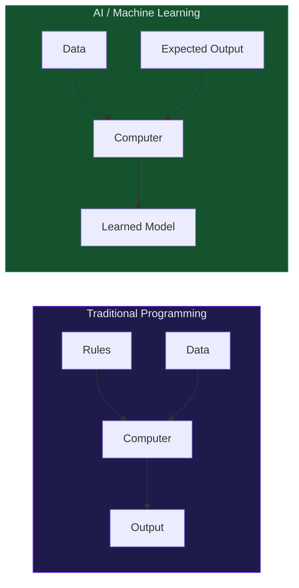

## What Is Artificial Intelligence?

> **AI is the ability of a machine to perform tasks that would normally require human intelligence.**

AI systems can:
- Understand language (read, write, translate)
- Recognize patterns (faces, objects, speech)
- Make decisions (recommend, diagnose, classify)
- Learn from experience (improve over time with data)

The word **"artificial"** = made by humans. The word **"intelligence"** = ability to learn, reason, and solve problems.

---

## The Core Idea

Traditional programs follow **explicit rules**:

```
if temperature > 37.5 → print "fever"
```

AI programs **learn rules from data**:

```
data: [thousands of patient records]
model learns: what patterns predict fever
```

Instead of a programmer writing every rule, the machine figures out the rules itself.



---

## What AI Can Do

| Capability | Example |
|------------|---------|
| **See** | Detect tumors in X-rays, recognize faces |
| **Hear** | Transcribe speech, detect wake words |
| **Read** | Summarize documents, answer questions |
| **Predict** | Stock prices, weather, churn |
| **Decide** | Approve loans, route traffic, play chess |
| **Create** | Generate images, write code, compose music |

---

## What AI Is Not

- Not magic — it's math + data + compute
- Not "thinking" the way humans do
- Not always right — it makes mistakes
- Not one thing — it's a broad field with many subfields

---

## Key Distinction: Narrow vs General AI

**Narrow AI** (what exists today): Excellent at ONE specific task.
- GPT-4 writes text but can't drive a car
- AlphaGo beats humans at Go but can't cook

**General AI** (hypothetical): Can handle any task a human can.
- Does not exist yet

---

## Interview Questions

**Q: What is Artificial Intelligence?**

**A:** AI is the simulation of human intelligence in machines — enabling them to perform tasks like understanding language, recognizing patterns, making decisions, and learning from data without being explicitly programmed for every scenario.

---

**Q: What is the difference between traditional programming and AI?**

**A:** In traditional programming, a developer writes explicit rules: `if X then Y`. In AI, the system learns rules from data — you feed it examples, and it figures out the patterns. The developer designs the learning process, not every individual rule.
