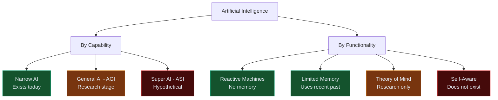

## Two Ways to Classify AI

AI is commonly classified by:
1. **Capability** — how broad is its intelligence?
2. **Functionality** — how does it learn and remember?



---

## By Capability

### Narrow AI (Weak AI)
> Designed to perform **one specific task** — and only that task.

- ChatGPT → generates text
- AlphaGo → plays Go
- Spotify → recommends music
- Tesla Autopilot → drives cars

**This is all that exists today.** Narrow AI can outperform humans in its domain but has zero ability outside it.

---

### General AI (AGI — Artificial General Intelligence)
> A machine that can perform **any intellectual task a human can**.

- Understands context across domains
- Learns new skills without retraining
- Reasons, plans, and adapts broadly

**Does not exist yet.** Active research area. Timelines debated — decades away at minimum.

---

### Super AI (ASI — Artificial Superintelligence)
> An AI that **surpasses human intelligence** in every domain.

- Hypothetical
- Would self-improve recursively
- Subject of significant philosophical and safety debate

---

## By Functionality

| Type | Memory | Examples |
|------|--------|---------|
| **Reactive Machines** | No memory, no learning — pure input/output | Deep Blue (chess), early game AI |
| **Limited Memory** | Uses recent past to inform decisions | Self-driving cars, recommendation systems |
| **Theory of Mind** | Understands emotions/intentions of others | Research stage only |
| **Self-Aware** | Conscious, aware of own existence | Hypothetical, does not exist |

---

## Where We Are Today

```
Narrow AI ✓  (exists, widely deployed)
AGI       ✗  (research, no consensus on timeline)
ASI       ✗  (hypothetical)

Reactive     ✓  (Deep Blue)
Limited Mem  ✓  (ChatGPT, Tesla, Netflix)
Theory of Mind ✗  (research)
Self-Aware   ✗  (science fiction)
```

---

## Other Common Classifications

| Term | Meaning |
|------|---------|
| **Supervised Learning AI** | Trained on labeled data |
| **Unsupervised Learning AI** | Finds patterns without labels |
| **Reinforcement Learning AI** | Learns via reward/punishment |
| **Generative AI** | Creates new content (text, images, audio) |
| **Discriminative AI** | Classifies / makes decisions |

---

## Interview Questions

**Q: What is the difference between Narrow AI and AGI?**

**A:** Narrow AI excels at one specific task — like translating text or detecting objects in images — but has no ability outside that domain. AGI would handle any intellectual task a human can, across all domains. Only Narrow AI exists today; AGI is still a research goal.

---

**Q: What are the four types of AI by functionality?**

**A:** (1) Reactive Machines — no memory, pure stimulus-response; (2) Limited Memory — uses recent history to improve decisions; (3) Theory of Mind — understands others' mental states (not yet achieved); (4) Self-Aware — conscious AI (purely hypothetical). All practical AI today falls into the Limited Memory category.
