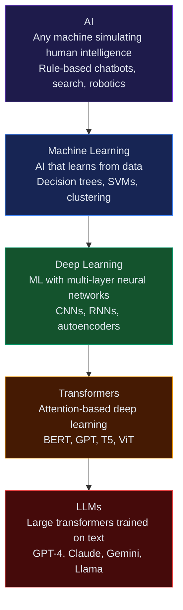

## The Confusion

People use these terms interchangeably. They are not the same thing. Each is a **subset** of the one before it.

---

## The Hierarchy



---

## Artificial Intelligence (AI)

**Definition:** Any technique that enables machines to mimic human behavior.

**Scope:** Broadest term. Includes rule-based expert systems, search algorithms, ML, robotics — anything that makes machines act "smart."

**Example:** A chess program using hardcoded rules is AI, even if it doesn't learn.

---

## Machine Learning (ML)

**Definition:** A subset of AI where systems **learn from data** without being explicitly programmed.

**Key idea:** Give the machine data + expected outputs → it finds patterns → applies them to new inputs.

```
Input: [house size, location, bedrooms]
Output: predicted price

ML finds the relationship without being told "multiply size by X"
```

**Examples:** Linear regression, decision trees, random forests, SVMs, k-means clustering.

---

## Deep Learning (DL)

**Definition:** A subset of ML that uses **multi-layer neural networks** to learn representations.

**Why "deep"?** Many layers (depth) of processing. Each layer learns increasingly abstract features.

```
Image → edges → shapes → faces → "that's a cat"
(layer 1) (layer 2) (layer 3) (layer 4)
```

**Examples:** CNNs (vision), RNNs (sequences), autoencoders.

**What deep learning unlocked:** Tasks that classical ML couldn't crack — images, audio, video, natural language.

---

## Transformers

**Definition:** A specific deep learning **architecture** using attention mechanisms to process sequences in parallel.

**Published:** 2017 ("Attention Is All You Need" — Google).

**Why transformers matter:** Previous architectures (RNNs) processed sequences word-by-word — slow and forgetful. Transformers process the whole sequence at once and learn which parts to "pay attention to."

**Examples:** BERT, GPT, T5, ViT (vision transformers).

---

## Large Language Models (LLMs)

**Definition:** Transformers trained on **massive text datasets** with billions of parameters.

**"Large"** = billions–trillions of parameters trained on internet-scale data.

**Examples:** GPT-4, Claude, Gemini, Llama, Mistral.

**What LLMs can do:** Write, summarize, translate, reason, code, answer questions — in any domain they've been trained on.

---

## Summary Table

| Term | What It Is | Example |
|------|-----------|---------|
| AI | Any machine intelligence | Rule-based chatbot |
| ML | AI that learns from data | Spam filter, churn prediction |
| Deep Learning | ML with neural networks | Image recognition, speech-to-text |
| Transformers | DL architecture using attention | BERT, GPT |
| LLMs | Large transformers on text | ChatGPT, Claude |

---

## Interview Questions

**Q: What is the relationship between AI, ML, Deep Learning, and LLMs?**

**A:** They are nested subsets. AI is the broadest concept — any machine simulating intelligence. ML is a subset of AI that learns from data. Deep Learning is ML using multi-layer neural networks. Transformers are a deep learning architecture. LLMs are large transformer models trained on text. Every LLM is a transformer, every transformer is deep learning, every deep learning model is ML, and every ML model is AI.

---

**Q: Why did transformers replace RNNs for NLP?**

**A:** RNNs processed sequences sequentially — slow to train and prone to forgetting distant context (vanishing gradient). Transformers use self-attention to process all tokens in parallel and directly model relationships between any two positions in a sequence, regardless of distance. This made training faster and results dramatically better.
