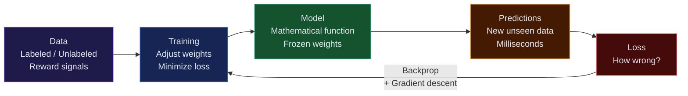

## The Core Loop

> **AI works by finding patterns in data and using those patterns to make predictions on new data.**

All AI — from spam filters to GPT-4 — follows the same fundamental loop:



---

## Step 1: Data

AI needs examples to learn from. The more, and the better quality, the better.

- **Labeled data** (supervised): emails tagged spam/not-spam
- **Unlabeled data** (unsupervised): raw customer behavior logs
- **Reward signals** (reinforcement): score from winning/losing a game

Without good data, AI cannot learn anything meaningful. **"Garbage in, garbage out."**

---

## Step 2: Training

The algorithm processes data repeatedly, adjusting internal parameters (**weights**) to minimize errors.

### Simple analogy:

Imagine learning to throw darts:
1. Throw → miss → adjust aim
2. Throw → miss less → adjust again
3. Repeat until accurate

Training works the same way:
1. Feed input → model makes prediction
2. Compare to correct answer → calculate **loss** (how wrong it was)
3. Adjust weights using **backpropagation + gradient descent**
4. Repeat millions of times

---

## Step 3: The Model

After training, the model is a function:

```
f(input) → output

f("Is this spam?") → 0.97  (97% spam)
f("image of cat") → "cat"
f("translate to French") → "Bonjour"
```

The model is just a mathematical function — a very complex one with billions of parameters. It doesn't "understand" anything. It finds the best mapping from input to output based on training.

---

## Step 4: Inference

Using the trained model to make predictions on new, unseen data.

```
New email arrives → model scores it → 0.89 → mark as spam
```

Training is expensive (days/weeks, massive compute).
Inference is cheap (milliseconds, single GPU or CPU).

---

## Key Concepts

| Concept | Definition |
|---------|-----------|
| **Parameters / Weights** | Numbers inside the model that get adjusted during training |
| **Loss function** | Measures how wrong the model's prediction is |
| **Gradient descent** | Algorithm that nudges weights in the direction that reduces loss |
| **Backpropagation** | How the error signal flows backward through the network to update weights |
| **Epoch** | One full pass through the training dataset |
| **Overfitting** | Model memorizes training data, fails on new data |
| **Underfitting** | Model too simple, fails on both training and new data |

---

## What "Learning" Really Means

The model doesn't learn facts or rules the way humans do. It learns a **mathematical mapping**:

```
P(output | input) = some very complex function of weights
```

When GPT writes code, it's not "thinking about programming" — it's computing the most likely next token given billions of patterns seen during training.

---

## The Role of Scale

Modern AI is powerful because of **scale**:

| Dimension | Effect |
|-----------|--------|
| More data | Better generalization |
| More parameters | More complex patterns captured |
| More compute | Larger models, more training iterations |
| Better architecture | More efficient learning |

GPT-4 works because: transformer architecture + trillions of tokens of text + massive compute.

---

## Interview Questions

**Q: How does a machine learning model learn?**

**A:** It learns by iteratively adjusting its internal parameters (weights) to minimize a loss function. In each training step: the model makes a prediction, the error is calculated, and backpropagation updates the weights via gradient descent. After millions of iterations across the training data, the model finds a parameter configuration that maps inputs to correct outputs well.

---

**Q: What is the difference between training and inference?**

**A:** Training is the process of learning — feeding data through the model, computing loss, and updating weights. It's computationally expensive and happens offline. Inference is using the trained model to make predictions on new inputs. It's fast and is what users experience in production. Once trained, the model weights are frozen — inference doesn't change them.
