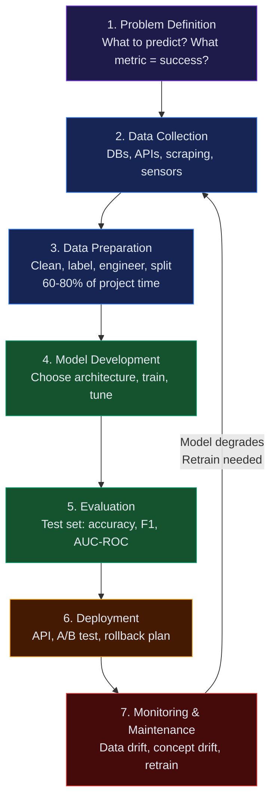

## What Is the AI Lifecycle?

> The AI lifecycle is the **end-to-end process** of taking an AI system from idea to production — and keeping it working over time.

Unlike traditional software, AI systems degrade if not maintained. Data drifts, the world changes, and models go stale. The lifecycle is continuous, not linear.

---

## The 7 Stages

---

## Stage 1: Problem Definition

**What to decide:**
- Is this actually an ML problem? (or can rules solve it?)
- What are inputs and outputs?
- What does "success" look like? (metric)
- What data is available?

**Example:** "Reduce customer churn" → predict which users will cancel in next 30 days → binary classification problem.

---

## Stage 2: Data Collection

Gather raw data from relevant sources:
- Databases, logs, APIs
- Web scraping
- Surveys, sensors
- Third-party datasets

**Quality matters more than quantity.** Biased or incomplete data produces a biased model.

---

## Stage 3: Data Preparation

Raw data is almost never model-ready:

| Task | Description |
|------|-------------|
| **Cleaning** | Remove duplicates, fix errors, handle nulls |
| **Labeling** | Add ground truth (often manual) |
| **Feature Engineering** | Transform raw columns into useful signals |
| **Splitting** | Train / Validation / Test sets |
| **Normalization** | Scale numeric values to comparable ranges |

This stage typically takes **60–80% of total project time**.

---

## Stage 4: Model Development

Select and train a model:
1. Choose architecture (linear model, tree, neural network, LLM)
2. Train on training set
3. Tune hyperparameters on validation set
4. Iterate

**Start simple.** A logistic regression baseline before a neural network tells you what uplift complexity actually buys.

---

## Stage 5: Evaluation

Measure model quality on the **held-out test set** (data never seen during training):

| Metric | Use When |
|--------|----------|
| Accuracy | Balanced classes |
| Precision / Recall | Imbalanced classes (fraud, cancer) |
| F1 Score | Balance precision and recall |
| AUC-ROC | Ranking quality |
| BLEU / ROUGE | Text generation |
| Perplexity | Language model quality |

Also check: fairness across subgroups, latency, cost at scale.

---

## Stage 6: Deployment

Move model to production:
- Wrap in an API (FastAPI, Flask, or managed service)
- A/B test against current system
- Monitor for latency and errors
- Set up rollback plan

**Deployment is not the finish line.** It's where maintenance begins.

---

## Stage 7: Monitoring & Maintenance

Models degrade over time due to **data drift** (the real world changes):

| Issue | Example |
|-------|---------|
| **Data drift** | User language patterns shift |
| **Concept drift** | "Spam" evolves as spammers adapt |
| **Performance decay** | Accuracy drops as distribution changes |

Monitor: prediction distribution, accuracy on labeled samples, latency, error rates. Retrain periodically.

---

## Interview Questions

**Q: What is data drift and why does it matter?**

**A:** Data drift occurs when the statistical properties of model inputs change over time, causing the model's predictions to become less accurate. For example, a fraud detection model trained on 2022 data may miss new fraud patterns in 2024. This is why AI systems need continuous monitoring and periodic retraining — deployment is not a one-time event.

---

**Q: Why does data preparation take so much time?**

**A:** Real-world data is messy — missing values, duplicates, inconsistent formats, labeling errors, and imbalances. The model can only learn what the data teaches it, so cleaning and structuring it correctly is critical. Poor data preparation causes poor model performance regardless of how sophisticated the algorithm is.
