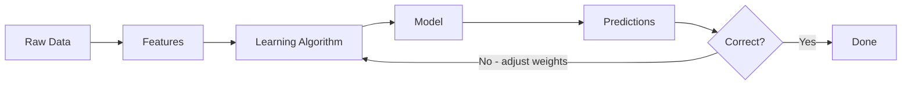

## Introduction

> **Machine Learning is a way of teaching computers to learn from experience — without explicitly programming every rule.**

Instead of writing `if/else` rules for every situation, you give the machine data and let it figure out the patterns itself.

---

## The Fundamental Shift

### Traditional Programming

You write the rules. The computer follows them.

```
Rules + Data → Program → Output
```

**Example — Spam filter with rules:**
```python
def is_spam(email):
    if "free money" in email:
        return True
    if "click here" in email:
        return True
    return False
```

Problem: Spammers write "fr33 m0ney". You can't enumerate every variation.

---

### Machine Learning

You give data + correct answers. The machine learns the rules.

```
Data + Output → Machine Learning → Model
```

**Example — Spam filter with ML:**
```python
# You provide thousands of labeled emails
emails = [
    ("Get free money now!!!", "spam"),
    ("Meeting at 3pm tomorrow", "not_spam"),
    ("Congratulations you won!", "spam"),
    # ... thousands more
]

# ML finds patterns automatically
model = train(emails)

# Now it handles novel spam it's never seen
model.predict("Fr33 m0n3y click h3r3")  # → spam
```

---

## How Computers Learn



**Step by step:**

1. **Feed data** — examples of inputs and correct outputs
2. **Make a guess** — model predicts an output
3. **Measure error** — how wrong was the guess?
4. **Adjust** — nudge internal numbers to reduce error
5. **Repeat** — millions of times across all examples
6. **Done** — model can now predict on new data it's never seen

---

## Real-World Examples

| Problem | Traditional Approach | ML Approach |
|---------|---------------------|-------------|
| **Email spam** | Hand-write keyword rules | Learn from millions of labeled emails |
| **Netflix recs** | Manually curate playlists | Learn from watch history of 300M users |
| **Face recognition** | Program pixel patterns | Learn from millions of face images |
| **Weather prediction** | Physics equations | Learn from decades of weather data |
| **Voice assistant** | Template matching | Learn speech patterns from audio data |

---

## What ML Is NOT

- Not magic — it's pattern matching at scale
- Not "thinking" — no understanding, just statistics
- Not always better than rules — for simple, stable problems, rules win
- Not autonomous — it learns what you train it on

---

## When to Use ML vs Rules

| Use Rules When | Use ML When |
|----------------|-------------|
| Problem is well-defined | Problem is too complex for rules |
| Few edge cases | Millions of edge cases |
| No historical data | You have lots of data |
| Behavior must be fully explainable | Approximate answers are fine |
| Rules don't change | Patterns evolve over time |

---

## Python Example

```python
# Simplest possible ML: linear regression with scikit-learn
from sklearn.linear_model import LinearRegression
import numpy as np

# Data: house sizes (sq ft) → prices ($)
sizes = np.array([[500], [700], [900], [1200], [1500]])
prices = np.array([150000, 200000, 250000, 310000, 400000])

# Train
model = LinearRegression()
model.fit(sizes, prices)

# Predict
print(model.predict([[1000]]))  # → ~$265,000
```

The model **learned** the relationship between size and price — we never told it the formula.

---

## JavaScript Example

```javascript
// Using ml5.js (browser-friendly ML library)
// Neural network classifying if a number is positive or negative

const ml5 = require('ml5');

// Simple classification: is input > 0?
const nn = ml5.neuralNetwork({ task: 'classification' });

// Training data
const data = [
  { input: [5],  output: { label: 'positive' } },
  { input: [-3], output: { label: 'negative' } },
  { input: [12], output: { label: 'positive' } },
  { input: [-7], output: { label: 'negative' } },
];

data.forEach(d => nn.addData(d.input, d.output));
nn.normalizeData();
nn.train({ epochs: 50 }, () => {
  nn.classify([8], (err, result) => {
    console.log(result[0].label); // → 'positive'
  });
});
```

---

## Interview Questions

**Q: What is Machine Learning and how does it differ from traditional programming?**

**A:** Machine Learning is a subset of AI where systems learn patterns from data rather than following explicitly programmed rules. In traditional programming, a developer writes `if/else` logic for every case. In ML, you provide labeled examples (input → correct output), and an algorithm finds the patterns automatically. The key difference: in traditional programming, humans encode knowledge; in ML, machines extract knowledge from data.

---

**Q: When should you NOT use Machine Learning?**

**A:** Avoid ML when: (1) a simple rule-based system works — don't over-engineer, (2) you have very little data — ML needs examples to learn from, (3) perfect explainability is legally required — black-box models can't satisfy regulatory demands in some sectors, (4) the problem is deterministic — like calculating tax, which has fixed rules. ML shines when problems are too complex for rules, input is unstructured, or patterns evolve over time.

---

## Common Mistakes

- Reaching for ML when a `if/else` would work fine
- Not having enough data to learn meaningful patterns
- Using ML outputs without checking for failure modes
- Confusing "the model is confident" with "the model is correct"

---

## Summary

| Concept | One-Line |
|---------|---------|
| Traditional programming | Human writes rules → computer executes |
| Machine Learning | Computer learns rules from data |
| Training | Iteratively adjusting to reduce prediction error |
| Model | The learned function: input → output |
| Prediction | Applying the model to new, unseen data |

---

## Further Reading

- [Google ML Crash Course — Framing](https://developers.google.com/machine-learning/crash-course/framing)
- [Kaggle: Intro to Machine Learning](https://www.kaggle.com/learn/intro-to-machine-learning)

---

**Next:** [02. Why Machine Learning? →](/ai/phase-02-machine-learning/02-why-machine-learning)
