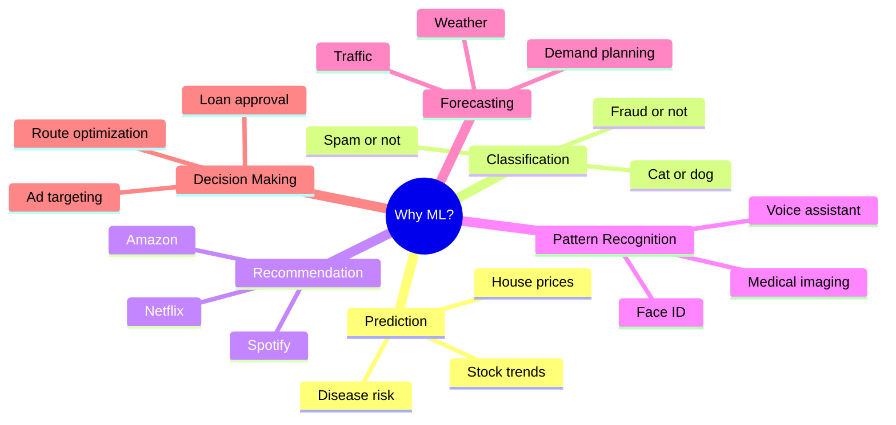
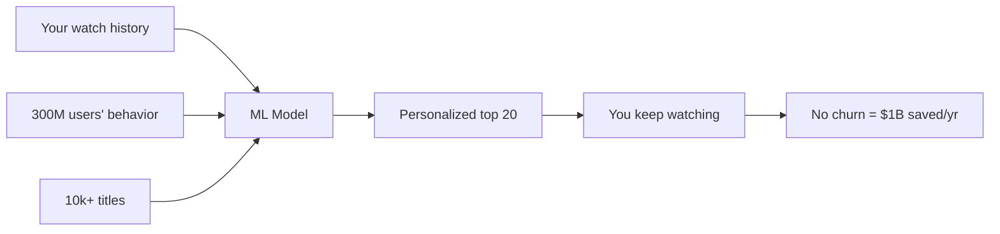
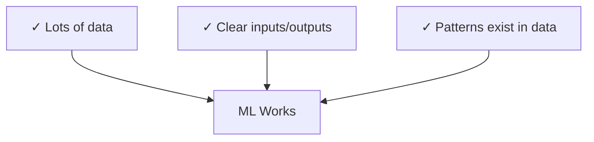

## Introduction

> **ML exists because some problems are too complex, too variable, or too data-rich for humans to write explicit rules for.**

This page explains the specific problem categories where ML wins — and why the world's most valuable companies depend on it.

---

## The Core Problem with Rules

Imagine trying to write rules for:

- "Is this email spam?" — Spammers evolve daily. 10,000+ rule variations needed.
- "Is this photo a cat?" — Impossible to describe every pixel pattern for every cat.
- "What movie should I recommend?" — 300 million users × 10,000 movies = unique preferences.

Rules don't scale. ML does.

---

## What ML Solves



---

## Category 1: Prediction

**Problem:** Given past data, what will happen next?

**Without ML:** Someone manually studies trends and guesses.

**With ML:** Train on historical data → model predicts future values.

| Example | Input Features | Prediction |
|---------|---------------|------------|
| House price | size, location, rooms | Price ($) |
| Disease risk | age, vitals, history | Probability of condition |
| Sales forecast | past sales, season, events | Next month revenue |

---

## Category 2: Classification

**Problem:** Given an input, which category does it belong to?

**Without ML:** Write rules for every category boundary.

**With ML:** Learn boundaries from thousands of labeled examples.

```python
# Spam classification - learned, not hand-coded
model.predict("You have won $1,000,000!")   # → spam (98% confident)
model.predict("Call me when you're free")   # → not_spam (99% confident)
```

---

## Category 3: Recommendation

**Problem:** Given a user and a catalog, what's most relevant for this person right now?

**Without ML:** Manually create "genres" and recommend similar items.

**With ML:** Learn user preferences from implicit behavior (clicks, watches, purchases).

**Netflix impact:** Their recommendation system is estimated to save **$1 billion/year** by reducing churn from users not finding content.

---

## Category 4: Pattern Recognition

**Problem:** Find meaningful signals in complex, high-dimensional data.

| Application | Data | Pattern Found |
|-------------|------|--------------|
| Face recognition | Pixel arrays | "This is Person A" |
| Speech-to-text | Audio waveforms | "This is the word 'hello'" |
| Medical imaging | X-ray pixels | "This looks like a tumor" |
| Credit card fraud | Transaction sequence | "This pattern = fraud" |

Human rules cannot describe what "a face" looks like in pixels. ML learns it from millions of examples.

---

## Real-World Scale: Why Major Companies Depend on ML

### Netflix



### Amazon

- Product recommendation: 35% of revenue comes from ML-driven suggestions
- Demand forecasting: warehouses stock the right items in the right locations
- Fraud detection: real-time scoring of every transaction

### Uber

- ETA prediction: learned from millions of trips
- Surge pricing: demand/supply forecasting in real time
- Driver-rider matching: optimization at city scale

### Spotify

- Discover Weekly: generated fresh every Monday for 600M users
- Audio analysis: ML identifies tempo, key, energy, danceability of every song
- Podcast recommendations: NLP on podcast transcripts

### Google

- Search ranking: hundreds of ML models blend 200+ signals
- Google Translate: neural machine translation for 100+ languages
- Gmail spam: blocks 15 billion spam emails per day

---

## The Three Conditions ML Needs

ML works best when all three are true:



Without data → can't learn.
Without clear I/O → can't train.
Without patterns → nothing to learn.

---

## ML vs Manual Rules: Decision Guide

| Situation | Use Rules | Use ML |
|-----------|-----------|--------|
| Calculate tax (fixed formula) | ✓ | |
| Detect spam | | ✓ |
| Validate an email address | ✓ | |
| Recommend movies | | ✓ |
| Business rule: discount > 20% needs approval | ✓ | |
| Predict customer churn | | ✓ |
| Sort a list | ✓ | |
| Recognize faces | | ✓ |

---

## Python Example

```python
# Demonstrating why ML beats rules for classification
# Rules approach - fragile
def spam_rules(email):
    keywords = ["free money", "click here", "you won", "limited offer"]
    return any(kw in email.lower() for kw in keywords)

# ML approach - learned from data
from sklearn.naive_bayes import MultinomialNB
from sklearn.feature_extraction.text import CountVectorizer

emails = [
    ("Get free money now", 1),
    ("Meeting notes attached", 0),
    ("You've been selected!", 1),
    ("Project deadline Friday", 0),
    # ... thousands more in practice
]
texts, labels = zip(*emails)

vectorizer = CountVectorizer()
X = vectorizer.fit_transform(texts)

model = MultinomialNB()
model.fit(X, labels)

# Handles novel phrasing rules can't catch
new_email = "Claim your exclusive reward today"
print(model.predict(vectorizer.transform([new_email])))  # → [1] spam
```

---

## Interview Questions

**Q: Why do major tech companies invest so heavily in ML?**

**A:** Because ML solves problems that don't scale with human effort. Netflix can't manually curate recommendations for 300M people. Amazon can't write rules to predict demand for 350M products across thousands of locations. Google can't hand-rank 8.5 billion daily searches. ML lets these companies personalize, predict, and optimize at a scale no team of humans could achieve with rules.

---

**Q: What are the three conditions where ML outperforms rules?**

**A:** (1) Large data exists — ML needs examples to learn from; more data = better patterns. (2) The problem has too many edge cases for rules — spam, fraud, and recommendations evolve constantly. (3) Input is unstructured — images, audio, and text can't be described by simple rules; ML learns representations from raw data.

---

## Common Mistakes

- Using ML when a lookup table would do
- Underestimating data requirements
- Assuming ML "understands" — it finds correlations, not causes
- Not measuring whether ML actually outperforms the baseline rules

---

## Summary

ML exists to solve problems where:
- Rules are too complex or constantly changing
- Personalization at scale is required
- Input is unstructured (images, audio, text)
- Predictions improve with more data

Every major tech company uses ML at the core of its most valuable products.

---

**← Previous:** [01. What is ML?](/ai/phase-02-machine-learning/01-what-is-machine-learning)
**Next →:** [03. ML Workflow](/ai/phase-02-machine-learning/03-machine-learning-workflow)
