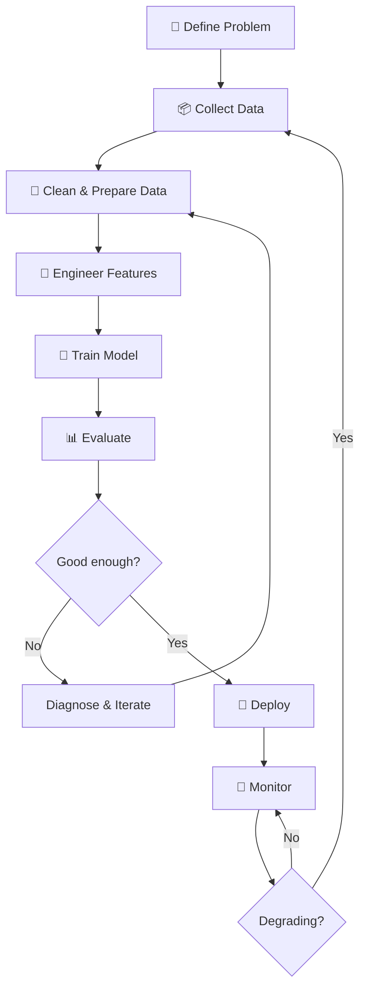
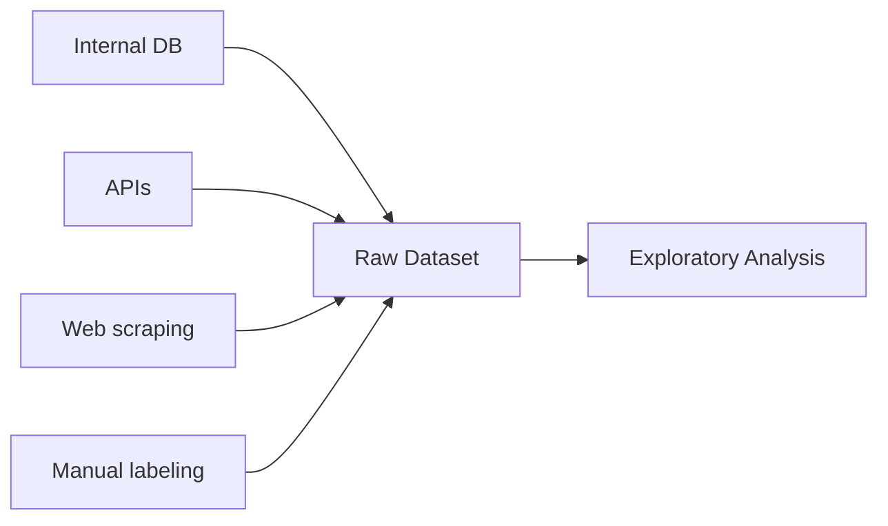
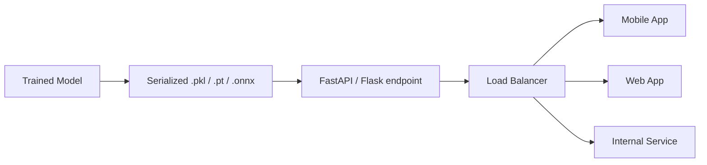
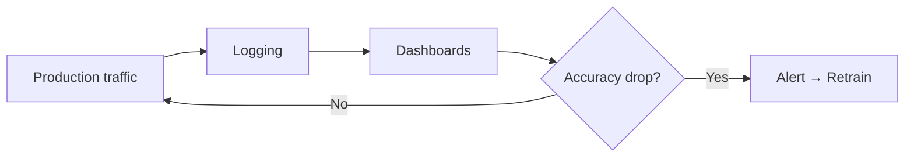
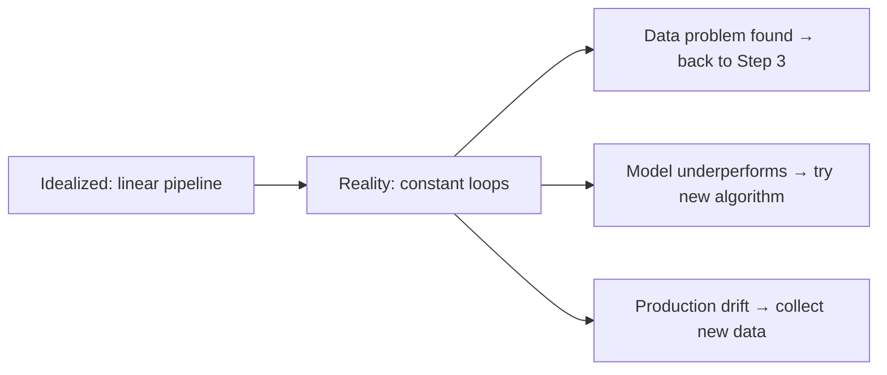

## Introduction

> **Building an ML system is not just training a model. It's a structured process with 8 stages — and most of the work happens before and after the training step.**

Understanding the full workflow prevents the most common failure mode: jumping straight to training without proper data preparation.

---

## The Complete ML Workflow



---

## Stage 1: Define the Problem

Before writing any code, answer these questions:

| Question | Why It Matters |
|----------|---------------|
| What decision are we automating? | Defines the output |
| What does "success" look like? | Defines the metric |
| What data do we have? | Determines feasibility |
| What's the cost of being wrong? | Determines precision/recall tradeoff |
| Does this need to be ML at all? | Avoid over-engineering |

**Example — Customer churn:**
- Decision: Will this customer cancel in the next 30 days?
- Success: 80%+ recall (catch most churners), even if some false positives
- Data: subscription history, usage logs, support tickets
- Cost of wrong: missing a churner costs more than a false retention offer

---

## Stage 2: Collect Data

ML models are only as good as their training data.



**Key questions:**
- Is there enough data? (Rule of thumb: 1,000+ examples per class for classification)
- Is it representative? (Does it reflect the real-world distribution?)
- Is it labeled? (Supervised learning needs correct answers)
- Is it up to date? (Old data = wrong patterns for current reality)

---

## Stage 3: Clean & Prepare Data

Raw data is almost never model-ready. Typical issues:

```python
import pandas as pd

df = pd.read_csv("customers.csv")

# Common problems you'll find:
print(df.isnull().sum())       # Missing values
print(df.duplicated().sum())   # Duplicate rows
print(df.dtypes)               # Wrong data types
print(df.describe())           # Outliers visible in min/max
```

**Fixes:**
- Missing values → impute (mean/median) or drop
- Duplicates → drop
- Outliers → cap, remove, or transform
- Wrong types → convert (strings to dates, etc.)

> This step takes **60–80% of total project time** in real ML projects.

---

## Stage 4: Engineer Features

Raw columns are often not the best inputs for a model. Feature engineering creates better signals.

**Example — House price prediction:**

| Raw Column | Engineered Feature |
|-----------|-------------------|
| `built_year` | `age_years = 2024 - built_year` |
| `lat`, `lon` | `distance_to_city_center` |
| `price_per_sqft` | New column combining price and area |
| `neighborhood` | One-hot encoded columns |

Good features = better model with less data. This is where domain knowledge pays off.

---

## Stage 5: Train the Model

```python
from sklearn.model_selection import train_test_split
from sklearn.ensemble import RandomForestClassifier

# Split data
X_train, X_test, y_train, y_test = train_test_split(
    X, y, test_size=0.2, random_state=42
)

# Train
model = RandomForestClassifier(n_estimators=100)
model.fit(X_train, y_train)
```

**During training:**
- Model makes predictions on training data
- Loss is calculated (how wrong?)
- Weights are updated to reduce loss
- Repeated for many epochs / passes

---

## Stage 6: Evaluate

Never evaluate on training data — that's like grading a student using the same questions they memorized.

```python
from sklearn.metrics import accuracy_score, classification_report

y_pred = model.predict(X_test)

print(accuracy_score(y_test, y_pred))
print(classification_report(y_test, y_pred))
```

**Common metrics:**

| Metric | Use When |
|--------|----------|
| Accuracy | Balanced classes |
| Precision | False positives are costly |
| Recall | False negatives are costly |
| F1 Score | Balance both |
| AUC-ROC | Ranking problems |

---

## Stage 7: Deploy

The model becomes an API that other systems call.



```python
# Simple FastAPI deployment
from fastapi import FastAPI
import pickle

app = FastAPI()
model = pickle.load(open("model.pkl", "rb"))

@app.post("/predict")
def predict(features: dict):
    X = [[features["age"], features["usage"], features["plan"]]]
    prediction = model.predict(X)
    return {"churn_risk": int(prediction[0])}
```

---

## Stage 8: Monitor

Models degrade over time as the real world changes.



Monitor:
- **Prediction distribution** — has the output shifted?
- **Input data distribution** — has the real-world data changed?
- **Accuracy on labeled samples** — regular ground truth checks
- **Latency and error rates** — system health

---

## The Iterative Reality



Most ML projects loop through stages 3–6 many times before deploying.

---

## Python: Full Mini Example

```python
import pandas as pd
from sklearn.model_selection import train_test_split
from sklearn.preprocessing import StandardScaler
from sklearn.linear_model import LogisticRegression
from sklearn.metrics import classification_report

# 1. Load data
df = pd.read_csv("churn.csv")

# 2. Clean
df.dropna(inplace=True)

# 3. Features
X = df[["age", "monthly_charges", "tenure"]]
y = df["churned"]

# 4. Split
X_train, X_test, y_train, y_test = train_test_split(X, y, test_size=0.2)

# 5. Scale features
scaler = StandardScaler()
X_train = scaler.fit_transform(X_train)
X_test = scaler.transform(X_test)

# 6. Train
model = LogisticRegression()
model.fit(X_train, y_train)

# 7. Evaluate
y_pred = model.predict(X_test)
print(classification_report(y_test, y_pred))
```

---

## Interview Questions

**Q: What are the stages of the ML workflow and which takes the most time?**

**A:** The stages are: (1) Problem definition, (2) Data collection, (3) Data cleaning and preparation, (4) Feature engineering, (5) Model training, (6) Evaluation, (7) Deployment, (8) Monitoring. Data preparation (stages 2–4) takes 60–80% of total project time in practice. Most engineers underestimate this and over-invest in model selection when data quality is the real bottleneck.

---

**Q: Why is monitoring an ML model in production necessary?**

**A:** Models degrade over time due to data drift — the real world changes but the model doesn't. A fraud detection model trained on 2022 patterns may miss 2024 fraud techniques. A recommendation model trained before a product redesign may surface irrelevant content. Continuous monitoring detects when prediction distributions or accuracy metrics shift, triggering retraining or rollback before users notice degraded quality.

---

## Common Mistakes

- Skipping exploratory data analysis → missing data quality issues
- Evaluating on training data → artificially inflated metrics
- Deploying without a monitoring plan → silent model degradation
- Not defining a baseline → no way to know if ML is worth it

---

## Summary

| Stage | Key Output |
|-------|-----------|
| Define problem | Metric, input/output spec |
| Collect data | Raw dataset |
| Clean & prepare | Clean, structured dataset |
| Feature engineering | Informative input columns |
| Train | Model weights |
| Evaluate | Performance metrics |
| Deploy | API serving predictions |
| Monitor | Alerts, retraining triggers |

---

**← Previous:** [02. Why ML?](/ai/phase-02-machine-learning/02-why-machine-learning)
**Next →:** [04. Data & Datasets](/ai/phase-02-machine-learning/04-data-and-datasets)
