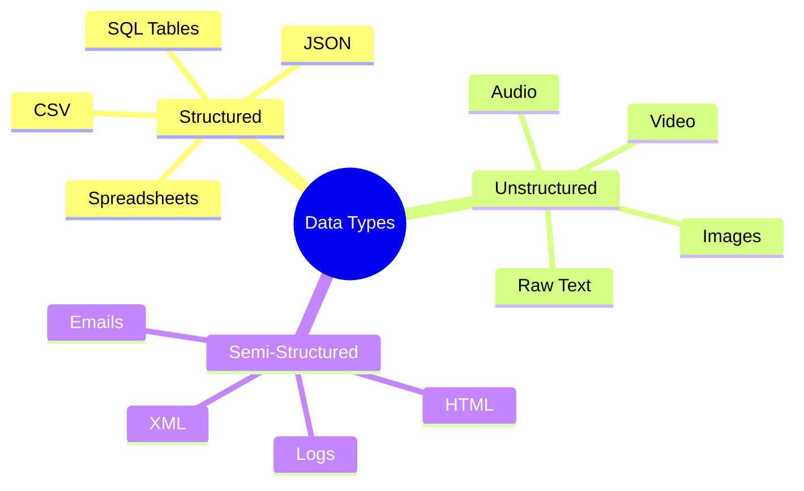
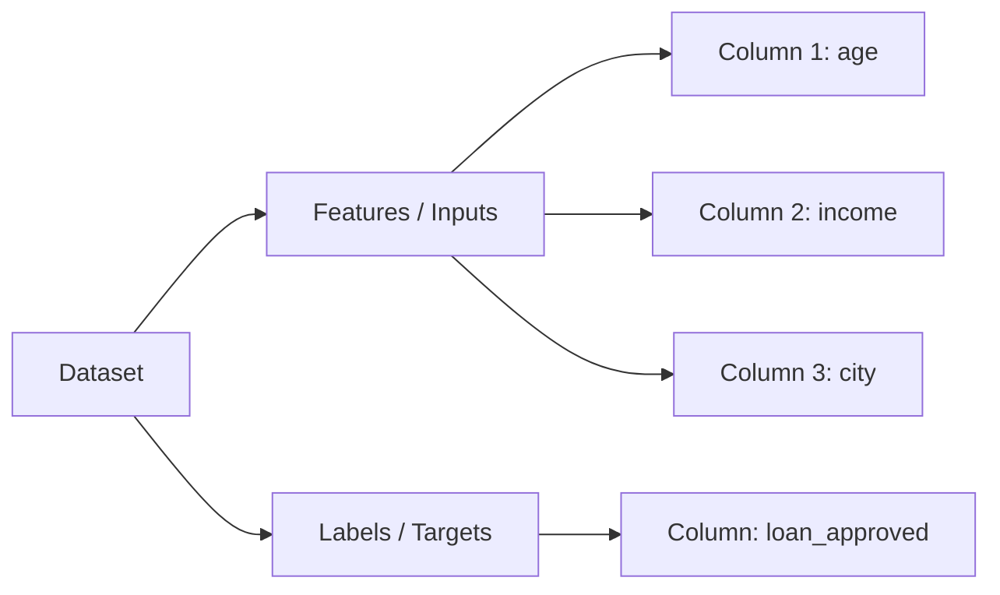
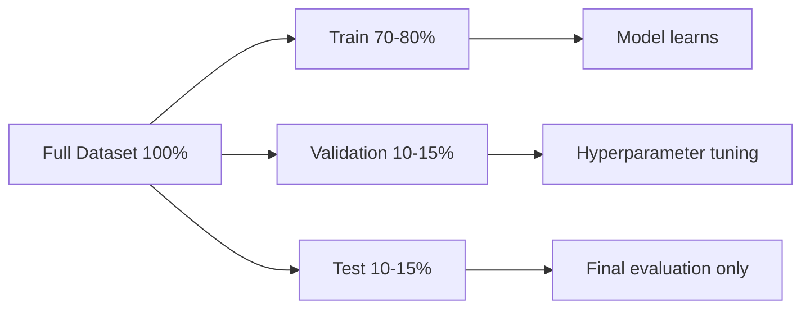

## Introduction

> **In Machine Learning, data is everything. The model can only learn what the data teaches it. Better data beats better algorithms.**

Before you can train any model, you need to understand what kind of data you have, what format it's in, and whether it's good enough to learn from.

---

## Types of Data



---

### Structured Data

Rows and columns. Each column is a well-defined attribute.

```csv
age,income,education,loan_approved
28,55000,bachelor,1
45,90000,master,1
22,25000,high_school,0
```

**Characteristics:**
- Easy to process with pandas / SQL
- Most classical ML algorithms work natively on structured data
- Examples: transaction records, customer databases, sensor readings

---

### Unstructured Data

No predefined format. Requires transformation before ML can use it.

| Type | Raw Form | ML Representation |
|------|---------|------------------|
| **Image** | Pixel values (H×W×3) | Flattened array or CNN feature map |
| **Text** | String of characters | Token IDs, embeddings |
| **Audio** | Sound wave samples | Spectrograms, MFCCs |
| **Video** | Sequence of image frames | Frame embeddings + temporal features |

---

### Semi-Structured Data

Has some structure but not a strict schema.

```json
{
  "user_id": 123,
  "events": [
    { "type": "click", "timestamp": "2024-01-01T10:30:00" },
    { "type": "purchase", "amount": 49.99 }
  ]
}
```

Requires parsing and transformation to become ML-ready.

---

## Dataset Anatomy

Every ML dataset has the same basic structure:



| Term | Meaning |
|------|---------|
| **Row / Sample / Example** | One data point |
| **Column / Feature** | One input attribute |
| **Label / Target** | What you want to predict |
| **Dataset size** | Number of rows |
| **Dimensionality** | Number of features |

---

## Data Quality: The #1 Factor

> **A small, clean, representative dataset outperforms a huge, dirty one.**

Common data quality problems:

```python
import pandas as pd

df = pd.read_csv("data.csv")

# Check missing values
print(df.isnull().sum())

# Check duplicates
print(f"Duplicates: {df.duplicated().sum()}")

# Check distribution
print(df.describe())

# Check class balance
print(df["label"].value_counts())
```

| Problem | Impact | Fix |
|---------|--------|-----|
| **Missing values** | Many algorithms fail or behave poorly | Impute (mean/median/mode) or drop |
| **Duplicates** | Model over-learns repeated examples | Drop duplicates |
| **Outliers** | Distort patterns | Cap, remove, or transform |
| **Class imbalance** | Model predicts majority class always | Oversample, undersample, or adjust weights |
| **Label noise** | Model learns wrong patterns | Manual review, consensus labeling |
| **Bias** | Model reflects historical discrimination | Audit and diversify data sources |

---

## Dataset Splits

You never train and evaluate on the same data:



```python
from sklearn.model_selection import train_test_split

# First split: train+val vs test
X_trainval, X_test, y_trainval, y_test = train_test_split(
    X, y, test_size=0.15, random_state=42
)

# Second split: train vs validation
X_train, X_val, y_train, y_val = train_test_split(
    X_trainval, y_trainval, test_size=0.15, random_state=42
)
```

---

## Dataset Size: How Much Do You Need?

There's no fixed answer, but rough rules of thumb:

| Task | Minimum Samples |
|------|----------------|
| Binary classification | 1,000+ per class |
| Multi-class classification | 500–1,000+ per class |
| Regression | 1,000–10,000+ |
| Image classification (from scratch) | 10,000+ per class |
| LLM fine-tuning | 1,000+ examples |

**When you don't have enough data:**
- Transfer learning (start from a pretrained model)
- Data augmentation (create synthetic variations)
- Collect more data
- Use a simpler model

---

## Common Dataset Formats

```python
# CSV - most common
df = pd.read_csv("data.csv")

# JSON
import json
with open("data.json") as f:
    data = json.load(f)

# SQL Database
import sqlite3
conn = sqlite3.connect("database.db")
df = pd.read_sql("SELECT * FROM customers", conn)

# Parquet (efficient for large datasets)
df = pd.read_parquet("data.parquet")

# Images (PIL)
from PIL import Image
img = Image.open("cat.jpg")
import numpy as np
arr = np.array(img)  # shape: (height, width, 3)
```

---

## Public Datasets to Practice With

| Dataset | Task | Source |
|---------|------|--------|
| Titanic | Classification | Kaggle |
| House Prices | Regression | Kaggle |
| MNIST | Image classification | TensorFlow/PyTorch |
| IMDB Reviews | Sentiment analysis | Hugging Face |
| Iris | Multi-class classification | sklearn |
| Boston Housing | Regression | sklearn |

```python
# Built-in datasets in sklearn
from sklearn.datasets import load_iris, load_diabetes, load_digits

iris = load_iris()
X, y = iris.data, iris.target
print(X.shape)  # (150, 4) — 150 samples, 4 features
```

---

## Interview Questions

**Q: Why does data quality matter more than algorithm choice?**

**A:** A model can only learn patterns that exist in training data. If data has missing values, label noise, or doesn't represent the real-world distribution, no algorithm will fix it. The best algorithm on bad data produces bad predictions. The simplest algorithm on clean, representative data often beats a complex model on noisy data. This is why data preparation takes 60–80% of project time.

---

**Q: What is class imbalance and how do you handle it?**

**A:** Class imbalance occurs when one class is much more frequent than another — for example, 99% legitimate transactions vs 1% fraud. A model trained on this data learns to predict "not fraud" always and achieves 99% accuracy while missing all actual fraud. Solutions: (1) oversample the minority class (SMOTE), (2) undersample the majority class, (3) adjust class weights in the loss function, (4) use precision/recall/F1 instead of accuracy as the metric.

---

## Common Mistakes

- Using test data during feature engineering → data leakage
- Not checking for class imbalance → misleading accuracy
- Treating the train split as the full dataset → overly optimistic metrics
- Ignoring temporal ordering in time-series data → future data leaks into training

---

## Summary

| Concept | Key Point |
|---------|----------|
| Structured data | Rows and columns — CSV, SQL |
| Unstructured data | Images, audio, text — needs transformation |
| Dataset splits | Train / Validation / Test — never mix |
| Data quality | More impactful than algorithm choice |
| Class imbalance | Special handling required for rare events |

---

**← Previous:** [03. ML Workflow](/ai/phase-02-machine-learning/03-machine-learning-workflow)
**Next →:** [05. Features & Labels](/ai/phase-02-machine-learning/05-features-and-labels)
