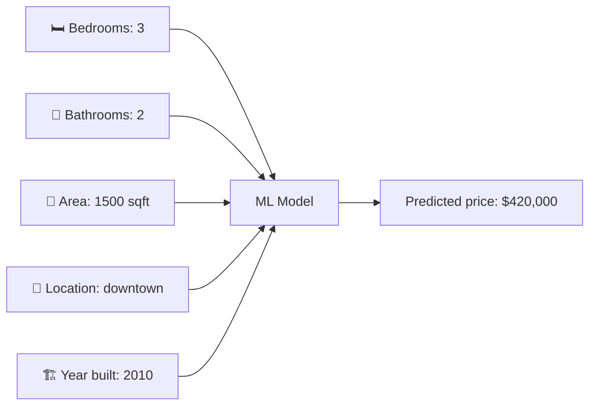
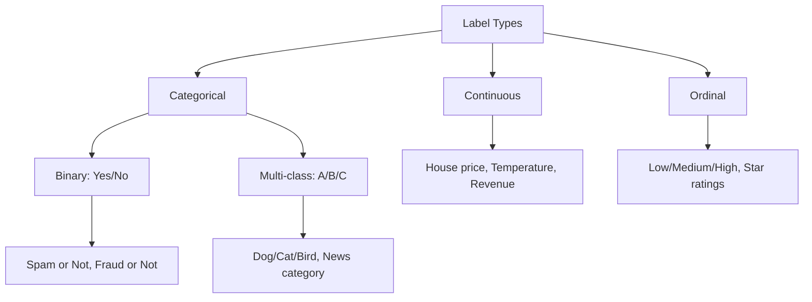
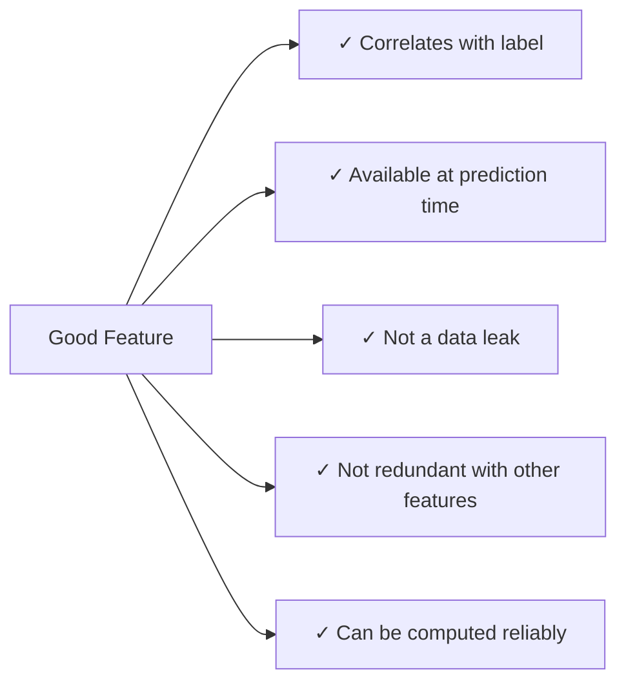

## Introduction

> **Features are what the model sees. Labels are what the model predicts. Getting both right is the most important design decision in ML.**

Before training any model, you must define: what inputs does the model receive, and what output should it produce?

---

## The Analogy

Think of ML like a student taking an exam:

| Exam Component | ML Equivalent |
|----------------|--------------|
| Question details (context given) | **Features** (inputs) |
| Correct answer | **Label** (what to predict) |
| Studying many Q&A pairs | **Training** |
| Answering a new question | **Inference** |

---

## Features

> **Features** are the input variables the model uses to make a prediction.

Also called: inputs, attributes, independent variables, predictors, X.

### House Price Prediction Example



```python
# Features = columns you pass as input (X)
features = {
    "bedrooms": 3,
    "bathrooms": 2,
    "area_sqft": 1500,
    "location": "downtown",
    "year_built": 2010
}
```

---

## Labels

> **Labels** are the output the model should predict.

Also called: target, output, dependent variable, y.

| Problem | Label |
|---------|-------|
| House price prediction | Price in dollars |
| Spam detection | spam / not_spam |
| Disease diagnosis | disease present / absent |
| Customer churn | will_churn / won't_churn |
| Movie rating | 1–5 stars |

```python
# Label = what you're trying to predict (y)
label = 420000  # house price in dollars
```

---

## Types of Labels



---

## Features vs Labels: The Full Picture

```python
import pandas as pd

df = pd.read_csv("houses.csv")
print(df.head())

#   bedrooms  bathrooms  area_sqft  location     price
#   3         2          1500       downtown     420000
#   4         3          2200       suburbs      580000
#   2         1          900        rural        220000

# Features (X) — everything except what you're predicting
X = df[["bedrooms", "bathrooms", "area_sqft", "location"]]

# Label (y) — what you want to predict
y = df["price"]
```

---

## Feature Types

Not all features are the same. Different types need different handling:

| Type | Example | Notes |
|------|---------|-------|
| **Numerical** | Age, price, area | Use directly or normalize |
| **Categorical (nominal)** | Color, city, category | Encode (one-hot, label encoding) |
| **Categorical (ordinal)** | Low/Med/High, 1–5 stars | Encode preserving order |
| **Boolean** | is_member, has_garage | Use as 0/1 |
| **Text** | Review, description | Vectorize (TF-IDF, embeddings) |
| **Date/Time** | timestamp | Extract hour, day_of_week, is_weekend |

---

## Feature Engineering: Turning Raw Data into Better Features

Sometimes raw columns aren't the best features. Good feature engineering can dramatically improve performance.

### Example: E-commerce Churn Prediction

```python
df = pd.read_csv("ecommerce.csv")

# Raw columns available:
# last_purchase_date, signup_date, total_purchases, total_spend

# Engineered features:
df["days_since_purchase"] = (pd.Timestamp.now() - pd.to_datetime(df["last_purchase_date"])).dt.days
df["account_age_days"] = (pd.Timestamp.now() - pd.to_datetime(df["signup_date"])).dt.days
df["avg_order_value"] = df["total_spend"] / df["total_purchases"].replace(0, 1)
df["purchase_frequency"] = df["total_purchases"] / (df["account_age_days"] + 1)
```

`days_since_purchase` is far more predictive for churn than `last_purchase_date`.

---

## What Makes a Good Feature?



**Data leakage** — the most dangerous mistake: including information that wouldn't be available when making a real prediction.

```python
# ❌ DATA LEAK — you wouldn't know the claim amount before predicting fraud
X = df[["age", "account_age", "claim_amount"]]  # claim_amount leaked!

# ✓ CORRECT — only use data available before the fraud decision
X = df[["age", "account_age", "transaction_velocity"]]
```

---

## Labeling: Where Does It Come From?

| Source | Example | Cost |
|--------|---------|------|
| **Explicit** | User rates a movie 1–5 stars | Low (user provides it) |
| **Implicit** | User watches 90% of a video = liked | Low (inferred from behavior) |
| **Manual annotation** | Humans label images as cat/dog | High (time + money) |
| **Programmatic** | Rule: late payment → default = 1 | Low (automated) |
| **Weak supervision** | Noisy heuristics + denoising | Medium |

For LLM fine-tuning, human labelers rate pairs of outputs — this is RLHF (Reinforcement Learning from Human Feedback).

---

## Python: Complete Features & Labels Example

```python
import pandas as pd
from sklearn.model_selection import train_test_split
from sklearn.preprocessing import LabelEncoder

# Load
df = pd.read_csv("titanic.csv")

# Define features and label
feature_cols = ["Pclass", "Sex", "Age", "SibSp", "Parch", "Fare"]
label_col = "Survived"

# Drop rows with missing values in selected columns
df = df[feature_cols + [label_col]].dropna()

# Encode categorical feature
df["Sex"] = LabelEncoder().fit_transform(df["Sex"])  # male=1, female=0

# Separate X and y
X = df[feature_cols]
y = df[label_col]

print(f"Features shape: {X.shape}")  # (rows, 6)
print(f"Label distribution:\n{y.value_counts()}")

# Split
X_train, X_test, y_train, y_test = train_test_split(X, y, test_size=0.2, random_state=42)
```

---

## Interview Questions

**Q: What is the difference between a feature and a label?**

**A:** Features are the input variables — the data the model receives to make a prediction (e.g., house size, location, age). Labels are the correct output the model should predict (e.g., house price). During training, the model learns the mapping from features to labels. During inference, only features are available; the model produces the predicted label.

---

**Q: What is data leakage and why is it dangerous?**

**A:** Data leakage occurs when information that wouldn't be available at prediction time is included as a feature during training. For example, including "fraud investigation was opened" as a feature when predicting fraud — this field only exists after fraud is detected. The model learns to rely on the leaked feature, achieves near-perfect accuracy in training, and completely fails in production where the feature doesn't yet exist.

---

## Common Mistakes

- Using the label as a feature (direct leak)
- Using future-derived features in time-series problems
- Not encoding categorical features before training
- Normalizing features using test set statistics (apply fit only on train)

---

## Summary

| Concept | Definition |
|---------|-----------|
| Feature | Input variable (X) |
| Label / Target | Output to predict (y) |
| Numerical feature | Continuous number — normalize or use directly |
| Categorical feature | Discrete category — must encode |
| Data leakage | Feature derived from the future — invalidates training |
| Feature engineering | Creating better inputs from raw data |

---

**← Previous:** [04. Data & Datasets](/ai/phase-02-machine-learning/04-data-and-datasets)
**Next →:** [06. Supervised Learning](/ai/phase-02-machine-learning/06-supervised-learning)
