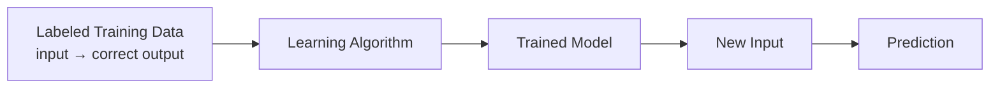
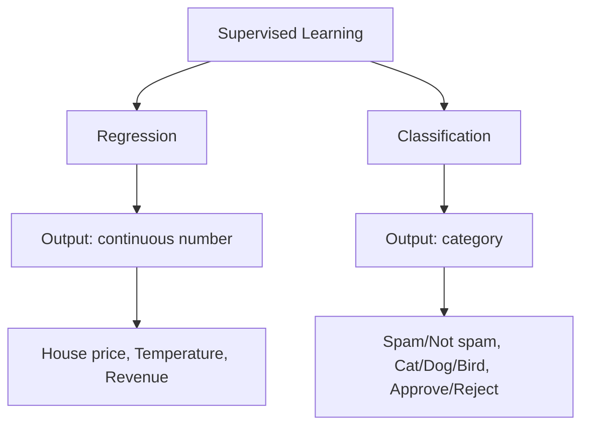
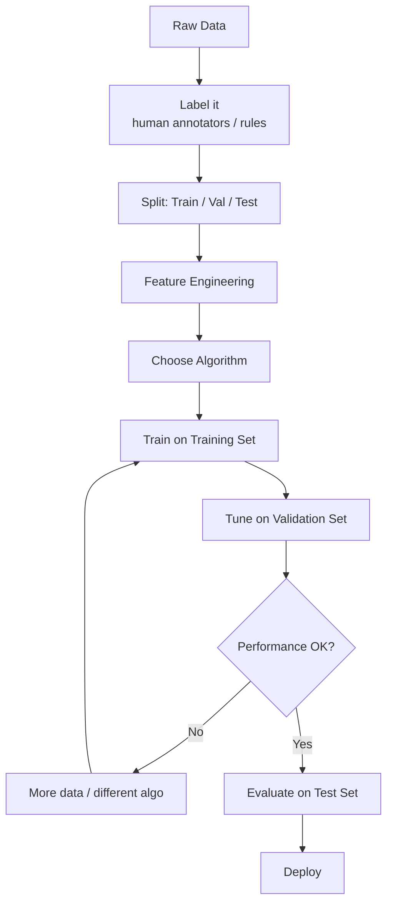

## Introduction

> **Supervised learning is training a model on labeled examples — you provide inputs AND the correct answers, and the model learns the mapping between them.**

It's called "supervised" because the correct answers supervise the learning process — like a teacher with an answer key.

---

## The Core Idea



**During training:** Model sees (input, correct answer) pairs millions of times, adjusting to minimize error.

**During inference:** Model receives a new input (no answer provided) and produces its best prediction.

---

## Two Types of Supervised Learning



---

## Regression

**Predict a continuous number.**

### Examples

| Problem | Input Features | Output |
|---------|---------------|--------|
| House price | Size, location, rooms | $420,000 |
| Weather | Pressure, humidity, temp | 24.5°C tomorrow |
| Sales forecast | History, season, events | $1.2M next month |
| Stock return | Market indicators | +3.2% |

### Visualization

```
Price ↑
      |           •  •
      |         •
      |       •
      |    •  •
      |  •
      +—————————————→ Size
      (Model learns this line)
```

### Python Example

```python
from sklearn.linear_model import LinearRegression
from sklearn.metrics import mean_absolute_error
import numpy as np

# House size → price
X_train = np.array([[800], [1000], [1200], [1500], [1800], [2000]])
y_train = np.array([200000, 250000, 290000, 350000, 420000, 460000])

model = LinearRegression()
model.fit(X_train, y_train)

# Predict
X_test = np.array([[1300], [1600]])
y_pred = model.predict(X_test)
print(y_pred)  # [~305000, ~365000]
```

---

## Classification

**Predict a category (class).**

### Binary Classification (2 classes)

| Problem | Input | Output |
|---------|-------|--------|
| Spam detection | Email text | spam / not_spam |
| Fraud detection | Transaction data | fraud / legitimate |
| Disease prediction | Patient vitals | positive / negative |
| Churn prediction | User activity | will_churn / won't |

### Multi-Class Classification (3+ classes)

| Problem | Input | Output |
|---------|-------|--------|
| Handwriting recognition | Image | 0–9 digit |
| Sentiment analysis | Review text | positive / negative / neutral |
| News categorization | Article text | sports / tech / politics / finance |
| Animal recognition | Image | cat / dog / bird / fish |

### Python Example

```python
from sklearn.linear_model import LogisticRegression
from sklearn.metrics import classification_report
from sklearn.datasets import load_iris

# Multi-class: classify iris flower species
iris = load_iris()
X, y = iris.data, iris.target

from sklearn.model_selection import train_test_split
X_train, X_test, y_train, y_test = train_test_split(X, y, test_size=0.2, random_state=42)

model = LogisticRegression(max_iter=200)
model.fit(X_train, y_train)

y_pred = model.predict(X_test)
print(classification_report(y_test, y_pred, target_names=iris.target_names))
```

---

## Real-World Supervised Learning Pipeline



---

## Practical Examples in Detail

### Email Spam Detection

```python
from sklearn.naive_bayes import MultinomialNB
from sklearn.feature_extraction.text import TfidfVectorizer
from sklearn.pipeline import Pipeline

emails = [
    ("Get free money now!!!", 1),
    ("Meeting at 3pm tomorrow", 0),
    ("You won a prize click here", 1),
    ("Project deadline is Friday", 0),
    ("Limited offer act now!", 1),
    ("Can we reschedule our call?", 0),
]

texts, labels = zip(*emails)

pipeline = Pipeline([
    ("tfidf", TfidfVectorizer()),
    ("clf", MultinomialNB()),
])

pipeline.fit(texts, labels)

# Test
new_emails = [
    "Exclusive deal just for you",
    "Please review the attached report",
]
print(pipeline.predict(new_emails))  # [1, 0]
```

### Customer Churn Prediction

```python
import pandas as pd
from sklearn.ensemble import RandomForestClassifier
from sklearn.model_selection import train_test_split
from sklearn.metrics import classification_report

df = pd.read_csv("telecom_churn.csv")

features = ["account_length", "total_day_calls", "customer_service_calls", "monthly_charges"]
X = df[features]
y = df["churn"]  # 0 or 1

X_train, X_test, y_train, y_test = train_test_split(X, y, test_size=0.2, random_state=42)

model = RandomForestClassifier(n_estimators=100, random_state=42)
model.fit(X_train, y_train)

y_pred = model.predict(X_test)
print(classification_report(y_test, y_pred))
```

---

## Common Supervised Learning Algorithms (Overview)

| Algorithm | Best For |
|-----------|----------|
| Linear Regression | Regression, interpretable relationships |
| Logistic Regression | Binary classification, interpretable |
| Decision Tree | Both, interpretable, non-linear |
| Random Forest | Both, strong general-purpose |
| XGBoost | Both, competitions, tabular data |
| SVM | Classification, high-dimensional data |
| Neural Network | Complex patterns, images, text |

---

## Interview Questions

**Q: What is the difference between regression and classification?**

**A:** Regression predicts a continuous numerical output — like predicting house price ($420,000) or temperature (24.5°C). Classification predicts a category — like spam/not-spam or cat/dog/bird. The key difference is the output type: a number vs a discrete class. Algorithms can often be adapted for both, and sometimes regression scores are converted to classification by applying a threshold.

---

**Q: Why is supervised learning the most commonly used type of ML in production?**

**A:** Supervised learning solves the most common business problems: predict X, classify Y. It has well-understood algorithms, strong tooling, and clear evaluation metrics. The main cost is labeling — you need correct answers for training data. But for high-value problems like fraud detection, churn prediction, or medical diagnosis, the cost of labeling is worth it for the performance gained.

---

## Common Mistakes

- Using accuracy alone for imbalanced classes (fraud detection)
- Not checking that labels are correct — noisy labels hurt badly
- Leaking test labels into training
- Choosing complex models when simple baselines work fine

---

## Best Practices

- Always start with a simple baseline (logistic regression, decision tree)
- Check if the algorithm's assumptions match your data
- Use cross-validation for small datasets
- Monitor class distribution — imbalanced data needs special handling

---

## Summary

| Concept | Key Point |
|---------|----------|
| Supervised learning | Learns from (input, label) pairs |
| Regression | Predicts a number |
| Classification | Predicts a category |
| Binary classification | 2 classes |
| Multi-class | 3+ classes |
| Training | Minimize error on labeled examples |

---

**← Previous:** [05. Features & Labels](/ai/phase-02-machine-learning/05-features-and-labels)
**Next →:** [07. Unsupervised Learning](/ai/phase-02-machine-learning/07-unsupervised-learning)
