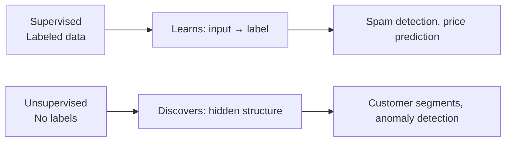
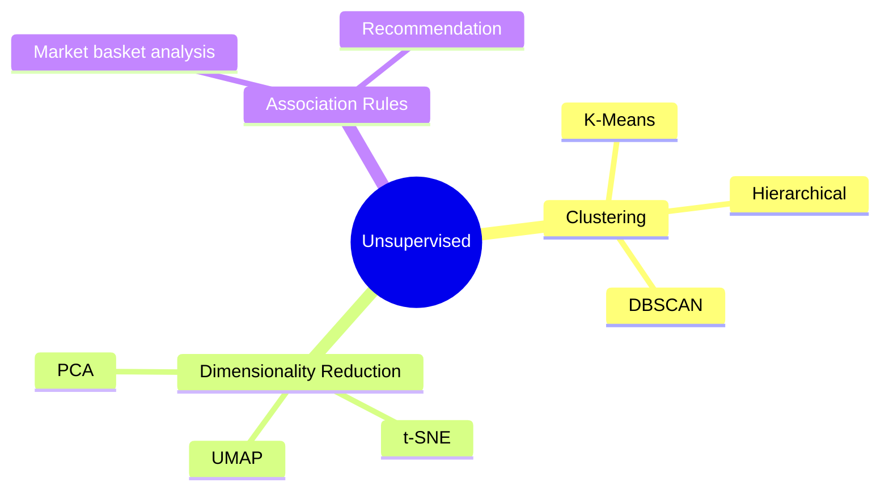
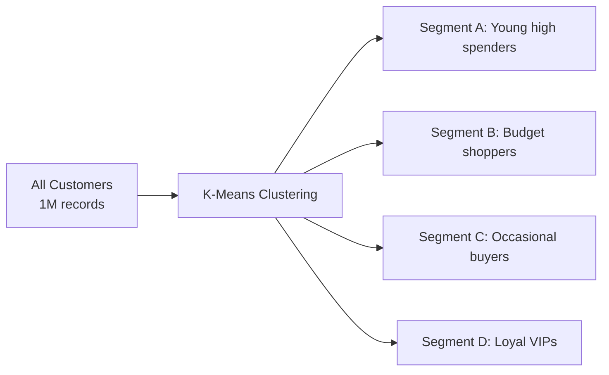
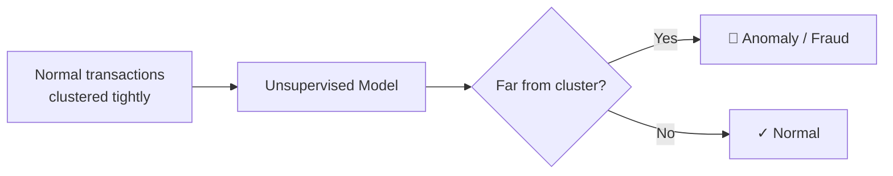

## Introduction

> **Unsupervised learning finds hidden patterns in data without being told what to look for — no labels, no correct answers.**

It's called "unsupervised" because there's no teacher providing correct answers. The algorithm discovers structure on its own.

---

## Supervised vs Unsupervised



| Aspect | Supervised | Unsupervised |
|--------|-----------|-------------|
| Labels needed | Yes | No |
| Goal | Predict a known output | Discover unknown structure |
| Evaluation | Clear metrics (accuracy, MAE) | Harder — no ground truth |
| Examples | Classification, regression | Clustering, dimensionality reduction |

---

## Three Main Types



---

## 1. Clustering

**Group similar items together — without being told the groups in advance.**

### Real-World Analogy

Imagine you're a librarian given 10,000 books with no labels. You'd naturally group them by topic — science, history, fiction. That's clustering: finding natural groupings.

### Customer Segmentation Example



```python
from sklearn.cluster import KMeans
from sklearn.preprocessing import StandardScaler
import pandas as pd

df = pd.read_csv("customers.csv")
features = ["age", "annual_income", "spending_score"]
X = df[features]

# Scale features
scaler = StandardScaler()
X_scaled = scaler.fit_transform(X)

# Find 4 customer segments
kmeans = KMeans(n_clusters=4, random_state=42)
df["segment"] = kmeans.fit_predict(X_scaled)

print(df.groupby("segment")[features].mean())
```

### Use Cases for Clustering

| Use Case | What's Clustered | Business Value |
|----------|-----------------|----------------|
| Customer segmentation | Users by behavior | Targeted marketing |
| Document clustering | Articles by topic | Content organization |
| Anomaly detection | Transactions that don't fit clusters | Fraud detection |
| Image compression | Pixels by color similarity | Reduced file size |
| Gene expression | Genes with similar patterns | Medical research |

---

## 2. Dimensionality Reduction

**Compress many features into fewer, while preserving the important structure.**

### Why It Matters

A dataset with 500 features is hard to visualize and computationally expensive. Dimensionality reduction compresses to 2–3 dimensions for visualization, or 50 dimensions for faster training.

### Analogy

A shadow is a 2D projection of a 3D object. It loses some information but preserves the essential shape. PCA does the same for high-dimensional data.

```python
from sklearn.decomposition import PCA
from sklearn.datasets import load_digits
import matplotlib.pyplot as plt

# 64-dimensional digit images → 2D for visualization
digits = load_digits()
X = digits.data  # shape: (1797, 64)

pca = PCA(n_components=2)
X_2d = pca.fit_transform(X)  # shape: (1797, 2)

plt.scatter(X_2d[:, 0], X_2d[:, 1], c=digits.target, cmap="tab10")
plt.colorbar()
plt.title("Digits dataset in 2D via PCA")
plt.show()
```

### Common Algorithms

| Algorithm | Best For |
|-----------|----------|
| **PCA** | Linear compression, preprocessing before ML |
| **t-SNE** | Visualization of high-dimensional data |
| **UMAP** | Faster t-SNE alternative, preserves global structure |
| **Autoencoders** | Non-linear compression with neural networks |

---

## 3. Association Rules

**Find items that frequently appear together.**

### Classic Example: Market Basket Analysis

"Customers who buy bread and butter also tend to buy milk."

```python
from mlxtend.frequent_patterns import apriori, association_rules
import pandas as pd

# Transaction data (one-hot encoded)
basket = pd.DataFrame([
    [1, 1, 0, 1],  # bread, butter, -, milk
    [1, 0, 1, 1],  # bread, -, eggs, milk
    [1, 1, 1, 0],  # bread, butter, eggs, -
], columns=["bread", "butter", "eggs", "milk"])

# Find frequent itemsets
frequent_items = apriori(basket, min_support=0.5, use_colnames=True)

# Generate rules
rules = association_rules(frequent_items, metric="confidence", min_threshold=0.7)
print(rules[["antecedents", "consequents", "confidence"]])
# bread → milk (confidence: 0.67)
```

**Applications:** Retail product placement, cross-selling recommendations, web navigation patterns.

---

## Anomaly Detection (Unsupervised)

**Find data points that don't fit the normal pattern.**



```python
from sklearn.ensemble import IsolationForest
import numpy as np

# Credit card transaction amounts
amounts = np.array([[50], [55], [48], [52], [200], [49], [5000], [51]])

model = IsolationForest(contamination=0.1, random_state=42)
predictions = model.fit_predict(amounts)

# -1 = anomaly, 1 = normal
for amount, pred in zip(amounts, predictions):
    label = "🚨 ANOMALY" if pred == -1 else "✓ Normal"
    print(f"${amount[0]:,.0f} → {label}")
```

---

## Interview Questions

**Q: What is the main challenge of evaluating unsupervised learning models?**

**A:** Unlike supervised learning, there's no ground truth label to compare predictions against. You can't compute accuracy. Evaluation is harder and often domain-specific: for clustering, you might use silhouette score (measures how well-separated clusters are) or visual inspection. For anomaly detection, you might need human review of flagged cases. Often the best evaluation is downstream business impact — did customer segmentation improve campaign ROI?

---

**Q: What is K-Means clustering and what are its limitations?**

**A:** K-Means partitions N data points into K clusters by iteratively assigning points to the nearest centroid and updating centroids. It requires you to specify K in advance, assumes spherical clusters of similar size, is sensitive to outliers, and can converge to local minima. Despite these limitations, it's fast, simple, and works well for many real-world segmentation problems.

---

## Common Mistakes

- Using K-Means without scaling features → distance-based algorithms are scale-sensitive
- Choosing K arbitrarily without using the elbow method or silhouette score
- Expecting unsupervised learning to "discover" the labels you have in mind
- Not validating clusters make business sense

---

## Summary

| Type | Goal | Example |
|------|------|---------|
| Clustering | Group similar items | Customer segmentation |
| Dimensionality reduction | Compress features | Visualize 500-dim data in 2D |
| Association rules | Find co-occurrence patterns | Market basket analysis |
| Anomaly detection | Find outliers | Fraud detection |

---

**← Previous:** [06. Supervised Learning](/ai/phase-02-machine-learning/06-supervised-learning)
**Next →:** [08. Reinforcement Learning](/ai/phase-02-machine-learning/08-reinforcement-learning)
