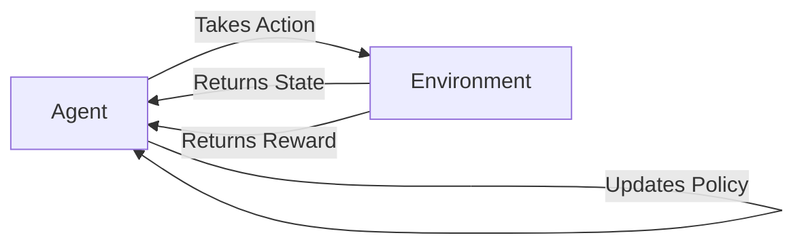
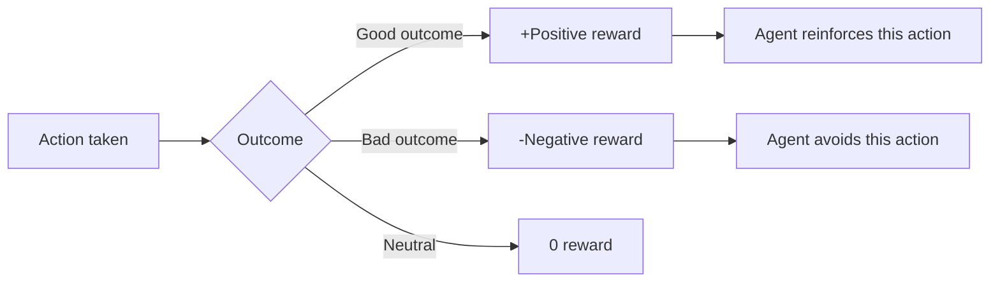
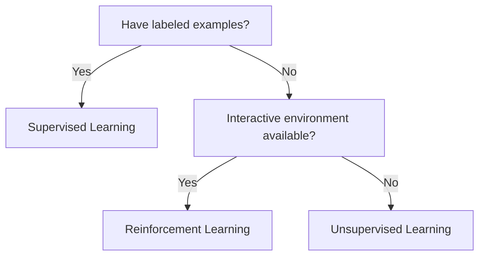

## Introduction

> **Reinforcement Learning is how agents learn to make decisions by trying things, observing what happens, and doing more of what works.**

No labeled examples. No predefined correct answers. Just: take an action, get feedback, get better over time.

---

## The Core Analogy: Training a Dog

| RL Component | Dog Training |
|-------------|-------------|
| **Agent** | The dog |
| **Environment** | The world (room, trainer) |
| **Action** | Sit, roll over, bark |
| **Reward** | Treat (positive), "No!" (negative) |
| **Policy** | The dog's strategy: what to do in each situation |
| **State** | Current situation (trainer pointing, looking at dog) |

The dog doesn't know the rules upfront. It tries things, gets treats for right behaviors, gets corrected for wrong ones, and gradually learns the optimal behavior.

---

## The RL Loop



**Step by step:**
1. Agent observes current **state** (what's the situation?)
2. Agent takes an **action** (based on its current policy)
3. Environment transitions to a new **state**
4. Environment provides a **reward** (positive or negative)
5. Agent updates its **policy** (strategy) to get more reward
6. Repeat millions of times

---

## Key Concepts

| Concept | Definition |
|---------|-----------|
| **Agent** | The learner making decisions |
| **Environment** | Everything the agent interacts with |
| **State (s)** | Current snapshot of the environment |
| **Action (a)** | What the agent does at each step |
| **Reward (r)** | Immediate feedback signal (+1 for good, -1 for bad) |
| **Policy (π)** | The agent's strategy — maps states to actions |
| **Value function** | Expected total future reward from a state |
| **Episode** | One complete run (e.g., one game of chess) |

---

## Types of Rewards



**Delayed reward problem:** In chess, you only know if your move was good when the game ends (won or lost). The agent must learn to associate early actions with eventual outcomes — called **credit assignment**.

---

## Real-World Examples

### Chess / Go (AlphaGo)

```
State: current board position
Action: which piece to move where
Reward: +1 for winning game, -1 for losing
Policy: best move in any position
```

AlphaGo played millions of games against itself, slowly discovering strategies that no human had ever conceived.

### Self-Driving Cars

```
State: sensor data (camera, lidar, GPS)
Action: steer, accelerate, brake
Reward: +stay in lane, +avoid collision, -hit pedestrian
Policy: drive safely to destination
```

### Robotics

```
State: joint angles, camera feed
Action: motor torques
Reward: +task completed, -drop object
Policy: pick up and place objects reliably
```

### Recommendation Systems

```
State: user's current session behavior
Action: which item to recommend next
Reward: +click / watch / purchase, -skip / close
Policy: maximize long-term user engagement
```

---

## RL vs Supervised Learning



| Aspect | Supervised | Reinforcement |
|--------|-----------|---------------|
| Learning signal | Correct label provided | Reward after action |
| Feedback timing | Immediate | Often delayed |
| Data source | Static dataset | Agent's own experience |
| Goal | Predict correctly | Maximize cumulative reward |

---

## Simple Python Example: Q-Learning

```python
import numpy as np
import random

# Simple grid world: 4 states, 2 actions (left/right)
# Goal: reach state 3 (reward +10), avoid state 0 (reward -10)

Q = np.zeros((4, 2))  # Q-table: states × actions

# Hyperparameters
alpha = 0.1    # learning rate
gamma = 0.9    # discount factor (how much future rewards matter)
epsilon = 0.1  # exploration rate

def get_reward(state):
    if state == 3: return 10    # goal
    if state == 0: return -10   # penalty
    return -1                    # small cost per step

for episode in range(1000):
    state = random.randint(1, 2)  # start in middle

    for step in range(20):
        # Epsilon-greedy: explore or exploit
        if random.random() < epsilon:
            action = random.randint(0, 1)  # explore
        else:
            action = np.argmax(Q[state])    # exploit

        # Take action
        next_state = state - 1 if action == 0 else state + 1
        next_state = max(0, min(3, next_state))
        reward = get_reward(next_state)

        # Q-Learning update
        Q[state, action] += alpha * (
            reward + gamma * np.max(Q[next_state]) - Q[state, action]
        )
        state = next_state
        if state in [0, 3]:
            break

print("Learned Q-Table:")
print(Q)
# Q[1, 1] (from state 1, go right) should be highest
```

---

## Popular RL Algorithms (Overview)

| Algorithm | Description |
|-----------|-------------|
| **Q-Learning** | Learn value of state-action pairs (simple, tabular) |
| **Deep Q-Network (DQN)** | Q-Learning with neural network (Atari games) |
| **Policy Gradient** | Directly learn the policy function |
| **PPO (Proximal Policy Optimization)** | Modern stable policy gradient (ChatGPT RLHF) |
| **AlphaZero** | Self-play + MCTS (chess, Go) |

---

## Interview Questions

**Q: What is the exploration vs exploitation tradeoff in RL?**

**A:** The agent must balance two competing needs: exploitation (use what it already knows to get reward) and exploration (try new actions that might lead to higher future reward). Too much exploitation = stuck in local optimum. Too much exploration = never learns to use good strategies. Epsilon-greedy is the simplest approach: with probability ε, take a random action; otherwise, take the best known action. ε is often decayed over training as the agent learns.

---

**Q: What is the credit assignment problem?**

**A:** In many RL tasks, rewards are delayed — you only know if your actions were good much later. In chess, a move at turn 10 might only prove good or bad by move 50. The credit assignment problem is: which of the many past actions deserve credit for the eventual reward? Algorithms like TD-learning and Monte Carlo methods solve this by propagating reward information backward through the sequence of actions.

---

## Common Mistakes

- Applying RL when supervised learning would work — RL is harder to implement and tune
- Forgetting that reward shaping heavily influences what the agent learns
- Ignoring the exploration problem — an agent that only exploits stops learning

---

## Summary

| Concept | One-Line |
|---------|---------|
| Agent | Learner that takes actions |
| Environment | World the agent interacts with |
| Reward | Feedback signal (positive/negative) |
| Policy | Strategy: what to do in each state |
| Goal | Maximize cumulative reward over time |

---

**← Previous:** [07. Unsupervised Learning](/ai/phase-02-machine-learning/07-unsupervised-learning)
**Next →:** [09. Training vs Inference](/ai/phase-02-machine-learning/09-training-vs-inference)
