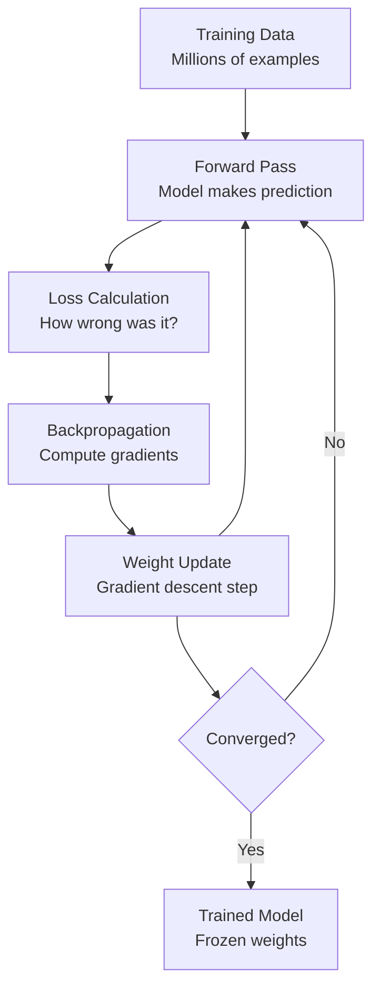
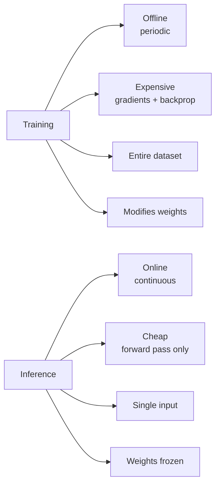

## Introduction

> **Training is how a model learns. Inference is how a model is used. They are completely different operations with different costs, infrastructure, and requirements.**

Understanding this distinction is critical for both building and deploying ML systems.

---

## The Analogy

| Phase | Human Equivalent |
|-------|-----------------|
| **Training** | Studying for an exam (months of effort) |
| **Inference** | Taking the exam (seconds per question) |

Once you've studied (trained), answering a question is fast. You don't re-read all your notes for every question — you use what you've already learned.

---

## Training

**What happens:** The model processes training data repeatedly, adjusting its internal weights to minimize prediction error.



### Characteristics of Training

| Property | Detail |
|----------|--------|
| **Duration** | Minutes to weeks depending on model size |
| **Compute** | GPU-intensive (100s–1000s of GPUs for LLMs) |
| **Data** | Entire training dataset |
| **Memory** | Must hold gradients, activations, optimizer state |
| **Frequency** | Done offline, periodically (retrain as needed) |
| **Output** | Model weights/checkpoint file |

### Training Cost Examples

| Model | Estimated Training Cost |
|-------|------------------------|
| Small classifier (sklearn) | Seconds on a laptop |
| Image classifier (ResNet) | Hours on 1 GPU |
| BERT base | ~$7,000 (4 days, 64 TPUs) |
| GPT-3 | ~$4.6 million |
| GPT-4 | Estimated $100M+ |

---

## Inference

**What happens:** The trained model (frozen weights) takes a new input and produces a prediction in real time.


### Characteristics of Inference

| Property | Detail |
|----------|--------|
| **Duration** | Milliseconds (small models) to seconds (LLMs) |
| **Compute** | GPU or CPU — much lower than training |
| **Data** | Single input (or small batch) |
| **Memory** | Only model weights (no gradients needed) |
| **Frequency** | Continuously, every user request |
| **Output** | Prediction for that input |

---

## Training vs Inference: Side-by-Side



| Aspect | Training | Inference |
|--------|---------|-----------|
| **Goal** | Learn weights | Use weights |
| **Frequency** | Periodic (weekly/monthly) | Continuous (every request) |
| **Latency requirement** | None | Low (< 100ms for user-facing) |
| **Infrastructure** | Training cluster (A100s, TPUs) | Inference server (optimized) |
| **Cost** | Very high (one-time per cycle) | Lower per-call, but scales with traffic |
| **Data needed** | Full training set | Just the new input |

---

## Online vs Offline Inference

### Offline Inference (Batch)

Process many predictions at once, asynchronously.

```python
# Batch inference: predict churn for all customers tonight
import pandas as pd
import pickle

model = pickle.load(open("churn_model.pkl", "rb"))
customers = pd.read_csv("all_customers.csv")

# Predict for entire customer base
customers["churn_probability"] = model.predict_proba(
    customers[["age", "tenure", "monthly_charges"]]
)[:, 1]

customers.to_csv("churn_predictions.csv", index=False)
# Results used by marketing team tomorrow
```

**Use when:** Recommendations pre-generated nightly, risk scores updated daily, report generation.

### Online Inference (Real-Time)

Predict immediately when a request arrives.

```python
# FastAPI real-time inference
from fastapi import FastAPI
import pickle
import numpy as np

app = FastAPI()
model = pickle.load(open("fraud_model.pkl", "rb"))

@app.post("/score-transaction")
def score(transaction: dict):
    features = np.array([[
        transaction["amount"],
        transaction["hour_of_day"],
        transaction["merchant_category"],
        transaction["distance_from_home"]
    ]])
    prob = model.predict_proba(features)[0][1]
    return {
        "fraud_probability": prob,
        "decision": "block" if prob > 0.8 else "allow"
    }
```

**Use when:** Fraud detection (must be instant), search ranking, real-time recommendations.

---

## Inference Optimization

For production, raw model inference is often too slow or expensive. Common optimizations:

| Technique | What It Does | Speedup |
|-----------|-------------|---------|
| **Quantization** | Reduce precision (float32 → int8) | 2–4× faster |
| **Pruning** | Remove unimportant weights | Smaller model |
| **Distillation** | Train small "student" from large "teacher" | Much smaller, similar accuracy |
| **Batching** | Group multiple requests together | Better GPU utilization |
| **Caching** | Store results of repeated inputs | Near-zero cost for duplicates |
| **ONNX export** | Hardware-agnostic optimized format | Portable, faster |

```python
# Example: quantize a PyTorch model for faster inference
import torch

model = torch.load("model.pt")
model.eval()

# Dynamic quantization: weights stored as int8 at inference time
quantized_model = torch.quantization.quantize_dynamic(
    model,
    {torch.nn.Linear},
    dtype=torch.qint8
)
# Typically 2-4x faster on CPU with minimal accuracy loss
```

---

## Interview Questions

**Q: Why does training use so much more compute than inference?**

**A:** Training requires forward pass + loss calculation + backpropagation + weight updates for every batch. Backpropagation stores intermediate activations to compute gradients — consuming significant memory and compute. Inference only needs a single forward pass with frozen weights — no gradient computation, no optimizer state, just matrix multiplications. A training cluster might cost $10,000/hour; the same model at inference might cost $0.01 per 1,000 requests.

---

**Q: When would you choose batch inference over real-time inference?**

**A:** Batch (offline) inference when: results don't need to be immediate (nightly churn scores, weekly recommendations), high throughput is more important than low latency, or the cost of real-time infrastructure isn't justified. Real-time (online) inference when: decisions must happen instantly (fraud detection, search ranking), user experience requires immediate response, or actions depend on current context (live recommendation).

---

## Common Mistakes

- Running gradient computation during inference (wastes memory and compute)
- Loading model weights from disk on every request (use server startup loading)
- Not batching inference requests (leaves GPU underutilized)
- Using training infrastructure for inference (overprovisioned and expensive)

---

## Summary

| Concept | Key Point |
|---------|----------|
| Training | Learn weights — expensive, periodic, offline |
| Inference | Use weights — fast, continuous, online |
| Batch inference | Predict many at once, asynchronously |
| Real-time inference | Predict instantly per request |
| Inference optimization | Quantization, distillation, caching |

---

**← Previous:** [08. Reinforcement Learning](/ai/phase-02-machine-learning/08-reinforcement-learning)
**Next →:** [10. Models](/ai/phase-02-machine-learning/10-models)
