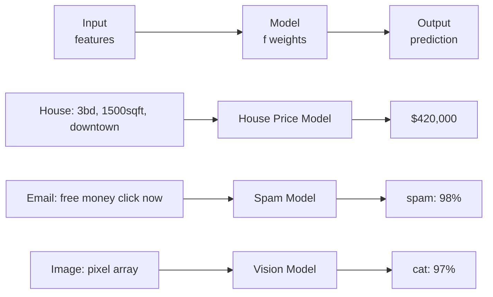
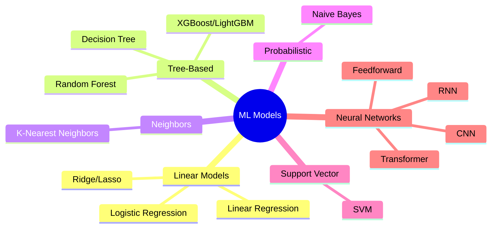
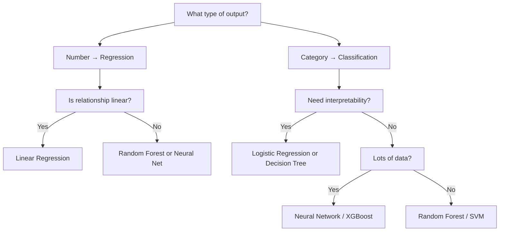

## Introduction

> **A model is a mathematical function that maps inputs to outputs — its internal numbers (parameters/weights) are learned from data.**

When engineers say "the model," they mean this learned function. Training adjusts its numbers. Inference applies them to new inputs.

---

## What Is a Model?

Think of a model as a very complex input → output machine:



The model **is** the function `f`. Training finds the best set of numbers (weights) inside `f`.

---

## Model Parameters (Weights)

**Parameters** are the numbers inside a model that get adjusted during training.

| Model | Parameters |
|-------|-----------|
| Linear regression (1 feature) | 2 (slope + intercept) |
| Logistic regression (10 features) | 11 |
| Small neural network | ~10,000 |
| BERT base | 110 million |
| GPT-3 | 175 billion |
| GPT-4 | ~1.8 trillion (estimated) |

```python
# A model's parameters are just numbers
# Linear regression: y = w1*x1 + w2*x2 + b
# After training:
w1 = 245.3  # slope for feature 1
w2 = 18.7   # slope for feature 2
b  = -50000  # intercept (bias)

def predict(x1, x2):
    return w1 * x1 + w2 * x2 + b

# Model "learned" these numbers from data
```

---

## Common Model Types



---

## Model 1: Linear Regression

**What it is:** Fits a straight line (or plane) through data.

**Best for:** Regression problems with roughly linear relationships.

```python
from sklearn.linear_model import LinearRegression

model = LinearRegression()
model.fit(X_train, y_train)

# Learned parameters
print(model.coef_)       # weights for each feature
print(model.intercept_)  # bias term

# How it predicts: y = w1*x1 + w2*x2 + ... + b
```

```
Price ↑
      |               /  (learned line)
      |             /
      |           /
      |         /
      |       •  •
      |    •
      +—————————————→ Size
```

---

## Model 2: Decision Tree

**What it is:** A series of if/else rules, learned from data.

**Best for:** Interpretable decisions, non-linear relationships.

```python
from sklearn.tree import DecisionTreeClassifier, export_text

model = DecisionTreeClassifier(max_depth=3)
model.fit(X_train, y_train)

# The model is a tree of if/else rules
print(export_text(model, feature_names=["age", "income", "score"]))

# Output:
# |--- income <= 50000
# |   |--- score <= 600
# |   |   |--- class: Rejected
# |   |--- score > 600
# |   |   |--- class: Approved
# |--- income > 50000
# |   |--- class: Approved
```

---

## Model 3: Random Forest

**What it is:** Many decision trees, each trained on a random subset of data and features. Final prediction = majority vote.

**Why it works:** Individual trees overfit. Averaging many diverse trees reduces overfitting. The "wisdom of crowds" principle.

```python
from sklearn.ensemble import RandomForestClassifier

# 100 trees, each trained differently
model = RandomForestClassifier(n_estimators=100, random_state=42)
model.fit(X_train, y_train)

# Feature importance — which features matter most?
import pandas as pd
importance = pd.Series(model.feature_importances_, index=feature_names)
print(importance.sort_values(ascending=False))
```

---

## Model 4: Neural Network

**What it is:** Layers of connected "neurons." Each layer extracts increasingly abstract features.

**Best for:** Complex patterns, images, text, audio.

```python
from sklearn.neural_network import MLPClassifier

model = MLPClassifier(
    hidden_layer_sizes=(128, 64, 32),  # 3 hidden layers
    activation="relu",
    max_iter=300,
    random_state=42
)
model.fit(X_train, y_train)
```

```
Input Layer  →  Hidden Layer 1  →  Hidden Layer 2  →  Output
 [feature1]     [128 neurons]       [64 neurons]       [class]
 [feature2]          ↕                   ↕
 [feature3]     learns edges        learns shapes    → prediction
```

---

## Choosing a Model



---

## Model as a Serialized File

After training, a model is saved to disk. Production inference loads this file.

```python
import pickle
import joblib

# Save model
joblib.dump(model, "model.pkl")

# Load model (no re-training needed)
model = joblib.load("model.pkl")
predictions = model.predict(new_data)
```

---

## Interview Questions

**Q: What is the difference between a model's parameters and hyperparameters?**

**A:** Parameters (weights) are internal values learned from training data — they define what the model has learned. Hyperparameters are external settings you choose before training: number of trees in a forest, number of hidden layers, learning rate, regularization strength. You tune hyperparameters; the model learns parameters. Changing hyperparameters changes how the model learns, not what it has already learned.

---

**Q: Why does a more complex model not always perform better?**

**A:** More complex models have more parameters and can fit training data more closely — but this leads to overfitting: memorizing noise rather than learning generalizable patterns. A decision tree with no depth limit memorizes every training example perfectly but fails on test data. The goal is a model complex enough to capture real patterns but simple enough to generalize. This is the bias-variance tradeoff.

---

## Common Mistakes

- Jumping to neural networks for tabular data (random forest often wins)
- Not checking feature importances — helps debug and understand model behavior
- Using the same model without tuning hyperparameters
- Forgetting to save the preprocessing steps alongside the model

---

## Summary

| Model | Best For | Interpretable? |
|-------|---------|----------------|
| Linear Regression | Regression, linear relationships | ✓ Yes |
| Decision Tree | Both, non-linear, clear rules | ✓ Yes |
| Random Forest | Both, strong general baseline | Partial |
| Neural Network | Complex patterns, images, text | ✗ No |
| Logistic Regression | Binary classification | ✓ Yes |

---

**← Previous:** [09. Training vs Inference](/ai/phase-02-machine-learning/09-training-vs-inference)
**Next →:** [11. Loss Functions](/ai/phase-02-machine-learning/11-loss-functions)
