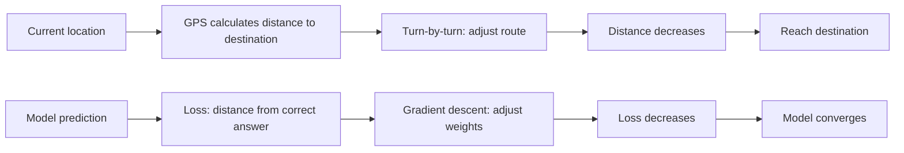
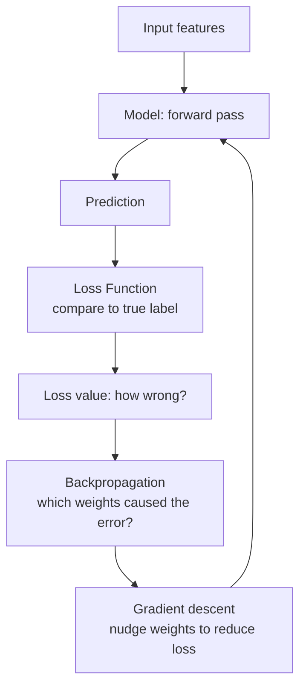
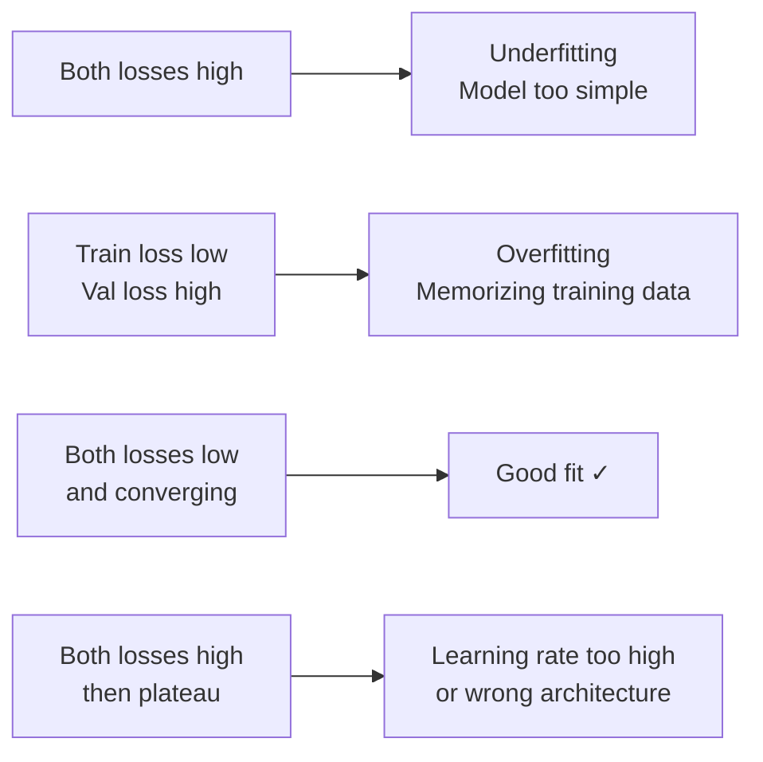

## Introduction

> **A loss function measures how wrong your model is. Training is the process of making that number smaller.**

The loss is the model's "score" in reverse — you want it as low as possible. Every training step tries to reduce it.

---

## The Analogy: GPS Navigation



The GPS doesn't know where you want to go — you tell it. Similarly, the loss function defines what "correct" means for your model.

---

## The Loss Landscape

Imagine loss as a hilly landscape. Every possible set of weights is a point on the terrain. The goal: find the lowest valley.

```
Loss
  ↑
  |    /\          /\
  |   /  \        /  \
  |  /    \  /\  /    \
  | /      \/  \/      \___
  +—————————————————————→ weights
               ↑
          Global minimum (goal)
```

Gradient descent walks "downhill" — small steps in the direction of steepest descent — until it reaches a minimum.

---

## Types of Loss Functions

### For Regression (predicting numbers)

**Mean Absolute Error (MAE)**

Average of absolute differences between predictions and actuals.

```
Prediction: $400,000
Actual:     $420,000
Error:      $20,000

MAE = average(|predictions - actuals|)
```

**Mean Squared Error (MSE)**

Squares the errors — penalizes large mistakes more heavily.

```
Error of $20,000 → (20,000)² = 400,000,000
Error of $2,000  → (2,000)²  = 4,000,000
```

Use MSE when large errors are especially costly. Use MAE when outliers should be treated normally.

```python
from sklearn.metrics import mean_absolute_error, mean_squared_error
import numpy as np

y_true = np.array([420000, 350000, 280000, 510000])
y_pred = np.array([400000, 360000, 270000, 500000])

mae = mean_absolute_error(y_true, y_pred)
mse = mean_squared_error(y_true, y_pred)
rmse = np.sqrt(mse)

print(f"MAE:  ${mae:,.0f}")    # average error in dollars
print(f"RMSE: ${rmse:,.0f}")   # root MSE (same units as target)
```

---

### For Classification (predicting categories)

**Cross-Entropy Loss (Log Loss)**

Measures how confident the model was, and how wrong it was.

```
True label: spam (1)
Prediction: 0.9 probability of spam → small loss (confident and correct)
Prediction: 0.3 probability of spam → large loss (unconfident and wrong)
```

```python
from sklearn.metrics import log_loss

y_true = [1, 0, 1, 1, 0]                       # actual labels
y_pred = [0.9, 0.2, 0.8, 0.3, 0.1]             # predicted probabilities

loss = log_loss(y_true, y_pred)
print(f"Log Loss: {loss:.4f}")  # lower is better
```

---

## How Loss Guides Training



**Epoch 1:** Loss = 2.4 (model is random)
**Epoch 10:** Loss = 0.8 (learning patterns)
**Epoch 50:** Loss = 0.12 (well-trained)
**Epoch 100:** Loss = 0.08 (converged)

---

## Visualizing Loss Over Training

```python
import matplotlib.pyplot as plt

# Typical training loss curve
epochs = list(range(1, 101))
train_loss = [2.4 * (0.96 ** e) + 0.05 for e in epochs]
val_loss   = [2.4 * (0.97 ** e) + 0.08 + (0.001 * e if e > 70 else 0) for e in epochs]

plt.figure(figsize=(10, 5))
plt.plot(epochs, train_loss, label="Training Loss")
plt.plot(epochs, val_loss, label="Validation Loss")
plt.xlabel("Epoch")
plt.ylabel("Loss")
plt.title("Loss Curve — Training vs Validation")
plt.legend()
plt.grid(True)
plt.show()
# When val_loss stops improving or rises → stop training (early stopping)
```

---

## Loss Curves Tell You Everything



---

## Common Loss Functions Reference

| Loss Function | Task | Notes |
|---------------|------|-------|
| **MAE** | Regression | Robust to outliers |
| **MSE / RMSE** | Regression | Penalizes large errors more |
| **Cross-Entropy** | Classification | Standard for most classifiers |
| **Binary Cross-Entropy** | Binary classification | Two classes only |
| **Hinge Loss** | Classification | Used in SVMs |
| **Huber Loss** | Regression | Mix of MAE and MSE |
| **KL Divergence** | Probability distributions | Used in VAEs, generative models |

---

## Interview Questions

**Q: What is a loss function and why is it important?**

**A:** A loss function quantifies how wrong a model's predictions are compared to the true labels. It's the signal that drives training — gradient descent minimizes the loss by adjusting the model's weights. Without a loss function, the model has no way to know whether it's improving. Choosing the right loss function is important: MSE works well for regression but can be dominated by outliers; cross-entropy is the standard for classification because it penalizes confident wrong predictions heavily.

---

**Q: What does it mean when training loss is low but validation loss is high?**

**A:** The model is overfitting — it has memorized the training data rather than learning generalizable patterns. It performs well on examples it's seen before but poorly on new data. Solutions include: regularization (L1/L2, dropout), getting more training data, reducing model complexity, or using early stopping to halt training when validation loss stops improving.

---

## Common Mistakes

- Optimizing accuracy (not a differentiable loss) instead of a proper loss function
- Not plotting loss curves — misses overfitting until too late
- Using MSE for classification (wrong loss for the task)
- Not using early stopping — training past convergence wastes time and overfits

---

## Summary

| Concept | Key Point |
|---------|----------|
| Loss function | Measures prediction error |
| MAE | Average absolute error — robust to outliers |
| MSE/RMSE | Squared error — penalizes big mistakes more |
| Cross-entropy | Standard for classification |
| Training goal | Minimize loss via gradient descent |
| Loss curve | Shows overfitting and convergence |

---

**← Previous:** [10. Models](/ai/phase-02-machine-learning/10-models)
**Next →:** [12. Overfitting & Underfitting](/ai/phase-02-machine-learning/12-overfitting-underfitting)
