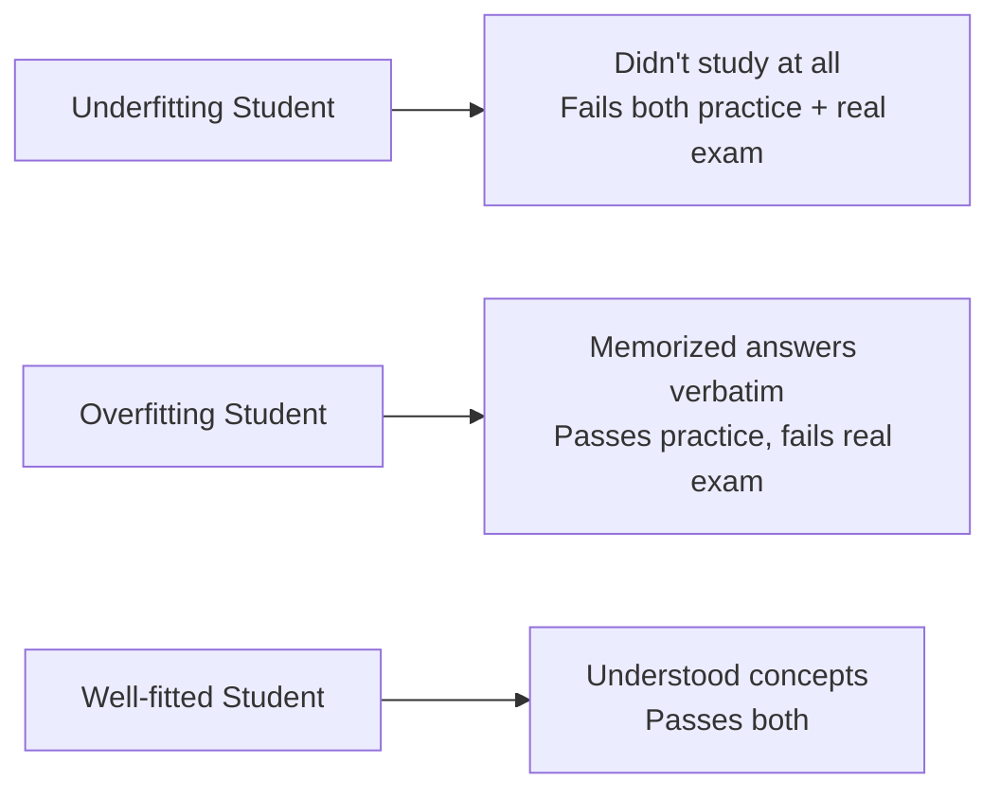
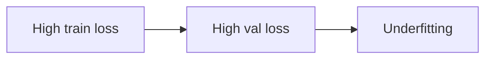
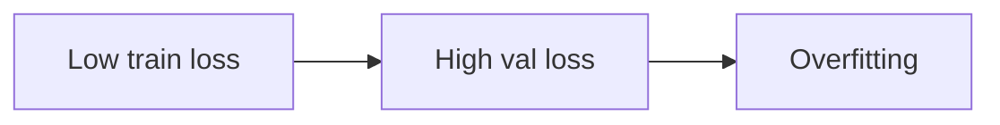
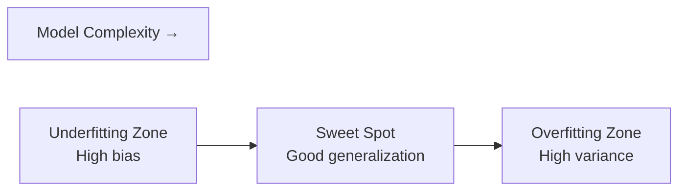

## Introduction

> **Overfitting is memorizing. Underfitting is not learning. The goal is the sweet spot: generalizing.**

These are the two most important failure modes in ML. Every model training session is a balance between the two.

---

## The Student Analogy



| Student Type | Practice Exam | Real Exam |
|-------------|--------------|-----------|
| **Didn't study** | Fails | Fails |
| **Memorized** | Perfect | Fails |
| **Understood** | Passes | Passes |

---

## Underfitting

> The model is too simple to capture the patterns in the data.

**Characteristics:**
- High training error
- High validation/test error
- Model makes overly simplistic predictions



### Visual Example

```
Price ↑
      |  •  •  •  •  •  •
      |
      |——————————————————  ← model (flat line, no learning)
      |  •  •  •  •
      +—————————————→ Size

Model predicted the same price for every house.
```

### Causes

- Model too simple for the problem (linear model for non-linear data)
- Not enough training (too few epochs)
- Features not informative enough
- Too much regularization

### Fixes

```python
# Underfitting fix: increase model complexity
from sklearn.ensemble import RandomForestClassifier

# Too simple: decision tree depth=1 (underfitting)
model_simple = DecisionTreeClassifier(max_depth=1)

# Better: random forest (more complex)
model_better = RandomForestClassifier(n_estimators=100, max_depth=None)

# Add more informative features
# Train for more epochs
# Reduce regularization strength
```

---

## Overfitting

> The model learned the training data too well — including noise and random quirks — and fails on new data.

**Characteristics:**
- Low training error
- High validation/test error
- Large gap between the two



### Visual Example

```
Price ↑
      |    •
      |  •/ \•
      | •    \  •
      |        •
      |    (wiggly line follows every point exactly)
      +—————————————→ Size

Model memorized training points, will fail on new data.
```

### Causes

- Model too complex (too many parameters for the data size)
- Too little training data
- Training too many epochs
- No regularization

### Fixes

```python
from sklearn.ensemble import RandomForestClassifier
from sklearn.linear_model import Ridge

# Fix 1: Add regularization
model = Ridge(alpha=1.0)  # L2 regularization

# Fix 2: Limit model complexity
model = RandomForestClassifier(
    max_depth=5,           # limit tree depth
    min_samples_leaf=10,   # require min samples per leaf
)

# Fix 3: Add more training data

# Fix 4: Dropout (neural networks)
import torch.nn as nn
model = nn.Sequential(
    nn.Linear(100, 64),
    nn.ReLU(),
    nn.Dropout(0.3),   # randomly zero 30% of neurons during training
    nn.Linear(64, 1)
)

# Fix 5: Early stopping
from sklearn.neural_network import MLPClassifier
model = MLPClassifier(early_stopping=True, validation_fraction=0.1)
```

---

## Detecting Overfitting: Learning Curves

```python
import matplotlib.pyplot as plt
import numpy as np
from sklearn.model_selection import learning_curve
from sklearn.ensemble import RandomForestClassifier

model = RandomForestClassifier(n_estimators=100)

train_sizes, train_scores, val_scores = learning_curve(
    model, X, y,
    train_sizes=np.linspace(0.1, 1.0, 10),
    cv=5
)

plt.figure(figsize=(10, 5))
plt.plot(train_sizes, train_scores.mean(axis=1), label="Training Score")
plt.plot(train_sizes, val_scores.mean(axis=1), label="Validation Score")
plt.xlabel("Training Set Size")
plt.ylabel("Score")
plt.title("Learning Curves")
plt.legend()
plt.grid(True)
plt.show()

# Large gap between curves → overfitting
# Both low → underfitting
# Both high and converging → good fit
```

---

## The Three Zones



```
Error ↑
      |                    ╲ Training error
      |╲                    
      | ╲_______/‾‾‾‾‾‾‾‾‾‾ Validation error
      |
      +————————————————————→ Model Complexity
       Simple           Complex
       (Underfitting)   (Overfitting)
              ↑
         Sweet Spot
```

---

## Quick Diagnosis Guide

| Train Error | Val Error | Diagnosis | Fix |
|-------------|-----------|-----------|-----|
| High | High | Underfitting | More complexity, more features, fewer epochs constraints |
| Low | High | Overfitting | Regularization, more data, simpler model |
| Low | Low | Good fit ✓ | Deploy |
| Both decrease then val rises | — | Overfitting starting | Early stopping |

---

## Regularization Quick Reference

| Technique | Mechanism | When to Use |
|-----------|-----------|------------|
| **L1 (Lasso)** | Penalizes weight magnitude, drives some to zero | Feature selection |
| **L2 (Ridge)** | Penalizes squared weight magnitude, shrinks all | General overfitting |
| **Dropout** | Randomly zeros neurons during training | Neural networks |
| **Early stopping** | Stop when val loss stops improving | Any iterative training |
| **Data augmentation** | Artificially create more training examples | Images, audio |
| **Reduce model size** | Fewer parameters = less capacity to overfit | Architecture choice |

---

## Interview Questions

**Q: What is the difference between overfitting and underfitting?**

**A:** Underfitting occurs when a model is too simple — it has high error on both training and test data. The model hasn't learned the underlying patterns. Overfitting occurs when a model is too complex — it fits the training data near-perfectly but fails on new data because it memorized noise. The fix for underfitting is more complexity; the fix for overfitting is regularization, more data, or a simpler model.

---

**Q: How do you detect overfitting in practice?**

**A:** Track both training loss and validation loss during training. If training loss decreases but validation loss stops decreasing or starts increasing, the model is overfitting. The gap between training and validation performance is the key signal. Learning curves (performance vs dataset size) show whether the problem is overfitting (large gap) or underfitting (both low, small gap).

---

## Common Mistakes

- Only looking at training accuracy (misses overfitting completely)
- Not using a held-out validation set during training
- Adding regularization without checking if the model was even overfitting
- Assuming more data always helps overfitting (it does help, but regularization is usually faster)

---

## Summary

| Concept | One-Line |
|---------|---------|
| Underfitting | Too simple, high error everywhere |
| Overfitting | Too complex, memorizes training data |
| Regularization | Penalty on model complexity to reduce overfitting |
| Early stopping | Stop when validation stops improving |
| Learning curves | Visual tool to diagnose fitting problems |

---

**← Previous:** [11. Loss Functions](/ai/phase-02-machine-learning/11-loss-functions)
**Next →:** [13. Bias vs Variance](/ai/phase-02-machine-learning/13-bias-vs-variance)
