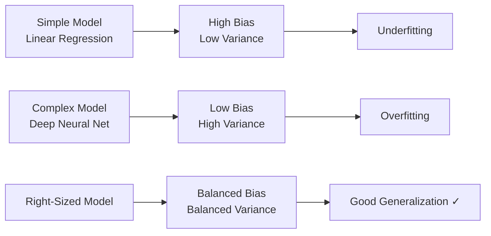

## Introduction

> **Bias and variance are two sources of prediction error. Every model has both. The art of ML is balancing them.**

This concept explains why simple models fail differently from complex models — and guides decisions about model selection and regularization.

---

## The Dartboard Analogy

```
High Bias         High Variance      High Bias +        Low Bias +
Low Variance      Low Bias           High Variance      Low Variance

    ●                                    •  •
  ●   ●              •     •         • •   •  •           •
    ●               •  •  •           • •  •               •
                        •               •                  •  •
                     •                    •                 •

Consistently     Spread around      Spread around     Tightly clustered
wrong (off-      target (but        AND off-center    on target = GOAL
center)          some hit)
```

- **Bias** = how far off-center your shots are (systematic error)
- **Variance** = how spread out your shots are (inconsistency)

---

## Definitions

### Bias

> **Bias is systematic error** — the model consistently misses in the same direction because it's too simple to capture the real pattern.

High bias = underfitting.

```
True relationship: curved (quadratic)
Model: straight line

No matter how much data you add, the line never fits the curve.
The model has a systematic error = high bias.
```

### Variance

> **Variance is sensitivity to training data** — small changes in data cause large changes in the model.

High variance = overfitting.

```
Train on Dataset A → model curve 1
Train on Dataset B → model curve 2
Train on Dataset C → model curve 3

All three curves are completely different.
The model is too sensitive to which data it saw = high variance.
```

---

## The Tradeoff



**Increasing model complexity:**
- ↓ Bias (better at learning patterns)
- ↑ Variance (more sensitive to training data)

**There's no free lunch.** Reducing one typically increases the other.

---

## Comparison Table

| | High Bias | High Variance |
|-|-----------|---------------|
| **Also called** | Underfitting | Overfitting |
| **Training error** | High | Low |
| **Test error** | High | High |
| **Symptom** | Both errors high and similar | Gap between train and test |
| **Model** | Too simple | Too complex |
| **Example** | Linear model on curved data | 100-node tree on 50 examples |
| **Fix** | More complexity, more features | Regularization, more data |

---

## Visual: The Bias-Variance Decomposition

```
Total Error = Bias² + Variance + Irreducible Noise

Error ↑
      |      Total Error
      |     /            ╲
      |    / ← Variance    ╲
      |   /                 ╲
      |  /—————————————————— ← Variance
      | ╲
      |  ╲ ← Bias²
      |   ╲_________________
      +————————————————→ Model Complexity
           Simple      Complex
```

**Irreducible noise:** Random error in data that no model can eliminate. Even a perfect model makes mistakes because reality has randomness.

---

## Python: Seeing Bias-Variance in Action

```python
import numpy as np
import matplotlib.pyplot as plt
from sklearn.preprocessing import PolynomialFeatures
from sklearn.linear_model import LinearRegression
from sklearn.pipeline import Pipeline

np.random.seed(42)

# True relationship: sin curve + noise
X = np.sort(np.random.uniform(0, 2*np.pi, 50))
y = np.sin(X) + np.random.normal(0, 0.2, 50)

X = X.reshape(-1, 1)

fig, axes = plt.subplots(1, 3, figsize=(15, 4))
titles = ["Degree 1 (High Bias)", "Degree 4 (Good Fit)", "Degree 20 (High Variance)"]
degrees = [1, 4, 20]

X_test = np.linspace(0, 2*np.pi, 200).reshape(-1, 1)

for ax, degree, title in zip(axes, degrees, titles):
    model = Pipeline([
        ("poly", PolynomialFeatures(degree=degree)),
        ("linear", LinearRegression())
    ])
    model.fit(X, y)
    y_pred = model.predict(X_test)

    ax.scatter(X, y, alpha=0.5, label="Data")
    ax.plot(X_test, y_pred, color="red", label=f"Degree {degree}")
    ax.set_title(title)
    ax.legend()
    ax.set_ylim(-2, 2)

plt.tight_layout()
plt.show()
```

---

## Strategies to Manage the Tradeoff

### Reduce Bias (Fix Underfitting)
- Use a more complex model
- Add more features
- Reduce regularization strength
- Train longer (more epochs)

### Reduce Variance (Fix Overfitting)
- Get more training data
- Add regularization (L1, L2, dropout)
- Use ensemble methods (random forest averages many high-variance trees)
- Feature selection (fewer, better features)
- Early stopping

---

## Ensemble Methods: Managing Variance

**Bagging** (Bootstrap Aggregating) — Random Forest:
- Train many models on random subsets of data
- Each model has high variance
- Averaging reduces variance without increasing bias

**Boosting** — XGBoost, AdaBoost:
- Train models sequentially, each fixing previous errors
- Reduces bias while keeping variance manageable

---

## Interview Questions

**Q: What is the bias-variance tradeoff?**

**A:** Every ML model's error comes from two sources: bias (systematic error from oversimplified assumptions) and variance (error from sensitivity to training data fluctuations). Simple models have high bias and low variance; complex models have low bias and high variance. The tradeoff is that you can't reduce both simultaneously without more data. The goal is to find the sweet spot that minimizes total error on new data — typically using techniques like regularization and cross-validation.

---

**Q: How do ensemble methods like Random Forest help with the bias-variance tradeoff?**

**A:** Individual decision trees have low bias (they can fit complex patterns) but high variance (they're sensitive to training data — small changes produce very different trees). Random Forest combines many diverse trees (each trained on a random data subset with random features), and averages their predictions. The averaging reduces variance without significantly increasing bias — giving you the pattern-capturing ability of deep trees without the overfitting instability.

---

## Common Mistakes

- Conflating bias-variance with underfitting-overfitting (they're related but not identical)
- Ignoring irreducible noise — some prediction error is unavoidable
- Applying regularization when the problem is high bias (makes it worse)
- Not using cross-validation to get reliable estimates of variance

---

## Summary

| Concept | One-Line |
|---------|---------|
| Bias | Systematic error — model consistently wrong in one direction |
| Variance | Inconsistency — model changes a lot with different data |
| Underfitting | High bias problem |
| Overfitting | High variance problem |
| Ensemble methods | Reduce variance by averaging many models |
| Goal | Minimize bias² + variance (total generalization error) |

---

**← Previous:** [12. Overfitting & Underfitting](/ai/phase-02-machine-learning/12-overfitting-underfitting)
**Next →:** [14. Train / Test / Validation](/ai/phase-02-machine-learning/14-train-test-validation)
