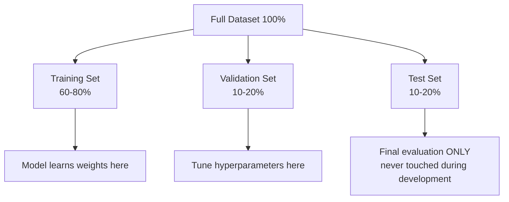
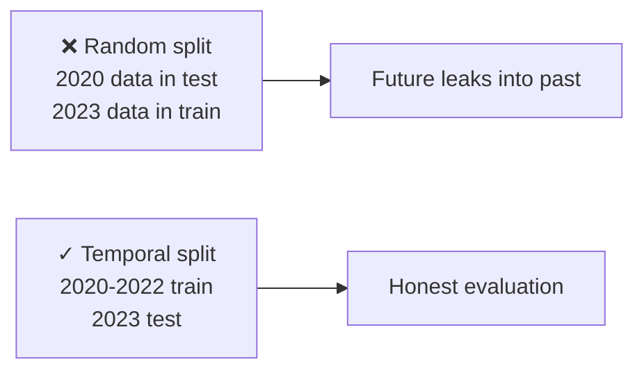

## Introduction

> **You can't grade a student using the same questions they studied. You can't evaluate an ML model on the data it trained on.**

Proper data splitting is the foundation of honest ML evaluation. Get it wrong and your metrics lie.

---

## The Three Splits



| Split | Purpose | Touched During |
|-------|---------|---------------|
| **Training** | Model learns weights | Training |
| **Validation** | Tune hyperparameters, compare models | Development |
| **Test** | Final honest evaluation | Once, at the end |

---

## Why Three Splits?

**Why not just train + test?**

If you tune hyperparameters on the test set, the test set becomes contaminated — you've been optimizing for it implicitly. The model appears better than it really is.

```
Train → validate → fine-tune → validate → fine-tune → ...
                                                    → final test

The test set stays locked away until you're completely done.
```

---

## The Data Snooping Problem

Imagine you're given 100 candidate models. You evaluate all 100 on the test set and pick the best one. The "best" will look impressive — but only because you tried 100 and got lucky. It's similar to flipping a coin 100 times: someone gets 10 heads in a row, but that doesn't mean their coin is special.

**Solution:** Use validation for development. Test set = blind evaluation.

---

## How to Split

```python
from sklearn.model_selection import train_test_split

# Method 1: Single split (simple)
X_train, X_test, y_train, y_test = train_test_split(
    X, y,
    test_size=0.2,      # 20% test
    random_state=42,    # reproducible
    stratify=y          # preserve class proportions in both splits
)

# Method 2: Three-way split
X_temp, X_test, y_temp, y_test = train_test_split(
    X, y, test_size=0.15, random_state=42
)
X_train, X_val, y_train, y_val = train_test_split(
    X_temp, y_temp, test_size=0.15, random_state=42
)

print(f"Train: {len(X_train)}, Val: {len(X_val)}, Test: {len(X_test)}")
```

---

## Cross-Validation: When You Don't Have Enough Data

With small datasets, a single split wastes too much data for evaluation. Cross-validation uses all data for both training and validation.

### K-Fold Cross-Validation

```mermaid
flowchart TD
    A[Dataset split into 5 folds]
    B[Fold 1: VAL | Train | Train | Train | Train] --> B1[Score 1]
    C[Fold 2: Train | VAL | Train | Train | Train] --> C1[Score 2]
    D[Fold 3: Train | Train | VAL | Train | Train] --> D1[Score 3]
    E[Fold 4: Train | Train | Train | VAL | Train] --> E1[Score 4]
    F[Fold 5: Train | Train | Train | Train | VAL] --> F1[Score 5]
    B1 & C1 & D1 & E1 & F1 --> G[Final Score = Average of 5]
```

```python
from sklearn.model_selection import cross_val_score
from sklearn.ensemble import RandomForestClassifier
import numpy as np

model = RandomForestClassifier(n_estimators=100, random_state=42)

# 5-fold cross-validation
scores = cross_val_score(model, X, y, cv=5, scoring="accuracy")

print(f"Scores: {scores}")
print(f"Mean:  {scores.mean():.3f}")
print(f"Std:   {scores.std():.3f}")
# If std is high → high variance model
```

---

## Stratified Splitting

For classification, naive random splitting can create imbalanced splits:

```python
# Problem: if only 5% of data is fraud, random split might put:
# Train: 4.8% fraud
# Test:  5.2% fraud  → small datasets make this worse

# Solution: stratified split preserves class proportions
X_train, X_test, y_train, y_test = train_test_split(
    X, y,
    test_size=0.2,
    stratify=y,         # ← ensures same fraud% in both splits
    random_state=42
)

# Check:
print(y_train.value_counts(normalize=True))  # ~5% fraud
print(y_test.value_counts(normalize=True))   # ~5% fraud
```

---

## Time-Series Split: Order Matters

For time-series data (stock prices, user events), random splitting leaks the future into training.



```python
from sklearn.model_selection import TimeSeriesSplit

tscv = TimeSeriesSplit(n_splits=5)

for fold, (train_idx, val_idx) in enumerate(tscv.split(X)):
    X_train_fold, X_val_fold = X[train_idx], X[val_idx]
    y_train_fold, y_val_fold = y[train_idx], y[val_idx]
    
    model.fit(X_train_fold, y_train_fold)
    score = model.score(X_val_fold, y_val_fold)
    print(f"Fold {fold+1}: {score:.3f}")
# Each fold: train on past, evaluate on future — no leakage
```

---

## Typical Split Sizes

| Dataset Size | Recommended Split |
|-------------|------------------|
| < 1,000 examples | Use cross-validation, no fixed test |
| 1,000–10,000 | 70% train / 15% val / 15% test |
| 10,000–100,000 | 80% train / 10% val / 10% test |
| > 1M examples | 98% train / 1% val / 1% test |

The test set only needs to be large enough for statistically meaningful evaluation — a few thousand is usually sufficient regardless of dataset size.

---

## Interview Questions

**Q: Why do we need a validation set separate from the test set?**

**A:** The validation set is used during development for hyperparameter tuning and model selection. Each time you tune a hyperparameter based on validation performance, you're implicitly fitting to the validation set. If you use the test set for this, the final reported performance is biased upward — you've been optimizing for it. The test set must be locked away and only used once, for the final honest evaluation. Otherwise your reported metrics are inflated.

---

**Q: When should you use cross-validation instead of a fixed train/test split?**

**A:** Use cross-validation when: (1) your dataset is small (< 5,000 examples) and a fixed split wastes too much data, (2) you need a more reliable estimate of performance with confidence intervals, (3) you're comparing multiple models and need statistically reliable rankings. For large datasets, a fixed split is more computationally efficient and usually sufficient. Always use time-aware splits for time-series data.

---

## Common Mistakes

- Fitting preprocessing (scaler, imputer) on the full dataset before splitting — leakage
- Evaluating on training data and calling it "accuracy"
- Using test set for model selection — inflated metrics
- Random split for time-series data — future leaks into training

---

## Summary

| Split | Purpose | Rule |
|-------|---------|------|
| Training | Fit model weights | ≥60% of data |
| Validation | Tune hyperparameters | Used during development |
| Test | Honest final evaluation | Used ONCE, at the very end |
| Cross-validation | All data for both roles | Best for small datasets |
| Stratified | Preserve class proportions | Always for imbalanced datasets |
| Temporal | Respect time order | Always for time-series |

---

**← Previous:** [13. Bias vs Variance](/ai/phase-02-machine-learning/13-bias-vs-variance)
**Next →:** [15. Model Evaluation](/ai/phase-02-machine-learning/15-model-evaluation)
