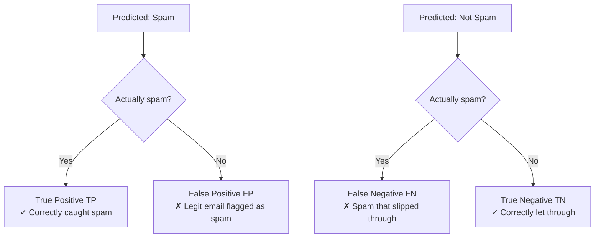
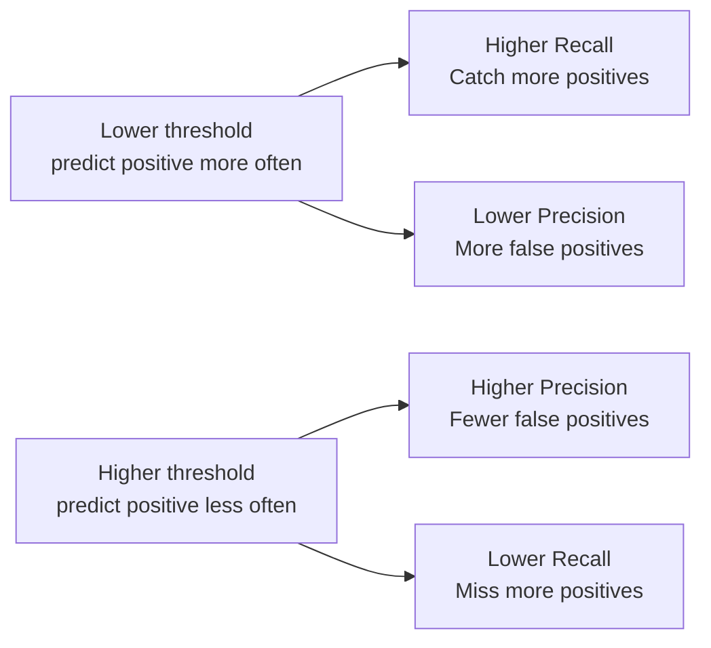

## Introduction

> **"My model is 99% accurate" can mean it's great — or completely useless. It depends on what you're measuring.**

Choosing the right metric is as important as building the model. The wrong metric leads to models that look good on paper but fail in the real world.

---

## The Spam Filter Problem

Imagine a spam filter that labels **every email as "not spam"**:

- Dataset: 990 legit emails, 10 spam emails
- Predictions: all predicted as "not spam"
- **Accuracy: 99%**

But it catches zero spam. Completely useless. Accuracy misled you.

This is why you need more than one metric.

---

## The Confusion Matrix

Every classification result falls into one of four buckets:



|  | **Predicted Positive** | **Predicted Negative** |
|--|------------------------|------------------------|
| **Actual Positive** | TP (True Positive) | FN (False Negative) |
| **Actual Negative** | FP (False Positive) | TN (True Negative) |

```python
from sklearn.metrics import confusion_matrix, ConfusionMatrixDisplay
import matplotlib.pyplot as plt

y_true = [1, 1, 0, 0, 1, 0, 1, 0, 0, 1]
y_pred = [1, 0, 0, 1, 1, 0, 1, 0, 1, 0]

cm = confusion_matrix(y_true, y_pred)
disp = ConfusionMatrixDisplay(confusion_matrix=cm, display_labels=["Not Spam", "Spam"])
disp.plot()
plt.title("Confusion Matrix")
plt.show()
```

---

## Core Metrics

### Accuracy

> What fraction of all predictions were correct?

```
Accuracy = (TP + TN) / (TP + TN + FP + FN)
```

**Use when:** Classes are balanced. **Avoid when:** One class is rare (fraud, disease).

---

### Precision

> Of everything we predicted positive, how many were actually positive?

```
Precision = TP / (TP + FP)
```

**Optimize when:** False positives are costly.
- Spam filter: high precision = less good email goes to spam
- Medical screening: high precision = fewer healthy people get unnecessary surgery

---

### Recall (Sensitivity)

> Of all actual positives, how many did we catch?

```
Recall = TP / (TP + FN)
```

**Optimize when:** False negatives are costly.
- Fraud detection: high recall = catch more fraud (miss less)
- Cancer screening: high recall = miss fewer cancer cases

---

### F1 Score

> Harmonic mean of Precision and Recall — balances both.

```
F1 = 2 × (Precision × Recall) / (Precision + Recall)
```

**Use when:** You need to balance precision and recall and classes are imbalanced.

---

### Putting It Together

```python
from sklearn.metrics import accuracy_score, precision_score, recall_score, f1_score, classification_report

y_true = [1, 1, 0, 0, 1, 0, 1, 0, 0, 1]
y_pred = [1, 0, 0, 1, 1, 0, 1, 0, 1, 0]

print(f"Accuracy:  {accuracy_score(y_true, y_pred):.2f}")
print(f"Precision: {precision_score(y_true, y_pred):.2f}")
print(f"Recall:    {recall_score(y_true, y_pred):.2f}")
print(f"F1 Score:  {f1_score(y_true, y_pred):.2f}")

# Full report for all classes
print(classification_report(y_true, y_pred, target_names=["Not Spam", "Spam"]))
```

---

## The Precision-Recall Tradeoff

Precision and recall trade off against each other via the decision threshold:



```python
from sklearn.metrics import precision_recall_curve
import matplotlib.pyplot as plt

# Requires predicted probabilities
y_scores = model.predict_proba(X_test)[:, 1]

precision, recall, thresholds = precision_recall_curve(y_test, y_scores)

plt.figure(figsize=(8, 5))
plt.plot(recall, precision, marker='.')
plt.xlabel("Recall")
plt.ylabel("Precision")
plt.title("Precision-Recall Curve")
plt.grid(True)
plt.show()
```

---

## ROC Curve and AUC

**ROC (Receiver Operating Characteristic)** — plots True Positive Rate vs False Positive Rate at all thresholds.

**AUC (Area Under Curve)** — single number summarizing model quality.

```
AUC = 1.0 → perfect model
AUC = 0.9 → excellent
AUC = 0.8 → good
AUC = 0.7 → fair
AUC = 0.5 → random (coin flip)
AUC < 0.5 → worse than random
```

```python
from sklearn.metrics import roc_curve, roc_auc_score
import matplotlib.pyplot as plt

y_scores = model.predict_proba(X_test)[:, 1]

fpr, tpr, thresholds = roc_curve(y_test, y_scores)
auc = roc_auc_score(y_test, y_scores)

plt.figure(figsize=(8, 5))
plt.plot(fpr, tpr, label=f"AUC = {auc:.3f}")
plt.plot([0, 1], [0, 1], "k--", label="Random (AUC=0.5)")
plt.xlabel("False Positive Rate")
plt.ylabel("True Positive Rate")
plt.title("ROC Curve")
plt.legend()
plt.grid(True)
plt.show()
```

---

## Regression Metrics

```python
from sklearn.metrics import mean_absolute_error, mean_squared_error, r2_score
import numpy as np

y_true = [420000, 350000, 280000, 510000, 390000]
y_pred = [400000, 360000, 270000, 505000, 395000]

mae  = mean_absolute_error(y_true, y_pred)
rmse = np.sqrt(mean_squared_error(y_true, y_pred))
r2   = r2_score(y_true, y_pred)

print(f"MAE:  ${mae:,.0f}")           # average error in dollars
print(f"RMSE: ${rmse:,.0f}")          # penalizes large errors more
print(f"R²:   {r2:.3f}")             # 1.0 = perfect, 0.0 = useless baseline
```

| Metric | What It Measures |
|--------|-----------------|
| MAE | Average absolute error (same units as target) |
| RMSE | Root mean squared error (penalizes outliers) |
| R² | Fraction of variance explained (1.0 = perfect) |

---

## Which Metric to Use?

| Problem | Best Metric | Why |
|---------|-------------|-----|
| Balanced classification | Accuracy or F1 | Both classes matter equally |
| Imbalanced (fraud, cancer) | Precision/Recall/F1 or AUC | Accuracy misleads |
| Need probability ranking | AUC-ROC | Threshold-independent |
| Cost of FP ≠ FN | Custom weighted metric | Domain-specific tradeoff |
| Regression | RMSE or MAE | Depends on outlier sensitivity |
| Regression + interpretability | MAE | "On average, off by $20k" |

---

## Interview Questions

**Q: When would you choose recall over precision as your primary metric?**

**A:** Choose recall when false negatives are more costly than false positives. Medical cancer screening is the classic example — it's better to flag a healthy patient for further testing (false positive) than to miss a real cancer case (false negative). Fraud detection also typically prioritizes recall: missing fraud is costlier than flagging a legitimate transaction for review. The tradeoff is always domain-specific.

---

**Q: What is AUC-ROC and what does it measure?**

**A:** AUC-ROC (Area Under the Receiver Operating Characteristic Curve) measures a model's ability to discriminate between positive and negative classes across all possible decision thresholds. An AUC of 1.0 means the model perfectly separates classes; 0.5 means it's no better than random guessing. AUC is especially useful for imbalanced datasets because it's threshold-independent and doesn't depend on the class distribution.

---

## Common Mistakes

- Reporting only accuracy for imbalanced datasets
- Not checking the confusion matrix — overall metrics hide class-specific failures
- Comparing models trained on different test sets
- Optimizing for one metric while ignoring relevant others (precision vs recall)

---

## Summary

| Metric | Formula | Use When |
|--------|---------|----------|
| Accuracy | (TP+TN)/All | Balanced classes |
| Precision | TP/(TP+FP) | False positives costly |
| Recall | TP/(TP+FN) | False negatives costly |
| F1 | Harmonic mean of P&R | Imbalanced, balance both |
| AUC-ROC | Area under ROC curve | Ranking quality |
| MAE | Avg absolute error | Regression, interpretable |
| RMSE | Sqrt avg squared error | Regression, penalize outliers |
| R² | Variance explained | Regression baseline comparison |

---

**← Previous:** [14. Train / Test / Validation](/ai/phase-02-machine-learning/14-train-test-validation)
**Next →:** [16. Feature Engineering](/ai/phase-02-machine-learning/16-feature-engineering)
