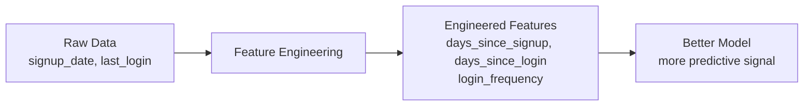

## Introduction

> **Feature engineering is the process of using domain knowledge to create, transform, and select the inputs that give ML models the best chance of learning.**

The most common reason a model underperforms isn't the algorithm — it's the features. Better features beat better algorithms.

---

## Why Feature Engineering Matters



**Raw data is rarely model-ready.** Dates are strings. Categories are text. The important signal is often derived, not direct.

---

## Technique 1: Date & Time Features

Dates contain rich cyclical information:

```python
import pandas as pd

df = pd.read_csv("orders.csv")
df["order_date"] = pd.to_datetime(df["order_date"])

# Extract meaningful time features
df["hour"]            = df["order_date"].dt.hour
df["day_of_week"]     = df["order_date"].dt.dayofweek    # 0=Mon, 6=Sun
df["month"]           = df["order_date"].dt.month
df["is_weekend"]      = df["day_of_week"].isin([5, 6]).astype(int)
df["is_holiday"]      = df["order_date"].dt.date.isin(holidays_list).astype(int)
df["days_since_signup"] = (df["order_date"] - df["signup_date"]).dt.days
df["quarter"]         = df["order_date"].dt.quarter

# Drop the raw date — model can't use it directly
df.drop("order_date", axis=1, inplace=True)
```

---

## Technique 2: Encoding Categorical Features

Models need numbers, not strings.

### Label Encoding (Ordinal categories)

```python
from sklearn.preprocessing import LabelEncoder, OrdinalEncoder

# Ordinal: Low < Medium < High
sizes = ["Small", "Medium", "Large", "Medium", "Small"]
encoder = OrdinalEncoder(categories=[["Small", "Medium", "Large"]])
encoded = encoder.fit_transform([[s] for s in sizes])
# [[0.], [1.], [2.], [1.], [0.]]
```

### One-Hot Encoding (Nominal categories)

```python
import pandas as pd

df = pd.DataFrame({"city": ["Mumbai", "Delhi", "Mumbai", "Bangalore"]})

# Creates binary columns for each category
encoded = pd.get_dummies(df, columns=["city"])
#    city_Bangalore  city_Delhi  city_Mumbai
# 0               0           0            1
# 1               0           1            0
# 2               0           0            1
# 3               1           0            0
```

### Target Encoding (High-cardinality categories)

```python
# For columns with 100s of categories (zip codes, user IDs)
# Replace category with mean of target variable

target_means = df.groupby("zip_code")["price"].mean()
df["zip_target_enc"] = df["zip_code"].map(target_means)
```

---

## Technique 3: Scaling Numerical Features

Distance-based algorithms (KNN, SVM) and neural networks are sensitive to feature scale.

```python
from sklearn.preprocessing import StandardScaler, MinMaxScaler

# StandardScaler: mean=0, std=1 (for normally distributed features)
scaler = StandardScaler()
X_scaled = scaler.fit_transform(X_train)

# MinMaxScaler: [0, 1] range (for bounded features)
scaler = MinMaxScaler()
X_scaled = scaler.fit_transform(X_train)

# IMPORTANT: fit on train, transform both train and test
X_train_scaled = scaler.fit_transform(X_train)
X_test_scaled  = scaler.transform(X_test)   # not fit_transform!
```

**When to scale:**
- KNN, SVM, Neural Networks → always scale
- Tree-based models (Random Forest, XGBoost) → don't need scaling

---

## Technique 4: Handling Missing Values

```python
from sklearn.impute import SimpleImputer
import pandas as pd

df = pd.read_csv("data.csv")
print(df.isnull().sum())

# Strategy 1: Mean/median imputation
imputer = SimpleImputer(strategy="median")
df[["age", "income"]] = imputer.fit_transform(df[["age", "income"]])

# Strategy 2: Mode for categorical
df["city"].fillna(df["city"].mode()[0], inplace=True)

# Strategy 3: Flag + impute
df["age_missing"] = df["age"].isnull().astype(int)  # new feature: was it missing?
df["age"].fillna(df["age"].median(), inplace=True)

# Strategy 4: Drop rows (only if few missing and data is large)
df.dropna(subset=["critical_feature"], inplace=True)
```

---

## Technique 5: Binning / Discretization

Convert continuous features to bins for better model interpretation.

```python
import pandas as pd

df["age_group"] = pd.cut(
    df["age"],
    bins=[0, 18, 35, 55, 100],
    labels=["under_18", "18_35", "35_55", "55_plus"]
)

df["income_quartile"] = pd.qcut(df["income"], q=4, labels=["Q1", "Q2", "Q3", "Q4"])
```

---

## Technique 6: Feature Interaction

Combine features to capture relationships the model might miss.

```python
# Create interaction terms
df["area_per_room"]   = df["area_sqft"] / (df["bedrooms"] + df["bathrooms"])
df["price_per_sqft"]  = df["list_price"] / df["area_sqft"]
df["spend_per_visit"] = df["total_spend"] / df["visit_count"].replace(0, 1)
df["is_power_user"]   = ((df["logins_per_week"] > 5) &
                          (df["features_used"] > 10)).astype(int)
```

---

## Technique 7: Text Features

```python
from sklearn.feature_extraction.text import TfidfVectorizer

reviews = [
    "The product is great, highly recommend",
    "Terrible quality, broke after one day",
    "Average product, nothing special",
]

# TF-IDF: word frequency weighted by how unique the word is
vectorizer = TfidfVectorizer(max_features=100, stop_words="english")
X_text = vectorizer.fit_transform(reviews)
# Sparse matrix: rows = reviews, columns = words, values = TF-IDF score
```

---

## Feature Selection: Drop the Noise

Not all features help. Irrelevant features add noise.

```python
from sklearn.feature_selection import SelectKBest, f_classif
from sklearn.ensemble import RandomForestClassifier

# Method 1: Statistical test — select top K features
selector = SelectKBest(score_func=f_classif, k=10)
X_selected = selector.fit_transform(X_train, y_train)

# Method 2: Model-based importance
model = RandomForestClassifier(n_estimators=100)
model.fit(X_train, y_train)

import pandas as pd
importance = pd.Series(model.feature_importances_, index=feature_names)
top_features = importance.nlargest(10).index
X_reduced = X_train[top_features]

# Method 3: Drop correlated features (removes redundancy)
corr_matrix = pd.DataFrame(X_train).corr().abs()
upper = corr_matrix.where(np.triu(np.ones(corr_matrix.shape), k=1).astype(bool))
to_drop = [col for col in upper.columns if any(upper[col] > 0.95)]
X_train.drop(columns=to_drop, inplace=True)
```

---

## Interview Questions

**Q: What is feature engineering and why is it important?**

**A:** Feature engineering is the process of transforming and creating input variables to better represent the underlying problem for ML algorithms. Raw data rarely provides the best signal: a `signup_date` column is less useful than `days_since_signup`. Good features allow simpler models to perform as well as or better than complex models on raw data. It's where domain knowledge about the problem translates into ML value.

---

**Q: Why must you fit a scaler on training data only, not the full dataset?**

**A:** Fitting the scaler on the full dataset (including test data) causes data leakage — information from test examples influences the transformation applied to training data. In production, you won't have test data available. You must fit all preprocessing transformations only on training data, then apply (transform) those fitted transformations to validation and test data. This simulates real-world conditions.

---

## Common Mistakes

- Fitting scaler/encoder on full dataset before split → data leakage
- Not encoding categoricals (many algorithms fail on strings)
- Scaling features before encoding categoricals (encode first)
- Forgetting to handle missing values before training
- Not saving preprocessing transformations alongside the model

---

## Summary

| Technique | Use When |
|-----------|----------|
| Date extraction | DateTime columns |
| One-hot encoding | Nominal categories (no order) |
| Label encoding | Ordinal categories (has order) |
| Standardization | KNN, SVM, neural networks |
| Mean imputation | Numerical missing values |
| Binning | Reduce noise in continuous features |
| Interaction terms | Model misses combined signals |
| Feature selection | Remove irrelevant/correlated features |

---

**← Previous:** [15. Model Evaluation](/ai/phase-02-machine-learning/15-model-evaluation)
**Next →:** [17. Data Preprocessing](/ai/phase-02-machine-learning/17-data-preprocessing)
