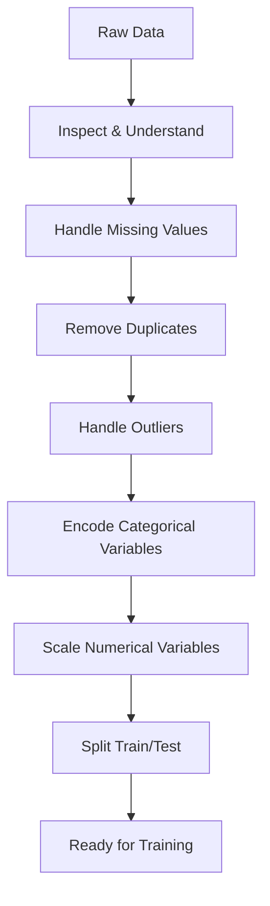

## Introduction

> **Preprocessing is everything that happens between raw data and model training. Garbage in = garbage out.**

It's related to feature engineering (which creates new features) but focused on cleaning and standardizing existing data so models can use it.

---

## The Preprocessing Pipeline



---

## Step 1: Inspect the Data

Always start with exploration:

```python
import pandas as pd
import numpy as np

df = pd.read_csv("data.csv")

# Basic info
print(df.shape)         # rows × columns
print(df.dtypes)        # column types
print(df.describe())    # stats for numerical columns
print(df.info())        # null counts + types

# Missing values
missing = df.isnull().sum()
missing_pct = (missing / len(df)) * 100
print(pd.DataFrame({"count": missing, "percent": missing_pct}))

# Duplicates
print(f"Duplicate rows: {df.duplicated().sum()}")

# Class balance
print(df["target"].value_counts(normalize=True))
```

---

## Step 2: Handle Missing Values

Strategy depends on the column and percentage missing:

```python
# View missing heatmap
import seaborn as sns
import matplotlib.pyplot as plt

sns.heatmap(df.isnull(), yticklabels=False, cbar=False, cmap="viridis")
plt.title("Missing Values Heatmap")
plt.show()
```

```python
from sklearn.impute import SimpleImputer, KNNImputer

# Numerical: mean or median
df["age"].fillna(df["age"].median(), inplace=True)

# Categorical: mode
df["city"].fillna(df["city"].mode()[0], inplace=True)

# KNN imputation (uses similar rows to fill)
imputer = KNNImputer(n_neighbors=5)
df[["age", "income"]] = imputer.fit_transform(df[["age", "income"]])

# Drop row if < 5% missing and critical column
df.dropna(subset=["target"], inplace=True)

# Drop column if > 60% missing
df.drop(columns=df.columns[df.isnull().mean() > 0.6], inplace=True)
```

---

## Step 3: Remove Duplicates

```python
# Check duplicates
print(df.duplicated().sum())

# Remove exact duplicates
df.drop_duplicates(inplace=True)

# Remove duplicates based on specific columns (keep most recent)
df.sort_values("updated_at", ascending=False, inplace=True)
df.drop_duplicates(subset=["user_id"], keep="first", inplace=True)
```

---

## Step 4: Handle Outliers

Outliers can distort model training, especially for regression and distance-based models.

```python
import numpy as np
import matplotlib.pyplot as plt

# Visualize
df["income"].plot(kind="box")
plt.title("Income Distribution — Outliers Visible")
plt.show()

# Method 1: IQR clipping
Q1 = df["income"].quantile(0.25)
Q3 = df["income"].quantile(0.75)
IQR = Q3 - Q1
lower = Q1 - 1.5 * IQR
upper = Q3 + 1.5 * IQR
df["income"] = df["income"].clip(lower=lower, upper=upper)

# Method 2: Z-score removal (remove > 3 std from mean)
from scipy import stats
z_scores = np.abs(stats.zscore(df["income"]))
df = df[z_scores < 3]

# Method 3: Log transform (compress large values)
df["income_log"] = np.log1p(df["income"])  # log1p handles zero safely
```

---

## Step 5: Encode Categorical Variables

```python
import pandas as pd
from sklearn.preprocessing import LabelEncoder, OrdinalEncoder

# One-hot encoding (nominal — no order)
df = pd.get_dummies(df, columns=["city", "product_category"], drop_first=True)

# Ordinal encoding (has order: Low < Med < High)
enc = OrdinalEncoder(categories=[["Low", "Medium", "High"]])
df[["risk_level"]] = enc.fit_transform(df[["risk_level"]])

# Label encoding (for binary columns)
df["gender"] = LabelEncoder().fit_transform(df["gender"])
```

---

## Step 6: Scale Numerical Variables

```python
from sklearn.preprocessing import StandardScaler, MinMaxScaler, RobustScaler

# StandardScaler: z-score normalization (good default)
# mean=0, std=1, sensitive to outliers
scaler = StandardScaler()

# MinMaxScaler: [0, 1] range (good for neural networks)
# Sensitive to outliers
scaler = MinMaxScaler()

# RobustScaler: uses median and IQR (best when data has outliers)
scaler = RobustScaler()

# ALWAYS fit on train, transform both
numerical_cols = ["age", "income", "tenure"]
scaler.fit(X_train[numerical_cols])
X_train[numerical_cols] = scaler.transform(X_train[numerical_cols])
X_test[numerical_cols] = scaler.transform(X_test[numerical_cols])
```

---

## Sklearn Pipelines: The Right Way

Pipelines chain preprocessing and modeling, preventing leakage:

```python
from sklearn.pipeline import Pipeline
from sklearn.compose import ColumnTransformer
from sklearn.preprocessing import StandardScaler, OneHotEncoder
from sklearn.impute import SimpleImputer
from sklearn.ensemble import RandomForestClassifier

# Define column types
num_features = ["age", "income", "tenure"]
cat_features = ["city", "plan_type"]

# Preprocessing for numerical columns
num_pipeline = Pipeline([
    ("imputer", SimpleImputer(strategy="median")),
    ("scaler", StandardScaler()),
])

# Preprocessing for categorical columns
cat_pipeline = Pipeline([
    ("imputer", SimpleImputer(strategy="most_frequent")),
    ("encoder", OneHotEncoder(handle_unknown="ignore", sparse_output=False)),
])

# Combine
preprocessor = ColumnTransformer([
    ("num", num_pipeline, num_features),
    ("cat", cat_pipeline, cat_features),
])

# Full pipeline: preprocessing + model
full_pipeline = Pipeline([
    ("preprocessor", preprocessor),
    ("classifier", RandomForestClassifier(n_estimators=100)),
])

# Train
full_pipeline.fit(X_train, y_train)

# Predict — preprocessing happens automatically
y_pred = full_pipeline.predict(X_test)

# Save entire pipeline (preprocessing + model together)
import joblib
joblib.dump(full_pipeline, "model_pipeline.pkl")
```

Using a pipeline ensures:
- No leakage (fit only on train data)
- Consistent preprocessing in production
- Single object to save and deploy

---

## Interview Questions

**Q: What is data leakage in preprocessing and how do you prevent it?**

**A:** Data leakage in preprocessing happens when information from validation or test sets influences the preprocessing fit. For example, if you compute the mean for imputation on the full dataset (train + test), test data statistics influence training — the model is implicitly exposed to test information. Prevention: fit all preprocessing (scalers, imputers, encoders) ONLY on training data, then apply (transform) those fitted objects to validation and test data. Sklearn Pipelines enforce this automatically.

---

**Q: When would you use RobustScaler instead of StandardScaler?**

**A:** RobustScaler uses median and interquartile range (IQR) instead of mean and standard deviation. It's preferable when data has significant outliers because outliers don't distort the scale. StandardScaler's mean and std are pulled heavily by outliers, making the scaling misleading. If your income column has values of $30k–$80k but one outlier at $5M, StandardScaler will compress most of the data near zero. RobustScaler handles this gracefully.

---

## Common Mistakes

- Fitting scalers/imputers on full dataset (leakage)
- Not removing duplicates before splitting
- Encoding categoricals after scaling (apply encoding before scaling)
- Forgetting to save the preprocessing transformers for production use
- Using the same imputation strategy for all columns

---

## Summary

| Step | Purpose |
|------|---------|
| Inspect | Understand distribution, missing values, duplicates |
| Handle missing | Impute or drop based on % missing and strategy |
| Remove duplicates | Prevent model over-learning repeated examples |
| Handle outliers | Clip, remove, or transform extreme values |
| Encode categoricals | Convert strings to numbers |
| Scale numericals | Normalize ranges for distance/gradient algorithms |
| Pipeline | Chain all steps to prevent leakage and simplify deployment |

---

**← Previous:** [16. Feature Engineering](/ai/phase-02-machine-learning/16-feature-engineering)
**Next →:** [18. Common ML Algorithms](/ai/phase-02-machine-learning/18-common-ml-algorithms)
