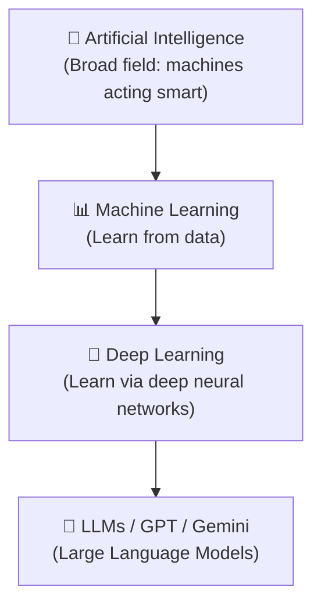
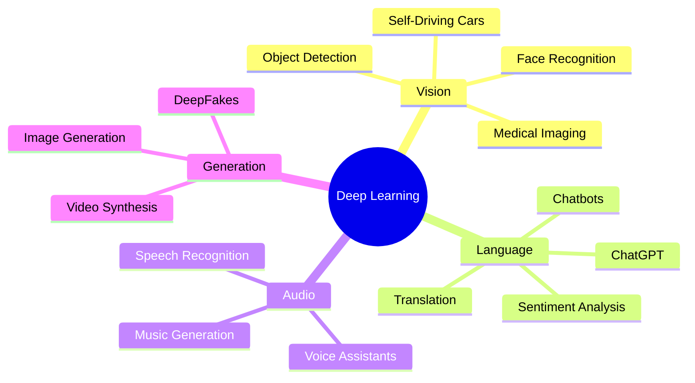
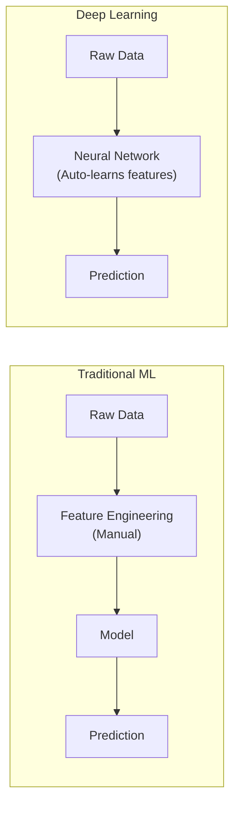

## Introduction

> **Deep Learning is a subfield of Machine Learning that uses neural networks with many layers to learn patterns from massive amounts of data — automatically.**

The "deep" refers to the depth of these layers. More layers = more complex patterns the model can learn.



---

## Why Deep Learning Exists

### The Problem with Traditional ML

Traditional ML required humans to manually **engineer features** — telling the model *what to look for*.

**Example — Detecting a cat in a photo:**

With traditional ML:
1. Human extracts features: fur texture, ear shape, whisker length
2. Model learns from those hand-crafted features

**Problem:** Humans can't enumerate every feature. What makes a cat look like a cat in 10 million different lighting conditions, angles, and breeds?


### The Deep Learning Solution

Deep Learning **learns its own features** from raw data.


No human tells it what edges or shapes are — it discovers these automatically through training.

---

## Real-World Analogy

Think of how a baby learns to recognize faces.

- A newborn sees thousands of faces over years
- Brain gradually learns: eyes go here, nose goes here, this combination = a face
- No one programs these rules — the brain learns them from experience

**Deep Learning works the same way:**
- Show it millions of cat images
- Let the network adjust its internal weights
- Eventually it "knows" what a cat looks like — through learned patterns, not rules

---

## Where Deep Learning Is Used



### Real Examples

| Application | What DL Does |
|-------------|-------------|
| **Face Recognition** (Face ID) | Identifies unique facial features from pixel data |
| **Self-Driving Cars** | Detects lanes, pedestrians, signs from camera feeds |
| **ChatGPT** | Generates human-like text using transformer networks |
| **Image Generation** (DALL-E, Midjourney) | Creates images from text descriptions |
| **Voice Assistants** (Siri, Alexa) | Converts speech to text, understands intent |
| **Medical Diagnosis** | Detects tumors in X-rays with doctor-level accuracy |
| **Spam Filters** | Identifies malicious emails from patterns |
| **Recommendation Systems** | Netflix, YouTube "what to watch next" |

---

## Why Machine Learning Wasn't Enough



**Traditional ML limitations:**

1. **Feature Engineering bottleneck** — Experts needed to define features manually
2. **Doesn't scale** — More data doesn't always improve performance
3. **Fails on unstructured data** — Images, audio, text are hard to feature-engineer
4. **Task-specific** — A spam filter can't be repurposed for image detection

**Deep Learning advantages:**

1. **Automatic feature learning** — Discovers patterns without human intervention
2. **Scales with data** — More data = better performance (usually)
3. **Excels at unstructured data** — Images, audio, text, video
4. **Transfer learning** — One trained model can be adapted for new tasks

---

## Python: Your First Deep Learning Model

```python
import tensorflow as tf
from tensorflow import keras
import numpy as np

# Load dataset: 70,000 handwritten digits (0-9)
(x_train, y_train), (x_test, y_test) = keras.datasets.mnist.load_data()

# Normalize pixel values from 0-255 to 0-1
x_train, x_test = x_train / 255.0, x_test / 255.0

# Build a simple deep neural network
model = keras.Sequential([
    keras.layers.Flatten(input_shape=(28, 28)),  # 28x28 image → 784 numbers
    keras.layers.Dense(128, activation='relu'),   # Hidden layer 1
    keras.layers.Dense(64, activation='relu'),    # Hidden layer 2
    keras.layers.Dense(10, activation='softmax') # Output: 10 digit classes
])

# Compile
model.compile(optimizer='adam',
              loss='sparse_categorical_crossentropy',
              metrics=['accuracy'])

# Train
model.fit(x_train, y_train, epochs=5)

# Evaluate
test_loss, test_acc = model.evaluate(x_test, y_test)
print(f"Test accuracy: {test_acc:.4f}")
# Test accuracy: ~0.9800 (98%)
```

---

## JavaScript: Deep Learning in the Browser

```javascript
// Using TensorFlow.js
import * as tf from '@tensorflow/tfjs';

// Build a simple neural network
const model = tf.sequential({
  layers: [
    tf.layers.dense({ inputShape: [784], units: 128, activation: 'relu' }),
    tf.layers.dense({ units: 64, activation: 'relu' }),
    tf.layers.dense({ units: 10, activation: 'softmax' })
  ]
});

model.compile({
  optimizer: 'adam',
  loss: 'categoricalCrossentropy',
  metrics: ['accuracy']
});

// Deep Learning now runs directly in the browser!
console.log('Model ready to train in the browser');
```

---

## Interview Questions

**Q1: What is Deep Learning?**

> Deep Learning is a subset of Machine Learning that uses artificial neural networks with multiple layers (deep architectures) to automatically learn hierarchical representations from raw data, eliminating the need for manual feature engineering.

**Q2: Why is Deep Learning better than traditional ML for images?**

> Traditional ML requires humans to manually extract features (edges, textures, shapes) from images — a brittle, labor-intensive process. Deep Learning (CNNs) automatically learns hierarchical features: edges in early layers, shapes in middle layers, and complex objects in deeper layers.

**Q3: When should you NOT use Deep Learning?**

> - Small datasets (DL needs large amounts of data)
> - When interpretability is critical (DL is a "black box")
> - Limited compute resources
> - When traditional ML achieves comparable results

**Q4: What does "deep" mean in Deep Learning?**

> "Deep" refers to the number of layers in the neural network. A shallow network has 1-2 hidden layers; a deep network may have dozens or hundreds of layers (e.g., ResNet-152 has 152 layers).

---

## Best Practices

1. **Start simple** — Try traditional ML first; move to DL only if needed
2. **Collect more data** — DL thrives on large datasets
3. **Use pretrained models** — Transfer learning saves months of training time
4. **Use GPU/TPU** — DL training on CPU is extremely slow
5. **Monitor for overfitting** — Deep networks can memorize training data

---

## Common Mistakes

- **Using DL on small datasets** — Traditional ML often beats DL with < 10K samples
- **Ignoring data quality** — Garbage in, garbage out
- **Skipping normalization** — Always normalize input data (0 to 1 range)
- **Too many layers too fast** — Start shallow, add depth gradually
- **Not using a validation set** — Always separate train/val/test splits

---

## Summary

| Concept | Key Point |
|---------|-----------|
| Deep Learning | ML using multi-layer neural networks |
| "Deep" | Refers to many hidden layers |
| Key advantage | Automatic feature learning from raw data |
| Best for | Images, audio, text, video |
| Needs | Large data + powerful hardware (GPU) |
| Invented | 1980s, but became practical after 2012 |

---

## Navigation

**Previous:** [Phase 2 — Machine Learning Cheat Sheet](/ai/phase-02-machine-learning/20-machine-learning-cheatsheet)

**Next:** [02 — Machine Learning vs Deep Learning](/ai/phase-03-deep-learning/02-machine-learning-vs-deep-learning)

**Related Topics:**
- [AI vs ML vs DL](/ai/phase-01-fundamentals/05-ai-vs-ml-vs-dl)
- [What is Machine Learning?](/ai/phase-02-machine-learning/01-what-is-machine-learning)
- [Neural Networks](/ai/phase-03-deep-learning/03-neural-networks)

---

## Practice Exercises

1. Run the MNIST example — what accuracy do you get?
2. Add a third hidden layer — does accuracy improve?
3. Try training on only 1,000 samples — what happens?
4. Look up "ImageNet" — understand why 2012 was a turning point for DL

## Further Reading

- [DeepLearning.ai — Deep Learning Specialization](https://www.deeplearning.ai)
- [Google's ML Crash Course](https://developers.google.com/machine-learning/crash-course)
- [Stanford CS231n — CNNs for Visual Recognition](https://cs231n.stanford.edu)
