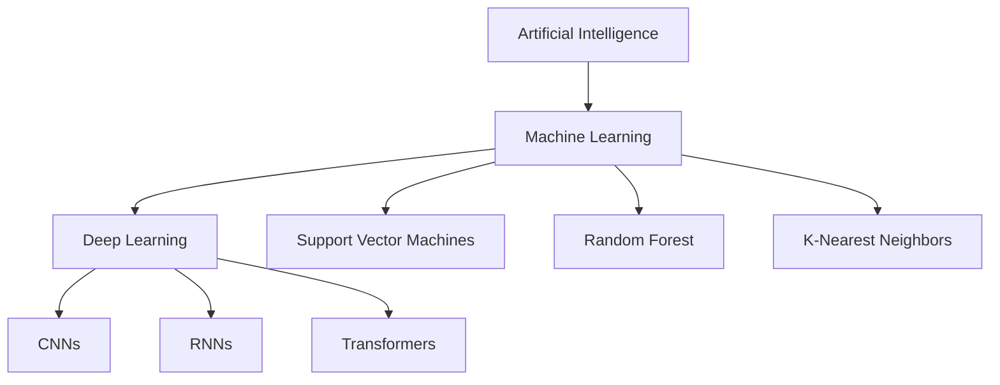
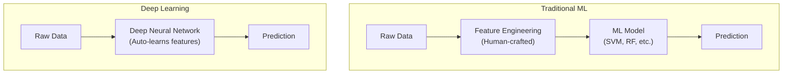
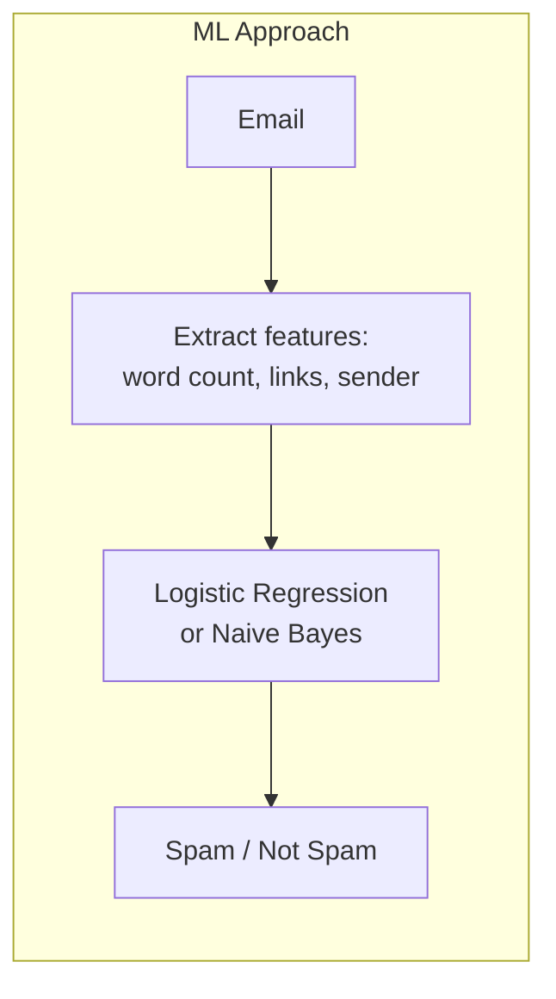
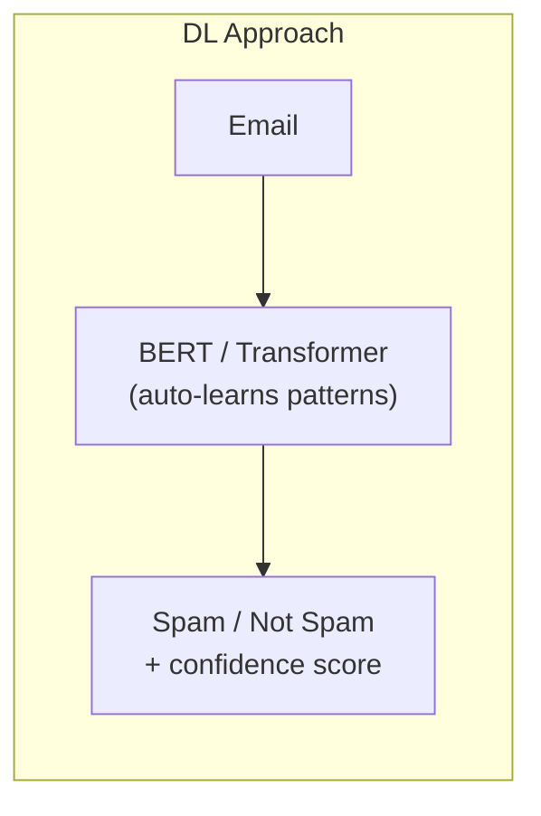
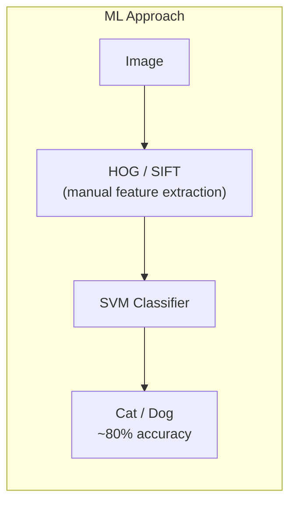
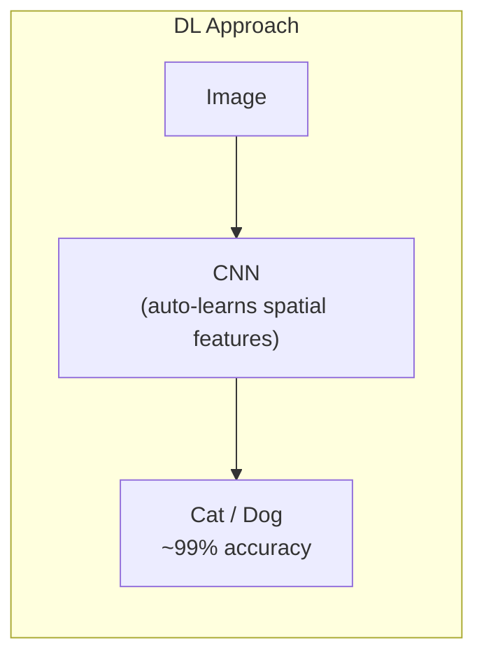
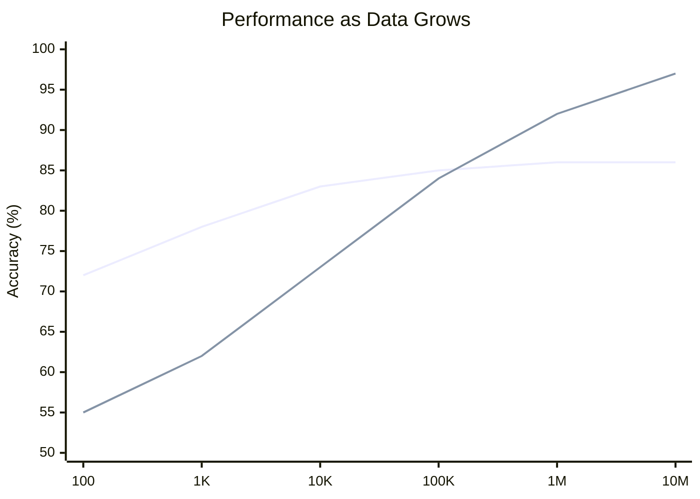
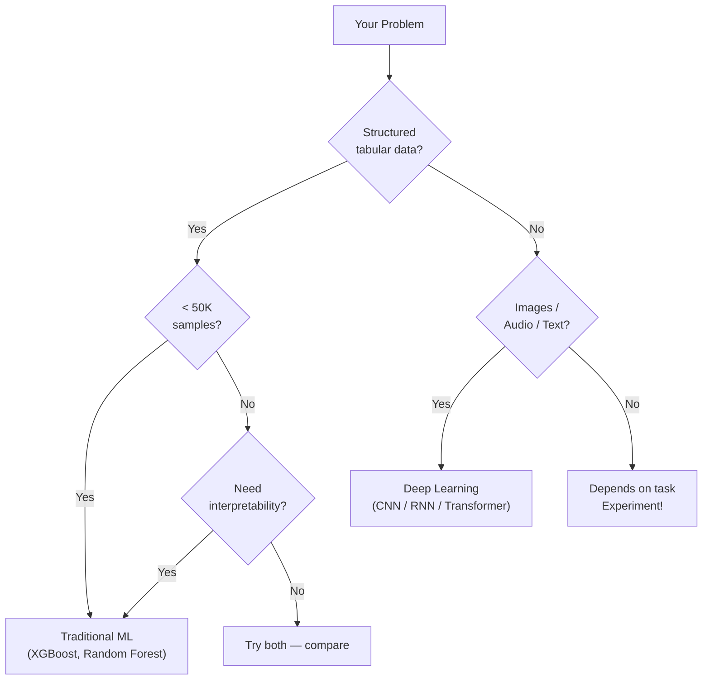

## Introduction

> **Machine Learning and Deep Learning both learn from data — but they differ fundamentally in HOW they learn and WHAT they need.**

Deep Learning is a subset of ML. Not all ML is Deep Learning. But all Deep Learning is ML.



---

## The Core Difference

### Machine Learning
- Humans define what features to look at
- Model learns to use those features
- Works well with structured/tabular data

### Deep Learning
- Model learns what features matter on its own
- Builds hierarchical feature representations
- Excels at unstructured data (images, audio, text)



---

## Detailed Comparison Table

| Dimension | Machine Learning | Deep Learning |
|-----------|-----------------|---------------|
| **Data Required** | Hundreds to thousands | Millions+ |
| **Feature Engineering** | Manual (human expertise) | Automatic (learned by network) |
| **Hardware** | CPU sufficient | GPU / TPU required |
| **Training Time** | Minutes to hours | Hours to weeks |
| **Interpretability** | High (decision trees, etc.) | Low ("black box") |
| **Performance on small data** | Better | Worse |
| **Performance on big data** | Plateaus | Keeps improving |
| **Unstructured data** | Weak | Strong |
| **Structured/tabular data** | Strong | Often overkill |
| **Expertise needed** | Domain + feature engineering | Architecture design + tuning |
| **Model size** | Small (KB to MB) | Large (MB to GB) |
| **Inference speed** | Fast | Slower (more compute) |

---

## Real-World Comparison

### Example 1: Spam Detection





**Winner for spam detection?** ML wins for simple spam filters. DL overkill unless dealing with sophisticated adversarial emails.

---

### Example 2: Image Recognition





**Winner for images?** Deep Learning by a massive margin. CNNs revolutionized image recognition.

---

### Example 3: Speech Recognition

| Approach | Method | Accuracy |
|----------|--------|----------|
| Traditional ML | HMM + hand-crafted audio features | ~70-80% |
| Deep Learning | End-to-end RNN/Transformer | ~95-99% |

DL enabled Apple Siri, Google Assistant, Amazon Alexa.

---

## Performance vs Data Size



- **Top line** = Deep Learning (keeps improving with more data)
- **Bottom line** = Traditional ML (plateaus)

---

## When to Use What

### Use Machine Learning when:

- Dataset is small (< 100K samples)
- Data is structured/tabular (CSV, databases)
- Need interpretability (medical decisions, legal)
- Limited compute budget
- Fast iteration needed (MVPs, prototypes)
- Problem is well-defined with clear features

**ML algorithms for these cases:**
```python
from sklearn.ensemble import RandomForestClassifier, GradientBoostingClassifier
from sklearn.linear_model import LogisticRegression
from sklearn.svm import SVC

# These work great on tabular data with limited samples
model = RandomForestClassifier(n_estimators=100)
model.fit(X_train, y_train)
```

### Use Deep Learning when:

- Massive dataset available (millions of samples)
- Unstructured data: images, audio, video, text
- Highest possible accuracy is priority
- Have GPU compute available
- Feature engineering is too complex or impossible
- Transfer learning is applicable

```python
import tensorflow as tf

# Deep Learning shines on images, text, audio
model = tf.keras.Sequential([
    tf.keras.layers.Conv2D(32, (3,3), activation='relu', input_shape=(224, 224, 3)),
    tf.keras.layers.MaxPooling2D(),
    tf.keras.layers.Conv2D(64, (3,3), activation='relu'),
    tf.keras.layers.Flatten(),
    tf.keras.layers.Dense(10, activation='softmax')
])
```

---

## Decision Flowchart



---

## Python: Side-by-Side Comparison

```python
# Same problem, two approaches: classify handwritten digits

# --- Traditional ML Approach ---
from sklearn.datasets import load_digits
from sklearn.ensemble import RandomForestClassifier
from sklearn.metrics import accuracy_score

digits = load_digits()
X, y = digits.data, digits.target

# Random Forest (traditional ML)
rf_model = RandomForestClassifier(n_estimators=100, random_state=42)
rf_model.fit(X[:1500], y[:1500])
rf_pred = rf_model.predict(X[1500:])
print(f"Random Forest Accuracy: {accuracy_score(y[1500:], rf_pred):.4f}")
# ~0.9700


# --- Deep Learning Approach ---
import tensorflow as tf
import numpy as np

(x_train, y_train), (x_test, y_test) = tf.keras.datasets.mnist.load_data()
x_train, x_test = x_train / 255.0, x_test / 255.0

dl_model = tf.keras.Sequential([
    tf.keras.layers.Flatten(input_shape=(28, 28)),
    tf.keras.layers.Dense(128, activation='relu'),
    tf.keras.layers.Dense(10, activation='softmax')
])
dl_model.compile(optimizer='adam', loss='sparse_categorical_crossentropy', metrics=['accuracy'])
dl_model.fit(x_train, y_train, epochs=5, verbose=0)
_, dl_acc = dl_model.evaluate(x_test, y_test, verbose=0)
print(f"Deep Learning Accuracy: {dl_acc:.4f}")
# ~0.9800
```

---

## Interview Questions

**Q1: Is Deep Learning always better than Machine Learning?**

> No. Deep Learning requires large datasets, significant compute, and longer training. Traditional ML often outperforms DL on small, structured datasets and is far more interpretable.

**Q2: Can Deep Learning replace all ML algorithms?**

> No. Gradient boosting (XGBoost, LightGBM) still dominates Kaggle tabular competitions. DL is dominant in images, audio, and text — not everything.

**Q3: Why does Deep Learning need more data?**

> Deep networks have millions of parameters. With small data, they overfit — memorizing training examples rather than learning general patterns. Traditional ML models have fewer parameters and need less data to generalize.

**Q4: What's the main hardware difference?**

> Traditional ML runs fine on CPU. Deep Learning training requires GPUs (parallel matrix multiplications) or TPUs (Google's custom AI chips). Inference can sometimes run on CPU, but training without GPU is impractical for large models.

---

## Best Practices

1. **Always baseline with ML** — Before training a large DL model, establish a baseline with XGBoost or Random Forest
2. **Plot learning curves** — Determine if more data will help (DL) or if you've plateaued (ML)
3. **Prefer ML for tabular data** — Gradient boosted trees win on structured data 80% of the time
4. **Use transfer learning with DL** — Don't train from scratch if a pretrained model exists
5. **Compare costs** — DL training can cost thousands of dollars on cloud GPUs

---

## Common Mistakes

- **Jumping to DL for every problem** — Classic over-engineering
- **Not trying XGBoost first** — One of the strongest all-round models for tabular data
- **Assuming DL = better accuracy always** — Wrong on small or structured datasets
- **Ignoring inference cost** — DL models are slower and more expensive to run in production
- **No data preprocessing** — Both ML and DL need clean data

---

## Summary

| | Traditional ML | Deep Learning |
|--|--|--|
| Data | Small to medium | Large |
| Features | Manual | Automatic |
| Hardware | CPU | GPU/TPU |
| Best for | Tabular, structured | Images, audio, text |
| Interpretable | Yes | Usually no |
| Training time | Fast | Slow |

---

## Navigation

**Previous:** [01 — What is Deep Learning?](/ai/phase-03-deep-learning/01-what-is-deep-learning)

**Next:** [03 — Neural Networks](/ai/phase-03-deep-learning/03-neural-networks)

**Related Topics:**
- [What is Machine Learning?](/ai/phase-02-machine-learning/01-what-is-machine-learning)
- [Model Evaluation](/ai/phase-02-machine-learning/15-model-evaluation)
- [CNN](/ai/phase-03-deep-learning/13-cnn)

---

## Practice Exercises

1. Train XGBoost and a neural network on the Titanic dataset — which wins?
2. Train both on MNIST — compare accuracy and training time
3. Plot performance vs training set size for both approaches
4. Find a Kaggle competition won by XGBoost vs one won by DL
