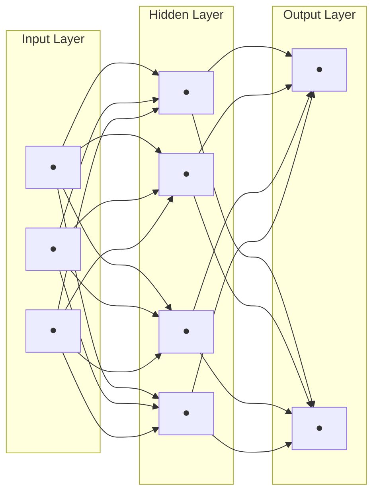
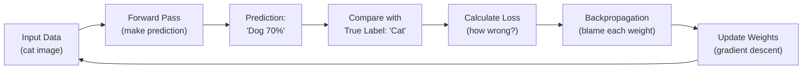
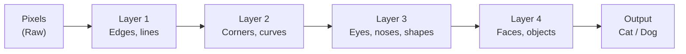
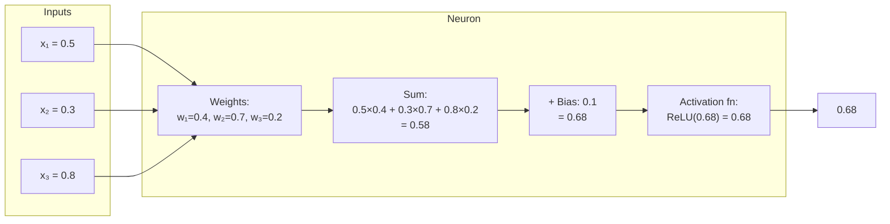
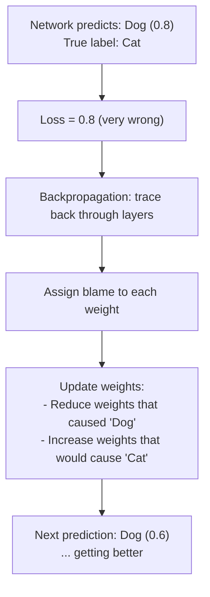

## Introduction

> **A neural network is a system of connected nodes (neurons) organized in layers that learns patterns by adjusting the strength of connections based on data.**

The name comes from the human brain's biological neural network — but the resemblance is more inspirational than literal.

---

## The Big Picture



Every arrow has a **weight** — a number that controls how strongly one neuron influences the next.

**Training = adjusting these weights until the network makes accurate predictions.**

---

## Real-World Analogy

Imagine a team of employees deciding whether to approve a loan:

- **Analysts** (input layer): Read raw application data (salary, debt, credit score)
- **Managers** (hidden layers): Combine analyst insights, look for risk patterns
- **Decision makers** (output layer): Approve / Reject

Each manager weights the analyst inputs differently based on past experience. Over time, they learn which factors matter most. That "learning" is exactly what training a neural network does.

---

## How a Neural Network Learns



This loop runs thousands or millions of times. Each iteration, the network gets slightly better.

---

## The Three Layers Explained

### Layer 1: Input Layer

- Receives raw data
- One neuron per feature
- No computation — just passes data forward

**Examples:**
- 784 neurons for a 28×28 pixel image (one per pixel)
- 3 neurons for (height, weight, age) prediction
- 10,000 neurons for a 100×100 image

### Layer 2: Hidden Layer(s)

- Where learning actually happens
- Neurons detect patterns and features
- Multiple hidden layers = "deep" network

**What each layer detects (in an image network):**



### Layer 3: Output Layer

- Final prediction
- One neuron per class (for classification)
- For cat/dog: 2 neurons
- For 10 digit MNIST: 10 neurons
- Each neuron outputs a probability (0 to 1)

---

## Inside a Single Neuron



**Three operations in every neuron:**
1. **Weighted sum** of inputs × weights
2. **Add bias** (shifts the function)
3. **Apply activation function** (adds non-linearity)

---

## How the Network "Knows" It's Wrong



---

## Python: Building a Neural Network from Scratch

```python
import numpy as np

class SimpleNeuralNetwork:
    def __init__(self):
        # Random initial weights for a 2-layer network
        # Input: 2 features, Hidden: 3 neurons, Output: 1 neuron
        np.random.seed(42)
        self.W1 = np.random.randn(2, 3) * 0.01   # Input → Hidden weights
        self.b1 = np.zeros((1, 3))                 # Hidden biases
        self.W2 = np.random.randn(3, 1) * 0.01   # Hidden → Output weights
        self.b2 = np.zeros((1, 1))                 # Output bias

    def sigmoid(self, z):
        return 1 / (1 + np.exp(-z))

    def forward(self, X):
        # Layer 1: Input → Hidden
        self.z1 = X.dot(self.W1) + self.b1
        self.a1 = self.sigmoid(self.z1)  # Apply activation

        # Layer 2: Hidden → Output
        self.z2 = self.a1.dot(self.W2) + self.b2
        self.a2 = self.sigmoid(self.z2)  # Final prediction

        return self.a2

    def predict(self, X):
        output = self.forward(X)
        return (output > 0.5).astype(int)

# Example usage
nn = SimpleNeuralNetwork()

# Training data: XOR problem
X = np.array([[0, 0], [0, 1], [1, 0], [1, 1]])
y = np.array([[0], [1], [1], [0]])

# Initial prediction (random weights — not trained yet)
predictions = nn.predict(X)
print("Untrained predictions:", predictions.T)

# After training, predictions would be: [[0, 1, 1, 0]]
```

### Using Keras (Production Way)

```python
import tensorflow as tf

# Same XOR network with Keras
model = tf.keras.Sequential([
    tf.keras.layers.Dense(3, activation='sigmoid', input_shape=(2,)),  # Hidden
    tf.keras.layers.Dense(1, activation='sigmoid')                      # Output
])

model.compile(optimizer='sgd', loss='binary_crossentropy', metrics=['accuracy'])

X = [[0,0], [0,1], [1,0], [1,1]]
y = [0, 1, 1, 0]

model.fit(X, y, epochs=1000, verbose=0)

print("Predictions:", model.predict(X).round(0).flatten())
# Predictions: [0. 1. 1. 0.]  ← Learned XOR!
```

---

## JavaScript: Neural Network in the Browser

```javascript
import * as tf from '@tensorflow/tfjs';

// XOR problem neural network
const model = tf.sequential({
  layers: [
    tf.layers.dense({ units: 4, inputShape: [2], activation: 'sigmoid' }),
    tf.layers.dense({ units: 1, activation: 'sigmoid' })
  ]
});

model.compile({ optimizer: 'sgd', loss: 'meanSquaredError' });

// Training data
const xs = tf.tensor2d([[0,0], [0,1], [1,0], [1,1]]);
const ys = tf.tensor2d([[0], [1], [1], [0]]);

async function train() {
  await model.fit(xs, ys, { epochs: 500, verbose: 0 });
  const result = model.predict(xs);
  result.print(); // Should show [0, 1, 1, 0]
}

train();
```

---

## Interview Questions

**Q1: What is a neural network?**

> A neural network is a computational model consisting of interconnected nodes (neurons) organized in layers. It learns by adjusting the weights of connections through an optimization process (backpropagation + gradient descent) to minimize prediction error.

**Q2: What happens if you have no hidden layers?**

> With no hidden layers (just input + output), the model is a simple linear classifier — it can only separate data that is linearly separable. No XOR, no image recognition, no complex patterns. Hidden layers add the non-linearity needed for complex tasks.

**Q3: How does a neural network differ from the human brain?**

> Similarities: Both use connected nodes, parallel processing, and adjust connection strength through experience. Differences: Biological neurons use electrochemical signals; artificial neurons use math. The brain has ~86 billion neurons with incredibly complex connectivity; today's largest networks have ~trillions of parameters but far simpler structure.

**Q4: What is a weight in a neural network?**

> A weight is a numerical value on a connection between two neurons. It controls how much influence neuron A has on neuron B. Training adjusts these weights to minimize prediction error. A high weight = strong influence; near-zero weight = weak influence.

---

## Best Practices

1. **Normalize inputs** — Scale to [0,1] or [-1,1] before training
2. **Initialize weights randomly** (not zero) — Zero initialization causes all neurons to learn the same thing
3. **Start with a simple architecture** — Add complexity only when simple fails
4. **Use batch training** — Don't update weights on every single sample
5. **Shuffle training data** — Prevents the model from learning data order

---

## Common Mistakes

- **Too many neurons too early** — Leads to overfitting on small datasets
- **Zero weight initialization** — All neurons learn identically, no learning diversity
- **Not normalizing inputs** — Causes slow or unstable training
- **Too large a learning rate** — Network diverges instead of converging
- **Forgetting bias terms** — Bias allows the model to fit when all inputs are zero

---

## Summary

| Concept | Description |
|---------|-------------|
| Neuron | Basic unit — receives inputs, computes weighted sum, applies activation |
| Input Layer | Accepts raw data |
| Hidden Layers | Learn intermediate representations and features |
| Output Layer | Produces final prediction |
| Weight | Strength of connection between neurons — learned during training |
| Bias | Offset that allows the neuron to activate even when all inputs are zero |
| Training | Adjusting weights to minimize prediction error |

---

## Navigation

**Previous:** [02 — Machine Learning vs Deep Learning](/ai/phase-03-deep-learning/02-machine-learning-vs-deep-learning)

**Next:** [04 — Biological Neuron vs Artificial Neuron](/ai/phase-03-deep-learning/04-biological-neuron-vs-artificial-neuron)

**Related Topics:**
- [Forward Propagation](/ai/phase-03-deep-learning/07-forward-propagation)
- [Backpropagation](/ai/phase-03-deep-learning/10-backpropagation)
- [Activation Functions](/ai/phase-03-deep-learning/08-activation-functions)

---

## Practice Exercises

1. Draw a neural network for predicting house prices (what are the inputs/outputs?)
2. Build the XOR neural network and train it — what minimum architecture solves XOR?
3. Count the total weights in a 784 → 128 → 64 → 10 network
4. Experiment with different numbers of hidden neurons — what changes?
