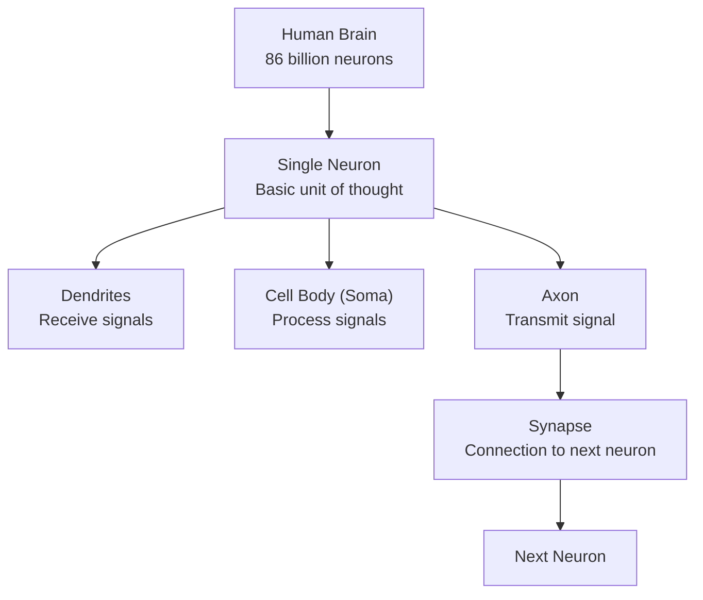
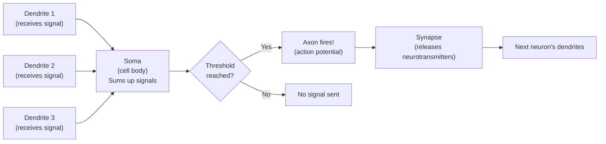
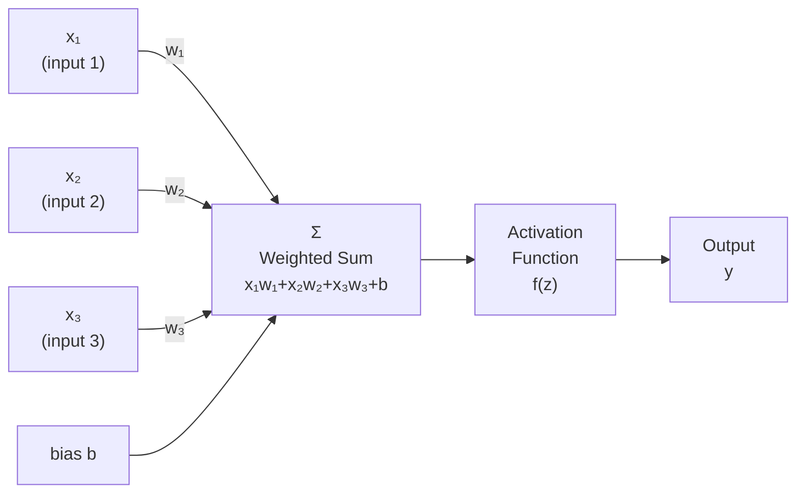
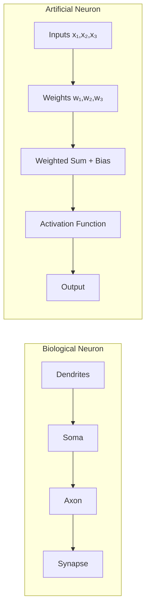
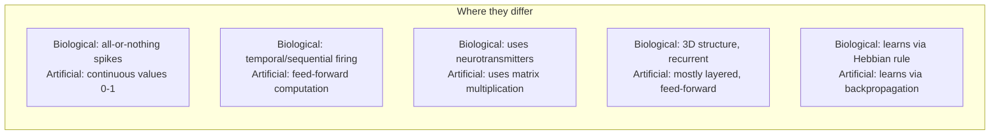
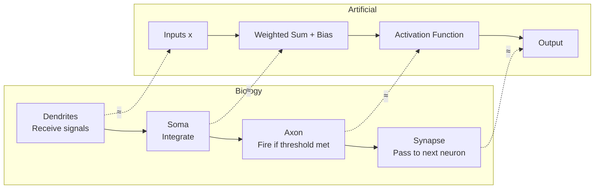

## Introduction

> **The artificial neuron was inspired by the biological neuron — nature's basic computational unit. Understanding the parallel helps build deep intuition for how neural networks work.**

The brain contains ~86 billion neurons, each connected to thousands of others. This biological network is the most powerful "computer" we know of. Scientists tried to mimic it — and created artificial neural networks.

---

## The Human Brain



---

## Biological Neuron: How It Works



**Key biological concepts:**

| Part | Role |
|------|------|
| **Dendrites** | Receive input signals from other neurons |
| **Soma (cell body)** | Integrates (sums up) incoming signals |
| **Axon** | Long fiber that carries the output signal |
| **Synapse** | Gap between axon and next dendrite; signal passes via neurotransmitters |
| **Threshold** | Minimum signal strength needed to "fire" — all-or-nothing response |

---

## Artificial Neuron: The Mathematical Model



**Mathematical operation:**

```
z = x₁·w₁ + x₂·w₂ + x₃·w₃ + b    (weighted sum)
y = f(z)                              (activation function)
```

---

## Side-by-Side Comparison



| Biological | Artificial |
|------------|------------|
| Dendrites | Input values (x₁, x₂, x₃) |
| Synapse strength | Weights (w₁, w₂, w₃) |
| Soma (integration) | Weighted sum + bias |
| Firing threshold | Activation function |
| Axon output | Output value y |
| Learning (synaptic plasticity) | Weight update (backpropagation) |

---

## Real-World Analogy

**Voting Committee:**

Imagine 5 experts voting on whether to approve a business proposal:

- Expert 1 (financial analyst): weight = 0.4 (high importance)
- Expert 2 (market researcher): weight = 0.3
- Expert 3 (technical reviewer): weight = 0.2
- Expert 4 (legal advisor): weight = 0.1

Each rates the proposal (0-10). The chairman collects weighted votes:

```
Total = 7×0.4 + 8×0.3 + 6×0.2 + 9×0.1 = 7.3
If Total > 7.0 → Approved
```

This is exactly what an artificial neuron does — weighted sum, then threshold (activation).

---

## The Perceptron: First Artificial Neuron

The perceptron (1957, Frank Rosenblatt) was the first formal artificial neuron:

```python
import numpy as np

class Perceptron:
    def __init__(self, learning_rate=0.01, n_iterations=1000):
        self.lr = learning_rate
        self.n_iter = n_iterations
        self.weights = None
        self.bias = None

    def fit(self, X, y):
        n_samples, n_features = X.shape
        self.weights = np.zeros(n_features)
        self.bias = 0

        for _ in range(self.n_iter):
            for xi, yi in zip(X, y):
                # Predict
                prediction = self.predict_single(xi)
                # Update weights based on error
                update = self.lr * (yi - prediction)
                self.weights += update * xi
                self.bias += update

    def predict_single(self, x):
        z = np.dot(x, self.weights) + self.bias
        return 1 if z >= 0 else 0  # Step activation function

    def predict(self, X):
        return np.array([self.predict_single(xi) for xi in X])


# Test: Classify points
X = np.array([[0, 0], [0, 1], [1, 0], [1, 1]])
y = np.array([0, 0, 0, 1])  # AND gate

p = Perceptron(learning_rate=0.1, n_iterations=100)
p.fit(X, y)
print("AND gate predictions:", p.predict(X))
# [0 0 0 1] ← Correct!
```

---

## Python: Simulating Biological vs Artificial

```python
class BiologicalNeuron:
    """Simplified model of a biological neuron"""

    def __init__(self, threshold=0.5):
        self.threshold = threshold  # Firing threshold

    def receive_signals(self, signals, synapse_strengths):
        # Soma: sum up all signals weighted by synapse strength
        total_signal = sum(s * w for s, w in zip(signals, synapse_strengths))
        # Axon: fire if threshold reached (all-or-nothing)
        return 1 if total_signal >= self.threshold else 0


class ArtificialNeuron:
    """Mathematical artificial neuron"""

    def __init__(self, weights, bias):
        self.weights = weights
        self.bias = bias

    def activate(self, inputs):
        # Weighted sum
        z = sum(x * w for x, w in zip(inputs, self.weights)) + self.bias
        # ReLU activation (not all-or-nothing like biological)
        return max(0, z)


# Compare
inputs = [0.5, 0.8, 0.3]

bio = BiologicalNeuron(threshold=0.5)
print("Biological fires:", bio.receive_signals(inputs, [0.4, 0.3, 0.2]))

art = ArtificialNeuron(weights=[0.4, 0.3, 0.2], bias=0.1)
print("Artificial output:", art.activate(inputs))
```

---

## Key Differences (Where the Analogy Breaks)



| Aspect | Biological | Artificial |
|--------|------------|------------|
| Output | Binary (fires or not) | Continuous (0 to 1 typically) |
| Learning rule | Hebbian ("fire together, wire together") | Backpropagation + gradient descent |
| Speed | Milliseconds per signal | Nanoseconds (GPU computation) |
| Energy | ~20 watts (whole brain) | Kilowatts (large GPU cluster) |
| Adaptation | Continuous, lifelong | Fixed after training |
| Fault tolerance | Very high | Lower |

---

## Interview Questions

**Q1: What inspired artificial neural networks?**

> Biological neurons in the human brain. The 1943 McCulloch-Pitts paper first proposed a mathematical model of a neuron. Frank Rosenblatt's 1957 Perceptron formalized the artificial neuron with learnable weights.

**Q2: Is the artificial neuron an accurate model of the brain?**

> No — it's a highly simplified mathematical abstraction. The real brain is far more complex: neurons have thousands of types, dendrites compute nonlinear functions, timing matters (spike-timing-dependent plasticity), and there are feedback loops absent in standard ANNs. The analogy is inspirational, not literal.

**Q3: What is the activation function equivalent to in biology?**

> The firing threshold. In biology, a neuron fires only when the combined input exceeds a threshold. In ANNs, the activation function performs a similar role — determining whether and how strongly a neuron "activates" and passes its signal forward.

**Q4: What is a weight in terms of biology?**

> The weight corresponds to synaptic strength — how strongly one neuron's signal influences another. In biology, synaptic plasticity (Hebbian learning) adjusts these strengths. In ANNs, backpropagation performs the equivalent adjustment.

---

## Best Practices

1. **Don't over-analogize** — The brain analogy helps intuition, but don't let it mislead you about how ANNs actually work
2. **Think mathematically** — Weights, sums, activation functions are cleaner abstractions than "neurons"
3. **Understand activation functions** — The "firing threshold" is the most crucial design choice in each layer
4. **Remember the bias** — Equivalent to a neuron that always fires at constant strength; it shifts the decision boundary

---

## Common Mistakes

- **Assuming ANNs work like the brain** — They don't; the analogy is surface-level
- **Ignoring bias terms** — Without bias, the neuron can't model patterns that occur when all inputs are zero
- **Confusing weights with architecture** — Architecture = number/arrangement of layers; weights = the learned values within that architecture

---

## Summary



---

## Navigation

**Previous:** [03 — Neural Networks](/ai/phase-03-deep-learning/03-neural-networks)

**Next:** [05 — Perceptron](/ai/phase-03-deep-learning/05-perceptron)

**Related Topics:**
- [Activation Functions](/ai/phase-03-deep-learning/08-activation-functions)
- [Layers in Neural Networks](/ai/phase-03-deep-learning/06-layers-in-neural-networks)
- [Backpropagation](/ai/phase-03-deep-learning/10-backpropagation)

---

## Practice Exercises

1. Implement the AND, OR, and NOT gates using a single perceptron
2. Explain why XOR cannot be solved by a single perceptron
3. Research Hebbian learning — how does it compare to backpropagation?
4. Look up "leaky integrate-and-fire" neurons — the most common biological neuron model
