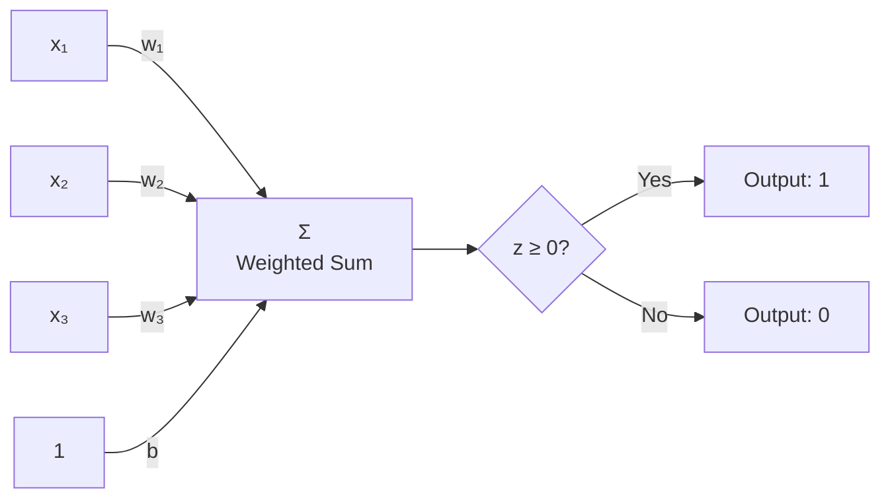
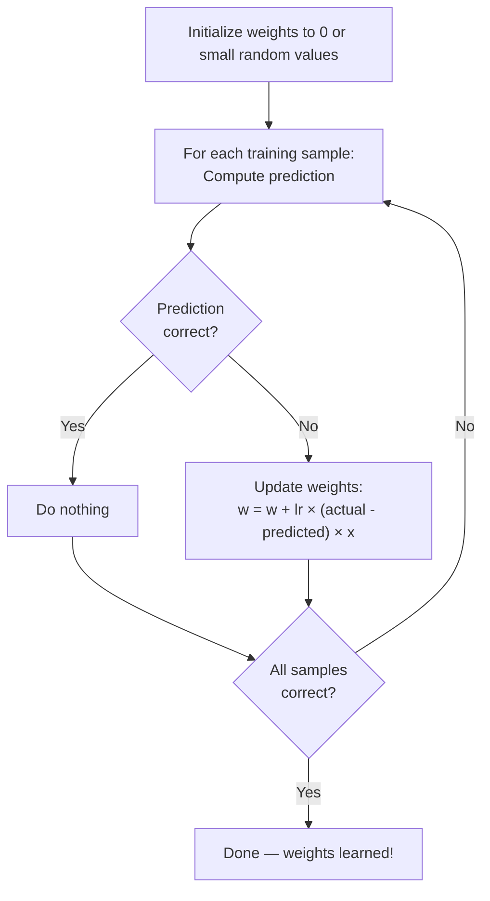
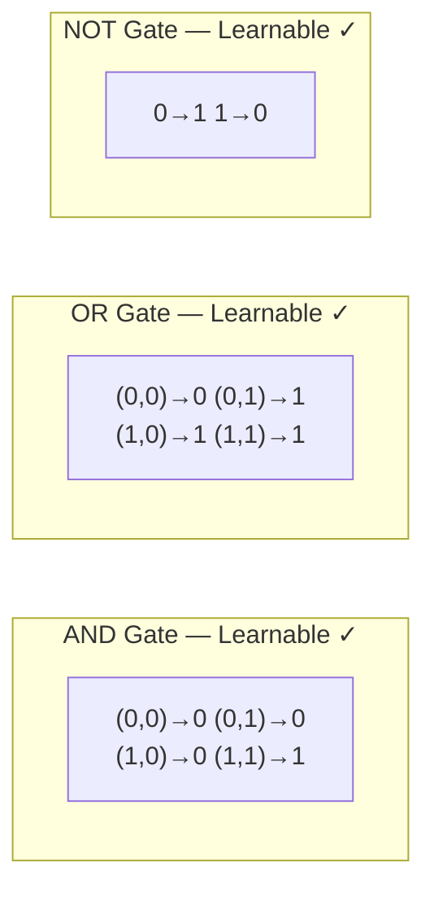
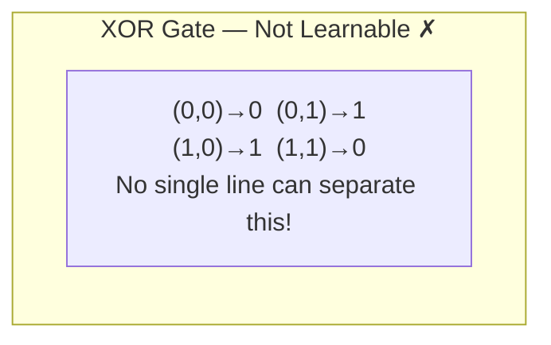
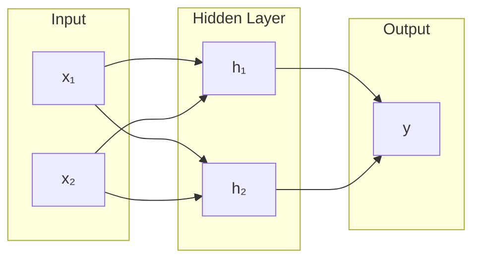
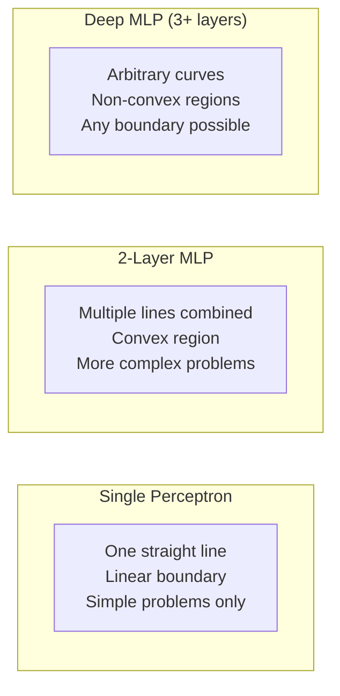

## Introduction

> **The Perceptron is the simplest neural network — a single artificial neuron that can classify linearly separable data. It is the foundation of all modern deep learning.**

Invented by Frank Rosenblatt in **1957**, the perceptron was the first machine learning algorithm that could learn from data and update its own parameters.

---

## What is a Perceptron?

A perceptron takes multiple binary inputs, applies weights, sums them, and outputs a binary decision.



**Formula:**
```
z = w₁x₁ + w₂x₂ + ... + wₙxₙ + b
output = 1 if z ≥ 0, else 0
```

---

## Real-World Analogy

Imagine deciding whether to watch a movie:

- Is the rating > 7? (weight: 0.5)
- Is it in your favorite genre? (weight: 0.3)
- Is it shorter than 2 hours? (weight: 0.2)

You sum these weighted factors. If the total exceeds your threshold → watch it, otherwise → skip it.

That's a perceptron making a binary decision.

---

## The Learning Algorithm



**Update rule:**
```
w_new = w_old + learning_rate × (true_label - predicted) × input
```

---

## Single-Layer Perceptron

### What It Can Learn: Linearly Separable Data



**Visualizing the decision boundary:**

A single perceptron draws a **straight line** to separate classes:

```
AND gate:
  (0,0)×  (0,1)×    ×  ×
  (1,0)×  (1,1)●    ×  ●
                ←line→
  Only (1,1) is on the "yes" side
```

### What It CANNOT Learn: XOR



XOR outputs 1 when inputs differ. No straight line can separate the 1s from the 0s. This limitation was a major blow to early AI research (discovered by Minsky & Papert, 1969).

---

## Multi-Layer Perceptron (MLP)

The solution to XOR: add hidden layers.



**Why hidden layers work for XOR:**

- Hidden layer transforms the input space
- Creates new feature representations
- The output layer can now linearly separate the transformed data

With 2 hidden neurons, XOR becomes linearly separable in the new feature space!

---

## Decision Boundaries



**Key insight:** Each hidden layer adds expressive power. Deep networks can learn decision boundaries of arbitrary complexity.

---

## Python: Perceptron from Scratch

```python
import numpy as np

class Perceptron:
    def __init__(self, learning_rate=0.01, n_iters=1000):
        self.lr = learning_rate
        self.n_iters = n_iters
        self.weights = None
        self.bias = None

    def fit(self, X, y):
        n_samples, n_features = X.shape
        self.weights = np.zeros(n_features)
        self.bias = 0

        for _ in range(self.n_iters):
            for idx, x_i in enumerate(X):
                prediction = self._predict(x_i)
                update = self.lr * (y[idx] - prediction)
                self.weights += update * x_i
                self.bias += update

    def predict(self, X):
        return np.array([self._predict(x) for x in X])

    def _predict(self, x):
        z = np.dot(x, self.weights) + self.bias
        return 1 if z >= 0 else 0


# Test on AND gate
X_and = np.array([[0,0], [0,1], [1,0], [1,1]])
y_and = np.array([0, 0, 0, 1])  # AND

p = Perceptron(learning_rate=0.1, n_iters=100)
p.fit(X_and, y_and)
print("AND predictions:", p.predict(X_and))  # [0 0 0 1] ✓
print("Learned weights:", p.weights)
print("Learned bias:", p.bias)


# Test on XOR — will FAIL (linear boundary)
X_xor = np.array([[0,0], [0,1], [1,0], [1,1]])
y_xor = np.array([0, 1, 1, 0])  # XOR

p_xor = Perceptron(learning_rate=0.1, n_iters=1000)
p_xor.fit(X_xor, y_xor)
print("\nXOR predictions:", p_xor.predict(X_xor))  # Wrong — can't solve XOR!
```

---

## Python: MLP Solves XOR

```python
import tensorflow as tf
import numpy as np

# XOR data
X = np.array([[0,0], [0,1], [1,0], [1,1]], dtype=np.float32)
y = np.array([0, 1, 1, 0], dtype=np.float32)

# MLP with hidden layer
model = tf.keras.Sequential([
    tf.keras.layers.Dense(4, activation='relu', input_shape=(2,)),  # Hidden
    tf.keras.layers.Dense(1, activation='sigmoid')                   # Output
])

model.compile(optimizer='adam', loss='binary_crossentropy')
model.fit(X, y, epochs=500, verbose=0)

predictions = model.predict(X)
print("XOR MLP predictions:")
for i, (xi, pred) in enumerate(zip(X, predictions)):
    print(f"  {xi} → {pred[0]:.3f} → {round(float(pred[0]))}")
# (0,0) → 0.01 → 0  ✓
# (0,1) → 0.99 → 1  ✓
# (1,0) → 0.99 → 1  ✓
# (1,1) → 0.02 → 0  ✓
```

---

## JavaScript: Perceptron

```javascript
class Perceptron {
  constructor(learningRate = 0.1, iterations = 100) {
    this.lr = learningRate;
    this.iterations = iterations;
    this.weights = null;
    this.bias = 0;
  }

  train(X, y) {
    this.weights = new Array(X[0].length).fill(0);

    for (let iter = 0; iter < this.iterations; iter++) {
      for (let i = 0; i < X.length; i++) {
        const pred = this.predict(X[i]);
        const error = y[i] - pred;
        this.weights = this.weights.map((w, j) => w + this.lr * error * X[i][j]);
        this.bias += this.lr * error;
      }
    }
  }

  predict(x) {
    const z = x.reduce((sum, xi, i) => sum + xi * this.weights[i], this.bias);
    return z >= 0 ? 1 : 0;
  }
}

// Test AND gate
const p = new Perceptron(0.1, 100);
const X = [[0,0], [0,1], [1,0], [1,1]];
const y = [0, 0, 0, 1]; // AND

p.train(X, y);
X.forEach((xi, i) => console.log(`${xi} → ${p.predict(xi)} (expected: ${y[i]})`));
```

---

## Interview Questions

**Q1: What is a perceptron and who invented it?**

> A perceptron is a single artificial neuron that computes a weighted sum of its inputs, adds a bias, and applies a step activation function to produce a binary output. It was invented by Frank Rosenblatt at Cornell in 1957 and is the fundamental building block of neural networks.

**Q2: Why can't a single perceptron solve XOR?**

> XOR is not linearly separable — no single straight line can divide XOR outputs (0 and 1) into two separate regions. The perceptron learns a linear decision boundary, which is insufficient for this problem. A multi-layer perceptron (MLP) with at least one hidden layer can solve XOR by creating a non-linear decision boundary.

**Q3: What is the perceptron convergence theorem?**

> If data is linearly separable, the perceptron is guaranteed to converge to a correct solution in finite iterations. If data is NOT linearly separable, the algorithm never converges — it keeps updating forever.

**Q4: What's the difference between a perceptron and a neuron in a deep network?**

> A classic perceptron uses a step activation function (outputs 0 or 1) and only supports binary outputs. Modern neural network neurons use differentiable activation functions (ReLU, sigmoid) that allow gradients to flow for backpropagation. The perceptron learning rule also differs from gradient descent.

---

## Best Practices

1. **Use MLP, not single perceptron** for real problems — almost all real tasks are non-linear
2. **Choose appropriate activation** — Step function is non-differentiable; use ReLU/sigmoid in MLPs
3. **Scale inputs** — Perceptron convergence is faster with normalized features
4. **Watch learning rate** — Too high = oscillation; too low = very slow convergence

---

## Common Mistakes

- **Expecting perceptron to solve non-linear problems** — Use MLP with hidden layers
- **Using step activation in backprop networks** — Non-differentiable = no gradient = no learning
- **Too few hidden neurons** — Not enough capacity to represent complex boundaries
- **Training on XOR with a single neuron and wondering why it fails**

---

## Summary

| Concept | Details |
|---------|---------|
| Perceptron | Single neuron, step activation, linear boundary |
| Linearly separable | AND, OR, NOT gates — perceptron can solve |
| Not linearly separable | XOR — single perceptron cannot solve |
| MLP | Multiple layers, learns non-linear boundaries |
| Decision boundary | Line (1 layer) → Curved (multi-layer) |
| Learning | Error-correction rule: w += lr × error × x |

---

## Navigation

**Previous:** [04 — Biological Neuron vs Artificial Neuron](/ai/phase-03-deep-learning/04-biological-neuron-vs-artificial-neuron)

**Next:** [06 — Layers in Neural Networks](/ai/phase-03-deep-learning/06-layers-in-neural-networks)

**Related Topics:**
- [Activation Functions](/ai/phase-03-deep-learning/08-activation-functions)
- [Forward Propagation](/ai/phase-03-deep-learning/07-forward-propagation)
- [Backpropagation](/ai/phase-03-deep-learning/10-backpropagation)

---

## Practice Exercises

1. Implement OR and NAND gates using a single perceptron
2. Prove XOR is not linearly separable by plotting the 4 points on a 2D grid
3. Solve XOR with an MLP — what is the minimum architecture?
4. Implement the perceptron convergence theorem verification
5. Visualize the decision boundary of a trained perceptron
