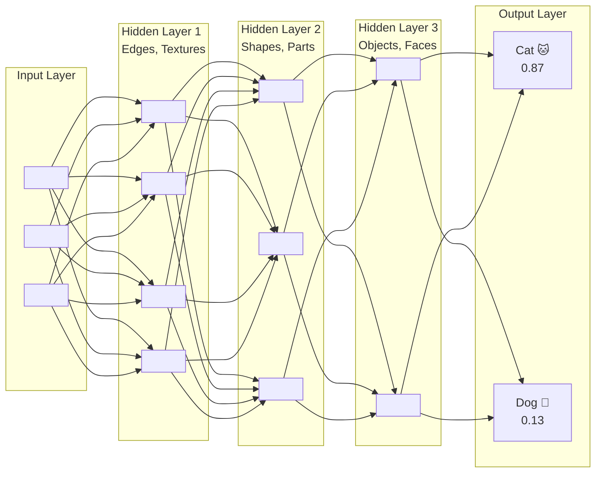
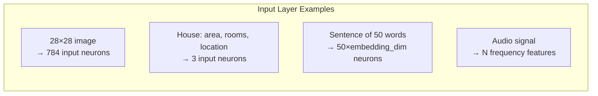
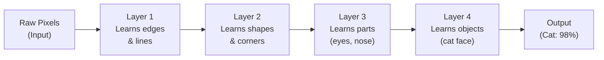
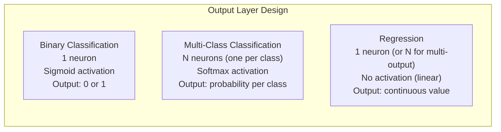
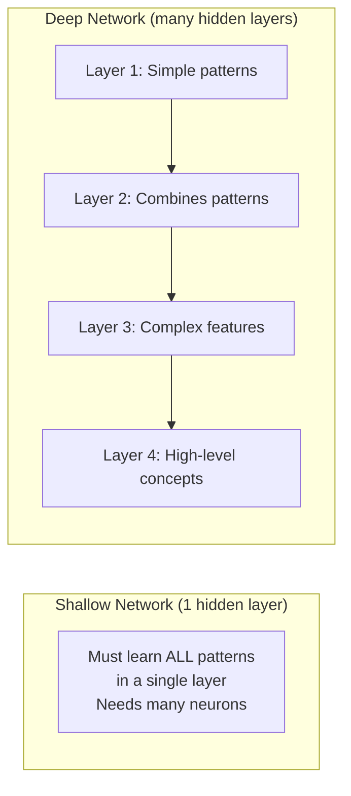
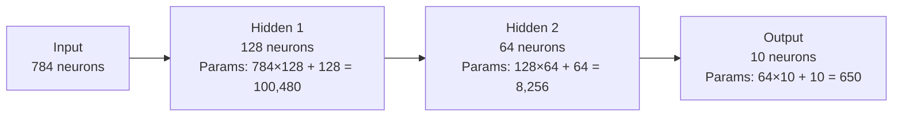
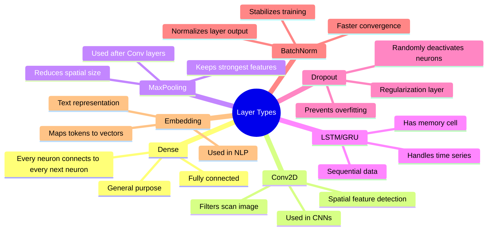

## Introduction

> **Layers are the building blocks of neural networks. Every layer transforms the data in a different way — extracting increasingly abstract features as information flows deeper.**

The depth (number of layers) is what makes "deep" learning deep.

---

## The Three Types of Layers



---

## Layer 1: Input Layer

The input layer is the gateway — it receives raw data and passes it forward without any computation.



**Rules:**
- One neuron per input feature
- No weights in the input layer (just pass-through)
- Shape determined by your data

```python
import tensorflow as tf

# Input layer examples
# For 28x28 grayscale images:
model = tf.keras.Sequential([
    tf.keras.layers.Flatten(input_shape=(28, 28)),  # 784 input neurons
    # ... more layers
])

# For tabular data with 5 features:
model2 = tf.keras.Sequential([
    tf.keras.layers.Dense(16, input_shape=(5,), activation='relu'),
    # First Dense layer's input_shape defines input neurons
])
```

---

## Layer 2: Hidden Layers

Hidden layers are where all the learning happens. They transform raw inputs into increasingly abstract representations.



**What determines hidden layer size?**

| Smaller hidden layers | Larger hidden layers |
|----------------------|---------------------|
| Faster training | Slower training |
| Risk of underfitting | Risk of overfitting |
| Less memory | More memory |
| Fewer parameters | More parameters |

**Common starting architectures:**

```python
# For small/medium classification:
model = tf.keras.Sequential([
    tf.keras.layers.Dense(128, activation='relu'),
    tf.keras.layers.Dense(64, activation='relu'),
    tf.keras.layers.Dense(32, activation='relu'),
    tf.keras.layers.Dense(n_classes, activation='softmax')
])

# Pyramid shape: wider → narrower is a common pattern
# Each layer compresses and abstracts information
```

---

## Layer 3: Output Layer

The output layer produces the final answer. Its size and activation depend on the task:



```python
# Binary classification (spam or not spam)
output_binary = tf.keras.layers.Dense(1, activation='sigmoid')

# Multi-class (10 digits 0-9)
output_multiclass = tf.keras.layers.Dense(10, activation='softmax')

# Regression (predicting house price)
output_regression = tf.keras.layers.Dense(1)  # No activation = linear
```

---

## Deep Networks: Why More Layers?



**Theoretical result:** A network with enough neurons in 1 hidden layer can approximate any function (Universal Approximation Theorem). But in practice, deep networks are far more efficient — they need exponentially fewer neurons to represent the same function.

---

## Counting Parameters

Understanding how many learnable values (weights + biases) a network has:



**Total parameters: 100,480 + 8,256 + 650 = 109,386 trainable values**

```python
import tensorflow as tf

model = tf.keras.Sequential([
    tf.keras.layers.Flatten(input_shape=(28, 28)),
    tf.keras.layers.Dense(128, activation='relu'),
    tf.keras.layers.Dense(64, activation='relu'),
    tf.keras.layers.Dense(10, activation='softmax')
])

model.summary()
# Total params: 109,386
```

---

## Special Layer Types

Beyond Dense (fully connected) layers, modern deep learning uses specialized layers:



---

## Python: Layer-by-Layer Visualization

```python
import tensorflow as tf
import numpy as np

# Build a network and inspect each layer
model = tf.keras.Sequential([
    tf.keras.layers.Flatten(input_shape=(28, 28), name='input'),
    tf.keras.layers.Dense(128, activation='relu', name='hidden_1'),
    tf.keras.layers.Dense(64, activation='relu', name='hidden_2'),
    tf.keras.layers.Dense(10, activation='softmax', name='output')
])

# See what each layer looks like
for layer in model.layers:
    print(f"Layer: {layer.name}")
    print(f"  Input shape:  {layer.input_shape}")
    print(f"  Output shape: {layer.output_shape}")
    print(f"  Trainable params: {layer.count_params()}")
    print()

# Extract intermediate layer outputs (see what hidden layers "see")
intermediate_model = tf.keras.Model(
    inputs=model.input,
    outputs=[layer.output for layer in model.layers]
)

# Load sample data
(x_train, _), _ = tf.keras.datasets.mnist.load_data()
sample = x_train[0:1] / 255.0  # One sample image

# Get activations at each layer
activations = intermediate_model.predict(sample)
for layer, activation in zip(model.layers, activations):
    print(f"Layer '{layer.name}' output shape: {activation.shape}")
```

---

## JavaScript: Layers with TensorFlow.js

```javascript
import * as tf from '@tensorflow/tfjs';

const model = tf.sequential();

// Add layers one by one
model.add(tf.layers.dense({
  units: 128,
  activation: 'relu',
  inputShape: [784],
  name: 'hidden1'
}));

model.add(tf.layers.dropout({ rate: 0.2, name: 'dropout1' }));

model.add(tf.layers.dense({
  units: 64,
  activation: 'relu',
  name: 'hidden2'
}));

model.add(tf.layers.dense({
  units: 10,
  activation: 'softmax',
  name: 'output'
}));

model.summary(); // Shows layer-by-layer architecture
```

---

## Interview Questions

**Q1: What is the difference between shallow and deep networks?**

> Shallow networks have one or two hidden layers. Deep networks have many (often 10-100+). Deep networks learn hierarchical representations — each layer extracts more abstract features from the previous layer's output. In practice, deep networks are more parameter-efficient and achieve better performance on complex tasks like image recognition.

**Q2: How do you decide how many hidden layers to use?**

> Start simple. For basic tabular classification: 1-2 hidden layers. For images: CNNs with 5-20+ layers. For language: transformers with 12-96+ layers. Add layers when the model underfits. Use cross-validation to find the sweet spot between capacity and overfitting.

**Q3: What happens to information as it flows through layers?**

> Each layer applies a linear transformation (weights × input + bias) followed by a non-linear activation. Information is compressed and abstracted. In image networks, pixel data becomes edges, then shapes, then objects. The network learns progressively higher-level representations.

**Q4: Why can't you just make one giant hidden layer instead of many?**

> Theoretically you could (Universal Approximation Theorem), but in practice: (1) you'd need exponentially more neurons, (2) training becomes unstable, (3) deep networks learn compositional features more efficiently, (4) deep architectures match the hierarchical structure of real-world data (images, language).

---

## Best Practices

1. **Start with established architectures** — Don't design from scratch; use VGG, ResNet, etc.
2. **Pyramid shape** — Make hidden layers progressively smaller (128→64→32) for most tasks
3. **Add BatchNormalization** after hidden layers for stable training
4. **Add Dropout** (0.2-0.5) between layers to prevent overfitting
5. **Check parameter count** — Ensure you have enough data (rule of thumb: 10× more data than parameters)

---

## Common Mistakes

- **Too many layers for small datasets** — Overfitting is inevitable
- **Same size for all layers** — No information compression; wasteful
- **No regularization** — Dropout, batch norm, or L2 regularization should be part of any deep architecture
- **Wrong output activation** — Sigmoid for binary, softmax for multi-class, linear for regression
- **Not using `model.summary()`** — Always verify your architecture before training

---

## Summary

| Layer | Role | Key Property |
|-------|------|--------------|
| Input | Receives data | Size = number of features |
| Hidden | Learns representations | Non-linear transformations |
| Output | Final prediction | Size/activation = task type |
| Dense | Fully connected | All-to-all connections |
| Conv2D | Spatial features | Shared weights, translation invariant |
| Dropout | Regularization | Random deactivation |
| BatchNorm | Stabilization | Normalizes activations |

---

## Navigation

**Previous:** [05 — Perceptron](/ai/phase-03-deep-learning/05-perceptron)

**Next:** [07 — Forward Propagation](/ai/phase-03-deep-learning/07-forward-propagation)

**Related Topics:**
- [Activation Functions](/ai/phase-03-deep-learning/08-activation-functions)
- [CNN](/ai/phase-03-deep-learning/13-cnn)
- [Forward Propagation](/ai/phase-03-deep-learning/07-forward-propagation)

---

## Practice Exercises

1. Calculate the parameter count for a 784→256→128→64→10 network
2. Build a network for multi-class classification on MNIST — compare 1 vs 3 hidden layers
3. Use `model.summary()` to understand the shapes at each layer
4. Experiment with adding `BatchNormalization` — does it speed up training?
5. Try different output activations for binary vs multi-class problems
