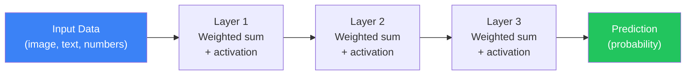
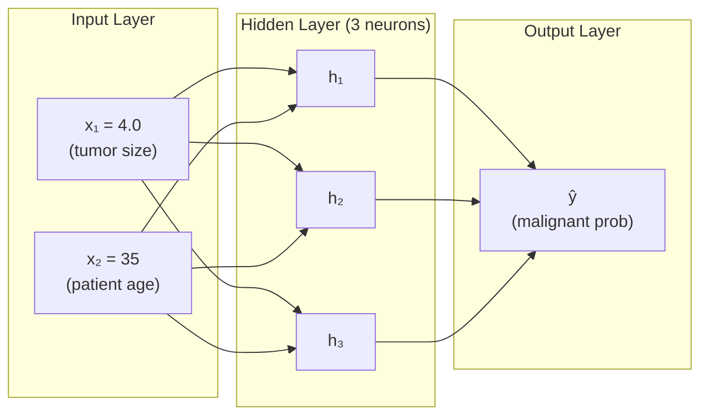
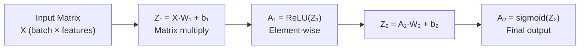
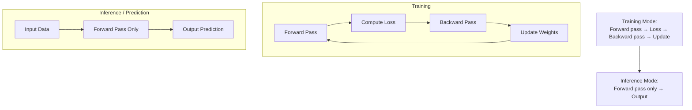

## Introduction

> **Forward propagation is the process of passing input data through a neural network layer by layer to produce a prediction. It's the "thinking" step — data flows forward, computation happens, output emerges.**

Training a network = running forward propagation → measuring error → backpropagating the error → updating weights → repeat.

---

## The Big Picture



At each layer, two operations happen:
1. **Linear transformation:** `z = W·x + b`
2. **Activation:** `a = f(z)`

The output of each layer becomes the input of the next.

---

## Step-by-Step Example

**Problem:** Predict if a tumor is malignant (1) or benign (0) given size and age.

**Network:** 2 inputs → 3 hidden neurons → 1 output



### Step 1: Input Layer

```
x = [4.0, 35]  (normalized: x = [0.4, 0.35])
```

Always normalize inputs — keeps weights in manageable ranges.

### Step 2: Hidden Layer Computation

```
For each hidden neuron h_j:
  z_j = w_{j1}×x₁ + w_{j2}×x₂ + b_j  ← linear combination
  a_j = ReLU(z_j)                       ← activation
```

**Example for neuron h₁:**
```
z₁ = 0.5×0.4 + 0.3×0.35 + 0.1
   = 0.20 + 0.105 + 0.1
   = 0.405
a₁ = ReLU(0.405) = 0.405  (already positive)
```

### Step 3: Output Layer

```
z_out = w₁×a₁ + w₂×a₂ + w₃×a₃ + b_out
ŷ = sigmoid(z_out) → probability between 0 and 1
```

If `ŷ > 0.5`: malignant (1)
If `ŷ ≤ 0.5`: benign (0)

---

## Matrix Form: How GPUs Make It Fast

Instead of computing neuron by neuron, we compute entire layers at once using matrices:



**This is why GPUs are essential** — GPUs can multiply matrices of millions of values in parallel.

```python
import numpy as np

# Batch of 5 samples, 2 features each
X = np.array([
    [0.4, 0.35],
    [0.8, 0.5],
    [0.2, 0.9],
    [0.6, 0.1],
    [0.3, 0.7]
])

# Random weights (would be learned during training)
W1 = np.random.randn(2, 3)  # 2 inputs → 3 hidden neurons
b1 = np.zeros(3)

W2 = np.random.randn(3, 1)  # 3 hidden → 1 output
b2 = np.zeros(1)

# Forward pass — processes all 5 samples SIMULTANEOUSLY
Z1 = X @ W1 + b1         # Matrix multiply: (5×2) @ (2×3) = (5×3)
A1 = np.maximum(0, Z1)   # ReLU activation: element-wise

Z2 = A1 @ W2 + b2        # (5×3) @ (3×1) = (5×1)
A2 = 1 / (1 + np.exp(-Z2))  # Sigmoid activation

print("Input shape:", X.shape)      # (5, 2)
print("Hidden output:", A1.shape)   # (5, 3)
print("Predictions:", A2.shape)     # (5, 1)
print("Output:", A2.flatten().round(3))
```

---

## Python: Full Forward Pass Class

```python
import numpy as np

class NeuralNetwork:
    def __init__(self, layer_dims):
        """
        layer_dims: list of layer sizes
        e.g., [2, 4, 3, 1] = 2 inputs, hidden(4), hidden(3), 1 output
        """
        self.params = {}
        np.random.seed(42)

        for l in range(1, len(layer_dims)):
            # He initialization — works well with ReLU
            self.params[f'W{l}'] = np.random.randn(layer_dims[l-1], layer_dims[l]) * np.sqrt(2/layer_dims[l-1])
            self.params[f'b{l}'] = np.zeros((1, layer_dims[l]))

        self.L = len(layer_dims) - 1  # Number of layers (excluding input)

    def relu(self, z):
        return np.maximum(0, z)

    def sigmoid(self, z):
        return 1 / (1 + np.exp(-z))

    def forward(self, X):
        self.cache = {'A0': X}

        A = X
        for l in range(1, self.L):  # Hidden layers: ReLU
            W = self.params[f'W{l}']
            b = self.params[f'b{l}']
            Z = A @ W + b
            A = self.relu(Z)
            self.cache[f'Z{l}'] = Z
            self.cache[f'A{l}'] = A

        # Output layer: sigmoid for binary classification
        W = self.params[f'W{self.L}']
        b = self.params[f'b{self.L}']
        Z = A @ W + b
        output = self.sigmoid(Z)
        self.cache[f'Z{self.L}'] = Z
        self.cache[f'A{self.L}'] = output

        return output


# Demo
nn = NeuralNetwork([2, 4, 3, 1])  # 2 → 4 → 3 → 1

X = np.array([[0.5, 0.3], [0.8, 0.1], [0.2, 0.9]])
predictions = nn.forward(X)
print("Predictions:", predictions.flatten().round(4))
```

---

## JavaScript: Forward Pass

```javascript
function sigmoid(z) {
  return 1 / (1 + Math.exp(-z));
}

function relu(z) {
  return Math.max(0, z);
}

function forwardLayer(inputs, weights, biases, activation) {
  // inputs: [n_samples, n_input_features]
  // weights: [n_input_features, n_output_neurons]
  // Returns: [n_samples, n_output_neurons]

  return inputs.map(sample => {
    return weights[0].map((_, j) => {
      const z = sample.reduce((sum, xi, i) => sum + xi * weights[i][j], biases[j]);
      return activation === 'relu' ? relu(z) : sigmoid(z);
    });
  });
}

// Example
const X = [[0.5, 0.3], [0.8, 0.1]]; // 2 samples, 2 features
const W1 = [[0.4, -0.2, 0.1], [0.3, 0.5, -0.4]]; // 2 inputs → 3 hidden
const b1 = [0.1, 0.1, 0.1];

const W2 = [[0.6], [-0.3], [0.8]]; // 3 hidden → 1 output
const b2 = [0.0];

const hidden = forwardLayer(X, W1, b1, 'relu');
const output = forwardLayer(hidden, W2, b2, 'sigmoid');

console.log('Hidden activations:', hidden);
console.log('Predictions:', output.map(o => o[0].toFixed(4)));
```

---

## Forward Propagation in Practice



**Key difference:** During inference, we run forward propagation only — no gradient computation, no weight updates. This makes inference much faster.

```python
import tensorflow as tf

# Training mode — forward + backward
model.fit(x_train, y_train, epochs=10)

# Inference mode — forward only (faster, less memory)
with tf.device('/CPU:0'):  # Can run on CPU for inference
    predictions = model.predict(x_test)  # Just forward pass

# Even faster for single samples:
prediction = model(x_test[0:1], training=False)
```

---

## Interview Questions

**Q1: What is forward propagation?**

> Forward propagation is the process of passing input data through a neural network's layers sequentially — from input to output. At each layer, the network computes a weighted sum of inputs, adds a bias, and applies an activation function. The final layer's output is the network's prediction.

**Q2: What is the role of the activation function in forward propagation?**

> Without activation functions, every layer computes a linear transformation, and stacking linear transformations is just another linear transformation — the network couldn't learn non-linear patterns no matter how many layers it has. Activation functions (ReLU, sigmoid, tanh) introduce non-linearity, enabling the network to learn complex, curved decision boundaries.

**Q3: Why is matrix multiplication used?**

> To compute an entire batch of samples simultaneously rather than one at a time. For a batch of 1000 samples with a 128-neuron hidden layer, instead of 1000 sequential computations, we do one matrix multiplication: `Z = X @ W + b` where X is (1000×features). GPUs parallelize this across thousands of cores, making deep learning practical.

**Q4: What happens to the shapes of tensors through the layers?**

> Input shape: (batch_size, input_features). After Dense(128): (batch_size, 128). After Dense(64): (batch_size, 64). After Dense(10): (batch_size, 10). Each Dense layer transforms the feature dimension to its `units` count while preserving the batch dimension.

---

## Best Practices

1. **Vectorize** — Always use matrix operations; never loop over samples
2. **Normalize inputs** before the first layer — stable gradients throughout
3. **Use appropriate data types** — `float32` is the standard (balance of speed and precision)
4. **Use `model.predict()`** for inference, not `model(x)` — Predict handles batching automatically
5. **Separate training and inference** — Use `training=False` in inference for proper BatchNorm/Dropout behavior

---

## Common Mistakes

- **Forgetting to normalize** — Large input values → exploding activations
- **Wrong matrix dimensions** — Check shapes at every layer; `(m, n) @ (n, p) = (m, p)`
- **Applying wrong activation to output** — Use linear for regression, sigmoid for binary, softmax for multi-class
- **Running inference in training mode** — Dropout and BatchNorm behave differently; set `training=False`

---

## Summary

| Step | Operation | Formula |
|------|-----------|---------|
| 1 | Receive input | `X = input data` |
| 2 | Compute weighted sum | `Z = X·W + b` |
| 3 | Apply activation | `A = f(Z)` |
| 4 | Pass to next layer | `X_next = A` |
| 5 | Repeat for each layer | Until output layer |
| 6 | Output | `ŷ = final A` |

---

## Navigation

**Previous:** [06 — Layers in Neural Networks](/ai/phase-03-deep-learning/06-layers-in-neural-networks)

**Next:** [08 — Activation Functions](/ai/phase-03-deep-learning/08-activation-functions)

**Related Topics:**
- [Backpropagation](/ai/phase-03-deep-learning/10-backpropagation)
- [Loss Functions](/ai/phase-03-deep-learning/09-loss-functions)
- [Neural Networks](/ai/phase-03-deep-learning/03-neural-networks)

---

## Practice Exercises

1. Implement forward propagation for a 3-layer network by hand (no Keras)
2. Verify your implementation matches Keras output for the same weights
3. Profile forward pass time: batch size 1 vs 100 vs 1000 — what do you observe?
4. Visualize intermediate layer activations on MNIST — what patterns emerge?
