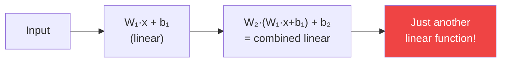
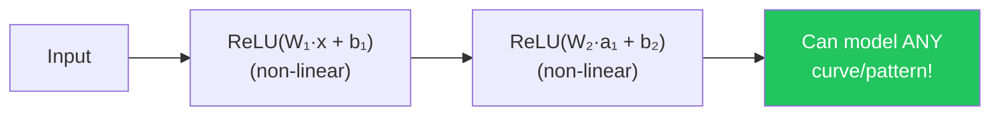
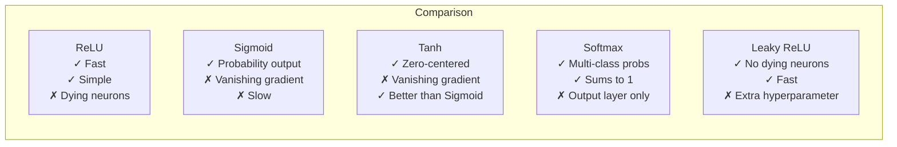
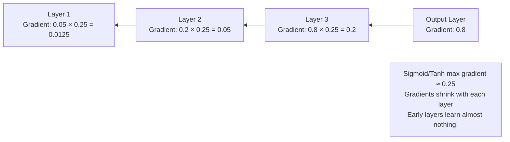

## Introduction

> **Activation functions are what give neural networks the ability to learn complex, non-linear patterns. Without them, a deep network is just a linear equation — no matter how many layers you stack.**

Every neuron outputs `f(weighted_sum)`. The choice of `f` determines the neuron's behavior.

---

## Why Activation Functions Exist

Without activation functions:



`Linear(Linear(x)) = Linear(x)` — stacking linear layers gives you... a linear layer.

With activation functions:



---

## The Five Key Activation Functions

### 1. ReLU (Rectified Linear Unit)

> **The most popular activation function in deep learning.**

```
f(x) = max(0, x)
```

```
     y
     |        /
     |       /
     |      /
     |     /
─────|────/────── x
     |   0
     |
```

**Properties:**

| Property | Detail |
|----------|--------|
| Output range | [0, ∞) |
| Computation | Extremely fast (just max) |
| Gradient | 1 if x > 0, else 0 |
| Problem | "Dying ReLU" — neurons can get stuck at 0 |

**Use when:** Default choice for hidden layers in most networks.

```python
import numpy as np
import tensorflow as tf

def relu(x):
    return np.maximum(0, x)

# In Keras:
tf.keras.layers.Dense(128, activation='relu')

# Test
x = np.array([-3, -1, 0, 1, 3])
print("ReLU:", relu(x))  # [0, 0, 0, 1, 3]
```

---

### 2. Sigmoid

```
f(x) = 1 / (1 + e^(-x))
```

```
     y
  1  |    ─────────
 0.5 |   /
  0  |──/─────────── x
     |
```

**Properties:**

| Property | Detail |
|----------|--------|
| Output range | (0, 1) |
| Interpretation | Probability |
| Problem | Vanishing gradients for large/small x |
| Problem | Not zero-centered |

**Use when:** Output layer for binary classification (probability).

```python
def sigmoid(x):
    return 1 / (1 + np.exp(-x))

# In Keras:
tf.keras.layers.Dense(1, activation='sigmoid')  # Binary classification output

# Test
x = np.array([-3, -1, 0, 1, 3])
print("Sigmoid:", sigmoid(x).round(3))
# [0.047, 0.269, 0.5, 0.731, 0.953]
```

---

### 3. Tanh (Hyperbolic Tangent)

```
f(x) = (e^x - e^(-x)) / (e^x + e^(-x))
```

```
     y
  1  |    ─────────
  0  |───/────────── x
 -1  |──────────
     |
```

**Properties:**

| Property | Detail |
|----------|--------|
| Output range | (-1, 1) |
| Zero-centered | Yes (better than sigmoid) |
| Gradient | Stronger than sigmoid |
| Problem | Still has vanishing gradients |

**Use when:** Hidden layers in RNNs; when zero-centered output matters.

```python
def tanh(x):
    return np.tanh(x)

# In Keras:
tf.keras.layers.Dense(64, activation='tanh')  # RNN hidden states

x = np.array([-3, -1, 0, 1, 3])
print("Tanh:", tanh(x).round(3))
# [-0.995, -0.762, 0., 0.762, 0.995]
```

---

### 4. Softmax

```
f(xᵢ) = e^(xᵢ) / Σ e^(xⱼ)  for all j
```

Softmax converts a vector of raw scores into probabilities that **sum to 1**.

```
Input:  [2.0, 1.0, 0.5]
            ↓
Softmax: [0.59, 0.24, 0.17]  ← Sums to 1.0!
```

**Properties:**

| Property | Detail |
|----------|--------|
| Output | Probability distribution |
| All outputs sum to | 1.0 |
| Use case | Multi-class classification output layer |

**Use when:** Output layer for multi-class classification (e.g., 10-class digit recognition).

```python
def softmax(x):
    e_x = np.exp(x - np.max(x))  # Numerical stability trick
    return e_x / e_x.sum()

# In Keras:
tf.keras.layers.Dense(10, activation='softmax')  # 10-class output

scores = np.array([2.0, 1.0, 0.5])
probs = softmax(scores)
print("Softmax:", probs.round(3))  # [0.587, 0.242, 0.171]
print("Sum:", probs.sum())          # 1.0
```

---

### 5. Leaky ReLU

```
f(x) = x       if x > 0
f(x) = 0.01x   if x ≤ 0
```

A fix for the "dying ReLU" problem — instead of outputting 0 for negative values, it outputs a small negative value.

**Properties:**

| Property | Detail |
|----------|--------|
| Output range | (-∞, ∞) |
| Fixes | Dying ReLU problem |
| Gradient | 1 for x>0, 0.01 for x≤0 (never exactly 0) |

**Use when:** When dying ReLU is a concern (very deep networks, sparse activations).

```python
def leaky_relu(x, alpha=0.01):
    return np.where(x > 0, x, alpha * x)

# In Keras:
tf.keras.layers.LeakyReLU(alpha=0.01)
# or:
tf.keras.layers.Dense(128, activation=tf.keras.layers.LeakyReLU(alpha=0.01))

x = np.array([-3, -1, 0, 1, 3])
print("Leaky ReLU:", leaky_relu(x))  # [-0.03, -0.01, 0, 1, 3]
```

---

## Comparison Table



| Function | Range | Best For | Avoid When |
|----------|-------|----------|------------|
| **ReLU** | [0, ∞) | Hidden layers (default) | Very deep nets with dying neurons |
| **Leaky ReLU** | (-∞, ∞) | Deep nets, dying ReLU issue | — |
| **Sigmoid** | (0, 1) | Binary output layer | Hidden layers in deep nets |
| **Tanh** | (-1, 1) | RNN hidden states | Very deep feed-forward nets |
| **Softmax** | (0, 1) summing to 1 | Multi-class output | Hidden layers |

---

## The Vanishing Gradient Problem



**ReLU's gradient is 1 (not < 1) for positive values** — gradients don't vanish, enabling deep networks to train.

---

## Python: All Activations Side by Side

```python
import numpy as np
import matplotlib
matplotlib.use('Agg')
import matplotlib.pyplot as plt

x = np.linspace(-5, 5, 100)

def relu(x): return np.maximum(0, x)
def sigmoid(x): return 1 / (1 + np.exp(-x))
def tanh(x): return np.tanh(x)
def leaky_relu(x, a=0.1): return np.where(x > 0, x, a * x)
def softmax(x): return np.exp(x) / np.sum(np.exp(x))

fig, axes = plt.subplots(2, 2, figsize=(12, 8))

activations = [
    ('ReLU', relu(x)),
    ('Sigmoid', sigmoid(x)),
    ('Tanh', tanh(x)),
    ('Leaky ReLU', leaky_relu(x)),
]

for (name, y), ax in zip(activations, axes.flat):
    ax.plot(x, y, 'b-', linewidth=2)
    ax.axhline(y=0, color='k', linestyle='-', linewidth=0.5)
    ax.axvline(x=0, color='k', linestyle='-', linewidth=0.5)
    ax.set_title(name, fontsize=14)
    ax.grid(True, alpha=0.3)
    ax.set_xlabel('Input x')
    ax.set_ylabel('f(x)')

plt.tight_layout()
plt.savefig('activation_functions.png', dpi=150)
print("Saved activation_functions.png")
```

---

## Interview Questions

**Q1: Why is ReLU preferred over sigmoid for hidden layers?**

> Sigmoid saturates at both ends — its gradient approaches 0 for large positive or negative inputs, causing the vanishing gradient problem in deep networks. ReLU's gradient is always 1 for positive values, allowing gradients to flow unchanged through many layers. ReLU is also computationally simpler (just `max(0, x)`).

**Q2: What is the vanishing gradient problem?**

> In backpropagation, gradients are multiplied together as they flow backward through layers. When activation functions like sigmoid have maximum gradients of 0.25, multiplying 10 of these together gives 0.25^10 ≈ 0.000001 — a gradient so small the early layers barely update. The network fails to learn. ReLU and skip connections (ResNets) are the main solutions.

**Q3: What is the dying ReLU problem?**

> If a neuron's weights get updated such that it always receives negative inputs, ReLU will always output 0 and its gradient will always be 0 — the neuron is "dead" and never updates again. Solutions: Leaky ReLU, ELU, or careful weight initialization.

**Q4: When do you use softmax vs sigmoid?**

> Sigmoid: binary classification (one output, outputs probability of class 1). Softmax: multi-class classification (N outputs, all probabilities sum to 1). For multi-label classification (multiple outputs can be 1 simultaneously), use sigmoid for each output independently.

---

## Best Practices

1. **Default: ReLU** for all hidden layers
2. **Binary output:** Sigmoid (1 neuron)
3. **Multi-class output:** Softmax (N neurons)
4. **Regression output:** No activation (linear)
5. **RNNs:** Tanh inside recurrent cells
6. **If dying ReLU is a problem:** Leaky ReLU or ELU

---

## Common Mistakes

- **Sigmoid in all hidden layers** — Causes vanishing gradients in deep networks
- **Softmax for binary classification** — Just use sigmoid
- **ReLU on the output layer for classification** — Wrong; use sigmoid or softmax
- **Not knowing which activation to use where** — Match to the task and layer position

---

## Summary

| Activation | Formula | Range | Use |
|------------|---------|-------|-----|
| ReLU | max(0,x) | [0,∞) | Hidden layers (default) |
| Sigmoid | 1/(1+e^-x) | (0,1) | Binary output |
| Tanh | (e^x-e^-x)/(e^x+e^-x) | (-1,1) | RNN states |
| Softmax | e^x/Σe^x | (0,1) | Multi-class output |
| Leaky ReLU | max(0.01x,x) | (-∞,∞) | Avoid dying ReLU |

---

## Navigation

**Previous:** [07 — Forward Propagation](/ai/phase-03-deep-learning/07-forward-propagation)

**Next:** [09 — Loss Functions](/ai/phase-03-deep-learning/09-loss-functions)

**Related Topics:**
- [Backpropagation](/ai/phase-03-deep-learning/10-backpropagation)
- [CNN](/ai/phase-03-deep-learning/13-cnn)
- [LSTM](/ai/phase-03-deep-learning/15-lstm)

---

## Practice Exercises

1. Plot all 5 activation functions — visualize their shapes
2. Build a network with sigmoid in hidden layers vs ReLU — compare convergence speed
3. Intentionally cause dying ReLU by using a large learning rate — observe dead neurons
4. Implement softmax from scratch and verify outputs sum to 1
5. Try using `elu` or `selu` — what are their properties?
