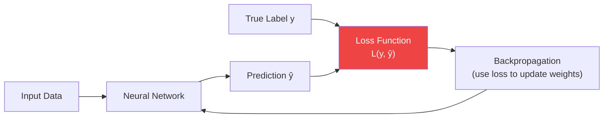
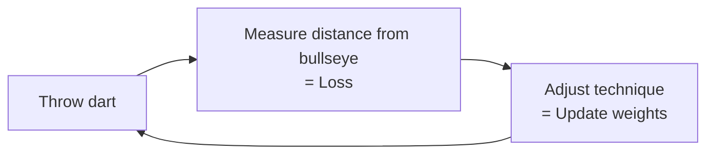
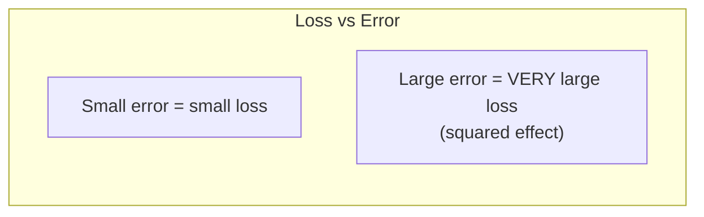
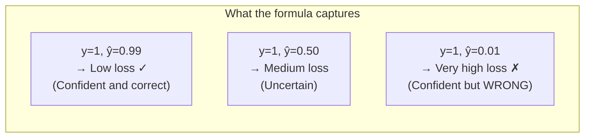
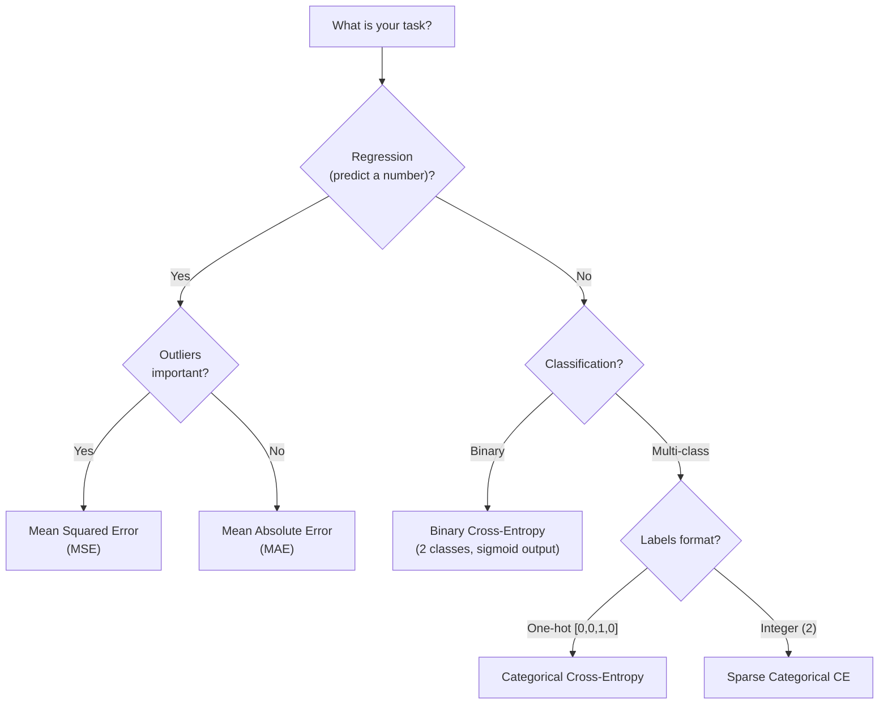

## Introduction

> **A loss function measures how wrong the network's prediction is. The goal of training is to make this number as small as possible.**

Think of loss as a report card — it tells the network exactly how far off it is, and in which direction to improve.

---

## The Role of Loss in Learning



Without a loss function, the network has no signal for learning. The loss is the compass.

---

## Real-World Analogy

You're learning to throw darts at a bullseye:

- **Prediction (ŷ)** = where your dart landed
- **True label (y)** = the bullseye
- **Loss** = how far your dart is from the bullseye
- **Training** = gradually adjusting your throw to minimize that distance

Every throw, you measure the error. You adjust your technique based on that measurement. Over many throws, you improve.



---

## Loss Function 1: Mean Squared Error (MSE)

**Used for regression tasks** — predicting continuous values.

```
MSE = (1/n) × Σ(y - ŷ)²
```

**Intuition:** Average squared distance between predictions and true values.

**Example:**

| Predicted house price | Actual price | Error | Squared Error |
|----------------------|--------------|-------|---------------|
| $450,000 | $400,000 | $50,000 | 2,500,000,000 |
| $320,000 | $350,000 | -$30,000 | 900,000,000 |
| $280,000 | $300,000 | -$20,000 | 400,000,000 |

`MSE = (2.5B + 0.9B + 0.4B) / 3 = $1.27B`

**Why squared?**
- Always positive (can't cancel out)
- Penalizes large errors more heavily than small ones



```python
import numpy as np
import tensorflow as tf

# Manual MSE
y_true = np.array([400000, 350000, 300000])
y_pred = np.array([450000, 320000, 280000])

mse = np.mean((y_true - y_pred) ** 2)
print(f"MSE: {mse:,.0f}")

# Keras
model.compile(optimizer='adam', loss='mse')

# For regression tasks:
model = tf.keras.Sequential([
    tf.keras.layers.Dense(64, activation='relu'),
    tf.keras.layers.Dense(1)  # No activation for regression
])
model.compile(loss='mean_squared_error', optimizer='adam')
```

---

## Loss Function 2: Mean Absolute Error (MAE)

```
MAE = (1/n) × Σ|y - ŷ|
```

**Intuition:** Average absolute distance between predictions and true values.

**MSE vs MAE:**

| | MSE | MAE |
|-|-----|-----|
| Sensitivity to outliers | High (squares large errors) | Low (linear penalty) |
| Optimization | Smooth, easy to optimize | Less smooth (not differentiable at 0) |
| Interpretation | Harder to interpret (squared units) | Easy: in original units |
| Use when | Outliers are important to penalize | Outliers are noise to ignore |

```python
# Manual MAE
mae = np.mean(np.abs(y_true - y_pred))
print(f"MAE: {mae:,.0f}")

# Keras
model.compile(loss='mean_absolute_error', optimizer='adam')
```

---

## Loss Function 3: Binary Cross-Entropy

**Used for binary classification** (spam/not spam, cat/dog, yes/no).

```
BCE = -(1/n) × Σ[y·log(ŷ) + (1-y)·log(1-ŷ)]
```

**Intuition:** Measures how confident the prediction was and whether that confidence was correct.



**Why logarithm?** `log(x)` approaches -∞ as x approaches 0, so being confidently wrong is severely penalized.

```python
# Manual Binary Cross-Entropy
def binary_cross_entropy(y_true, y_pred, epsilon=1e-15):
    y_pred = np.clip(y_pred, epsilon, 1 - epsilon)  # Avoid log(0)
    return -np.mean(y_true * np.log(y_pred) + (1 - y_true) * np.log(1 - y_pred))

# Example: email spam detection
y_true = np.array([1, 0, 1, 1, 0])    # Spam (1) or not (0)
y_pred = np.array([0.9, 0.1, 0.8, 0.3, 0.2])  # Model confidence

loss = binary_cross_entropy(y_true, y_pred)
print(f"Binary Cross-Entropy: {loss:.4f}")

# Keras
model.compile(
    loss='binary_crossentropy',
    optimizer='adam',
    metrics=['accuracy']
)
# Output layer: Dense(1, activation='sigmoid')
```

---

## Loss Function 4: Categorical Cross-Entropy

**Used for multi-class classification** (10 digits, 1000 ImageNet classes).

```
CCE = -(1/n) × Σ Σ yᵢⱼ · log(ŷᵢⱼ)
```

**Intuition:** Like binary cross-entropy but for multiple classes. Penalizes wrong predictions based on confidence.

```python
# Example: MNIST digit classification
y_true = np.array([[0, 0, 1, 0, 0, 0, 0, 0, 0, 0]])  # True class: 2
y_pred = np.array([[0.01, 0.02, 0.85, 0.04, 0.02, 0.01, 0.01, 0.01, 0.02, 0.01]])

cce = -np.sum(y_true * np.log(y_pred + 1e-15))
print(f"CCE: {cce:.4f}")  # Low loss — model was confident and correct

# Keras
model.compile(
    loss='categorical_crossentropy',  # Labels are one-hot encoded
    # or:
    loss='sparse_categorical_crossentropy',  # Labels are integers (0-9)
    optimizer='adam',
    metrics=['accuracy']
)
# Output layer: Dense(10, activation='softmax')
```

---

## Choosing the Right Loss Function



---

## Tracking Loss During Training

```python
import tensorflow as tf
import numpy as np

# Build model
model = tf.keras.Sequential([
    tf.keras.layers.Dense(64, activation='relu', input_shape=(10,)),
    tf.keras.layers.Dense(32, activation='relu'),
    tf.keras.layers.Dense(1, activation='sigmoid')
])
model.compile(optimizer='adam', loss='binary_crossentropy', metrics=['accuracy'])

# Generate dummy data
X = np.random.randn(1000, 10)
y = (X[:, 0] + X[:, 1] > 0).astype(float)

# Train — watch loss decrease
history = model.fit(X, y, epochs=10, validation_split=0.2)

# Plot loss
for epoch, (loss, val_loss) in enumerate(
    zip(history.history['loss'], history.history['val_loss'])
):
    print(f"Epoch {epoch+1}: loss={loss:.4f}, val_loss={val_loss:.4f}")
```

---

## JavaScript: Custom Loss Visualization

```javascript
import * as tf from '@tensorflow/tfjs';

// Binary cross-entropy from scratch
function binaryCrossEntropy(yTrue, yPred) {
  const epsilon = 1e-7;
  const clipped = yPred.map(p => Math.min(Math.max(p, epsilon), 1 - epsilon));
  const losses = yTrue.map((y, i) =>
    -(y * Math.log(clipped[i]) + (1 - y) * Math.log(1 - clipped[i]))
  );
  return losses.reduce((sum, l) => sum + l, 0) / losses.length;
}

// Confidence vs loss visualization
const scenarios = [
  { label: 'Correct + Confident', y: 1, pred: 0.99 },
  { label: 'Correct + Uncertain', y: 1, pred: 0.50 },
  { label: 'Wrong + Uncertain',   y: 1, pred: 0.20 },
  { label: 'Wrong + Confident',   y: 1, pred: 0.01 },
];

scenarios.forEach(({ label, y, pred }) => {
  const loss = binaryCrossEntropy([y], [pred]);
  console.log(`${label}: loss = ${loss.toFixed(4)}`);
});
// Correct + Confident:  loss = 0.0101  (low)
// Correct + Uncertain:  loss = 0.6931
// Wrong + Uncertain:    loss = 1.6094
// Wrong + Confident:    loss = 4.6052  (very high!)
```

---

## Interview Questions

**Q1: What is a loss function?**

> A loss function quantifies the difference between the model's predictions and the true labels. It produces a scalar value that the optimizer tries to minimize through training. Common examples: MSE for regression, cross-entropy for classification.

**Q2: Why use cross-entropy instead of MSE for classification?**

> MSE treats all errors linearly. Cross-entropy uses log-probability, which heavily penalizes confident wrong predictions. Being 99% confident and wrong is astronomically worse than being 51% confident and wrong — cross-entropy captures this properly. MSE doesn't. Additionally, cross-entropy produces gradients that are more informative for classification tasks.

**Q3: What happens if loss doesn't decrease during training?**

> Possible causes: (1) Learning rate too high — gradients diverge. (2) Learning rate too low — extremely slow convergence. (3) Wrong loss function for the task. (4) Model capacity too low (underfitting). (5) Data/label errors. (6) Weight initialization issues.

**Q4: What's the difference between `categorical_crossentropy` and `sparse_categorical_crossentropy`?**

> Both are the same mathematical loss, but differ in expected label format. `categorical_crossentropy` expects one-hot encoded labels: `[0, 0, 1, 0, 0]`. `sparse_categorical_crossentropy` expects integer class indices: `2`. Use sparse when you have many classes to save memory.

---

## Best Practices

1. **Match loss to task** — Regression → MSE/MAE, binary classification → BCE, multi-class → CCE
2. **Monitor validation loss** — Training loss always decreases; validation loss tells you about generalization
3. **Use `sparse_categorical_crossentropy`** when labels are integers (most common in practice)
4. **Watch for NaN loss** — Usually caused by exploding gradients or log(0); add gradient clipping or check preprocessing
5. **Loss ≠ Accuracy** — Loss is differentiable and used for optimization; accuracy is human-interpretable but not directly optimized

---

## Common Mistakes

- **Using MSE for classification** — Produces poor gradients; always use cross-entropy for classification
- **Not normalizing inputs** — Can cause loss to start extremely high and converge slowly
- **Ignoring validation loss** — Overfitting shows as training loss decreasing while validation loss increases
- **Forgetting `from_logits=True`** — When using softmax inside the model, Keras handles it; when you don't have softmax in the model but want cross-entropy, set `from_logits=True`

---

## Summary

| Loss Function | Task | Output Layer | When to Use |
|--------------|------|-------------|-------------|
| MSE | Regression | Linear | Continuous target, outliers matter |
| MAE | Regression | Linear | Continuous target, robust to outliers |
| Binary CE | Binary classification | Sigmoid (1 unit) | Yes/No, Spam/Ham |
| Categorical CE | Multi-class | Softmax (N units) | One-hot labels |
| Sparse Categorical CE | Multi-class | Softmax (N units) | Integer labels |

---

## Navigation

**Previous:** [08 — Activation Functions](/ai/phase-03-deep-learning/08-activation-functions)

**Next:** [10 — Backpropagation](/ai/phase-03-deep-learning/10-backpropagation)

**Related Topics:**
- [Gradient Descent](/ai/phase-03-deep-learning/11-gradient-descent)
- [Optimizers](/ai/phase-03-deep-learning/12-optimizers)
- [Model Evaluation](/ai/phase-02-machine-learning/15-model-evaluation)

---

## Practice Exercises

1. Compute BCE loss manually for a batch of 5 predictions
2. Train two identical networks — one with MSE, one with cross-entropy for classification — compare results
3. Deliberately create a "wrong + confident" prediction — observe the large loss value
4. Plot training vs validation loss curves — identify when overfitting begins
5. What does a loss of 0.0 mean? Is that good?
