## Introduction

> **Backpropagation is how a neural network learns from its mistakes — it flows the error signal backwards through the network, layer by layer, so every weight knows exactly how much it contributed to the wrong answer.**

Without backpropagation, a neural network could make predictions but could never improve. Backprop is the engine that turns raw data into a trained model.

---

## Real-World Analogy

Imagine a student sitting an exam:

- The student reads the question **(forward pass)** and writes an answer **(prediction)**
- The teacher grades it and marks it wrong **(loss calculation)**
- The teacher points out exactly which part of the reasoning was flawed **(backward pass)**
- The student adjusts their study approach for next time **(weight update)**
- The cycle repeats for every exam **(training loop)**

Backpropagation is the teacher pointing backwards through the student's reasoning — not just saying "you got it wrong" but explaining *which step* went wrong and *how much* to fix it.

---

## The Learning Loop

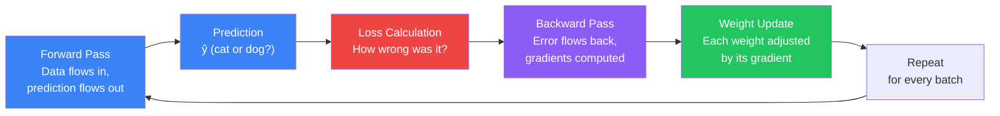

This loop runs thousands of times during training. Each repetition is called an **iteration** (one batch). A full pass over the entire dataset is an **epoch**.

---

## What is Backpropagation?

Backpropagation answers one question:

> "For each weight in the network, how much did it contribute to the final error — and in which direction should we adjust it?"

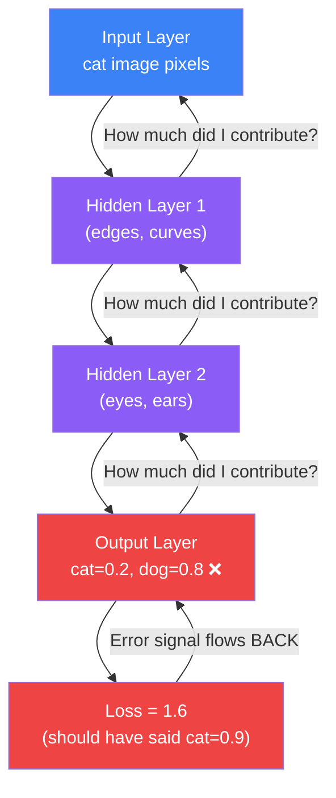

The key insight: **error flows backward, just as data flows forward.**

---

## Key Concept: The Chain Rule

The chain rule from calculus is the math behind backprop. But you don't need the formula — here is the intuition:

Imagine a factory assembly line with three workers:

- **Worker A** cuts raw material
- **Worker B** shapes it
- **Worker C** finishes and packages it

If the final product has a defect, you ask Worker C first — "did you cause this?" Worker C passes the blame estimate back to Worker B, who passes it back to Worker A. Each worker gets their **share of blame** proportional to how much their work affected the defect.

Backpropagation does exactly this — each layer gets its share of blame for the final error.

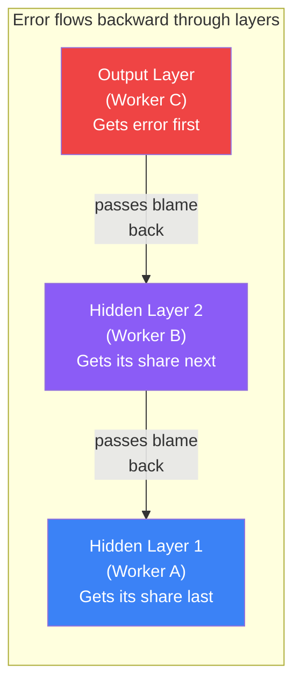

---

## Step-by-Step: How Backprop Works

### Step 1 — Forward Pass

Data enters the input layer and flows forward through every hidden layer to the output layer. A prediction is produced.

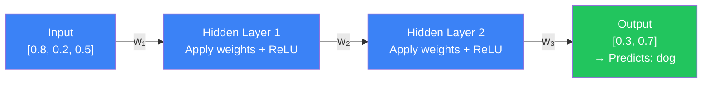

Result: network predicts "dog" with 70% confidence. But the true label is "cat."

---

### Step 2 — Calculate Loss

Compare prediction to truth. Loss quantifies how wrong the answer was.

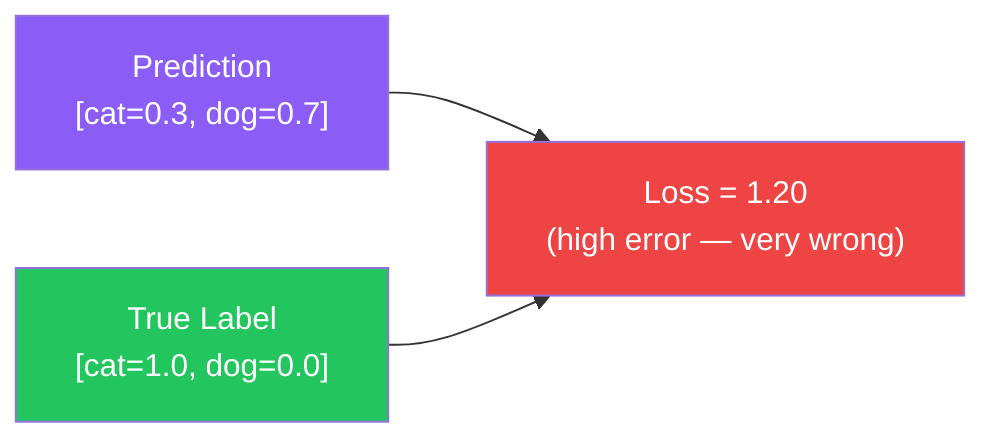

---

### Step 3 — Backward Pass

The error signal travels backwards through every layer. Each layer computes how much its weights contributed to the error — this is called the **gradient**.

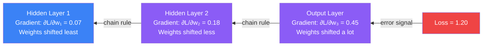

---

### Step 4 — Update Weights

Every weight in the network gets updated using its gradient. The **learning rate** controls how big each step is.

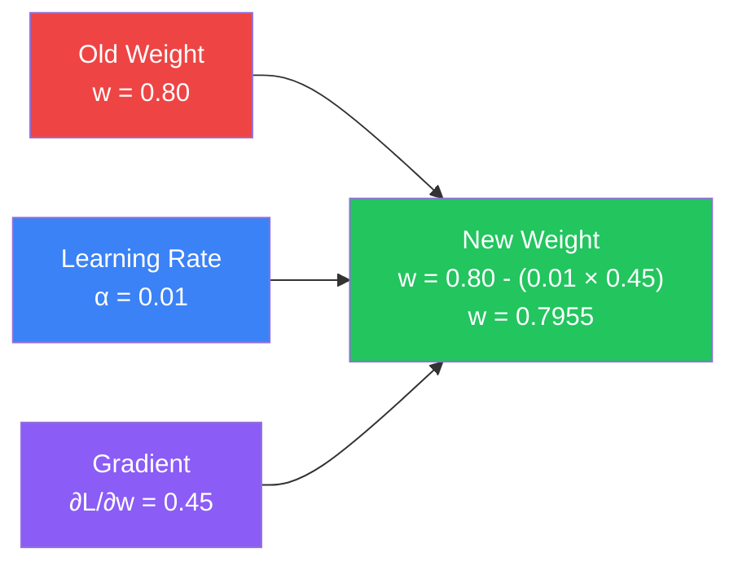

The formula is simply:

```
New Weight = Old Weight - (Learning Rate × Gradient)
```

Repeat steps 1–4 for every batch of training data. Over thousands of iterations, the loss shrinks and the network improves.

---

## Full Forward + Backward Diagram

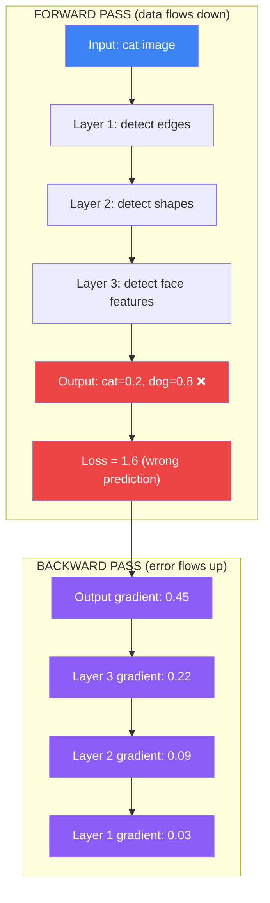

---

## Why Backpropagation Was Revolutionary

In 1986, **David Rumelhart, Geoffrey Hinton, and Ronald Williams** published a landmark paper showing that backpropagation could efficiently train multi-layer neural networks. Before this, people could only train very shallow networks (one or two layers).

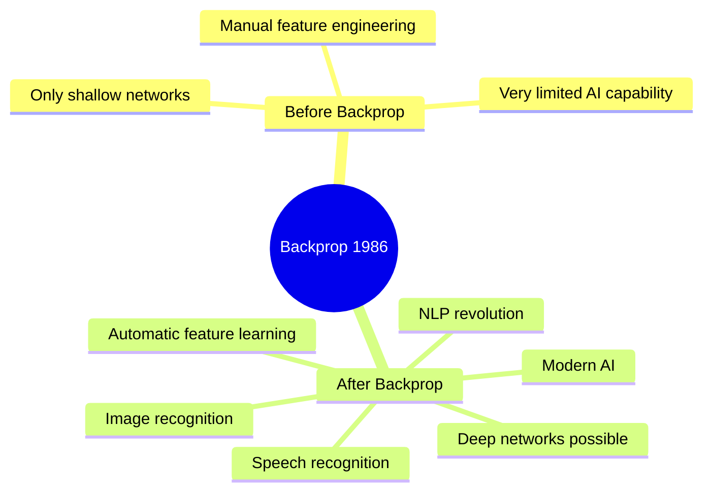

This single idea — efficiently flowing gradients backwards — is the foundation of almost all modern deep learning, from MNIST digit classifiers to GPT language models.

---

## Python Example: Watching Backprop in Action

```python
import tensorflow as tf
import numpy as np

# Build a simple cat/dog classifier
model = tf.keras.Sequential([
    tf.keras.layers.Dense(64, activation='relu', input_shape=(10,), name='layer1'),
    tf.keras.layers.Dense(32, activation='relu', name='layer2'),
    tf.keras.layers.Dense(1, activation='sigmoid', name='output')
])

model.compile(
    optimizer=tf.keras.optimizers.Adam(learning_rate=0.01),
    loss='binary_crossentropy',
    metrics=['accuracy']
)

# Simulate cat=0, dog=1 data (10 features per image)
np.random.seed(42)
X_train = np.random.randn(500, 10)
y_train = (X_train[:, 0] + X_train[:, 1] > 0).astype(float)

# Train — loss decreases as backprop updates weights each epoch
print("Training — watch loss decrease as backprop corrects weights:\n")
history = model.fit(X_train, y_train, epochs=10, batch_size=32, verbose=0)

for epoch, loss in enumerate(history.history['loss']):
    bar = '█' * int((1 - loss) * 20)
    print(f"Epoch {epoch+1:2d}: loss = {loss:.4f}  {bar}")

# Manually inspect gradients with GradientTape
print("\n--- Manual gradient computation ---")
X_sample = tf.constant(X_train[:1], dtype=tf.float32)
y_sample = tf.constant(y_train[:1], dtype=tf.float32)

with tf.GradientTape() as tape:
    pred = model(X_sample, training=True)
    loss_val = tf.keras.losses.binary_crossentropy(y_sample, tf.squeeze(pred))

# Get gradients for every trainable weight
gradients = tape.gradient(loss_val, model.trainable_variables)

for var, grad in zip(model.trainable_variables, gradients):
    print(f"{var.name:40s} | grad norm = {tf.norm(grad).numpy():.4f}")
```

**Expected output:**

```
Training — watch loss decrease as backprop corrects weights:

Epoch  1: loss = 0.6891  ██████
Epoch  2: loss = 0.6542  ███████
Epoch  3: loss = 0.6108  ████████
Epoch  4: loss = 0.5624  █████████
Epoch  5: loss = 0.5098  ██████████
Epoch  6: loss = 0.4601  ███████████
Epoch  7: loss = 0.4157  ████████████
Epoch  8: loss = 0.3786  █████████████
Epoch  9: loss = 0.3490  █████████████
Epoch 10: loss = 0.3248  ██████████████

--- Manual gradient computation ---
layer1/kernel:0                          | grad norm = 0.0312
layer1/bias:0                            | grad norm = 0.0089
layer2/kernel:0                          | grad norm = 0.0251
layer2/bias:0                            | grad norm = 0.0047
output/kernel:0                          | grad norm = 0.1834
output/bias:0                            | grad norm = 0.2193
```

Notice: the **output layer gradient norm is largest** (0.18, 0.21). Earlier layers have smaller gradients — this is normal. Very deep networks can suffer from gradients shrinking to near-zero (vanishing gradient problem).

---

## PyTorch Example: Explicit Backward Pass

```python
import torch
import torch.nn as nn

# Simple network
model = nn.Sequential(
    nn.Linear(10, 64),
    nn.ReLU(),
    nn.Linear(64, 32),
    nn.ReLU(),
    nn.Linear(32, 1),
    nn.Sigmoid()
)

optimizer = torch.optim.Adam(model.parameters(), lr=0.01)
loss_fn = nn.BCELoss()

# Fake batch: 32 samples, 10 features
X = torch.randn(32, 10)
y = (X[:, 0] + X[:, 1] > 0).float().unsqueeze(1)

print("Epoch | Loss   | Grad norm (layer 1)")
print("-" * 45)

for epoch in range(10):
    # 1. Forward pass
    pred = model(X)

    # 2. Compute loss
    loss = loss_fn(pred, y)

    # 3. Zero old gradients (important!)
    optimizer.zero_grad()

    # 4. Backward pass — computes all gradients
    loss.backward()

    # Inspect gradient of first layer weights
    first_layer_grad_norm = model[0].weight.grad.norm().item()

    # 5. Update weights using gradients
    optimizer.step()

    print(f"  {epoch+1:2d}  | {loss.item():.4f} | {first_layer_grad_norm:.4f}")
```

In PyTorch, you see the four steps explicitly: **forward**, **loss**, **backward()**, **step()**. Keras/TensorFlow does these automatically inside `model.fit()`.

---

## JavaScript Example: Gradients with TensorFlow.js

```javascript
import * as tf from '@tensorflow/tfjs';

// TensorFlow.js exposes gradients with tf.grad / tf.variableGrads
// Conceptual example: single neuron learning

// A weight we want to train
const weight = tf.variable(tf.scalar(0.5));
const bias   = tf.variable(tf.scalar(0.0));

// Simple prediction: sigmoid(weight * x + bias)
function predict(x) {
  return tf.sigmoid(weight.mul(x).add(bias));
}

// Binary cross-entropy loss for one sample
function loss(pred, label) {
  return label.mul(pred.log().neg())
    .add(tf.scalar(1).sub(label).mul(tf.scalar(1).sub(pred).log().neg()))
    .mean();
}

const optimizer = tf.train.adam(0.1);

// Training loop — backprop runs inside optimizer.minimize()
for (let epoch = 0; epoch < 10; epoch++) {
  const x     = tf.scalar(1.0);   // input feature
  const label = tf.scalar(1.0);   // true class = 1

  const lossVal = optimizer.minimize(() => {
    const pred = predict(x);
    return loss(pred, label);     // backprop computed here automatically
  }, /* returnCost */ true);

  console.log(`Epoch ${epoch + 1}: loss=${lossVal.dataSync()[0].toFixed(4)}, weight=${weight.dataSync()[0].toFixed(4)}`);
}

// Output: weight gradually moves toward the correct value
// Epoch 1:  loss=0.4741, weight=0.5986
// Epoch 5:  loss=0.2103, weight=0.9003
// Epoch 10: loss=0.0984, weight=1.1842
```

`optimizer.minimize()` runs the forward pass, computes loss, runs backpropagation, and updates the variable — all in one call.

---

## Common Misconceptions

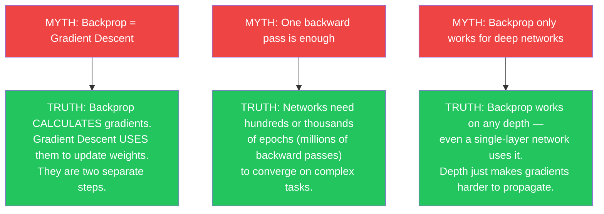

---

## The Vanishing Gradient Problem

As networks get deeper, gradients get multiplied by small fractions at each layer during backprop. By the time the signal reaches the first layers, it can be so tiny the weights barely move.

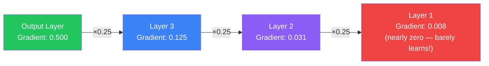

**Solutions to vanishing gradients:**
- Use **ReLU** activation (not sigmoid/tanh in hidden layers)
- Use **Batch Normalization** between layers
- Use **Residual connections** (as in ResNet)
- Use **LSTM / GRU** cells in recurrent networks

---

## Interview Questions

**Q: What is backpropagation?**

> Backpropagation is an algorithm that computes the gradient of the loss function with respect to each weight in the network. It flows the error signal backward through the network layer by layer using the chain rule of calculus, assigning each weight a gradient that indicates how much it contributed to the error and in which direction to adjust it.

**Q: What is the difference between backpropagation and gradient descent?**

> They are separate steps in training. Backpropagation computes the gradients — it answers "how much did each weight contribute to the error?" Gradient descent uses those gradients to actually update the weights — it answers "how should we change each weight?" Backprop gives us the direction and magnitude; gradient descent takes the step.

**Q: What is the chain rule and why does backprop need it?**

> The chain rule states that the derivative of a composed function can be computed by multiplying the derivatives of each part. Neural networks are compositions of many functions (layer after layer), so to find how the loss changes with respect to an early-layer weight, we must chain together the derivatives of every layer in between. Backprop automates this chain multiplication efficiently from output back to input.

**Q: What is the vanishing gradient problem?**

> In deep networks, gradients are multiplied together as they flow backward through layers. If each multiplication involves a value less than 1 (common with sigmoid activations), the gradient shrinks exponentially by the time it reaches early layers — sometimes to near zero. Early layers then receive almost no learning signal and barely update their weights. Solutions include ReLU activations, batch normalization, residual connections, and careful weight initialization.

**Q: What is the exploding gradient problem?**

> The opposite of vanishing gradients — if gradients are larger than 1, they grow exponentially as they flow backward, causing weight updates to become enormous and making training unstable (loss oscillates or becomes NaN). Common solutions: gradient clipping (cap gradient norm at a threshold), lower learning rate, careful weight initialization.

---

## Best Practices

1. **Use batch training** — Compute gradients over mini-batches (32–256 samples) rather than one sample at a time. This gives more stable, averaged gradient estimates and speeds up training significantly.
2. **Monitor loss curves** — If training loss decreases but validation loss increases, your network is overfitting. If neither decreases, your learning rate may be wrong or the network too shallow.
3. **Choose the right learning rate** — Too high: loss oscillates or explodes. Too low: training is painfully slow. Start with `0.001` for Adam and adjust based on loss curve behavior.
4. **Use ReLU in hidden layers** — ReLU activations have gradients of 0 or 1, which avoids the vanishing gradient problem inherent in sigmoid and tanh.
5. **Zero gradients before each backward pass** (PyTorch) — Gradients accumulate by default in PyTorch. Always call `optimizer.zero_grad()` before `loss.backward()` or you will be adding old gradients to new ones.
6. **Use batch normalization** — Normalizes layer outputs during training, keeping gradients in a healthy range and enabling higher learning rates.

---

## Common Mistakes

- **Using sigmoid/tanh in deep hidden layers** — These saturate for large inputs, producing near-zero gradients that vanish quickly. Use ReLU or its variants (Leaky ReLU, ELU) instead.
- **Too high a learning rate** — Weights overshoot the minimum and the loss diverges. Symptom: loss jumps wildly or becomes NaN after a few steps.
- **Too many layers without residual connections** — Very deep networks suffer from vanishing gradients in early layers, causing them to not learn. Use ResNet-style skip connections or choose an architecture designed for depth.
- **Not normalizing inputs** — Unnormalized features (e.g., pixel values 0–255 instead of 0–1) cause uneven gradient magnitudes across weights, slowing convergence. Always normalize or standardize your inputs.
- **Forgetting `optimizer.zero_grad()` in PyTorch** — Leads to accumulating gradients across batches, causing incorrect and growing weight updates. Always zero gradients before each backward pass.
- **Confusing backprop with the whole training loop** — Backprop is just step 3 (computing gradients). The full training loop also includes the forward pass, loss computation, and weight update via an optimizer.

---

## Summary

| Concept | Key Point |
|---------|-----------|
| Backpropagation | Flows error signal backward through the network to compute gradients |
| Forward pass | Data moves input → output; produces a prediction |
| Loss | Measures how wrong the prediction was |
| Gradient | How much each weight contributed to the error, and in which direction |
| Chain rule | Lets us compute gradients through many composed layers efficiently |
| Weight update | New weight = Old weight − (Learning rate × Gradient) |
| Learning rate | Controls step size; too high = diverge, too low = slow convergence |
| Vanishing gradient | Gradients shrink to near-zero in early layers of deep networks |
| Exploding gradient | Gradients grow uncontrollably; fixed with gradient clipping |
| Epoch | One full pass over the training dataset |
| Why revolutionary | Made training deep multi-layer networks practical (Rumelhart & Hinton, 1986) |

---

## Navigation

**Previous:** [09 — Loss Functions](/ai/phase-03-deep-learning/09-loss-functions)

**Next:** [11 — Gradient Descent](/ai/phase-03-deep-learning/11-gradient-descent)

**Related Topics:**
- [Loss Functions](/ai/phase-03-deep-learning/09-loss-functions)
- [Gradient Descent](/ai/phase-03-deep-learning/11-gradient-descent)
- [Forward Propagation](/ai/phase-03-deep-learning/07-forward-propagation)
- [Neural Networks](/ai/phase-03-deep-learning/03-neural-networks)

---

## Practice Exercises

1. Train a model on MNIST (handwritten digits) for 5 epochs and print the loss after each epoch — observe how backprop reduces loss over time.
2. In PyTorch, deliberately skip `optimizer.zero_grad()` — observe how gradients accumulate and training breaks.
3. Build a 2-layer network and a 10-layer network on the same dataset. Compare how quickly each converges — observe the vanishing gradient effect in the deeper model.
4. Use `tf.GradientTape` to manually inspect the gradient norm of each layer after one backward pass. Which layer has the largest gradient? Which the smallest?
5. Replace all `relu` activations with `sigmoid` in a deep network. Train for 10 epochs. Compare loss curves with the ReLU version — explain the difference using the vanishing gradient concept.
6. Implement the weight update formula manually (`weight = weight - lr * gradient`) in NumPy for a single-neuron network and verify it matches what an optimizer does.

---

## Further Reading

- [deeplearning.ai — Neural Networks and Deep Learning (Course 1)](https://www.deeplearning.ai/courses/neural-networks-deep-learning/)
- [CS231n Stanford — Backpropagation, Intuitions](https://cs231n.stanford.edu/slides/2024/lecture_4.pdf)
- [PyTorch Autograd Tutorial](https://pytorch.org/tutorials/beginner/blitz/autograd_tutorial.html)
- [TensorFlow GradientTape Guide](https://www.tensorflow.org/guide/advanced_autodiff)
- [3Blue1Brown — Backpropagation Calculus (YouTube)](https://www.youtube.com/watch?v=tIeHLnjs5U8)
- [Rumelhart, Hinton & Williams 1986 — Original Paper](https://www.nature.com/articles/323533a0)
