## Introduction

> **Gradient descent is the optimization algorithm that trains neural networks — it finds the weight values that minimize the loss function by repeatedly stepping in the direction that reduces error.**

Every time a neural network learns, gradient descent is what actually does the learning. It takes the loss signal from backpropagation and translates it into concrete weight updates. Without gradient descent, you have no training.

---

## Real-World Analogy

Imagine you are hiking down a foggy mountain, completely blindfolded. You cannot see the valley below or the summit above. You can only feel the ground under your feet — specifically, which direction slopes downward.

Your strategy: **always take a step in the direction that feels downhill.**

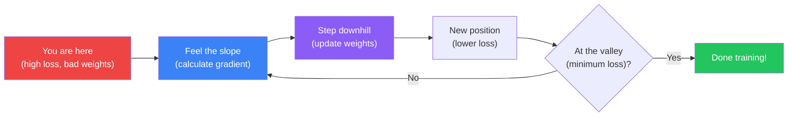

- **Mountain** = the loss landscape
- **Your position** = current weight values
- **Slope** = gradient (tells you which direction is uphill)
- **Step downhill** = move weights opposite to gradient
- **Valley** = minimum loss = well-trained model

---

## The Loss Landscape

Neural networks have millions of weights. Each combination of weights produces a different loss value. If you could plot all those combinations, you would see a high-dimensional surface — the **loss landscape**.

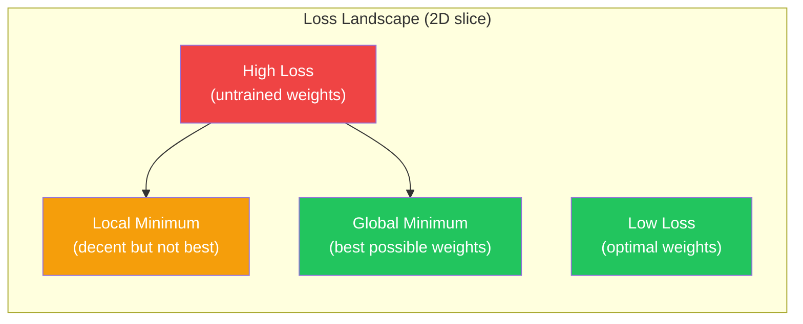

Training = finding your way from the high-loss peaks down to a low-loss valley.

---

## What is a Gradient?

A gradient is just the **slope** of the loss function with respect to a weight. It answers: "If I increase this weight slightly, does the loss go up or down, and by how much?"

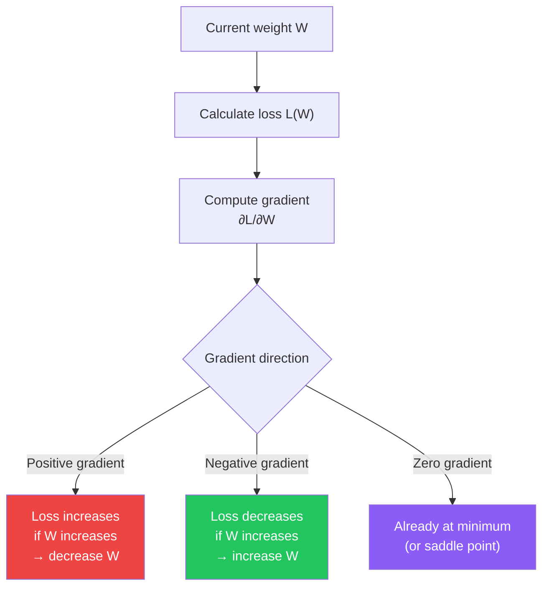

**Key insight:** The gradient points toward the steepest ascent. To minimize loss, move in the **opposite** direction.

---

## The Update Rule

The core equation of gradient descent is elegantly simple:

```
new_weight = old_weight - learning_rate × gradient
```

Written mathematically:

```
W = W - α × ∂L/∂W
```

Where:
- `W` = weight being updated
- `α` (alpha) = learning rate (how big of a step to take)
- `∂L/∂W` = gradient of loss with respect to this weight

```python
import numpy as np

# Simulating one gradient descent step
weight = 2.5          # Current weight value
gradient = 1.8        # Slope of loss at this point (computed by backprop)
learning_rate = 0.01  # Step size

new_weight = weight - learning_rate * gradient
print(f"Old weight: {weight}")
print(f"Gradient:   {gradient}")
print(f"New weight: {new_weight}")
# Old weight: 2.5
# Gradient:   1.8
# New weight: 2.482
```

Every trainable weight in the entire network gets this update applied simultaneously, thousands of times per training epoch.

---

## Learning Rate: The Step Size

The learning rate controls how large each step is. It is the most important hyperparameter in training.

### Too High — Overshoots


Loss bounces wildly. May even diverge (loss goes to infinity).

### Too Low — Crawls

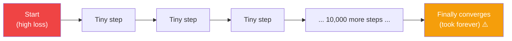

Training takes impractically long. May also get stuck in shallow local minima.

### Just Right — Smooth Convergence


Loss decreases smoothly and reliably.

### Learning Rate Comparison

| Learning Rate | Behavior | Risk |
|--------------|----------|------|
| Too high (e.g. 1.0) | Overshoots, diverges | Loss goes to NaN |
| Too low (e.g. 0.000001) | Extremely slow, stalls | Training never finishes |
| Good range (0.001–0.01) | Smooth, reliable convergence | None major |
| Adaptive (Adam) | Adjusts per parameter automatically | Best default choice |

```python
import tensorflow as tf
import numpy as np
import matplotlib.pyplot as plt

# Compare learning rates on MNIST
(x_train, y_train), (x_test, y_test) = tf.keras.datasets.mnist.load_data()
x_train = x_train.reshape(-1, 784).astype('float32') / 255.0
x_test  = x_test.reshape(-1, 784).astype('float32') / 255.0

def build_and_train(lr, epochs=10):
    model = tf.keras.Sequential([
        tf.keras.layers.Dense(128, activation='relu', input_shape=(784,)),
        tf.keras.layers.Dense(10, activation='softmax')
    ])
    model.compile(
        optimizer=tf.keras.optimizers.SGD(learning_rate=lr),
        loss='sparse_categorical_crossentropy',
        metrics=['accuracy']
    )
    history = model.fit(
        x_train, y_train,
        epochs=epochs,
        batch_size=64,
        validation_split=0.1,
        verbose=0
    )
    return history.history['loss']

# Three learning rates
loss_high = build_and_train(1.0)   # Too high
loss_good = build_and_train(0.01)  # Just right
loss_low  = build_and_train(0.0001) # Too low

# Plot
plt.figure(figsize=(10, 5))
plt.plot(loss_high, label='lr=1.0 (too high)', color='red')
plt.plot(loss_good, label='lr=0.01 (good)',    color='green')
plt.plot(loss_low,  label='lr=0.0001 (too low)', color='orange')
plt.xlabel('Epoch')
plt.ylabel('Loss')
plt.title('Effect of Learning Rate on Loss Convergence')
plt.legend()
plt.show()
```

---

## Three Variants of Gradient Descent

How many training samples do you use to compute each gradient update? That question defines the three main variants.

### Overview

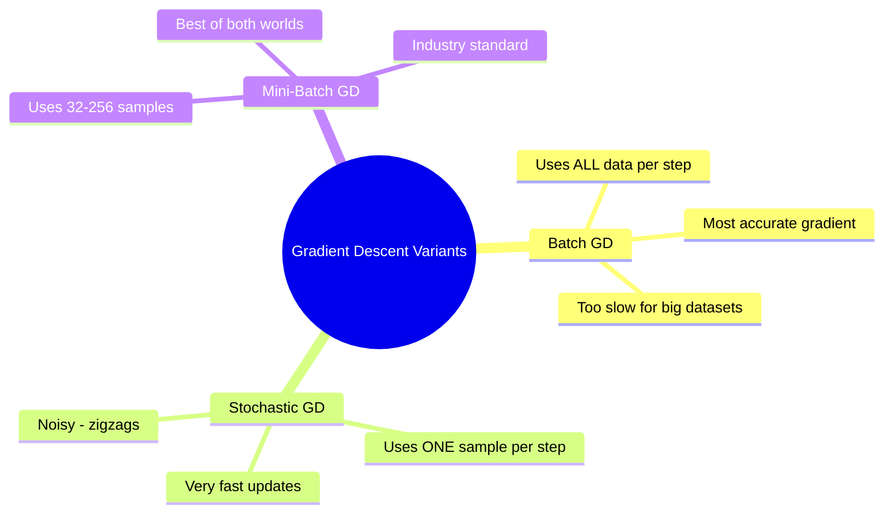

---

### Variant 1: Batch Gradient Descent

Compute the gradient using the **entire training dataset** before taking one step.


**Pros:** Smooth, accurate gradient. Guaranteed to converge (on convex problems).
**Cons:** Must process all data before each step. Extremely slow on large datasets. One epoch = one weight update.

```python
# Batch GD: batch_size = entire dataset
history = model.fit(
    x_train, y_train,
    batch_size=len(x_train),  # All 60,000 at once
    epochs=20
)
```

---

### Variant 2: Stochastic Gradient Descent (SGD)

Compute the gradient using **one sample at a time** and update weights immediately.

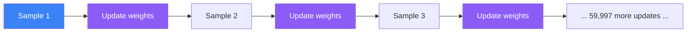

**Pros:** Very fast updates. The noise can help escape local minima.
**Cons:** Gradient is noisy and erratic. Loss oscillates. Hard to parallelize on GPUs.

```python
# SGD: batch_size = 1
history = model.fit(
    x_train, y_train,
    batch_size=1,  # One sample at a time
    epochs=5
)
# Warning: 60,000 gradient steps per epoch — very slow in practice
```

---

### Variant 3: Mini-Batch Gradient Descent (Industry Standard)

Compute the gradient using a **small batch** of samples (typically 32–256) per update.

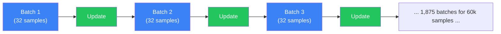

**Pros:** Balances accuracy and speed. GPU-friendly (batches parallelize well). Industry default.
**Cons:** Adds the hyperparameter of batch size to tune.

```python
# Mini-Batch GD: batch_size = 32 (common default)
history = model.fit(
    x_train, y_train,
    batch_size=32,  # Mini-batch — the default
    epochs=10,
    validation_split=0.1
)
# 60,000 / 32 = 1,875 gradient steps per epoch
```

---

### Comparison Table

| Variant | Data per Step | Steps per Epoch | Gradient Quality | GPU Efficiency | When to Use |
|---------|--------------|-----------------|-----------------|----------------|-------------|
| Batch GD | All N samples | 1 | Exact, smooth | Poor | Tiny datasets, research |
| SGD | 1 sample | N | Very noisy | Poor | Escaping local minima |
| Mini-Batch GD | 32–256 samples | N / batch_size | Good approximation | Excellent | Always — industry default |

---

## The Local Minima Problem

The loss landscape is not a perfect bowl with one bottom. It has many valleys, hills, and flat plateaus.

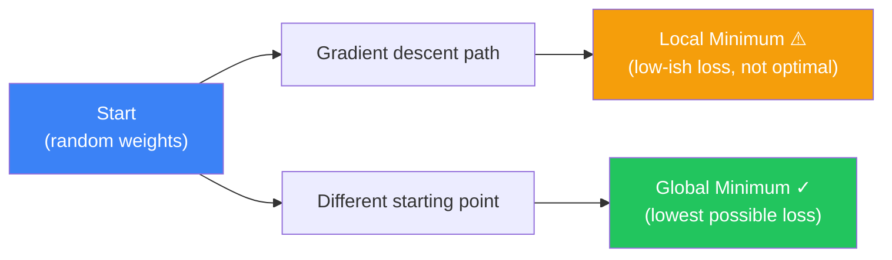

A **local minimum** is a valley that looks like the bottom from nearby but is not the deepest valley overall.

**Why this matters for cat/dog classification:** If gradient descent gets stuck in a local minimum, the model might reach 85% accuracy when the global minimum gives 95% accuracy.

### How SGD Noise Helps

The randomness in stochastic and mini-batch gradient descent is actually useful here. Noisy gradients make the optimization path jitter and bounce, which can kick the model out of shallow local minima.

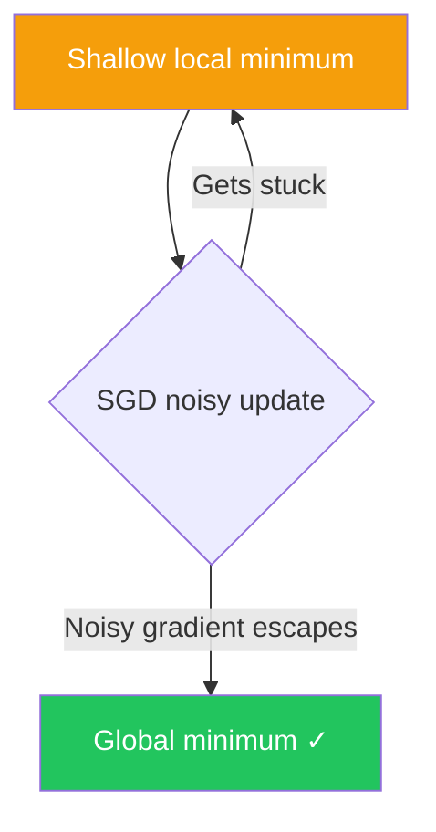

**Good news:** In practice with deep networks, true local minima are rare. Most problematic flat regions are saddle points.

---

## Saddle Points

A saddle point is a location where the gradient is zero (looks like a minimum) but is actually flat in some directions and curved in others — like the center of a horse saddle.

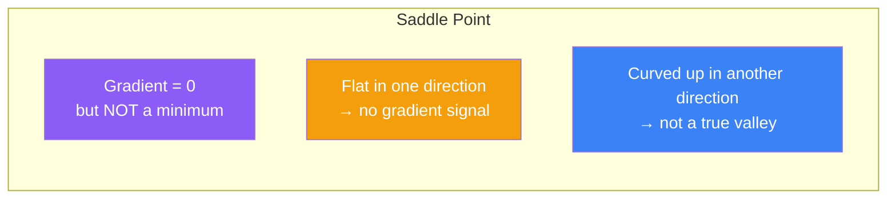

Saddle points are more common than local minima in high-dimensional neural networks. Modern optimizers like Adam handle them better than plain gradient descent.

---

## Python Example: Training with Different Batch Sizes

```python
import tensorflow as tf
import numpy as np
import matplotlib.pyplot as plt

# Load and preprocess MNIST
(x_train, y_train), (x_test, y_test) = tf.keras.datasets.mnist.load_data()
x_train = x_train.reshape(-1, 784).astype('float32') / 255.0
x_test  = x_test.reshape(-1, 784).astype('float32') / 255.0

def build_model():
    """Simple feedforward network for digit classification."""
    model = tf.keras.Sequential([
        tf.keras.layers.Dense(256, activation='relu', input_shape=(784,)),
        tf.keras.layers.Dense(128, activation='relu'),
        tf.keras.layers.Dense(10,  activation='softmax')
    ])
    model.compile(
        optimizer=tf.keras.optimizers.SGD(learning_rate=0.01),
        loss='sparse_categorical_crossentropy',
        metrics=['accuracy']
    )
    return model

# Train with three different batch sizes
results = {}

for batch_size in [1, 32, 512]:
    print(f"\nTraining with batch_size={batch_size}")
    model = build_model()
    history = model.fit(
        x_train, y_train,
        batch_size=batch_size,
        epochs=5,
        validation_data=(x_test, y_test),
        verbose=1
    )
    results[batch_size] = history.history

# Plot validation accuracy comparison
plt.figure(figsize=(12, 5))

plt.subplot(1, 2, 1)
for bs, hist in results.items():
    plt.plot(hist['val_loss'], label=f'batch={bs}')
plt.title('Validation Loss by Batch Size')
plt.xlabel('Epoch')
plt.ylabel('Loss')
plt.legend()

plt.subplot(1, 2, 2)
for bs, hist in results.items():
    plt.plot(hist['val_accuracy'], label=f'batch={bs}')
plt.title('Validation Accuracy by Batch Size')
plt.xlabel('Epoch')
plt.ylabel('Accuracy')
plt.legend()

plt.tight_layout()
plt.show()

# Final test accuracy
for bs, hist in results.items():
    final_acc = hist['val_accuracy'][-1]
    print(f"Batch size {bs:>4} → Final accuracy: {final_acc:.4f}")
```

---

## Learning Rate Scheduling

Instead of a fixed learning rate, you can reduce it over time — start bold, finish precise.

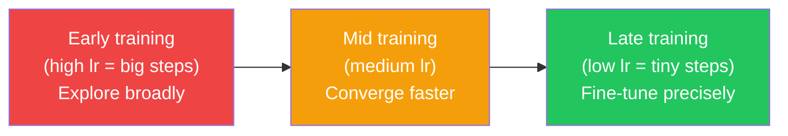

```python
import tensorflow as tf

# Method 1: Step decay — halve LR every 10 epochs
def step_decay(epoch):
    initial_lr = 0.1
    drop = 0.5
    epochs_drop = 10
    return initial_lr * (drop ** (epoch // epochs_drop))

lr_scheduler = tf.keras.callbacks.LearningRateScheduler(step_decay, verbose=1)

# Method 2: ReduceLROnPlateau — reduce when validation loss stalls
reduce_lr = tf.keras.callbacks.ReduceLROnPlateau(
    monitor='val_loss',
    factor=0.5,        # Multiply lr by 0.5
    patience=3,        # Wait 3 epochs before reducing
    min_lr=1e-6,
    verbose=1
)

# Training with scheduler
model.fit(
    x_train, y_train,
    epochs=50,
    batch_size=64,
    validation_split=0.1,
    callbacks=[reduce_lr]
)

# Method 3: Cosine annealing (popular in research)
cosine_lr = tf.keras.optimizers.schedules.CosineDecay(
    initial_learning_rate=0.001,
    decay_steps=10000,
    alpha=0.0           # Final lr = 0
)
optimizer = tf.keras.optimizers.SGD(learning_rate=cosine_lr)
```

---

## JavaScript: Gradient Descent from Scratch

```javascript
// Conceptual gradient descent — minimize f(x) = (x - 3)^2
// The minimum is at x = 3, where f(3) = 0

function f(x) {
  return Math.pow(x - 3, 2);  // Loss function
}

function gradient(x) {
  return 2 * (x - 3);  // df/dx = 2(x - 3)
}

function gradientDescent(startX, learningRate, steps) {
  let x = startX;

  console.log('Step | x value | Loss f(x) | Gradient');
  console.log('-----|---------|-----------|----------');

  for (let step = 0; step < steps; step++) {
    const loss = f(x);
    const grad = gradient(x);

    if (step % 5 === 0) {
      console.log(
        `${step.toString().padStart(4)} | ${x.toFixed(4).padStart(7)} | ${loss.toFixed(4).padStart(9)} | ${grad.toFixed(4)}`
      );
    }

    x = x - learningRate * grad;  // The update rule
  }

  console.log(`\nFinal x = ${x.toFixed(6)} (should be ~3.0)`);
  console.log(`Final loss = ${f(x).toFixed(6)} (should be ~0.0)`);
}

// Compare learning rates
console.log('=== Learning Rate: 0.1 (good) ===');
gradientDescent(0, 0.1, 50);

console.log('\n=== Learning Rate: 0.9 (too high — may oscillate) ===');
gradientDescent(0, 0.9, 50);

console.log('\n=== Learning Rate: 0.001 (too low — slow) ===');
gradientDescent(0, 0.001, 50);
```

```javascript
// TensorFlow.js: gradient descent with automatic differentiation
import * as tf from '@tensorflow/tfjs';

// Define a trainable weight (the parameter we want to optimize)
const w = tf.variable(tf.scalar(0.0));  // Start at 0

const learningRate = 0.1;
const optimizer = tf.train.sgd(learningRate);

// Loss: we want w to converge to 3.0
function loss() {
  return tf.pow(tf.sub(w, tf.scalar(3)), 2);  // (w - 3)^2
}

// Run 30 steps of gradient descent
for (let step = 0; step < 30; step++) {
  optimizer.minimize(loss);

  if (step % 5 === 0) {
    const currentLoss = loss().dataSync()[0];
    const currentW    = w.dataSync()[0];
    console.log(`Step ${step}: w=${currentW.toFixed(4)}, loss=${currentLoss.toFixed(4)}`);
  }
}

// Step  0: w=0.2000, loss=7.8400
// Step  5: w=2.2144, loss=0.6162
// Step 10: w=2.8241, loss=0.0311
// Step 15: w=2.9697, loss=0.0009
// Step 20: w=2.9948, loss=0.0000
// Step 25: w=2.9991, loss=0.0000
```

---

## Interview Questions

**Q1: What is gradient descent and why do we use it?**

> Gradient descent is an iterative optimization algorithm that minimizes a loss function by repeatedly computing the gradient (slope) of the loss with respect to each weight and nudging the weights in the opposite direction. We use it because directly solving for optimal weights analytically is computationally impossible for networks with millions of parameters. Gradient descent gives us a tractable iterative approach.

**Q2: What are the three variants of gradient descent?**

> Batch GD uses all training samples per update — accurate gradient but one update per epoch, which is too slow for large datasets. SGD uses one sample per update — fast but extremely noisy. Mini-batch GD (the industry standard) uses small batches of 32–256 samples — it approximates the full gradient well enough while being GPU-friendly and updating weights many times per epoch.

**Q3: What is the learning rate and how do you choose it?**

> The learning rate (alpha) controls the step size of each weight update. Too high causes overshooting and divergence (loss goes to NaN). Too low causes extremely slow training. A good starting point is 0.001 with the Adam optimizer. In practice, use learning rate schedulers to start higher and reduce it over training, or use adaptive optimizers like Adam that adjust the effective learning rate per parameter automatically.

**Q4: Can gradient descent get stuck in local minima?**

> In theory yes, but in practice deep networks rarely have problematic local minima. The bigger issue is saddle points — regions where gradient is zero but it is not a true minimum. The noise in mini-batch gradient descent helps escape both. Modern adaptive optimizers (Adam, RMSProp) also handle saddle points better than plain SGD. In practice, local minima in deep networks tend to have similar loss values to the global minimum.

**Q5: What is the difference between gradient descent and backpropagation?**

> These are two different but complementary algorithms. Backpropagation is the method for efficiently computing the gradient of the loss with respect to every weight using the chain rule (working backwards through the network). Gradient descent is the optimization algorithm that uses those gradients to update the weights. Backprop computes the gradients; gradient descent applies them.

---

## Best Practices

1. **Start with learning rate 0.001** — This is a reliable default, especially with Adam optimizer. Adjust from there.
2. **Use mini-batch with batch size 32–128** — Good balance of noise, accuracy, and GPU utilization. Powers of 2 are GPU-friendly.
3. **Always shuffle your training data** — Before each epoch, shuffle samples so batches are representative and not ordered by class.
4. **Use learning rate schedulers** — `ReduceLROnPlateau` is a safe, adaptive choice. Reduce learning rate when validation loss stalls.
5. **Monitor both training and validation loss** — Training loss always goes down. Validation loss tells you the real story.
6. **Use Adam over vanilla SGD** as your default — Adam adapts the learning rate per-parameter and usually converges faster.
7. **Gradient clipping for RNNs** — If loss explodes to NaN during training, add `clipnorm=1.0` to your optimizer.

---

## Common Mistakes

- **Fixed learning rate for the entire training run** — Loss often stalls in the later epochs. Use a scheduler to reduce LR as training progresses.
- **Batch size too large (1024+)** — Large batches produce very accurate but very sharp gradients that generalize poorly. Medium batches (32–128) generalize better.
- **Batch size of 1 in production** — True SGD is impractically slow and noisy. Always use mini-batches.
- **Not shuffling training data** — If data is sorted by class (all cats, then all dogs), early batches are unrepresentative and gradients are misleading.
- **Ignoring loss explosion (NaN)** — Usually caused by learning rate too high or exploding gradients. Do not ignore NaN loss; reduce LR or add gradient clipping.
- **Treating loss plateau as convergence** — Flat loss often means you are in a saddle point. Try reducing LR or switching to Adam before concluding training is done.
- **Not normalizing inputs** — Raw pixel values (0–255) or un-scaled features cause wildly different gradient magnitudes. Always normalize to [0, 1] or standardize to mean=0, std=1.

---

## Summary

| Concept | Key Point |
|---------|-----------|
| Gradient descent | Optimization algorithm that minimizes loss by stepping opposite to the gradient |
| Gradient | Slope of the loss surface at current weights; points toward steepest ascent |
| Update rule | `W = W - lr × gradient` — applied to every weight every step |
| Learning rate | Step size; too high diverges, too low stalls, ~0.001 is a good start |
| Batch GD | All data per step; accurate but slow; impractical for large datasets |
| SGD | One sample per step; noisy but fast; rarely used directly |
| Mini-batch GD | 32–256 samples per step; GPU-friendly; industry standard |
| Local minima | Getting stuck in a sub-optimal valley; less of a problem in deep networks than theory suggests |
| Saddle points | Gradient = 0 but not a minimum; common in deep networks; noise and Adam help escape |
| LR scheduler | Reducing learning rate over time improves final convergence |

---

## Navigation

**Previous:** [10 — Backpropagation](/ai/phase-03-deep-learning/10-backpropagation)

**Next:** [12 — Optimizers](/ai/phase-03-deep-learning/12-optimizers)

**Related Topics:**
- [Backpropagation](/ai/phase-03-deep-learning/10-backpropagation)
- [Optimizers (Adam, RMSProp, Momentum)](/ai/phase-03-deep-learning/12-optimizers)
- [Loss Functions](/ai/phase-03-deep-learning/09-loss-functions)

---

## Practice Exercises

1. Implement gradient descent from scratch in Python to minimize `f(x) = x^2 + 4x + 4` — find the minimum analytically first, then verify gradient descent reaches it.
2. Train an MNIST classifier with three different learning rates (0.1, 0.01, 0.001) and plot the loss curves side by side.
3. Experiment with batch sizes (1, 32, 256, full dataset) — observe the trade-off between training speed and loss smoothness.
4. Add a `ReduceLROnPlateau` callback to a training run and observe when and how much the LR drops.
5. Deliberately introduce un-shuffled data (sort by label) and observe the effect on loss curve smoothness.
6. Set learning rate to 10.0 and observe loss explosion — then add gradient clipping (`clipnorm=1.0`) and observe recovery.

---

## Further Reading

- [deeplearning.ai — Gradient Descent](https://www.deeplearning.ai/ai-notes/optimization/)
- [CS231n Stanford — Optimization](https://cs231n.stanford.edu/slides/2023/lecture_3.pdf)
- [PyTorch Optimizers Documentation](https://pytorch.org/docs/stable/optim.html)
- [TensorFlow Keras Optimizers](https://www.tensorflow.org/api_docs/python/tf/keras/optimizers)
- [An Overview of Gradient Descent Optimization Algorithms — Sebastian Ruder](https://ruder.io/optimizing-gradient-descent/)
