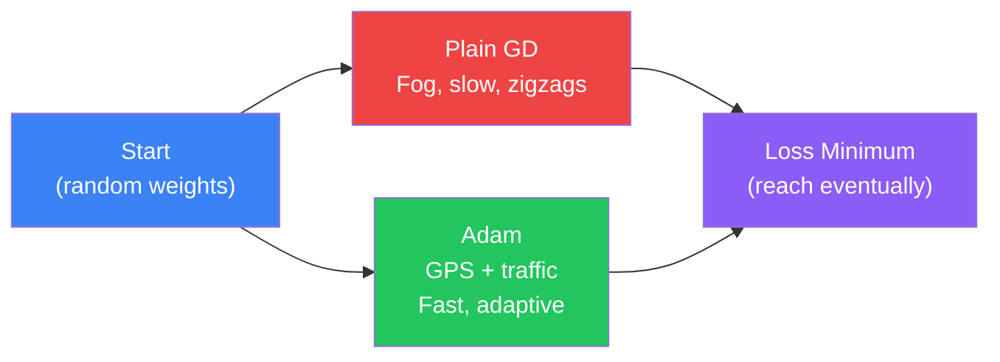
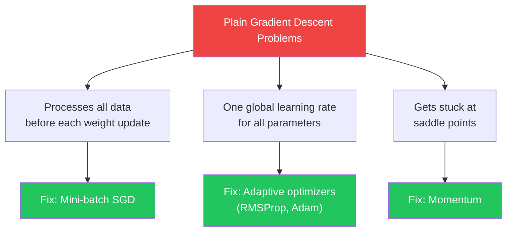
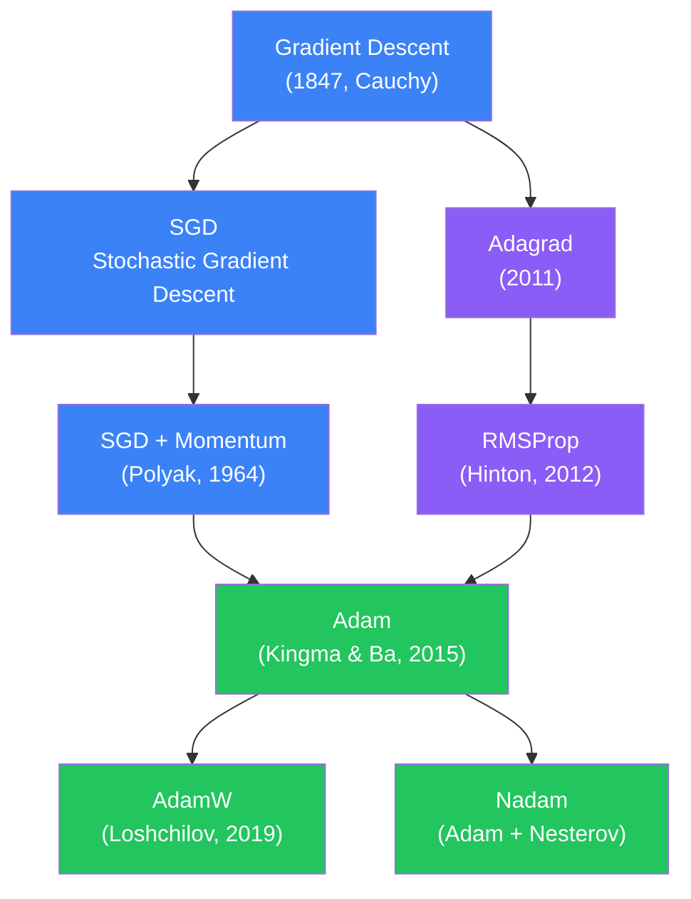
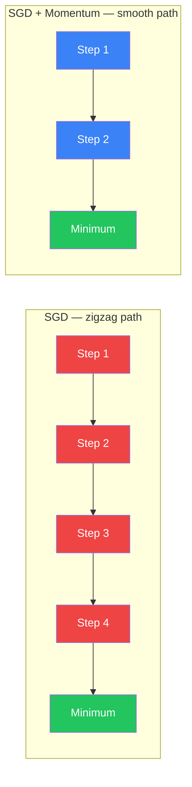
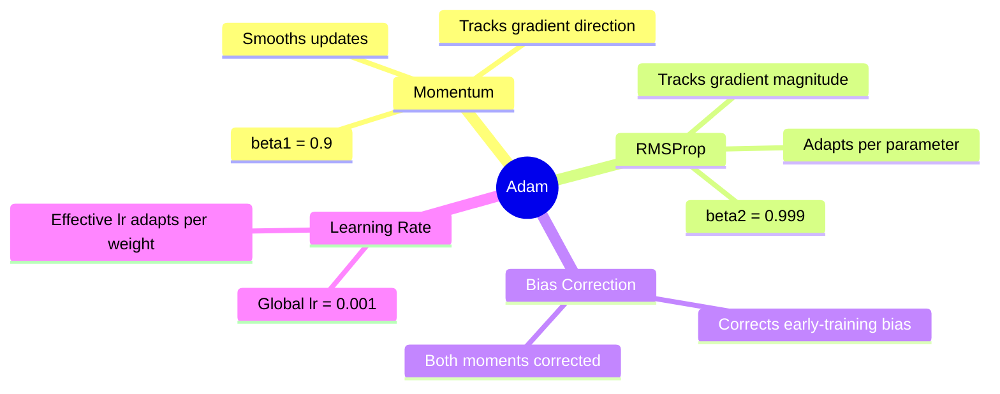
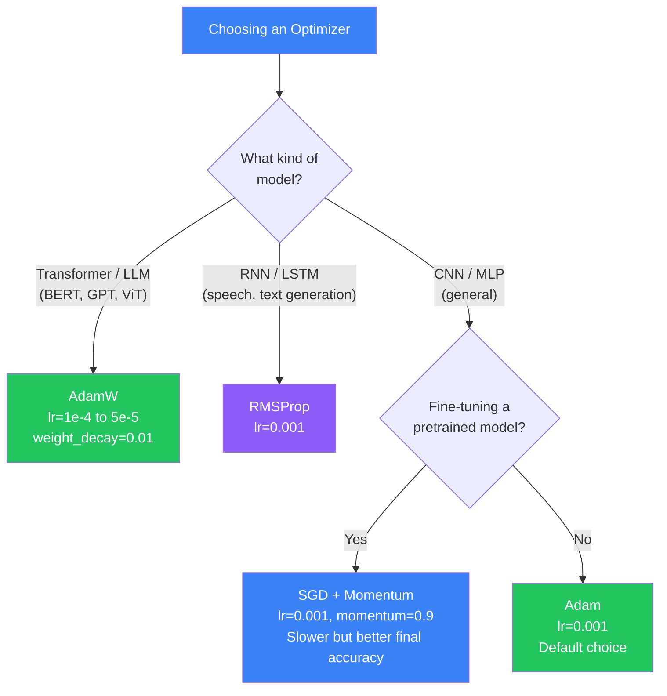

## Introduction

> **An optimizer is the algorithm that updates the network's weights during training. It reads the gradients computed by backpropagation and decides how — and how much — to adjust every weight to reduce the loss.**

Without an optimizer, you would have gradients but no strategy for using them. The optimizer is the engine that turns "how wrong was I?" into "how should I change?".

---

## Real-World Analogy: GPS vs Driving in Fog

Imagine you are trying to drive to the lowest valley in a mountain range:

- **Plain Gradient Descent** = driving in thick fog with no GPS. You can only see the ground immediately under your feet. You inch downhill step by step, constantly at risk of taking a wrong turn into a dead-end ravine.
- **SGD with Momentum** = you pick up speed rolling downhill, so small bumps do not stop you.
- **Adam** = a GPS with real-time traffic updates. It knows which roads are congested (high-gradient directions) and which are clear, and it dynamically reroutes you to reach the valley faster.



---

## Why Plain Gradient Descent is Not Enough

Plain (batch) gradient descent has three major problems in practice:

1. **Slow convergence** — it processes the entire dataset before taking one step. With millions of training samples this is impractically slow.
2. **Sensitive to learning rate** — too high and weights explode; too low and training takes forever.
3. **Gets stuck in saddle points and local minima** — once gradients are tiny, plain GD stops moving.



---

## Optimizer Family Tree



---

## 1. SGD — Stochastic Gradient Descent

The simplest optimizer. Instead of computing gradients over the full dataset, it samples a random mini-batch (e.g. 32 or 64 samples) and updates weights after each batch.

**The update rule:**
```
weight = weight - learning_rate × gradient
```

**Pros:**
- Simple to understand and implement
- Memory efficient — only one mini-batch in memory at a time
- Noisy updates can accidentally escape local minima

**Cons:**
- Zigzags toward the minimum — wastes many steps
- Very sensitive to learning rate choice
- Slow on problems where different parameters need different step sizes

```python
import tensorflow as tf

# SGD — the most basic optimizer
optimizer = tf.keras.optimizers.SGD(learning_rate=0.01)

model.compile(
    optimizer=optimizer,
    loss='sparse_categorical_crossentropy',
    metrics=['accuracy']
)
```

---

## 2. SGD with Momentum

### The Ball Rolling Downhill Analogy

Imagine a ball rolling down a hilly surface. Plain SGD is like a ball that stops and resets at every step — it has no memory of direction. Momentum lets the ball accumulate speed in the downhill direction and resist sideways noise.

```
velocity = momentum × velocity - learning_rate × gradient
weight   = weight + velocity
```

With **momentum = 0.9**, 90% of the previous velocity is carried forward. The ball rolls faster in consistent directions and slows on oscillating dimensions.



```python
# SGD with Momentum — classic choice for image classification
optimizer = tf.keras.optimizers.SGD(
    learning_rate=0.01,
    momentum=0.9,        # Typical value: 0.9
    nesterov=True        # Nesterov variant: look ahead before computing gradient
)
```

**Nesterov Momentum** is a small improvement: it computes the gradient at the anticipated future position rather than the current one — like looking ahead before stepping.

---

## 3. RMSProp — Root Mean Square Propagation

Invented by Geoffrey Hinton in a Coursera lecture (never formally published), RMSProp solves a key problem: **not every parameter should use the same learning rate**.

**The idea:** Track the running average of squared gradients for each parameter. Parameters that receive consistently large gradients get their effective learning rate shrunk; parameters with small gradients get a larger effective step.

```
v = decay × v + (1 - decay) × gradient²
weight = weight - (learning_rate / sqrt(v + ε)) × gradient
```

**Why this matters:** In a sentiment analysis RNN, the word "not" is rare but critical. Its gradient is small most of the time. RMSProp keeps its learning rate high, while a common word like "the" — which gets large gradients constantly — gets a reduced rate.

```python
# RMSProp — great for RNNs and non-stationary problems
optimizer = tf.keras.optimizers.RMSprop(
    learning_rate=0.001,
    rho=0.9,         # Decay rate for moving average (default)
    epsilon=1e-07    # Small constant for numerical stability
)
```

**Best for:** Recurrent Neural Networks (speech recognition, text generation), reinforcement learning.

---

## 4. Adam — Adaptive Moment Estimation

Adam (Kingma & Ba, 2015) is the **industry default optimizer**. It combines the best ideas from momentum and RMSProp:

- **First moment (m):** Running average of gradients — like momentum, smooths direction.
- **Second moment (v):** Running average of squared gradients — like RMSProp, adapts learning rate per parameter.

Both moments are bias-corrected (early in training, the averages are biased toward zero — Adam corrects for this).



**Typical hyperparameters:**
- `lr = 0.001` (rarely needs tuning)
- `beta1 = 0.9` (momentum decay)
- `beta2 = 0.999` (RMSProp decay)
- `epsilon = 1e-7` (numerical stability)

```python
# Adam — the default for most neural networks
optimizer = tf.keras.optimizers.Adam(
    learning_rate=0.001,  # Start here; rarely need to change
    beta_1=0.9,
    beta_2=0.999,
    epsilon=1e-7
)

model.compile(
    optimizer=optimizer,
    loss='categorical_crossentropy',
    metrics=['accuracy']
)
```

**Why Adam works so well out of the box:** Because of bias correction and per-parameter adaptation, it is robust to poor learning rate choices, handles sparse gradients (NLP tasks) gracefully, and converges quickly in most architectures.

---

## 5. AdamW — Adam with Decoupled Weight Decay

Adam has a subtle bug: its weight decay (L2 regularization) is absorbed into the adaptive learning rate, making it less effective than intended. AdamW **decouples** weight decay from the gradient update, applying it directly to the weights.

```
# Adam (broken regularization)
weight = weight - lr × (gradient + λ × weight) / sqrt(v)

# AdamW (correct regularization)
weight = weight - lr × gradient / sqrt(v) - lr × λ × weight
```

**Why it matters:** Transformers (GPT, BERT, LLaMA) are huge models that rely heavily on regularization to prevent overfitting. AdamW gives proper control over weight decay — it is the reason all modern LLMs use AdamW.

```python
# AdamW — the go-to for Transformers
import tensorflow_addons as tfa

optimizer = tfa.optimizers.AdamW(
    learning_rate=5e-5,   # Typical for fine-tuning BERT
    weight_decay=0.01     # Decoupled weight decay
)

# PyTorch version (more common in research)
import torch.optim as optim

optimizer = optim.AdamW(
    model.parameters(),
    lr=5e-5,
    weight_decay=0.01
)
```

---

## Optimizer Comparison Table

| Optimizer | Speed | Memory | Adaptive LR | Best For | Used In |
|-----------|-------|--------|-------------|----------|---------|
| SGD | Slow | Low | No | Simple baselines | Classic ML |
| SGD + Momentum | Medium | Low | No | Image classification, fine-tuning | ResNet, VGG |
| RMSProp | Fast | Medium | Yes | RNNs, RL | LSTM, GRU |
| Adam | Fast | Medium | Yes | General purpose, default | Most CNNs, MLPs |
| AdamW | Fast | Medium | Yes + proper decay | Transformers, LLMs | BERT, GPT, LLaMA |

---

## When to Use Which Optimizer



**Quick reference:**
- **Adam** — your default. Start here for any new network.
- **AdamW** — whenever you use a Transformer (BERT, GPT, ViT, etc.).
- **SGD + Momentum** — image classification training from scratch (ResNet, EfficientNet). Also preferred for fine-tuning because it generalizes better long-term.
- **RMSProp** — RNNs, LSTMs, and non-stationary reinforcement learning environments.

---

## Python Example: Comparing Optimizers on MNIST

```python
import tensorflow as tf
import numpy as np
import matplotlib.pyplot as plt

# Load MNIST
(X_train, y_train), (X_test, y_test) = tf.keras.datasets.mnist.load_data()
X_train = X_train.reshape(-1, 784).astype('float32') / 255.0
X_test  = X_test.reshape(-1, 784).astype('float32') / 255.0

def build_model():
    """Same architecture for fair comparison."""
    return tf.keras.Sequential([
        tf.keras.layers.Dense(256, activation='relu', input_shape=(784,)),
        tf.keras.layers.Dropout(0.2),
        tf.keras.layers.Dense(128, activation='relu'),
        tf.keras.layers.Dropout(0.2),
        tf.keras.layers.Dense(10, activation='softmax')
    ])

# Three optimizers to compare
optimizers = {
    'SGD':          tf.keras.optimizers.SGD(learning_rate=0.01),
    'SGD+Momentum': tf.keras.optimizers.SGD(learning_rate=0.01, momentum=0.9),
    'Adam':         tf.keras.optimizers.Adam(learning_rate=0.001),
}

histories = {}

for name, opt in optimizers.items():
    print(f"\nTraining with {name}...")
    model = build_model()
    model.compile(
        optimizer=opt,
        loss='sparse_categorical_crossentropy',
        metrics=['accuracy']
    )
    history = model.fit(
        X_train, y_train,
        epochs=10,
        batch_size=64,
        validation_split=0.1,
        verbose=0
    )
    histories[name] = history
    final_acc = history.history['val_accuracy'][-1]
    print(f"  Final val accuracy: {final_acc:.4f}")

# Compare convergence speed (epoch 1 accuracy)
print("\n--- Convergence speed (epoch 1 val_accuracy) ---")
for name, h in histories.items():
    ep1 = h.history['val_accuracy'][0]
    print(f"  {name:15s}: {ep1:.4f}")

# Typical results on MNIST:
# SGD:           ~0.91 at epoch 10 (slow to start)
# SGD+Momentum:  ~0.97 at epoch 10 (much faster)
# Adam:          ~0.97 at epoch 10 (fastest early convergence)
```

---

## Python Example: AdamW for Text Classification (PyTorch)

```python
import torch
import torch.nn as nn
import torch.optim as optim

class SentimentClassifier(nn.Module):
    """Simple sentiment analysis model (positive/negative reviews)."""
    def __init__(self, vocab_size, embed_dim=64, hidden=128):
        super().__init__()
        self.embedding = nn.Embedding(vocab_size, embed_dim, padding_idx=0)
        self.lstm = nn.LSTM(embed_dim, hidden, batch_first=True)
        self.dropout = nn.Dropout(0.3)
        self.classifier = nn.Linear(hidden, 2)  # Positive / Negative

    def forward(self, x):
        emb = self.embedding(x)
        _, (hidden, _) = self.lstm(emb)
        out = self.dropout(hidden.squeeze(0))
        return self.classifier(out)

model = SentimentClassifier(vocab_size=10000)

# AdamW with decoupled weight decay — proper regularization
optimizer = optim.AdamW(
    model.parameters(),
    lr=1e-3,
    betas=(0.9, 0.999),   # Same as Adam defaults
    weight_decay=0.01     # This is now correctly decoupled
)

# Compare: Adam with the same weight_decay would be less effective
# optimizer_adam = optim.Adam(model.parameters(), lr=1e-3, weight_decay=0.01)

criterion = nn.CrossEntropyLoss()

# Training loop
def train_epoch(model, optimizer, data_loader):
    model.train()
    total_loss = 0
    for tokens, labels in data_loader:
        optimizer.zero_grad()
        logits = model(tokens)
        loss = criterion(logits, labels)
        loss.backward()
        # Gradient clipping — common with AdamW for Transformers
        torch.nn.utils.clip_grad_norm_(model.parameters(), max_norm=1.0)
        optimizer.step()
        total_loss += loss.item()
    return total_loss / len(data_loader)
```

---

## JavaScript Example: TensorFlow.js Optimizer Comparison

```javascript
import * as tf from '@tensorflow/tfjs';

// Build the same model with different optimizers
function buildModel(optimizerName) {
  const model = tf.sequential({
    layers: [
      tf.layers.dense({ inputShape: [784], units: 128, activation: 'relu' }),
      tf.layers.dropout({ rate: 0.2 }),
      tf.layers.dense({ units: 10, activation: 'softmax' })
    ]
  });

  // Optimizer options in TF.js
  const optimizers = {
    'sgd':      tf.train.sgd(0.01),
    'momentum': tf.train.momentum(0.01, 0.9),  // lr, momentum
    'rmsprop':  tf.train.rmsprop(0.001),
    'adam':     tf.train.adam(0.001),
    'adamax':   tf.train.adamax(0.002),
  };

  model.compile({
    optimizer: optimizers[optimizerName],
    loss: 'categoricalCrossentropy',
    metrics: ['accuracy']
  });

  return model;
}

// Compare Adam vs SGD convergence
async function compareOptimizers(xTrain, yTrain) {
  const results = {};

  for (const optName of ['sgd', 'momentum', 'adam']) {
    const model = buildModel(optName);
    console.log(`\nTraining with ${optName}...`);

    const history = await model.fit(xTrain, yTrain, {
      epochs: 5,
      batchSize: 64,
      validationSplit: 0.1,
      verbose: 0,
      callbacks: {
        onEpochEnd: (epoch, logs) => {
          console.log(
            `  Epoch ${epoch + 1}: loss=${logs.loss.toFixed(4)}, acc=${logs.acc.toFixed(4)}`
          );
        }
      }
    });

    results[optName] = history.history.acc[history.history.acc.length - 1];
  }

  // Print final comparison
  console.log('\n--- Final Accuracy Comparison ---');
  Object.entries(results).forEach(([name, acc]) => {
    const bar = '█'.repeat(Math.round(acc * 20));
    console.log(`${name.padEnd(10)}: ${bar} ${(acc * 100).toFixed(1)}%`);
  });
}
```

---

## Learning Rate Scheduling with Optimizers

Optimizers and learning rate schedules work together. A common pattern: start with a larger learning rate, then reduce it as training progresses.

```python
import tensorflow as tf

# Cosine decay schedule — reduces lr smoothly over training
# Used in training ResNets, ViTs, and LLMs
lr_schedule = tf.keras.optimizers.schedules.CosineDecay(
    initial_learning_rate=0.001,
    decay_steps=10000,   # Total training steps
    alpha=1e-6           # Minimum learning rate
)

# Combine with Adam
optimizer = tf.keras.optimizers.Adam(learning_rate=lr_schedule)

# Warmup + cosine decay (standard for Transformers)
# Phase 1: linearly increase lr from 0 to peak
# Phase 2: cosine decay to minimum
class WarmupCosineDecay(tf.keras.optimizers.schedules.LearningRateSchedule):
    def __init__(self, peak_lr, warmup_steps, total_steps):
        self.peak_lr = peak_lr
        self.warmup_steps = warmup_steps
        self.total_steps = total_steps

    def __call__(self, step):
        warmup_lr = self.peak_lr * (step / self.warmup_steps)
        cosine_lr = 0.5 * self.peak_lr * (
            1 + tf.cos(3.14159 * (step - self.warmup_steps) / (self.total_steps - self.warmup_steps))
        )
        return tf.where(step < self.warmup_steps, warmup_lr, cosine_lr)

schedule = WarmupCosineDecay(peak_lr=1e-4, warmup_steps=500, total_steps=10000)
optimizer = tf.keras.optimizers.AdamW(learning_rate=schedule, weight_decay=0.01)
```

---

## Interview Questions

**Q1: What is the Adam optimizer and why is it so popular?**

> Adam (Adaptive Moment Estimation) combines gradient momentum (first moment) with per-parameter adaptive learning rates (second moment, like RMSProp). It applies bias correction to both moments, making it stable early in training. It is popular because it works well out of the box on most architectures without careful learning rate tuning — `lr=0.001` is a reasonable default for nearly any network.

**Q2: What is the difference between SGD and Adam?**

> SGD uses a single global learning rate for all parameters and has no memory of past gradients beyond momentum. Adam adapts the effective learning rate individually for every weight based on its historical gradient magnitudes. Adam converges faster and is more robust to learning rate choice. However, SGD with momentum often achieves better final generalization on image tasks (like ResNet on ImageNet), which is why practitioners sometimes switch to SGD after initial prototyping with Adam.

**Q3: What is momentum and what does it do?**

> Momentum is a technique that accumulates a velocity vector in the direction of persistent gradient descent, like a ball gaining speed rolling downhill. A momentum of 0.9 means 90% of the previous update direction is carried forward. It smooths the optimization path, reduces oscillations on steep curves, and allows larger effective step sizes in the dominant descent direction — leading to faster convergence than vanilla SGD.

**Q4: What is the difference between Adam and AdamW?**

> In Adam, weight decay (L2 regularization) is applied as a gradient penalty before the adaptive scaling step. This means the adaptive scaling diminishes the regularization effect — the weight decay becomes weaker for parameters with large gradients, which defeats the purpose. AdamW decouples weight decay: it applies the decay directly to the weights after the gradient update, independently of the adaptive scaling. This results in proper, effective regularization. AdamW is the standard optimizer for Transformers and all modern large language models.

**Q5: What happens if you set the learning rate too high with Adam?**

> Even though Adam is adaptive, an excessively high learning rate still causes divergence. The loss will spike or oscillate wildly rather than converging. Typical symptom: training loss quickly goes to NaN or oscillates between high values. The fix is to reduce the learning rate — often by 10x. Adam is forgiving of learning rate choice in a moderate range (1e-4 to 1e-2), but extreme values still break it.

**Q6: Why does SGD with momentum sometimes beat Adam on image classification?**

> Adam's adaptivity can lead it to find "sharp minima" — regions where the loss is low on the training set but the surrounding landscape is steep, causing poor generalization. SGD with momentum, being less adaptive, tends to find "flatter minima" that generalize better to unseen data. This is particularly noticeable in large-scale image classification (ResNet, ImageNet). For most practical tasks and especially for Transformers, Adam/AdamW is preferred.

---

## Best Practices

1. **Default to Adam** — for any new network, start with `Adam(lr=0.001)`. It almost always trains successfully without tuning.
2. **Switch to AdamW for Transformers** — BERT fine-tuning, GPT pre-training, and Vision Transformers all use AdamW with a small `weight_decay=0.01`.
3. **Tune the learning rate, not the optimizer** — the single most impactful hyperparameter is `learning_rate`. Try 10x variations (1e-4, 1e-3, 1e-2) before switching optimizers.
4. **Use learning rate scheduling** — combine any optimizer with a schedule: cosine decay or warmup + cosine decay significantly improves final accuracy.
5. **Add gradient clipping** — especially with RNNs and Transformers: `clipnorm=1.0` in Keras or `clip_grad_norm_` in PyTorch prevents exploding gradients regardless of optimizer.
6. **Try SGD + Momentum for fine-tuning** — when fine-tuning a pretrained image model (e.g. ResNet), SGD with `momentum=0.9` and a small `lr=0.001` often generalizes better than Adam.
7. **Do not mix optimizers mid-training** — switching optimizers resets accumulated moment estimates and typically degrades performance.

---

## Common Mistakes

- **Using SGD without momentum** — bare SGD zigzags excessively and converges slowly. Always add `momentum=0.9` when using SGD for anything beyond simple experiments.
- **Setting learning rate too high with Adam** — Adam is forgiving but not magic. `lr=0.01` often causes oscillation; stick to `lr=0.001` as a starting point.
- **Using Adam for Transformers without weight decay** — Adam's implicit weight decay is broken. Always use AdamW with an explicit `weight_decay` value when training or fine-tuning Transformers.
- **Not tuning the learning rate at all** — the default `lr=0.001` works often, but a 3x or 10x search (0.0003, 0.001, 0.003) costs little and frequently yields significant gains.
- **Forgetting gradient clipping with RNNs** — RMSProp and Adam do not prevent exploding gradients on their own. Always add gradient clipping when working with LSTMs and GRUs.
- **Trusting training loss over validation loss** — a great optimizer converges the training loss fast; a great optimizer with good regularization (AdamW, weight decay) also keeps validation loss low. Always monitor both.
- **Applying weight decay to bias and layer norm parameters** — best practice is to exclude bias terms and layer normalization parameters from weight decay. Most frameworks and HuggingFace do this automatically, but double-check when writing custom loops.

---

## Summary

| Concept | Key Point |
|---------|-----------|
| Optimizer | Algorithm that uses gradients to update weights during training |
| SGD | Simplest optimizer; one global learning rate; prone to zigzagging |
| Momentum | Accumulates velocity in gradient direction; smooths updates; typical value 0.9 |
| RMSProp | Adapts learning rate per parameter using running average of squared gradients |
| Adam | Momentum + RMSProp + bias correction; industry default; lr=0.001 |
| AdamW | Adam with decoupled weight decay; standard for all Transformers and LLMs |
| Learning rate | Most important hyperparameter; tune this before switching optimizers |
| Gradient clipping | Prevents exploding gradients; essential for RNNs and Transformers |
| LR scheduling | Cosine decay or warmup+decay significantly improves final accuracy |
| Flat vs sharp minima | SGD+Momentum finds flatter minima; better generalization on image tasks |

---

## Practice Exercises

1. Train a small MLP on MNIST with SGD (no momentum), SGD+Momentum, and Adam. Plot the validation loss curves for all three on one chart and observe convergence speed.
2. Deliberately set Adam's learning rate to 0.1. Observe what happens to the training loss. Then try 1e-5. Compare to 0.001.
3. Fine-tune a pretrained ResNet-50 on a cats vs dogs dataset using Adam. Then repeat with SGD+Momentum. Compare final test accuracy after 10 epochs.
4. Implement a simple momentum update from scratch in NumPy (no framework). Verify it matches the mathematical formula.
5. Find a HuggingFace BERT fine-tuning tutorial and locate where AdamW is configured. Identify the `weight_decay` value and `learning_rate` used. What learning rate schedule is applied?
6. Add cosine decay scheduling to an Adam optimizer on a CIFAR-10 CNN. Compare accuracy with and without the schedule after 20 epochs.

---

## Further Reading

- [Stanford CS231n: Neural Networks Part 3 — Optimization](https://cs231n.github.io/neural-networks-3/#update)
- [PyTorch Optimizers Documentation](https://pytorch.org/docs/stable/optim.html)
- [Adam: A Method for Stochastic Optimization — Original Paper (Kingma & Ba)](https://arxiv.org/abs/1412.6980)
- [Decoupled Weight Decay Regularization — AdamW Paper](https://arxiv.org/abs/1711.05101)
- [deeplearning.ai — Improving Deep Neural Networks (Course 2)](https://www.deeplearning.ai/courses/deep-learning-specialization/)
- [fast.ai — Lesson on Training Loop and Optimizers](https://www.fast.ai/)
- [TensorFlow Optimizer Guide](https://www.tensorflow.org/api_docs/python/tf/keras/optimizers)

---

## Navigation

**Previous:** [11 — Gradient Descent](/ai/phase-03-deep-learning/11-gradient-descent)

**Next:** [13 — Convolutional Neural Networks (CNN)](/ai/phase-03-deep-learning/13-cnn)

**Related Topics:**
- [Gradient Descent](/ai/phase-03-deep-learning/11-gradient-descent)
- [Backpropagation](/ai/phase-03-deep-learning/10-backpropagation)
- [Loss Functions](/ai/phase-03-deep-learning/09-loss-functions)
