## Introduction

> **A Convolutional Neural Network (CNN) is a specialized neural network designed to process grid-like data — primarily images and video — by automatically learning spatial features through filters that slide across the input.**

Regular neural networks treat an image as a flat list of pixels and lose all spatial relationships. CNNs preserve the 2D structure of images and exploit the fact that nearby pixels are related to each other — just like how humans recognize objects by looking at local patterns first (edges, corners) before understanding the whole picture.

---

## The Problem with Regular Neural Networks on Images

A standard fully-connected neural network on a 224×224 RGB image:

- Input size: 224 × 224 × 3 = **150,528 inputs**
- First hidden layer with 1,024 neurons: **150,528 × 1,024 = ~154 million weights**
- Just one layer already has more parameters than many entire CNN models

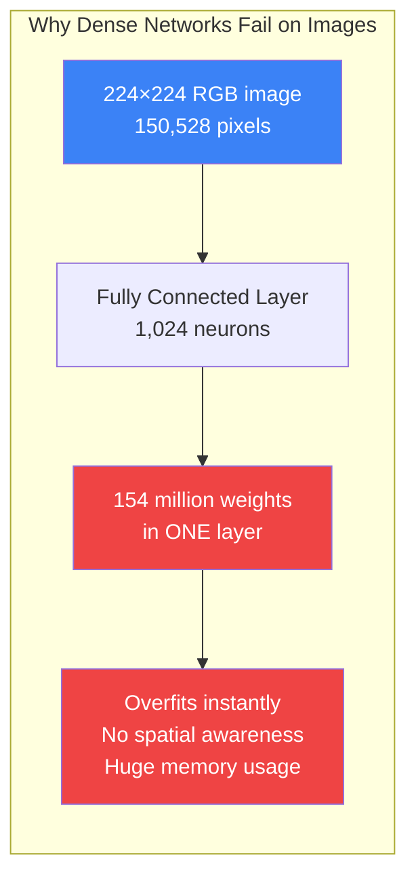

Three fatal problems:

1. **Too many parameters** — Overfits on small datasets, consumes enormous GPU memory
2. **No spatial structure** — Pixel (10, 10) has no special relationship to pixel (11, 10)
3. **Not translation invariant** — A cat in the top-left vs bottom-right looks completely different to the network

---

## Real-World Analogy: How Your Eyes Work

Your visual cortex processes images in a hierarchy — exactly how CNNs work:

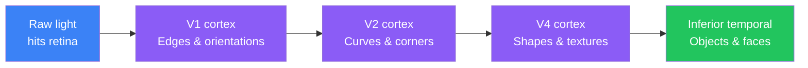

- Your eye does not see a "cat" — it sees brightness values
- V1 detects edges and orientations (horizontal lines, vertical lines)
- V2 combines edges into curves and corners
- V4 assembles curves into shapes and textures
- Inferior temporal cortex recognizes the complete object

**CNNs mirror this exact hierarchy** — early layers detect edges, middle layers detect shapes, deep layers detect complex objects.

---

## Why CNNs? The Three Key Properties

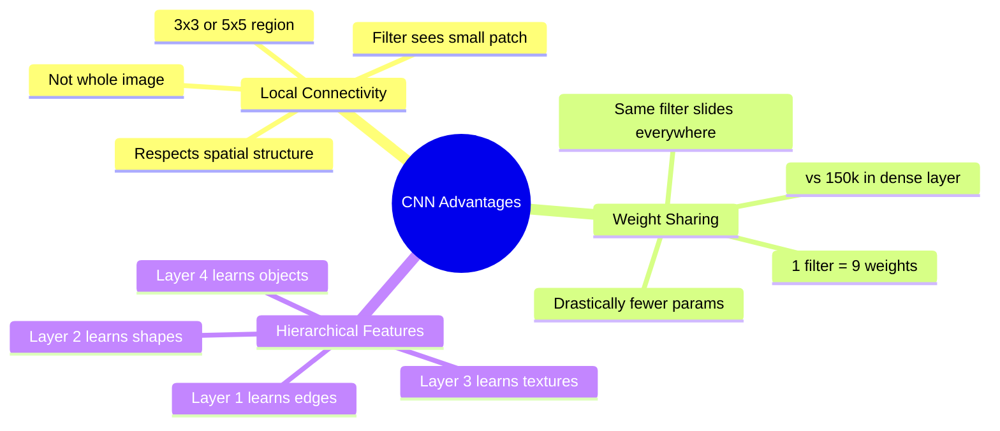

### 1. Local Connectivity

Instead of connecting every neuron to all 150,528 pixels, each filter only looks at a small **3×3 or 5×5 patch** at a time. A cat's ear looks like a cat's ear whether it's in the top-left or bottom-right corner.

### 2. Weight Sharing

One filter (9 weights for 3×3) slides across the **entire image**. The same edge-detector that finds a horizontal edge at position (10, 10) is reused at position (100, 200). This compresses 150k weights into just 9.

### 3. Hierarchical Feature Learning

Depth creates a feature hierarchy:

| Layer | What it sees |
|-------|-------------|
| Conv Layer 1 | Edges, color gradients |
| Conv Layer 2 | Corners, curves |
| Conv Layer 3 | Textures, patterns |
| Conv Layer 4 | Object parts (eyes, ears, wheels) |
| Conv Layer 5 | Full objects (cat, car, dog) |

---

## The Convolution Operation

A **filter** (also called a **kernel**) is a small matrix of learned weights that slides across the image and produces a **feature map**.

### Visualizing a 3×3 filter sliding over an image

```
Input Image (5×5):        3×3 Filter:
┌─────────────────┐       ┌──────────┐
│  1  2  3  0  1  │       │  1  0 -1 │
│  4  5  6  1  2  │       │  2  0 -2 │
│  7  8  9  0  1  │  -->  │  1  0 -1 │
│  0  1  2  3  4  │       └──────────┘
│  2  3  4  5  6  │       (Sobel edge detector)
└─────────────────┘

Step 1: Filter at top-left (position 0,0)       Step 2: Filter slides right (position 0,1)
┌─────────────────┐                             ┌─────────────────┐
│ [1  2  3] 0  1  │                             │  1 [2  3  0] 1  │
│ [4  5  6] 1  2  │   dot product = value       │  4 [5  6  1] 2  │
│ [7  8  9] 0  1  │   → placed in feature map   │  7 [8  9  0] 1  │
│  0  1  2  3  4  │                             │  0  1  2  3  4  │
│  2  3  4  5  6  │                             │  2  3  4  5  6  │
└─────────────────┘                             └─────────────────┘

Output Feature Map (3×3 for 5×5 input, 3×3 filter, stride 1):
┌──────────────┐
│  v00 v01 v02 │
│  v10 v11 v12 │
│  v20 v21 v22 │
└──────────────┘
Each value = element-wise multiply filter × patch, then sum all 9 values
```

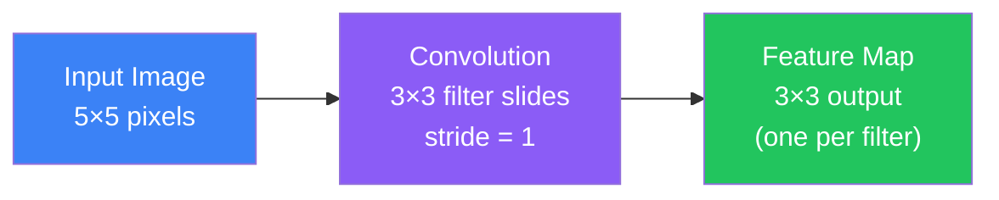

**Key terms:**
- **Stride**: How many pixels the filter moves each step (stride=1 → dense output, stride=2 → half-size output)
- **Padding**: Adding zeros around edges so output stays same size as input (`padding='same'` in Keras)
- **Depth**: Number of filters = number of feature maps in the output

---

## What Filters Detect

Filters are not hand-coded — **the network learns them automatically during training**. But conceptually, different filters specialize in different patterns:

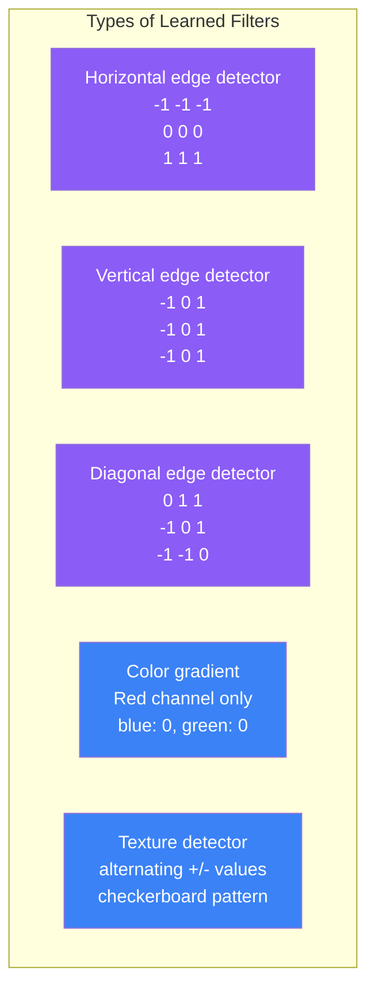

In practice:
- **Early CNN layers** learn filters that look like Gabor filters — detecting edges at various angles and colors
- **Middle layers** combine edges into corners and curves
- **Late layers** have filters that respond to dog faces, car tires, or eyes

---

## ReLU After Convolution

After every convolution, a **ReLU activation** is applied element-wise to the feature map:

```
ReLU(x) = max(0, x)
```

Negative values (representing "this edge is not here") are zeroed out. This adds non-linearity so the network can learn complex patterns beyond simple linear combinations.

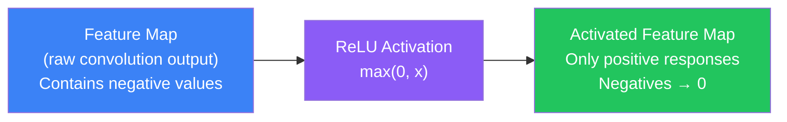

---

## Pooling Layers

Pooling **reduces the spatial size** of feature maps while retaining the most important information. This:

1. Reduces the number of parameters (smaller feature maps → fewer weights in later layers)
2. Adds **translation invariance** — a cat slightly shifted by 2 pixels still activates the same pooled value
3. Controls overfitting by forcing the network to focus on dominant features

### Max Pooling (most common)

Take the **maximum value** in each pooling window:

```
Input Feature Map (4×4):         After 2×2 Max Pooling (stride 2):
┌────────────────────┐            ┌──────────┐
│  1   3   2   4    │            │  3   4   │
│  5   6   1   2    │    →       │  8   9   │
│  3   2   8   1    │            └──────────┘
│  4   7   5   9    │
└────────────────────┘
Top-left 2×2: max(1,3,5,6) = 6   Wait... max(1,3,5,6) = 6 → Oh: top-left = 6
                                  but shown as 3 in top-left when stride=2
Actually:
  Top-left 2×2  → max(1,3,5,6) = 6
  Top-right 2×2 → max(2,4,1,2) = 4
  Bot-left 2×2  → max(3,2,4,7) = 7
  Bot-right 2×2 → max(8,1,5,9) = 9
```

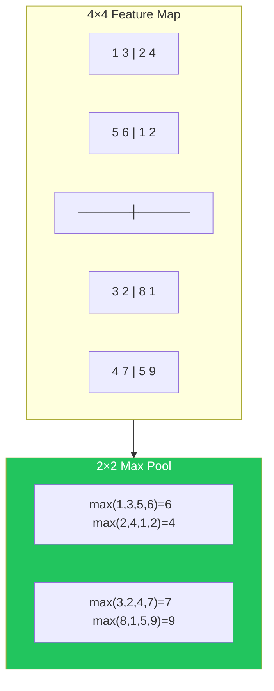

### Average Pooling

Take the **average** of each pooling window instead of the max. Less commonly used — max pooling tends to work better because the presence of a feature (large value) matters more than its average strength.

---

## Full CNN Architecture

```mermaid
flowchart LR
    IMG["Input Image\n32×32×3\n(cat or dog)"]
    C1["Conv Layer 1\n32 filters, 3×3\nLearns edges"]
    R1["ReLU"]
    P1["Max Pool 2×2\n16×16×32"]
    C2["Conv Layer 2\n64 filters, 3×3\nLearns shapes"]
    R2["ReLU"]
    P2["Max Pool 2×2\n8×8×64"]
    C3["Conv Layer 3\n128 filters, 3×3\nLearns textures"]
    R3["ReLU"]
    P3["Max Pool 2×2\n4×4×128"]
    FL["Flatten\n2048 values"]
    D1["Dense 256\nReLU"]
    OUT["Output\nSoftmax\nCat / Dog"]

    IMG --> C1 --> R1 --> P1 --> C2 --> R2 --> P2 --> C3 --> R3 --> P3 --> FL --> D1 --> OUT

    style IMG fill:#3b82f6,color:#fff
    style C1 fill:#8b5cf6,color:#fff
    style C2 fill:#8b5cf6,color:#fff
    style C3 fill:#8b5cf6,color:#fff
    style P1 fill:#3b82f6,color:#fff
    style P2 fill:#3b82f6,color:#fff
    style P3 fill:#3b82f6,color:#fff
    style FL fill:#3b82f6,color:#fff
    style D1 fill:#3b82f6,color:#fff
    style OUT fill:#22c55e,color:#fff
```

The network gets **spatially smaller but deeper** as we go right:
- 32×32×3 → 32×32×32 → 16×16×32 → 16×16×64 → 8×8×64 → 4×4×128 → 2048 → 256 → 2

---

## Famous CNN Architectures

| Architecture | Year | Layers | Key Innovation |
|-------------|------|--------|---------------|
| **LeNet-5** | 1998 | 7 | First practical CNN; MNIST handwriting recognition |
| **AlexNet** | 2012 | 8 | ReLU, dropout, GPU training; won ImageNet by 10% margin |
| **VGG-16** | 2014 | 16 | Deep + simple (all 3×3 filters); easy to understand |
| **ResNet-50** | 2015 | 50 | Skip connections (residual blocks); 152 layers possible |
| **EfficientNet** | 2019 | Variable | Systematic scaling of depth/width/resolution |

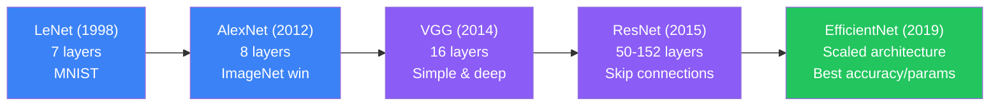

---

## Real-World Applications

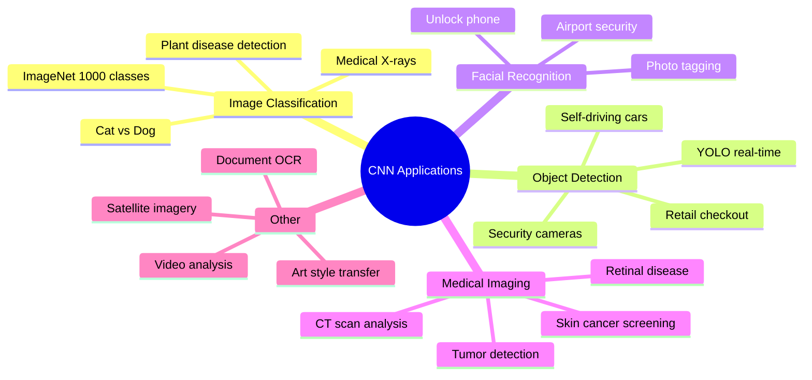

---

## Python Example: CNN for CIFAR-10 (Cat vs Dog Classification)

```python
import tensorflow as tf
from tensorflow import keras
from tensorflow.keras import layers
import numpy as np

# Load CIFAR-10 dataset (10 classes including cats and dogs)
(x_train, y_train), (x_test, y_test) = keras.datasets.cifar10.load_data()

# Normalize pixel values from [0, 255] to [0, 1]
x_train = x_train.astype("float32") / 255.0
x_test  = x_test.astype("float32") / 255.0

# Filter for just cats (class 3) and dogs (class 5)
def filter_cat_dog(x, y):
    mask = (y.squeeze() == 3) | (y.squeeze() == 5)
    x_filtered = x[mask]
    y_filtered = (y[mask].squeeze() == 5).astype("int32")  # 0=cat, 1=dog
    return x_filtered, y_filtered

x_train, y_train = filter_cat_dog(x_train, y_train)
x_test,  y_test  = filter_cat_dog(x_test,  y_test)

print(f"Training samples: {len(x_train)}")  # ~10,000
print(f"Test samples: {len(x_test)}")       # ~2,000
print(f"Image shape: {x_train[0].shape}")   # (32, 32, 3)

# Build CNN model
model = keras.Sequential([
    # --- Block 1: Detect edges ---
    layers.Conv2D(32, (3, 3), activation='relu', padding='same',
                  input_shape=(32, 32, 3)),
    layers.Conv2D(32, (3, 3), activation='relu', padding='same'),
    layers.MaxPooling2D(pool_size=(2, 2)),
    layers.Dropout(0.25),

    # --- Block 2: Detect shapes ---
    layers.Conv2D(64, (3, 3), activation='relu', padding='same'),
    layers.Conv2D(64, (3, 3), activation='relu', padding='same'),
    layers.MaxPooling2D(pool_size=(2, 2)),
    layers.Dropout(0.25),

    # --- Block 3: Detect textures ---
    layers.Conv2D(128, (3, 3), activation='relu', padding='same'),
    layers.MaxPooling2D(pool_size=(2, 2)),
    layers.Dropout(0.25),

    # --- Classifier head ---
    layers.Flatten(),
    layers.Dense(256, activation='relu'),
    layers.Dropout(0.5),
    layers.Dense(1, activation='sigmoid')  # Binary: cat=0, dog=1
])

model.summary()
# Total params: ~300k (vs ~154M for a dense network on 32×32 images)

# Compile
model.compile(
    optimizer='adam',
    loss='binary_crossentropy',
    metrics=['accuracy']
)

# Data augmentation to improve generalization
data_augmentation = keras.Sequential([
    layers.RandomFlip("horizontal"),
    layers.RandomRotation(0.1),
    layers.RandomZoom(0.1),
])

# Train
history = model.fit(
    x_train, y_train,
    batch_size=64,
    epochs=20,
    validation_data=(x_test, y_test),
    verbose=1
)

# Evaluate
test_loss, test_acc = model.evaluate(x_test, y_test)
print(f"\nTest accuracy: {test_acc:.2%}")  # ~75-80% (vs ~60% for dense network)

# Make a prediction
import numpy as np
sample = x_test[0:1]  # One image
prob = model.predict(sample)[0][0]
label = "Dog" if prob > 0.5 else "Cat"
print(f"Prediction: {label} (confidence: {prob:.2%})")
```

---

## Python Example: Visualizing What Filters Learn

```python
import tensorflow as tf
import numpy as np
import matplotlib.pyplot as plt

# Load a pretrained model and inspect its first layer filters
model = tf.keras.applications.VGG16(weights='imagenet', include_top=False)

# Get the first convolutional layer
first_layer = model.get_layer('block1_conv1')
filters, biases = first_layer.get_weights()

print(f"Filter shape: {filters.shape}")  # (3, 3, 3, 64) = 3x3 kernel, 3 channels, 64 filters

# Normalize filter values for visualization
f_min, f_max = filters.min(), filters.max()
filters_normalized = (filters - f_min) / (f_max - f_min)

# Plot first 16 filters
fig, axes = plt.subplots(4, 4, figsize=(8, 8))
for i, ax in enumerate(axes.flat):
    if i < 64:
        ax.imshow(filters_normalized[:, :, :, i])
        ax.axis('off')
        ax.set_title(f'Filter {i}')
plt.suptitle('VGG16 First Layer Filters\n(Edge & color detectors)')
plt.tight_layout()
plt.show()
# You will see Gabor-like patterns: horizontal edges, vertical edges,
# diagonal edges, color gradients — all learned from ImageNet data
```

---

## JavaScript Example: CNN for Image Classification with TensorFlow.js

```javascript
import * as tf from '@tensorflow/tfjs';
import '@tensorflow/tfjs-backend-webgl';

// Build a simple CNN for MNIST-style digit classification
function buildCNN() {
  const model = tf.sequential();

  // Conv block 1: detect edges in 28x28 grayscale image
  model.add(tf.layers.conv2d({
    inputShape: [28, 28, 1],   // height, width, channels
    filters: 32,
    kernelSize: 3,
    activation: 'relu',
    padding: 'same'
  }));
  model.add(tf.layers.maxPooling2d({ poolSize: [2, 2] }));

  // Conv block 2: detect shapes
  model.add(tf.layers.conv2d({
    filters: 64,
    kernelSize: 3,
    activation: 'relu',
    padding: 'same'
  }));
  model.add(tf.layers.maxPooling2d({ poolSize: [2, 2] }));

  // Classifier
  model.add(tf.layers.flatten());
  model.add(tf.layers.dense({ units: 128, activation: 'relu' }));
  model.add(tf.layers.dropout({ rate: 0.5 }));
  model.add(tf.layers.dense({ units: 10, activation: 'softmax' })); // 10 digits

  model.compile({
    optimizer: 'adam',
    loss: 'categoricalCrossentropy',
    metrics: ['accuracy']
  });

  return model;
}

const model = buildCNN();
model.summary();
// Total params: ~93k — tiny and runs in browser!

// Predict on a single 28x28 image
async function classifyDigit(imageData) {
  // imageData: Float32Array of 784 values (28x28 grayscale, normalized 0-1)
  const tensor = tf.tensor4d(imageData, [1, 28, 28, 1]);
  const prediction = model.predict(tensor);
  const probabilities = await prediction.data();

  const digit = probabilities.indexOf(Math.max(...probabilities));
  const confidence = probabilities[digit];

  tensor.dispose();
  prediction.dispose();

  return { digit, confidence: (confidence * 100).toFixed(1) + '%' };
}

// Using pretrained MobileNet for real images (transfer learning in browser)
async function classifyImage(imgElement) {
  const mobilenet = await tf.loadLayersModel(
    'https://tfhub.dev/google/tfjs-model/imagenet/mobilenet_v2_100_224/classification/3/default/1',
    { fromTFHub: true }
  );

  const tensor = tf.browser.fromPixels(imgElement)
    .resizeBilinear([224, 224])
    .expandDims(0)
    .div(255.0);

  const predictions = mobilenet.predict(tensor);
  const topClass = (await predictions.data()).indexOf(
    Math.max(...await predictions.data())
  );

  return topClass; // ImageNet class index
}
```

---

## Transfer Learning: Don't Train from Scratch

Training a CNN from scratch requires millions of images and days of GPU time. **Transfer learning** lets you reuse a pretrained model and adapt it to your specific task in minutes.

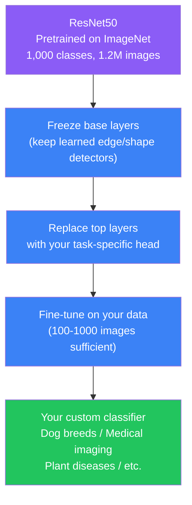

```python
import tensorflow as tf
from tensorflow import keras

# Load ResNet50 pretrained on ImageNet, without top classification layer
base_model = keras.applications.ResNet50(
    weights='imagenet',
    include_top=False,         # Remove ImageNet's 1000-class head
    input_shape=(224, 224, 3)
)

# Freeze base model weights — keep the learned features
base_model.trainable = False

# Add your custom head for binary cat vs dog
inputs = keras.Input(shape=(224, 224, 3))
x = base_model(inputs, training=False)  # Frozen base
x = keras.layers.GlobalAveragePooling2D()(x)
x = keras.layers.Dense(256, activation='relu')(x)
x = keras.layers.Dropout(0.5)(x)
outputs = keras.layers.Dense(1, activation='sigmoid')(x)

model = keras.Model(inputs, outputs)

model.compile(
    optimizer=keras.optimizers.Adam(learning_rate=1e-4),
    loss='binary_crossentropy',
    metrics=['accuracy']
)

# Train only the top layers — fast and effective even with small dataset
model.fit(x_train, y_train, epochs=5, validation_data=(x_test, y_test))
# Often reaches 90%+ accuracy with just a few hundred images!

# (Optional) Unfreeze and fine-tune the whole model at a lower learning rate
base_model.trainable = True
model.compile(optimizer=keras.optimizers.Adam(learning_rate=1e-5), ...)
model.fit(x_train, y_train, epochs=10, ...)
```

---

## Interview Questions

**Q1: What is a convolution operation in a CNN?**

> A convolution slides a small matrix of weights (the filter or kernel) across the input image. At each position, it computes the element-wise dot product between the filter and the image patch beneath it, producing a single output value. This value becomes one element of the output feature map. The result captures whether the pattern the filter encodes (e.g., a horizontal edge) is present at that location. The same filter weights are reused at every position — this is called weight sharing.

**Q2: What is a filter/kernel and what does it learn?**

> A filter is a small matrix (typically 3×3 or 5×5) of learnable weights. During training, filters automatically learn to detect specific low-level patterns. Early-layer filters tend to become edge detectors (horizontal edges, vertical edges, color gradients), similar to Gabor filters in image processing. Deeper-layer filters respond to higher-level patterns like textures, parts, or full objects. You do not manually design these filters — gradient descent learns them from data.

**Q3: What is the purpose of pooling layers?**

> Pooling layers reduce the spatial dimensions of feature maps (width and height), which: (1) reduces the number of parameters in subsequent layers, saving memory and computation; (2) provides translation invariance — a feature detected 2 pixels to the right still produces the same pooled output; (3) controls overfitting by progressively abstracting the representation. Max pooling (taking the maximum value in each region) is most common because the presence of a feature matters more than its average strength.

**Q4: Why use CNN for images instead of dense (fully-connected) layers?**

> Dense layers treat all input pixels as independent and unstructured. For a 224×224×3 image, the first dense layer alone would have 150,528 weights per neuron — ~154M weights for 1,024 neurons, causing massive overfitting on any realistic dataset. CNNs instead use local connectivity (each filter only sees a small patch), weight sharing (one filter reused across all positions), and hierarchical feature learning (edges → shapes → objects). This reduces parameters by 100-1000x while achieving far better accuracy because spatial structure is preserved.

**Q5: What is the difference between `padding='same'` and `padding='valid'`?**

> With `padding='valid'` (no padding), the filter cannot extend beyond the image border, so a 3×3 filter applied to a 5×5 image gives a 3×3 output (size decreases). With `padding='same'`, zeros are added around the image border so the output has the same spatial dimensions as the input — a 3×3 filter on a 5×5 image still gives a 5×5 output. `padding='same'` is preferred when you want to control size reduction explicitly through pooling rather than having convolutions shrink the feature maps.

---

## Best Practices

1. **Start with a pretrained model** — ResNet50, EfficientNet, or MobileNet pretrained on ImageNet almost always outperform a CNN trained from scratch unless you have millions of images
2. **Use data augmentation** — Random flips, rotations, zoom, and brightness jitter can double or triple effective dataset size and dramatically reduce overfitting
3. **Add Batch Normalization after Conv layers** — `layers.BatchNormalization()` after each Conv2D stabilizes training, allows higher learning rates, and often improves accuracy by 1-3%
4. **Use Global Average Pooling before Dense layers** — Replace `Flatten()` with `GlobalAveragePooling2D()` to reduce parameters and improve regularization
5. **Increase filters with depth** — Typical pattern: 32 → 64 → 128 → 256 filters as the network gets deeper and feature maps get smaller
6. **Monitor training vs validation accuracy** — If training accuracy >> validation accuracy, you are overfitting; add dropout, augmentation, or reduce model size

---

## Common Mistakes

- **Using Dense layers directly on images** — Ignores spatial structure and creates too many parameters; always use Conv2D for image data
- **Not using MaxPooling** — Without pooling, feature maps stay large, making deep networks computationally infeasible and prone to overfitting
- **Training from scratch on small datasets** — CNNs need millions of examples to learn good features; always use transfer learning when you have fewer than ~100,000 images
- **Using too large a kernel** — Large kernels (7×7, 11×11) are expensive; VGG showed that multiple 3×3 layers have the same receptive field as a single large kernel, with fewer parameters
- **Forgetting to normalize pixel values** — Feeding raw [0, 255] pixel values instead of [0, 1] or [-1, 1] causes unstable training and slow convergence
- **Using sigmoid instead of softmax for multi-class output** — Use `sigmoid` for binary, `softmax` for multi-class classification

---

## Summary

| Concept | Key Point |
|---------|-----------|
| **Why CNN** | Images have spatial structure; dense networks lose it and use 100x+ more parameters |
| **Convolution** | Filter slides across image computing dot products; produces a feature map |
| **Filter/Kernel** | Small weight matrix (3×3, 5×5) that detects a specific pattern; learned via backprop |
| **Feature Map** | Output of applying one filter to the input; shows where that pattern is strong |
| **ReLU** | Applied after each convolution; zeroes out negatives; adds non-linearity |
| **Max Pooling** | Takes max value in each region; shrinks size, keeps dominant features |
| **Weight Sharing** | One filter is reused across all image positions — drastically reduces params |
| **Local Connectivity** | Each filter sees only a small patch, not the whole image |
| **Hierarchical Features** | Early layers → edges; middle → shapes; deep → objects |
| **Transfer Learning** | Use pretrained CNN (ResNet, EfficientNet) and fine-tune on your data |
| **Data Augmentation** | Artificially expand dataset with flips, rotations, zooms |
| **Famous Architectures** | LeNet (1998) → AlexNet (2012) → VGG (2014) → ResNet (2015) → EfficientNet (2019) |

---

## Navigation

**Previous:** [12 — Optimizers](/ai/phase-03-deep-learning/12-optimizers)

**Next:** [14 — Recurrent Neural Networks (RNN)](/ai/phase-03-deep-learning/14-rnn)

**Related Topics:**
- [Layers in Neural Networks](/ai/phase-03-deep-learning/06-layers-in-neural-networks)
- [Activation Functions](/ai/phase-03-deep-learning/08-activation-functions)
- [Forward Propagation](/ai/phase-03-deep-learning/07-forward-propagation)

---

## Practice Exercises

1. Build a CNN from scratch in Keras for MNIST (28×28 grayscale digit images) — target 99%+ accuracy
2. Load a pretrained ResNet50 and fine-tune it on a binary cat/dog classifier using just 500 images per class
3. Visualize the feature maps after each Conv layer to see how the representation changes from edges to shapes
4. Add data augmentation to your CIFAR-10 model and measure the accuracy improvement
5. Compare parameter counts: a Dense network on 32×32×3 images vs a CNN — calculate and explain the difference
6. Implement max pooling manually in NumPy for a 4×4 input with a 2×2 window and stride 2
7. Use `model.get_layer('block1_conv1').get_weights()` on VGG16 to extract and visualize the first-layer filters

---

## Further Reading

- [CS231n: Convolutional Neural Networks for Visual Recognition](https://cs231n.stanford.edu/2024/schedule.html)
- [Deep Learning with Python — François Chollet (Chapter 8)](https://www.manning.com/books/deep-learning-with-python-second-edition)
- [TensorFlow: Image classification tutorial](https://www.tensorflow.org/tutorials/images/classification)
- [PyTorch: Training a CNN on CIFAR-10](https://pytorch.org/tutorials/beginner/blitz/cifar10_tutorial.html)
- [Fast.ai: Practical Deep Learning for Coders (Lesson 1)](https://course.fast.ai/)
- [Transfer learning with pretrained CNNs — TensorFlow guide](https://www.tensorflow.org/guide/keras/transfer_learning)
- [EfficientNet: Rethinking Model Scaling for CNNs (original paper)](https://arxiv.org/abs/1905.11946)
