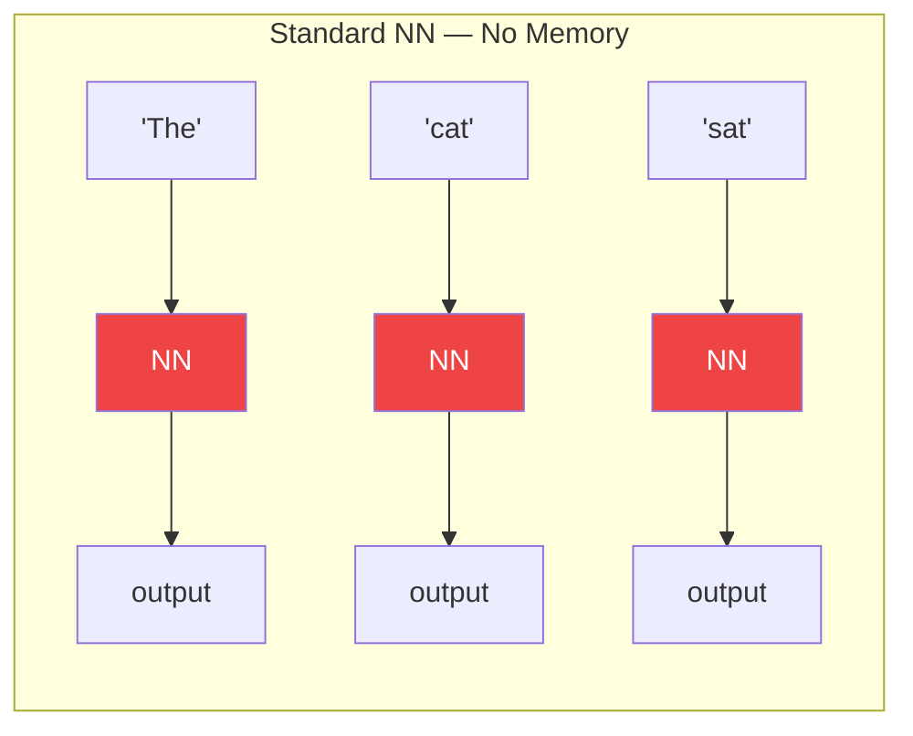
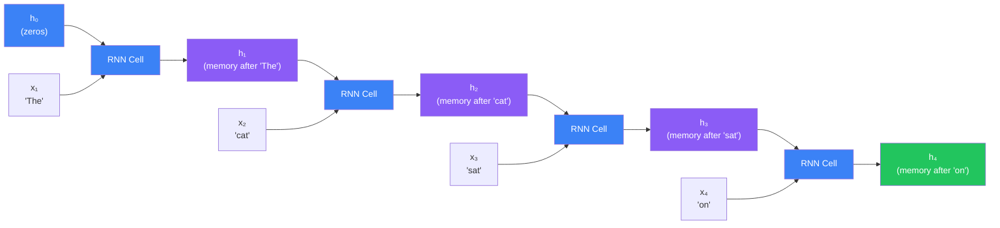
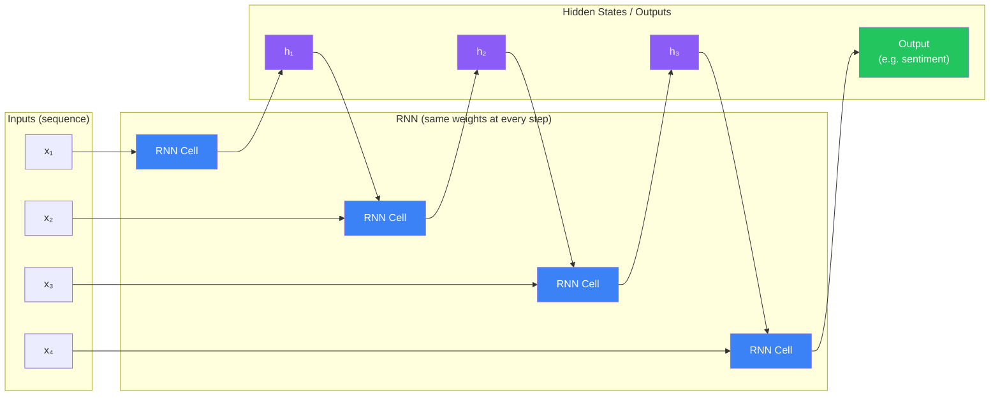
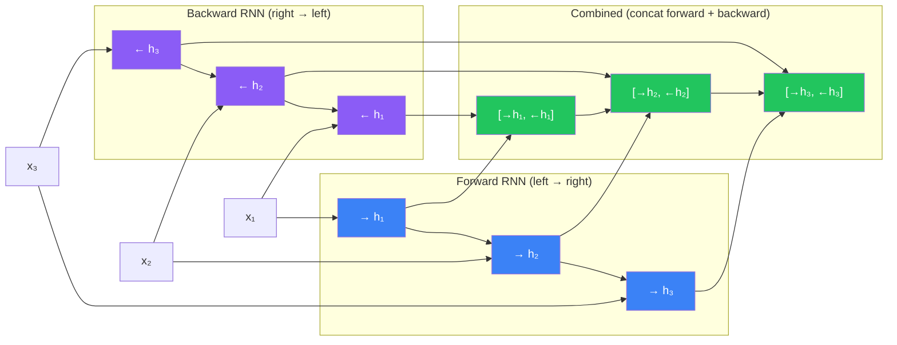
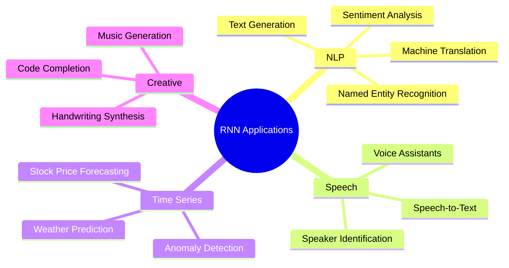
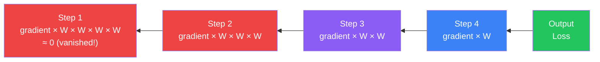
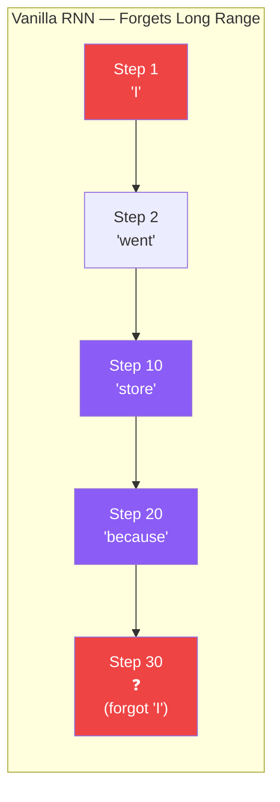

## Introduction

> **A Recurrent Neural Network (RNN) is a neural network with memory — it processes sequences by passing a hidden state forward through time, so each step knows what came before it.**

Standard neural networks look at one input at a time and forget everything else. RNNs are different: they remember. They read sequences step by step and carry context forward, making them the go-to architecture for language, speech, time series, and anything where **order matters**.

---

## Why Regular Neural Networks Fail at Sequences

Consider these examples where position and order are everything:

- **"The cat sat on the mat"** — understanding "mat" requires knowing "cat" came before
- **Stock prices** — tomorrow's price depends on the last 30 days of movement
- **Speech recognition** — "I scream" vs "ice cream" sound identical without context

A standard (feedforward) neural network sees each input **independently**. It has no concept of "what came before." Feed it word by word and it treats each word as if it appeared from nowhere.



Each word is processed in isolation — no information flows from one timestep to the next. The model cannot learn that "sat" follows "cat" in a sentence.

---

## Real-World Analogy

Imagine reading a mystery novel. As you read each new sentence, you don't forget everything you read before. You carry forward clues, character names, and plot details. When a new clue appears on page 200, your understanding is shaped by 199 pages of context.

An RNN works exactly the same way:

- **Each word/timestep** = reading a new sentence
- **Hidden state** = your memory of what you read so far
- **Output** = your understanding at this moment

The "memory" is updated at every step, passed forward, and influences how the next input is interpreted.

---

## The Hidden State: RNN's Memory

The core innovation of an RNN is the **hidden state** `h_t`. At every timestep `t`:

- Take the current input `x_t` (e.g., the current word)
- Combine it with the previous hidden state `h_{t-1}` (memory of what came before)
- Produce a new hidden state `h_t` that represents updated memory

```
h_t = tanh(W_h · h_{t-1} + W_x · x_t + b)
```

The same weights (`W_h`, `W_x`) are reused at every timestep — this is called **weight sharing in time**.



The green `h₄` carries context from all four words — it is the accumulated "memory" of the entire sequence so far.

---

## RNN Unrolled Through Time

The same single RNN cell is applied repeatedly — once per timestep. "Unrolling" means drawing out each application in sequence:



Key insight: **the weights are shared across all timesteps**. There is only one RNN cell — it is just applied repeatedly. This allows the network to generalize to sequences of any length.

---

## Types of RNN Architectures

Depending on the task, RNNs can be structured in five main patterns:

```mermaid
graph TD
    subgraph One2One["One-to-One\n(Not really RNN)\nStandard NN"]
        A1["Input"] --> A2["Output"]
    end

    subgraph One2Many["One-to-Many\nImage Captioning"]
        B1["Image"] --> B2["word1"] --> B3["word2"] --> B4["word3"]
    end

    subgraph Many2One["Many-to-One\nSentiment Analysis"]
        C1["word1"] --> C2["word2"] --> C3["word3"] --> C4["Positive / Negative"]
    end

    subgraph Many2Many_Same["Many-to-Many (same length)\nVideo Frame Classification"]
        D1["frame1"] --> D2["frame2"] --> D3["frame3"]
        D1 --> E1["class1"]
        D2 --> E2["class2"]
        D3 --> E3["class3"]
    end

    subgraph Many2Many_Diff["Many-to-Many (different length)\nMachine Translation"]
        F1["Bonjour"] --> F2["le"] --> F3["monde"] --> F4["Hello"] --> F5["world"]
    end

    style A1 fill:#3b82f6,color:#fff
    style A2 fill:#22c55e,color:#fff
    style B1 fill:#8b5cf6,color:#fff
    style B2 fill:#22c55e,color:#fff
    style B3 fill:#22c55e,color:#fff
    style B4 fill:#22c55e,color:#fff
    style C1 fill:#3b82f6,color:#fff
    style C2 fill:#3b82f6,color:#fff
    style C3 fill:#3b82f6,color:#fff
    style C4 fill:#22c55e,color:#fff
    style F1 fill:#3b82f6,color:#fff
    style F2 fill:#3b82f6,color:#fff
    style F3 fill:#3b82f6,color:#fff
    style F4 fill:#22c55e,color:#fff
    style F5 fill:#22c55e,color:#fff
```



| Architecture | Input | Output | Real Example |
|---|---|---|---|
| One-to-One | Single | Single | Image classification (not RNN) |
| One-to-Many | Single | Sequence | Image captioning |
| Many-to-One | Sequence | Single | Sentiment analysis |
| Many-to-Many (same) | Sequence | Sequence (same length) | POS tagging, video classification |
| Many-to-Many (different) | Sequence | Sequence (different length) | Machine translation (seq2seq) |

---

## Bidirectional RNN

A standard RNN only reads left to right. But for understanding text, the future context is just as important as the past:

- "The **bank** can guarantee deposits will cover future tuition costs." — bank = financial
- "She sat by the river **bank**." — bank = riverbank

To resolve this ambiguity, a **Bidirectional RNN** runs two RNNs in parallel: one forward, one backward.



Each output position now has context from **both directions** — it sees what came before and what comes after. This is especially powerful for NLP tasks like named entity recognition and question answering.

---

## Real-World Applications



**Sentiment Analysis (Many-to-One):** Read a movie review word by word → output "Positive" or "Negative"

**Machine Translation (Many-to-Many):** Read an English sentence → output a French sentence of different length

**Speech Recognition (Many-to-Many):** Read audio frames → output text characters

**Time Series Forecasting (Many-to-One):** Read 30 days of stock prices → predict tomorrow's price

---

## The Vanishing Gradient Problem

Here is the biggest weakness of vanilla RNNs. During training, gradients must flow **backwards through time** (Backpropagation Through Time — BPTT). For each step backwards, the gradient is multiplied by the same weights repeatedly.



If the weights are small (< 1), multiplying them repeatedly causes the gradient to shrink exponentially. Early timesteps receive a gradient of nearly **zero** — the network effectively forgets long-range dependencies.

**Analogy:** Imagine passing a whisper down a line of 50 people. By the time it reaches the last person, the original message is gone.

**Consequences:**
- RNN "forgets" what happened many steps ago
- Cannot learn dependencies spanning more than ~10 timesteps
- Long sequences (paragraphs, long audio) are impossible to handle

**This is exactly why LSTM was invented.** LSTM uses gates to control what to remember and what to forget, solving the vanishing gradient problem.



---

## Python: Sentiment Analysis with SimpleRNN (Keras)

```python
import tensorflow as tf
import numpy as np

# Load IMDB movie review dataset — 25,000 reviews, labeled positive/negative
(x_train, y_train), (x_test, y_test) = tf.keras.datasets.imdb.load_data(
    num_words=10000  # Keep only the 10,000 most common words
)

# Pad sequences to equal length (RNNs need consistent batch shapes)
maxlen = 200
x_train = tf.keras.preprocessing.sequence.pad_sequences(x_train, maxlen=maxlen)
x_test  = tf.keras.preprocessing.sequence.pad_sequences(x_test,  maxlen=maxlen)

# Build the RNN model
model = tf.keras.Sequential([
    # Turn word indices into dense vectors (each word → 32-dim embedding)
    tf.keras.layers.Embedding(input_dim=10000, output_dim=32, input_length=maxlen),

    # SimpleRNN layer: 64 hidden units, returns a single output (not full sequence)
    tf.keras.layers.SimpleRNN(64),

    # Dropout to prevent overfitting
    tf.keras.layers.Dropout(0.5),

    # Binary classification — positive or negative review
    tf.keras.layers.Dense(1, activation='sigmoid')
])

model.compile(
    optimizer='adam',
    loss='binary_crossentropy',
    metrics=['accuracy']
)

model.summary()
# Total params: ~640,000

# Train
history = model.fit(
    x_train, y_train,
    epochs=5,
    batch_size=128,
    validation_split=0.2
)

# Evaluate
test_loss, test_acc = model.evaluate(x_test, y_test)
print(f"Test Accuracy: {test_acc:.4f}")
# Typical result: ~75-80% (vanilla RNN — LSTM achieves ~88%)

# Predict on a new review
word_index = tf.keras.datasets.imdb.get_word_index()

def encode_review(text):
    tokens = text.lower().split()
    encoded = [word_index.get(word, 2) + 3 for word in tokens]
    return tf.keras.preprocessing.sequence.pad_sequences([encoded], maxlen=maxlen)

review = "This movie was absolutely fantastic and I loved every minute of it"
prediction = model.predict(encode_review(review))[0][0]
print(f"Sentiment: {'Positive' if prediction > 0.5 else 'Negative'} ({prediction:.2%} confident)")
```

---

## Python: Bidirectional RNN for Better NLP

```python
import tensorflow as tf

# Bidirectional LSTM (built on RNN concept — reads both directions)
model_bidir = tf.keras.Sequential([
    tf.keras.layers.Embedding(input_dim=10000, output_dim=64, input_length=200),

    # Bidirectional wraps any RNN layer — doubles the hidden units in output
    tf.keras.layers.Bidirectional(tf.keras.layers.SimpleRNN(64)),

    tf.keras.layers.Dropout(0.5),
    tf.keras.layers.Dense(1, activation='sigmoid')
])

model_bidir.compile(optimizer='adam', loss='binary_crossentropy', metrics=['accuracy'])
# The bidirectional layer output size = 64 * 2 = 128 (forward + backward concatenated)
print(model_bidir.summary())

# Returning the full sequence — useful for sequence labeling tasks
model_seq = tf.keras.Sequential([
    tf.keras.layers.Embedding(input_dim=10000, output_dim=32, input_length=200),

    # return_sequences=True returns h_t at EVERY timestep, not just the last one
    tf.keras.layers.SimpleRNN(64, return_sequences=True),

    # Stack another RNN on top
    tf.keras.layers.SimpleRNN(32),

    tf.keras.layers.Dense(1, activation='sigmoid')
])
```

---

## Python: Time Series Prediction with RNN

```python
import numpy as np
import tensorflow as tf

# Generate a simple sine wave time series
t = np.linspace(0, 100, 1000)
series = np.sin(t) + 0.1 * np.random.randn(1000)  # Noisy sine wave

# Create sliding window dataset
# Use 30 past values to predict the next value
def create_sequences(data, window=30):
    X, y = [], []
    for i in range(len(data) - window):
        X.append(data[i:i+window])
        y.append(data[i+window])
    return np.array(X), np.array(y)

X, y = create_sequences(series, window=30)
X = X.reshape(X.shape[0], X.shape[1], 1)  # Shape: (samples, timesteps, features)

# Train/test split
split = int(0.8 * len(X))
X_train, X_test = X[:split], X[split:]
y_train, y_test = y[:split], y[split:]

# Build RNN for time series
model = tf.keras.Sequential([
    tf.keras.layers.SimpleRNN(50, activation='tanh', input_shape=(30, 1)),
    tf.keras.layers.Dense(1)  # Predict next value (regression)
])

model.compile(optimizer='adam', loss='mse')
model.fit(X_train, y_train, epochs=20, batch_size=32, validation_split=0.1)

# Predict
predictions = model.predict(X_test)
mse = np.mean((predictions.flatten() - y_test) ** 2)
print(f"Test MSE: {mse:.6f}")
```

---

## JavaScript: Simple Sequence Prediction (TensorFlow.js)

```javascript
import * as tf from '@tensorflow/tfjs';

// Generate a simple repeating pattern: [1, 2, 3, 4, 5, 1, 2, 3, 4, 5, ...]
function generateSequence(length) {
  return Array.from({ length }, (_, i) => (i % 5) + 1);
}

// Create training pairs: given 4 numbers, predict the 5th
function createDataset(seq, windowSize = 4) {
  const X = [], y = [];
  for (let i = 0; i < seq.length - windowSize; i++) {
    X.push(seq.slice(i, i + windowSize).map(v => [v / 5])); // Normalize
    y.push(seq[i + windowSize] / 5);
  }
  return {
    X: tf.tensor3d(X),       // Shape: [samples, timesteps, features]
    y: tf.tensor1d(y)        // Shape: [samples]
  };
}

const sequence = generateSequence(200);
const { X, y } = createDataset(sequence);

// Build simple RNN model
const model = tf.sequential({
  layers: [
    tf.layers.simpleRNN({
      units: 32,
      inputShape: [4, 1],   // 4 timesteps, 1 feature each
      activation: 'tanh'
    }),
    tf.layers.dense({ units: 1, activation: 'sigmoid' })
  ]
});

model.compile({ optimizer: 'adam', loss: 'meanSquaredError' });

// Train
async function train() {
  await model.fit(X, y, {
    epochs: 50,
    batchSize: 16,
    callbacks: {
      onEpochEnd: (epoch, logs) => {
        if (epoch % 10 === 0) {
          console.log(`Epoch ${epoch}: loss = ${logs.loss.toFixed(4)}`);
        }
      }
    }
  });

  // Predict: given [1, 2, 3, 4], should predict 5
  const input = tf.tensor3d([[[0.2], [0.4], [0.6], [0.8]]]);
  const prediction = model.predict(input);
  const predictedValue = (await prediction.data())[0] * 5;
  console.log(`Prediction (expect ~5): ${predictedValue.toFixed(2)}`);
}

train();
```

---

## Interview Questions

**Q1: What is a Recurrent Neural Network?**

> An RNN is a neural network designed for sequential data. Unlike feedforward networks that process each input independently, RNNs maintain a hidden state that is updated at each timestep and carries information from previous steps forward. This "memory" allows RNNs to model dependencies between elements in a sequence — like words in a sentence or frames in a video.

**Q2: What is the hidden state in an RNN?**

> The hidden state `h_t` is the RNN's memory at timestep `t`. It is a vector computed from two sources: the current input `x_t` and the previous hidden state `h_{t-1}`. The formula is `h_t = tanh(W_h · h_{t-1} + W_x · x_t + b)`. The hidden state accumulates information about the entire sequence seen so far and is passed to the next timestep. The final hidden state is often used as a fixed-size representation of the whole sequence.

**Q3: What is the vanishing gradient problem and why does it affect RNNs?**

> During backpropagation through time (BPTT), gradients must flow backwards through every timestep. At each step, the gradient is multiplied by the recurrent weight matrix. If those weights are less than 1, the gradient shrinks exponentially — becoming essentially zero by the time it reaches early timesteps. This means early inputs in a long sequence have almost no influence on the weight updates, so the RNN cannot learn long-range dependencies. This is why LSTM and GRU were invented — they use gating mechanisms to preserve gradients across hundreds of timesteps.

**Q4: What is a bidirectional RNN and when would you use it?**

> A bidirectional RNN runs two separate RNNs on the same sequence: one left-to-right (forward) and one right-to-left (backward). Their hidden states are concatenated at each timestep, giving every output access to both past and future context. Use bidirectional RNNs for tasks where the full sequence is available at inference time — sentiment analysis, named entity recognition, machine translation encoding, question answering. Do not use them for real-time/streaming tasks where future input is unavailable, like live speech recognition or text generation.

**Q5: What is the difference between `return_sequences=True` and `return_sequences=False`?**

> With `return_sequences=False` (default), the RNN returns only the final hidden state — a single vector summarizing the whole sequence. Use this for many-to-one tasks like sentiment classification. With `return_sequences=True`, the RNN returns the hidden state at every timestep — a sequence of vectors. Use this when you need per-token output (NER, translation encoding) or when stacking RNN layers (the next RNN layer needs a sequence as input, not a single vector).

**Q6: What is weight sharing in RNNs?**

> In an RNN, the same set of weights (`W_h`, `W_x`, `b`) is used at every timestep. This is called weight sharing in time. It means the RNN has the same number of parameters regardless of the sequence length — a huge advantage. The model that processes "The" in position 1 uses identical weights to the model processing "mat" in position 6. This also means the RNN can generalize to sequences longer than those seen during training.

---

## Best Practices

1. **Use LSTM or GRU instead of vanilla RNN** for most real tasks — SimpleRNN suffers from vanishing gradients on sequences longer than ~10 steps; LSTM/GRU are almost always better choices
2. **Pad and mask sequences** — use `tf.keras.preprocessing.sequence.pad_sequences` plus a `Masking` layer so the model ignores padding tokens
3. **Normalize your inputs** — scale sequences to zero mean and unit variance; unnormalized data slows convergence dramatically
4. **Use bidirectional RNNs for NLP** — whenever the full sequence is available upfront, bidirectional models consistently outperform unidirectional ones
5. **Start with `return_sequences=False`** — only switch to `True` if you need per-timestep outputs or are stacking multiple RNN layers
6. **Use gradient clipping** — set `clipnorm=1.0` in your optimizer to prevent exploding gradients, which are the other side of the vanishing gradient coin
7. **Limit sequence length** — very long sequences are slow and prone to gradient issues; use truncation or chunking strategies

---

## Common Mistakes

- **Using vanilla SimpleRNN for long sequences** — vanishing gradients make this essentially useless beyond ~10-20 timesteps; always switch to LSTM or GRU for longer sequences
- **Not padding sequences to the same length** — RNNs in Keras require inputs of equal length within a batch; always call `pad_sequences` before training
- **Forgetting to reshape input for time series** — RNN expects shape `(samples, timesteps, features)`; a common error is feeding `(samples, timesteps)` which causes dimension errors
- **Using bidirectional RNN for autoregressive generation** — during text generation you produce one token at a time and the future is unknown; bidirectional is impossible here
- **Stacking too many RNN layers** — deep stacked RNNs are hard to train and rarely outperform a single well-tuned LSTM; start with 1-2 layers
- **Not using `Masking` layer with padded data** — without masking, the model trains on padding zeros as if they were real data, harming performance

---

## Summary

| Concept | Key Point |
|---|---|
| RNN | Neural network with a loop — processes sequences step by step, passing hidden state forward |
| Hidden state `h_t` | The RNN's memory — updated at each step using current input + previous memory |
| Weight sharing | Same weights used at every timestep — allows handling variable-length sequences |
| One-to-Many | Single input → sequence output (e.g. image captioning) |
| Many-to-One | Sequence input → single output (e.g. sentiment analysis) |
| Many-to-Many | Sequence input → sequence output (e.g. translation, video labeling) |
| Bidirectional RNN | Two RNNs reading forward and backward — captures both past and future context |
| Vanishing gradient | Gradients shrink exponentially through many timesteps — RNN forgets long-range info |
| BPTT | Backpropagation Through Time — the algorithm used to train RNNs |
| LSTM / GRU | Gated RNN variants that solve the vanishing gradient problem |
| `return_sequences` | `False` = return last hidden state only; `True` = return all hidden states |
| Padding | Sequences must be equal length in a batch — pad shorter ones with zeros |

---

## Navigation

**Previous:** [13 — Convolutional Neural Networks (CNN)](/ai/phase-03-deep-learning/13-cnn)

**Next:** [15 — Long Short-Term Memory (LSTM)](/ai/phase-03-deep-learning/15-lstm)

**Related Topics:**
- [Long Short-Term Memory (LSTM)](/ai/phase-03-deep-learning/15-lstm)
- [Gated Recurrent Units (GRU)](/ai/phase-03-deep-learning/16-gru)
- [Attention Mechanism](/ai/phase-03-deep-learning/17-attention-mechanism)
- [Neural Networks](/ai/phase-03-deep-learning/03-neural-networks)

---

## Practice Exercises

1. Build a SimpleRNN that predicts the next number in the sequence `[1, 2, 3, 4, 5, 1, 2, 3, ...]` — verify it learns the pattern
2. Train a sentiment classifier on IMDB with SimpleRNN, then swap to LSTM — compare accuracy and training time
3. Visualize the hidden state values over time for a short sentence — see how they change as each word is processed
4. Add a `Masking` layer to the IMDB model and pad sequences differently — verify accuracy improves
5. Build a bidirectional RNN sentiment model — compare it to the unidirectional version on validation accuracy
6. Intentionally create a very long sequence (500+ steps) and observe how vanilla RNN's loss fails to converge vs LSTM
7. Use `return_sequences=True` to stack two RNN layers — observe the output shapes at each layer
