## Introduction

> **LSTM (Long Short-Term Memory) is a special type of RNN with a built-in gating mechanism that decides what to remember, what to forget, and what to output — allowing it to learn dependencies across hundreds of timesteps.**

Standard RNNs forget the past too quickly. LSTMs fix this by carrying two memory streams through time: a long-term **cell state** and a short-term **hidden state**, controlled by three learned gates.

---

## Why RNN Failed: The Vanishing Gradient Problem

Imagine reading a book and trying to answer a question about page 1 while on page 50. A standard RNN can't do this — its "memory" evaporates over time.

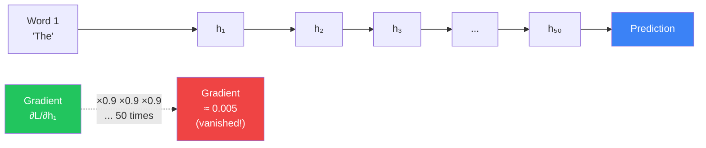

When backpropagating through 50 timesteps, gradients are multiplied by a small number at every step. By step 50, the gradient is nearly zero — the network can't learn long-range patterns.

**The result:** RNN can only remember the last ~10 timesteps reliably. Sentence context, paragraph meaning, musical themes — all out of reach.

---

## Real-World Analogy: The Notepad

Think of LSTM as a person with a **notepad** (cell state) and three decisions to make at every moment:

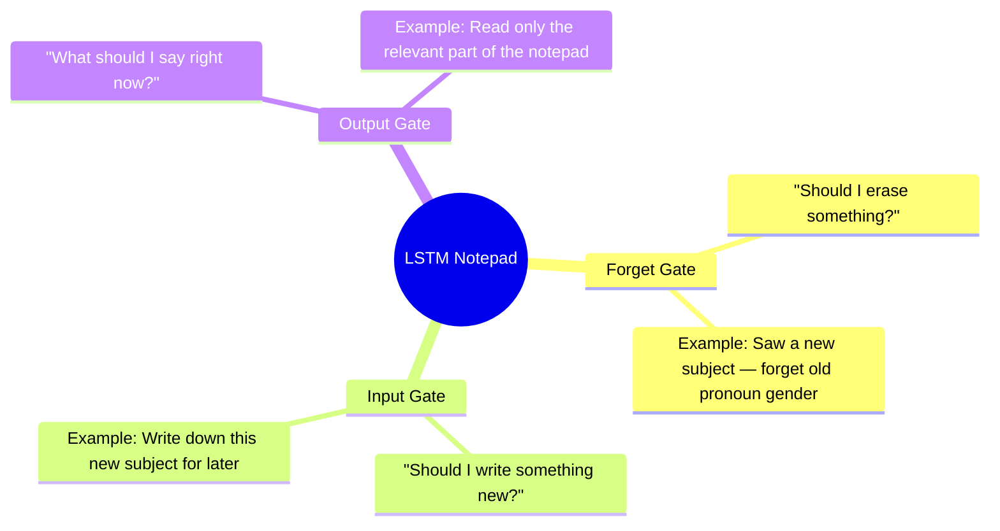

- The **notepad** (cell state) persists across time — information stays unless explicitly erased.
- Each gate is a small neural network that learns when to open or close based on context.
- Gates output values between 0 (fully closed, nothing passes) and 1 (fully open, everything passes).

---

## The 3 Gates Explained

### Gate 1: Forget Gate — "What to Erase"

The forget gate looks at the previous hidden state `h_(t-1)` and the current input `x_t`, then outputs a number between 0 and 1 for each piece of the cell state.

- **0** = completely erase this memory
- **1** = completely keep this memory

**Example:** In the sentence *"The cat sat. Then the dog..."*, when the LSTM encounters "dog", the forget gate learns to erase the gender information associated with "cat" so pronouns later refer to the right subject.

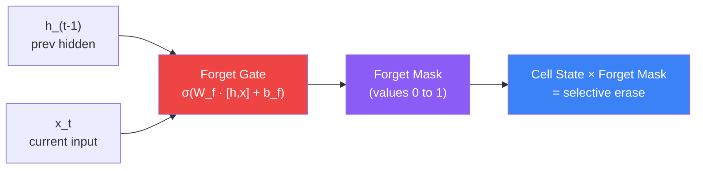

### Gate 2: Input Gate — "What to Write"

The input gate decides which new information to add to the cell state. It works in two parts:

1. **Input gate sigmoid** — Which values to update (0 to 1)?
2. **Candidate values (tanh)** — What new values could be written (-1 to 1)?

The cell state update is: `C_t = (Forget × C_(t-1)) + (Input gate × Candidate)`

**Example:** After seeing "dog", the input gate writes new information: "current subject is dog, masculine singular".

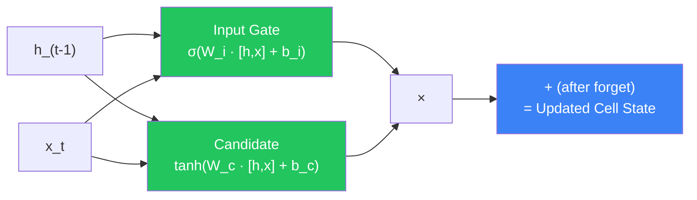

### Gate 3: Output Gate — "What to Say"

The output gate decides what part of the (now updated) cell state to expose as the hidden state `h_t` — the short-term output used by the next layer or the final prediction.

**Example:** For next-word prediction, the output gate exposes only information relevant to predicting the next word, not every fact stored in the cell state.

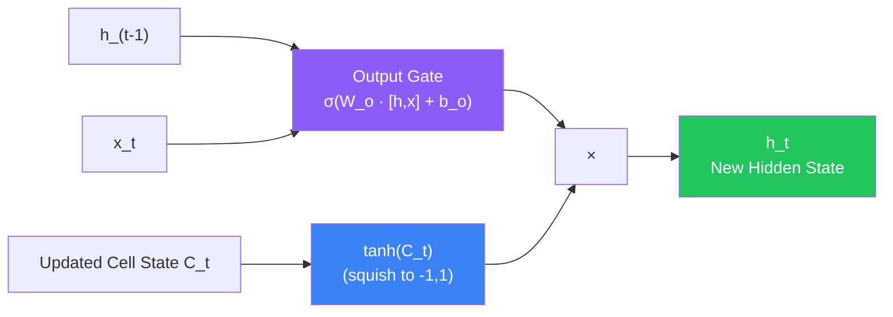

---

## Cell State: The Long-Term Memory Highway

The cell state `C_t` is LSTM's most important innovation. It runs like a conveyor belt through the entire sequence, with only small, deliberate changes made by the gates.

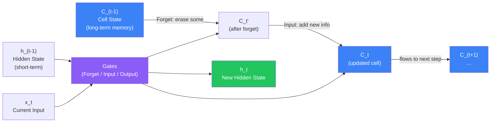

**Why does this solve vanishing gradients?**

Because the cell state uses **addition** to update, not multiplication. During backpropagation, gradients flow through the addition operation without shrinking. The gradient highway stays open across hundreds of timesteps.

| | RNN | LSTM |
|--|-----|------|
| State update | Multiply by matrix → squash | Add gate-controlled updates |
| Gradient flow | Multiplied at every step → vanishes | Flows through additions → preserved |
| Memory span | ~10–20 timesteps | Hundreds of timesteps |

---

## Full LSTM Cell Diagram

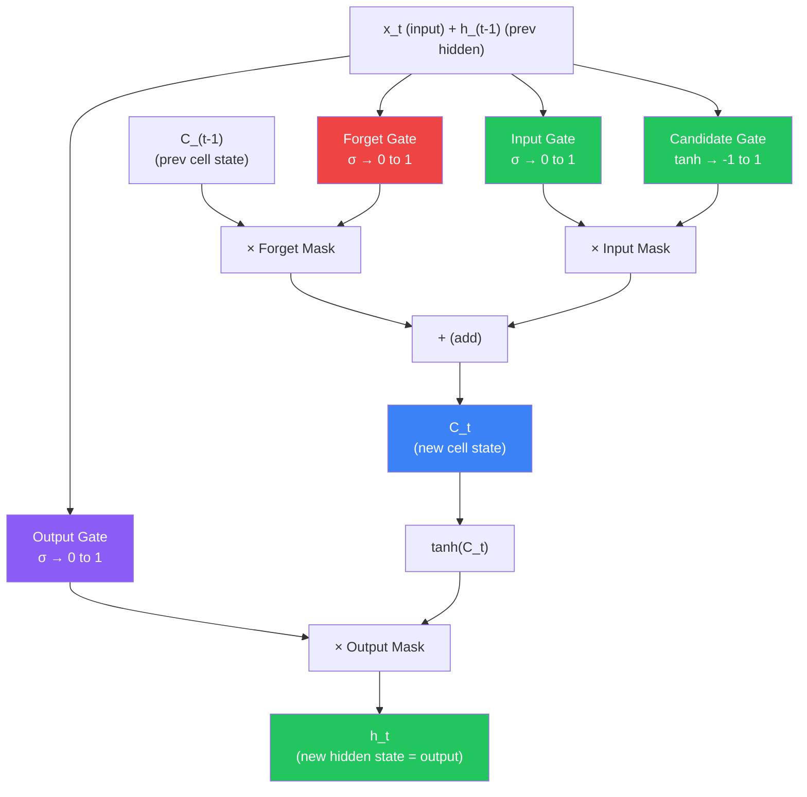

---

## LSTM Unrolled Over Time

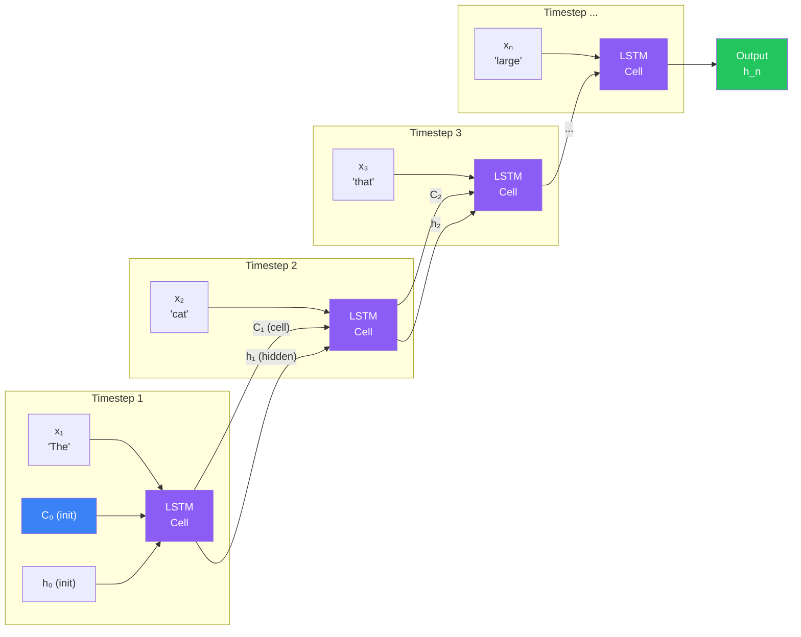

Both `C_t` (cell state) and `h_t` (hidden state) pass between every timestep. The cell state carries long-term information; the hidden state carries what's immediately relevant.

---

## What LSTM Can Learn That RNN Cannot

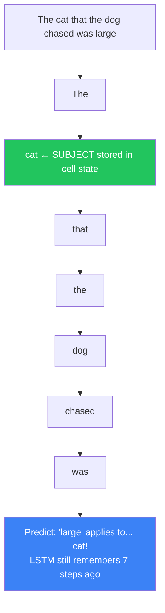

**LSTM excels at:**
- Long sentences with nested clauses
- Code completion (matching brackets 100 chars back)
- Music generation (remembering a theme introduced 16 bars ago)
- Time series (remembering a trend from days/weeks earlier)

---

## Bidirectional LSTM

A standard LSTM reads left-to-right. A **Bidirectional LSTM** reads in both directions simultaneously and concatenates the results.

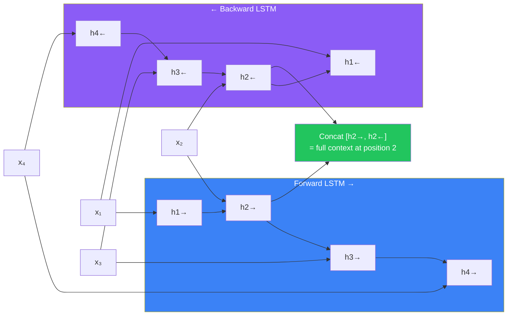

**Why?** At word position 2, a forward LSTM only knows words 1–2. A backward LSTM also knows words 3 and 4. Combining both gives full context — critical for NLP tasks like named entity recognition.

**Used in:** BERT's predecessor (ELMo), Named Entity Recognition, Part-of-Speech tagging.

---

## Stacked LSTM

Multiple LSTM layers stacked on top of each other learn increasingly abstract representations.

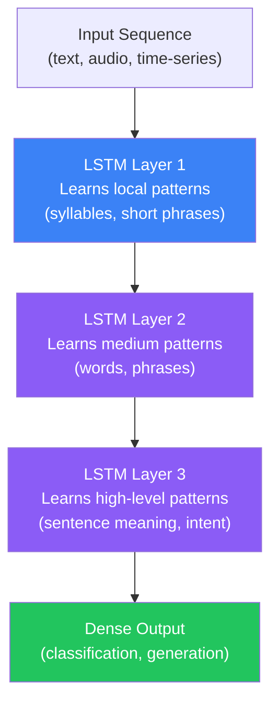

Typical stack depth: 2–4 layers. More than that rarely helps and significantly slows training.

---

## Real-World Applications

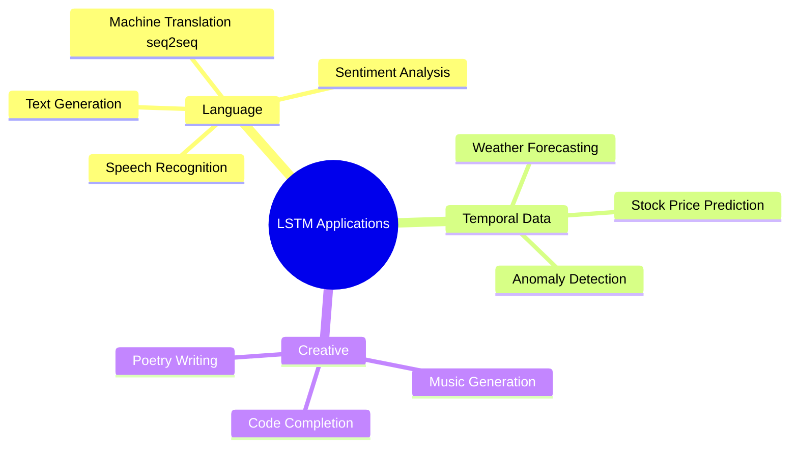

---

## Python: LSTM Text Generation (Keras)

```python
import numpy as np
import tensorflow as tf
from tensorflow import keras

# --- Character-level text generation ---
text = """
To be or not to be that is the question
Whether tis nobler in the mind to suffer
The slings and arrows of outrageous fortune
Or to take arms against a sea of troubles
""".lower()

# Build character vocabulary
chars = sorted(set(text))
char_to_idx = {c: i for i, c in enumerate(chars)}
idx_to_char = {i: c for c, i in char_to_idx.items()}
vocab_size = len(chars)

# Create sequences: predict next character from 40-char window
seq_length = 40
step = 3
X, y = [], []
for i in range(0, len(text) - seq_length, step):
    X.append([char_to_idx[c] for c in text[i:i + seq_length]])
    y.append(char_to_idx[text[i + seq_length]])

X = np.array(X)
y = np.array(y)

# One-hot encode
X_enc = tf.keras.utils.to_categorical(X, num_classes=vocab_size)
y_enc = tf.keras.utils.to_categorical(y, num_classes=vocab_size)

# Build stacked LSTM model
model = keras.Sequential([
    keras.layers.LSTM(
        128,
        input_shape=(seq_length, vocab_size),
        return_sequences=True   # <-- Must be True when stacking!
    ),
    keras.layers.Dropout(0.2),
    keras.layers.LSTM(128),
    keras.layers.Dropout(0.2),
    keras.layers.Dense(vocab_size, activation='softmax')
])

model.compile(
    optimizer='adam',
    loss='categorical_crossentropy'
)
model.summary()

# Train
history = model.fit(
    X_enc, y_enc,
    batch_size=64,
    epochs=30,
    validation_split=0.1
)


# --- Generate text ---
def sample_text(model, seed_text, length=200, temperature=0.7):
    """temperature: lower = more predictable, higher = more creative"""
    generated = seed_text
    for _ in range(length):
        # Prepare input
        seq = [char_to_idx.get(c, 0) for c in generated[-seq_length:]]
        seq = tf.keras.utils.to_categorical([seq], num_classes=vocab_size)

        # Predict next character probabilities
        preds = model.predict(seq, verbose=0)[0]

        # Apply temperature scaling
        preds = np.log(preds + 1e-10) / temperature
        preds = np.exp(preds) / np.sum(np.exp(preds))

        # Sample from distribution
        next_idx = np.random.choice(len(preds), p=preds)
        generated += idx_to_char[next_idx]

    return generated

seed = "to be or not to be that "
generated = sample_text(model, seed, length=200)
print(generated)
```

---

## Python: Bidirectional LSTM for Sentiment Analysis

```python
import tensorflow as tf
from tensorflow import keras

# Sentiment analysis on IMDB movie reviews
vocab_size = 10000
max_length = 200
embedding_dim = 64

(X_train, y_train), (X_test, y_test) = keras.datasets.imdb.load_data(
    num_words=vocab_size
)

# Pad sequences to same length
X_train = keras.preprocessing.sequence.pad_sequences(X_train, maxlen=max_length)
X_test = keras.preprocessing.sequence.pad_sequences(X_test, maxlen=max_length)

# Bidirectional LSTM
model = keras.Sequential([
    keras.layers.Embedding(vocab_size, embedding_dim, input_length=max_length),
    keras.layers.Bidirectional(keras.layers.LSTM(64, return_sequences=True)),
    keras.layers.Dropout(0.3),
    keras.layers.Bidirectional(keras.layers.LSTM(32)),
    keras.layers.Dense(32, activation='relu'),
    keras.layers.Dropout(0.3),
    keras.layers.Dense(1, activation='sigmoid')  # Binary: positive/negative
])

model.compile(
    optimizer='adam',
    loss='binary_crossentropy',
    metrics=['accuracy']
)
model.summary()

# Train
history = model.fit(
    X_train, y_train,
    epochs=5,
    batch_size=64,
    validation_data=(X_test, y_test)
)

# Evaluate
loss, accuracy = model.evaluate(X_test, y_test)
print(f"Test Accuracy: {accuracy:.2%}")
# Typically reaches ~88-90% accuracy
```

---

## Python: LSTM for Time Series (Stock Prices)

```python
import numpy as np
import tensorflow as tf
from tensorflow import keras

# Simulate stock price data (sine wave + noise)
np.random.seed(42)
days = 500
prices = np.sin(np.linspace(0, 50, days)) * 50 + 150 + np.random.randn(days) * 5

# Normalize
prices = (prices - prices.min()) / (prices.max() - prices.min())

# Create sliding window sequences
def create_sequences(data, window=30):
    X, y = [], []
    for i in range(len(data) - window):
        X.append(data[i:i + window])
        y.append(data[i + window])
    return np.array(X), np.array(y)

X, y = create_sequences(prices, window=30)
X = X.reshape(X.shape[0], X.shape[1], 1)  # (samples, timesteps, features)

# Split
split = int(0.8 * len(X))
X_train, X_test = X[:split], X[split:]
y_train, y_test = y[:split], y[split:]

# LSTM model
model = keras.Sequential([
    keras.layers.LSTM(50, return_sequences=True, input_shape=(30, 1)),
    keras.layers.Dropout(0.2),
    keras.layers.LSTM(50),
    keras.layers.Dropout(0.2),
    keras.layers.Dense(1)  # Predict next price
])

model.compile(optimizer='adam', loss='mse')
model.fit(X_train, y_train, epochs=20, batch_size=32, validation_split=0.1)

# Predict
y_pred = model.predict(X_test)
mae = np.mean(np.abs(y_pred.flatten() - y_test))
print(f"Mean Absolute Error: {mae:.4f}")
```

---

## JavaScript: LSTM Sequence Prediction (TensorFlow.js)

```javascript
import * as tf from '@tensorflow/tfjs';

// Simple LSTM that learns a repeating pattern: [0, 0.25, 0.5, 0.75, 1.0, 0.75, ...]
// (a triangle wave)

const SEQ_LEN = 10;
const VOCAB = 5;

// Generate triangle wave training data
function generateTriangleWave(n) {
  const wave = [];
  for (let i = 0; i < n; i++) {
    wave.push((i % 4) / 4);  // 0, 0.25, 0.5, 0.75, 0, 0.25, ...
  }
  return wave;
}

const data = generateTriangleWave(200);

// Create sequences
const Xs = [], ys = [];
for (let i = 0; i < data.length - SEQ_LEN; i++) {
  Xs.push(data.slice(i, i + SEQ_LEN).map(v => [v]));  // shape: [SEQ_LEN, 1]
  ys.push(data[i + SEQ_LEN]);
}

const X = tf.tensor3d(Xs);  // [samples, SEQ_LEN, 1]
const y = tf.tensor2d(ys, [ys.length, 1]);

// Build LSTM model
const model = tf.sequential({
  layers: [
    tf.layers.lstm({
      units: 32,
      inputShape: [SEQ_LEN, 1],
      returnSequences: false,
    }),
    tf.layers.dense({ units: 1 }),
  ],
});

model.compile({ optimizer: 'adam', loss: 'meanSquaredError' });
model.summary();

// Train
async function train() {
  const history = await model.fit(X, y, {
    epochs: 50,
    batchSize: 16,
    validationSplit: 0.1,
    callbacks: {
      onEpochEnd: (epoch, logs) => {
        if (epoch % 10 === 0) {
          console.log(`Epoch ${epoch}: loss=${logs.loss.toFixed(5)}`);
        }
      },
    },
  });

  // Predict next value from a seed sequence
  const seed = tf.tensor3d([[[0], [0.25], [0.5], [0.75], [0], [0.25], [0.5], [0.75], [0], [0.25]]]);
  const pred = model.predict(seed);
  const nextValue = pred.dataSync()[0];
  console.log(`Predicted next value: ${nextValue.toFixed(4)}`);  // Should be ~0.5
}

train();
```

---

## LSTM vs RNN Comparison

| Aspect | Vanilla RNN | LSTM |
|--------|-------------|------|
| Memory span | ~10–20 timesteps | 100–500+ timesteps |
| Gradient flow | Vanishes (multiplied each step) | Preserved (additive cell updates) |
| Parameters | Few (simple) | ~4x more than RNN |
| Training speed | Fast | Slower (more ops per step) |
| Long sequences | Fails | Handles well |
| Short sequences | Works fine | Overkill |
| Architecture complexity | Simple | Moderate |
| Use when | Short sequences, quick prototype | Long-range dependencies matter |

---

## Interview Questions

**Q1: What is an LSTM and why was it invented?**

> LSTM (Long Short-Term Memory) is a variant of RNN designed to solve the vanishing gradient problem. Standard RNNs multiply gradients through time, causing them to shrink toward zero. LSTM uses an additive cell state and gating mechanism so gradients can flow through long sequences without disappearing. Invented by Hochreiter and Schmidhuber in 1997.

**Q2: What are the three gates in an LSTM and what does each one do?**

> (1) **Forget Gate** — decides what to erase from the cell state. Outputs 0–1 for each cell state value; 0 = forget, 1 = keep. (2) **Input Gate** — decides what new information to write to the cell state. Works with a candidate (tanh) layer to select and scale new values. (3) **Output Gate** — decides what part of the cell state to expose as the hidden state output at this timestep.

**Q3: What is the difference between cell state and hidden state?**

> The **cell state** (`C_t`) is long-term memory — it flows through all timesteps with only minor gate-controlled changes, like a conveyor belt. It can carry information from very early in the sequence. The **hidden state** (`h_t`) is short-term memory and the visible output — it's what gets passed to the next layer or used for predictions. Think: cell state = notepad, hidden state = what you're currently saying.

**Q4: Why is LSTM better than a basic RNN for long sequences?**

> The key difference is how the state is updated. RNN: `h_t = tanh(W·h_(t-1) + U·x_t)` — multiplies at every step, gradients vanish. LSTM cell state: `C_t = (f_t × C_(t-1)) + (i_t × C̃_t)` — uses addition, so gradients flow through the sum without shrinking. This preserves gradient signal across many timesteps.

**Q5: When would you use Bidirectional LSTM?**

> When the full sequence is available at inference time and future context helps. Examples: sentiment analysis (the word "not" before "good" changes meaning only if you look forward too), Named Entity Recognition, machine translation encoding. You would NOT use Bidirectional LSTM for real-time prediction (speech synthesis, live forecasting) because future tokens aren't available yet.

**Q6: What is `return_sequences=True` in Keras LSTM?**

> By default, a Keras LSTM only returns the hidden state from the last timestep — useful when you need one output for the whole sequence (classification). `return_sequences=True` returns the hidden state at every timestep — required when stacking LSTM layers (the next LSTM needs a sequence as input) or when doing sequence-to-sequence tasks.

---

## Best Practices

1. **Stack 2–3 LSTM layers for complex tasks** — A single LSTM captures surface patterns; stacked layers learn increasingly abstract representations. Beyond 3 layers, gains diminish and training slows significantly.
2. **Use Dropout between LSTM layers** — Apply `Dropout(0.2–0.4)` or `recurrent_dropout` inside the LSTM to prevent overfitting, especially with small datasets.
3. **Use Bidirectional for NLP** — For tasks where you have the full text (classification, NER, translation encoding), Bidirectional LSTM always outperforms unidirectional because it sees both past and future context.
4. **Always set `return_sequences=True` when stacking** — Forgetting this is one of the most common bugs; the next LSTM layer needs a full sequence, not just the last timestep.
5. **Normalize your inputs** — LSTM gates use sigmoid and tanh; unnormalized inputs cause saturation, dead gates, and slow convergence.
6. **Use gradient clipping** — Long sequences can still produce exploding gradients (the opposite of vanishing). Add `clipnorm=1.0` or `clipvalue=0.5` to your optimizer.
7. **Consider GRU for simpler tasks** — GRU (Gated Recurrent Unit) has only 2 gates and trains faster. If LSTM is overpowering a small task, GRU is a great first step down.

---

## Common Mistakes

- **Not setting `return_sequences=True` when stacking** — This silently returns only the last hidden state, so the second LSTM receives a 2D tensor instead of a 3D sequence. Keras will raise an error or silently treat the input incorrectly.
- **Stacking too many LSTM layers** — 4+ stacked LSTMs rarely help and dramatically slow training. Deep LSTMs also overfit quickly on small datasets.
- **Using LSTM when a Transformer works better** — For tasks with datasets >100K examples, Transformers (BERT, GPT) consistently outperform LSTMs. LSTM is often the right choice when data is limited or sequence length is short.
- **Ignoring `recurrent_dropout`** — Standard `Dropout` drops connections to the next layer; `recurrent_dropout` drops connections inside the recurrent cell itself. Both are needed for regularization.
- **Forgetting to reshape inputs** — Keras LSTM expects shape `(batch, timesteps, features)`. Passing `(batch, timesteps)` causes subtle shape errors or incorrect results.
- **Treating cell state and hidden state as the same** — They serve different purposes. The cell state is internal long-term memory; the hidden state is the output. Confusing them leads to misunderstanding the architecture.
- **Using large batch sizes with small sequences** — LSTM's sequential nature means small batches (16–64) often converge better than large ones. Large batches can destabilize the hidden state initialization.

---

## Summary

| Concept | Key Point |
|---------|-----------|
| LSTM | RNN variant with gating mechanism for long-range memory |
| Vanishing Gradient | RNN gradients shrink to ~0 over 20+ timesteps; LSTM solves this |
| Cell State (C_t) | Long-term memory highway; updated additively, gradients preserved |
| Hidden State (h_t) | Short-term output; what the LSTM "says" at each timestep |
| Forget Gate | Sigmoid network; decides what to erase from cell state |
| Input Gate | Sigmoid × tanh; decides what new info to write to cell state |
| Output Gate | Sigmoid; decides what cell state info to expose as h_t |
| Bidirectional LSTM | Reads sequence forwards and backwards; doubles context |
| Stacked LSTM | Multiple layers learn hierarchical, abstract patterns |
| `return_sequences=True` | Return output at every timestep, not just the last; required for stacking |
| GRU | Simpler alternative to LSTM with only 2 gates; faster training |
| Transformer | Preferred over LSTM for large datasets; LSTM still shines on small ones |

---

## Navigation

**Previous:** [14 — Recurrent Neural Networks (RNN)](/ai/phase-03-deep-learning/14-rnn)

**Next:** [16 — GRU (Gated Recurrent Unit)](/ai/phase-03-deep-learning/16-gru)

**Related Topics:**
- [14 — RNN](/ai/phase-03-deep-learning/14-rnn)
- [16 — GRU](/ai/phase-03-deep-learning/16-gru)
- [17 — Attention Mechanism](/ai/phase-03-deep-learning/17-attention-mechanism)
- [10 — Backpropagation](/ai/phase-03-deep-learning/10-backpropagation)

---

## Practice Exercises

1. Build a character-level LSTM that generates text similar to Shakespeare. Train on at least 50 epochs and observe how coherence improves.
2. Implement an LSTM-based sentiment classifier on the IMDB dataset. Compare accuracy with a simple Dense network — note the difference.
3. Add `return_sequences=True` to a stacked LSTM, then remove it and observe the Keras error. Understand what the error message is telling you.
4. Train the same text generation model with a standard RNN (`SimpleRNN`) and with LSTM — compare the generated output quality after 20 epochs.
5. Build a Bidirectional LSTM for sentiment analysis and compare its accuracy against a unidirectional LSTM with the same number of units.
6. Implement a 30-day window LSTM stock price predictor. Plot predictions vs actual values on the test set.
7. Experiment with `temperature` in the text generation sample function. What happens at temperature=0.1 (very low) vs temperature=2.0 (very high)?

---

## Further Reading

- [Understanding LSTM Networks — Colah's Blog](https://colah.github.io/posts/2015-08-Understanding-LSTMs/)
- [Sequence Models — deeplearning.ai](https://www.deeplearning.ai/courses/sequence-models/)
- [PyTorch LSTM Documentation](https://pytorch.org/docs/stable/generated/torch.nn.LSTM.html)
- [Keras LSTM Layer](https://keras.io/api/layers/recurrent_layers/lstm/)
- [The Unreasonable Effectiveness of Recurrent Neural Networks — Karpathy](https://karpathy.github.io/2015/05/21/rnn-effectiveness/)
- [cs231n Stanford — RNN Lecture Notes](https://cs231n.stanford.edu/slides/2021/lecture_10.pdf)
- [Original LSTM Paper (1997) — Hochreiter & Schmidhuber](https://www.bioinf.jku.at/publications/older/2604.pdf)
