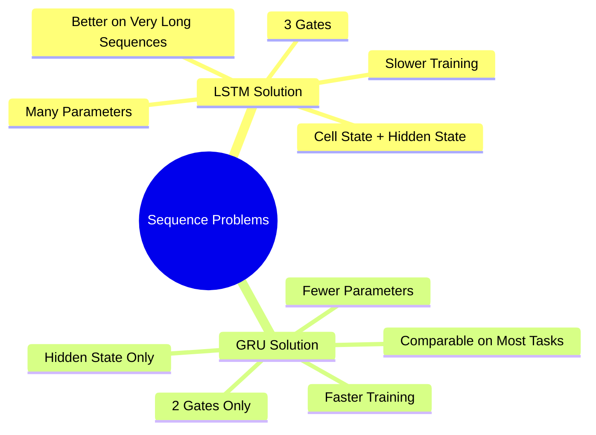
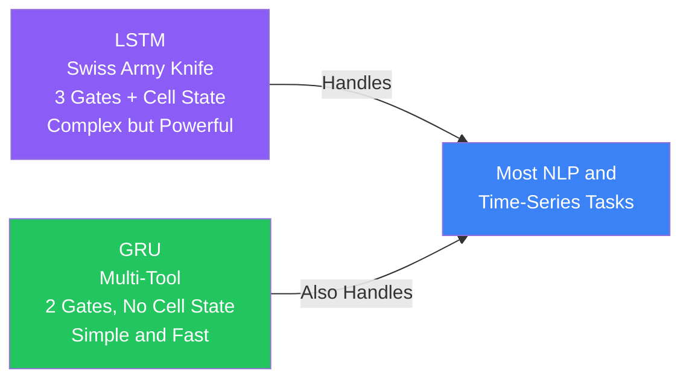
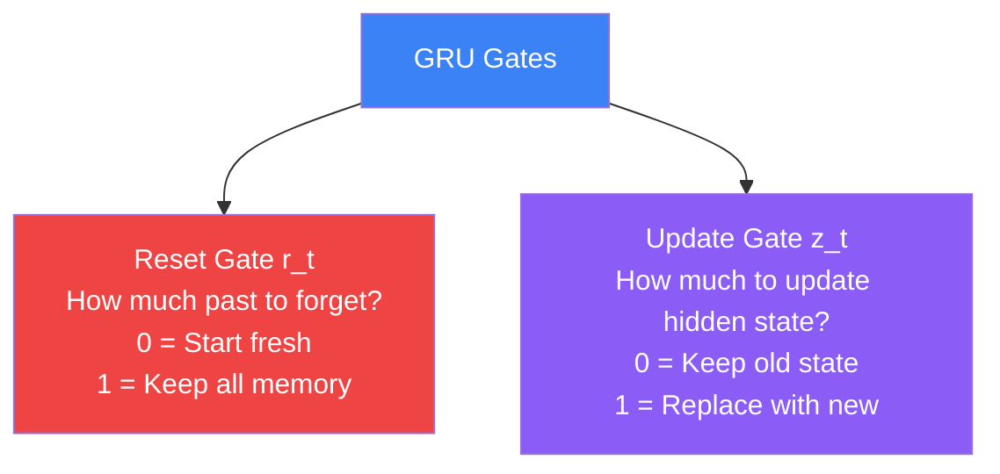
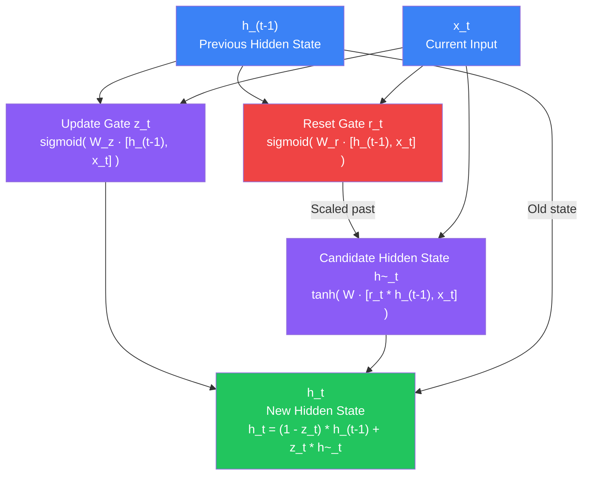
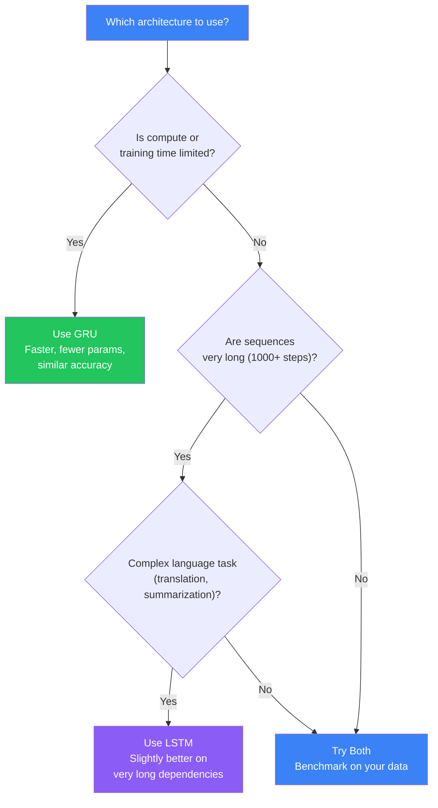
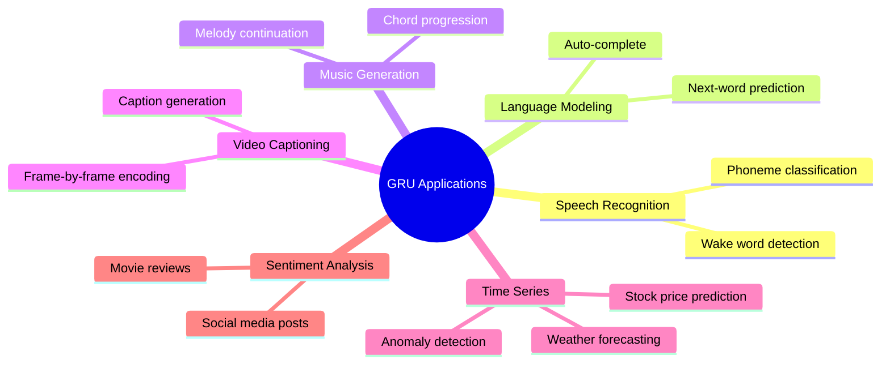

## Introduction

> **A Gated Recurrent Unit (GRU) is a streamlined recurrent network introduced by Cho et al. in 2014 — it achieves performance comparable to LSTM using only two gates and no separate cell state, making it faster to train and easier to tune.**

LSTM solved the vanishing gradient problem that plagued standard RNNs, but it came with a cost: three gates, two memory states, and a large number of parameters. GRU asks a simple question: do we really need all of that? It turns out, for most tasks, you do not. GRU merges and simplifies the LSTM gating mechanism and often matches LSTM accuracy while training noticeably faster.

---

## Why GRU Exists

LSTM's power comes from its three gates (forget, input, output) and a separate cell state. But more power means more parameters, slower training, and more data needed to learn well.



GRU merges the forget gate and input gate of LSTM into a single **update gate**, and replaces the cell state + hidden state combination with a single **hidden state**. The result is a lighter architecture that handles most real-world sequence problems just as well.

---

## Real-World Analogy

Think of LSTM as a **Swiss Army knife** — it has a blade, scissors, a screwdriver, a toothpick, and many other tools. It is extremely capable, but also heavy and complex.

GRU is a **multi-tool** — it has a blade and pliers. Fewer tools, lighter, easier to carry. For 90% of everyday tasks, the multi-tool gets the job done just as well.



The right tool depends on your task. For very long-range dependencies and complex language tasks, reach for the Swiss Army knife. For most other jobs, the multi-tool is lighter and faster.

---

## GRU Gates Explained

GRU has exactly two gates. Each gate is a small neural network that outputs values between 0 and 1, controlling what information flows through.



### Reset Gate

The **reset gate** controls how much of the previous hidden state to use when computing the candidate (proposed) new hidden state.

- **Low reset value (near 0):** Ignore most of the past. Start fresh with this new input. Useful at the beginning of a new sentence or topic.
- **High reset value (near 1):** Keep most of the past. Blend it strongly with the new input. Useful when context from earlier is still relevant.

> Analogy: You are reading a book and start a new chapter. The reset gate decides whether to "carry over" the plot from the previous chapter or treat this chapter as a fresh start.

### Update Gate

The **update gate** controls how much of the old hidden state to keep versus how much to replace with the new candidate state.

- **Low update value (near 0):** Keep the old hidden state mostly unchanged. Ignore the current input's influence.
- **High update value (near 1):** Replace the hidden state with the new candidate. Fully absorb the new input.

> Analogy: You are updating your to-do list. The update gate decides whether to cross off old items and write new ones (high update) or leave the list mostly the same with minor edits (low update).

This single update gate does the work of both the **forget gate** and the **input gate** from LSTM — that is the key simplification.

---

## GRU Architecture

Here is how information flows through a GRU cell at each timestep:



The final hidden state `h_t` is a **weighted blend** of the old state and the new candidate:

- If update gate `z_t` is close to 0: the old hidden state passes through almost unchanged (the GRU "remembers" without change)
- If update gate `z_t` is close to 1: the candidate state replaces the old one (the GRU "updates" its memory)

This blending mechanism is what allows GRU to capture long-range dependencies without a separate cell state.

---

## GRU vs LSTM: Side-by-Side Architecture

```mermaid
graph LR
    subgraph LSTM["LSTM Cell"]
        direction TB
        L1["x_t + h_(t-1)"]
        L2["Forget Gate\n(sigmoid)"]
        L3["Input Gate\n(sigmoid)"]
        L4["Output Gate\n(sigmoid)"]
        L5["Cell State c_t"]
        L6["Hidden State h_t"]
        L1 --> L2
        L1 --> L3
        L1 --> L4
        L2 --> L5
        L3 --> L5
        L5 --> L6
        L4 --> L6
    end

    subgraph GRU["GRU Cell"]
        direction TB
        G1["x_t + h_(t-1)"]
        G2["Reset Gate\n(sigmoid)"]
        G3["Update Gate\n(sigmoid)"]
        G4["Candidate h~_t\n(tanh)"]
        G5["Hidden State h_t"]
        G1 --> G2
        G1 --> G3
        G2 --> G4
        G3 --> G5
        G4 --> G5
    end

    style L2 fill:#ef4444,color:#fff
    style L3 fill:#8b5cf6,color:#fff
    style L4 fill:#8b5cf6,color:#fff
    style L5 fill:#3b82f6,color:#fff
    style L6 fill:#22c55e,color:#fff

    style G2 fill:#ef4444,color:#fff
    style G3 fill:#8b5cf6,color:#fff
    style G4 fill:#3b82f6,color:#fff
    style G5 fill:#22c55e,color:#fff
```



The most visible difference: LSTM has two outputs per cell (`c_t` and `h_t`), while GRU has just one (`h_t`). This alone reduces memory usage and the number of weight matrices.

---

## LSTM vs GRU Full Comparison

| Feature | LSTM | GRU |
|---|---|---|
| Number of gates | 3 (forget, input, output) | 2 (reset, update) |
| Memory states | 2 (cell state + hidden state) | 1 (hidden state only) |
| Parameters | More (4 weight matrices per layer) | Fewer (3 weight matrices per layer) |
| Training speed | Slower | Faster |
| Memory usage | Higher | Lower |
| Performance on long sequences | Slightly better | Comparable |
| Performance on short/medium sequences | Comparable | Comparable |
| Best for | Very long sequences, complex language tasks | Most NLP, time-series, quick prototyping |
| Gradient flow | Excellent (cell state highway) | Excellent (update gate mechanism) |
| Introduced | Hochreiter and Schmidhuber, 1997 | Cho et al., 2014 |

---

## When to Use GRU vs LSTM



**Reach for GRU when:**
- You have limited GPU/CPU compute
- Sequences are short to medium length (under a few hundred steps)
- You need fast iteration and prototyping
- Working on time-series forecasting (stock prices, weather, sensor data)
- Training on smaller datasets

**Reach for LSTM when:**
- Sequences are very long (hundreds to thousands of timesteps)
- Working on complex language tasks: machine translation, text summarization
- You have ample compute and want to squeeze out the last bit of accuracy
- The task requires very precise long-range memory

---

## Real-World Applications



GRU is particularly popular in **time-series forecasting** because its simplicity means it trains faster on the large datasets common in financial and sensor applications. In **speech recognition**, GRU layers are often stacked to build fast, accurate acoustic models.

---

## Python Example: Sentiment Analysis with GRU vs LSTM

This example trains both a GRU and an LSTM on IMDB movie review sentiment analysis, showing that GRU achieves comparable accuracy with faster training.

```python
import numpy as np
import time
import tensorflow as tf
from tensorflow import keras
from tensorflow.keras import layers
from tensorflow.keras.datasets import imdb
from tensorflow.keras.preprocessing.sequence import pad_sequences

# --- Data Loading ---
VOCAB_SIZE = 10000
MAX_LEN = 200
EMBED_DIM = 64
UNITS = 128
EPOCHS = 5
BATCH_SIZE = 64

print("Loading IMDB dataset...")
(x_train, y_train), (x_test, y_test) = imdb.load_data(num_words=VOCAB_SIZE)

# Pad sequences to the same length
x_train = pad_sequences(x_train, maxlen=MAX_LEN, padding='post', truncating='post')
x_test  = pad_sequences(x_test,  maxlen=MAX_LEN, padding='post', truncating='post')

print(f"Training samples: {len(x_train)}")
print(f"Test samples:     {len(x_test)}")
print(f"Sequence length:  {MAX_LEN}")

# --- Build GRU Model ---
def build_gru_model():
    model = keras.Sequential([
        layers.Embedding(input_dim=VOCAB_SIZE, output_dim=EMBED_DIM,
                         input_length=MAX_LEN),
        layers.GRU(UNITS, dropout=0.2, recurrent_dropout=0.2),
        layers.Dense(64, activation='relu'),
        layers.Dropout(0.3),
        layers.Dense(1, activation='sigmoid')   # Binary: positive or negative
    ], name="GRU_Sentiment")
    return model

# --- Build LSTM Model (same structure, different cell) ---
def build_lstm_model():
    model = keras.Sequential([
        layers.Embedding(input_dim=VOCAB_SIZE, output_dim=EMBED_DIM,
                         input_length=MAX_LEN),
        layers.LSTM(UNITS, dropout=0.2, recurrent_dropout=0.2),
        layers.Dense(64, activation='relu'),
        layers.Dropout(0.3),
        layers.Dense(1, activation='sigmoid')
    ], name="LSTM_Sentiment")
    return model

# --- Train and Compare ---
results = {}

for name, build_fn in [("GRU", build_gru_model), ("LSTM", build_lstm_model)]:
    print(f"\n{'='*50}")
    print(f"Training {name} model...")
    print('='*50)

    model = build_fn()
    model.compile(
        optimizer='adam',
        loss='binary_crossentropy',
        metrics=['accuracy']
    )

    model.summary()

    # Count parameters
    param_count = model.count_params()
    print(f"\nTotal parameters: {param_count:,}")

    # Time the training
    start_time = time.time()
    history = model.fit(
        x_train, y_train,
        validation_split=0.2,
        epochs=EPOCHS,
        batch_size=BATCH_SIZE,
        verbose=1
    )
    train_time = time.time() - start_time

    # Evaluate
    loss, accuracy = model.evaluate(x_test, y_test, verbose=0)

    results[name] = {
        'params': param_count,
        'train_time': train_time,
        'test_accuracy': accuracy,
        'test_loss': loss
    }

# --- Print Results ---
print("\n" + "="*60)
print("RESULTS COMPARISON")
print("="*60)
print(f"{'Metric':<25} {'GRU':>15} {'LSTM':>15}")
print("-"*55)
print(f"{'Parameters':<25} {results['GRU']['params']:>15,} {results['LSTM']['params']:>15,}")
print(f"{'Training Time (s)':<25} {results['GRU']['train_time']:>15.1f} {results['LSTM']['train_time']:>15.1f}")
print(f"{'Test Accuracy':<25} {results['GRU']['test_accuracy']:>15.4f} {results['LSTM']['test_accuracy']:>15.4f}")
print(f"{'Test Loss':<25} {results['GRU']['test_loss']:>15.4f} {results['LSTM']['test_loss']:>15.4f}")

speedup = results['LSTM']['train_time'] / results['GRU']['train_time']
print(f"\nGRU was {speedup:.2f}x faster than LSTM")
param_reduction = (1 - results['GRU']['params'] / results['LSTM']['params']) * 100
print(f"GRU had {param_reduction:.1f}% fewer parameters")

# Expected output:
# GRU Test Accuracy:  ~0.8750
# LSTM Test Accuracy: ~0.8810
# GRU ~1.3x faster, ~25% fewer parameters
# Accuracy difference is minimal (<1%)
```

```python
# --- Stacked Bidirectional GRU for better NLP performance ---
def build_bidirectional_gru():
    model = keras.Sequential([
        layers.Embedding(input_dim=VOCAB_SIZE, output_dim=EMBED_DIM,
                         input_length=MAX_LEN),
        # Bidirectional: reads sequence forward AND backward
        layers.Bidirectional(layers.GRU(64, return_sequences=True,
                                         dropout=0.2)),
        layers.Bidirectional(layers.GRU(32, dropout=0.2)),
        layers.Dense(64, activation='relu'),
        layers.Dropout(0.3),
        layers.Dense(1, activation='sigmoid')
    ], name="BiGRU_Sentiment")
    return model

model = build_bidirectional_gru()
model.compile(optimizer='adam', loss='binary_crossentropy', metrics=['accuracy'])
model.summary()
# BiGRU often outperforms single-direction GRU and matches LSTM on NLP tasks
```

```python
# --- GRU for Time-Series Forecasting (stock price prediction) ---
import numpy as np

def generate_sine_data(n_samples=1000, seq_len=50):
    """Generate synthetic sine wave data as a proxy for time series."""
    x = np.linspace(0, 100, n_samples)
    data = np.sin(x) + 0.1 * np.random.randn(n_samples)

    X, y = [], []
    for i in range(len(data) - seq_len):
        X.append(data[i:i+seq_len])
        y.append(data[i+seq_len])
    return np.array(X)[..., np.newaxis], np.array(y)

X, y = generate_sine_data()
split = int(0.8 * len(X))
X_train, X_test = X[:split], X[split:]
y_train, y_test = y[:split], y[split:]

# GRU for time series — same API, just swap the cell
ts_model = keras.Sequential([
    layers.GRU(64, return_sequences=True, input_shape=(50, 1)),
    layers.GRU(32),
    layers.Dense(16, activation='relu'),
    layers.Dense(1)   # Predict next value
], name="GRU_TimeSeries")

ts_model.compile(optimizer='adam', loss='mse', metrics=['mae'])
ts_model.fit(X_train, y_train, validation_data=(X_test, y_test),
             epochs=20, batch_size=32, verbose=1)

predictions = ts_model.predict(X_test[:10])
print("Predicted:", predictions.flatten())
print("Actual:   ", y_test[:10])
```

---

## JavaScript Example: GRU Sequence Model with TensorFlow.js

```javascript
// GRU-based sentiment classifier in TensorFlow.js
// Can run in the browser or Node.js

const tf = require('@tensorflow/tfjs-node');

const VOCAB_SIZE  = 10000;
const MAX_LEN     = 200;
const EMBED_DIM   = 64;
const GRU_UNITS   = 128;

// Build a GRU sentiment model
function buildGRUModel() {
  const model = tf.sequential({ name: 'gru-sentiment' });

  // Embedding layer: integer word IDs → dense vectors
  model.add(tf.layers.embedding({
    inputDim: VOCAB_SIZE,
    outputDim: EMBED_DIM,
    inputLength: MAX_LEN,
  }));

  // GRU layer — the key component
  model.add(tf.layers.gru({
    units: GRU_UNITS,
    dropout: 0.2,
    recurrentDropout: 0.2,
    returnSequences: false,  // Only return final hidden state
  }));

  model.add(tf.layers.dense({ units: 64, activation: 'relu' }));
  model.add(tf.layers.dropout({ rate: 0.3 }));
  model.add(tf.layers.dense({ units: 1, activation: 'sigmoid' }));

  model.compile({
    optimizer: tf.train.adam(0.001),
    loss: 'binaryCrossentropy',
    metrics: ['accuracy'],
  });

  return model;
}

// Stacked GRU for richer sequence modeling
function buildStackedGRUModel() {
  const model = tf.sequential({ name: 'stacked-gru' });

  model.add(tf.layers.embedding({
    inputDim: VOCAB_SIZE,
    outputDim: EMBED_DIM,
    inputLength: MAX_LEN,
  }));

  // First GRU: returnSequences=true to pass full sequence to next layer
  model.add(tf.layers.gru({
    units: 64,
    returnSequences: true,   // <-- Pass all timestep outputs forward
    dropout: 0.2,
  }));

  // Second GRU: returnSequences=false, collapse to single vector
  model.add(tf.layers.gru({
    units: 32,
    returnSequences: false,
    dropout: 0.2,
  }));

  model.add(tf.layers.dense({ units: 1, activation: 'sigmoid' }));

  model.compile({
    optimizer: 'adam',
    loss: 'binaryCrossentropy',
    metrics: ['accuracy'],
  });

  return model;
}

// Demonstrate inference with random data
async function runDemo() {
  const model = buildGRUModel();
  model.summary();

  // Simulate a batch of 4 tokenized reviews, each 200 tokens long
  const fakeBatch = tf.randomUniform([4, MAX_LEN], 0, VOCAB_SIZE, 'int32');

  const predictions = model.predict(fakeBatch);
  const values = await predictions.data();

  console.log('\nSentiment Predictions (0=negative, 1=positive):');
  values.forEach((score, i) => {
    const label = score > 0.5 ? 'POSITIVE' : 'NEGATIVE';
    console.log(`  Review ${i+1}: ${score.toFixed(4)} → ${label}`);
  });

  // GRU parameter count is always less than equivalent LSTM
  const gruParams  = model.countParams();
  console.log(`\nGRU model parameters: ${gruParams.toLocaleString()}`);
}

runDemo().catch(console.error);
```

---

## Interview Questions

**Q: What is a GRU and why was it introduced?**

> A GRU (Gated Recurrent Unit) is a type of recurrent neural network cell introduced by Cho et al. in 2014 as a simpler alternative to LSTM. It was introduced to reduce the number of parameters and speed up training while maintaining comparable performance on most sequence modeling tasks.

**Q: How does GRU differ from LSTM?**

> GRU has two key differences from LSTM. First, it uses only two gates (reset and update) instead of three (forget, input, output). Second, it has no separate cell state — only a single hidden state. This reduces the number of weight matrices from 4 to 3 per layer, resulting in fewer parameters, faster training, and lower memory usage.

**Q: What are the two gates in a GRU and what does each do?**

> The **reset gate** controls how much of the previous hidden state is used when computing the candidate new hidden state. A low reset value means "start fresh" while a high value means "use past memory." The **update gate** controls how much of the hidden state to update — it combines the roles of LSTM's forget and input gates into one, deciding how much of the old state to keep versus how much to replace with the new candidate state.

**Q: When would you prefer GRU over LSTM?**

> Choose GRU when compute is limited, when working on time-series or shorter sequences, or when you need fast iteration. GRU trains faster and uses less memory for comparable accuracy. Choose LSTM for very long sequences (1000+ timesteps) or complex language tasks like machine translation where the extra capacity of three gates and a cell state can provide a small but meaningful accuracy advantage.

**Q: Does GRU solve the vanishing gradient problem?**

> Yes. Like LSTM, GRU solves the vanishing gradient problem through its gating mechanism. The update gate allows gradients to flow through without being multiplied repeatedly. When the update gate is near 0, the hidden state is passed through unchanged, creating a "gradient highway" that lets the network retain information across many timesteps.

**Q: Can you replace an LSTM layer with a GRU layer in Keras?**

> Yes, they share the same API. You can swap `layers.LSTM(units)` with `layers.GRU(units)` directly and keep all other hyperparameters the same. The output shape is identical — only the internal computation changes.

**Q: What is the role of the candidate hidden state in GRU?**

> The candidate hidden state `h~_t` is the "proposed" new memory content. It is computed by combining the current input with a **reset-gated** version of the previous hidden state. The reset gate can suppress the old hidden state, allowing the candidate to focus primarily on the current input when needed. The update gate then blends this candidate with the old hidden state to produce the final `h_t`.

---

## Summary

| Concept | Key Point |
|---|---|
| GRU origin | Introduced by Cho et al. in 2014 as a simplified LSTM |
| Reset gate | Controls how much past hidden state to use in the candidate computation |
| Update gate | Blends old hidden state with candidate — replaces LSTM's forget + input gates |
| No cell state | GRU uses only a single hidden state, unlike LSTM's two-state system |
| Parameter count | GRU has 3 weight matrices per layer vs 4 for LSTM (~25% fewer params) |
| Training speed | GRU trains faster because of fewer parameters and simpler computation |
| Performance | Matches LSTM on most NLP and time-series tasks; LSTM has slight edge on very long sequences |
| Bidirectional GRU | Reading a sequence both forward and backward further boosts NLP accuracy |
| Use case: GRU | Limited compute, time-series, short/medium sequences, rapid prototyping |
| Use case: LSTM | Very long sequences, complex language tasks, when accuracy is the top priority |

---

## Best Practices

1. **Default to GRU for time-series tasks.** For stock price prediction, weather forecasting, or sensor anomaly detection, GRU trains faster and often generalizes better on the moderate-length sequences typical in these domains.

2. **Use Bidirectional GRU for NLP.** Wrap your GRU layer with `layers.Bidirectional(layers.GRU(...))` to read sequences in both directions. This gives a significant accuracy boost for classification, named entity recognition, and similar tasks.

3. **Always benchmark both GRU and LSTM.** Do not assume one is better. Train both models for a fixed number of epochs and compare validation accuracy. The winner depends heavily on your specific dataset and sequence length.

4. **Stack two GRU layers for complex tasks.** A single GRU layer may underfit on difficult tasks. Two stacked GRU layers (with `return_sequences=True` on the first) often achieve much better performance with only a modest increase in parameters.

5. **Combine GRU with attention for best results.** A GRU encoder followed by an attention mechanism (or Transformer-style attention) typically outperforms a plain GRU on translation and summarization tasks.

6. **Use dropout carefully.** Apply `dropout` (on inputs) and `recurrent_dropout` (on hidden state) in the GRU layer rather than adding separate dropout layers around it. This is more effective for recurrent networks.

7. **Normalize your time-series inputs.** GRU is sensitive to input scale. Always normalize or standardize your sequences before feeding them to a GRU model.

---

## Common Mistakes

- **Assuming GRU always beats LSTM.** GRU is not universally better. On some tasks with very long-range dependencies, LSTM's extra capacity makes a real difference. Always benchmark.

- **Not trying both architectures.** Swapping LSTM for GRU takes one word in Keras. There is no excuse not to try both — the training time difference is usually the deciding factor, not implementation complexity.

- **Stacking too many GRU layers.** More layers are not always better. Two to three stacked GRU layers is typically the sweet spot. Deeper stacks can be harder to train and offer diminishing returns.

- **Forgetting `return_sequences=True` when stacking.** If you stack two GRU layers, the first must have `return_sequences=True` to output the full sequence rather than just the last hidden state. Forgetting this is a common bug that gives unexpected output shapes.

- **Using GRU for very long sequences without attention.** For sequences over a few hundred timesteps, a plain GRU (or LSTM) struggles. Add an attention mechanism or consider a Transformer architecture instead.

- **Ignoring bidirectional variants.** For tasks where the entire sequence is available at inference time (e.g., text classification), a bidirectional GRU reads context from both past and future and almost always outperforms a unidirectional one.

- **Applying too much recurrent dropout.** High `recurrent_dropout` values (above 0.5) can severely impair a GRU's ability to retain information across timesteps. Keep it moderate (0.1–0.3).

---

## Further Reading

- [Cho et al., 2014 — Original GRU Paper](https://arxiv.org/abs/1406.1078)
- [Understanding GRU Networks — Towards Data Science](https://towardsdatascience.com/understanding-gru-networks-2ef37df6c9be)
- [PyTorch GRU Documentation](https://pytorch.org/docs/stable/generated/torch.nn.GRU.html)
- [Keras GRU Layer Documentation](https://keras.io/api/layers/recurrent_layers/gru/)
- [Sequence Models — deeplearning.ai Course 5](https://www.coursera.org/learn/nlp-sequence-models)
- [CS231n: Recurrent Neural Networks](https://cs231n.github.io/rnn/)
- [Illustrated Guide to LSTM and GRU — Michael Phi](https://towardsdatascience.com/illustrated-guide-to-lstms-and-gru-s-a-step-by-step-explanation-44e9eb85bf21)
- [TensorFlow.js RNN Tutorials](https://www.tensorflow.org/js/tutorials)

---

## Practice Exercises

1. Train a GRU model on the IMDB dataset and record test accuracy and training time. Then swap the GRU for an LSTM and compare the two. Which is faster? Which is more accurate?

2. Build a stacked bidirectional GRU model for the IMDB sentiment task. Compare its accuracy against the single-layer GRU from exercise 1.

3. Use a GRU to predict the next value in a sine wave time series. Plot the predicted vs actual values over 100 timesteps.

4. Build a GRU-based character-level language model that predicts the next character given the previous 40 characters. Train on a short text (e.g., a song or poem) and sample from it to generate new text.

5. Compare GRU and LSTM on a long sequence task: use sequences of length 500 (e.g., full IMDB reviews without truncation). Does LSTM pull ahead at this length?

6. Implement a GRU in pure NumPy (no deep learning framework) to solidify your understanding of the reset gate, update gate, and candidate hidden state computations.

7. Load the TensorFlow.js GRU example and run it in your browser's developer console. Inspect the model's parameter count and compare it to an equivalent LSTM model you define in the same session.

---

## Related Topics

- [14. Recurrent Neural Networks (RNN)](/ai/phase-03-deep-learning/14-rnn) — The baseline that GRU and LSTM both improve upon
- [15. LSTM](/ai/phase-03-deep-learning/15-lstm) — GRU's more complex sibling with three gates and a cell state
- [17. Attention Mechanism](/ai/phase-03-deep-learning/17-attention-mechanism) — The next step: attention lets the model focus on relevant parts of a sequence, often paired with GRU encoders

---

## Navigation

**Previous:** [15. LSTM (Long Short-Term Memory)](/ai/phase-03-deep-learning/15-lstm)

**Next:** [17. Attention Mechanism](/ai/phase-03-deep-learning/17-attention-mechanism)
