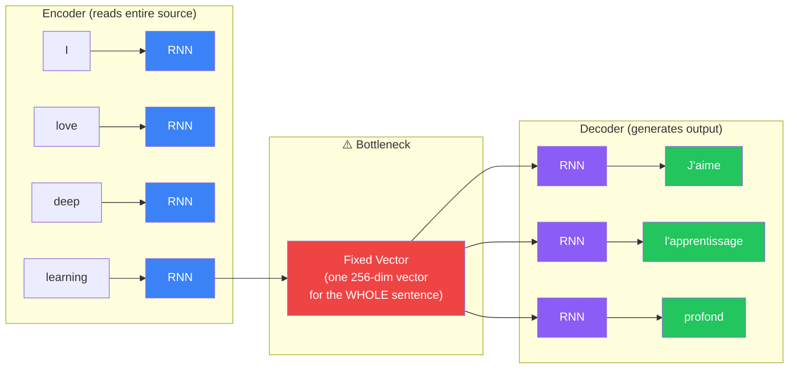
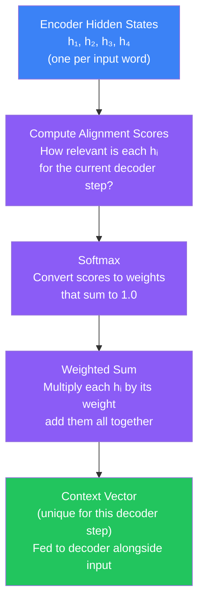
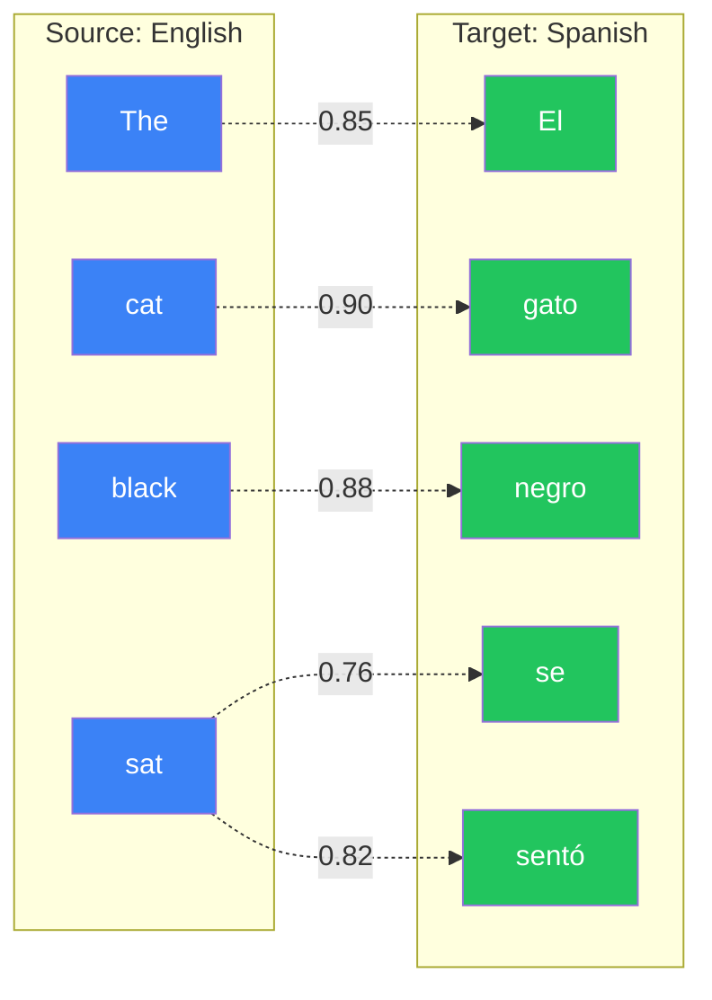
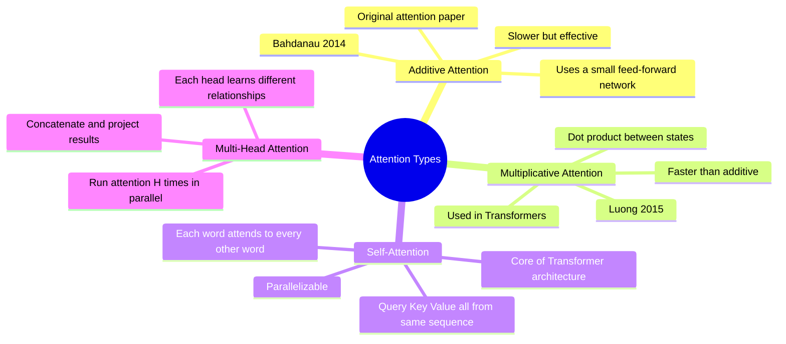
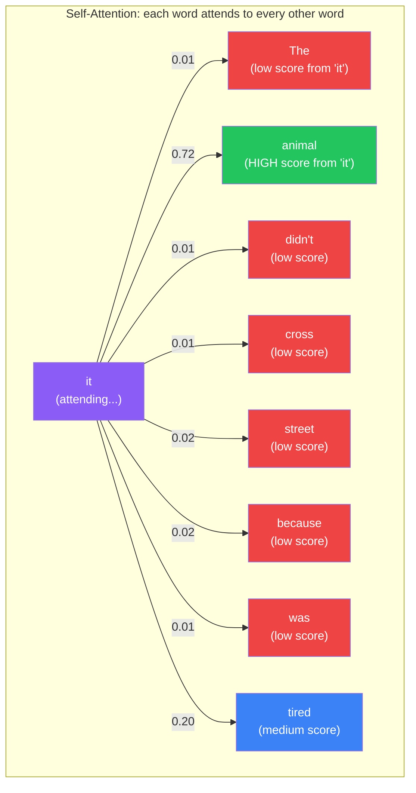
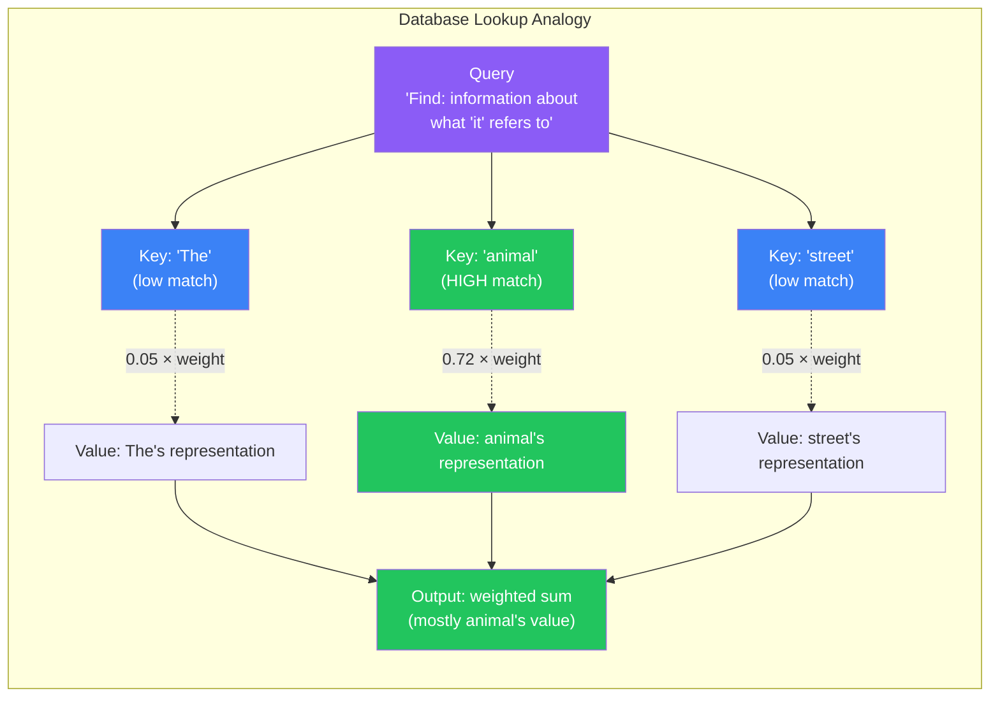
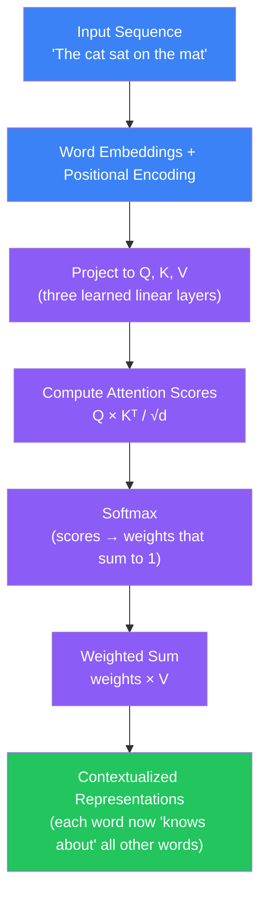
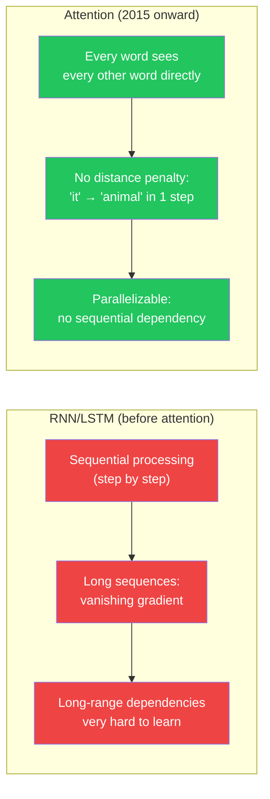
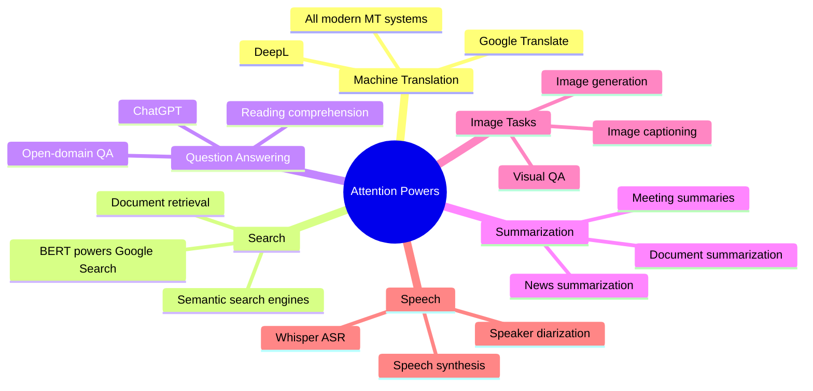

## Introduction

> **Attention is a mechanism that lets a neural network selectively focus on the most relevant parts of its input when making each prediction — instead of relying on a single compressed summary of the whole sequence.**

Before attention, sequence-to-sequence models had to squeeze an entire source sentence into one fixed-size vector before decoding. For short sentences that worked fine. For long, complex sentences it was a disaster — information was lost before the decoder even began. Attention changed everything in 2015, and its ideas now power every large language model you use today.

---

## The Problem Attention Solves

### The Seq2Seq Bottleneck

In the original encoder-decoder architecture (RNN-based), the encoder reads the entire source sentence and compresses it into **one fixed-size vector** — sometimes called the "thought vector" or context vector. The decoder then generates the output from that single vector alone.



The bottleneck gets worse as sentences get longer. Imagine trying to translate a 50-word paragraph after someone whispered a summary to you in exactly 10 words. You will lose critical details.

### The Coreference Problem

Consider this famous sentence used in AI research:

> **"The animal didn't cross the street because it was too tired."**

What does "it" refer to? The animal or the street? A human reader knows instantly — "it" refers to "animal" because streets don't get tired. But a vanilla RNN encoder must pack both "animal" and "street" into the same fixed vector, making this kind of fine-grained coreference resolution extremely difficult.

Attention allows the decoder to look back at **every encoder hidden state** and ask: "which words are most relevant right now?" — and then weight them accordingly.

---

## Real-World Analogy: Translating a Book

Imagine you are a human translator working on a novel. You sit at a desk with the original French text on your left and a blank page on your right. When you write each English word, you do not rely on a 10-word summary someone gave you earlier. Instead, you **look back at specific parts of the French text** as needed.

- Writing "cat" → you glance at "chat" in the source
- Writing "black" → you glance at "noir" in the source
- Writing "sat" → you glance at "était assis" in the source

You pay **attention** to the most relevant source words for each output word you write. Different output words pull your gaze to different parts of the source. This is exactly what attention does — it gives the decoder a spotlight it can shine on any part of the encoder output at any moment.

---

## How Attention Works (Intuition)

There are four steps in computing attention:



**Step 1 — Alignment scores:** For each encoder hidden state `hᵢ`, compute a score that answers "how relevant is word `i` to the current output word I am about to generate?" High score = highly relevant.

**Step 2 — Softmax:** Convert raw scores to probabilities (they sum to 1.0). Now each input word has an "attention weight" between 0 and 1.

**Step 3 — Weighted sum:** Multiply each encoder hidden state by its attention weight, then add them all up. Highly attended words contribute more.

**Step 4 — Context vector:** The result is a new context vector — different for every decoder step. This vector is passed into the decoder along with its previous output, giving it a focused view of the source.

The key insight: **there is no bottleneck anymore**. Every decoder step gets its own context vector that is a weighted combination of all encoder outputs. The model can focus on any part of the source at any time.

---

## Visualizing Attention Weights

One of the most beautiful properties of attention is that it is **interpretable**. You can visualize which source words the model attended to when generating each output word:



Notice something fascinating: "gato" (cat) aligns strongly with "cat", and "negro" (black) aligns strongly with "black" — but in Spanish, adjectives come **after** nouns. The attention mechanism automatically learned this word order difference, connecting "black" → "negro" even though their positions in the sentence are swapped. The model is not following rules — it discovered this alignment through training.

---

## Types of Attention



### Additive Attention (Bahdanau, 2014)

The original attention paper by Bahdanau, Cho, and Bengio used a small neural network to compute alignment scores. Given decoder state `s` and encoder state `hᵢ`, the score is computed as:

```
score(s, hᵢ) = vᵀ · tanh(W₁s + W₂hᵢ)
```

A small feed-forward network learns to judge relevance. It is expressive but slightly slower because it adds a layer of computation for each pair of (decoder state, encoder state).

### Multiplicative / Dot-Product Attention (Luong, 2015)

A simpler and faster approach: just compute a **dot product** between the decoder state and encoder state:

```
score(s, hᵢ) = s · hᵢ
```

Vectors that point in a similar direction will have a high dot product — meaning "these two states are semantically similar." This is faster than additive attention and became the foundation for Transformers. A scaling factor of `1/√d` is often applied to prevent scores from growing too large when vectors are high-dimensional.

---

## Self-Attention: The Core of Transformers

Regular (cross) attention allows the decoder to attend to the encoder. **Self-attention** is different — it allows a sequence to attend to **itself**. Every position in the sequence can look at every other position.

### Why Self-Attention Matters

Go back to our coreference example:

> "The **animal** didn't cross the street because **it** was too tired."

In self-attention:
- The word "it" computes attention scores against all other words
- "animal" receives the highest attention score from "it"
- Result: the representation of "it" is now heavily influenced by "animal"
- The model understands the coreference without explicit rules



The critical advantage over RNNs: self-attention captures the relationship between "it" and "animal" **in a single step**, regardless of how many words separate them. An RNN would have to carry that information through many timesteps, battling vanishing gradients the whole way.

---

## Query, Key, and Value: The Database Analogy

Self-attention uses three learned projections: **Query (Q)**, **Key (K)**, and **Value (V)**. The best analogy is a database lookup:



- **Query (Q):** "What am I looking for?" — derived from the current word's representation
- **Key (K):** "What do I contain?" — each word advertises what information it holds
- **Value (V):** "What do I actually give you if you select me?" — the actual content

The attention score between a Query and a Key determines how much of that Key's Value flows into the output. Words with Keys that match the Query well contribute more of their Value to the result.

In self-attention, Q, K, and V all come from the same input sequence — each word is simultaneously a searcher (Q) and something being searched (K, V).

---

## Full Attention Pipeline



---

## Why Attention Changed Everything



Three properties of self-attention that made Transformers possible:

1. **No sequential dependency** — all positions are computed in parallel. An RNN must process token 1 before token 2 before token 3. Self-attention processes all positions simultaneously. This makes training dramatically faster on modern GPUs.

2. **Constant path length** — in an RNN, information from word 1 must travel through N timesteps to reach word N+1. In self-attention, every word is directly connected to every other word — the path length is always 1. No vanishing gradients over distance.

3. **Interpretable** — attention weights are human-readable. You can visualize exactly what the model focused on for each prediction, making it one of the most interpretable deep learning mechanisms available.

---

## Real-World Applications



- **Google Translate** — uses Transformer with multi-head attention; dramatically outperforms old RNN-based systems
- **BERT / Google Search** — self-attention allows BERT to understand the full context of a query before retrieving results
- **ChatGPT / GPT-4** — the entire GPT family is built on stacked self-attention layers (Transformer decoder)
- **Whisper (speech recognition)** — Transformer encoder processes audio features with self-attention
- **Image captioning** — cross-attention between image regions and output words

---

## Python: Attention-Enhanced LSTM for Sentiment Analysis (Keras)

```python
import tensorflow as tf
import numpy as np

# Load IMDB dataset
(x_train, y_train), (x_test, y_test) = tf.keras.datasets.imdb.load_data(
    num_words=10000
)

# Pad sequences
maxlen = 200
x_train = tf.keras.preprocessing.sequence.pad_sequences(x_train, maxlen=maxlen)
x_test  = tf.keras.preprocessing.sequence.pad_sequences(x_test,  maxlen=maxlen)

# Custom Attention Layer
class BahdanauAttention(tf.keras.layers.Layer):
    """
    Additive (Bahdanau) attention layer.
    Takes LSTM output sequence and computes a context vector
    by weighing each timestep based on learned relevance.
    """
    def __init__(self, units, **kwargs):
        super().__init__(**kwargs)
        self.W = tf.keras.layers.Dense(units)        # Weight for hidden states
        self.V = tf.keras.layers.Dense(1)            # Scores each timestep

    def call(self, encoder_outputs):
        # encoder_outputs shape: (batch, timesteps, features)
        # Score each timestep — how important is each position?
        score = self.V(tf.nn.tanh(self.W(encoder_outputs)))  # (batch, timesteps, 1)

        # Softmax across the timestep dimension → attention weights
        attention_weights = tf.nn.softmax(score, axis=1)     # (batch, timesteps, 1)

        # Context vector: weighted sum of encoder outputs
        context = attention_weights * encoder_outputs          # broadcast multiply
        context = tf.reduce_sum(context, axis=1)              # (batch, features)

        return context, attention_weights


# Build the model: LSTM + Attention + Dense classifier
inputs = tf.keras.Input(shape=(maxlen,))

# Word embeddings
x = tf.keras.layers.Embedding(input_dim=10000, output_dim=64)(inputs)

# Bidirectional LSTM — return_sequences=True gives us all hidden states
lstm_out = tf.keras.layers.Bidirectional(
    tf.keras.layers.LSTM(64, return_sequences=True)
)(x)

# Apply attention over all timesteps
context, attn_weights = BahdanauAttention(units=32)(lstm_out)

# Classify
x = tf.keras.layers.Dropout(0.5)(context)
outputs = tf.keras.layers.Dense(1, activation='sigmoid')(x)

model = tf.keras.Model(inputs, outputs)
model.compile(
    optimizer='adam',
    loss='binary_crossentropy',
    metrics=['accuracy']
)

model.summary()
# Total params: ~1.4M

# Train
history = model.fit(
    x_train, y_train,
    epochs=5,
    batch_size=128,
    validation_split=0.2
)

# Evaluate
test_loss, test_acc = model.evaluate(x_test, y_test)
print(f"Test Accuracy: {test_acc:.4f}")
# Typical: ~89-91% — better than plain LSTM (~87%)

# Inspect attention weights for a specific review
sample = x_test[0:1]
# Build a sub-model that also returns attention weights
attention_model = tf.keras.Model(
    inputs=model.inputs,
    outputs=[model.output, attn_weights]
)
prediction, weights = attention_model.predict(sample)
weights = weights[0, :, 0]  # shape: (maxlen,)

# Show top-5 attended positions
top5_positions = np.argsort(weights)[-5:][::-1]
print(f"\nTop 5 attended positions: {top5_positions}")
print(f"Attention weights: {weights[top5_positions].round(4)}")
print(f"Sentiment: {'Positive' if prediction[0][0] > 0.5 else 'Negative'}")
```

---

## Python: Self-Attention from Scratch (NumPy / PyTorch)

```python
import torch
import torch.nn as nn
import torch.nn.functional as F
import numpy as np

class SelfAttention(nn.Module):
    """
    Single-head self-attention — the fundamental building block of Transformers.
    Input:  (batch, seq_len, d_model)
    Output: (batch, seq_len, d_model)
    """
    def __init__(self, d_model, d_k=64):
        super().__init__()
        self.d_k = d_k
        # Three linear projections: input → Q, K, V
        self.W_Q = nn.Linear(d_model, d_k, bias=False)
        self.W_K = nn.Linear(d_model, d_k, bias=False)
        self.W_V = nn.Linear(d_model, d_k, bias=False)
        self.W_O = nn.Linear(d_k, d_model, bias=False)  # Output projection

    def forward(self, x, mask=None):
        # x: (batch, seq_len, d_model)
        Q = self.W_Q(x)   # (batch, seq_len, d_k)
        K = self.W_K(x)   # (batch, seq_len, d_k)
        V = self.W_V(x)   # (batch, seq_len, d_k)

        # Scaled dot-product attention
        # (batch, seq_len, d_k) × (batch, d_k, seq_len) → (batch, seq_len, seq_len)
        scores = torch.matmul(Q, K.transpose(-2, -1)) / (self.d_k ** 0.5)

        # Apply mask (e.g. ignore padding tokens)
        if mask is not None:
            scores = scores.masked_fill(mask == 0, float('-inf'))

        # Softmax across the last dimension (which token to attend to)
        attn_weights = F.softmax(scores, dim=-1)  # (batch, seq_len, seq_len)

        # Weighted sum of values
        output = torch.matmul(attn_weights, V)    # (batch, seq_len, d_k)

        return self.W_O(output), attn_weights


# Quick demo: self-attention on a 4-word sentence
batch_size, seq_len, d_model = 1, 4, 128
x = torch.randn(batch_size, seq_len, d_model)  # Fake word embeddings

attn = SelfAttention(d_model=d_model, d_k=64)
output, weights = attn(x)

print(f"Input shape:         {x.shape}")       # (1, 4, 128)
print(f"Output shape:        {output.shape}")  # (1, 4, 128)
print(f"Attention weights:   {weights.shape}") # (1, 4, 4) — 4×4 attention matrix

# Visualize which positions attend to which
import matplotlib
matplotlib.use('Agg')
import matplotlib.pyplot as plt

words = ["The", "animal", "didn't", "it"]
w = weights[0].detach().numpy()  # (4, 4)

fig, ax = plt.subplots(figsize=(6, 5))
im = ax.imshow(w, cmap='Blues')
ax.set_xticks(range(len(words)))
ax.set_yticks(range(len(words)))
ax.set_xticklabels(words)
ax.set_yticklabels(words)
ax.set_xlabel("Keys (being attended to)")
ax.set_ylabel("Queries (attending from)")
ax.set_title("Self-Attention Weights")
plt.colorbar(im)
plt.savefig("attention_weights.png", dpi=100, bbox_inches='tight')
print("Saved attention_weights.png")
```

---

## Python: Seq2Seq with Attention for Translation (PyTorch)

```python
import torch
import torch.nn as nn
import torch.nn.functional as F

class Encoder(nn.Module):
    def __init__(self, vocab_size, embed_dim, hidden_dim):
        super().__init__()
        self.embedding = nn.Embedding(vocab_size, embed_dim, padding_idx=0)
        self.lstm = nn.LSTM(embed_dim, hidden_dim, batch_first=True,
                            bidirectional=True)
        # Project bidirectional output back to hidden_dim
        self.fc = nn.Linear(hidden_dim * 2, hidden_dim)

    def forward(self, src):
        # src: (batch, src_len)
        embedded = self.embedding(src)                   # (batch, src_len, embed_dim)
        outputs, (h, c) = self.lstm(embedded)           # outputs: (batch, src_len, hidden*2)
        # Combine forward and backward final states
        h = torch.tanh(self.fc(torch.cat([h[-2], h[-1]], dim=1)))
        return outputs, h


class AttentionDecoder(nn.Module):
    def __init__(self, vocab_size, embed_dim, hidden_dim):
        super().__init__()
        self.embedding = nn.Embedding(vocab_size, embed_dim, padding_idx=0)
        self.attention = nn.Linear(hidden_dim * 3, 1)   # Additive attention
        self.lstm = nn.LSTM(embed_dim + hidden_dim * 2, hidden_dim, batch_first=True)
        self.fc_out = nn.Linear(hidden_dim, vocab_size)

    def forward(self, tgt_token, hidden, encoder_outputs):
        # tgt_token: (batch,)
        # hidden: (1, batch, hidden_dim)
        # encoder_outputs: (batch, src_len, hidden_dim*2)

        embedded = self.embedding(tgt_token.unsqueeze(1))  # (batch, 1, embed_dim)

        src_len = encoder_outputs.size(1)
        h = hidden.squeeze(0).unsqueeze(1).repeat(1, src_len, 1)  # (batch, src_len, hidden)

        # Compute attention scores
        energy = self.attention(torch.cat([h, encoder_outputs], dim=2))  # (batch, src_len, 1)
        attn_weights = F.softmax(energy, dim=1)                           # (batch, src_len, 1)

        # Context vector: weighted sum of encoder outputs
        context = torch.sum(attn_weights * encoder_outputs, dim=1, keepdim=True)  # (batch, 1, hidden*2)

        # Concatenate embedded input + context, feed to LSTM
        lstm_input = torch.cat([embedded, context], dim=2)   # (batch, 1, embed + hidden*2)
        output, (hidden, cell) = self.lstm(lstm_input, (hidden, torch.zeros_like(hidden)))

        # Final prediction
        prediction = self.fc_out(output.squeeze(1))  # (batch, vocab_size)
        return prediction, hidden, attn_weights.squeeze(2)


# Tiny vocabulary demo
SRC_VOCAB, TGT_VOCAB = 1000, 1000
EMBED_DIM, HIDDEN_DIM = 128, 256

encoder = Encoder(SRC_VOCAB, EMBED_DIM, HIDDEN_DIM)
decoder = AttentionDecoder(TGT_VOCAB, EMBED_DIM, HIDDEN_DIM)

# Fake batch: 4 sentences of length 10
src = torch.randint(1, SRC_VOCAB, (4, 10))
tgt_token = torch.randint(1, TGT_VOCAB, (4,))

enc_outputs, hidden = encoder(src)
print(f"Encoder outputs: {enc_outputs.shape}")   # (4, 10, 512)

# Single decoder step
pred, hidden, attn = decoder(tgt_token, hidden.unsqueeze(0), enc_outputs)
print(f"Prediction:      {pred.shape}")          # (4, 1000)
print(f"Attention:       {attn.shape}")          # (4, 10) — weights over 10 source positions
print(f"Sum of weights:  {attn[0].sum().item():.4f}")  # Should be ~1.0
```

---

## JavaScript: Conceptual Attention (TensorFlow.js)

```javascript
import * as tf from '@tensorflow/tfjs';

/**
 * Scaled dot-product attention — the core operation in Transformers.
 * Q: queries  (batch, seqQ, depth)
 * K: keys     (batch, seqK, depth)
 * V: values   (batch, seqK, depth)
 * Returns: output (batch, seqQ, depth), weights (batch, seqQ, seqK)
 */
function scaledDotProductAttention(Q, K, V, mask = null) {
  const depth = Q.shape[Q.shape.length - 1];
  const scale = Math.sqrt(depth);

  // Attention scores: Q × Kᵀ
  const scores = tf.matMul(Q, K, false, true).div(tf.scalar(scale));
  // scores shape: (batch, seqQ, seqK)

  // Apply mask (set padding positions to -inf so softmax gives ~0)
  let maskedScores = scores;
  if (mask !== null) {
    const negInf = tf.fill(scores.shape, -1e9);
    maskedScores = tf.where(mask, scores, negInf);
  }

  // Attention weights — softmax across key dimension
  const weights = tf.softmax(maskedScores, -1);  // (batch, seqQ, seqK)

  // Weighted sum of values
  const output = tf.matMul(weights, V);           // (batch, seqQ, depth)

  return { output, weights };
}

// Demo: 1 batch, 4 tokens (the animal didn't cross), depth=8
const batch = 1, seqLen = 4, depth = 8;
const Q = tf.randomNormal([batch, seqLen, depth]);
const K = tf.randomNormal([batch, seqLen, depth]);
const V = tf.randomNormal([batch, seqLen, depth]);

const { output, weights } = scaledDotProductAttention(Q, K, V);

console.log('Input shape:', Q.shape);         // [1, 4, 8]
console.log('Output shape:', output.shape);   // [1, 4, 8]
console.log('Weight shape:', weights.shape);  // [1, 4, 4]

// Print attention matrix — rows are queries, columns are keys
weights.print();
// Each row sums to ~1.0 (due to softmax)
// High values show which query attended to which key

// Verify weights sum to 1.0 per query position
const rowSums = weights.sum(-1);
rowSums.print();  // All values should be ~1.0
```

---

## Interview Questions

**Q: What is the attention mechanism and what problem does it solve?**

> Attention is a mechanism that allows a neural network decoder to look at all encoder hidden states (not just the last one) when generating each output token. It solves the bottleneck problem in seq2seq models: before attention, the entire source sequence had to be compressed into a single fixed-size vector, which lost information for long sequences. With attention, each decoder step creates its own context vector by taking a weighted sum of all encoder outputs — weighted by how relevant each input position is to the current output.

**Q: What is self-attention? How is it different from cross-attention?**

> Self-attention is attention where the Queries, Keys, and Values all come from the same sequence — the sequence attends to itself. Every position can directly relate to every other position. Cross-attention (used in seq2seq decoders) has Queries from one sequence (the decoder) and Keys/Values from a different sequence (the encoder). In Transformers, the encoder uses self-attention, and the decoder uses both self-attention (on its own output) and cross-attention (on the encoder output).

**Q: What are Query, Key, and Value in attention?**

> Q, K, V are three linear projections of the input embeddings, learned during training. The Query represents what information the current position is searching for. The Key represents what information each position advertises that it has. The Value represents the actual content a position contributes when selected. Attention computes dot products between Q and all Ks to get relevance scores, applies softmax to get weights, then returns a weighted sum of all Vs. Think of it like a database search: Query is your search term, Keys are index entries, Values are the actual data.

**Q: Why is attention said to solve the vanishing gradient problem over long sequences?**

> In RNNs, information from early timesteps must travel through many recurrent steps before influencing a late output — and gradient signals must travel the same distance backward during training. Each step multiplies by the recurrent weights, causing gradients to shrink or explode. In self-attention, every pair of positions has a direct connection: the path length between any two positions is always 1, regardless of sequence length. Gradients flow directly without passing through intermediate steps, making it easy to learn dependencies between distant positions.

**Q: What is the difference between Bahdanau and Luong attention?**

> Bahdanau (additive) attention uses a small neural network to compute alignment scores: `score = vᵀ tanh(W₁ · decoder_state + W₂ · encoder_state)`. It was the first attention mechanism and is very expressive. Luong (multiplicative/dot-product) attention computes alignment as a simple dot product: `score = decoder_state · encoder_stateᵀ`, optionally scaled by `1/√d`. Luong attention is faster and simpler, and the scaled dot-product variant is what Transformers use. Both produce similar quality results on most tasks.

---

## Best Practices

1. **Add attention on top of Bidirectional LSTM** for sequence classification tasks — bidirectional LSTM + attention is a strong baseline before reaching for a full Transformer
2. **Always scale dot-product attention by `1/√d_k`** — without scaling, dot products grow large when vectors are high-dimensional, pushing softmax into saturation and making gradients vanish
3. **Visualize attention weights during development** — attention matrices are one of the most powerful debugging tools in NLP; they reveal whether the model is looking at the right parts of the input
4. **Use masking for padding tokens** — padding positions should receive zero attention weight; set their scores to `-inf` before softmax so they are effectively ignored
5. **Use multi-head attention instead of single-head** — multiple heads allow the model to attend to different aspects simultaneously (syntax, semantics, coreference); this is why Transformers use 8-16 heads
6. **Prefer Transformer-based architectures for new sequence tasks** — LSTM + attention was the state of the art in 2016-2018; for most tasks today, a pretrained Transformer (BERT, GPT, T5) will outperform it with far less engineering

---

## Common Mistakes

- **Confusing attention with memory networks** — attention computes a soft weighted lookup over the input at inference time; memory networks (like Neural Turing Machines) have an external writable memory store; they are related ideas but architecturally different
- **Thinking self-attention is sequential** — unlike RNNs, self-attention processes all positions in parallel; there is no step-by-step recurrence; this is what makes Transformers fast to train on GPUs
- **Forgetting positional encoding** — self-attention has no built-in sense of word order (it treats the input as a set, not a sequence); positional encodings must be added to the embeddings to inject position information
- **Skipping padding masks** — if you do not mask padding tokens, the model will attend to them and waste capacity learning to ignore meaningless zeros; always apply a mask in both self-attention and cross-attention
- **Using attention without enough data** — attention mechanisms add parameters and complexity; on very small datasets (<10K examples), a simple LSTM may generalize better than an attention model that overfits
- **Treating attention weights as ground-truth explanations** — attention weights show what the model looked at, not why it made a decision; research has shown high attention does not always correlate with feature importance

---

## Summary

| Concept | Key Point |
|---|---|
| Seq2Seq bottleneck | Entire source sentence compressed into ONE fixed vector — loses info for long sequences |
| Attention (2015) | Decoder dynamically looks at ALL encoder states; different context vector at every step |
| Alignment score | Measures how relevant each encoder state is to the current decoder state |
| Softmax normalization | Converts raw scores to weights that sum to 1.0 |
| Context vector | Weighted sum of encoder hidden states — unique per decoder step |
| Additive attention | Bahdanau 2014 — uses a small network to compute scores; expressive |
| Dot-product attention | Luong 2015 — uses simple dot product; faster; used in Transformers |
| Self-attention | Q, K, V all from same sequence — every word directly attends to every other word |
| Query (Q) | "What am I searching for?" — projected from current word embedding |
| Key (K) | "What do I advertise?" — projected from each word in the sequence |
| Value (V) | "What do I contribute?" — the actual content summed into the output |
| Parallelizable | Self-attention computes all positions at once — no sequential dependency like RNN |
| No vanishing gradient over distance | Direct connection between any two positions — path length always 1 |
| Interpretable | Attention weights can be visualized to see what the model focused on |
| Multi-head attention | Run attention multiple times in parallel with different W_Q/W_K/W_V; concat results |
| Positional encoding | Must be added to embeddings — self-attention is order-invariant without it |

---

## Navigation

**Previous:** [16 — Gated Recurrent Units (GRU)](/ai/phase-03-deep-learning/16-gru)

**Next:** [18 — Introduction to Transformers](/ai/phase-03-deep-learning/18-introduction-to-transformers)

**Related Topics:**
- [Recurrent Neural Networks (RNN)](/ai/phase-03-deep-learning/14-rnn)
- [Long Short-Term Memory (LSTM)](/ai/phase-03-deep-learning/15-lstm)
- [Gated Recurrent Units (GRU)](/ai/phase-03-deep-learning/16-gru)
- [Introduction to Transformers](/ai/phase-03-deep-learning/18-introduction-to-transformers)

---

## Practice Exercises

1. Implement Bahdanau attention from scratch in PyTorch or NumPy — compute scores, softmax, and context vector manually for a 5-word sentence
2. Add a `BahdanauAttention` layer to the IMDB LSTM classifier from the RNN chapter — compare accuracy with and without attention
3. Visualize the 4×4 self-attention weight matrix for the sentence "The animal didn't cross" — identify which positions attend to which
4. Implement the Q, K, V projection matrices and scaled dot-product attention formula as separate functions, then compose them
5. Build a character-level seq2seq with attention that reverses a string (e.g., "hello" → "olleh") — check whether attention learns the correct alignment
6. Train the attention-enhanced LSTM on a short machine translation dataset (e.g., English→French toy dataset) and visualize the alignment matrix
7. Experiment with removing the `1/√d` scaling factor — observe how it affects training stability and softmax saturation on longer sequences

---

## Further Reading

- [Attention Is All You Need (Vaswani et al., 2017)](https://arxiv.org/abs/1706.03762) — the Transformer paper that made self-attention the dominant architecture
- [Neural Machine Translation by Jointly Learning to Align and Translate (Bahdanau et al., 2014)](https://arxiv.org/abs/1409.0473) — the original attention paper
- [Illustrated Attention (Jay Alammar)](https://jalammar.github.io/visualizing-neural-machine-translation-mechanics-of-seq2seq-models-with-attention/) — the best visual explanation of attention available
- [The Illustrated Transformer (Jay Alammar)](https://jalammar.github.io/illustrated-transformer/) — step-by-step visual walkthrough of multi-head attention
- [Sequence to Sequence Learning — deeplearning.ai](https://www.deeplearning.ai/courses/natural-language-processing-specialization/) — NLP specialization covering attention in detail
- [PyTorch Seq2Seq Tutorial with Attention](https://pytorch.org/tutorials/intermediate/seq2seq_translation_tutorial.html) — official PyTorch tutorial implementing attention for translation
- [Attention and Memory in Deep Learning — DeepMind](https://deepmind.com/blog/article/attention-and-memory-in-deep-learning-and-nlp) — conceptual overview from DeepMind researchers
- [CS224N: Natural Language Processing with Deep Learning — Stanford](https://web.stanford.edu/class/cs224n/) — lecture notes and slides covering attention and Transformers from first principles
