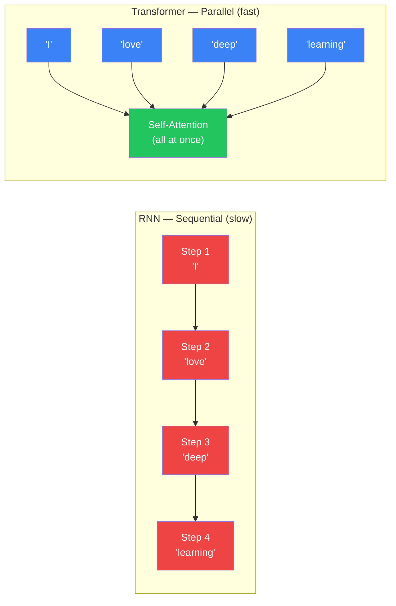
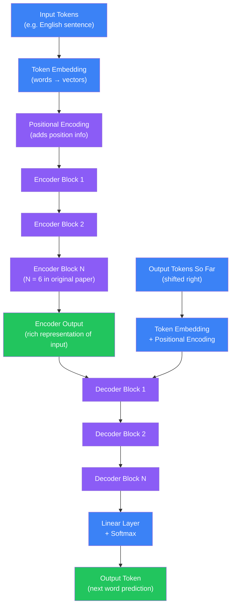
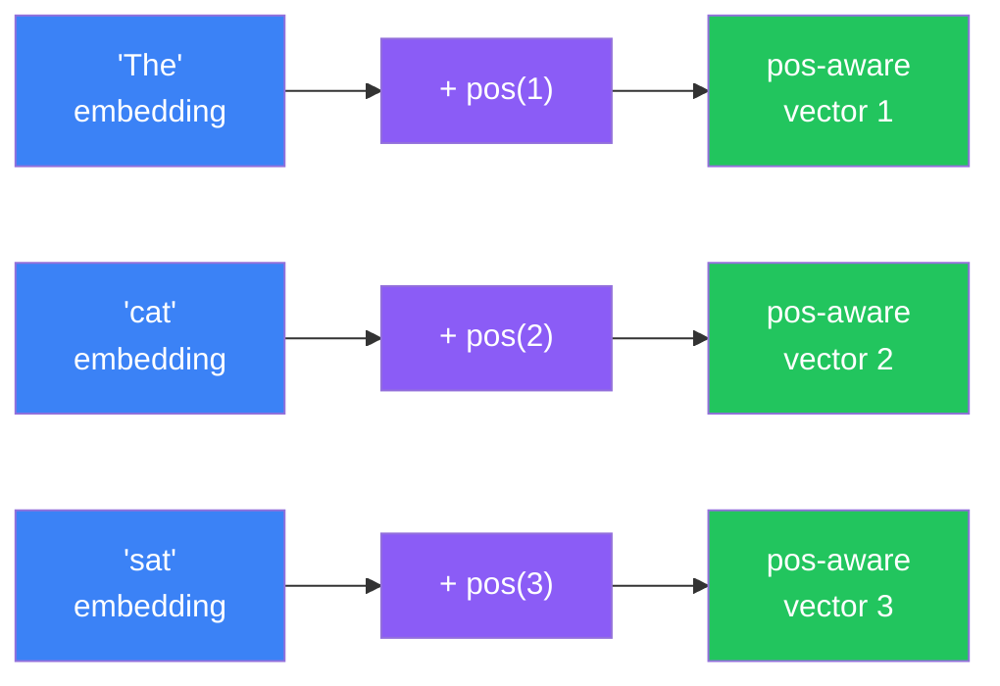
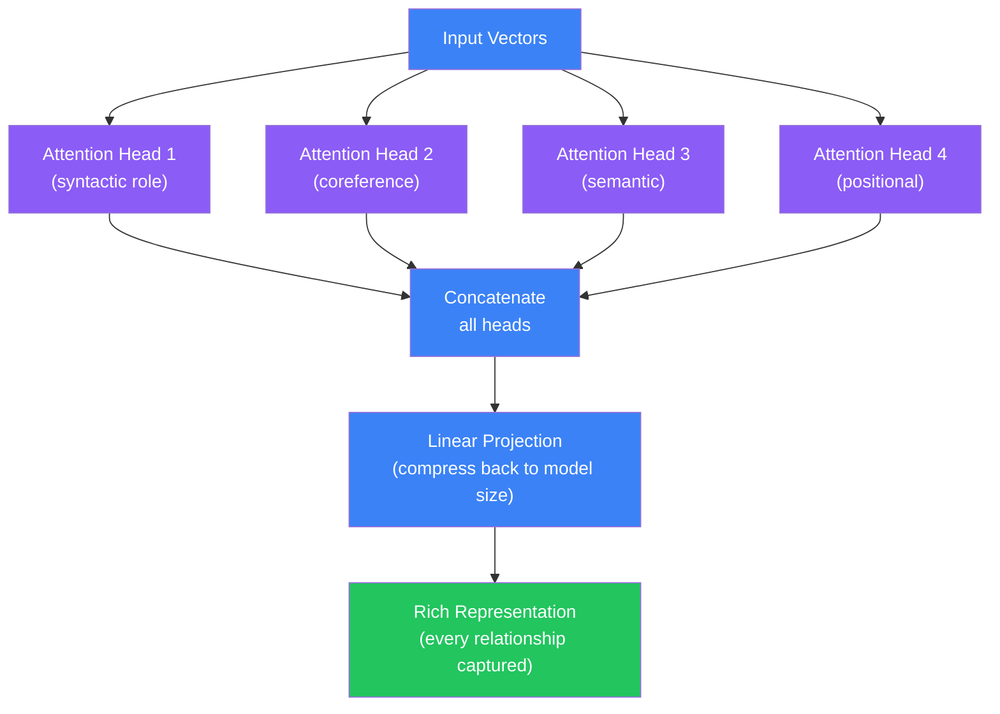
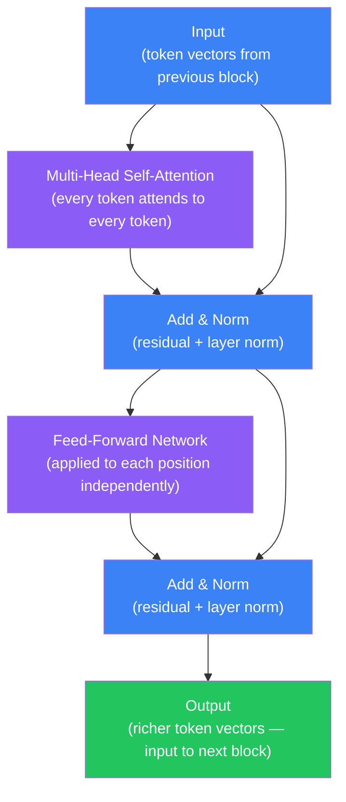
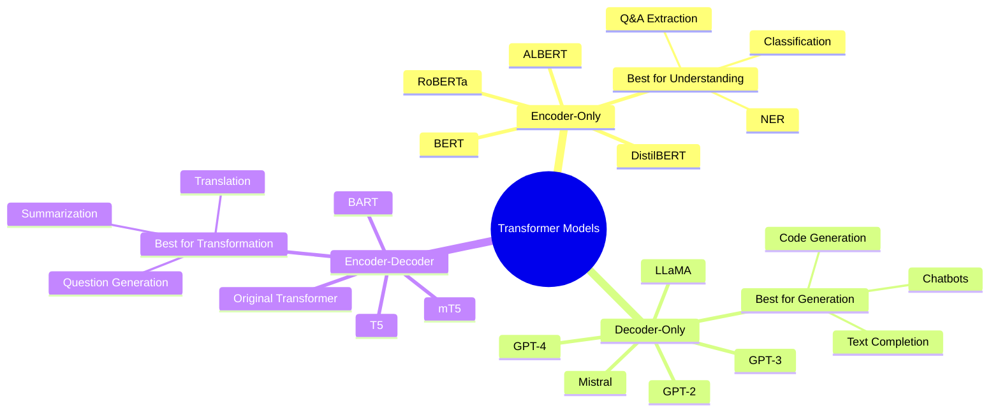
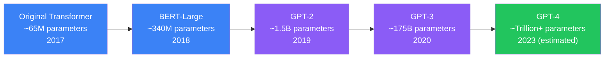
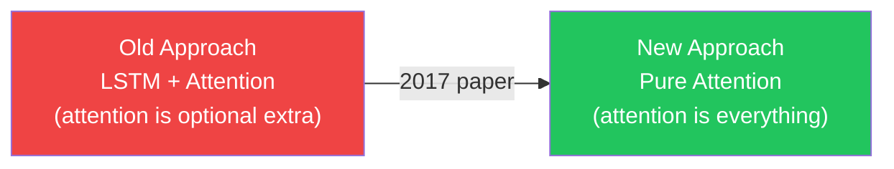
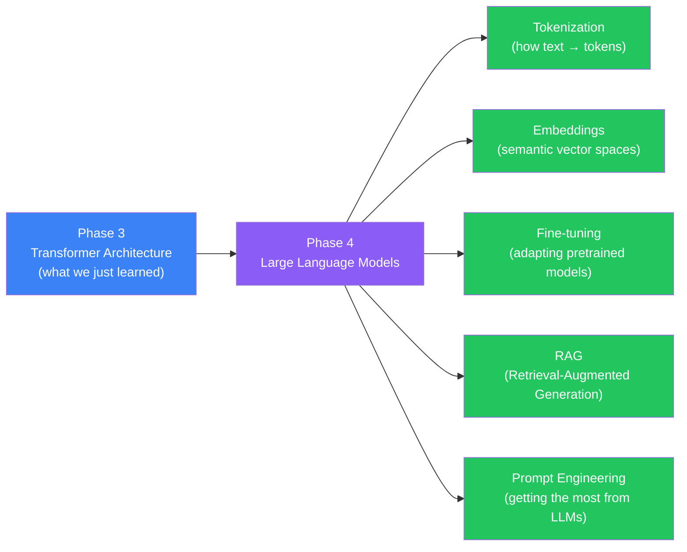

## Introduction

> **A Transformer is a neural network architecture that processes all tokens in a sequence simultaneously using self-attention, replacing the sequential step-by-step processing of RNNs and enabling the massive parallelism that powers GPT, BERT, and every major modern AI system.**

In 2017, Google researchers published a paper titled "Attention Is All You Need." The title was a bold claim: you do not need RNNs, LSTMs, or convolutions to build state-of-the-art sequence models. Just attention. That paper introduced the **Transformer**, and it changed all of AI. Every major language model you have heard of — GPT-4, BERT, LLaMA, Gemini, Claude — is built on the Transformer architecture introduced in that paper.

---

## Why Transformers Won

Before Transformers, RNNs and LSTMs were the go-to architecture for sequence tasks. They had a fundamental limitation: they processed tokens **one at a time**, left to right.



The four reasons Transformers replaced RNNs completely:

| Problem with RNNs | Transformer Solution |
|---|---|
| Sequential processing — cannot parallelize | Processes all tokens simultaneously on GPU |
| Vanishing gradients over long sequences | Attention directly connects any two tokens regardless of distance |
| Slow training on large datasets | Massive parallelism means 10x–100x faster training |
| Hidden state bottleneck | Every token attends to every other token directly |

---

## Real-World Analogy

**RNN** is like reading a book word by word, covering each word with your hand as you move forward. By the time you reach page 200, you may have forgotten what happened on page 3. You carry a compressed mental summary, but details fade.

**Transformer** is like spreading the entire book out on a table and looking at all pages simultaneously. You can instantly spot that the character on page 200 is referencing a clue from page 3 — because you can see both at once. You have a **bird's eye view** of the entire text.

This is exactly what self-attention does: it lets every word look directly at every other word in the sequence and decide which ones are relevant.

---

## High-Level Architecture: Encoder-Decoder

The original Transformer (used for translation) has two major parts: an **Encoder** that reads and understands the input, and a **Decoder** that generates the output.



The encoder and decoder are each stacked N times (6 in the original paper). More layers = more capacity to learn complex patterns.

---

## Key Components

### a. Token Embedding

Before a Transformer can process text, words must be converted to numbers — specifically, dense vectors. An embedding layer maps each word (or subword) to a vector of fixed size (e.g., 512 dimensions).

- "cat" → `[0.2, -0.5, 0.8, ..., 0.1]` (512 numbers)
- "dog" → `[0.3, -0.4, 0.7, ..., 0.2]` (512 numbers)
- Similar words end up with similar vectors after training

---

### b. Positional Encoding

The Transformer processes all tokens simultaneously — which is great for speed, but it means the model has no built-in sense of order. "I love you" and "You love I" would look identical to pure attention.

**Positional encoding** solves this by adding a unique position signal to each token's embedding before it enters the Transformer.

**Analogy:** Imagine you receive a shuffled deck of book pages. You cannot tell the order just by reading them. But if someone stamps each page with a page number, you instantly know the correct order. Positional encoding is those page numbers — stamped onto each token's embedding.



The original paper used sinusoidal functions (sine and cosine at different frequencies) to generate position vectors. Modern models often use **learned positional embeddings** instead — the model learns the best position representations during training.

---

### c. Multi-Head Attention

This is the heart of the Transformer. Self-attention lets each token look at all other tokens and decide which ones to pay attention to.

**Single attention head analogy:** Imagine translating "The animal did not cross the street because **it** was too tired." What does "it" refer to? A human immediately looks back and connects "it" to "animal" — not "street." Self-attention does exactly this: the word "it" attends strongly to "animal."

**Multi-head** means running this attention mechanism multiple times in parallel, each with different learned weights. Each "head" learns a different type of relationship:

- Head 1 might learn **syntactic relationships** (subject-verb pairs)
- Head 2 might learn **coreference** (which pronouns refer to which nouns)
- Head 3 might learn **positional proximity** (nearby words)
- Head 4 might learn **semantic similarity** (related meaning)



The original paper used **8 heads**. GPT-3 uses **96 heads**. More heads = more types of relationships the model can track simultaneously.

---

### d. Feed-Forward Network (FFN)

After attention, each token's representation is independently passed through a small two-layer fully-connected network. This is the same FFN applied to every position separately — it adds non-linearity and increases the model's capacity to transform representations.

Think of it as: attention decides **which** tokens to focus on; the FFN decides **what** to do with that focused information.

---

### e. Layer Normalization and Residual Connections

Two training stability tricks that appear after every sub-layer (attention and FFN):

- **Residual connection:** Add the input directly to the output — `output = sublayer(input) + input`. This prevents vanishing gradients and lets gradients flow directly to early layers.
- **Layer Normalization:** Normalize activations across the feature dimension. Keeps values in a stable range and speeds up training.

These are the reason Transformers with hundreds of layers can be trained at all.

---

## Single Encoder Block (Zoomed In)



After N of these stacked blocks, each token's vector contains information about its meaning **in context** — influenced by all other tokens in the sequence through repeated layers of attention.

---

## Three Families of Transformer Models

Depending on which parts of the architecture are used, modern Transformers split into three families:

### Encoder-Only (BERT family)

Uses only the encoder stack. Reads the **full input** and produces a rich representation for each token. Since it sees the whole sequence, it excels at **understanding** tasks.

Best for: text classification, sentiment analysis, named entity recognition, question answering (extractive).

Examples: BERT, RoBERTa, DistilBERT, ALBERT.

---

### Decoder-Only (GPT family)

Uses only the decoder stack with **causal (masked) self-attention** — each token can only attend to tokens that came before it. This makes it perfect for **generation**: predict the next token, then the next, building text one word at a time.

Best for: text generation, code completion, chatbots, story writing.

Examples: GPT-2, GPT-3, GPT-4, LLaMA, Mistral, Gemma.

---

### Encoder-Decoder (T5 / original Transformer)

Uses both encoder and decoder. The encoder reads and understands the input; the decoder generates the output conditioned on the encoder's representation.

Best for: machine translation, summarization, question generation, any task with a distinct "input format → output format" structure.

Examples: T5, BART, mT5, original "Attention Is All You Need" Transformer.

---

## Transformer Model Family Map



---

## Scale: Why Bigger Works Better

One of the most surprising findings about Transformers is that performance improves predictably with scale — more parameters, more data, more compute = better results.



GPT-3 has **175 billion parameters**. The original Transformer had 65 million. This 2,000x increase in scale, combined with massive datasets and GPU farms, is what makes modern LLMs so capable. The architecture is essentially the same — scale is the magic ingredient.

---

## "Attention Is All You Need" — Why That Title

The paper's title was a direct challenge to the field. Before 2017, every state-of-the-art sequence model used RNNs, LSTMs, or convolutions as the core component, sometimes with attention **added on top** as an enhancement.

The paper's claim: you do not need any of that. Attention alone — **self-attention applied in layers** — is sufficient to build the best sequence models ever created. No recurrence, no convolution. Just attention.



The paper proved this claim by achieving state-of-the-art results on English-to-German and English-to-French translation benchmarks while training **8x faster** than the previous best models. The field pivoted almost overnight.

---

## RNN vs LSTM vs Transformer Comparison

| Property | Vanilla RNN | LSTM | Transformer |
|---|---|---|---|
| Processing | Sequential | Sequential | Parallel |
| Long-range dependencies | Poor (vanishing gradients) | Good (gating mechanism) | Excellent (direct attention) |
| Training speed | Slow | Slow | Fast (GPU parallelism) |
| Memory efficiency | Low | Medium | High (no hidden state) |
| Scales to massive data | No | Barely | Yes |
| Powers modern AI | No | No | Yes |
| Typical use today | Rarely | Legacy NLP | Standard for all NLP |

---

## Python Example: BERT Sentiment Analysis (Hugging Face)

```python
# Install: pip install transformers torch
from transformers import pipeline

# Load a pretrained sentiment analysis pipeline
# Under the hood: DistilBERT fine-tuned on SST-2 (Stanford Sentiment Treebank)
classifier = pipeline("sentiment-analysis")

# Run inference — no training required
results = classifier([
    "I loved this movie, it was absolutely fantastic!",
    "The food was terrible and the service was even worse.",
    "The product is okay, nothing special about it.",
])

for result in results:
    label = result["label"]
    score = result["score"]
    print(f"  {label} (confidence: {score:.2%})")

# Output:
#   POSITIVE (confidence: 99.87%)
#   NEGATIVE (confidence: 99.93%)
#   NEGATIVE (confidence: 57.41%)
```

```python
# More control: load model and tokenizer separately
from transformers import AutoTokenizer, AutoModelForSequenceClassification
import torch

model_name = "distilbert-base-uncased-finetuned-sst-2-english"
tokenizer = AutoTokenizer.from_pretrained(model_name)
model = AutoModelForSequenceClassification.from_pretrained(model_name)

# Tokenize input
text = "Deep learning is changing the world."
inputs = tokenizer(text, return_tensors="pt", truncation=True, max_length=512)

# Forward pass through the Transformer
with torch.no_grad():
    outputs = model(**inputs)

# Get predicted class
logits = outputs.logits
predicted_class = torch.argmax(logits, dim=1).item()
labels = ["NEGATIVE", "POSITIVE"]
confidence = torch.softmax(logits, dim=1)[0][predicted_class].item()

print(f"Text: {text}")
print(f"Prediction: {labels[predicted_class]} ({confidence:.2%})")
# Prediction: POSITIVE (94.32%)
```

```python
# Encoder-Decoder: Translation with T5
from transformers import pipeline

# T5 fine-tuned for English → French translation
translator = pipeline("translation_en_to_fr", model="Helsinki-NLP/opus-mt-en-fr")

sentences = [
    "The cat sat on the mat.",
    "Deep learning is a subset of machine learning.",
    "Attention is all you need.",
]

for sentence in sentences:
    translation = translator(sentence)[0]["translation_text"]
    print(f"EN: {sentence}")
    print(f"FR: {translation}")
    print()

# EN: The cat sat on the mat.
# FR: Le chat s'est assis sur le tapis.
```

---

## JavaScript Example: Transformers.js in the Browser

```javascript
// Install: npm install @xenova/transformers
// Runs BERT/GPT models directly in the browser — no server needed

import { pipeline } from '@xenova/transformers';

// Sentiment analysis with DistilBERT
async function runSentimentAnalysis() {
  console.log('Loading model...');
  const classifier = await pipeline(
    'sentiment-analysis',
    'Xenova/distilbert-base-uncased-finetuned-sst-2-english'
  );

  const texts = [
    'I love this product, it works perfectly!',
    'This is the worst experience I have ever had.',
    'The movie was okay, not great but not terrible.',
  ];

  for (const text of texts) {
    const result = await classifier(text);
    const { label, score } = result[0];
    console.log(`"${text}"`);
    console.log(`  → ${label} (${(score * 100).toFixed(1)}% confident)\n`);
  }
}

// Text generation with GPT-2 (decoder-only Transformer)
async function runTextGeneration() {
  const generator = await pipeline(
    'text-generation',
    'Xenova/gpt2'
  );

  const prompt = 'Deep learning is';
  const result = await generator(prompt, {
    max_new_tokens: 50,
    num_return_sequences: 1,
    do_sample: true,
    temperature: 0.7,
  });

  console.log('Prompt:', prompt);
  console.log('Generated:', result[0].generated_text);
}

runSentimentAnalysis();
runTextGeneration();
```

---

## What Comes Next (Phase 4 Preview)

This chapter introduced the Transformer architecture — the engine. Phase 4 is about the fuel and how to drive:



For now, the key takeaway: **do not train Transformers from scratch**. Use Hugging Face's pretrained models and build on top of them.

---

## Interview Questions

**Q: What is a Transformer?**

> A Transformer is a neural network architecture introduced by Vaswani et al. in "Attention Is All You Need" (2017). Unlike RNNs that process sequences step by step, Transformers process all tokens in parallel using self-attention — each token attends to every other token to build context-aware representations. The architecture consists of encoder blocks, decoder blocks, or both, each containing multi-head self-attention layers, feed-forward networks, and residual + layer norm connections. Transformers are the foundation of BERT, GPT, T5, and virtually all modern language models.

**Q: What is the "Attention Is All You Need" paper?**

> It is the 2017 Google paper by Vaswani et al. that introduced the Transformer architecture. The title claims that self-attention alone — without recurrence or convolution — is sufficient to build state-of-the-art sequence models. The paper demonstrated this by achieving the best translation results at the time while training 8x faster than existing RNN-based models. It is arguably the most influential deep learning paper of the past decade, as it directly enabled the creation of BERT, GPT, and all modern LLMs.

**Q: What is positional encoding and why do we need it?**

> Positional encoding is a technique that adds position information to each token's embedding before it enters the Transformer. It is necessary because the Transformer's self-attention mechanism is **permutation-invariant** — if you shuffled all the tokens, the attention scores would compute the same relationships regardless of order. Without positional encoding, the model cannot distinguish "cat bites dog" from "dog bites cat." The original paper used sinusoidal functions (sine and cosine at different frequencies) to generate a unique position vector for each position. Modern models often use learned positional embeddings instead.

**Q: What is multi-head attention?**

> Multi-head attention runs the self-attention mechanism multiple times in parallel, each with different learned weight matrices. Each "head" learns to attend to different types of relationships — one might focus on syntactic roles, another on coreference, another on semantic similarity. The outputs of all heads are concatenated and then projected with a linear layer back to the model's hidden size. This gives the model a richer representation than single-head attention by capturing multiple relationship types simultaneously. The original Transformer used 8 heads; GPT-3 uses 96 heads.

**Q: What is the difference between encoder-only and decoder-only Transformer models?**

> Encoder-only models (BERT) process the full input sequence with bidirectional self-attention — each token sees all other tokens. This is ideal for **understanding** tasks like classification, named entity recognition, and extractive question answering. Decoder-only models (GPT) use causal (masked) self-attention — each token can only attend to tokens that came before it. This enforces an autoregressive left-to-right generation process, making them ideal for **text generation**. Encoder-decoder models (T5, original Transformer) combine both: an encoder that reads input with full bidirectional attention and a decoder that generates output attending to both the encoder output and previously generated tokens.

---

## Best Practices

1. **Use pretrained Transformer models via Hugging Face** — `transformers` library gives you BERT, GPT-2, T5, and thousands of fine-tuned variants in 3 lines of code; start here, always
2. **Never train a Transformer from scratch** unless you have millions of dollars in compute and terabytes of data — even top research labs use pretrained weights as a starting point
3. **Choose the right model family for your task** — encoder-only (BERT) for classification and understanding; decoder-only (GPT-2) for generation; encoder-decoder (T5) for translation and summarization
4. **Run inference on CPU for small experiments** — Transformer inference on a single review or sentence is fast enough on CPU; only move to GPU for batch processing or production
5. **Use `pipeline` for quick prototyping** — Hugging Face's `pipeline` API handles tokenization, model loading, and post-processing automatically; use it before writing custom model code
6. **Check model size before loading** — BERT-base is 110M parameters and loads in seconds; GPT-3 is 175B parameters and requires specialized infrastructure; always check the model card first

---

## Common Mistakes

- **Trying to train a Transformer from scratch** — Transformers need massive datasets and compute to learn useful representations from random initialization; always start with a pretrained checkpoint
- **Confusing encoder-only with decoder-only** — using a GPT model for text classification produces poor results; using a BERT model for text generation is not how BERT works; match the model family to the task
- **Forgetting that positional encoding is required** — without positional encoding, the Transformer cannot learn word order; some beginners implement a minimal Transformer and skip this step, then wonder why the model ignores sequence structure
- **Assuming "more parameters = always better"** — a 7B parameter LLaMA fine-tuned on your domain often outperforms a 175B GPT-3 on domain-specific tasks; scale is not everything
- **Ignoring the attention mask** — when batching sequences of different lengths, padding tokens must be masked so the model does not attend to them; always pass `attention_mask` when using the Hugging Face API
- **Treating Transformer as a black box without understanding attention** — you do not need to implement attention from scratch, but understanding that each token attends to all others helps you debug failures, choose the right model, and interpret results

---

## Summary

| Concept | Key Point |
|---|---|
| Transformer | Architecture from "Attention Is All You Need" (2017) that processes sequences in parallel using self-attention |
| Why it won | Processes all tokens simultaneously → massive GPU parallelism; handles long-range dependencies directly |
| Token embedding | Converts words to dense vectors (numbers) the model can process |
| Positional encoding | Adds position information to embeddings — without it, Transformer ignores word order |
| Self-attention | Each token looks at all other tokens and learns which ones are relevant |
| Multi-head attention | Run self-attention N times in parallel with different weights — each head learns different relationship types |
| Feed-forward network | Small MLP applied to each position after attention — adds non-linearity and model capacity |
| Residual + Layer Norm | Training stability tricks — prevent vanishing gradients, normalize activations |
| Encoder-only (BERT) | Sees full sequence both ways — best for classification, NER, extractive Q&A |
| Decoder-only (GPT) | Sees only past tokens — best for text generation, code completion, chatbots |
| Encoder-Decoder (T5) | Encoder reads input, decoder generates output — best for translation, summarization |
| Scale | GPT-3 = 175B parameters; original Transformer = 65M; scale drives modern AI capability |
| "Attention Is All You Need" | Paper title literally means: you do not need RNNs — attention alone is sufficient |
| Hugging Face | Library that gives you pretrained Transformers in 3 lines of Python — use it |

---

## Practice Exercises

1. Use the Hugging Face `pipeline` API to run sentiment analysis on 10 movie reviews from IMDB — compare the model's confidence scores across positive and negative reviews
2. Load the same BERT model via `AutoTokenizer` and `AutoModelForSequenceClassification` (manual API) and verify you get the same results as the `pipeline` version
3. Use the T5 `pipeline` with `"translation_en_to_fr"` to translate 5 English sentences — experiment with technical vs everyday language and see which translates more accurately
4. Experiment with GPT-2 text generation: change `temperature` (0.2 vs 1.5) and observe how lower temperature produces safer, repetitive text while higher temperature produces creative but less coherent output
5. Look up the BERT paper on arXiv and the original "Attention Is All You Need" paper — read just the abstracts and architecture sections to see how the authors describe their innovations
6. Draw the Encoder Block on paper (Input → Multi-Head Attention → Add & Norm → FFN → Add & Norm → Output) — label each component and write one sentence explaining what each does
7. Using Hugging Face, load a Named Entity Recognition model (e.g., `"dslim/bert-base-NER"`) and run it on a news article — identify all detected entities (persons, organizations, locations)

---

## Further Reading

- [Attention Is All You Need (original paper)](https://arxiv.org/abs/1706.03762) — the 2017 paper that started it all; read the architecture section
- [The Illustrated Transformer — Jay Alammar](https://jalammar.github.io/illustrated-transformer/) — the best visual explanation of Transformers on the internet
- [Hugging Face Transformers Documentation](https://huggingface.co/docs/transformers/index) — official docs for the `transformers` library
- [Hugging Face Course — Chapter 1](https://huggingface.co/learn/nlp-course/chapter1/1) — free interactive course: Transformers, tokenization, fine-tuning
- [Stanford CS224N: NLP with Deep Learning](https://web.stanford.edu/class/cs224n/) — university-level NLP course covering Transformers in depth
- [Deep Learning Specialization — deeplearning.ai](https://www.deeplearning.ai/courses/deep-learning-specialization/) — Andrew Ng's course includes sequence models and attention
- [Andrej Karpathy: Let's build GPT from scratch (YouTube)](https://www.youtube.com/watch?v=kCc8FmEb1nY) — 2-hour video building a GPT Transformer from scratch in PyTorch
- [BERT Paper: Pre-training of Deep Bidirectional Transformers](https://arxiv.org/abs/1810.04805) — Google's 2018 paper introducing BERT

---

## Navigation

**Previous:** [17 — Attention Mechanism](/ai/phase-03-deep-learning/17-attention-mechanism)

**Next:** [19 — Deep Learning Pipeline](/ai/phase-03-deep-learning/19-deep-learning-pipeline)

**Related Topics:**
- [Attention Mechanism](/ai/phase-03-deep-learning/17-attention-mechanism)
- [Recurrent Neural Networks (RNN)](/ai/phase-03-deep-learning/14-rnn)
- [Long Short-Term Memory (LSTM)](/ai/phase-03-deep-learning/15-lstm)
- [Neural Networks](/ai/phase-03-deep-learning/03-neural-networks)
