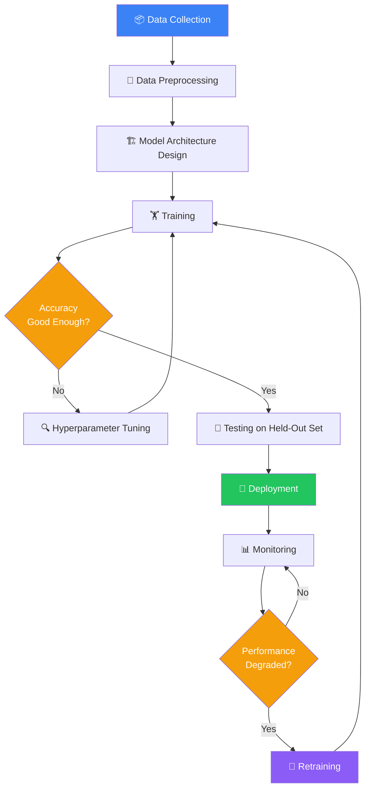
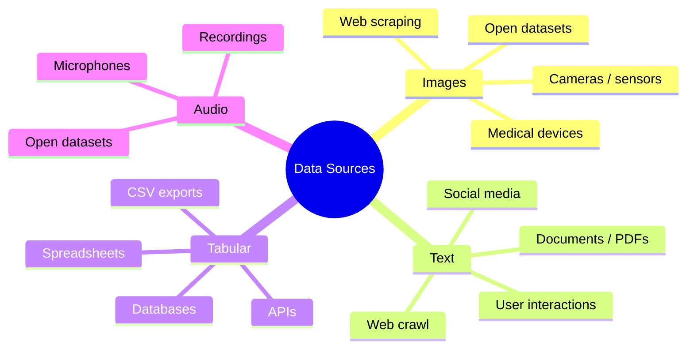
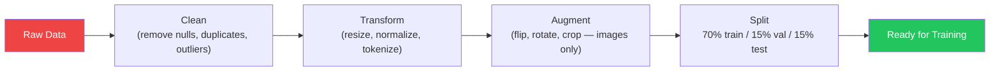
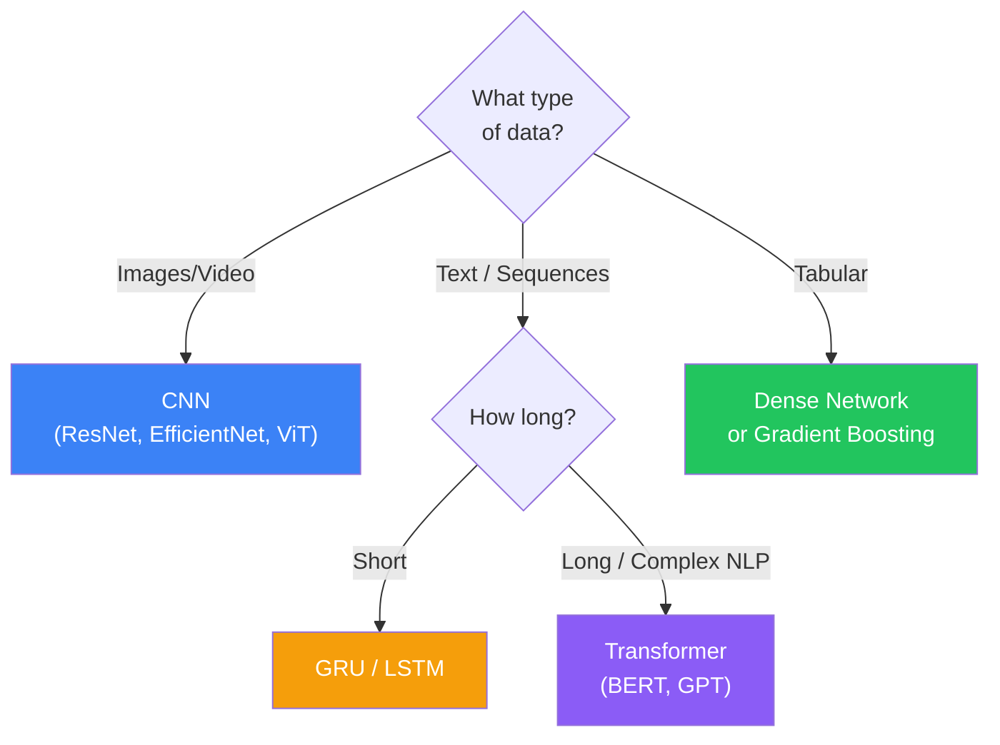
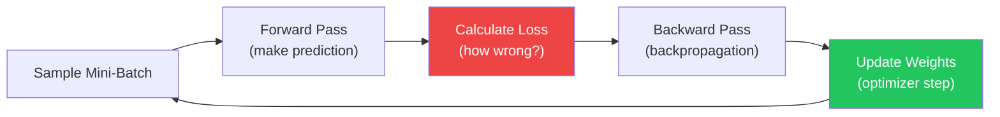
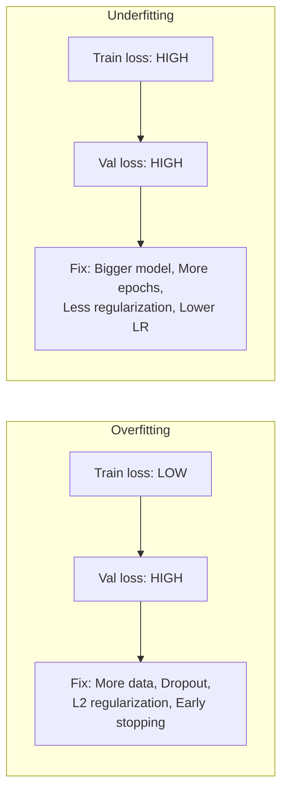
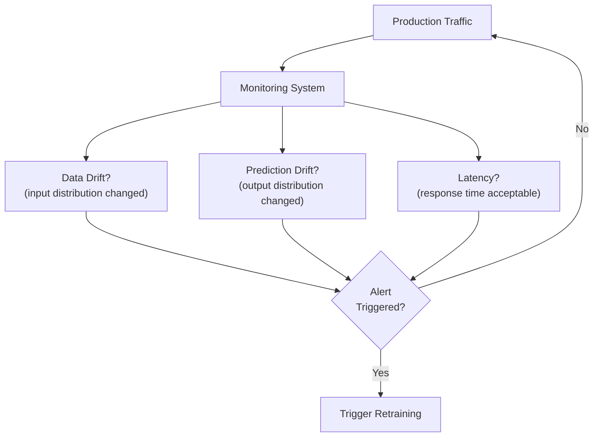
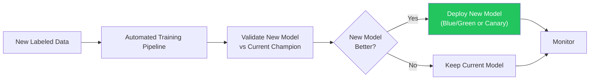
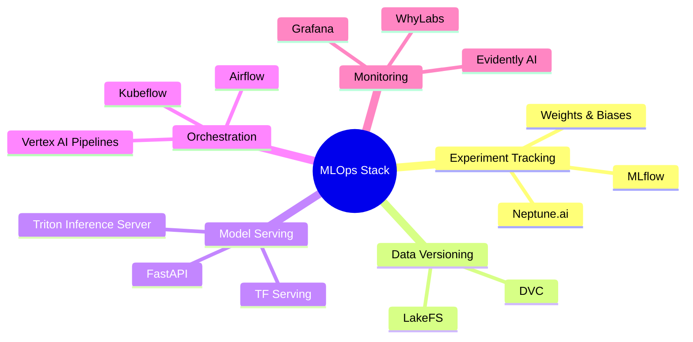

## Introduction

> **A Deep Learning pipeline is the complete workflow from raw data to a deployed, monitored model in production. Building a model is only one step.**

Most beginners focus on model architecture. In production, data collection, preprocessing, monitoring, and retraining are equally — often more — important.

---

## The Full Pipeline



---

## Real-World Analogy

Think of a car factory assembly line:

- **Raw materials** = raw data
- **Quality control & shaping** = preprocessing
- **Assembly** = model training
- **Road testing** = validation & testing
- **Showroom delivery** = deployment
- **Customer feedback & recalls** = monitoring & retraining

Every stage must work. A broken stage breaks the whole pipeline.

---

## Stage 1 — Data Collection

> **Rule: More clean data beats a better model architecture. Always.**



**Key decisions:**
- How much data do you need? (Rule of thumb: 1,000+ samples per class for images, 10,000+ for text)
- Is it labeled? (Supervised learning needs labels)
- Is it biased? (Biased data → biased model)
- Is it legal to collect? (GDPR, CCPA, copyright)

---

## Stage 2 — Data Preprocessing

**Goal:** Transform raw data into a form the model can learn from.



**By data type:**

| Data Type | Preprocessing Steps |
|-----------|---------------------|
| **Images** | Resize to fixed size, normalize to 0–1, data augmentation (flip, crop, rotate, color jitter) |
| **Text** | Lowercase, tokenize, remove special chars, handle OOV, pad/truncate to fixed length |
| **Audio** | Convert to mel-spectrogram, normalize, segment into fixed windows |
| **Tabular** | Normalize numeric cols, encode categoricals (one-hot / label encoding), handle missing values |

**The 70/15/15 split:**
- **Train set (70%)** — model learns from this
- **Validation set (15%)** — tune hyperparameters on this
- **Test set (15%)** — final evaluation ONLY. Never touch during training.

---

## Stage 3 — Model Architecture Design

Choose architecture based on your data type:



**Golden rule:** Start simple. Add complexity only if needed.

1. Start with pretrained model (transfer learning)
2. Freeze base layers, train only the head
3. If accuracy is insufficient, unfreeze and fine-tune

---

## Stage 4 — Training



**Key training settings:**

| Hyperparameter | Typical Default | Notes |
|----------------|-----------------|-------|
| Optimizer | Adam | AdamW for Transformers |
| Learning Rate | 0.001 | Most important hyperparameter |
| Batch Size | 32–128 | Larger = faster, less noisy |
| Epochs | 10–100 | Use early stopping |
| Loss Function | Cross-Entropy (classification), MSE (regression) | Task dependent |

**Monitor per epoch:**
- Training loss (should decrease)
- Validation loss (should decrease, then plateau)
- If val loss increases while train loss decreases → **overfitting**

---

## Stage 5 — Validation and Hyperparameter Tuning

**The overfitting / underfitting diagnosis:**



**Tuning strategies:**
- **Learning Rate Scheduler** — reduce LR when validation loss plateaus
- **Early Stopping** — stop training when val loss stops improving for N epochs
- **Dropout** — randomly disable neurons during training (prevents memorization)
- **Data Augmentation** — artificially expand training set

---

## Stage 6 — Testing

> **The test set is sacred. Only evaluate on it ONCE, at the very end.**

**Evaluation metrics by task:**

| Task | Primary Metric | Also Monitor |
|------|----------------|--------------|
| Binary Classification | Accuracy, AUC-ROC | Precision, Recall, F1 |
| Multi-Class Classification | Accuracy, Top-5 Accuracy | Confusion Matrix |
| Object Detection | mAP | IoU |
| Regression | MAE, RMSE | R² |
| Language Generation | BLEU, ROUGE | Human evaluation |

**Error analysis:**
- Look at examples the model gets wrong
- Find patterns: which classes fail? Why?
- Does the model fail on edge cases, unusual lighting, rare words?

---

## Stage 7 — Deployment


**Deployment targets:**

| Target | Tool | Use Case |
|--------|------|----------|
| Cloud API | FastAPI + Docker, AWS SageMaker, GCP Vertex AI | Web services |
| Mobile | TFLite, Core ML, ONNX Runtime | iOS / Android |
| Browser | TensorFlow.js, ONNX.js, WebNN | In-browser inference |
| Edge | TFLite Micro, ONNX Runtime | IoT, embedded devices |

---

## Stage 8 — Monitoring

> **Models degrade in production. Always monitor.**



**What to monitor:**
- **Data drift** — input feature distribution shifts over time (e.g., seasonal change in user behavior)
- **Model performance drift** — accuracy drops (compare live predictions to ground truth)
- **Prediction distribution** — if model only predicts one class, something is wrong
- **Latency** — inference time must stay within SLA

**Tools:** Evidently AI, WhyLabs, Amazon SageMaker Monitor, Grafana + Prometheus

---

## Stage 9 — Retraining

Retraining is triggered when:
- Performance drops below threshold
- Data drift detected
- New labeled data available
- Regular schedule (weekly/monthly)

**MLOps pipeline for continuous retraining:**



---

## Python: Complete Cat vs Dog Pipeline

```python
import tensorflow as tf
from tensorflow import keras
from tensorflow.keras import layers
import numpy as np

# Stage 1 & 2: Load and preprocess data
(x_train, y_train), (x_test, y_test) = keras.datasets.cifar10.load_data()

# Normalize pixel values 0-1
x_train = x_train.astype('float32') / 255.0
x_test = x_test.astype('float32') / 255.0

# Use only cats (3) and dogs (5) for binary classification
cat_dog_mask_train = (y_train[:, 0] == 3) | (y_train[:, 0] == 5)
cat_dog_mask_test = (y_test[:, 0] == 3) | (y_test[:, 0] == 5)

x_train = x_train[cat_dog_mask_train]
y_train = (y_train[cat_dog_mask_train] == 5).astype('float32')  # 1=dog, 0=cat
x_test = x_test[cat_dog_mask_test]
y_test = (y_test[cat_dog_mask_test] == 5).astype('float32')

# Stage 2: Data augmentation
data_augmentation = keras.Sequential([
    layers.RandomFlip("horizontal"),
    layers.RandomRotation(0.1),
    layers.RandomZoom(0.1),
])

# Stage 3: Model architecture (CNN with transfer learning approach)
base_model = keras.applications.MobileNetV2(
    input_shape=(32, 32, 3),
    include_top=False,
    weights=None  # training from scratch on small dataset for demo
)

model = keras.Sequential([
    data_augmentation,
    base_model,
    layers.GlobalAveragePooling2D(),
    layers.Dropout(0.3),
    layers.Dense(1, activation='sigmoid')
])

# Stage 4: Training configuration
model.compile(
    optimizer=keras.optimizers.Adam(learning_rate=0.001),
    loss='binary_crossentropy',
    metrics=['accuracy']
)

# Callbacks for validation monitoring
callbacks = [
    keras.callbacks.EarlyStopping(patience=5, restore_best_weights=True),
    keras.callbacks.ReduceLROnPlateau(factor=0.5, patience=3)
]

# Train
history = model.fit(
    x_train, y_train,
    validation_split=0.2,
    epochs=20,
    batch_size=64,
    callbacks=callbacks,
    verbose=1
)

# Stage 6: Evaluate on held-out test set
test_loss, test_acc = model.evaluate(x_test, y_test)
print(f"\nTest Accuracy: {test_acc:.4f}")

# Stage 7: Save model for deployment
model.save('cat_dog_classifier.keras')
print("Model saved for deployment")

# Stage 7: Load and serve (simulating inference)
loaded_model = keras.models.load_model('cat_dog_classifier.keras')
sample_image = x_test[:1]
prediction = loaded_model.predict(sample_image)
print(f"Prediction: {'Dog' if prediction[0] > 0.5 else 'Cat'} ({prediction[0]:.4f})")
```

---

## JavaScript: Load and Run Inference in Browser

```javascript
import * as tf from '@tensorflow/tfjs';

// Stage 7: Load deployed model and run inference in browser
async function runInference() {
  // Load model from URL (deployed endpoint)
  const model = await tf.loadLayersModel('https://your-api/model.json');

  // Preprocess image (normalize to 0-1)
  const imageElement = document.getElementById('input-image');
  const tensor = tf.browser
    .fromPixels(imageElement)
    .resizeBilinear([32, 32])
    .toFloat()
    .div(255.0)
    .expandDims(0); // Add batch dimension

  // Inference
  const prediction = model.predict(tensor);
  const score = await prediction.data();

  console.log(score[0] > 0.5 ? 'Dog' : 'Cat', `(confidence: ${(score[0]).toFixed(3)})`);

  // Clean up tensors to prevent memory leaks
  tensor.dispose();
  prediction.dispose();
}

runInference();
```

---

## Common Issues and Fixes

| Problem | Symptom | Fix |
|---------|---------|-----|
| **Overfitting** | Val loss rises while train loss falls | More data, dropout, data augmentation, L2 regularization, early stopping |
| **Underfitting** | Both losses high | Bigger model, more epochs, lower regularization, check learning rate |
| **Vanishing Gradient** | Loss doesn't decrease in early layers | Use LSTM/GRU/Transformer, ReLU activation, batch normalization |
| **Exploding Gradient** | Loss becomes NaN | Gradient clipping, lower learning rate |
| **Slow Training** | Hours per epoch | GPU, larger batch size, mixed precision (float16), compiled model |
| **Data Drift** | Production accuracy drops | Monitor inputs, retrain on fresh data |
| **Class Imbalance** | Model predicts majority class always | Oversample minority, class weights, focal loss |

---

## MLOps Tools



---

## Interview Questions

**Q1: What is the difference between validation set and test set?**

> Validation set is used during training to tune hyperparameters and monitor overfitting — you look at it repeatedly. Test set is held out completely and evaluated ONCE at the very end to get an unbiased estimate of real-world performance. Using the test set during development causes data leakage and overoptimistic results.

**Q2: What is data drift and how do you detect it?**

> Data drift occurs when the statistical distribution of production input data shifts away from the training data distribution over time. For example, a sentiment model trained on formal text may degrade when users start writing in slang. Detect it by monitoring the distribution of input features and model predictions using tools like Evidently AI, and comparing against baseline statistics from the training set.

**Q3: Explain the full deep learning pipeline.**

> 1. Data collection, 2. Preprocessing and augmentation, 3. Architecture selection (CNN/LSTM/Transformer based on data type), 4. Training with chosen optimizer and loss function, 5. Validation and hyperparameter tuning, 6. Final evaluation on held-out test set, 7. Export and deploy model via REST API or edge device, 8. Monitor for data drift and performance degradation, 9. Retrain when performance drops.

**Q4: What is MLOps?**

> MLOps (Machine Learning Operations) is the set of practices that combines ML system development with reliable operations — including automated training pipelines, versioned models and data, continuous monitoring, and automated retraining triggered by performance degradation. Similar to DevOps for software, MLOps ensures ML systems are reliable, reproducible, and maintainable in production.

**Q5: When should you retrain a model?**

> Retrain when: (1) production accuracy drops below an acceptable threshold, (2) data drift is detected in inputs, (3) significant new labeled data becomes available, or (4) on a scheduled basis (weekly/monthly) for high-stakes applications. Always validate the new model against the current production model before deploying.

---

## Best Practices

1. **Separate test set is sacred** — never touch it until the very end. Use cross-validation on training data instead.
2. **Start with pretrained models** — transfer learning from ImageNet/BERT/GPT saves weeks of compute.
3. **Log everything** — use MLflow or Weights & Biases to track experiments; you'll thank yourself later.
4. **Version your data** — models are only reproducible if you can recreate the exact training data.
5. **Monitor in production** — set up alerting for data drift and performance degradation from day one.
6. **Use early stopping** — saves training time and prevents overfitting automatically.
7. **Profile before optimizing** — find the actual bottleneck (data loading, GPU utilization, batch size) before changing architecture.

---

## Common Mistakes

- **Testing on validation set** — causes optimistic accuracy; real-world performance will be worse
- **No production monitoring** — model silently degrades without anyone noticing
- **Not versioning experiments** — impossible to reproduce results or compare approaches
- **Skipping error analysis** — understanding what the model gets wrong is more valuable than marginal accuracy gains
- **Training from scratch** — ignoring pretrained models wastes huge amounts of compute and data
- **Inconsistent preprocessing** — training data preprocessed differently than inference data = silent bugs

---

## Summary

| Stage | Purpose | Key Tool |
|-------|---------|----------|
| Data Collection | Get raw material | Web scraping, sensors, databases |
| Preprocessing | Clean and transform | NumPy, Pandas, Albumentations |
| Model Design | Choose architecture | Keras, PyTorch |
| Training | Learn from data | GPU, Adam optimizer |
| Validation | Tune hyperparameters | EarlyStopping, LR scheduler |
| Testing | Unbiased evaluation | Held-out test set |
| Deployment | Serve predictions | FastAPI, TF Serving, SageMaker |
| Monitoring | Detect degradation | Evidently AI, Grafana |
| Retraining | Keep model fresh | Automated pipelines, MLflow |

---

## Navigation

**Previous:** [18 — Introduction to Transformers](/ai/phase-03-deep-learning/18-introduction-to-transformers)

**Next:** [20 — Deep Learning Cheat Sheet](/ai/phase-03-deep-learning/20-deep-learning-cheatsheet)

**Related Topics:**
- [What is Deep Learning?](/ai/phase-03-deep-learning/01-what-is-deep-learning)
- [Training vs Inference](/ai/phase-02-machine-learning/09-training-vs-inference)
- [Model Evaluation](/ai/phase-02-machine-learning/15-model-evaluation)
- [Data Preprocessing](/ai/phase-02-machine-learning/17-data-preprocessing)

---

## Practice Exercises

1. Build and train a CNN on CIFAR-10 — track train vs val loss per epoch
2. Intentionally overfit a model (remove dropout, train 100 epochs) — observe the val loss curve
3. Add early stopping to exercise 1 — how many epochs did it stop at?
4. Export a trained Keras model and reload it — verify predictions are identical
5. Research: what does an MLOps engineer do day-to-day?

## Further Reading

- [Practical Deep Learning for Coders (fast.ai)](https://course.fast.ai)
- [MLOps: Machine Learning Operations (Google)](https://cloud.google.com/architecture/mlops-continuous-delivery-and-automation-pipelines-in-machine-learning)
- [Evidently AI — ML Monitoring Guide](https://www.evidentlyai.com/blog/ml-monitoring-do-i-even-need-it)
- [Stanford CS229 — Machine Learning Systems Design](https://stanford-cs329s.github.io)
- [Weights & Biases MLOps Course](https://www.wandb.courses/courses/effective-mlops-model-development)
