> **Deep Learning is a sub-field of Machine Learning that uses multi-layer neural networks to automatically learn hierarchical representations from raw data — removing the need for hand-crafted features.**

This is your one-page revision of every Phase 3 topic. No new concepts — just clear summaries, quick-reference tables, and visual anchors to lock in what you have learned.

---

## 1. What is Deep Learning?

Deep Learning sits inside Machine Learning, which sits inside Artificial Intelligence. Each layer learns increasingly abstract features — pixels become edges, edges become shapes, shapes become objects.


- **AI** — any technique that makes a machine appear intelligent
- **ML** — a subset where the machine learns patterns from examples rather than explicit rules
- **Deep Learning** — a subset of ML using neural networks with many layers (depth = power)

---

## 2. ML vs Deep Learning — Quick Comparison

| Dimension | Traditional ML | Deep Learning |
|---|---|---|
| Feature Engineering | Manual (domain expert required) | Automatic (learned from data) |
| Data Required | Works with thousands of examples | Needs millions of examples |
| Compute | CPU is enough | Requires GPU / TPU |
| Interpretability | Relatively interpretable | Black-box layers |
| Best For | Tabular, structured data | Images, text, audio, video |
| Examples | Random Forest, SVM, XGBoost | CNN, RNN, LSTM, Transformer |

---

## 3. Neural Network Anatomy

Every neural network is built from three kinds of layers stacked together:

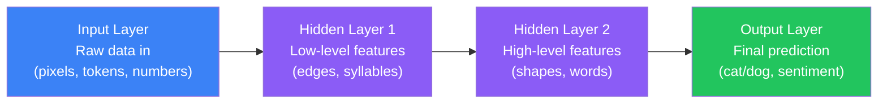

**Inside every neuron:**

```
inputs × weights  →  sum  →  + bias  →  activation function  →  output
   [x₁, x₂, x₃]    Σ(xᵢwᵢ)    +b         ReLU / Sigmoid          yhat
```

- **Weights** — how much each input matters (learned during training)
- **Bias** — shifts the activation threshold (also learned)
- **Activation function** — adds non-linearity so the network can learn complex patterns

---

## 4. Activation Functions — Quick Reference

| Function | Formula (text) | Range | Use When |
|---|---|---|---|
| **ReLU** | max(0, x) | [0, ∞) | Hidden layers — default choice |
| **Leaky ReLU** | max(0.01x, x) | (-∞, ∞) | Hidden layers — prevents dead neurons |
| **Sigmoid** | 1 / (1 + e^-x) | (0, 1) | Binary output layer |
| **Tanh** | (e^x - e^-x) / (e^x + e^-x) | (-1, 1) | RNN hidden states |
| **Softmax** | e^xᵢ / Σe^xⱼ | (0, 1), sums to 1 | Multi-class output layer |

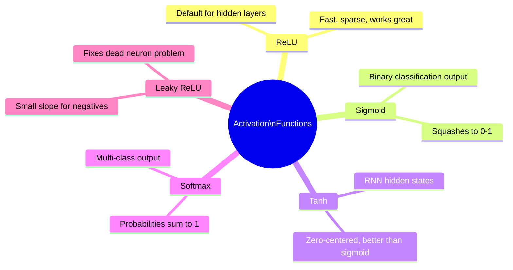

---

## 5. Loss Functions — Quick Reference

| Loss Function | Use When | Good For |
|---|---|---|
| **MSE** (Mean Squared Error) | Predicting a continuous number | House price, temperature forecasting |
| **MAE** (Mean Absolute Error) | Predicting a continuous number, robust to outliers | Sales forecasting |
| **Binary Cross-Entropy** | Output is 0 or 1 | Spam/not-spam, cat/not-cat |
| **Categorical Cross-Entropy** | Output is one of N classes | MNIST digits, ImageNet |

> **Rule of thumb:** Regression → MSE/MAE. Binary classification → Binary Cross-Entropy. Multi-class → Categorical Cross-Entropy.

---

## 6. Training Pipeline

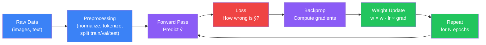

Each full pass through the dataset = **1 epoch**. Each pass through one batch = **1 iteration**. The loop runs until loss converges.

---

## 7. Gradient Descent Variants

| Variant | Dataset Size Used Per Update | Speed | Noise Level | Best For |
|---|---|---|---|---|
| **Batch GD** | Entire dataset | Slow | Low (smooth) | Small datasets |
| **Stochastic GD (SGD)** | 1 example | Fast | High (noisy) | Online learning |
| **Mini-Batch GD** | 32–512 examples | Balanced | Medium | Default — most training |

> **Mini-Batch is the standard.** Batch size of 32 or 64 works well in most cases.

---

## 8. Optimizers — Quick Reference

| Optimizer | How It Works | Best For |
|---|---|---|
| **SGD** | Plain gradient step | Baseline, image models with tuning |
| **Momentum** | Adds velocity from past gradients | Faster convergence than plain SGD |
| **RMSProp** | Adapts learning rate per parameter | RNNs, non-stationary problems |
| **Adam** | Momentum + RMSProp combined | Default choice for most tasks |
| **AdamW** | Adam + weight decay (L2 regularization) | Transformers, large language models |

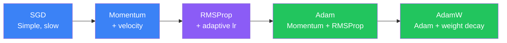

---

## 9. CNN — Convolutional Neural Network

**Best for: images, video, spatial data**

### Building Blocks

| Layer | What It Does | Analogy |
|---|---|---|
| **Conv Layer** | Slides a filter across the image, detects local patterns | Spotlight scanning for a face |
| **ReLU** | Removes negatives, keeps non-linearity | Throws away irrelevant signals |
| **Pooling** | Shrinks spatial size, keeps strongest signal | Compressing a photo thumbnail |
| **Flatten** | Converts 2D feature map to 1D vector | Unrolling a crumpled paper |
| **Dense** | Standard fully-connected layer, final classification | Voting on what the features mean |

### What Each Layer Learns

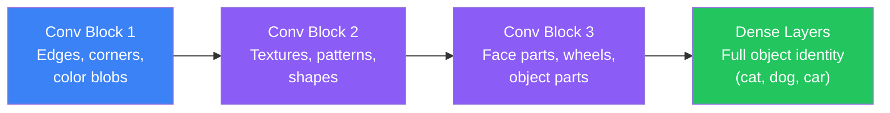

### CNN Architecture Flow

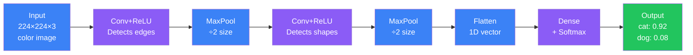

---

## 10. RNN — Recurrent Neural Network

**Best for: short sequences where order matters**

An RNN passes a **hidden state** forward through time — each step sees the current input plus a memory of what came before.

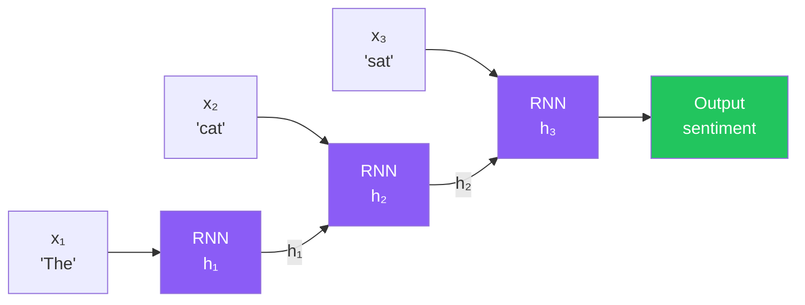

**Core problem:** Vanishing gradients. After ~10 steps, early information is effectively gone. "The cat that sat on the mat which was next to the window ___ " — the RNN forgets "cat" by the time it needs to predict the verb.

---

## 11. LSTM — Long Short-Term Memory

**Best for: long sequences, text generation, speech recognition**

LSTM adds a **cell state** (long-term memory tape) alongside the hidden state, controlled by three learned gates.

| Gate | Question It Answers | Operation |
|---|---|---|
| **Forget Gate** | What old information should be erased? | Multiply cell state by 0–1 |
| **Input Gate** | What new information should be written? | Add to cell state |
| **Output Gate** | What should I output right now? | Filter cell state → hidden state |

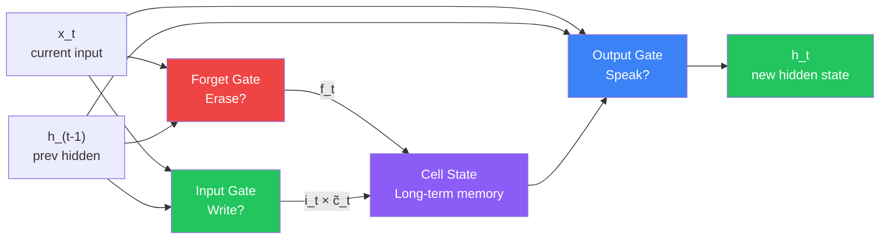

**Why it works:** The cell state can carry information across hundreds of timesteps without shrinking — gradients flow through the cell state highway nearly unchanged.

---

## 12. GRU — Gated Recurrent Unit

**Best for: limited compute, time-series, when LSTM is overkill**

GRU is a streamlined LSTM with only two gates and no separate cell state.

| Gate | Purpose |
|---|---|
| **Reset Gate** | How much of the past to forget |
| **Update Gate** | How much new input vs old hidden state to keep |

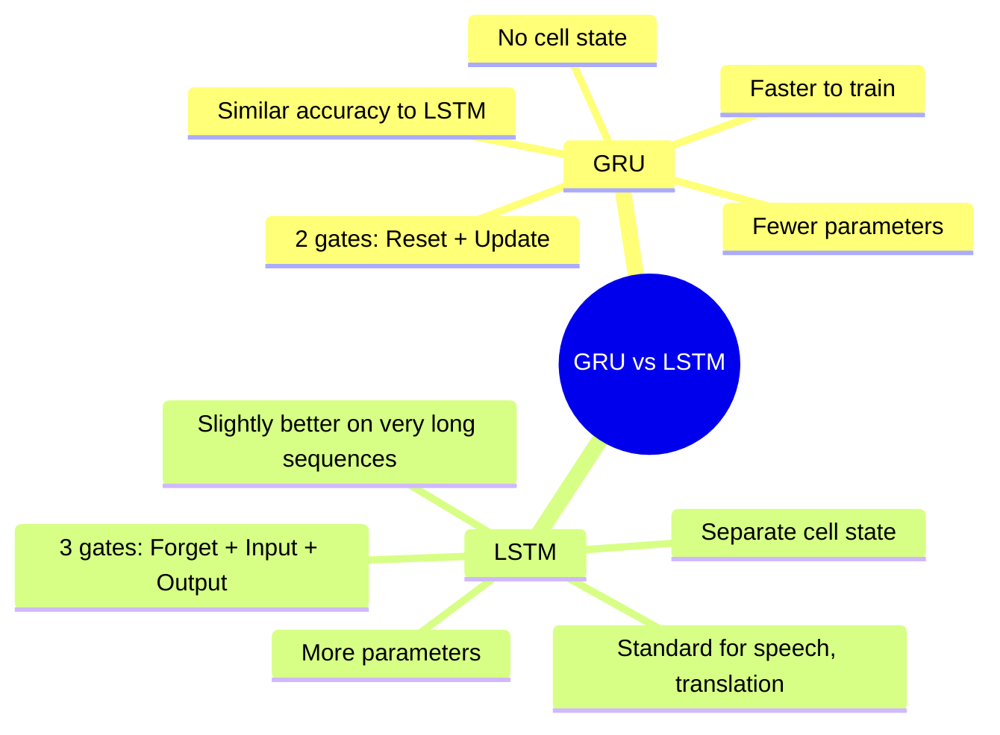

> **Rule of thumb:** Start with GRU. If accuracy is insufficient, upgrade to LSTM. If sequence is very long or data is large, consider Transformer.

---

## 13. Attention Mechanism

**Enabled Transformers — the most important idea in modern AI**

Attention answers: *"When predicting this output word, which input words matter most?"*

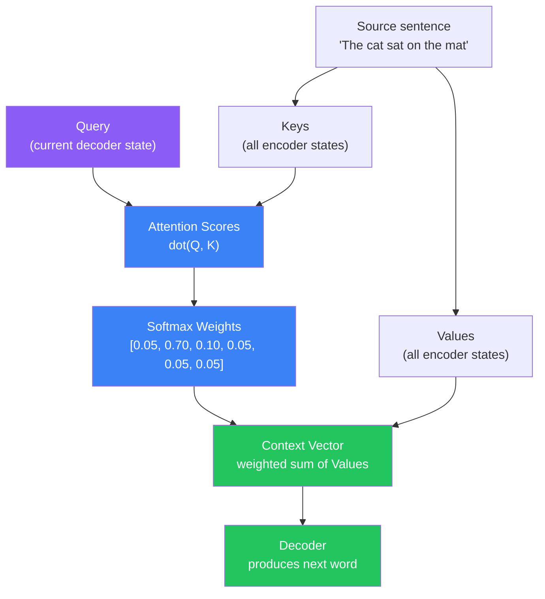

**Self-attention:** The sequence attends to *itself* — every position can look at every other position simultaneously. This is what powers Transformers.

---

## 14. Transformer Architecture

**Best for: NLP, large-scale sequence modeling, vision (ViT)**

| Component | Role |
|---|---|
| **Embedding** | Converts tokens (words) to dense vectors |
| **Positional Encoding** | Injects word-order information (Transformers have no recurrence) |
| **Multi-Head Attention** | Runs multiple attention heads in parallel — captures different relationships |
| **Feed-Forward Network** | Position-wise dense layers after attention |
| **Layer Normalization** | Stabilizes training, applied after each sub-layer |


### Transformer Variants

| Variant | Architecture | Best For | Examples |
|---|---|---|---|
| **Encoder-Only** | Only encoder stack | Understanding text | BERT, RoBERTa |
| **Decoder-Only** | Only decoder stack | Generating text | GPT-2, GPT-4, LLaMA |
| **Encoder-Decoder** | Both stacks | Sequence-to-sequence | T5, BART, mT5 |

---

## 15. Architecture Selection Guide

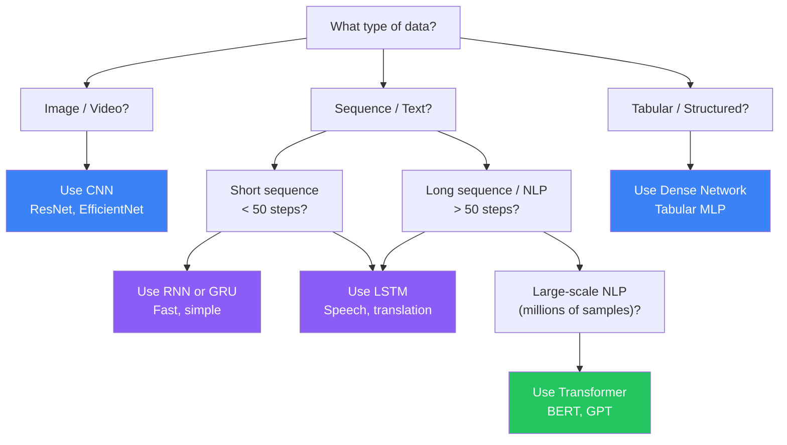

---

## 16. Hyperparameter Quick Reference

| Hyperparameter | Typical Default | Notes |
|---|---|---|
| **Learning Rate** | 1e-3 (Adam), 1e-2 (SGD) | Most critical hyperparameter — too high diverges, too low stalls |
| **Batch Size** | 32–128 | Larger = stable gradients, needs more memory |
| **Epochs** | 10–100 | Use early stopping — stop when val loss stops improving |
| **Dropout Rate** | 0.2–0.5 | Apply to Dense layers; 0 means no dropout |
| **Optimizer** | Adam | AdamW for Transformers |
| **Weight Decay** | 1e-4 to 1e-2 | L2 regularization coefficient |

---

## 17. Common Problems and Fixes

| Problem | Symptoms | Fixes |
|---|---|---|
| **Overfitting** | Train loss low, Val loss high | Add Dropout, L2 regularization, data augmentation, more training data, early stopping |
| **Underfitting** | Both losses high | Bigger model, more epochs, reduce regularization, check data quality |
| **Vanishing Gradient** | Deep RNN learns nothing | Switch to LSTM/GRU/Transformer, use ReLU, add Batch Normalization |
| **Exploding Gradient** | Loss becomes NaN | Gradient clipping (`clipnorm=1.0`), lower learning rate |
| **Slow Training** | Epochs take hours | Use GPU, increase batch size, mixed-precision training (float16) |
| **High Loss / Not Converging** | Loss stays high from epoch 1 | Check learning rate (try 1e-3), verify data preprocessing (normalize!), check labels |

---

## 18. Python Quick Snippets

### Build a CNN in 5 Lines (Keras)

```python
from tensorflow.keras import layers, models

model = models.Sequential([
    layers.Conv2D(32, (3,3), activation='relu', input_shape=(28,28,1)),
    layers.MaxPooling2D(),
    layers.Conv2D(64, (3,3), activation='relu'),
    layers.Flatten(),
    layers.Dense(10, activation='softmax')   # 10 MNIST digit classes
])
```

### Build an LSTM in 3 Lines (Keras)

```python
from tensorflow.keras import layers, models

model = models.Sequential([
    layers.Embedding(input_dim=10000, output_dim=64),       # vocabulary → vectors
    layers.LSTM(128, return_sequences=False),                # 128-unit LSTM
    layers.Dense(1, activation='sigmoid')                    # binary sentiment output
])
```

### Build a GRU in 3 Lines (Keras)

```python
model = models.Sequential([
    layers.Embedding(input_dim=10000, output_dim=64),
    layers.GRU(64),                                          # faster than LSTM
    layers.Dense(3, activation='softmax')                    # 3-class sentiment
])
```

### Load a Pretrained Transformer in 3 Lines (Hugging Face)

```python
from transformers import pipeline

classifier = pipeline("sentiment-analysis",
                      model="distilbert-base-uncased-finetuned-sst-2-english")
result = classifier("This movie was absolutely brilliant!")
# [{'label': 'POSITIVE', 'score': 0.9998}]
```

### Train Any Keras Model in 2 Lines

```python
model.compile(optimizer='adam', loss='categorical_crossentropy', metrics=['accuracy'])
model.fit(X_train, y_train, epochs=10, batch_size=32, validation_split=0.2)
```

### PyTorch CNN Forward Pass

```python
import torch
import torch.nn as nn

class SimpleCNN(nn.Module):
    def __init__(self):
        super().__init__()
        self.conv = nn.Conv2d(1, 32, kernel_size=3, padding=1)
        self.pool = nn.MaxPool2d(2)
        self.fc   = nn.Linear(32 * 14 * 14, 10)

    def forward(self, x):
        x = torch.relu(self.conv(x))  # (B, 32, 28, 28)
        x = self.pool(x)              # (B, 32, 14, 14)
        x = x.view(x.size(0), -1)    # flatten
        return self.fc(x)             # (B, 10) logits
```

### TensorFlow.js — Inference in Browser

```javascript
// Load a pre-trained model and classify an image in the browser
const model = await tf.loadLayersModel('https://example.com/model/model.json');
const image = tf.browser.fromPixels(imgElement).resizeBilinear([224, 224]);
const input = image.expandDims(0).div(255.0);   // normalize to [0, 1]
const prediction = model.predict(input);
const classIndex = prediction.argMax(-1).dataSync()[0];
console.log('Predicted class:', classIndex);
```

---

## 19. Summary Table — All Phase 3 Concepts

| Concept | Key Point |
|---|---|
| Neural Network | Layers of neurons; each neuron = weighted sum + bias + activation |
| Forward Pass | Data flows input → hidden → output, producing a prediction |
| Loss Function | Measures how wrong the prediction is (MSE, Cross-Entropy) |
| Backpropagation | Flows error backwards; computes gradient for every weight |
| Gradient Descent | Updates weights by stepping opposite to the gradient |
| Learning Rate | Controls step size; too high = diverge, too low = slow |
| Mini-Batch | Standard training: update weights every 32–128 examples |
| Adam Optimizer | Adaptive per-parameter learning rate; default for most tasks |
| ReLU | max(0,x) — default hidden layer activation |
| Softmax | Converts logits to probabilities for multi-class output |
| Overfitting | Model memorizes training data; fix with dropout/regularization |
| CNN | Convolution + Pooling extracts spatial features from images |
| Pooling | Reduces spatial size, keeps dominant signals |
| RNN | Passes hidden state forward through a sequence; forgets long-range |
| Vanishing Gradient | Gradients shrink to zero in deep RNNs; solved by LSTM/GRU |
| LSTM | 3 gates (Forget/Input/Output) + cell state = long-term memory |
| GRU | 2 gates (Reset/Update), no cell state; faster than LSTM |
| Attention | Assigns relevance scores; lets model focus on important positions |
| Self-Attention | Sequence attends to itself; every position sees every other |
| Transformer | Multi-head self-attention + FFN; no recurrence, parallelizable |
| BERT | Encoder-only Transformer; pre-trained for text understanding |
| GPT | Decoder-only Transformer; pre-trained for text generation |
| Positional Encoding | Injects word-order info since Transformers have no recurrence |
| Transfer Learning | Use pretrained weights, fine-tune on your task |
| Dropout | Randomly zeros neurons during training — prevents overfitting |

---

## 20. Key Papers and Resources

### Landmark Papers

| Paper | Year | What It Changed |
|---|---|---|
| **AlexNet** (Krizhevsky et al.) | 2012 | Showed deep CNNs beat classical CV on ImageNet — started the DL era |
| **Dropout** (Srivastava et al.) | 2014 | Simple regularization that made deep networks trainable |
| **Batch Normalization** (Ioffe & Szegedy) | 2015 | Stabilized training of very deep networks |
| **ResNet** (He et al.) | 2015 | Skip connections enabled 100+ layer networks |
| **Attention Is All You Need** (Vaswani et al.) | 2017 | Introduced the Transformer — basis for all modern LLMs |
| **BERT** (Devlin et al.) | 2018 | Encoder-only Transformer pre-training; dominated NLP benchmarks |
| **GPT-3** (Brown et al.) | 2020 | Showed few-shot learning at massive scale |

### Learning Resources

- [DeepLearning.ai Specialization](https://www.deeplearning.ai/courses/deep-learning-specialization/) — Andrew Ng's foundational course
- [fast.ai Practical Deep Learning](https://course.fast.ai/) — top-down, code-first approach
- [CS231n — Stanford CNN for Visual Recognition](https://cs231n.stanford.edu/) — best CNN course available
- [The Illustrated Transformer](https://jalammar.github.io/illustrated-transformer/) — Jay Alammar's visual walkthrough
- [PyTorch Tutorials](https://pytorch.org/tutorials/) — official hands-on tutorials
- [Hugging Face Course](https://huggingface.co/learn/nlp-course/) — Transformers in practice

---

## 21. Best Practices

1. **Normalize your inputs** — always scale pixel values to [0,1] or standardize features to mean=0, std=1 before training.
2. **Start simple** — begin with a 2–3 layer dense network or shallow CNN, then add depth only when needed.
3. **Use Adam by default** — switch to AdamW for Transformers; try SGD with momentum for image classifiers if you want to tune.
4. **Monitor validation loss** — train loss going down but val loss going up = overfitting. Stop early.
5. **Use dropout on Dense layers** — rate 0.2–0.5. Do not apply dropout to Conv layers in shallow CNNs.
6. **Pretrain and fine-tune** — never train a large model from scratch when a pretrained checkpoint exists. Use transfer learning.
7. **Check your data first** — 80% of training problems are data problems: wrong labels, unnormalized inputs, class imbalance.
8. **Gradient clipping for RNNs** — set `clipnorm=1.0` when training LSTMs/GRUs to prevent exploding gradients.
9. **Use GPU** — even a free Colab T4 GPU is 10–50x faster than a CPU for CNN and Transformer training.
10. **Log experiments** — use Weights & Biases or TensorBoard to track loss curves across runs.

---

## 22. Common Mistakes

- **Not splitting data correctly** — always have train / validation / test. Never evaluate on training data.
- **Forgetting to normalize inputs** — raw pixel values in [0, 255] cause slow convergence and NaN losses.
- **Using sigmoid in hidden layers** — sigmoid saturates and causes vanishing gradients. Use ReLU instead.
- **Setting learning rate too high** — loss oscillates or becomes NaN. Start with 1e-3 for Adam.
- **Training for too many epochs without early stopping** — model overfits silently. Always monitor val loss.
- **Using RNN for long sequences** — anything over ~50 steps needs LSTM, GRU, or Transformer.
- **Ignoring class imbalance** — 99% negative class → model predicts all negative and claims 99% accuracy. Use class weights or resample.
- **Not using pretrained models** — training ViT or BERT from scratch without millions of samples wastes compute and gives poor results.
- **Confusing model.evaluate() with model.predict()** — `evaluate` returns loss/accuracy on labeled data; `predict` returns raw predictions.
- **Large batch size without scaling LR** — if you double batch size, also scale learning rate (linear scaling rule).

---

## 23. Interview Q&A — Quick Fire

**Q: What is the vanishing gradient problem?**

> Gradients shrink exponentially as they flow backwards through many layers (or timesteps). Early layers receive near-zero gradient and learn nothing. Fixed by ReLU activations, skip connections (ResNet), or gated architectures (LSTM/GRU).

**Q: What is the difference between CNN and RNN?**

> CNN uses spatial convolution to detect local patterns in grids (images). RNN processes sequences step-by-step, maintaining a hidden state across time. CNN is position-invariant and parallelizable; RNN is inherently sequential.

**Q: Why does LSTM solve vanishing gradients?**

> The cell state acts as a gradient highway — gradients flow through the cell state mostly unchanged across many timesteps, because the forget gate allows near-1 values. In contrast, plain RNNs multiply the same weight matrix at every step, causing exponential shrinkage.

**Q: What makes the Transformer better than LSTM?**

> Transformers process all positions in parallel (no sequential bottleneck), use self-attention so every token can directly attend to every other token regardless of distance, and scale far better with data and compute. LSTM processes step by step and struggles with very long dependencies.

**Q: When would you choose GRU over LSTM?**

> GRU has fewer parameters and trains faster. Choose GRU when compute is limited, sequences are medium length, or you want a simpler baseline. Use LSTM when you need the extra capacity — for example, very long sequences or speech recognition tasks.

**Q: What is self-attention?**

> Self-attention is an operation where each position in a sequence computes relevance scores against all other positions in the same sequence. The output for each position is a weighted sum of all value vectors, where weights are the attention scores. This allows modeling long-range dependencies in O(1) layers.

**Q: What is the role of positional encoding in Transformers?**

> Transformers have no recurrence and process all positions simultaneously, so they have no inherent notion of order. Positional encodings (fixed sine/cosine patterns or learned embeddings) are added to token embeddings to inject word-order information.

---

## 24. What is Next — Phase 4: LLMs

Phase 3 covered the foundations. Phase 4 applies them at industrial scale:

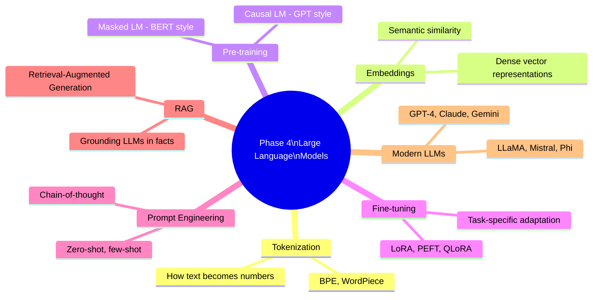

Every concept you learned in Phase 3 directly applies:

- **Embeddings** = learned token representations (like CNN feature maps, but for text)
- **Transformer blocks** = the building blocks of every modern LLM
- **Pre-training** = self-supervised learning at scale on internet text
- **Fine-tuning** = transfer learning — same idea as fine-tuning a ResNet on your own images
- **RLHF** = reinforcement learning applied on top of a pre-trained LM to align behavior

---

## Navigation

**Previous:** [19. Deep Learning Pipeline](/ai/phase-03-deep-learning/19-deep-learning-pipeline)

**Next:** Phase 4 — Large Language Models *(coming soon)*
