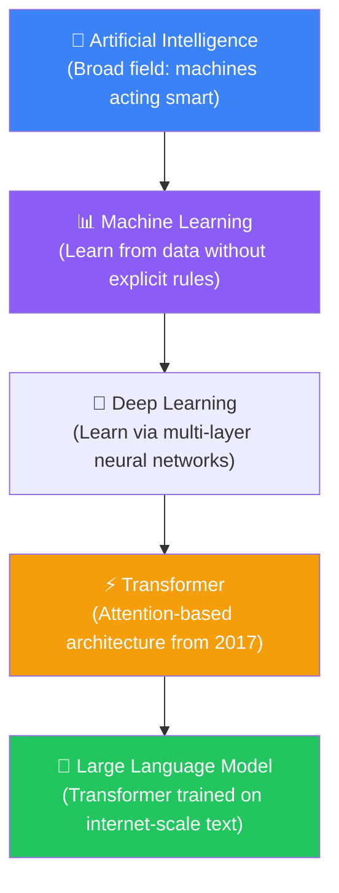
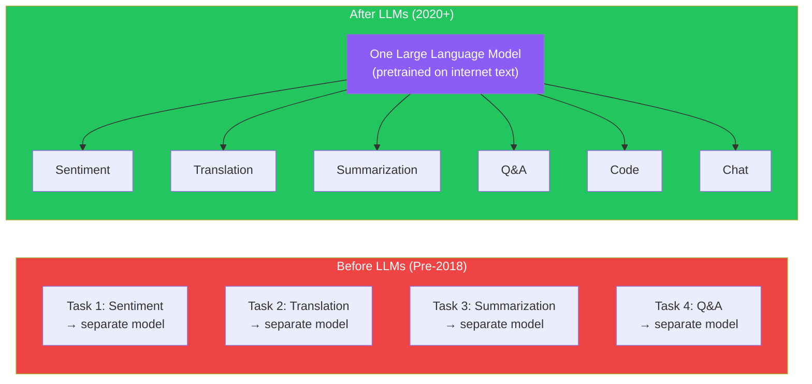
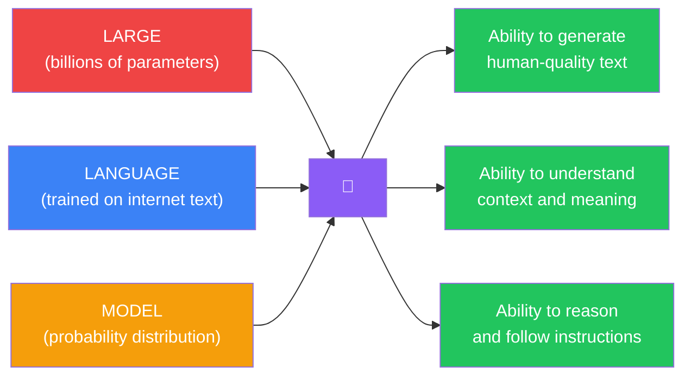
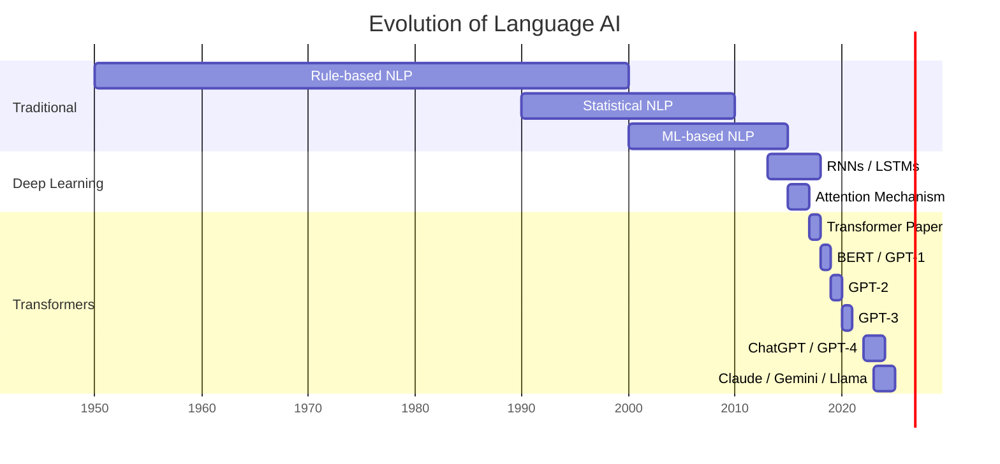
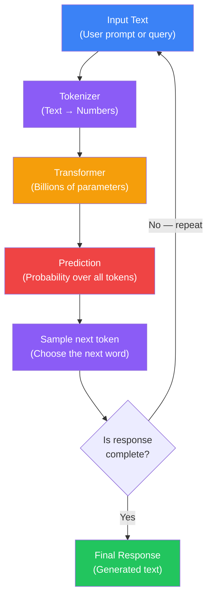
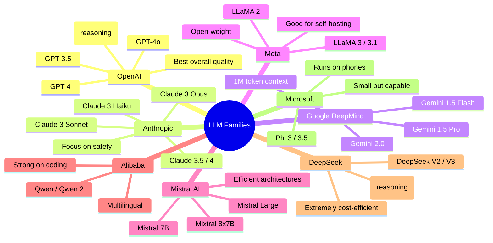
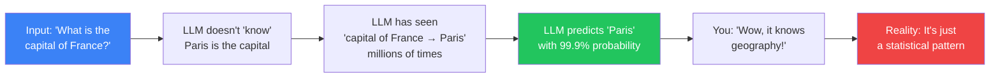
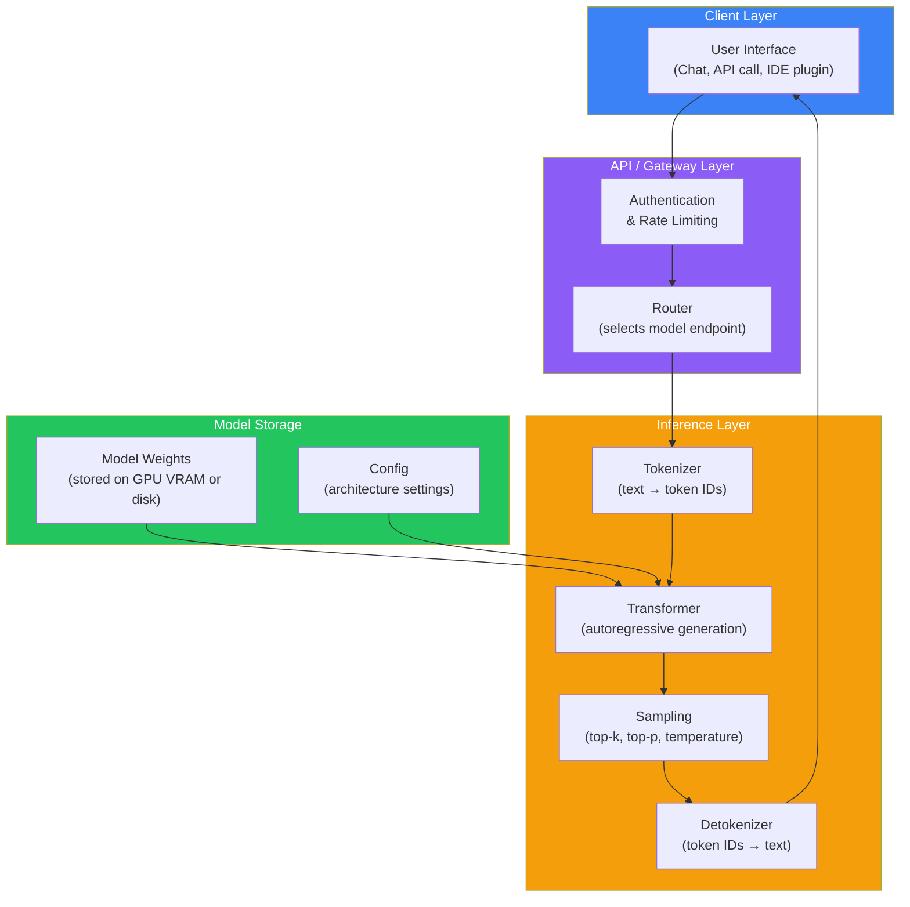

## Introduction

> **A Large Language Model (LLM) is a neural network trained on massive amounts of text to predict the next word in a sequence — and that simple ability, at massive scale, produces systems that can write, reason, translate, summarize, and hold conversations.**

LLMs are the technology behind ChatGPT, Claude, Gemini, GitHub Copilot, and every modern AI assistant you have heard of. They represent the culmination of decades of AI research, combining the scale of the internet's text data with the power of Transformer neural networks and the parallel processing of modern GPU hardware.



---

## Why This Exists

### The Problem Before LLMs

Before LLMs, computers could not understand natural language. They could process text — search for keywords, match patterns, follow rules — but they could not **understand** meaning.

**Traditional NLP (Pre-2018):**

- Keyword matching: "I'm not happy" → searches for "happy" → misses the "not"
- Rule-based systems: Thousands of hand-written grammar rules that break on every edge case
- Statistical models: Naive Bayes, SVM — required manual feature engineering, could only handle simple tasks
- No concept of context, sarcasm, analogy, or reasoning

**Example — Customer support before LLMs:**

> User: "My order hasn't arrived and it's been three weeks. I'm extremely frustrated."
>
> Traditional bot: "I found the keyword 'order'. Did you mean to track your order? Type your order number."
>
> The bot could not detect frustration, understand the time reference, or empathize.

### What LLMs Solved

LLMs brought three breakthroughs:

1. **Understanding context** — They don't match keywords; they understand the meaning behind words
2. **Generalization** — One model can summarize, translate, code, write poetry, and answer questions — no separate model needed for each task
3. **Emergent abilities** — At sufficient scale, models develop abilities that were never explicitly programmed: reasoning, analogies, chain-of-thought, even theory of mind



---

## Deconstructing "Large Language Model"

Every word in the name tells you something important.

| Word | Meaning | Why It Matters |
|------|---------|----------------|
| **Large** | The model has billions of parameters and was trained on massive data | Small models can't do what large models can — scale creates emergent abilities |
| **Language** | The model processes human language — text in, text out | It understands words, sentences, documents, and conversations |
| **Model** | A mathematical approximation of the patterns in its training data | It's not a database, it's a **pattern predictor** — it models the probability distribution of language |

> **Put together:** A Large Language Model is a mathematical system, trained on billions of text documents, that predicts the next word in a sequence with such accuracy that it appears to understand and generate human language.



---

## Real-World Analogy

### The Librarian Who Read Everything

Imagine a librarian who has read **every book ever written** — every novel, textbook, blog post, poem, research paper, Wikipedia article, and Reddit thread.

You give her the start of a sentence: "The cat sat on the..."

She doesn't think about cats or mats. She has read "The cat sat on the mat" 10,000 times, "The cat sat on the roof" 500 times, and "The cat sat on the fence" 200 times.

Based on everything she has read, she predicts the most likely next word: "mat."

**Now expand this:** She doesn't just predict one word. She predicts the next word after that. And the next. One word at a time, she builds entire paragraphs, essays, stories — all based on the statistical patterns she absorbed from her training.

**The key insight:** She is not thinking. She is not conscious. She is doing what she has done a trillion times: pattern matching at an unimaginable scale.

---

## The Difference Between NLMs, ML, DL, Transformers, and LLMs

| Technology | What It Does | Example | Limitation |
|------------|-------------|---------|------------|
| **Traditional NLP** | Follows hand-written rules for text | Regex, keyword matching | Cannot handle ambiguity or nuance |
| **Machine Learning** | Learns patterns from labeled data | Spam classifier, regression | Requires feature engineering; limited on text |
| **Deep Learning** | Multi-layer neural networks learn hierarchical features | CNNs for images, RNNs for sequences | RNNs are slow; can't parallelize |
| **Transformer** | Architecture using self-attention to process sequences in parallel | BERT (understanding), GPT (generation) | The foundation, not the final product |
| **LLM** | A massive Transformer trained on internet-scale text | ChatGPT, Claude, Gemini | Expensive to run; can hallucinate |



---

## How LLMs Work (High Level)



1. **Input** — A user types a prompt: "Explain quantum computing in simple terms"
2. **Tokenization** — The text is split into tokens (words/subwords) and converted to numbers
3. **Transformer** — The numbers pass through 100+ layers of neural network, each layer refining the representation using self-attention and feed-forward computation
4. **Prediction** — The final layer outputs a probability distribution over the entire vocabulary (~50,000–200,000 possible tokens)
5. **Sampling** — The model selects one token (the most likely, or randomly weighted by probability)
6. **Repeat** — The new token is appended to the input, and steps 2–5 repeat until the model outputs a stop token or reaches the token limit

---

## Major LLM Families

Here is a comparison of the major LLM families available today:



### Detailed Comparison

| Model | Creator | Size Range | Context Window | Cost | Best For | Open? |
|-------|---------|-----------|---------------|------|----------|-------|
| **GPT-4o** | OpenAI | Unknown | 128K | $$$ | General, coding, reasoning | No |
| **Claude 3 Opus** | Anthropic | Unknown | 200K | $$$ | Long docs, analysis, safety | No |
| **Gemini 1.5 Pro** | Google | Unknown | 1M | $$ | Very long context, multimodal | No |
| **LLaMA 3.1 405B** | Meta | 8B, 70B, 405B | 128K | Free | Self-hosting, research | Yes |
| **Mistral Large** | Mistral | Unknown | 128K | $$ | Efficiency, multilingual | No |
| **Mixtral 8x7B** | Mistral | 46B total (MoE) | 32K | Low | Self-hosting on modest hardware | Yes |
| **Qwen 2.5 72B** | Alibaba | 7B, 14B, 72B | 128K | Low-Med | Coding, math, Chinese/English | Yes |
| **DeepSeek V3** | DeepSeek | 671B (MoE) | 128K | Very Low | Cost-efficient, coding | Yes |
| **Phi 3** | Microsoft | 3.8B, 14B | 128K | Very Low | On-device, simple tasks | Yes |
| **Gemma 2** | Google | 2B, 9B, 27B | 8K | Free | Lightweight research | Yes |

> **Note on "Open":** Strictly open-source models (open weights + open data + open training code) are rare. Most models listed as "Yes" here are "open-weight" — you can download and run the model weights, but the training data and training code are not public.

---

## What Makes LLMs Feel Intelligent?



LLMs feel intelligent because:

1. **Pattern completion at scale** — When you see a friend and say "Long time, no..." you complete "see" automatically. LLMs do this with every concept, across billions of patterns, simultaneously.

2. **Emergent abilities** — When a model reaches a certain size (~70B+ parameters), it develops abilities that smaller versions don't have: reasoning, step-by-step thinking, analogical reasoning. No one programmed these — they emerged from scale.

3. **Massive training data** — The model has been exposed to more text than any human could read in 100 lifetimes. It has seen every argument, every explanation, every analogy — and can recombine them.

4. **In-context learning** — LLMs can learn a new task from a few examples in the prompt, without any weight updates. This makes them appear to "understand" instructions instantly.

### The Critical Distinction: Prediction vs. Understanding

> **LLMs are prediction engines — not thinking machines.**

- They do **not** understand truth
- They do **not** have beliefs
- They do **not** have consciousness
- They do **not** have intentions
- They do **not** have memory (beyond the context window)

When an LLM says "I think the answer is X," it is not thinking. It is generating a sequence of tokens that statistically matches the pattern of a thoughtful person giving an answer.

---

## What LLMs Can and Cannot Do

### Capabilities

| Capability | Example | Why It Works |
|------------|---------|-------------|
| **Summarization** | "Summarize this 100-page PDF" | Training data contained countless examples of summaries |
| **Translation** | "Translate to Spanish" | Training data was multilingual |
| **Code generation** | "Write a Python function to sort a list" | Training data contained GitHub repositories |
| **Creative writing** | "Write a poem about AI in the style of Shakespeare" | Training data contained literature in every style |
| **Reasoning** | Solve a logic puzzle step by step | At scale, models learn to decompose problems |
| **Role-playing** | "Act as a history professor" | Training data contained dialogues, role-play, and instruction examples |
| **Tool use** | "Find today's weather" (calls a function) | Fine-tuned for function calling |

### Limitations

| Limitation | Example | Why |
|------------|---------|-----|
| **Hallucination** | States fake facts confidently | Model prioritizes plausible text over truth |
| **No true reasoning** | Fails on simple math if pattern is unusual | It's pattern matching, not mathematical reasoning |
| **No memory beyond context** | Forgets what you said 1000 tokens ago | Fixed context window size |
| **No real-time awareness** | Doesn't know today's news (unless using tools) | Training data has a cutoff date |
| **Biases from training data** | Exhibits social biases | Learns biases present in internet text |
| **No causal understanding** | Can't tell correlation vs causation | Predicts text, doesn't model the world |
| **Sensitive to prompt wording** | Same question rephrased → different answer | No grounded understanding of meaning |

---

## Python Example: Using an LLM

```python
# The simplest way to use an LLM — through an API

# Install: pip install openai
from openai import OpenAI

client = OpenAI(api_key="your-api-key")  # Get key from platform.openai.com

response = client.chat.completions.create(
    model="gpt-4o",
    messages=[
        {"role": "system", "content": "You are a helpful tutor who explains things simply."},
        {"role": "user", "content": "What is an LLM in one paragraph?"}
    ]
)

print(response.choices[0].message.content)
# LLM stands for Large Language Model — a neural network trained on massive text data
# that predicts the next word in a sequence. By repeating this prediction millions of
# times, LLMs can generate coherent text, answer questions, write code, and hold
# conversations. They don't "think" or "understand" — they excel at statistical
# pattern matching at an enormous scale.
```

## JavaScript Example: Using an LLM

```javascript
// Install: npm install openai
import OpenAI from 'openai';

const openai = new OpenAI({ apiKey: 'your-api-key' });

async function askLLM() {
  const response = await openai.chat.completions.create({
    model: 'gpt-4o',
    messages: [
      { role: 'system', content: 'You explain concepts simply.' },
      { role: 'user', content: 'What is an LLM in one paragraph?' }
    ]
  });

  console.log(response.choices[0].message.content);
  // LLM stands for Large Language Model...
}

askLLM();
```

---

## Architecture Diagram: LLM as a System



---

## Best Practices

1. **Choose the right model for the task** — GPT-4o is great for complex reasoning; smaller models like Claude Haiku or GPT-4o mini are faster and cheaper for simple tasks
2. **Match model size to hardware** — Don't try to run a 405B parameter model on a laptop; use API-based models or quantized smaller models for local use
3. **Understand the pricing model** — LLM APIs charge per token (input + output); cost can accumulate fast with long prompts or high traffic
4. **Use system prompts** — Set the behavior, tone, and constraints in a system message rather than relying on the user to describe what they want
5. **Always validate outputs** — LLMs can hallucinate; verify facts, test code, review generated content before using it
6. **Monitor for prompt injection** — Users may try to override your system instructions; implement input sanitization and output filtering

---

## Common Misconceptions

| Misconception | Truth |
|--------------|-------|
| "LLMs understand language like humans" | LLMs have no understanding, consciousness, or awareness — they perform statistical pattern matching |
| "LLMs have access to the internet" | No — they only know what was in their training data (cutoff date varies) |
| "LLMs will replace all jobs" | LLMs are tools that augment humans, not replace them — they lack agency, physical presence, and true reasoning |
| "Bigger models are always better" | Larger models are more capable but also more expensive and slower; smaller models can outperform on specific tasks with fine-tuning |
| "Open-source LLMs are as good as GPT-4" | Open models are catching up fast but typically lag 6–18 months behind the best proprietary models |
| "LLMs can do math perfectly" | LLMs are not calculators — they can approximate but may fail on simple arithmetic; use code execution for precise math |

---

## Interview Questions

### Easy

**Q: What does LLM stand for and what does it do?**

> LLM stands for Large Language Model. It is a neural network trained on massive amounts of text data that generates text by predicting the next word in a sequence. By repeating this prediction step-by-step, it can write essays, answer questions, summarize documents, and hold conversations.

**Q: What is the difference between a traditional ML model and an LLM?**

> Traditional ML models are trained for specific tasks (like spam classification or sentiment analysis) and require labeled data and feature engineering for each task. LLMs are general-purpose: one single model trained on diverse internet text can perform hundreds of different tasks — translation, summarization, code generation, Q&A, creative writing — without needing separate training for each one.

### Medium

**Q: Why are LLMs called "large"? What makes them large?**

> "Large" refers to three things: (1) the number of parameters — modern LLMs have tens to hundreds of billions of parameters, (2) the training data — they are trained on trillions of tokens from the internet, books, and code repositories, and (3) the computational resources — training requires thousands of GPUs running for weeks or months. The combination of these three factors creates emergent abilities that smaller models lack.

**Q: Explain why LLMs appear intelligent but are not actually thinking.**

> LLMs appear intelligent because they have been trained on virtually every text ever written by humans. When asked a question, the model doesn't "think" about the answer — it calculates the most likely sequence of tokens based on statistical patterns in its training data. A useful analogy: a LLM is like a parrot that has heard every conversation ever recorded. It can say the right thing in the right context because it has heard it so many times, not because it understands what it is saying. This is why LLMs can confidently state falsehoods (hallucinations) — they are producing statistically plausible text, not verifying truth.

### Hard

**Q: What are emergent abilities in LLMs, and why do they matter?**

> Emergent abilities are capabilities that appear only when a model reaches a certain size threshold — they are not present in smaller versions of the same architecture. Examples include: chain-of-thought reasoning, in-context learning (learning a new task from examples without weight updates), code generation, and solving arithmetic problems. These abilities are notoriously unpredictable — researchers don't know exactly at what scale they will appear or which abilities will emerge. This is significant because it means our understanding of LLM capabilities is always incomplete: a model 2x larger may do things we didn't expect, and a model 2x smaller may lack abilities we assumed were basic.

**Q: What is the difference between a foundation model and a fine-tuned model?**

> A foundation model (e.g., GPT-3 base, LLaMA-3 base) is trained on raw internet text using self-supervised learning — next-token prediction. It is extremely capable but hard to use because it continues text rather than following instructions. A fine-tuned model (e.g., GPT-3.5-turbo, LLaMA-3-Chat) is a foundation model that has been further trained on instruction-response pairs and preference data (RLHF). Fine-tuning aligns the model to be helpful, follow instructions, and refuse harmful requests. The foundation model is a raw intelligence engine; the fine-tuned model is a polished assistant. Most users interact with fine-tuned models.

---

## Summary

| Concept | Key Point |
|---------|-----------|
| **LLM** | Large Language Model — neural network trained on internet-scale text to predict the next token |
| **"Large"** | Billions of parameters, trillions of training tokens, thousands of GPUs |
| **"Language"** | Processes and generates human language text |
| **"Model"** | A mathematical approximation of language patterns — a prediction engine, not a thinking machine |
| **Key technology** | Transformer architecture with self-attention |
| **How it works** | Tokenize → predict next token → append → repeat |
| **Emergent abilities** | Capabilities that appear at scale (reasoning, in-context learning) |
| **Major families** | GPT (OpenAI), Claude (Anthropic), Gemini (Google), LLaMA (Meta), Mistral, Qwen, DeepSeek |
| **Not thinking** | LLMs do NOT understand, believe, or know — they generate statistically plausible text |
| **Hallucination** | Confident falsehoods — the model generates plausible but incorrect information |

---

## Navigation

**Previous:** [Phase 3 — Deep Learning Cheat Sheet](/ai/phase-03-deep-learning/20-deep-learning-cheatsheet)

**Next:** [02 — How Language Models Work](/ai/phase-04-large-language-models/02-how-language-models-work)

**Related Topics:**
- [What is Deep Learning?](/ai/phase-03-deep-learning/01-what-is-deep-learning)
- [Introduction to Transformers](/ai/phase-03-deep-learning/18-introduction-to-transformers)
- [Neural Networks](/ai/phase-03-deep-learning/03-neural-networks)

**Practice Questions:**
1. List 5 different LLMs and describe how they differ
2. Explain why an LLM is a "prediction engine" rather than a "thinking machine"
3. What emergent ability of LLMs is most surprising to you and why?
4. Draw the high-level flow of how an LLM generates a response
5. Compare a traditional ML spam filter with an LLM — what can the LLM do that the spam filter cannot?

**Further Reading:**
- [OpenAI — GPT-4 Technical Report](https://arxiv.org/abs/2303.08774)
- [Anthropic — The Claude Model Family](https://docs.anthropic.com/en/docs/about-claude/models)
- [LLaMA 3 — Meta's Open LLM](https://ai.meta.com/blog/meta-llama-3/)
- [The Annotated Transformer — Harvard](https://nlp.seas.harvard.edu/2018/04/03/attention.html)
