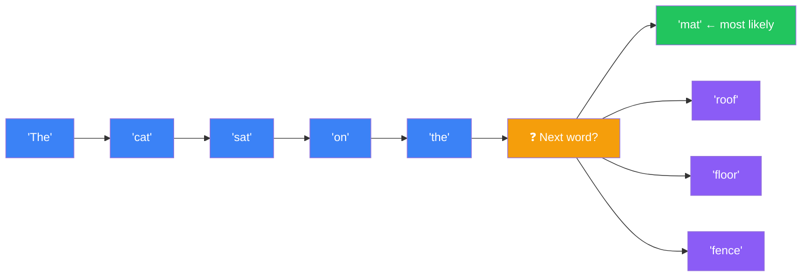
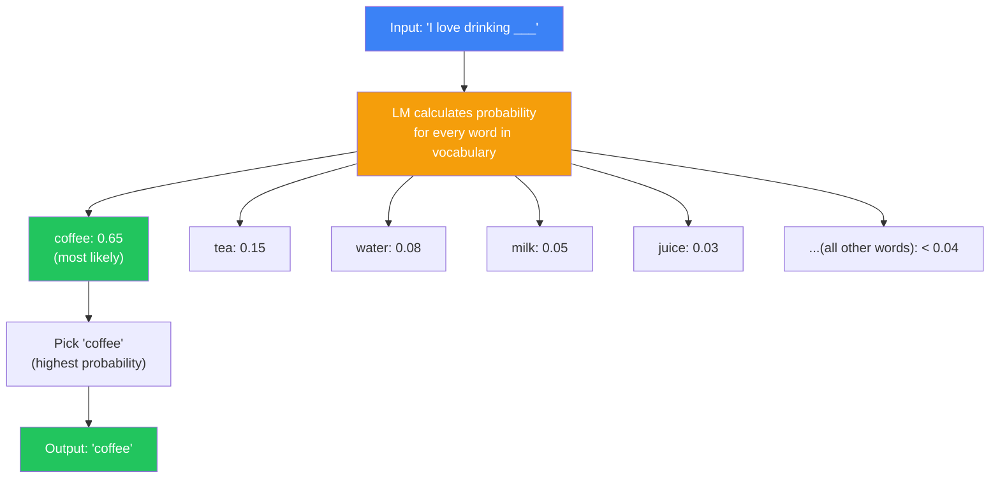
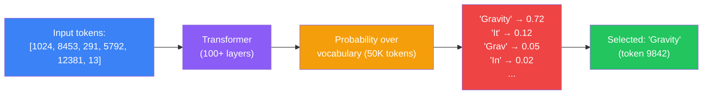
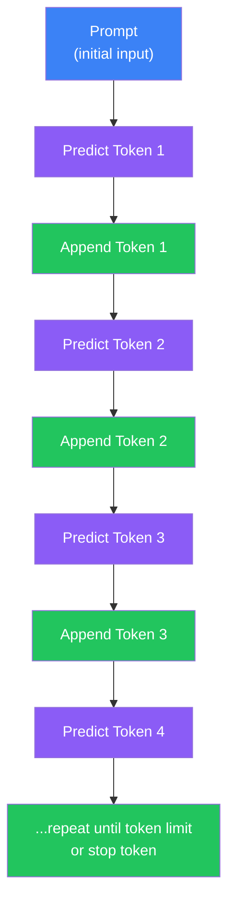
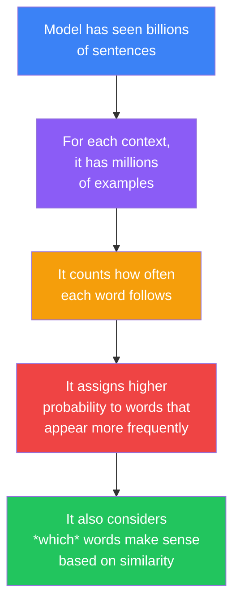
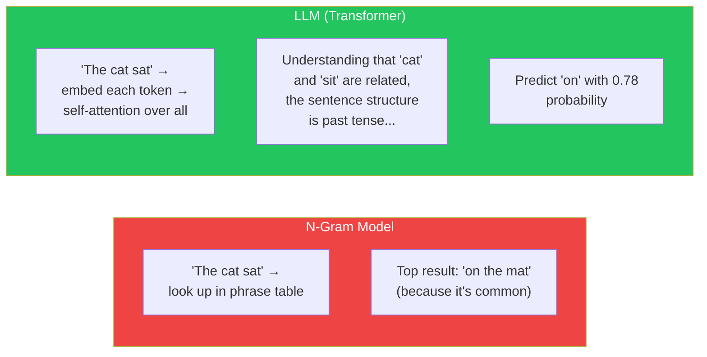
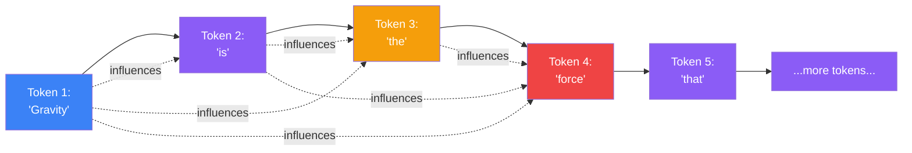
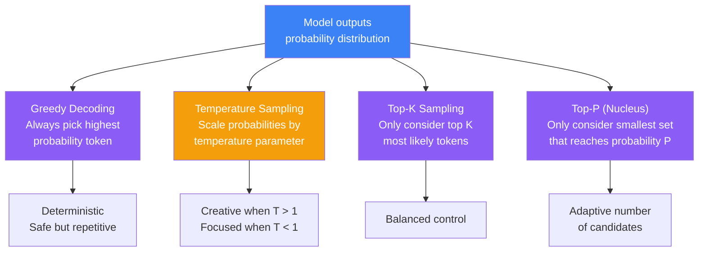

## Introduction

> **A language model is a system that learns the statistical patterns of human language from text data — then uses those patterns to predict what word comes next.**

This is the core of every LLM. From GPT-4 to Claude to Gemini, every modern AI assistant works by doing one thing, billions of times over: **predicting the next token.**



---

## Why This Exists

### The Problem: Computers Don't Understand Language

Computers operate on numbers — binary 0s and 1s, then integers, floats, and logical operations. Human language is:

- **Ambiguous** — "I saw her duck" could mean watching a bird or watching someone lower their head
- **Context-dependent** — "bank" means something different in "river bank" vs "savings bank"
- **Infinite** — You can always create a new sentence that has never been spoken before
- **Rule-breaking** — Poetry, slang, dialects, typos, and creative writing defy strict grammar rules

Before language models, computers could only process text through rigid rules. They could match keywords, apply regex patterns, or follow grammar rules — but they could not handle ambiguity or novelty.

### The Solution: Learn Patterns Instead of Rules

Instead of programming rules for every possible sentence, a language model **learns the patterns of language** from millions of examples. It doesn't know grammar rules explicitly — it absorbs them implicitly by observing which words tend to follow which words.

---

## Real-World Analogy

### The Autocomplete Keyboard

You have used autocomplete on your phone. You type "I am go" and it suggests "going to", "to the", "ing to be".

A language model is this concept expanded by a **billion times**.

```mermaid
flowchart TD
    subgraph PHONE["Phone Autocomplete"]
        A["Type: 'I am go'"] --> B["Suggestions:\n'going' • 'ing to' • 'ne'"]
        B --> C["Tap 'going'"]
        C --> D["New suggestions:\n'to' → 'to the' → 'to be'"]
    end

    subgraph LLM["LLM Autocomplete"]
        E["Prompt: 'Write a 500-word essay\non the importance of'"] --> F["Predict next token"]
        F --> G["...'education'...'critical thinking'...'democracy'"]
        G --> H["Append 'education'"]
        H --> I["Predict next token"]
        I --> J["...'shapes'...'is'...'plays a'"]
        J --> K["Continue... 500 words later"]
    end

    style PHONE fill:#3b82f6,color:#fff
    style LLM fill:#8b5cf6,color:#fff
```



The phone's autocomplete uses a small model with a limited vocabulary (maybe 10,000 words). An LLM uses a massive model with 50,000+ tokens and billions of parameters, trained on the entire internet. But the **underlying principle is identical**: given previous words, predict the next one.

---

## Language Modeling: The Core Idea

### What is a Language Model?

A language model (LM) assigns a **probability** to sequences of words. Given a sequence of words, it tells you how likely that sequence is.

**Example:**

- "I love drinking coffee" → High probability (0.8)
- "I love drinking elephant" → Very low probability (0.000001)
- "Drinking I love coffee" → Low probability (0.0001)

More importantly, given a partial sequence, the LM tells you the probability of **each possible next word**.

### How It Works



The model has learned from training data that:

- "drinking" is often followed by beverage names
- "coffee" is a very common beverage
- "tea" is also common
- "elephant" has never appeared after "drinking" in the training data

**The model is not thinking about coffee or beverages. It has simply observed a statistical pattern: the sequence "I love drinking coffee" appears millions of times in its training data, while "I love drinking elephant" never does.**

---

## The Full Generation Process

Let's walk through how an LLM generates an entire paragraph — one token at a time.

### Step 1: The Input

```
Prompt: "Explain gravity in simple terms."
```

### Step 2: Tokenization

```
["Explain", " gravity", " in", " simple", " terms", "."]
→ [1024, 8453, 291, 5792, 12381, 13]
```

Each token (word or subword) is converted to a unique integer ID.

### Step 3: Predict Token 1



**Output so far:** "Explain gravity in simple terms. Gravity"

### Step 4: Predict Token 2

Now the input is the original prompt + the generated token:

```
"Explain gravity in simple terms. Gravity"
→ [1024, 8453, 291, 5792, 12381, 13, 9842]
```

The model predicts the next token again.

**Output so far:** "Explain gravity in simple terms. Gravity is"

### Step 5: Repeat

This continues, one token at a time, until the model predicts a stop token or reaches the maximum response length.



### The Final Output

After 50–200 tokens of generation:

> "Gravity is the force that pulls objects with mass toward one another. On Earth, it gives us weight and keeps our feet on the ground. The more mass an object has, the stronger its gravitational pull. The Sun's gravity keeps Earth in orbit, while Earth's gravity keeps the Moon circling around us. Gravity is one of the four fundamental forces of nature, and scientists like Isaac Newton and Albert Einstein spent their lives trying to understand it."

The model never "planned" this paragraph. Each word was chosen one at a time, based on the probability distribution at that moment.

---

## How Probability Works (Intuitively)

You do not need to understand the mathematics to understand what a language model does. Think of it this way:



**Example: "The cat sat on the ___"**

The model assigns high probability to words that commonly appear after "the" at the end of a sentence about cats and sitting:

- **mat** — very high (common phrase, makes sense)
- **roof** — medium (possible, depends on context)
- **floor** — medium (also possible)
- **fence** — medium (outdoor context)
- **elephant** — near zero (semantically nonsensical)
- **extrapolation** — near zero (doesn't fit the pattern)

The model learned these probabilities purely from observing text. It never learned what a cat, a mat, or a roof is in the real world.

---

## Comparison: How Different Systems Generate Text

| System | How It Generates | Example |
|--------|-----------------|---------|
| **Simple autocomplete** | Frequency table of common phrases | Phone keyboard |
| **N-gram model** | Considers last N words to predict next | Old Google Search predictions |
| **RNN/LSTM** | Processes words sequentially with a hidden state | Pre-Transformer text generation |
| **LLM (Transformer)** | Self-attention over all tokens simultaneously; massive parallel training | ChatGPT, Claude, Gemini |
| **Retrieval-augmented (RAG)** | LLM + searches a database for relevant info before generating | Modern AI search tools |



The n-gram model is a simple lookup table. The LLM builds a rich contextual understanding using attention over all tokens.

---

## Why Autoregressive Generation Matters

LLMs generate text **autoregressively** — each token depends on all previous tokens, including ones the model generated itself.



This has important implications:

| Effect | What Happens | Example |
|--------|-------------|---------|
| **Coherence** | Later tokens build on earlier ones, creating consistent text | The paragraph stays on topic |
| **Drift** | An early wrong token leads the model down a wrong path | One incorrect fact → more incorrect facts |
| **Repetition** | The model may get stuck in a loop repeating the same phrase | "I love coding. I love coding. I love coding..." |
| **Error compounding** | A small mistake early on grows into larger errors later | Starts with wrong assumption → builds wrong argument |

---

## Sampling Strategies: How the Model Chooses

The model outputs a probability distribution — but how does it choose which token to actually output?



| Strategy | Description | Use Case |
|----------|-------------|----------|
| **Greedy** | Always pick the most likely token | When you need deterministic, safe answers |
| **Temperature** | Scale logits by temperature (0=deterministic, 1=balanced, 2=creative) | Controlling creativity vs. precision |
| **Top-K** | Sample from the top K most likely tokens | Prevents rare/weird tokens |
| **Top-P** | Sample from the smallest set of tokens whose cumulative probability exceeds P | Adaptive — fewer candidates when one is dominant |

> **Temperature analogy:** Think of temperature like a creativity dial. Low temperature (0.1) always picks the most obvious next word — safe, boring, repetitive. High temperature (1.5) picks less likely words more often — creative, surprising, sometimes nonsense. Temperature 0 is a straight-A student who never takes risks. Temperature 1.5 is a poet who uses unusual words.

---

## Python Example: Simple Language Model

```python
# A minimal illustration of how language models predict next words
# This is NOT a real LLM — real LLMs have billions of parameters

import math
from collections import Counter, defaultdict

class SimpleLanguageModel:
    """A very simple bigram language model for illustration only."""

    def __init__(self):
        # Counts of (word1 → word2) occurrences
        self.bigram_counts = defaultdict(Counter)
        self.total_words = 0

    def train(self, text):
        """Learn word transition probabilities from text."""
        words = text.lower().split()
        for i in range(len(words) - 1):
            self.bigram_counts[words[i]][words[i + 1]] += 1
            self.total_words += 1

    def predict_next(self, word, top_n=5):
        """Given a word, predict the most likely next words."""
        word = word.lower()
        if word not in self.bigram_counts:
            return []

        total = sum(self.bigram_counts[word].values())
        predictions = []
        for next_word, count in self.bigram_counts[word].most_common(top_n):
            prob = count / total
            predictions.append((next_word, prob))

        return predictions


# Example usage
lm = SimpleLanguageModel()

# Train on some text
lm.train("""
    I love drinking coffee in the morning
    I love drinking tea in the afternoon
    I love drinking water when I am thirsty
    The cat sat on the mat
    The dog sat on the floor
    The bird sat on the fence
    Gravity is the force that keeps us on the ground
    Gravity is what makes objects fall
""")

# Predict next word
print("After 'I':")
for word, prob in lm.predict_next("I"):
    print(f"  '{word}' → {prob:.0%}")

print("\nAfter 'the':")
for word, prob in lm.predict_next("the"):
    print(f"  '{word}' → {prob:.0%}")

print("\nAfter 'drinking':")
for word, prob in lm.predict_next("drinking"):
    print(f"  '{word}' → {prob:.0%}")

# Output:
# After 'I':
#   'love' → 100%
# After 'the':
#   'morning' → 29%
#   'afternoon' → 14%
#   'mat' → 14%
#   'floor' → 14%
#   'fence' → 14%
# After 'drinking':
#   'coffee' → 33%
#   'tea' → 33%
#   'water' → 33%
```

> **Important:** Real LLMs are not simple bigram models. They use deep Transformers with self-attention that considers the entire context, not just the last word. But the core principle — predicting the next word based on learned patterns — is the same.

---

## JavaScript Example: Token-by-Token Generation

```javascript
// Illustration of autoregressive generation

// Simulated vocabulary (in reality: ~50,000+ tokens)
const VOCAB = [
  "the", "cat", "sat", "on", "mat", "dog", "floor",
  "loves", "I", "you", "coffee", "tea", "water",
  "gravity", "force", "is", "explain", "simple", "terms",
  "Gravity", "that", "pulls", "objects", "with"
];

// Simulated model (in reality: billions of parameters)
function simulatedModel(context) {
  // Returns a probability distribution over vocabulary
  // Real models output a vector of logits → softmax → probabilities
  const probabilities = VOCAB.map(word => {
    // Simple heuristic: words that appear more in context get higher probability
    let score = Math.random() * 0.1; // base probability

    // Boost words that relate to context
    if (context.includes("gravity") && (word === "is" || word === "force")) {
      score += 0.3;
    }
    if (context.includes("drink") && ["coffee", "tea", "water"].includes(word)) {
      score += 0.4;
    }
    if (context.includes("the") && ["cat", "dog", "mat", "floor"].includes(word)) {
      score += 0.2;
    }
    // Common function words get a small boost
    if (["the", "is", "that", "with", "on"].includes(word)) {
      score += 0.05;
    }

    return { word, score };
  });

  // Normalize to probabilities
  const total = probabilities.reduce((sum, p) => sum + p.score, 0);
  return probabilities.map(p => ({
    word: p.word,
    prob: p.score / total
  }));
}

// Sample a token from the probability distribution
function sampleToken(probs, temperature = 1.0) {
  // Apply temperature
  const scaled = probs.map(p => ({
    word: p.word,
    score: Math.exp(Math.log(p.prob + 1e-10) / temperature)
  }));

  const total = scaled.reduce((s, x) => s + x.score, 0);
  let r = Math.random() * total;

  for (const item of scaled) {
    r -= item.score;
    if (r <= 0) return item.word;
  }

  return scaled[scaled.length - 1].word;
}

// Generate text token by token
function generate(prompt, maxTokens = 30, temperature = 0.8) {
  let output = prompt;
  const promptWords = prompt.split(" ");

  for (let i = 0; i < maxTokens; i++) {
    // Get the last 5 words as context (simplified)
    const context = output.split(" ").slice(-5).join(" ");
    const probs = simulatedModel(context);

    // Sample next token
    const nextToken = sampleToken(probs, temperature);
    output += " " + nextToken;

    // Stop if we hit a natural stopping point
    if (nextToken.endsWith(".") || nextToken.endsWith("!") || nextToken.endsWith("?")) {
      if (output.split(" ").length > promptWords.length + 5) {
        break;
      }
    }
  }

  return output;
}

// Generate!
console.log("Prompt: 'Gravity is'");
console.log("Output:", generate("Gravity is", 20, 0.5));
// Example output: "Gravity is the force that pulls objects with mass toward one another."
```

---

## Best Practices

1. **Use temperature for creativity control** — Low temperature (0.1–0.3) for factual tasks, high temperature (0.7–1.2) for creative tasks
2. **Understand token limits** — Each generation consumes tokens from your prompt budget; shorter prompts leave more room for the response
3. **Consider top-p as an alternative to temperature** — Top-p (nucleus sampling) often produces better results than temperature alone
4. **Prefer greedy decoding for evaluation** — When testing if a model can answer correctly, use temperature=0 (deterministic)
5. **Add repetition penalty when needed** — Set `frequency_penalty` or `presence_penalty` to avoid loops
6. **Remember it's one token at a time** — The model cannot "plan ahead" explicitly; long coherent responses emerge from local decisions

---

## Common Misconceptions

| Misconception | Truth |
|--------------|-------|
| "LLMs think before they speak" | LLMs generate one token at a time with no explicit planning — coherence emerges from self-attention |
| "LLMs are just fancy autocomplete" | While the core mechanism is next-token prediction, the scale and self-attention produce emergent abilities far beyond simple autocomplete |
| "Lower temperature is always better" | Low temperature produces deterministic but potentially repetitive output; some tasks benefit from creative randomness |
| "The model knows what it's going to say" | The model doesn't plan the full response — each token is a new prediction based on previous tokens |
| "Probability means confidence" | High probability means the token fits the statistical pattern, not that it's factually correct |

---

## Interview Questions

### Easy

**Q: How does an LLM generate text?**

> An LLM generates text one token at a time. It takes the input prompt, processes it through its Transformer layers using self-attention, and outputs a probability distribution over its entire vocabulary. It selects one token (using greedy decoding or sampling), appends it to the input, and repeats until a stop condition is met.

**Q: What is the difference between greedy decoding and temperature sampling?**

> Greedy decoding always picks the token with the highest probability — it's deterministic and safe but can be repetitive. Temperature sampling scales the probability distribution before sampling: low temperature (0.1) makes high-probability tokens even more likely (safe), while high temperature (1.5) flattens the distribution, making less likely tokens more probable (creative but risky).

### Medium

**Q: What is autogressive generation and why does it matter?**

> Autoregressive generation means each token is generated based on all previous tokens, including ones the model generated itself. This creates a feedback loop where early tokens influence later ones. This matters because: (1) it creates coherence — later words match earlier ones; (2) it can cause drift — an early mistake leads the model down a wrong path; (3) errors compound — a small inaccuracy early in generation can grow into a large error by the end.

**Q: How does an LLM produce coherent paragraphs if it only predicts one token at a time?**

> Coherence emerges from self-attention. When predicting each new token, the model's attention mechanism looks at every previous token in the sequence. This means the model can maintain references, follow a topic, and build on earlier statements — not by "remembering" the topic, but because the attention weights encode contextual relationships. The first tokens establish a topic; subsequent tokens are conditioned on that topic through attention. This creates the appearance of intentional structure without any explicit planning.

### Hard

**Q: Explain the difference between training and inference in language models.**

> **Training** (pre-training): The model is initialized with random weights and trained on trillions of tokens. For each token in the training data, the model predicts the next token, computes the error (loss) between its prediction and the actual token, and updates all parameters using backpropagation. This takes weeks on thousands of GPUs. **Inference** (generation): The model's weights are frozen. Given a prompt, it performs a forward pass through the network to generate a probability distribution, samples the next token, appends it, and repeats. Inference requires far less compute than training but still requires significant GPU power for large models.

**Q: How does attention enable the model to maintain context across long generations?**

> Self-attention computes a weighted sum of all token representations for each token. On every forward pass, the model computes attention scores between the token being predicted and every previous token. This means the relationship between token 1 and token 500 is computed directly (not through a chain of hidden states). The weights are learned: the model learns which tokens matter for predicting the next one. This is fundamentally different from RNNs, which passed a compressed hidden state step-by-step and forgot early tokens over long sequences. Self-attention allows the model to "look back" arbitrarily far (within the context window) with no information loss.

---

## Summary

| Concept | Key Point |
|---------|-----------|
| **Language model** | A system that learns the statistical patterns of language from text data |
| **Core mechanism** | Predict the next token given all previous tokens |
| **Autoregressive** | Each new token depends on the tokens generated before it |
| **Probability distribution** | The model outputs a probability for every word in its vocabulary |
| **Sampling** | Choosing the next token from the probability distribution (greedy, temperature, top-k, top-p) |
| **Self-attention** | The mechanism that lets the model see all previous tokens simultaneously |
| **No planning** | The model does not plan its response — coherence emerges from local predictions |
| **Training** | Learning probabilities from trillions of text examples (massive compute required) |
| **Inference** | Using learned weights to generate text (much less compute than training) |

---

## Navigation

**Previous:** [01 — What is an LLM?](/ai/phase-04-large-language-models/01-what-is-an-llm)

**Next:** [03 — Tokenization](/ai/phase-04-large-language-models/03-tokenization)

**Related Topics:**
- [What is an LLM?](/ai/phase-04-large-language-models/01-what-is-an-llm)
- [Introduction to Transformers](/ai/phase-03-deep-learning/18-introduction-to-transformers)
- [Neural Networks](/ai/phase-03-deep-learning/03-neural-networks)

**Practice Questions:**
1. Explain why an LLM produces progressively more tokens without ever "planning" the full response
2. What happens if you set temperature to 0? To 2.0?
3. Write pseudocode for an autoregressive text generation loop
4. Why can a single wrong early token cause the entire response to go off-topic?
5. Compare greedy decoding with top-p sampling — when would you use each?

**Further Reading:**
- [OpenAI — How GPT Models Work](https://platform.openai.com/docs/guides/gpt)
- [Hugging Face — How to Generate Text](https://huggingface.co/blog/how-to-generate)
- [The Illustrated GPT-2 — Jay Alammar](https://jalammar.github.io/illustrated-gpt2/)
- [DeepLearning.AI — How LLMs Generate Text](https://www.deeplearning.ai/short-courses/)
