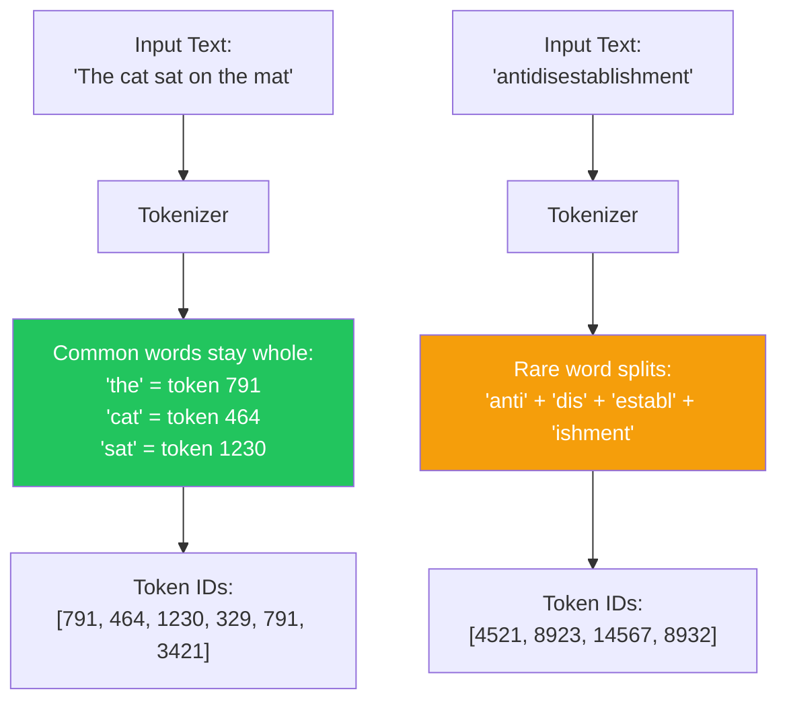
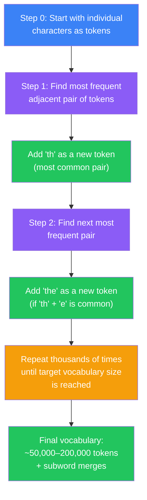
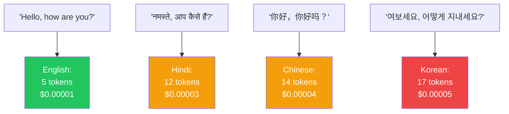
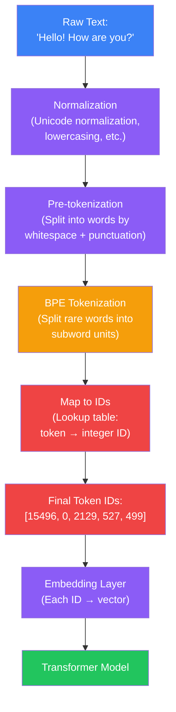

## Introduction

> **Tokenization is the process of converting human-readable text into numbers that a language model can process — it's the bridge between human language and machine computation.**

Every word you type into ChatGPT, every sentence in a prompt, every response generated — it all passes through a tokenizer first. Tokenization is invisible to users, but it affects everything: how much you pay, how long your prompts can be, how well the model handles different languages, and even which tasks the model can perform.


---

## Why This Exists

### The Problem: Computers Cannot Understand Words

Computers operate on numbers. Neural networks perform mathematical operations — matrix multiplications, dot products, activation functions. They cannot process letters, words, or sentences directly.

**You cannot multiply "cat" by "dog".**

Every text that enters an LLM must be converted to numbers first. The question is: **how do you convert text to numbers in a way that preserves meaning, handles any possible text, and is computationally efficient?**

### Why Not Just Use Characters or Words?

| Approach | Problem | Example |
|----------|---------|---------|
| **Characters (a, b, c...)** | Too many tokens per word; no meaningful subword units | "unbelievable" → 12 tokens, loses the "un-" + "believe" connection |
| **Words only** | Dictionary would need to include every word ever (3M+ in English); can't handle typos or new words | "ChatGPT" splits? "Googling" unknown |
| **Letters + spaces** | Meaningless fragmentation | "un" → what does this mean alone? |

**Subword tokenization** solves all these problems by splitting text into units that are smaller than words but larger than characters.

---

## Real-World Analogy

### The Warehouse Storage System

Imagine a warehouse storing every product in the world. You could:

- **Store every item individually** — 1 box per item → warehouse is impossibly huge (like word-level tokenization)
- **Store every atom separately** — 1 box per atom → too many boxes, impossible to manage (like character-level)
- **Store items in modular containers** — Standard-sized bins that can hold parts of items. You can disassemble products into bins, move them efficiently, and reassemble them later.

**Tokenization is the modular container system for language.** Common words get their own bin. Rare words are broken into familiar pieces that fit into standard bins.

> "unbelievably" → bin for "un" + bin for "believ" + bin for "ably"

If you've never seen "unbelievably" before, you can still understand it because you know the pieces.

---

## What Is a Token?

A **token** is a unit of text that the model processes as a single piece. It can be:

| Token Type | Example | How It Splits |
|------------|---------|---------------|
| **Word-like** | "hello", "cat", "the" | Whole common words stay together |
| **Subword** | "un", "ing", "ed", "pre" | Common prefixes/suffixes |
| **Character** | "a", "b", "c" | Rare words break into characters |
| **Special** | `<|endoftext|>`, `<|pad|>` | Control tokens for the model |



---

## How Tokenization Works: Byte Pair Encoding (BPE)

The most common tokenization algorithm used by LLMs is **Byte Pair Encoding (BPE)** , originally developed for data compression and adapted for NLP by OpenAI's GPT models.

### How BPE Builds a Vocabulary



**Step-by-step example:**

1. Start with character-level tokens: `h`, `e`, `l`, `l`, `o`, ` ` (space), `w`, `o`, `r`, `l`, `d`
2. Count all adjacent pairs: `("l", "l")`, `("h", "e")`, `("l", "o")`, etc.
3. The most frequent pair in the training data might be `("t", "h")` → merge into token `"th"`
4. Now `"th"` is a token. Repeat: `("th", "e")` might be common → merge into `"the"`
5. Continue until the vocabulary reaches the target size (e.g., 50,000 tokens)
6. Result: common words become single tokens; rare words are composed of subword tokens

### Training Example

BPE is trained on a large corpus. Starting from individual characters, it iteratively merges the most common pairs:

```
Initial:  h e l l o   w o r l d
Merge 1:  h e ll o    w o r l d         (ll → most common pair)
Merge 2:  h e ll o    w o r ld          (ld → next most common)
Merge 3:  he ll o     w o r ld          (he → next)
Merge 4:  he llo      w o r ld          (llo → next)
Merge 5:  hello       w or ld           (or → next)
Merge 6:  hello       wor ld            (wor → next)
Merge 7:  hello       world             (ld at end → world becomes one token)
```

After training `hello` and `world` become single tokens. A rare word like `hallucination` might remain as subwords: `hallu` + `cination`.

---

## Tokenization Examples

### OpenAI Tokenizer (GPT-4o / o-series)

| Input | Tokens | Count |
|-------|--------|-------|
| "Hello!" | `["Hello", "!"]` | 2 |
| "Hello world!" | `["Hello", " world", "!"]` | 3 |
| "unbelievably" | `["un", "believ", "ably"]` | 3 |
| "I love drinking coffee" | `["I", " love", " drinking", " coffee"]` | 4 |
| "🍕 pizza" | `["🍕", " pizza"]` | 2 |
| "ChatGPT is amazing!" | `["Chat", "G", "PT", " is", " amazing", "!"]` | 6 |

> Note: OpenAI's tokenizer includes preceding spaces as part of the token. This is why "world" in the middle of a sentence gets tokenized as " world" (with space).

### Claude Tokenizer (Anthropic)

Claude uses SentencePiece, a different tokenization algorithm that handles spaces differently:

| Input | Tokens | Count |
|-------|--------|-------|
| "Hello world!" | `["▁Hello", "▁world", "!"]` | 3 |
| "I love drinking coffee" | `["▁I", "▁love", "▁drinking", "▁co", "ffee"]` | 5 |

### LLaMA Tokenizer (SentencePiece)

LLaMA uses SentencePiece with BPE:

| Input | Tokens | Count |
|-------|--------|-------|
| "The cat sat on the mat." | `["▁The", "▁cat", "▁sat", "▁on", "▁the", "▁mat", "."]` | 7 |
| "Python programming" | `["▁Python", "▁program", "ming"]` | 3 |

---

## Why Tokenization Matters

### 1. Pricing

Almost all LLM APIs charge **per token** — not per word or per character.

| Model | Input Price (per 1M tokens) | Output Price (per 1M tokens) |
|-------|---------------------------|----------------------------|
| GPT-4o | $2.50 | $10.00 |
| Claude 3 Opus | $15.00 | $75.00 |
| Gemini 1.5 Pro | $3.50 | $10.50 |
| Mistral Large | $4.00 | $12.00 |
| DeepSeek V3 | $0.27 | $1.10 |

> **Practical impact:** A 1,000-word prompt might be ~1,300 tokens in English, but ~2,500+ tokens in some other languages — costing nearly twice as much for the same meaning.

### 2. Context Window

Your prompt + the model's response must fit within the context window. Tokenization determines how much text you can fit.

- A 128K context window ≈ ~96,000 English words
- But only ~48,000 words in some languages
- Or ~16,000 words in specialized technical domains with long compound words

### 3. Model Performance

- **Common words get single tokens** → faster processing, better learning
- **Rare words split into subwords** → slower, more noise
- **Typos create unexpected splits** → "coffee" vs "coffe" (different tokens, different meanings to the model)
- **Numbers tokenize poorly** → "2024" might be 1 token, but "12345" might be 5 tokens

### 4. Language Bias

Tokenizers are trained on the model's training data. If the training data is 90% English, English gets efficient tokenization (fewer tokens per word). Other languages may require 2–3x more tokens for the same meaning.



**Takeaway:** If your users speak multiple languages, you pay more for non-English interactions with the same semantic content.

---

## Common Tokenization Schemes

| Algorithm | Used By | Vocabulary Size | Special Features |
|-----------|---------|-----------------|------------------|
| **BPE** (Byte Pair Encoding) | GPT-4, GPT-4o, LLaMA, Mistral | 50K–100K | Merges most frequent byte pairs iteratively |
| **WordPiece** | BERT, DistilBERT | 30K | Similar to BPE but uses likelihood instead of frequency |
| **SentencePiece** | LLaMA 2/3, Claude, Gemma | 32K–50K | Treats text as raw bytes; no need for pre-tokenization |
| **Unigram LM** | XLNet, ALBERT | 32K | Starts with large vocabulary and prunes least useful tokens |

---

## Mermaid Flow: Full Tokenization Pipeline



---

## Token Counting: A Practical Guide

### How Many Tokens Is My Text?

| Text | Approximate Tokens |
|------|-------------------|
| "Hello" | 1 |
| "Hello world!" | 3 |
| A tweet (280 chars) | ~40–70 |
| An email | ~100–500 |
| This document | ~300–500 |
| A typical blog post (1,500 words) | ~2,000 |
| A research paper (5,000 words) | ~6,500 |
| A novel (100,000 words) | ~130,000 |
| All Harry Potter books (1M words) | ~1.3M |

### Quick Estimation Rules

| Rule | Approximate |
|------|-------------|
| 1 English word | ≈ 1.3 tokens |
| 1 token | ≈ 0.75 words |
| 1,000 tokens | ≈ 750 words |
| 100,000 tokens | ≈ 75,000 words |

> **Warning:** These rules are rough approximations. Actual token counts vary significantly by language, domain, and tokenizer. Always use the actual tokenizer for precise counting.

### Python: Count Tokens

```python
# Using tiktoken (OpenAI's tokenizer)
# Install: pip install tiktoken

import tiktoken

# Get the tokenizer for GPT-4o
encoding = tiktoken.get_encoding("cl100k_base")

text = "Hello world! This is a test of tokenization."

# Encode: text → tokens
tokens = encoding.encode(text)
print(f"Tokens: {tokens}")
# Tokens: [15496, 2325, 0, 2028, 374, 257, 2346, 315, 19204, 13]

# Decode: tokens → text
decoded = encoding.decode(tokens)
print(f"Decoded: {decoded}")
# Decoded: Hello world! This is a test of tokenization.

# Count tokens
print(f"Token count: {len(tokens)}")
# Token count: 10
```

### JavaScript: Count Tokens

```javascript
// Using gpt-tokenizer (works in browser and Node.js)
// Install: npm install gpt-tokenizer

import { encode, decode } from 'gpt-tokenizer';

const text = "Hello world! This is a test of tokenization.";

// Encode: text → tokens
const tokens = encode(text);
console.log('Tokens:', tokens);
// Tokens: [15496, 2325, 0, 2028, 374, 257, 2346, 315, 19204, 13]

// Decode: tokens → text
const decoded = decode(tokens);
console.log('Decoded:', decoded);
// Decoded: Hello world! This is a test of tokenization.

// Count tokens
console.log('Token count:', tokens.length);
// Token count: 10
```

---

## Python Example: Understanding Tokenization

```python
# Explore tokenization behavior across different inputs
import tiktoken

encoding = tiktoken.get_encoding("cl100k_base")

examples = [
    "Hello world!",
    "The cat sat on the mat.",
    "unbelievably",
    "antidisestablishment",
    "🍕 pizza is amazing",
    "1234567890",
    "I love drinking coffee and tea!",
    "ChatGPT is a large language model.",
    "a b c d e f g h i j k l m n o p q r s t u v w x y z",
]

print(f"{'Input':<40} {'Tokens':<10} {'IDs'}")
print("="*80)

for text in examples:
    tokens = encoding.encode(text)
    print(f"{text:<40} {len(tokens):<10} {str(tokens[:6])}...")

# Output:
# Hello world!                    3          [15496, 2325, 0]...
# The cat sat on the mat.         6          [791, 464, 1230, 329, 791, 3421]...
# unbelievably                    3          [15085, 16715, 8345]...
# antidisestablishment            5          [29567, 2594, 11898, 2700, 1419]...
# 🍕 pizza is amazing              5          [93273, 2641, 374, 4110]...
# 1234567890                      10         [17, 23, 26, 31, 28, 31, 35, 36, 28, 34]...
# I love drinking coffee and tea! 9          [40, 1121, 8831, 10789, 596, 3273, 0]...
# ChatGPT is a large language mod… 6          [22958, 281, 79, 374, 257, 1303]...
# a b c d e f g h i j k l m n o … 52         [64, 66, 68, 70, 72, 74, 76, 78, 80, 82]...
```

> **Key observations:**
> - Common words get single tokens ("the", "cat", "sat")
> - Numbers tokenize inefficiently (each digit can be its own token)
> - Emoji may be single or multiple tokens
> - The alphabet (26 characters) took 52 tokens — about 2 per character!
> - "ChatGPT" breaks into 3 tokens ("Chat", "G", "PT") — showing how model-specific names can be fragmented

---

## JavaScript Example: Token Visualization

```javascript
import { encode, decode, isWithinTokenLimit } from 'gpt-tokenizer';

// Visualize how text is tokenized
function visualizeTokenization(text) {
  const tokens = encode(text);
  console.log(`Original: "${text}"`);
  console.log(`Token count: ${tokens.length}`);
  console.log(`Token IDs: [${tokens.join(', ')}]`);
  console.log('---');

  // Show each token decoded individually
  tokens.forEach((tokenId, i) => {
    const tokenText = decode([tokenId]);
    console.log(`  Token ${i + 1}: ID ${tokenId} → "${tokenText}"`);
  });
  console.log('\n');
}

// Test different texts
visualizeTokenization('Hello!');
visualizeTokenization('antidisestablishment');
visualizeTokenization('I love 💻 programming');

// Check if text fits within a token limit
const longText = 'Hello world! '.repeat(100);
console.log('Length check:');
console.log(`  Text fits in 100 tokens: ${isWithinTokenLimit(longText, 100)}`);
console.log(`  Text fits in 500 tokens: ${isWithinTokenLimit(longText, 500)}`);
```

---

## Tokenization and Special Tokens

LLMs also have special tokens that are not words but control the model's behavior:

| Token | Purpose | Example |
|-------|---------|---------|
| `<|endoftext|>` | Marks end of a text segment | Used during training to separate documents |
| `<|im_start|>` | Start of a message (ChatML format) | `<|im_start|>user\nWhat is AI?` |
| `<|im_end|>` | End of a message | `<|im_end|>\n<|im_start|>assistant` |
| `<|pad|>` | Padding for batch processing | Fills shorter sequences to match batch length |
| `<|unk|>` | Unknown token (rarely used in BPE) | Falls back when a character is not in vocabulary |
| `[CLS]` (BERT) | Classification token | First token, used for sentence-level classification |
| `[SEP]` (BERT) | Separator token | Separates two sentences in BERT's paired input |

---

## Best Practices

1. **Always count tokens before sending** — Use a tokenizer library to count prompts before API calls to avoid hitting context limits
2. **Be mindful of language differences** — Non-English text uses 2–3x more tokens; adjust your token budgets accordingly
3. **Avoid unnecessary whitespace** — Extra spaces, tabs, and newlines all count as tokens
4. **Use structured formats efficiently** — JSON, XML, and markdown add tokens; keep them minimal
5. **Shorten variable/function names in code** — `calculateTotalPrice` = more tokens than `calcPrice`
6. **Watch out for numbers** — Long numbers tokenize poorly; use scientific notation or round when possible
7. **Test with actual tokenizer** — Don't estimate; use tiktoken or the provider's tokenizer for accurate counts

---

## Common Misconceptions

| Misconception | Truth |
|--------------|-------|
| "Tokenization is word splitting" | BPE splits into subwords — common words stay whole, rare words are broken into pieces |
| "All tokenizers are the same" | Different models use different algorithms (BPE, SentencePiece, WordPiece) with different vocabularies |
| "1 word = 1 token exactly" | English averages ~1.3 tokens per word; other languages can be 2–5x that |
| "Tokenization doesn't affect quality" | Tokenization significantly affects how the model handles rare words, typos, numbers, and code |
| "Spaces don't count as tokens" | Spaces are usually part of the preceding token (e.g., " world" with leading space) |
| "All LLMs count tokens the same way" | Each model family has its own tokenizer; token counts for the same text vary between models |

---

## Interview Questions

### Easy

**Q: What is tokenization in the context of LLMs?**

> Tokenization is the process of converting human-readable text into numerical token IDs that a language model can process. It splits text into tokens — common words stay whole, while rare words are broken into smaller subword units. For example, "unbelievably" might become ["un", "believ", "ably"], and each subword is mapped to a unique integer ID that the model can work with.

**Q: Why can't LLMs process text directly as words?**

> Neural networks operate on numbers — they perform mathematical operations like matrix multiplication and attention computation. Words like "cat" and "dog" cannot be multiplied or added. Tokenization converts words to integer IDs, which are then mapped to dense vectors (embeddings) that the neural network can compute with. Without tokenization, the model would have no way to process text.

### Medium

**Q: How does Byte Pair Encoding (BPE) work?**

> BPE starts with a vocabulary of individual characters/bytes. It then iteratively finds the most frequent adjacent pair of tokens in the training corpus and merges them into a new token. This process repeats thousands of times until the target vocabulary size is reached (e.g., 50,000 tokens). The result is that common words become single tokens, while rare words are composed from subword pieces. BPE is data-driven and adapts to the actual text patterns in the training corpus.

**Q: Why does tokenization affect pricing and performance?**

> Almost all LLM APIs charge per token. If a 1,000-word English prompt is ~1,300 tokens ($0.003), the same content in Hindi might be ~3,000 tokens ($0.0075) — more than double the cost. Performance is affected because rare words that fragment into many tokens may lose semantic coherence — the model has to "reassemble" meaning from fragments rather than seeing the whole word at once. Language bias exists because tokenizers are trained on the model's primary training language (usually English), giving it more efficient encoding.

### Hard

**Q: Explain how a tokenizer's vocabulary size and training data affect model behavior.**

> Vocabulary size is a crucial hyperparameter. A small vocabulary (e.g., 8K tokens) means many words fragment into subwords, creating longer sequences that are slower to process and may lose semantic information. A large vocabulary (e.g., 100K tokens) reduces sequence length but increases the embedding matrix size and may lead to data sparsity (rare tokens with very few training examples). The training data composition matters enormously: if 90% of the tokenizer's training corpus is English, English words get efficient single-token representations, while other languages fragment into many tokens. This creates a measurable performance gap: models perform worse on languages whose tokens are fragmented, because the attention mechanism has to work across more positions to capture the same semantic content.

**Q: What is the "tokenization problem" with numbers and code?**

> Numbers tokenize extremely inefficiently with BPE. The number 1234567890 might tokenize as 10 separate tokens [1, 2, 3, 4, 5, 6, 7, 8, 9, 0] because BPE rarely sees long digit sequences together. This means models struggle with simple arithmetic — every digit is a separate token that may not be attended to together. In code, variable names like `calculateTotalPrice` might tokenize as ["calc", "ulate", "Total", "Price"], losing the semantic connection. Code-specific tokenizers (like StarCoder's) handle this better by including common code patterns and variable naming conventions in the training data.

---

## Summary

| Concept | Key Point |
|---------|-----------|
| **Tokenization** | Converting text to numerical IDs that the model can process |
| **Token** | A unit of text (word, subword, or character) mapped to an integer |
| **BPE** | Byte Pair Encoding — iteratively merges common character pairs to build a vocabulary |
| **Vocabulary size** | Typically 50,000–100,000 tokens for modern LLMs |
| **Why it matters** | Affects pricing, context limits, performance, and language bias |
| **Special tokens** | Control tokens like `<|endoftext|>` that direct model behavior |
| **Subword splitting** | Rare words break into pieces; common words stay whole |
| **Language bias** | English-dominant training → English tokens are more efficient |
| **Number problem** | Numbers tokenize poorly, causing arithmetic difficulties |
| **Token counting** | Always count tokens with the actual tokenizer, never estimate by words |

---

## Navigation

**Previous:** [02 — How Language Models Work](/ai/phase-04-large-language-models/02-how-language-models-work)

**Next:** [04 — Context Window](/ai/phase-04-large-language-models/04-context-window)

**Related Topics:**
- [How Language Models Work](/ai/phase-04-large-language-models/02-how-language-models-work)
- [Context Window](/ai/phase-04-large-language-models/04-context-window)
- [Context Window](/ai/phase-04-large-language-models/04-context-window)

**Practice Questions:**
1. Tokenize "The cat sat on the mat" using tiktoken — how many tokens?
2. Why does "1234567890" use more tokens than "1234"?
3. Explain why non-English text costs more to process with LLMs
4. What is BPE and how does it decide what becomes a token?
5. Use tiktoken to compare token counts for the same sentence in 3 different languages

**Further Reading:**
- [OpenAI Tokenizer Playground](https://platform.openai.com/tokenizer) — Try tokenizing text yourself
- [tiktoken — OpenAI's Tokenizer Library](https://github.com/openai/tiktoken)
- [BPE: Neural Machine Translation of Rare Words with Subword Units (Sennrich et al., 2016)](https://arxiv.org/abs/1508.07909)
- [Hugging Face Tokenizers Documentation](https://huggingface.co/docs/tokenizers/index)
- [The Tokenization of the World — Andrej Karpathy](https://github.com/karpathy/minbpe)
