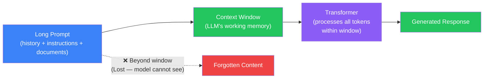
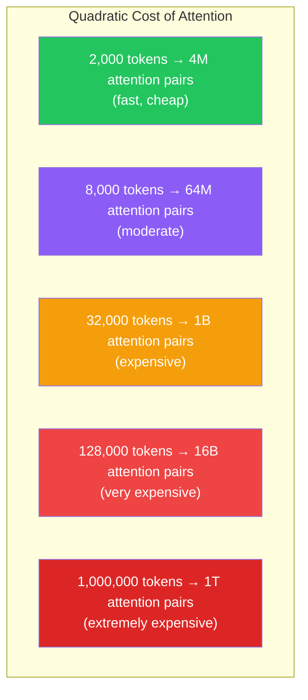
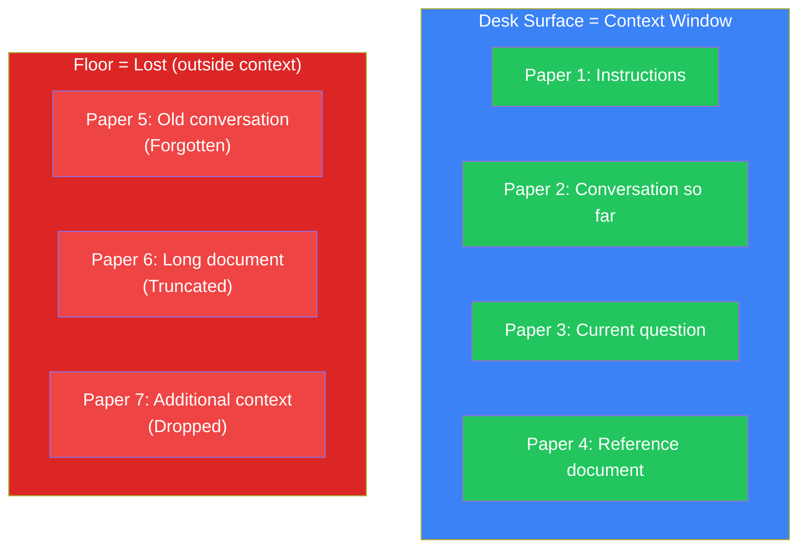
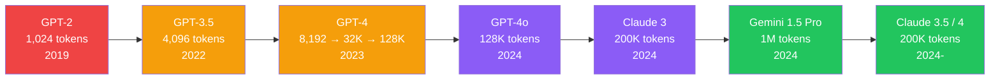
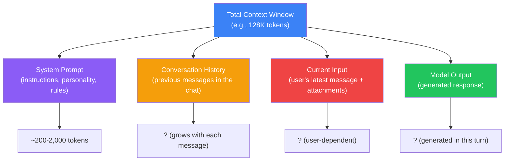
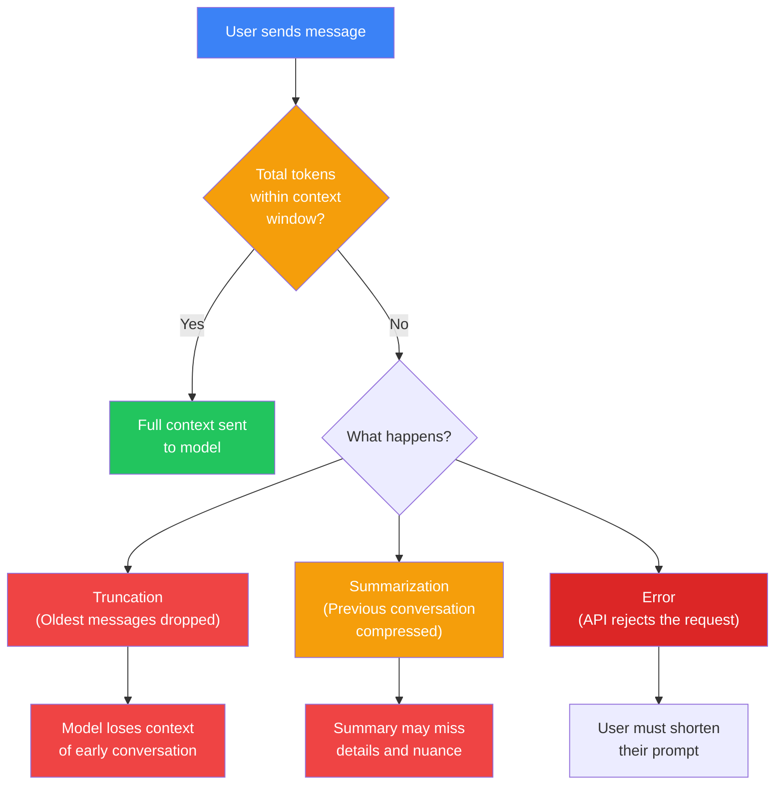
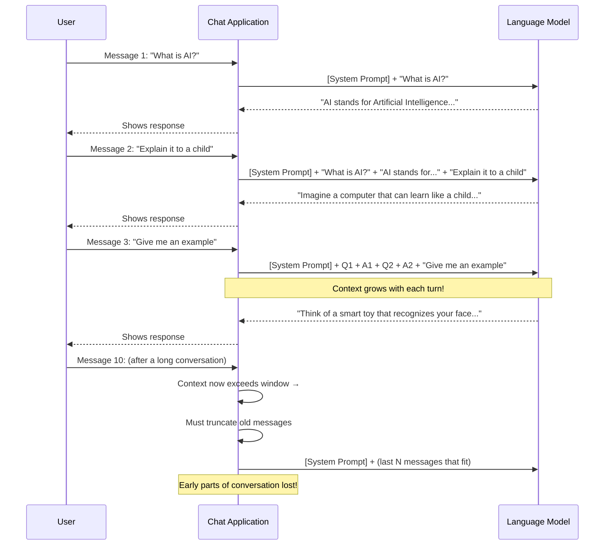
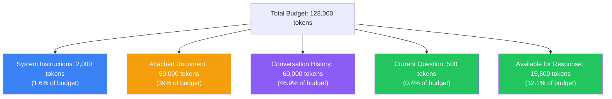
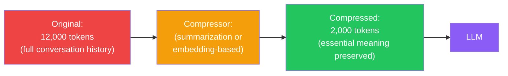

## Introduction

> **The context window is the maximum amount of text a language model can "see" at once when generating a response — it's the model's working memory.**

Every LLM has a fixed-size context window. This limits how much conversation history, document text, or instructions the model can consider when predicting the next token. When the input exceeds the window, the model either truncates it, fails, or loses information.



---

## Why This Exists

### The Problem: Finite Attention

The Transformer's self-attention mechanism has quadratic complexity — the compute cost grows with the **square** of the sequence length (`O(n²)`).



**This is why context windows are limited:** doubling the context length roughly quadruples the compute needed for attention. Models must balance capability (longer context) with cost and speed.

### Why Models Can't Just "Remember"

LLMs have **no persistent memory**. Each conversation is processed independently. The model doesn't "remember" your previous chat session unless the entire history is included in the prompt.

| Memory Type | How It Works | Duration |
|-------------|-------------|----------|
| **Context window** | Everything in the current prompt | Single request |
| **Conversation history** | Previously sent messages (re-sent with each request) | Until window fills |
| **Fine-tuning** | Knowledge embedded in model weights | Permanent (but expensive) |
| **RAG** | External knowledge retrieved on demand | Per-query |
| **True memory** | Not yet available in standard LLMs | N/A |

---

## Real-World Analogy

### The Desk

Imagine working at a desk. Your **context window** is the surface area of the desk.

- You can spread out a few papers and read them all at once → **within context**
- If someone hands you a 50-page report, some pages fall off the desk → **beyond context window**
- You have to repeatedly swap papers on and off the desk to read the full report → **context overflow / sliding window**



The bigger your desk, the more you can work with at once. But a bigger desk costs more and takes up more space.

---

## Context Window Sizes Across Models



### Comparison Table

| Model | Context Window | ~Words Equivalent | ~Pages |
|-------|---------------|-------------------|--------|
| GPT-2 | 1,024 tokens | ~750 words | ~1.5 pages |
| GPT-3 (text-davinci-003) | 4,096 tokens | ~3,000 words | ~6 pages |
| GPT-3.5-turbo | 16,385 tokens | ~12,000 words | ~24 pages |
| GPT-4 (early) | 8,192 tokens | ~6,000 words | ~12 pages |
| GPT-4-32K | 32,768 tokens | ~24,000 words | ~48 pages |
| GPT-4o / GPT-4-turbo | 128,000 tokens | ~96,000 words | ~192 pages |
| Claude 3 Haiku | 200,000 tokens | ~150,000 words | ~300 pages |
| Claude 3 Sonnet | 200,000 tokens | ~150,000 words | ~300 pages |
| Claude 3 Opus | 200,000 tokens | ~150,000 words | ~300 pages |
| Gemini 1.5 Pro | 1,000,000 tokens | ~750,000 words | ~1,500 pages |
| Gemini 1.5 Flash | 1,000,000 tokens | ~750,000 words | ~1,500 pages |
| LLaMA 2 | 4,096 tokens | ~3,000 words | ~6 pages |
| LLaMA 3 / 3.1 | 8,192 → 128K tokens | ~96,000 words | ~192 pages |
| Mistral 7B | 8,192 → 32K tokens | ~24,000 words | ~48 pages |
| Mixtral 8x7B | 32,768 tokens | ~24,000 words | ~48 pages |
| Qwen 2.5 | 128,000 tokens | ~96,000 words | ~192 pages |
| DeepSeek V3 | 128,000 tokens | ~96,000 words | ~192 pages |
| Phi 3 | 128,000 tokens | ~96,000 words | ~192 pages |

---

## How Context Windows Work in Practice

### The Three Components of Context

When you use an LLM (e.g., ChatGPT), the context window contains three things:



**The key constraint:** System prompt + Conversation history + Current input + Model output must ALL fit within the context window.

### What Happens When Context Exceeds the Window?



---

## Conversation History: Why Models "Forget"

### How Chat Applications Manage Context

When you use ChatGPT or Claude, the application does NOT store your conversation in the model. Instead:

1. **Every message sends the entire conversation history** as part of the prompt
2. The model processes all previous messages + your new message to generate a response
3. The model's response is appended to the conversation
4. On the next turn, the entire updated conversation is sent again



### The "Forgetting Problem"

After many exchanges, the conversation grows beyond the context window. The application must drop the oldest messages. The user says "But I told you that 20 messages ago!" — and the model has no memory of it.

This is why:
- Long chat sessions eventually lose track of early context
- You may need to repeat instructions mid-conversation
- Complex multi-step tasks work better in shorter sessions

---

## Context Window Token Budget

### Managing Your Token Budget

Think of the context window as a budget you must allocate:



**Strategies to optimize token usage:**

| Strategy | How It Works | Example |
|----------|-------------|---------|
| **Trim system prompt** | Keep only essential instructions | Remove verbose examples |
| **Summarize history** | Replace old messages with a summary | "The user has asked about X, Y, Z. You answered A, B, C." |
| **Prioritize relevance** | Keep only recent/highly relevant messages | Drop "How are you?" exchanges |
| **Chunk documents** | Send only relevant sections | Instead of the full 100-page PDF, send 5 relevant pages |
| **Use sliding window** | Keep only the last N messages | Always drop messages beyond N |

---

## Context Overflow: Real Scenarios

### Scenario 1: Long Document Analysis

```
Prompt includes: "Analyze this 300-page novel..."
Document tokens: 390,000 tokens
Context window: 200,000 tokens (Claude 3)
Result: 190,000 tokens of the novel are outside the window
```

**Solution:** Split the document, analyze in sections, then synthesize.

### Scenario 2: Multi-Turn Conversation

```
Message 1-20: Normal chat (~8,000 tokens)
Message 21: User attaches a large code file (15,000 tokens)
Message 22: User asks a follow-up (still fine)
Message 23: User asks again (now old messages may be dropped)

Before message 23: System prompt + messages 1-22 = ~25,000 tokens
After message 23: System prompt + messages 2-22 + msg 23 + new attachment = too much
→ Messages 1-10 are dropped
→ Model no longer remembers setup details from early conversation
```

### Scenario 3: Code Review with Context

```
System: 2,000 tokens
Codebase context: 100,000 tokens (full repository)
User question: 500 tokens
Total: 102,500 tokens → exceeds most models' context

Solution: Use RAG to retrieve only relevant files instead of sending the full repo
```

---

## Context Compression

One emerging technique is **context compression** — making the prompt smaller while preserving semantic information.



**Compression techniques:**

| Technique | How It Works | Trade-off |
|-----------|-------------|-----------|
| **LLM summarization** | Use a smaller model to summarize old conversation | Loses detail, takes extra API call |
| **Embedding-based retrieval** | Store past messages as embeddings; retrieve only relevant ones | Requires vector database infrastructure |
| **Lossy compression** | Drop punctuation, articles, stop words | Lowers output quality |
| **Special tokens** | Train models to use compression tokens | Requires custom fine-tuning |

---

## Python Example: Checking Context Window Limits

```python
import tiktoken

encoding = tiktoken.get_encoding("cl100k_base")

def count_tokens(text: str) -> int:
    return len(encoding.encode(text))

def check_fits(text: str, model_context: int, model_name: str):
    tokens = count_tokens(text)
    fits = tokens <= model_context
    print(f"{model_name}: {tokens} token{'s' if tokens != 1 else ''}")
    print(f"  Context window: {model_context}")
    print(f"  Fits: {'✅ Yes' if fits else '❌ No — exceeds by ' + str(tokens - model_context) + ' tokens'}")
    print()

# Model context windows
MODELS = {
    "GPT-3.5-turbo": 16385,
    "GPT-4o": 128000,
    "Claude 3 Opus": 200000,
    "Gemini 1.5 Pro": 1000000,
    "LLaMA 2": 4096,
}

# Test content
short_text = "Hello world! This is a short message."
long_text = "This is a long document. " * 10000  # ~100,000 words

print("Short text (all models):")
for name, window in MODELS.items():
    check_fits(short_text, window, name)

print("\nLong text:")
for name, window in MODELS.items():
    check_fits(long_text, window, name)
```

## JavaScript Example: Managing Context

```javascript
// Simulating context window management in a chat application

const MAX_CONTEXT_TOKENS = 128000; // GPT-4o window
const SYSTEM_PROMPT_TOKENS = 500; // estimated

// Simplified token counter
function estimateTokens(text) {
  return Math.ceil(text.split(/\s+/).length * 1.3);
}

class ChatSession {
  constructor() {
    this.messages = [];
    this.totalTokens = SYSTEM_PROMPT_TOKENS;
  }

  addMessage(role, content) {
    const tokens = estimateTokens(content);
    const message = { role, content, tokens };

    // Check if adding this message would exceed the window
    if (this.totalTokens + tokens > MAX_CONTEXT_TOKENS) {
      // Remove oldest messages until we fit
      while (this.messages.length > 0 &&
             this.totalTokens + tokens > MAX_CONTEXT_TOKENS * 0.9) {
        const removed = this.messages.shift();
        this.totalTokens -= removed.tokens;
        console.log(`Dropped message: "${removed.content.slice(0, 40)}..."`);
      }
    }

    this.messages.push(message);
    this.totalTokens += tokens;
  }

  getContext() {
    return {
      messages: this.messages,
      totalTokens: this.totalTokens,
      availableTokens: MAX_CONTEXT_TOKENS - this.totalTokens
    };
  }
}

// Usage simulation
const chat = new ChatSession();

// Simulate a long conversation
for (let i = 1; i <= 100; i++) {
  chat.addMessage('user', `This is message number ${i} in our conversation about AI and machine learning.`);
  chat.addMessage('assistant', `This is response number ${i} acknowledging your question about AI and ML.`);
}

const context = chat.getContext();
console.log(`Total messages in context: ${context.messages.length}`);
console.log(`Total tokens used: ${context.totalTokens}`);
console.log(`Available tokens remaining: ${context.availableTokens}`);
// Output:
// Total messages in context: ~138 (system drops oldest)
// Total tokens used: ~115,000
// Available tokens remaining: ~12,500
```

---

## Best Practices

1. **Be concise in system prompts** — Every token in your system prompt reduces space for conversation history and the response
2. **Monitor token usage** — Track how many tokens your prompts consume; use token counting libraries proactively
3. **Prune rarely used instructions** — If your system prompt has rules that only apply 5% of the time, move them to a conditional section
4. **Restart long conversations** — If a conversation exceeds 50% of the context window, consider starting fresh or summarizing
5. **Use shorter responses when possible** — Ask the model to "be concise" to save output tokens
6. **Leverage the full window** — Models perform better when they have more context; don't truncate unnecessarily
7. **Know your model's window** — Different models have different limits; design your application for the minimum window you support

---

## Common Misconceptions

| Misconception | Truth |
|--------------|-------|
| "LLMs remember our conversation" | LLMs have no persistent memory — the application re-sends the entire conversation history with each request |
| "A bigger context window means the model remembers everything" | Larger windows can handle more text, but attention can still lose focus on very early tokens (the "lost in the middle" problem) |
| "You can use the full context window for output" | The window is shared between input and output — long responses reduce the space for the prompt |
| "All tokens in the context window are equal" | Models tend to focus on tokens at the beginning and end of the context, with weaker attention to the middle |
| "Context compression is lossless" | All compression techniques lose some information — the trade-off is between completeness and cost |

---

## Interview Questions

### Easy

**Q: What is a context window in an LLM?**

> The context window is the maximum number of tokens an LLM can process in a single request. It includes the system prompt, conversation history, user input, and the model's generated response. If the total exceeds the window, the application must truncate old content, typically dropping the oldest messages.

**Q: Why do LLMs have limited context windows?**

> Context windows are limited because the Transformer's self-attention mechanism has quadratic computational complexity — doubling the sequence length roughly quadruples the compute and memory required. Larger windows also require more GPU memory and cost more to run. The limit is a practical trade-off between capability, speed, and cost.

### Medium

**Q: Explain the "lost in the middle" phenomenon.**

> The "lost in the middle" problem refers to a finding that LLMs perform best on information at the beginning and end of their context window, but worse on information in the middle. When asked to retrieve a fact from a long document, the model is most accurate when the fact is in the first (~20%) or last (~30%) of the tokens. This happens because the earliest tokens get strong positional bias, and the latest tokens are most recent in the attention computation. When building prompts, put the most important information at the start or end, not in the middle.

**Q: How does a chat application manage context window limits across a long conversation?**

> Chat applications (like ChatGPT) manage context by: (1) including a system prompt at the beginning of every request, (2) appending the conversation history as messages grow, (3) tracking total token count, (4) when the window is nearly full, dropping the oldest messages (often summarized as "Earlier in the conversation, the user discussed X"), and (5) in some cases, using a smaller model to compress the conversation history before it's sent to the main model. The user experience is that the model "forgets" early parts of very long conversations.

### Hard

**Q: What are the latest innovations in extending context windows beyond 128K tokens?**

> Recent innovations include: (1) **Ring Attention / Blockwise Parallel Transformers** — distributes attention computation across multiple GPUs to handle millions of tokens; (2) **Flash Attention 2/3** — IO-aware attention algorithms that are memory-efficient for very long sequences; (3) **ALiBi (Attention with Linear Biases)** — replaces positional encoding with a bias that scales linearly with distance, enabling extrapolation to longer contexts than training; (4) **LongLoRA / YaRN** — efficient fine-tuning methods that extend context by modifying position encoding; (5) **Infini-Attention** — Google's approach enabling 1M+ token contexts by compressing past attention into a learned memory. Gemini 1.5 Pro achieves 1 million tokens through a combination of efficient attention architecture and mixture-of-experts design.

**Q: What trade-offs exist between context window size and model quality?**

> Larger context windows come with significant trade-offs: (1) **Quadratic compute cost** — each additional token increases attention compute quadratically, making longer windows much more expensive; (2) **Training time** — training on longer sequences takes exponentially more time and GPU memory; (3) **Quality degradation** — some research shows that models trained on very long contexts may perform slightly worse on shorter tasks because the model learns to "spread out" its attention; (4) **Memory requirements** — even with efficient attention, the key-value cache for 1M tokens requires substantial GPU memory (~80GB+); (5) **Inference latency** — generating the first token with 1M tokens of context can take significantly longer. The best approach depends on your use case: short conversations benefit from smaller, faster models; document analysis benefits from the larger window.

---

## Summary

| Concept | Key Point |
|---------|-----------|
| **Context window** | The maximum tokens the model can process in one request |
| **Quadratic complexity** | Attention cost grows with O(n²) — doubling context quadruples cost |
| **Token budget** | System prompt + history + input + output must fit in the window |
| **Conversation memory** | The application re-sends the full history; no persistent model memory |
| **Truncation** | When context exceeds the window, oldest content is dropped |
| **Lost in the middle** | Models perform worse on information in the middle of the context |
| **Context compression** | Summarizing or encoding history to reduce token usage |
| **Model comparison** | Windows range from 4K (LLaMA 2) to 1M (Gemini 1.5 Pro) |
| **Best practice** | Monitor token usage, prune old content, put key info at the start/end |

---

## Navigation

**Previous:** [03 — Tokenization](/ai/phase-04-large-language-models/03-tokenization)

**Next:** [05 — Transformer Overview](/ai/phase-04-large-language-models/05-transformer-overview)

**Related Topics:**
- [Tokenization](/ai/phase-04-large-language-models/03-tokenization)
- [Transformer Overview](/ai/phase-04-large-language-models/05-transformer-overview)
- [Introduction to Transformers](/ai/phase-03-deep-learning/18-introduction-to-transformers)

**Practice Questions:**
1. Why do LLMs have limited context windows? Explain the technical reason.
2. You have a 100K token document and a 128K context window — how would you allocate the budget for system prompt, document, and response?
3. What is the "lost in the middle" problem and how do you mitigate it?
4. Design a strategy for managing a conversation that exceeds the context window after 50 exchanges
5. Compare the context windows of GPT-4o, Claude 3 Opus, and Gemini 1.5 Pro — which is best for analyzing a 500-page book?

**Further Reading:**
- [Lost in the Middle: How Language Models Use Long Contexts (Liu et al., 2023)](https://arxiv.org/abs/2307.03172)
- [Flash Attention: Fast and Memory-Efficient Exact Attention](https://arxiv.org/abs/2205.14135)
- [Ring Attention with Blockwise Transformers (Liu et al., 2023)](https://arxiv.org/abs/2310.01801)
- [Gemini 1.5: Unlocking Multimodal Understanding Across Millions of Tokens](https://blog.google/technology/ai/google-gemini-1.5-pro/)
- [YaRN: Efficient Context Window Extension of Large Language Models](https://arxiv.org/abs/2309.00071)
