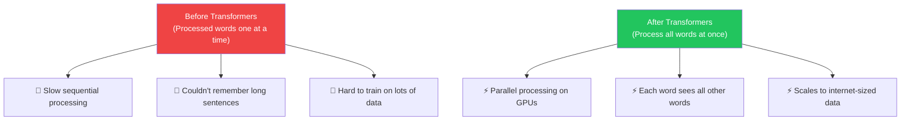
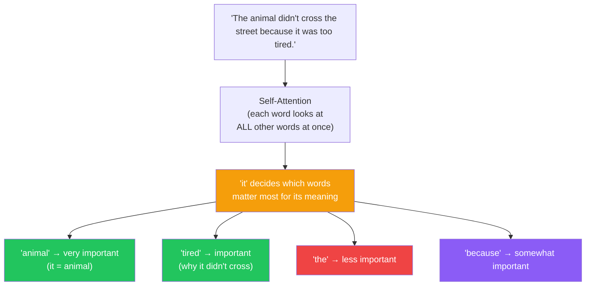
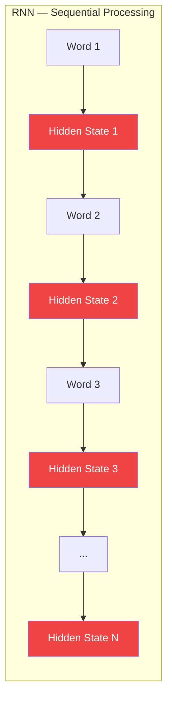
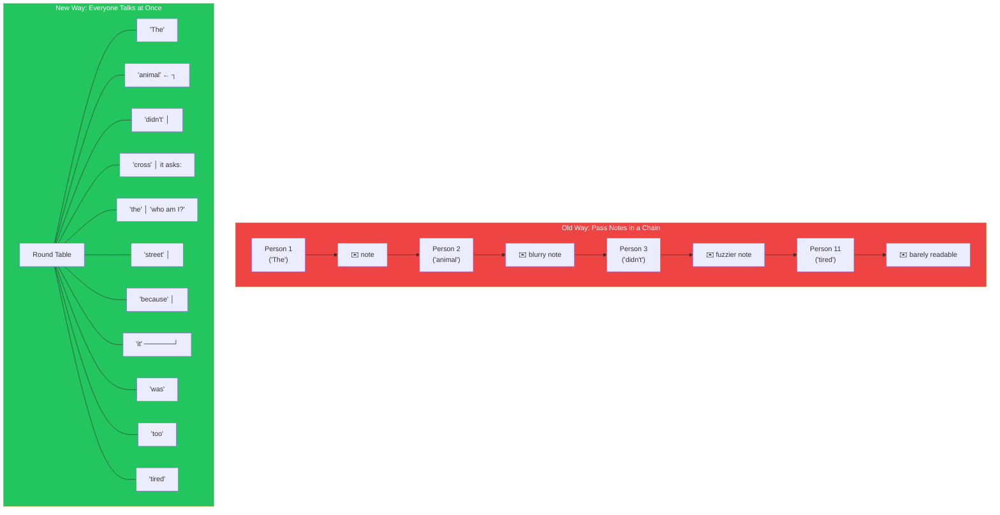
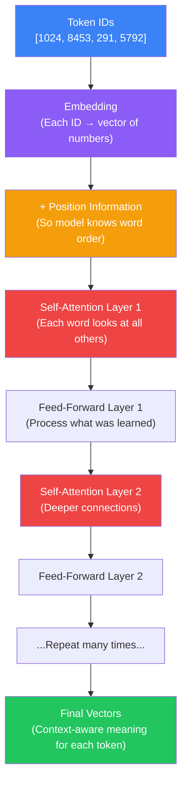
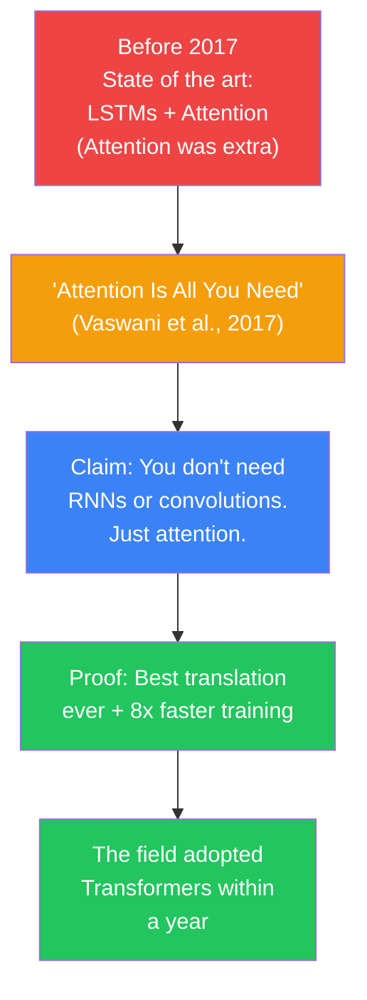

## Introduction

> **A Transformer is a neural network architecture that reads an entire sequence of words at once — not one at a time — and figures out which words matter most by using a mechanism called self-attention.**

Before 2017, every AI that processed language worked like a person reading a book: one word at a time, left to right, building up understanding step by step. The Transformer changed everything by reading the whole sentence simultaneously, like looking at all the puzzle pieces at once instead of picking them up one by one.

This single idea — processing all words in parallel — is why your phone can autocomplete sentences, why ChatGPT can hold conversations, and why AI has advanced faster in the last five years than in the previous fifty.



---

## The Story: Reading a Sentence

### How You Read

Think about how you read this sentence:

> "The animal didn't cross the street because **it** was too tired."

What does **"it"** refer to?

Your brain immediately connects "it" to "animal." You didn't read the sentence one word at a time and forget the beginning. By the time you reached "tired," you still knew what "animal" means, what "street" means, and what's happening overall.

You naturally **pay attention** to the important words and connect them.

### How Computers Used to Read (The Problem)

Before Transformers, computers read like this:


Word by word. One after another. By the time the computer reached "it," it had to remember what came before through a **compressed summary** — like trying to describe a movie you watched years ago from memory alone. Details fade. Long connections break.

This is why older AI systems (RNNs and LSTMs) struggled with long sentences. They simply forgot.

### How Transformers Read



The word "it" looks at every other word simultaneously. It computes a "relevance score" for each one. "Animal" gets a high score. "Tired" gets a high score. "The" gets a low score. Through this, the model understands that "it" refers to "the animal" — and that the animal is tired, which explains why it didn't cross.

---

## Why This Exists

### The Problem: Sequential Processing Was Too Slow

Before Transformers, the best architecture for language was the **Recurrent Neural Network (RNN)** and its upgrade, the **LSTM** (Long Short-Term Memory).



**Why RNNs failed:**

| Problem | What It Means | Why It's Bad |
|---------|-------------|-------------|
| **Sequential** | Word 2 can't be processed until Word 1 is done | Can't use GPU parallelization — slow |
| **Vanishing gradient** | Information from early words fades away | Forget the subject of a long sentence |
| **Hidden state bottleneck** | Everything gets compressed into one vector | Like summarizing a book with one sentence |
| **Can't scale** | More data doesn't help much | Training on the whole internet? Impossible |

**The 'Vanilla' RNN problem:**

```
Input: "I was born in France. I lived there for 20 years. I speak fluent..."
Prediction: "French" ← need to remember "France" from far back

RNN path:  France → (20 steps of compression) → ???
           Lost somewhere in the middle. Forgot.
Transformer:  "fluent" ↔ "France" ← direct connection. No forgetting.
```

### Why LSTM Wasn't Enough

LSTM was an improvement — it added a "memory cell" with gates that could decide what to remember and what to forget.

But LSTMs still:
- Processed tokens **one at a time** (sequential → slow)
- Had a **limited memory** (could remember ~100-200 tokens, not 100K+)
- Couldn't **parallelize** on GPUs (needed the previous step's output before computing the next)

### The Breakthrough

In 2017, Google researchers published **"Attention Is All You Need"** (Vaswani et al.). The title was making a bold statement: you don't need RNNs, LSTMs, or any sequential processing. Just self-attention. That's enough.

The paper showed that by processing all tokens in parallel and letting each token directly attend to every other token, you could:
1. Train **8x faster** than the best RNN models
2. Achieve **better accuracy** on translation tasks
3. **Scale to massive datasets** — the architecture could leverage the entire internet

The AI world pivoted overnight. Today, every major AI system — GPT, Claude, Gemini, BERT, LLaMA, Mistral — is built on the Transformer.

---

## Real-World Analogy

### The Committee Meeting

Imagine a committee trying to understand a complex document. Each member represents one word.

**Before Transformers (RNN style):**
- Members pass notes in a chain, one person at a time
- Person 1 reads Word 1, writes a summary, passes to Person 2
- Person 2 reads their word + Person 1's summary, writes a new summary, passes to Person 3
- By Person 20, the original summary is barely recognizable
- Information gets lost. Mistakes amplify.

**With Transformers:**
- All members sit around a table with the entire document
- Each person can talk directly to any other person
- Word "it" turns to Word "animal" and asks: "Are you what I'm referring to?"
- Word "animal" responds: "Yes, I'm 95% likely to be your reference."
- Everyone gets all the context they need, instantly



### The Spotlight Analogy

Think of self-attention as a **spotlight** that each word holds.

- Each word shines a spotlight on every other word
- The brightness of the spotlight = how relevant that word is
- "It" shines a bright spotlight on "animal" (very relevant)
- "It" shines a dim spotlight on "the" (not very relevant)
- The spotlight brightness is learned from data — the model learns what to pay attention to

---

## What Does a Transformer Actually Do?

At the highest level, a Transformer:

1. Takes in a sequence of token IDs (numbers representing words/subwords)
2. Converts each token ID to a **vector** (a list of numbers — the embedding)
3. Adds **position information** so it knows which word is where
4. Passes these through **self-attention layers** — each token looks at all others
5. Passes through **feed-forward layers** — each token thinks about what it learned
6. Repeats steps 4-5 many times (12x for small models, 96x for large ones)
7. Outputs a **new vector for each token** that contains context-aware meaning



The magic is in step 4: **self-attention**. That's where each word gets enriched with context from every other word. We'll explore this in detail in the next document.

---

## What the "Attention Is All You Need" Paper Actually Said

The 2017 paper made three revolutionary claims:

1. **You don't need recurrence** — No RNNs, no hidden state passing. Pure attention.
2. **Parallel is better** — Processing all words simultaneously is not just faster, it's better at capturing long-range dependencies.
3. **Attention can replace everything** — Self-attention + feed-forward layers, stacked N times, is all you need.



The results were so dramatically better — and training was so much faster — that within a year, every NLP conference paper used Transformers. By 2020, GPT-3 showed that scaling Transformers to 175 billion parameters produced emergent abilities no one predicted. The rest is history.

---

## Python Example: Using a Transformer (Without Training One)

```python
# You don't need to train Transformers. Use pretrained ones.
# Install: pip install transformers torch

from transformers import pipeline

# Load a pretrained Transformer model
# This is a distilled BERT (encoder-only Transformer)
classifier = pipeline(
    "sentiment-analysis",
    model="distilbert-base-uncased-finetuned-sst-2-english"
)

# The Transformer processes ALL tokens at once
result = classifier("I absolutely loved this movie, it was fantastic!")
print(result)
# [{'label': 'POSITIVE', 'score': 0.998}]

# Under the hood, here's what happened:
# 1. Tokenizer: "I" "absolutely" "loved" "this" "movie" "it" "was" "fantastic" "!"
# 2. All tokens → numbers → embeddings
# 3. Self-attention: "loved" ↔ "fantastic" (strong connection)
# 4. Output: the [CLS] token's vector → POSITIVE prediction
```

---

## JavaScript Example: Transformers.js in the Browser

```javascript
// Run a Transformer directly in your browser!
// Install: npm install @xenova/transformers

import { pipeline } from '@xenova/transformers';

async function runTransformer() {
  // Load the model (downloads once, caches locally)
  const generator = await pipeline(
    'text-generation',
    'Xenova/gpt2'  // GPT-2 is a small decoder-only Transformer
  );

  // The Transformer generates this one token at a time,
  // but each step it looks at ALL previous tokens via self-attention
  const result = await generator(
    'The Transformer is a type of neural network that',
    { max_new_tokens: 30, temperature: 0.7 }
  );

  console.log(result[0].generated_text);
  // The Transformer is a type of neural network that
  // processes all words in a sentence simultaneously...
}

runTransformer();
```

---

## Best Practices

1. **Never train a Transformer from scratch** — Always use pretrained models from Hugging Face; training from scratch requires millions of dollars in compute
2. **Choose the right variant for your task** — Encoder-only (BERT) for understanding; decoder-only (GPT) for generation; encoder-decoder (T5) for translation/summarization
3. **Start small** — DistilBERT is 40% smaller than BERT but retains 97% of performance; use smaller models for prototyping
4. **Understand that bigger is NOT always better for your use case** — A fine-tuned 7B model can outperform GPT-4 on a narrow domain task
5. **Use `pipeline()` for quick experiments** — Hugging Face's pipeline API handles tokenization, inference, and decoding automatically

---

## Common Misconceptions

| Misconception | Truth |
|--------------|-------|
| "Transformers are only for text" | Transformers are now used for images (ViT), audio (Whisper), video, protein folding (AlphaFold), and more |
| "You need to understand all the math to use Transformers" | You can use pretrained Transformers through APIs and libraries without understanding the internal math |
| "Transformers understand language" | They perform statistical pattern matching — they don't understand meaning any more than a calculator understands numbers |
| "Transformers were invented for ChatGPT" | Transformers were invented in 2017 for machine translation; GPT and ChatGPT came 2-5 years later |
| "The Transformer is a single model" | It's an architecture — there are thousands of different Transformer models varying in size, training data, and purpose |

---

## Interview Questions

### Easy

**Q: What is a Transformer and why was it invented?**

> A Transformer is a neural network architecture that processes all tokens in a sequence simultaneously using self-attention. It was invented in 2017 by Google researchers (Vaswani et al.) to replace slower sequential models like RNNs and LSTMs. The Transformer's parallel processing makes it much faster to train on GPUs and better at handling long-range dependencies in text.

**Q: How is a Transformer different from an RNN?**

> An RNN processes words one at a time, left to right, passing a compressed hidden state forward. This is slow (can't parallelize) and forgets information over long sequences. A Transformer processes all words simultaneously — each word can directly look at every other word through self-attention. This makes Transformers much faster to train and much better at handling long-range connections.

### Medium

**Q: What problem did the "Attention Is All You Need" paper solve?**

> The paper solved two problems: (1) sequential processing — RNNs/LSTMs processed tokens one at a time, making them slow and unable to leverage GPU parallelization, and (2) long-range dependency — RNNs forgot early information in long sequences. The Transformer's self-attention mechanism lets every token directly attend to every other token regardless of distance, and processes all tokens simultaneously for massive parallelism. The paper demonstrated state-of-the-art translation results while training 8x faster.

**Q: Explain self-attention in simple terms.**

> Self-attention is a mechanism that lets each word in a sentence look at every other word and decide which ones are important. It works like a spotlight: each word shines a bright spotlight on words that are relevant to it, and a dim spotlight on irrelevant words. The word "it" in "The animal was tired so it rested" would shine a bright spotlight on "animal" (that's what "it" refers to) and "tired" (that's why it rested). The model learns these spotlight patterns from data — no human tells it what to pay attention to.

### Hard

**Q: Why were RNNs and LSTMs fundamentally limited in a way that Transformers are not?**

> RNNs and LSTMs have a fundamental architectural limitation: they process tokens sequentially, and each step depends on the previous step's hidden state. This means: (1) training cannot be parallelized across GPUs — the next step literally cannot be computed until the previous one finishes; (2) information must pass through a chain of compressed hidden states, creating a bottleneck — early information is compressed and distorted by the time it reaches later tokens; (3) the vanishing gradient problem makes it difficult for gradients to propagate back more than ~100 steps during training. Transformers solve all three by: (1) processing all tokens in parallel (no sequential dependency), (2) letting every token directly attend to every other token (no compression bottleneck), (3) having direct gradient paths between any two tokens (no vanishing gradients over distance).

**Q: How does the Transformer's parallel processing actually work when generating text?**

> During training, the Transformer processes all tokens in parallel using a technique called "masked self-attention" (for decoder-only models like GPT). A mask prevents each token from attending to future tokens — token 5 can see tokens 1-4 but not 6-10. This allows the model to process all positions simultaneously during training: it predicts token 2 given token 1, token 3 given tokens 1-2, etc., all in one forward pass. During inference (generation), the process must be sequential because you don't yet know the future tokens. However, the key advantage is during training — the model sees billions of examples in parallel, which is why training on internet-scale data is feasible. The training parallelism is the secret: it lets the model learn patterns from trillions of examples in weeks rather than centuries.

---

## Summary

| Concept | Key Point |
|---------|-----------|
| **Transformer** | Neural network architecture that processes all tokens in parallel using self-attention |
| **Why it won** | Parallel → fast training on GPUs; direct attention → no forgetting |
| **Before Transformers** | RNNs/LSTMs processed one word at a time — slow, limited memory |
| **The breakthrough** | "Attention Is All You Need" (2017) — you don't need RNNs at all |
| **Self-attention** | Each word looks at all other words and computes relevance scores |
| **Key advantage** | Scales to internet-sized data; trains 8x+ faster than RNNs |
| **Main components** | Self-attention layers + feed-forward layers, stacked N times |
| **Impact** | Powers GPT, Claude, Gemini, BERT, LLaMA — every modern AI system |
| **You use it through** | Hugging Face, OpenAI API, Anthropic API — never train from scratch |

---

## Navigation

**Previous:** [04 — Context Window](/ai/phase-04-large-language-models/04-context-window)

**Next:** [06 — Self-Attention](/ai/phase-04-large-language-models/06-self-attention)

**Related Topics:**
- [Self-Attention](/ai/phase-04-large-language-models/06-self-attention)
- [Introduction to Transformers](/ai/phase-03-deep-learning/18-introduction-to-transformers)
- [What is an LLM?](/ai/phase-04-large-language-models/01-what-is-an-llm)

**Practice Questions:**
1. Explain why RNNs struggle with long sentences but Transformers do not.
2. Draw a diagram comparing sequential processing (RNN) with parallel processing (Transformer).
3. What does the paper title "Attention Is All You Need" actually mean?
4. Why is the Transformer able to train on much more data than RNNs?
5. Name three AI systems you use that are built on the Transformer architecture.

**Further Reading:**
- [Attention Is All You Need (original paper)](https://arxiv.org/abs/1706.03762) — the paper that started it all
- [The Illustrated Transformer — Jay Alammar](https://jalammar.github.io/illustrated-transformer/) — the best visual explanation on the web
- [3Blue1Brown — Transformers explained visually](https://www.youtube.com/watch?v=wjZofJX0v4M) — beautifully animated intuition
- [Andrej Karpathy — Let's build GPT from scratch](https://www.youtube.com/watch?v=kCc8FmEb1nY) — build one yourself in 2 hours
